# Architecture — Orchard Core CMS (CodeForensics v1.1.4)

---

## Overview and scope

**What is built:** Orchard Core CMS is a modular, multi-tenant content management system built on ASP.NET Core (.NET / C#). Its core purpose is to define, edit, version, preview, and publish structured content. It also provides user and role management, tenant provisioning, feature enable/disable, deployment plans, query execution, background processing, workflow automation, media storage, full-text search, REST and GraphQL APIs, and a documentation site.

**For whom:** Administrators, Editors, Moderators, Authors, Contributors, and Registered Users; Integration Developers consuming the REST/GraphQL API; Platform Engineers and Quality Analysts maintaining the build pipeline; Security Reviewers; and anonymous Site Visitors accessing published content.

**Out of scope:** Native mobile applications; custom workflow business logic beyond the engine provided; third-party plugin marketplace; multi-region active-active database replication; data residency enforcement (no constraint stated — inferred: no geographic constraints; global deployment acceptable [arch-5 inferred: recommended]).

---

## System context

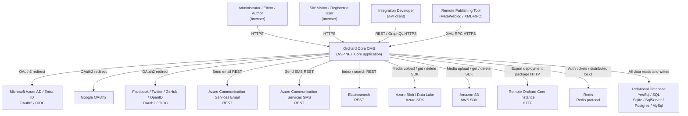

---

## Containers and components

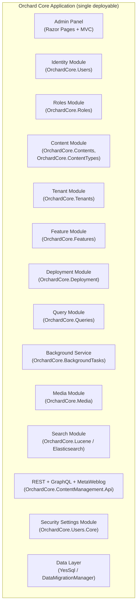

| Component | Responsibility | Entities | Endpoints |
|---|---|---|---|
| Admin Panel (Razor Pages + MVC) | Renders all admin screens; routes form posts to modules; enforces AccessAdminPanel permission | — (view layer only) | — (all UI interactions call module endpoints below) |
| Identity Module (OrchardCore.Users) | User registration, login, local/external auth, 2FA, password reset, lockout, self-service profile, timing-attack normalization | ENT-01 (User) | API-01 (Setup Site), API-02 (Login), API-03 (External Auth Initiate), API-04 (External Auth Callback), API-05 (Register User), API-06 (List Users), API-07 (Get User), API-08 (Create User Admin), API-09 (Update User Admin), API-10 (Disable User), API-11 (Enable User), API-12 (Delete User), API-13 (Send Password Reset Email), API-14 (Get Current User Profile), API-15 (Update Current User Profile) |
| Roles Module (OrchardCore.Roles) | Role CRUD, clone, permission full-replace, system-role protection, admin-role immutability, implied permissions, MissingFeaturesByRole retention | ENT-02 (Role), ENT-03 (RoleClaim) | API-16 (List Roles), API-17 (Get Role), API-18 (Create Role), API-19 (Update Role Permissions), API-20 (Clone Role), API-21 (Delete Role) |
| Content Module (OrchardCore.Contents / OrchardCore.ContentTypes) | Content item lifecycle (create, edit, publish, unpublish, clone, remove, restore, import), content type and field management, version pruning, audit trail, taxonomy | ENT-04 (ContentItem), ENT-05 (ContentTypeDefinition), ENT-06 (ContentPartFieldDefinition), ENT-14 (ContentVersionPruningSettings) | API-22 (List Content Items), API-23 (Get Content Item), API-24 (Create Content Item), API-25 (Save Draft), API-26 (Publish), API-27 (Unpublish), API-28 (Clone), API-29 (Remove), API-30 (Restore), API-31 (Discard Draft), API-32 (Import Content Items), API-33 (List Content Types), API-34 (Create Content Type), API-35 (Update Content Type), API-36 (List Content Part Fields), API-37 (Add Field), API-38 (Update Field Order), API-39 (Remove Field) |
| Tenant Module (OrchardCore.Tenants) | Tenant shell provisioning, AutoSetup middleware, per-tenant database isolation, interactive tenant creation and setup | ENT-07 (Tenant) | API-40 (List Tenants), API-41 (Get Tenant), API-42 (Create Tenant), API-43 (Update Tenant) |
| Feature Module (OrchardCore.Features) | Feature enable/disable with force flag, dependency resolution, notification | ENT-08 (Feature) | API-44 (List Features), API-45 (Enable Feature), API-46 (Disable Feature) |
| Deployment Module (OrchardCore.Deployment) | Deployment plan CRUD, step management, export to package, import from package, export to remote instance | ENT-09 (DeploymentPlan), ENT-10 (DeploymentStep) | API-47 (List Deployment Plans), API-48 (Create Deployment Plan), API-49 (Delete Deployment Plan), API-50 (Add Deployment Step), API-51 (Export Deployment Plan), API-52 (Import Deployment Package) |
| Query Module (OrchardCore.Queries) | Named query CRUD, Lucene/SQL/GraphQL query execution via QueryGlobalMethodProvider, query manager | ENT-11 (Query) | API-53 (List Queries) and Execute/Create/Delete Query endpoints (SCR-queries-admin; see Risks for remaining endpoint IDs) |
| Background Service (OrchardCore.BackgroundTasks) | Per-tenant polling loop, distributed task locking, event symmetry (ExecutingAsync / ExecutedAsync), PollingTime / MinimumIdleTime config | — | — (internal scheduler, no external endpoints) |
| Media Module (OrchardCore.Media) | File upload, retrieval, deletion via Azure Blob/Data Lake or Amazon S3 backend | — (files stored externally) | — (served through media middleware) |
| Search Module (OrchardCore.Lucene / Elasticsearch) | Index content on publish/update/remove, serve full-text search queries | — | — (invoked by Content Module on content lifecycle events) |
| REST + GraphQL + MetaWeblog API | External content CRUD via REST API (INT-09), GraphQL queries/mutations (INT-10), XML-RPC remote publishing (INT-12) | ENT-04 | (exposed via /api/content, /api/graphql, XML-RPC endpoint) |
| Security Settings Module | Security headers (CSP, Referrer-Policy, Permissions-Policy), registration settings, login settings, external provider toggles, background service config | ENT-12 (SecuritySettings) | — (managed through admin forms) |
| Data Layer (YesSql / DataMigrationManager) | All data persistence across Sqlite/SqlServer/Postgres/MySql; schema creation/migration; CancelAsync/SaveAsync atomicity | ENT-13 (DataMigrationRecord) | — (in-process library) |

---

## Technology stack

| Layer | Choice | Evidenced or inferred | Why |
|---|---|---|---|
| Runtime | .NET 6+ / C# | Evidenced [synthesis.md p.6, p.11] | Orchard Core is an ASP.NET Core application; primary language C# |
| Web framework | ASP.NET Core (Razor Pages + MVC + Minimal API) | Evidenced [synthesis.md p.11] | Modular architecture; self-contained modules with Razor views |
| CMS framework | Orchard Core CMS | Evidenced [synthesis.md p.5] | The product itself |
| Data persistence | YesSql (document/relational ORM) | Evidenced [synthesis.md p.12, business-process-requirements p.9] | Chosen ORM; supports Sqlite, SqlServer, PostgreSQL, MySQL |
| Identity / auth | ASP.NET Core Identity + external OAuth2/OIDC | Evidenced [.clarify/architect.json settled] | Local and external login; 2FA; lockout; UserService |
| External auth providers | Azure AD/Entra ID, Google, Facebook, Twitter/X, GitHub, OpenID Connect | Evidenced [synthesis.md p.88, prototype p.21] | Multiple SSO options required |
| Session/ticket store | Redis (distributed cache when Redis feature enabled) | Evidenced [nfrs.json NFR-06] | Multi-instance deployment support |
| API serialization | System.Text.Json with custom output formatters | Evidenced [nfrs.json NFR-08] | Correctness for YesSql documents and content entities |
| Search | Lucene (in-process, OrchardCore.Lucene) + Elasticsearch (external) | Evidenced [.clarify/architect.json settled] | In-process for default; Elasticsearch for scale |
| Email | Azure Communication Services Email | Evidenced [platform.json PLT-08, integrations.json INT-03] | Verification emails, password reset |
| SMS | Azure Communication Services SMS | Evidenced [platform.json PLT-08, integrations.json INT-04] | SMS notification events |
| Media storage | Azure Blob Storage / Azure Data Lake OR Amazon S3 | Evidenced [business-process-requirements p.27] | Cloud-backed media; pluggable backend |
| Remote deployment | HTTP to remote Orchard Core instance | Evidenced [integrations.json INT-11] | Deployment plan export to remote target |
| MetaWeblog | XML-RPC (OrchardCore.Lists) | Evidenced [integrations.json INT-12] | Remote publishing via MetaWeblog clients |
| Background tasks | ASP.NET Core hosted service with distributed locking | Evidenced [nfrs.json NFR-12, epics-and-user-stories p.49] | Per-tenant task coordination |
| Audit trail | AuditTrailPart (OrchardCore.AuditTrail) | Evidenced [nfrs.json NFR-09] | First-class change history |
| CI/CD | GitHub Actions | Evidenced [platform.json PLT-03] | Pipeline for build, test, deploy |
| Test framework | xUnit (unit/integration) + Playwright (browser, Chromium) | Evidenced [platform.json PLT-04, .clarify/architect.json settled] | Cross-platform unit tests; functional browser tests |
| Documentation | MkDocs Material theme | Evidenced [synthesis.md p.17, epics-and-user-stories p.62] | Docs site at src/docs |
| Cloud hosting | Microsoft Azure | Inferred (recommended, arch-1 not answered) | Tight Azure service integration (ACS email/SMS, Azure AD, Blob/Data Lake); single-cloud simplicity |
| App hosting | Azure App Service (or Azure Container Apps) | Inferred (simplest managed host for ASP.NET Core on Azure) | No custom Kubernetes requirement stated; managed host reduces ops overhead |
| Database (production) | Azure SQL (SqlServer) or Azure Database for PostgreSQL | Inferred (inferred: Azure-native managed databases align with hosting choice) | YesSql supports both; managed service removes ops burden |
| Secrets management | Azure Key Vault | Inferred (inferred: standard practice for Azure-hosted .NET applications) | Centralised secret rotation; no plaintext secrets in config |

---

## Development setup

| Container | Repository and folder | Run locally | Build and package | Lint and format |
|---|---|---|---|---|
| Orchard Core Application | Mono-repo root; source in `src/` with module projects under `src/OrchardCore.Modules/` and `src/OrchardCore.Cms.Web/` | `dotnet run --project src/OrchardCore.Cms.Web/OrchardCore.Cms.Web.csproj`; first run hits Site Setup at `/` | `dotnet build -c Release /WarnAsError`; ships as a container image (Dockerfile) or self-contained publish via `dotnet publish -c Release` | `dotnet format` (Roslyn analyzers run on build in release config; warnings as errors per NFR-14) |
| Documentation site | `src/docs/` with MkDocs Material theme in `src/docs/theme/` | `mkdocs serve` (Python; requires `pip install mkdocs-material`) | `mkdocs build` produces a static site under `site/`; deployed to Azure Static Web Apps or GitHub Pages | MkDocs validates warnings: omitted_files, absolute_links, unrecognized_links, anchors [epics-and-user-stories p.62] |

---

## Data architecture

### Storage

All application data (users, roles, content items, tenants, features, queries, deployment plans, security settings, migration records) is stored via **YesSql** on a relational database. Supported providers: Sqlite (development/test), SqlServer, PostgreSQL, MySQL [synthesis.md p.12]. In production on Azure, Azure SQL or Azure Database for PostgreSQL is recommended (inferred: Azure-native managed databases).

Media files (images, documents) are stored externally in **Azure Blob Storage / Data Lake** or **Amazon S3**, referenced by path in `ENT-04.featuredImagePath`. Authentication tickets and distributed background task locks are stored in **Redis** when the Redis feature is enabled [NFR-06].

Per-tenant isolation is achieved through distinct `databaseConnectionString`, `tablePrefix`, or `databaseSchema` [epics-and-user-stories p.42].

### Component entity ownership

| Component | Entities owned |
|---|---|
| Identity Module | ENT-01 (User) |
| Roles Module | ENT-02 (Role), ENT-03 (RoleClaim) |
| Content Module | ENT-04 (ContentItem), ENT-05 (ContentTypeDefinition), ENT-06 (ContentPartFieldDefinition), ENT-14 (ContentVersionPruningSettings) |
| Tenant Module | ENT-07 (Tenant) |
| Feature Module | ENT-08 (Feature) |
| Deployment Module | ENT-09 (DeploymentPlan), ENT-10 (DeploymentStep) |
| Query Module | ENT-11 (Query) |
| Security Settings Module | ENT-12 (SecuritySettings) |
| Data Layer | ENT-13 (DataMigrationRecord) |

### Schema creation and migration

DataMigrationManager [epics-and-user-stories p.44–46] manages all schema changes:

1. `GetDataMigrationRecordAsync` — load or create the `DataMigrationRecord` for the feature.
2. `current == 0` → run `Create()` method on the migration class.
3. `current > 0` → walk the upgrade lookup table (`UpdateFromN` methods; names begin with "UpdateFrom", return `int` or `Task<int>`).
4. Dependency-first ordering: feature dependencies are migrated before the requested feature.
5. On exception: `_session.CancelAsync()`; `finally` always calls `_session.SaveAsync(_dataMigrationRecord)` [NFR-11].

**Table creation order (parents before children):**

1. DataMigrationRecord (ENT-13) — base; no foreign keys
2. Tenant (ENT-07) — no FK
3. SecuritySettings (ENT-12) — no FK
4. Feature (ENT-08) — no FK
5. Role (ENT-02) — no FK
6. User (ENT-01) — no FK (roles via junction table)
7. user_roles (junction) — FK → ENT-01, ENT-02
8. RoleClaim (ENT-03) — FK → ENT-02
9. ContentTypeDefinition (ENT-05) — no FK
10. ContentPartFieldDefinition (ENT-06) — FK → ENT-05
11. ContentVersionPruningSettings (ENT-14) — FK → ENT-05
12. ContentItem (ENT-04) — FK → ENT-05, ENT-01
13. DeploymentPlan (ENT-09) — no FK
14. DeploymentStep (ENT-10) — FK → ENT-09
15. Query (ENT-11) — no FK

### Seed data

Applied via recipe on first run (DataMigrationManager `Create()`):

- **Administrator** account (username `admin`, email from setup form) with status Enabled.
- Default roles: Administrator (system, admin), Editor, Moderator, Author, Contributor, Anonymous (special), Authenticated (special) [synthesis.md p.21–26].
- Default security settings (AdminRoleName = "Administrator", Referrer-Policy = "no-referrer", PollingTime = 00:01:00, MinimumIdleTime = 00:00:10) [prototype p.21].
- Content types per recipe: BlogPost, Page, Article, Video, Testimonial, Event (for Blog recipe).

### Retention, backup, and recovery

- **Content version pruning:** governed by `ContentVersionPruningSettings` (RetentionDays ≥ 0, VersionsToKeep ≥ 0) per content type [NFR-10, NFR-22]. Operators must configure all content types to prevent unbounded growth.
- **Backups:** Daily automated backups of the YesSql database and `App_Data` directory. Azure SQL supports automated backups with point-in-time restore [NFR-23]. Target: RTO < 1 hour, RPO < 1 hour (inferred: recommended, arch-4 not answered).
- **App_Data:** Contains shell configuration, tenant registry, and Sqlite databases (dev). Included in backup scope.

---

## Key flows

### Flow 1: Site Setup → Login

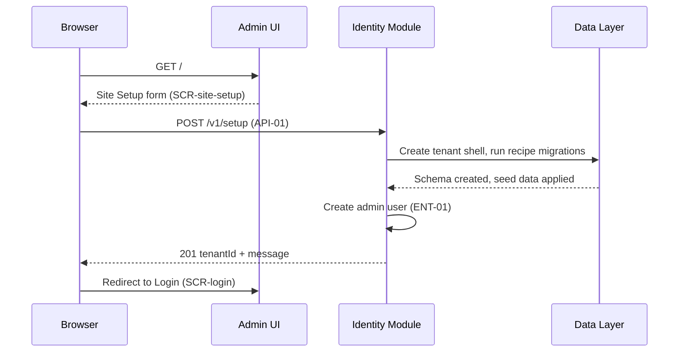

### Flow 2: Local Login → Admin Panel

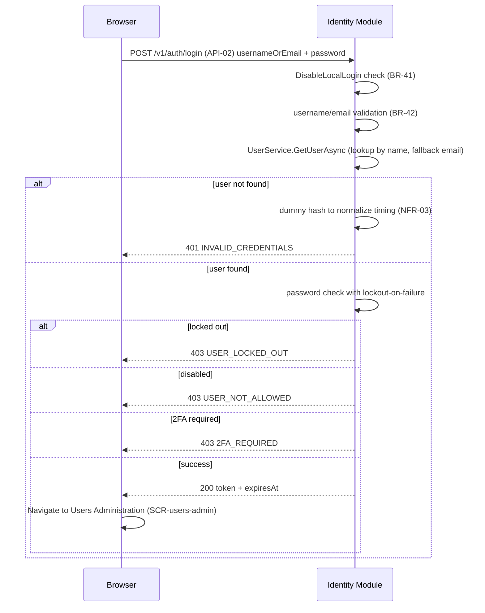

### Flow 3: External Authentication (Google / Microsoft)

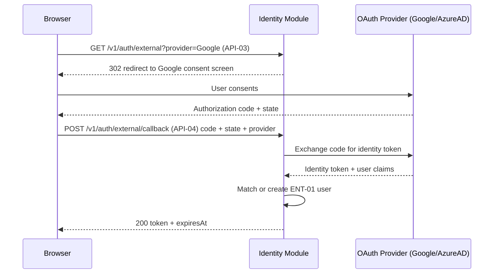

### Flow 4: User Registration

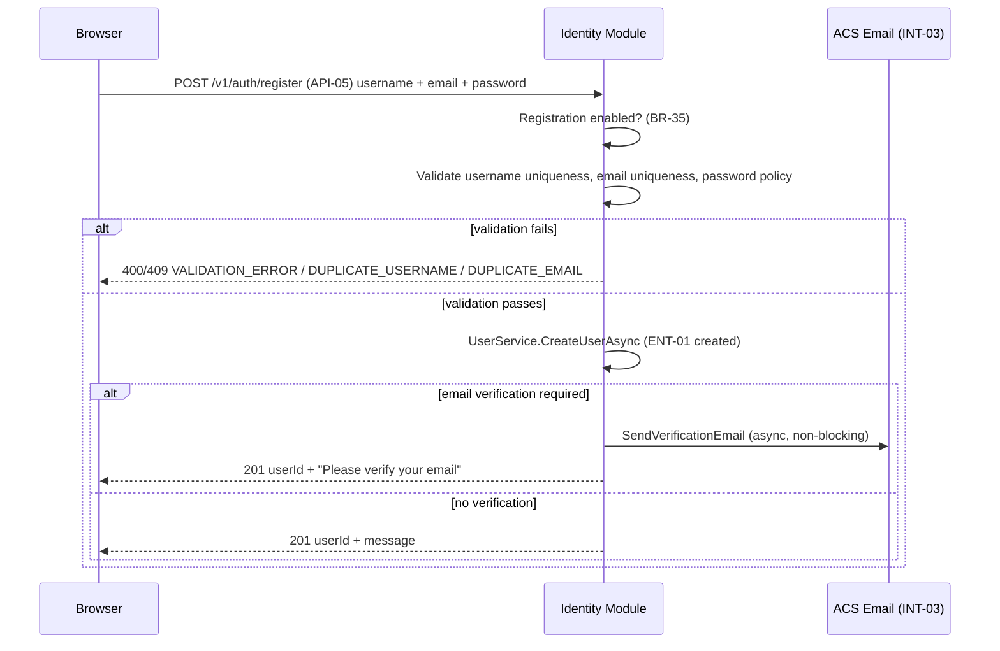

### Flow 5: Content Item Edit and Publish

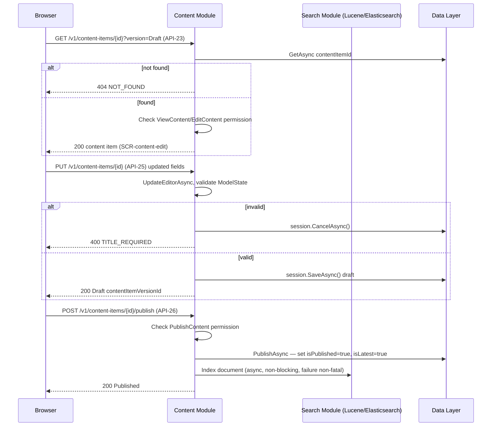

### Flow 6: Role Management

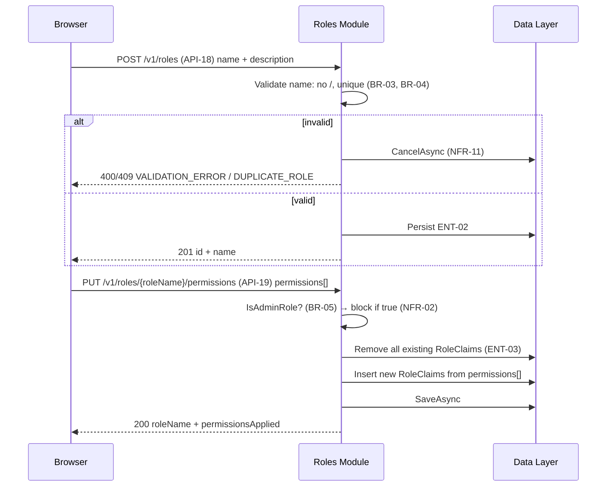

### Flow 7: Tenant Provisioning

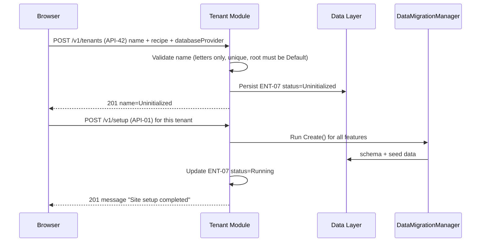

### Flow 8: Background Task Execution

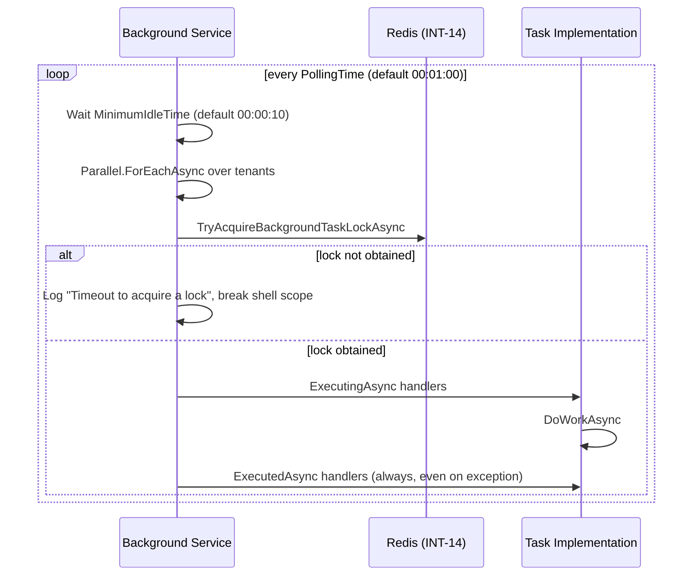

### Flow 9: Deployment Plan Export

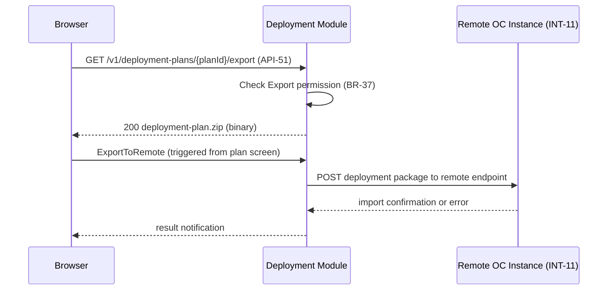

---

## Security

### Authentication

| Aspect | Detail | Reference |
|---|---|---|
| Sign-in methods | Local username/password via ASP.NET Core Identity `UserService.AuthenticateAsync`; external OAuth2/OIDC (Azure AD, Google, Facebook, Twitter/X, GitHub, OpenID Connect) | Evidenced [synthesis.md p.88, platform.json PLT-05] |
| Local login can be disabled | `DisableLocalLogin = true` in SecuritySettings forces external-only login | Evidenced [prototype p.21, business-process-requirements p.29] |
| Credential storage | Passwords stored as ASP.NET Core Identity password hashes (PBKDF2); never logged in plaintext | Evidenced [NFR-17] |
| Session/token | JWT Bearer token returned on login; lifetime from `expiresAt` in response. `rememberMe` flag extends persistence. Tickets stored in Redis (distributed cache) when Redis feature enabled for multi-instance support | Evidenced [NFR-06, API-02] |
| Lockout | `UserService.AuthenticateAsync` increments access-failed count on wrong password; lockout applied after configured threshold (ASP.NET Core Identity default: 5 failures, 5-minute lockout) | Evidenced [epics-and-user-stories p.12] |
| Timing normalization | When user not found: dummy hash verification executes to normalize response time before returning `INVALID_CREDENTIALS` | Evidenced [NFR-03] |
| Two-factor authentication | Optional 2FA; can be required globally or scoped to specific roles via SecuritySettings | Evidenced [business-process-requirements p.29] |
| External provider anti-CSRF | `state` token required in OAuth callback (API-04) | Evidenced [API-04 request body] |
| External auth rate limiting | `ExternalAuthenticationRateLimitsStartup.ConfigureServices` applies rate limits | Evidenced [NFR-04] |
| Confidential OAuth clients | Clients without a secret are rejected | Evidenced [epics-and-user-stories p.58] |

### Authorization

Role-based access control (RBAC) enforced by `RolesPermissionsHandler.HandleRequirementAsync` [synthesis.md p.559]:

1. Load roles via RoleManager.
2. `IPermissionGrantingService` checks granted permissions against the requirement.
3. Admin role: no claims checked; always has all permissions. Permissions cannot be modified [NFR-02].
4. Anonymous role: `IsAuthenticated = false` during effective-permission computation [epics-and-user-stories p.21].
5. Security-critical permission categories (Content Type Management, Role Management, User Management, Deployment, Workflows, Templates) flagged in the Edit Role UI [NFR-01].
6. System roles (Administrator, Anonymous, Authenticated) cannot be deleted [prototype p.5].
7. Last-enabled-admin guard: disabling the last enabled Administrator is blocked [API-10, BR-01].
8. `ViewRoles` implied by `ManageRoles` [epics-and-user-stories p.21].

### Data protection in transit and at rest

- All HTTP traffic over TLS (HTTPS); enforced by Azure App Service [inferred: standard practice].
- Passwords stored as PBKDF2 hashes via ASP.NET Core Identity [NFR-17].
- PII (email, phone number, username) not logged in plaintext [NFR-17].
- Database credentials and Azure/AWS service credentials stored in Azure Key Vault [inferred: standard practice].
- `Microsoft.AspNetCore.DataProtection` used for `RemoteClientService` credentials in deployment [integrations.json INT-11].
- Media files in Azure Blob or S3 with access controlled by Azure RBAC / S3 bucket policies [inferred].

### Secrets

All application secrets (database connection strings, Azure ACS keys, OAuth client secrets, Redis connection string, Elasticsearch credentials) stored in Azure Key Vault, injected at runtime via `IConfiguration`. No plaintext secrets in source code or appsettings.json in production [inferred: standard practice].

### OWASP Top 10

| Risk | Mitigation |
|---|---|
| A01 Broken Access Control | RBAC enforced on every admin route; Forbid on unauthorized; last-admin guard; system-role delete protection |
| A02 Cryptographic Failures | PBKDF2 password hashing; TLS in transit; Key Vault for secrets |
| A03 Injection | YesSql parameterized queries; input validation on all forms; SQL query admin gated by ManageQueries |
| A04 Insecure Design | Security-critical permission flagging; admin-role immutability; timing-attack normalization |
| A05 Security Misconfiguration | CSP/Referrer-Policy/Permissions-Policy configurable [NFR-05]; build warnings-as-errors [NFR-14] |
| A06 Vulnerable Components | Static analyzers on every build [NFR-14]; Renovate/Dependabot for dependency updates [inferred] |
| A07 Auth & Session | ASP.NET Core Identity; JWT; Redis ticket store; 2FA; lockout; rate limiting |
| A08 Software Integrity | Signed releases; GitHub Actions pipeline; warnings-as-errors; analyzer gates |
| A09 Logging & Monitoring | Structured logging; audit trail via AuditTrailPart; background task execution logs |
| A10 SSRF | Remote deployment validated via RemoteClientService + DataProtection; Import permission security-critical |

---

## Integration architecture

| Integration | Calling component | Sync/Async | Retry | Idempotency | Failure containment |
|---|---|---|---|---|---|
| INT-01: ASP.NET Core Identity / UserService | Identity Module | Synchronous (in-process) | N/A | CreateUserAsync validated; AuthenticateAsync stateless | `UserService.reportError`: null check, last-admin guard; `CancelAsync` on partial write |
| INT-02: External OAuth/OIDC Providers | Identity Module | Synchronous (redirect flow) | None; user retries via browser | State token per request; OAuth code one-time use | `DisableNewExternalRegistrations` blocks new accounts; rate limiting via `ExternalAuthenticationRateLimitsStartup` |
| INT-03: Azure Communication Services Email | Identity Module | Asynchronous (fire-and-forget) | None specified (inferred: Azure ACS SDK handles delivery retry) | Email links contain unique tokens | Email provider must be configured; if unconfigured, email verification feature cannot work |
| INT-04: Azure Communication Services SMS | Background/Workflow Module | Asynchronous | None specified | N/A | Gated by ManageSmsSettings permission |
| INT-05: Elasticsearch | Content Module | Asynchronous (index on content lifecycle events); Synchronous (query) | None specified | Index by document ID (idempotent) | Non-fatal; index errors caught and logged; search continues to work with stale index |
| INT-06: Lucene (in-process) | Content Module | Asynchronous (index); Synchronous (query) | N/A (in-process) | Index by document ID | Non-fatal; errors logged |
| INT-07: Azure Blob / Data Lake | Media Module | Synchronous | None specified | Blob operations idempotent by path | Non-fatal errors logged; ViewAzureMediaOptions permission gates config |
| INT-08: Amazon S3 | Media Module | Synchronous | None specified | S3 PutObject idempotent by key | Errors logged; ViewAmazonS3MediaOptions gates config |
| INT-09: Content REST API | REST+GraphQL Module | Synchronous (inbound) | N/A (caller retries) | VersionOptions (Published/Draft/DraftRequired) | Forbid on missing AccessContentApi; NotFound on missing item |
| INT-10: GraphQL API | REST+GraphQL Module | Synchronous (inbound) | N/A | N/A | ExecuteGraphQL/ExecuteGraphQLMutations permission gating |
| INT-11: Remote Deployment (HTTP) | Deployment Module | Synchronous (outbound HTTP POST) | None specified | Package import idempotent if content IDs match | Import permission security-critical; DataProtection for client credentials; failure returns error to operator |
| INT-12: MetaWeblog / XML-RPC | REST+GraphQL Module | Synchronous (inbound) | N/A | N/A | `XRpcFault(0, e.Message)` on exception; `CheckAccessAsync` gates all operations |
| INT-13: YesSql Data Persistence | Data Layer | Synchronous (in-process) | N/A | DataMigrationManager skips processed features | `CancelAsync` on exception; `SaveAsync` in finally always called [NFR-11] |
| INT-14: Redis Distributed Cache | Background Service + Identity Module | Synchronous (lock acquire/release) | None; if lock not obtained: log and break | N/A | `TryAcquireBackgroundTaskLockAsync` failure: log "Timeout to acquire a lock", terminate shell scope, break [NFR-12] |

---

## Deployment and environments

### Environments

| Environment | Purpose |
|---|---|
| Development | Local developer machine; Sqlite database; in-process Lucene; no Redis; LocalStack for S3; Azure emulator for Blob |
| Test / CI | GitHub Actions Ubuntu + Windows runners; xUnit tests; Playwright browser tests on Chromium; App_Data cleaned between runs |
| Staging | Azure App Service (Uninitialized tenant per prototype); Azure SQL; Redis; Elasticsearch optional |
| Production | Azure App Service (multi-instance); Azure SQL; Redis; Azure Blob/S3 for media; Elasticsearch |

### Where each container runs

| Container | Development | Staging | Production |
|---|---|---|---|
| Orchard Core Application | Local dotnet run | Azure App Service (single instance) | Azure App Service (2+ instances, load balanced) |
| Database | Sqlite (App_Data) | Azure SQL or Azure DB for PostgreSQL | Azure SQL / Azure DB for PostgreSQL |
| Redis | (not used) | Azure Cache for Redis | Azure Cache for Redis |
| Media storage | Local filesystem | Azure Blob Storage | Azure Blob Storage or Amazon S3 |
| Documentation site | mkdocs serve | Azure Static Web Apps | Azure Static Web Apps / GitHub Pages |

### CI/CD pipeline

Implemented in **GitHub Actions** [platform.json PLT-03]. Stages:

1. **Build** — `dotnet build -c Release /WarnAsError`; static analyzers run; documentation-only changes skip tests [NFR-14].
2. **Unit Tests** — `dotnet test` on Ubuntu and Windows agents; a failing test fails the pipeline [NFR-15]; macOS via manually triggered workflow.
3. **Browser Tests** — Playwright on Chromium; artefacts (logs, traces) uploaded on failure [platform.json PLT-04].
4. **Migration Test** — DataMigrationManager Create/UpdateFrom round-trips on a test database.
5. **Publish** — `dotnet publish -c Release`; Docker image built and pushed to Azure Container Registry (inferred).
6. **Deploy Staging** — `az webapp deploy` or rolling update to staging slot.
7. **Smoke Test** — health check on staging.
8. **Deploy Production** — swap staging → production slot (zero-downtime) or rolling update.

### Infrastructure as code

Azure resources provisioned via Bicep or Terraform (inferred: standard practice; no explicit tool named in evidence). Secrets injected via Azure Key Vault references in App Service configuration.

### Schema migrations on deploy

1. Application starts; `DataMigrationManager.UpdateAllFeaturesAsync()` runs on startup for each enabled feature.
2. `GetFeaturesThatNeedUpdateAsync` compares stored version vs. current; runs `UpdateFromN` methods in order.
3. Non-fatal per-feature exceptions are caught, logged, and pipeline continues [epics-and-user-stories p.44].

### Rollback

- **Application:** swap production slot back to previous deployment slot (Azure App Service slot swap).
- **Database:** point-in-time restore from Azure SQL automated backup (RPO < 1 hour). Schema migration rollback requires manual `UpdateFrom` reverse scripts if breaking changes introduced.

---

## Observability

### Logs

Structured logging via ASP.NET Core `ILogger` (Serilog or Application Insights sink, inferred). Events captured:

- Authentication: sign-in success/failure, lockout, 2FA challenges.
- Background tasks: lock acquire/timeout, task start/end, exceptions [NFR-12, epics-and-user-stories p.49].
- Migration: feature migration start, version changes, exceptions.
- Deployment: plan export, remote import, errors.
- Content lifecycle: create, publish, unpublish, remove events (feed to audit trail).

### Metrics

- Request rate, response time, error rate per endpoint [NFR-18].
- Background task execution duration and frequency per tenant.
- Authentication failure rate.

### Traces

- Distributed tracing via ASP.NET Core Activity/OpenTelemetry (inferred: standard practice).
- Playwright browser test traces uploaded on failure [platform.json PLT-04].

### Alerts

- Pipeline test failures notify CI channel.
- Background task lock timeout rate spikes → alert.
- 5xx error rate exceeds threshold → alert.
- Authentication failure rate spike → alert.

---

## Scalability and performance

Against NFR-18 (admin panel pages < 2 seconds) and NFR-19 (multi-instance):

| Concern | Approach |
|---|---|
| Horizontal scale | Multiple App Service instances behind Azure Load Balancer; Redis distributed cache for session tickets [NFR-06] |
| Per-tenant isolation | Each tenant has its own database, table prefix, or schema; shell scope is per-tenant |
| Background task coordination | Distributed locking via Redis prevents duplicate task execution across instances [NFR-12] |
| Content search | Lucene in-process for single-instance; Elasticsearch for multi-instance or large-volume search [INT-05, INT-06] |
| Database | Azure SQL Auto-scaling or read replicas for query-heavy workloads (inferred) |
| Media CDN | Azure CDN in front of Blob Storage for media delivery (inferred: reduces origin load) |
| Response time | YesSql indexed queries on contentType, status, author, modifiedDate, isLatest/isPublished [entities.json ENT-04 indexes]; Lucene full-text for content list search |
| Target scale | Medium: 1000–10000 users, 10–100 concurrent [arch-2 inferred: recommended] |

---

## Error handling and resilience

| Scenario | Handling |
|---|---|
| YesSql write failure | `ISession.CancelAsync()` to roll back partial write; `SaveAsync()` in finally [NFR-11] |
| Migration exception | Non-fatal per-feature; exception caught, logged, migration continues for other features |
| Background task lock timeout | Log "Timeout to acquire a lock", terminate shell scope, break [NFR-12] |
| Background task exception | `scope.HandleExceptionAsync(ex)` invoked; `ExecutedAsync` handlers always run (event symmetry) [epics-and-user-stories p.49-50] |
| External auth provider failure | Error returned to user on callback; `DisableNewExternalRegistrations` prevents new account creation |
| Email send failure | Non-blocking async; failure logged; user informed to retry if email verification is pending |
| Elasticsearch index failure | Non-fatal; errors logged; search may return stale results until next index cycle |
| Remote deployment failure | Error returned to operator; Import permission security-critical; DataProtection for client secret integrity |
| Query null check | `QueryGlobalMethodProvider`: if `query == null`, execution stops without error propagation [business-process-requirements p.33] |
| Content not found | `GetAsync` returns null → 404 NOT_FOUND |
| Unauthorized | Forbid → 403 FORBIDDEN; unauthenticated → 401 UNAUTHORIZED |
| Last admin guard | Disabling last enabled Administrator blocked with 422 LAST_ADMIN_GUARD [API-10] |
| System role delete | Blocked with 422 SYSTEM_ROLE [API-21] |

---

## Cross-cutting concerns

### Internationalisation

- Site time zone configurable at setup (IANA time zone per tenant) and per user profile (ENT-01.timeZone).
- Content `publicationDate` stored as date; rendered in the requesting user's time zone.
- No multi-language UI localisation stated; inferred as not required in scope.

### Accessibility

All screens must meet **WCAG 2.1 Level AA** [NFR-20]:

- Form fields labelled (`<label for>` or `aria-label`).
- Error messages screen-reader accessible (ARIA live regions or focus management).
- Focus management required for slide-in forms (users-admin--create-form) and confirm-delete modals.
- Admin panel supports latest two versions of Chrome, Firefox, Edge, Safari on desktop; login/register usable on mobile browsers [NFR-21].

### Audit trail

`AuditTrailPart` attaches change history to content items as a first-class concern [NFR-09]. Audit signals fired on content create/update/delete operations. Entities with `audit: true`: ENT-01 (User), ENT-02 (Role), ENT-04 (ContentItem).

### Configuration

- Per-tenant configuration via recipe (Blog, Headless, Agency, Blank).
- SecuritySettings (ENT-12) persisted to YesSql; admin-editable via Security Settings screen.
- `appsettings.json` for environment-level overrides; secrets injected from Azure Key Vault.
- Background service timing via SecuritySettings: PollingTime (default 00:01:00), MinimumIdleTime (default 00:00:10) [prototype p.21].

### Module structure

Every module requires: `Manifest.cs`, `Startup.cs`, `OrchardCore.YourModule.csproj`. Optional: `Migrations.cs`, `PermissionProvider.cs`, `AdminMenu.cs`, `Controllers/`, `Drivers/`, `Handlers/`, `Services/`, `Views/` [epics-and-user-stories p.31].

---

## Test strategy

| Layer | Tool | Pipeline stage | Test data source |
|---|---|---|---|
| Unit | xUnit (.NET) | Build → Unit Tests (Ubuntu + Windows) [NFR-15] | In-memory mocks; no external dependencies |
| API contract | xUnit + HttpClient against in-process test host | Unit Tests stage | Seeded in-memory YesSql (Sqlite) |
| Integration | xUnit + test containers | CI (separate workflow) | LocalStack for S3; Azure Blob emulator; test Sqlite DB |
| End-to-end / browser | Playwright (Chromium) [platform.json PLT-04] | Browser Tests stage | Live test App Service or local server; App_Data cleaned between runs |
| Performance | k6 or Azure Load Testing (inferred) | Pre-production / on-demand | Staging environment with production-like data |
| Security | OWASP ZAP or Snyk (inferred); static analyzers on build | Build stage (static); security scan stage (dynamic) | Staging environment |
| Documentation | MkDocs validation warnings (omitted_files, absolute_links, unrecognized_links, anchors) [epics-and-user-stories p.62] | Build stage | Markdown source in `src/docs/` |

Gherkin scenarios from epics-and-user-stories drive Playwright end-to-end tests (admin sign-in and navigation flow [epics-and-user-stories p.58]; content editing; role management; tenant provisioning; feature enablement).

---

## NFR traceability

| NFR | How the architecture meets it |
|---|---|
| NFR-01: Security-critical permission flagging | Role Module Edit Role UI flags security-critical categories (Content Type Mgmt, Role Mgmt, User Mgmt, Deployment, Workflows, Templates); displayed prominently on SCR-role-edit |
| NFR-02: Admin role permission immutability | API-19 returns 403 ADMIN_ROLE_IMMUTABLE when roleName is the admin role; no claims added or removed for admin role |
| NFR-03: Timing-attack normalization on login | Identity Module executes dummy hash verification when user not found before returning INVALID_CREDENTIALS; normalizes response time to prevent username enumeration |
| NFR-04: External authentication rate limiting | `ExternalAuthenticationRateLimitsStartup.ConfigureServices` applied in Identity Module startup |
| NFR-05: Security headers configurability | SecuritySettings (ENT-12) stores CSP, Referrer-Policy (default: no-referrer), Permissions-Policy; applied as HTTP response headers from Security Settings Module |
| NFR-06: Multi-instance auth ticket storage | Redis distributed cache enabled via Redis feature; authentication tickets stored in Redis; enables horizontal scale |
| NFR-07: System-type content parts structural integrity | `IContentDefinitionHandler` prevents system-type parts from being removed or modified via UI or recipes |
| NFR-08: API serialization correctness | System.Text.Json with custom output formatters for YesSql documents and content entities; used by REST and GraphQL modules |
| NFR-09: Audit trail | AuditTrailPart attached to content items; signals fired on create/update/delete; stored in YesSql |
| NFR-10: Content version pruning safety | ContentVersionPruningSettings (ENT-14) per content type; when no type selected nothing is pruned; operators must configure all types |
| NFR-11: Failed operation atomicity | `ISession.CancelAsync()` called on exception for role, migration, and data operations; `SaveAsync` in finally |
| NFR-12: Background task distributed locking | `TryAcquireBackgroundTaskLockAsync` via Redis; on failure logs "Timeout to acquire a lock" and breaks shell scope |
| NFR-13: MissingFeaturesByRole permission preservation | Roles Module retains `MissingFeaturesByRole` map; permissions for absent features preserved across enable/disable cycles |
| NFR-14: CI build quality gates | GitHub Actions: release configuration, warnings-as-errors, static analyzers, documentation-only changes skip tests |
| NFR-15: Cross-platform unit testing | xUnit on Ubuntu and Windows agents on every CI push; macOS manually triggered; failing test fails pipeline |
| NFR-16: Authentication and authorization | All admin routes require authenticated session; Forbid on insufficient permissions; 401 redirect to Login; input validation on all form submissions |
| NFR-17: Privacy of personal data | Passwords stored as PBKDF2 hashes; PII not logged in plaintext; Azure Key Vault for secrets |
| NFR-18: Page response performance | Admin pages target < 2 seconds; YesSql indexed queries (contentType, status, author, modifiedDate, isLatest/isPublished); Lucene in-process search |
| NFR-19: Availability | Multi-instance on Azure App Service; Redis distributed cache for tickets; per-tenant background task locking; target 99.9% SLA |
| NFR-20: Accessibility WCAG 2.1 AA | Form labels, ARIA live regions, focus management for slide-in forms and modals |
| NFR-21: Browser and device support | Latest 2 versions Chrome, Firefox, Edge, Safari on desktop; login/register usable on mobile browsers |
| NFR-22: Data retention | ContentVersionPruningSettings per content type; operators must configure RetentionDays and VersionsToKeep |
| NFR-23: Backup and recovery | Azure SQL automated daily backups with point-in-time restore; App_Data directory backup; RTO < 1 hour, RPO < 1 hour |
| NFR-24: Observability — logging and monitoring | Structured logging via ASP.NET Core ILogger; auth events, background task execution, migration errors, deployment operations logged; Playwright test artefacts uploaded on failure |

---

## Decisions

| Decision | Context | Choice | Alternatives | Consequence |
|---|---|---|---|---|
| Cloud hosting | Tight Azure service dependencies; no residency constraint stated | Microsoft Azure | AWS, GCP, on-premises | Azure App Service, Azure SQL, Azure Cache for Redis, Azure Blob, ACS Email/SMS — single cloud simplifies ops and credential management |
| Hosting model | ASP.NET Core application; multi-tenant | Azure App Service (PaaS) | Azure Container Apps, AKS, on-premises VMs | Managed TLS, slot swap, auto-scaling; no Kubernetes complexity until load demands it |
| Database in production | YesSql supports multiple backends | Azure SQL (SqlServer) or Azure DB for PostgreSQL | Sqlite (dev only), self-hosted MySQL | Managed backups, point-in-time restore, scaling without ops overhead |
| Target scale | No user volume stated | Medium: 1000–10000 users, 10–100 concurrent | Small, Large, Enterprise | Two App Service instances + Redis; horizontal scale available on demand |
| SLA | No SLA stated | 99.9% (3 nines) | 99%, 99.95%, 99.99% | Achievable with multi-instance + health monitoring; cost-proportionate |
| Disaster recovery | No RTO/RPO stated | RTO < 1 hour, RPO < 1 hour | RTO < 4 hours, RTO < 15 min | Azure SQL point-in-time restore; slot swap; reasonable for multi-tenant CMS |
| Redis usage | Multi-instance requires shared ticket store | Redis for auth tickets and distributed locks | In-memory (single-instance only) | Enables horizontal scale; required for background task locking |
| Secrets management | Cloud-hosted application | Azure Key Vault | Environment variables, appsettings secrets | Centralised rotation; no plaintext in config or source |

---

## Risks and open questions

| Risk / Gap | Severity | Mitigation / Action |
|---|---|---|
| `API-54` (Execute Query), `API-55` (Create Query), `API-56` (Delete Query) are referenced in solution.md (ENT-11 / SCR-queries-admin) but not fully enumerated in endpoints.json; endpoint file ends at API-53 in the portion read — remainder may exist | Medium | Read remainder of endpoints.json; ensure all Query endpoints are in the components table |
| Content version pruning unconfigured: if no content type is configured for pruning, content versions grow unboundedly [NFR-10] | High | Operators must configure ContentVersionPruningSettings for every content type after deployment; monitoring alert on database size growth |
| Email service required for email verification: if Azure ACS Email is not configured, email verification feature cannot work [INT-03] | Medium | Email provider configuration must be validated in deployment checklist; registration can proceed without verification if feature disabled |
| Incomplete user story rows for epics 4, 5, 6, 7, 9, 10 [clarify/answers.json gap-43 through gap-48] | Low | Stories to be filled in for backlog clarity; architecture is not blocked |
| Schema migration rollback: no automatic rollback for schema-level migrations; only point-in-time database restore available | Medium | Enforce backward-compatible schema changes (additive only); maintain rollback scripts for breaking changes |
| AutoSetup re-run: if App_Data is not deleted, AutoSetup does not re-trigger [epics-and-user-stories p.38] | Low | Document: to re-run AutoSetup, delete App_Data; add to runbook |
| MkDocs `not_in_nav` entries (samples/, releases/4.0.0.md, llms.txt) will produce validation warnings on doc build [epics-and-user-stories p.62] | Low | Suppress or add to nav; does not block deployment |
| External provider consent screen not wired in prototype [prototype p.2] — confirmed as redirect to OAuth provider [clarify/answers.json gap-2, gap-3] | Resolved | Architecture implements API-03 + API-04 redirect flows |
