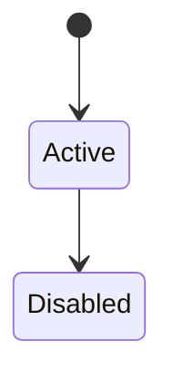
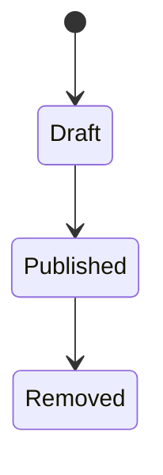
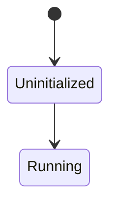
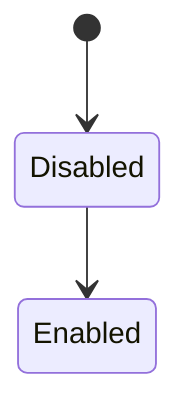
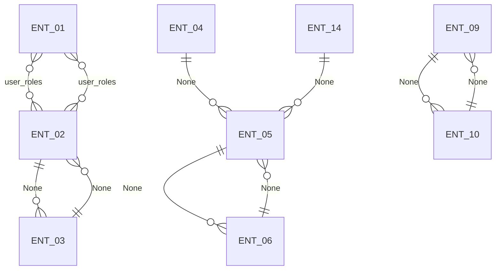

# Data Model

## ENT-01 User

| Attribute | Type | Key | Required | Unique | Default | Enum or validation | Example |
|---|---|---|---|---|---|---|---|
| id | string | pk | yes | yes |  |  | None |
| username | string |  | yes | yes |  | unique; must not contain invalid characters | johndoe |
| email | string |  | yes | yes |  | unique when configured; must be valid email format | john@example.com |
| phoneNumber | string |  | no | no |  |  | None |
| passwordHash | string |  | no | no |  | optional — account can be passwordless | None |
| status | string |  | yes | no | Enabled | Enabled, Disabled | Enabled |
| timeZone | string |  | no | no |  |  | UTC |
| lastLoginAt | datetime |  | no | no |  |  | 2026-08-15T10:00:00Z |

Relationships:
- n-n ENT-02 via user_roles

Indexes:
- username
- email
- status

## ENT-02 Role

| Attribute | Type | Key | Required | Unique | Default | Enum or validation | Example |
|---|---|---|---|---|---|---|---|
| id | string | pk | yes | yes |  |  | None |
| name | string |  | yes | yes |  | unique; must not contain / | Editor |
| description | string |  | no | no |  |  | Can edit and publish content |
| isSystemRole | boolean |  | yes | no | false |  | false |
| isAdminRole | boolean |  | yes | no | false |  | false |
| isSpecial | boolean |  | yes | no | false |  | false |

Relationships:
- n-n ENT-01 via user_roles
- 1-n ENT-03 via None

Indexes:
- name

## ENT-03 RoleClaim

| Attribute | Type | Key | Required | Unique | Default | Enum or validation | Example |
|---|---|---|---|---|---|---|---|
| id | integer | pk | yes | yes |  |  | None |
| roleId | string | fk | yes | no |  |  | None |
| claimType | string |  | yes | no |  | must be permission claim type | Permission |
| claimValue | string |  | yes | no |  |  | View Content |

Relationships:
- 1-n ENT-02 via None

Indexes:
- roleId
- claimValue

## ENT-04 ContentItem

| Attribute | Type | Key | Required | Unique | Default | Enum or validation | Example |
|---|---|---|---|---|---|---|---|
| contentItemId | string | pk | yes | yes |  |  | None |
| contentItemVersionId | string |  | yes | yes |  |  | None |
| contentType | string | fk | yes | no |  |  | BlogPost |
| title | string |  | yes | no |  | required; not empty | My First Blog Post |
| bodyText | string |  | no | no |  |  | None |
| priorityLevel | integer |  | no | no |  | min=1; max=10 | 5 |
| featured | boolean |  | no | no |  |  | None |
| publicationDate | date |  | no | no |  |  | 2025-08-15 |
| relatedLink | url |  | no | no |  |  | None |
| customHtml | string |  | no | no |  |  | 
Formatted content
 |
| tags | string[] |  | no | no |  | leaf terms only | Technology, Web Development |
| notes | string |  | no | no |  |  | None |
| featuredImagePath | string |  | no | no |  |  | article-cover.jpg 1200×630 |
| author | string | fk | no | no |  |  | admin |
| status | string |  | yes | no | Draft | Published, Draft, Removed | Published |
| modifiedDate | datetime |  | yes | no |  |  | 2026-08-01 |
| isLatest | boolean |  | yes | no |  |  | None |
| isPublished | boolean |  | yes | no |  |  | None |

Relationships:
- 1-n ENT-05 via None

Indexes:
- contentType
- status
- author
- modifiedDate
- isLatest, isPublished

## ENT-05 ContentTypeDefinition

| Attribute | Type | Key | Required | Unique | Default | Enum or validation | Example |
|---|---|---|---|---|---|---|---|
| id | string | pk | yes | yes |  |  | None |
| displayName | string |  | yes | no |  | not null/empty; max 1024 characters | Blog Post |
| name | string |  | yes | yes |  | must start with ASCII letter; normalized via ToSafeName(); unique | BlogPost |
| creatable | boolean |  | no | no |  |  | None |
| listable | boolean |  | no | no |  |  | None |
| draftable | boolean |  | no | no |  |  | None |
| versionable | boolean |  | no | no |  |  | None |
| securable | boolean |  | no | no |  |  | None |
| settings | json |  | no | no |  |  | None |

Relationships:
- 1-n ENT-06 via None

Indexes:
- name

## ENT-06 ContentPartFieldDefinition

| Attribute | Type | Key | Required | Unique | Default | Enum or validation | Example |
|---|---|---|---|---|---|---|---|
| id | string | pk | yes | yes |  |  | None |
| contentTypeId | string | fk | yes | no |  |  | None |
| fieldName | string |  | yes | no |  |  | Title |
| fieldType | string |  | yes | no |  | TextField, DateField, CustomBooleanField, ContentPicker, Numeric, Boolean, Date, Link, Html, Markdown, Media | TextField |
| position | integer |  | no | no | 0 | 0-based integer | 0 |
| isSystemDefined | boolean |  | no | no | false |  | None |
| settings | json |  | no | no |  |  | None |

Relationships:
- 1-n ENT-05 via None

Indexes:
- contentTypeId

## ENT-07 Tenant

| Attribute | Type | Key | Required | Unique | Default | Enum or validation | Example |
|---|---|---|---|---|---|---|---|
| id | string | pk | yes | yes |  |  | None |
| name | string |  | yes | yes |  | letters only, no spaces; unique; root tenant must be Default | Default |
| description | string |  | no | no |  |  | Main site |
| requestUrlPrefix | string |  | no | no |  |  | blog |
| recipeName | string |  | yes | no |  | Blog, Headless, Agency, Blank | Blog |
| databaseProvider | string |  | yes | no | Sqlite | Sqlite, SqlConnection, Postgres, MySql | Sqlite |
| databaseConnectionString | string |  | no | no |  | required for non-Sqlite providers | None |
| tablePrefix | string |  | no | no |  |  | None |
| databaseSchema | string |  | no | no |  |  | None |
| featureProfile | string |  | no | no |  |  | None |
| status | string |  | yes | no | Uninitialized | Running, Uninitialized | Running |

Indexes:
- name
- status

## ENT-08 Feature

| Attribute | Type | Key | Required | Unique | Default | Enum or validation | Example |
|---|---|---|---|---|---|---|---|
| id | string | pk | yes | yes |  |  | OrchardCore.Features |
| featureName | string |  | yes | no |  |  | Features |
| module | string |  | yes | no |  |  | OrchardCore.Features |
| category | string |  | yes | no |  | Infrastructure, Content Management | Infrastructure |
| isEnabled | boolean |  | yes | no | false |  | true |
| isAlwaysEnabled | boolean |  | no | no | false |  | None |
| needsUpdate | boolean |  | no | no | false |  | None |
| needsVersionUpdate | boolean |  | no | no | false |  | None |
| isRecentlyInstalled | boolean |  | no | no | false |  | None |
| enabledByDependencyOnly | boolean |  | no | no | false |  | None |
| dependencies | string[] |  | no | no |  |  | OrchardCore.Features |

Indexes:
- category
- isEnabled

## ENT-09 DeploymentPlan

| Attribute | Type | Key | Required | Unique | Default | Enum or validation | Example |
|---|---|---|---|---|---|---|---|
| id | string | pk | yes | yes |  |  | None |
| planName | string |  | yes | no |  |  | Production Roles Sync |
| description | string |  | no | no |  |  | None |

Relationships:
- 1-n ENT-10 via None

Indexes:
- planName

## ENT-10 DeploymentStep

| Attribute | Type | Key | Required | Unique | Default | Enum or validation | Example |
|---|---|---|---|---|---|---|---|
| id | string | pk | yes | yes |  |  | None |
| planId | string | fk | yes | no |  |  | None |
| stepType | string |  | yes | no |  | ContentDefinitionDeploymentStep, DeleteContentDefinitionDeploymentStep, ContentItemDeploymentStep, AllContentDeploymentStep, QueryBasedContentDeploymentStep, AllQueriesDeploymentStep, ExportContentToDeploymentTargetDeploymentStep, AllRolesDeploymentStep | AllRolesDeploymentStep |
| configuration | json |  | no | no |  |  | None |
| position | integer |  | no | no |  |  | None |

Relationships:
- 1-n ENT-09 via None

Indexes:
- planId

## ENT-11 Query

| Attribute | Type | Key | Required | Unique | Default | Enum or validation | Example |
|---|---|---|---|---|---|---|---|
| id | string | pk | yes | yes |  |  | None |
| queryName | string |  | yes | yes |  |  | RecentBlogPosts |
| queryType | string |  | yes | no |  | Lucene, SQL, GraphQL | Lucene |
| parameters | json |  | no | no |  |  | { "limit": 10 } |

Indexes:
- queryName

## ENT-12 SecuritySettings

| Attribute | Type | Key | Required | Unique | Default | Enum or validation | Example |
|---|---|---|---|---|---|---|---|
| id | string | pk | yes | yes |  |  | None |
| adminRoleName | string |  | no | no | Administrator |  | Administrator |
| enableSelfServiceRegistration | boolean |  | no | no | false |  | None |
| requireEmailVerification | boolean |  | no | no | false |  | None |
| requireAdministratorApproval | boolean |  | no | no | false |  | None |
| renderRegistrationWithSiteTheme | boolean |  | no | no | false |  | None |
| disableNewExternalRegistrations | boolean |  | no | no | false |  | None |
| disableLocalLogin | boolean |  | no | no | false |  | None |
| requireTwoFactorAuthentication | boolean |  | no | no | false |  | None |
| contentSecurityPolicy | string |  | no | no |  |  | None |
| referrerPolicy | string |  | no | no | no-referrer | no-referrer, no-referrer-when-downgrade, same-origin, origin, strict-origin, origin-when-cross-origin, strict-origin-when-cross-origin, unsafe-url | None |
| permissionsPolicy | string |  | no | no |  |  | None |
| backgroundServicePollingTime | string |  | no | no | 00:01:00 |  | 00:01:00 |
| backgroundServiceMinimumIdleTime | string |  | no | no | 00:00:10 |  | 00:00:10 |

## ENT-13 DataMigrationRecord

| Attribute | Type | Key | Required | Unique | Default | Enum or validation | Example |
|---|---|---|---|---|---|---|---|
| id | string | pk | yes | yes |  |  | None |
| featureId | string |  | yes | yes |  |  | None |
| version | integer |  | yes | no | 0 |  | None |

Indexes:
- featureId

## ENT-14 ContentVersionPruningSettings

| Attribute | Type | Key | Required | Unique | Default | Enum or validation | Example |
|---|---|---|---|---|---|---|---|
| id | string | pk | yes | yes |  |  | None |
| contentType | string | fk | no | no |  |  | BlogPost |
| retentionDays | integer |  | no | no |  | minimum 0 | None |
| versionsToKeep | integer |  | no | no |  | minimum 0 | None |

Relationships:
- 1-n ENT-05 via None

Indexes:
- contentType

## Reference data

- User.status: Enabled, Disabled
- ContentItem.status: Published, Draft, Removed
- ContentPartFieldDefinition.fieldType: TextField, DateField, CustomBooleanField, ContentPicker, Numeric, Boolean, Date, Link, Html, Markdown, Media
- Tenant.recipeName: Blog, Headless, Agency, Blank
- Tenant.databaseProvider: Sqlite, SqlConnection, Postgres, MySql
- Tenant.status: Running, Uninitialized
- Feature.category: Infrastructure, Content Management
- DeploymentStep.stepType: ContentDefinitionDeploymentStep, DeleteContentDefinitionDeploymentStep, ContentItemDeploymentStep, AllContentDeploymentStep, QueryBasedContentDeploymentStep, AllQueriesDeploymentStep, ExportContentToDeploymentTargetDeploymentStep, AllRolesDeploymentStep
- Query.queryType: Lucene, SQL, GraphQL
- SecuritySettings.referrerPolicy: no-referrer, no-referrer-when-downgrade, same-origin, origin, strict-origin, origin-when-cross-origin, strict-origin-when-cross-origin, unsafe-url

