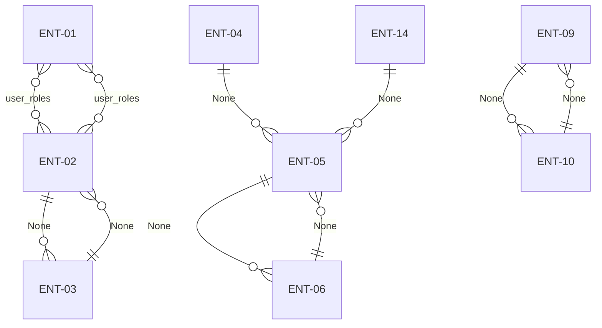

# Orchard Core CMS

## Overview

- Product: Orchard Core CMS
- Mode: final
- Shape: feature-epic-story
- Stories: 281
- Coverage items: 285

Personas:
- **PER-01** Administrator — Manage users, roles, tenants, features, content types, deployment plans, security settings, and the full system configuration.
- **PER-02** Editor — Edit and publish content items across the CMS.
- **PER-03** Moderator — Moderate user-generated content and manage community contributions.
- **PER-04** Author — Create and edit content items for publication.
- **PER-05** Contributor — Create content drafts that can be reviewed and published by others.
- **PER-06** Registered User / Site Visitor — Register, log in, manage personal profile, and view published content.
- **PER-07** Integration Developer — Consume the REST, GraphQL, and MetaWeblog/XML-RPC APIs to build integrations and headless applications.

Hierarchy:
- FEAT-01 Security
  - EPIC-02 User Management & Identity
    - US-02a-01 Sign in with local credentials
    - US-02a-02 Login form validation and error messages
    - US-02a-03 Local login disabled blocks sign-in
    - US-02a-04 Denied sign-in for disabled, locked, or 2FA-required accounts
    - US-02b-01 Sign up for a new user account
    - US-02b-02 Email verification required before first login
    - US-02b-03 Registration input validation and duplicate rejection
    - US-02b-04 Block self-service registration when the feature is disabled
    - US-02c-01 Browse and search the users administration list
    - US-02c-02 Create a new user account from the admin panel
    - US-02c-03 Retrieve a user account by ID
    - US-02c-04 Retrieve the current user's own profile
    - US-02d-01 Update User Account (Admin)
    - US-02d-02 Disable User Account
    - US-02d-03 Enable User Account
    - US-02d-04 Delete User Account
    - US-02d-05 Send Password Reset Email to User
    - US-02e-01 View and update user profile
    - US-02e-02 Profile update validation and error handling
  - EPIC-03 Roles & Access Control
    - US-03a-01 Browse Roles List
    - US-03a-02 View Role Details
    - US-03a-03 Block System Role Deletion
    - US-03b-01 Create Role
    - US-03b-02 Clone Role
    - US-03c-01 Edit Role Permissions
    - US-03c-02 Delete a Role
    - US-03c-03 Manage Security Settings
- FEAT-02 Content
  - EPIC-04 Content Management
    - US-04a-01 Browse and filter the content admin list
    - US-04a-02 Publish a content item from the admin list
    - US-04a-03 Unpublish a content item from the admin list
    - US-04a-04 Remove and restore content items
    - US-04a-05 Clone a content item from the admin list
    - US-04a-06 Import content items
    - US-04a-07 Bulk select and add content items to a deployment plan
    - US-04a-08 Enforce content permission scopes on the admin list
    - US-04b-01 Load Existing Content Item into Editor
    - US-04b-02 Create New Content Item as Draft
    - US-04b-03 Save Content Item Changes as New Draft Version
    - US-04c-01 Publish a Content Item
    - US-04c-02 Unpublish a Content Item
    - US-04c-03 Clone a Content Item
    - US-04c-04 Remove a Content Item
    - US-04c-05 Restore a Removed Content Item
    - US-04c-06 Discard Draft of a Content Item
    - US-04d-01 View Published Content Item
    - US-04d-02 Import Content Items in Bulk
    - US-04d-03 Enforce Taxonomy Leaf-Term and Multi-Select Constraints
    - US-04d-04 Enforce Priority Level Numeric Range
    - US-04d-05 Enforce Required Text Field Validation
  - EPIC-05 Content Type Management
    - US-05a-01 View Content Types List
    - US-05a-02 Create a Content Type
    - US-05b-01 View field list for a content part
    - US-05b-02 Reorder fields on a content part
    - US-05b-03 Update content type settings
    - US-05b-04 Add a field to a content part
    - US-05b-05 Remove a user-defined field from a content part
    - US-05b-06 Delete a content part with confirmation
    - US-05c-01 View and Update Content Version Pruning Settings
    - US-05c-02 Remove Non-System Field from Content Part
    - US-05c-03 Enforce Content Part Field Display and Ordering Rules
  - EPIC-06 Media Storage
    - US-06a-01 View Amazon S3 Media Options
    - US-06a-02 Save Amazon S3 Media Options
- FEAT-03 Tenants
  - EPIC-01 Site Setup & Tenant Provisioning
    - US-01a-01 Complete Initial Site Setup
    - US-01a-02 Enforce Provisioning Validation Rules
    - US-01b-01 View and Manage Tenants
    - US-01b-02 Create a Tenant
    - US-01c-01 List Tenants
    - US-01c-02 Get Tenant
    - US-01c-03 Create Tenant
    - US-01c-04 Update Tenant
- FEAT-04 Configuration
  - EPIC-07 Module & Feature Extensibility
    - US-07a-01 Browse and Filter Features Administration
    - US-07a-02 Enable a Feature
    - US-07a-03 Disable a Feature
    - US-07b-01 Enable a Feature
    - US-07b-02 Disable a Feature
    - US-07b-03 Enforce External Authentication Feature Auto-Enable Rule
  - EPIC-08 Deployment Plans
    - US-08a-01 View Deployment Plans
    - US-08a-02 Create Deployment Plan
    - US-08a-03 Delete Deployment Plan
    - US-08a-04 Add Deployment Step with ContentDefinitionDeploymentStep Validation
    - US-08a-05 Export Deployment Plan
    - US-08a-06 Import Deployment Package
    - US-08b-01 Add Deployment Step
    - US-08b-02 Export Deployment Plan
    - US-08b-03 Import Deployment Package
  - EPIC-09 Query Management
    - US-09a-01 Browse Queries Administration Page
    - US-09a-02 View Named Query Definition
    - US-09b-01 Create a Named Query
    - US-09b-02 Update a Named Query
    - US-09b-03 Execute a Named Query
    - US-09b-04 Delete a Named Query
  - EPIC-10 Background Processing
    - US-10a-01 Configure Background Processing Polling Intervals
    - US-10a-02 Modular Background Service Architecture
    - US-10a-03 Per-Tenant Background Task Execution
    - US-10a-04 Distributed Locking for Background Tasks
  - EPIC-11 Workflow Automation
    - US-11a-01 Configure Workflow Task Settings
    - US-11a-02 Save Workflow Task Configuration via API
    - US-11b-01 Configure Content Expression for Publish and Update Workflow Tasks
    - US-11b-02 Enforce User Task Action Gating via UserTaskEventContentDriver
    - US-11b-03 Gate Workflow Rule Evaluation on Minimum Condition Count
  - EPIC-12 API & Integration
    - US-12a-01 Retrieve a published content item via external REST API
    - US-12a-02 Create a content item via external REST API
    - US-12a-03 API serialization correctness with System.Text.Json
    - US-12b-01 Query CMS Content via External GraphQL API
    - US-12b-02 Mutate CMS Content via External GraphQL API
    - US-12b-03 Receive MetaWeblog XML-RPC Remote Publishing Calls
- FEAT-05 Data
  - EPIC-13 User, Role & RoleClaim Data
    - US-13a-01 Create User
    - US-13a-02 List and Retrieve Users
    - US-13a-03 Update User Attributes
    - US-13a-04 Disable and Enable User
    - US-13a-05 Delete User
    - US-13a-06 Create Role
    - US-13a-07 List and Retrieve Roles with Claims
    - US-13a-08 Update Role Permissions
    - US-13a-09 Clone Role
    - US-13a-10 Delete Role
    - US-13a-11 Record Last Login Timestamp
  - EPIC-14 Content Type & Field Data
    - US-14a-01 List Content Types
    - US-14a-02 Create Content Type
    - US-14a-03 Update Content Type
    - US-14a-04 List Content Part Fields
    - US-14a-05 Add Field to Content Part
    - US-14a-06 Reorder Content Part Fields
    - US-14a-07 Remove Field from Content Part
    - US-14a-08 Manage Content Version Pruning Settings
  - EPIC-15 Content Item Data
    - US-15a-01 Create Content Item (Draft)
    - US-15a-02 Update Content Item Draft
    - US-15a-03 Publish and Unpublish Content Item
    - US-15a-04 Remove and Restore Content Item
    - US-15a-05 List and Get Content Items
    - US-15a-06 Clone and Discard Draft Content Item
    - US-15a-07 Import Content Items
    - US-15a-08 External API Access for Content Items
  - EPIC-16 Tenant & Feature Data
    - US-16a-01 Create Tenant
    - US-16a-02 List and Retrieve Tenants
    - US-16a-03 Update Tenant Configuration
    - US-16a-04 Transition Tenant from Uninitialized to Running
    - US-16a-05 Seed and Query Feature Catalogue
    - US-16a-06 Enable Feature
    - US-16a-07 Disable Feature
  - EPIC-17 Deployment, Query & Plan Data
    - US-17a-01 Create a Deployment Plan
    - US-17a-02 List and Delete Deployment Plans
    - US-17a-03 Add a Deployment Step to a Plan
    - US-17a-04 Export a Deployment Plan
    - US-17a-05 Import a Deployment Package
    - US-17a-06 Create a Query
    - US-17a-07 List and Get Queries
    - US-17a-08 Update a Query
    - US-17a-09 Execute a Query
    - US-17a-10 Delete a Query
  - EPIC-18 Security Settings & Migration Data
    - US-18a-01 Retrieve Security Settings
    - US-18a-02 Update Security Settings
    - US-18a-03 List Data Migration Records
- FEAT-06 Integrations
  - EPIC-19 ASP.NET Core Identity Integration
    - US-19a-01 Create User via ASP.NET Core Identity UserService
    - US-19a-02 Authenticate User via ASP.NET Core Identity UserService
    - US-19a-03 Retrieve User via ASP.NET Core Identity UserService
    - US-19a-04 UserService Error Handling and Guard Conditions
  - EPIC-20 External Authentication Providers Integration
    - US-20a-01 Initiate External OAuth/OIDC Authentication
    - US-20a-02 Complete External Authentication via Provider Callback
    - US-20a-03 Enforce Client Secret Requirement for Confidential OAuth Providers
  - EPIC-21 Email Service Integration
    - US-21a-01 Send Email Verification on User Registration
    - US-21a-02 Send Password Reset Email via Azure Communication Services
    - US-21a-03 Configure Azure Communication Services Email Provider
  - EPIC-22 SMS Service Integration
    - US-22a-01 Configure SMS Service Settings
    - US-22a-02 Send Outbound SMS Notification via Azure Communication Services
    - US-22a-03 Handle SMS Send Failure from Azure Communication Services
  - EPIC-23 Elasticsearch Search Integration
    - US-23a-01 Configure Elasticsearch Connection
    - US-23a-02 Index Content Items in Elasticsearch on Publish or Update
    - US-23a-03 Remove Content Items from Elasticsearch Index on Unpublish or Removal
    - US-23a-04 Search Content via Elasticsearch
    - US-23a-05 Handle Elasticsearch Integration Failures Gracefully
  - EPIC-24 Lucene Search Integration
    - US-24a-01 Enable and Configure Lucene Search Feature
    - US-24a-02 Index Content Items on Publish, Update, and Removal
    - US-24a-03 Define and Execute Lucene Search Queries
  - EPIC-25 Azure Blob / Data Lake Media Integration
    - US-25a-01 Configure Azure Blob/Data Lake Storage Integration
    - US-25a-02 Upload Media File to Azure Blob/Data Lake Storage
    - US-25a-03 Retrieve Media File from Azure Blob/Data Lake Storage
    - US-25a-04 Delete Media File from Azure Blob/Data Lake Storage
    - US-25a-05 Log Azure Storage Operation Errors as Non-Fatal
  - EPIC-26 Amazon S3 Media Integration
    - US-26a-01 Configure Amazon S3 Media Storage Settings
    - US-26a-02 Upload Media File to Amazon S3
    - US-26a-03 Retrieve Media File from Amazon S3
    - US-26a-04 Delete Media File from Amazon S3
  - EPIC-27 Content REST API Integration
    - US-27a-01 Authenticate and Authorize REST API Access
    - US-27a-02 Create Content Item via REST API
    - US-27a-03 Retrieve Content Item via REST API
  - EPIC-28 GraphQL API Integration
    - US-28a-01 Execute a GraphQL Query to Retrieve Content Data
    - US-28a-02 Execute a GraphQL Mutation to Write Content Data
    - US-28a-03 Introspect the GraphQL API Schema
  - EPIC-29 Remote Deployment Integration
    - US-29a-01 Manage Remote Client Configuration
    - US-29a-02 Export Deployment Plan to Remote Orchard Core Instance
    - US-29a-03 Enforce Permission Gates for Remote Deployment Operations
    - US-29a-04 Handle Remote Deployment HTTP Errors
  - EPIC-30 MetaWeblog / XML-RPC Integration
    - US-30a-01 Publish a blog post via MetaWeblog XML-RPC
    - US-30a-02 Enforce access control for MetaWeblog XML-RPC operations via CheckAccessAsync
    - US-30a-03 Return structured fault responses on MetaWeblog XML-RPC errors
  - EPIC-31 YesSql Data Persistence Integration
    - US-31a-01 Configure YesSql Database Connection and Session Factory
    - US-31a-02 Persist Entity Writes via YesSql Session Lifecycle
    - US-31a-03 Retrieve Entities via YesSql Read Operations
    - US-31a-04 Manage Schema Migrations via DataMigrationManager Idempotency
  - EPIC-32 Redis Distributed Cache Integration
    - US-32a-01 Redis Feature Activation and Connection Configuration
    - US-32a-02 Redis-backed Authentication Ticket Storage and Retrieval
    - US-32a-03 Redis Distributed Lock for Background Task Coordination
- FEAT-07 Platform
  - EPIC-33 Project Setup
    - US-33a-01 Initialise Orchard Core application repository and module scaffold
    - US-33a-02 Run Orchard Core application locally
    - US-33a-03 Lint and format Orchard Core application source
    - US-33a-04 Create README for Orchard Core application
    - US-33a-05 Initialise documentation site scaffold
    - US-33a-06 Run documentation site locally
    - US-33a-07 Lint and validate documentation site
    - US-33a-08 Create README section for documentation site
  - EPIC-34 Data Foundation
    - US-34a-01 Provision YesSql Data Store and Initialize Schema
    - US-34a-02 DataMigrationManager Idempotency and Atomic Error Handling
    - US-34a-03 Apply Foundation Seed Data
    - US-34a-04 View Schema Migration Records
  - EPIC-35 Delivery Pipeline
    - US-35a-01 GitHub Actions CI/CD workflow
    - US-35a-02 Build quality gates
    - US-35a-03 Cross-platform unit testing
    - US-35a-04 Browser testing with Playwright
  - EPIC-36 Test Harness
    - US-36a-01 Unit test harness — xUnit on Ubuntu and Windows
    - US-36a-02 API contract test harness — xUnit with in-process test host
    - US-36a-03 Integration test harness — LocalStack for S3 and Azure Blob emulator
    - US-36a-04 Browser functional test harness — Playwright on Chromium with App_Data cleanup and artefact upload
    - US-36a-05 Documentation test harness — MkDocs validation in CI
  - EPIC-37 Identity and Access
    - US-37a-01 Local Username/Password Login
    - US-37a-02 External OAuth2/OIDC Provider Authentication
    - US-37a-03 Two-Factor Authentication and Local Login Policy
    - US-37a-04 Role-Based Authorization Framework
    - US-37a-05 Role Lifecycle Management
    - US-37a-06 Built-in Role Definitions: Administrator, Editor, Moderator
    - US-37b-01 Configure Author role with create and edit content permissions
    - US-37b-02 Configure Contributor role with draft-only content permissions
    - US-37b-03 Enforce Anonymous role access restrictions for unauthenticated visitors
    - US-37b-04 Enforce Authenticated base role permissions for all logged-in users
    - US-37b-05 Enforce authentication and role-based authorisation on all admin panel routes
    - US-37c-01 Permission set persistence across feature enable/disable cycles
    - US-37c-02 Anonymous role authentication type fixed to null so IsAuthenticated is false
    - US-37c-03 ViewRoles permission implied by ManageRoles assignment
    - US-37c-04 Permission gathering restricted to enabled features with duplicate-name detection
    - US-37c-05 Upgrade-time security caveat for roles with no permissions assigned
  - EPIC-38 Audit and Compliance
    - US-38a-01 Provision AuditTrailPart capability for content items
    - US-38a-02 Emit and persist audit signals on content create, update, and delete
    - US-38a-03 Administrator reviews the audit trail for a content item
  - EPIC-39 Notifications
    - US-39a-01 Notifications Platform Capability
    - US-39a-02 View SMS Notification Settings
    - US-39a-03 Configure SMS Notification Settings
  - EPIC-40 Administration and Configuration
    - US-40a-01 Admin Panel Permission Gating
    - US-40a-02 Retrieve Current Security Settings
    - US-40a-03 Update Security Settings
    - US-40a-04 Multi-Tenant Provisioning and Isolation
  - EPIC-41 Search and Reporting
    - US-41a-01 Enable Search Provider
    - US-41a-02 Manage Search Indices
    - US-41a-03 Configure Custom Analyzers and Token Filters
    - US-41a-04 Manage Named Queries
    - US-41a-05 Execute Named Query
    - US-41a-06 Index Content on Lifecycle Events
  - EPIC-42 Import, Export and Retention
    - US-42a-01 Export Deployment Plan
    - US-42a-02 Import Deployment Package
    - US-42a-03 View Content Version Pruning Settings
    - US-42a-04 Configure Content Version Pruning Settings
  - EPIC-43 Operations
    - US-43a-01 XML-RPC, Admin Route, and Migration Error Handling
    - US-43a-02 Background Task Distributed Lock Enforcement
    - US-43a-03 Application Observability, Structured Logging, and CI Artefact Capture
    - US-43a-04 YesSql Database and App_Data Backup and Recovery
  - EPIC-44 Quality
    - US-44a-01 Login Timing-Attack Normalization
    - US-44a-02 Configurable Security Response Headers
    - US-44a-03 External Authentication Rate Limiting
    - US-44a-04 Admin Role Permission Immutability
    - US-44a-05 System Role Deletion Prevention
    - US-44a-06 Security-Critical Permission Flagging
    - US-44a-07 WCAG 2.1 AA Accessibility Compliance
    - US-44a-08 Platform Performance Targets
    - US-44b-01 External Authentication Rate Limiting Enforcement
    - US-44b-02 Security Headers Configurability
    - US-44b-03 Distributed Authentication Ticket Storage for Multi-Instance Deployment
    - US-44b-04 System-Type Content Part Structural Integrity Protection
    - US-44b-05 Personal Data Privacy and Secure Storage
    - US-44c-01 Page Response Performance
    - US-44c-02 High Availability with Redis Distributed Cache
    - US-44c-03 WCAG 2.1 AA Accessibility
    - US-44c-04 Browser and Device Compatibility

## Release plan

### P0

- EPIC-01 Site Setup & Tenant Provisioning
  - US-01a-01 Complete Initial Site Setup (8 pts)
  - US-01a-02 Enforce Provisioning Validation Rules (5 pts)
  - US-01b-01 View and Manage Tenants (3 pts)
  - US-01b-02 Create a Tenant (5 pts)
  - US-01c-01 List Tenants (3 pts)
  - US-01c-02 Get Tenant (2 pts)
  - US-01c-03 Create Tenant (5 pts)
  - US-01c-04 Update Tenant (3 pts)
- EPIC-02 User Management & Identity
  - US-02a-01 Sign in with local credentials (5 pts)
  - US-02a-02 Login form validation and error messages (3 pts)
  - US-02a-03 Local login disabled blocks sign-in (2 pts)
  - US-02a-04 Denied sign-in for disabled, locked, or 2FA-required accounts (3 pts)
  - US-02b-01 Sign up for a new user account (5 pts)
  - US-02b-02 Email verification required before first login (5 pts)
  - US-02b-03 Registration input validation and duplicate rejection (5 pts)
  - US-02b-04 Block self-service registration when the feature is disabled (3 pts)
  - US-02c-01 Browse and search the users administration list (3 pts)
  - US-02c-02 Create a new user account from the admin panel (8 pts)
  - US-02c-03 Retrieve a user account by ID (2 pts)
  - US-02d-01 Update User Account (Admin) (8 pts)
  - US-02d-02 Disable User Account (3 pts)
  - US-02d-03 Enable User Account (2 pts)
  - US-02d-04 Delete User Account (2 pts)
  - US-02d-05 Send Password Reset Email to User (3 pts)
  - US-02e-01 View and update user profile (5 pts)
  - US-02e-02 Profile update validation and error handling (3 pts)
- EPIC-13 User, Role & RoleClaim Data
  - US-13a-01 Create User (5 pts)
  - US-13a-02 List and Retrieve Users (3 pts)
  - US-13a-03 Update User Attributes (3 pts)
  - US-13a-04 Disable and Enable User (3 pts)
  - US-13a-05 Delete User (2 pts)
  - US-13a-06 Create Role (5 pts)
  - US-13a-07 List and Retrieve Roles with Claims (3 pts)
  - US-13a-08 Update Role Permissions (5 pts)
  - US-13a-09 Clone Role (3 pts)
  - US-13a-10 Delete Role (3 pts)
  - US-13a-11 Record Last Login Timestamp (2 pts)
- EPIC-16 Tenant & Feature Data
  - US-16a-01 Create Tenant (8 pts)
  - US-16a-02 List and Retrieve Tenants (3 pts)
  - US-16a-03 Update Tenant Configuration (3 pts)
  - US-16a-04 Transition Tenant from Uninitialized to Running (3 pts)
  - US-16a-05 Seed and Query Feature Catalogue (5 pts)
  - US-16a-06 Enable Feature (5 pts)
  - US-16a-07 Disable Feature (5 pts)
- EPIC-19 ASP.NET Core Identity Integration
  - US-19a-01 Create User via ASP.NET Core Identity UserService (5 pts)
  - US-19a-02 Authenticate User via ASP.NET Core Identity UserService (5 pts)
  - US-19a-03 Retrieve User via ASP.NET Core Identity UserService (3 pts)
  - US-19a-04 UserService Error Handling and Guard Conditions (5 pts)
- EPIC-21 Email Service Integration
  - US-21a-01 Send Email Verification on User Registration (5 pts)
  - US-21a-02 Send Password Reset Email via Azure Communication Services (5 pts)
  - US-21a-03 Configure Azure Communication Services Email Provider (3 pts)
- EPIC-31 YesSql Data Persistence Integration
  - US-31a-01 Configure YesSql Database Connection and Session Factory (3 pts)
  - US-31a-02 Persist Entity Writes via YesSql Session Lifecycle (8 pts)
  - US-31a-03 Retrieve Entities via YesSql Read Operations (5 pts)
  - US-31a-04 Manage Schema Migrations via DataMigrationManager Idempotency (5 pts)
- EPIC-33 Project Setup
  - US-33a-01 Initialise Orchard Core application repository and module scaffold (3 pts)
  - US-33a-02 Run Orchard Core application locally (2 pts)
  - US-33a-03 Lint and format Orchard Core application source (2 pts)
  - US-33a-04 Create README for Orchard Core application (1 pts)
  - US-33a-05 Initialise documentation site scaffold (1 pts)
  - US-33a-06 Run documentation site locally (1 pts)
  - US-33a-07 Lint and validate documentation site (2 pts)
  - US-33a-08 Create README section for documentation site (1 pts)
- EPIC-34 Data Foundation
  - US-34a-01 Provision YesSql Data Store and Initialize Schema (5 pts)
  - US-34a-02 DataMigrationManager Idempotency and Atomic Error Handling (5 pts)
  - US-34a-03 Apply Foundation Seed Data (3 pts)
  - US-34a-04 View Schema Migration Records (3 pts)
- EPIC-35 Delivery Pipeline
  - US-35a-01 GitHub Actions CI/CD workflow (5 pts)
  - US-35a-02 Build quality gates (5 pts)
  - US-35a-03 Cross-platform unit testing (5 pts)
  - US-35a-04 Browser testing with Playwright (5 pts)
- EPIC-36 Test Harness
  - US-36a-01 Unit test harness — xUnit on Ubuntu and Windows (5 pts)
  - US-36a-02 API contract test harness — xUnit with in-process test host (5 pts)
  - US-36a-03 Integration test harness — LocalStack for S3 and Azure Blob emulator (8 pts)
  - US-36a-04 Browser functional test harness — Playwright on Chromium with App_Data cleanup and artefact upload (8 pts)
  - US-36a-05 Documentation test harness — MkDocs validation in CI (3 pts)
- EPIC-37 Identity and Access
  - US-37a-01 Local Username/Password Login (5 pts)
  - US-37a-02 External OAuth2/OIDC Provider Authentication (8 pts)
  - US-37a-03 Two-Factor Authentication and Local Login Policy (5 pts)
  - US-37a-04 Role-Based Authorization Framework (8 pts)
  - US-37a-05 Role Lifecycle Management (5 pts)
  - US-37a-06 Built-in Role Definitions: Administrator, Editor, Moderator (3 pts)
  - US-37b-01 Configure Author role with create and edit content permissions (5 pts)
  - US-37b-02 Configure Contributor role with draft-only content permissions (5 pts)
  - US-37b-03 Enforce Anonymous role access restrictions for unauthenticated visitors (5 pts)
  - US-37b-04 Enforce Authenticated base role permissions for all logged-in users (3 pts)
  - US-37b-05 Enforce authentication and role-based authorisation on all admin panel routes (8 pts)
  - US-37c-01 Permission set persistence across feature enable/disable cycles (5 pts)
  - US-37c-02 Anonymous role authentication type fixed to null so IsAuthenticated is false (3 pts)
  - US-37c-03 ViewRoles permission implied by ManageRoles assignment (3 pts)
  - US-37c-04 Permission gathering restricted to enabled features with duplicate-name detection (5 pts)
  - US-37c-05 Upgrade-time security caveat for roles with no permissions assigned (3 pts)

Points: 382

### P1

- EPIC-02 User Management & Identity
  - US-02c-04 Retrieve the current user's own profile (2 pts)
- EPIC-03 Roles & Access Control
  - US-03a-01 Browse Roles List (5 pts)
  - US-03a-02 View Role Details (3 pts)
  - US-03a-03 Block System Role Deletion (3 pts)
  - US-03b-01 Create Role (5 pts)
  - US-03b-02 Clone Role (5 pts)
  - US-03c-01 Edit Role Permissions (8 pts)
  - US-03c-02 Delete a Role (3 pts)
  - US-03c-03 Manage Security Settings (5 pts)
- EPIC-04 Content Management
  - US-04a-01 Browse and filter the content admin list (5 pts)
  - US-04a-02 Publish a content item from the admin list (3 pts)
  - US-04a-03 Unpublish a content item from the admin list (3 pts)
  - US-04a-04 Remove and restore content items (5 pts)
  - US-04a-05 Clone a content item from the admin list (2 pts)
  - US-04a-06 Import content items (3 pts)
  - US-04a-07 Bulk select and add content items to a deployment plan (3 pts)
  - US-04a-08 Enforce content permission scopes on the admin list (5 pts)
  - US-04b-01 Load Existing Content Item into Editor (5 pts)
  - US-04b-02 Create New Content Item as Draft (5 pts)
  - US-04b-03 Save Content Item Changes as New Draft Version (5 pts)
  - US-04c-01 Publish a Content Item (5 pts)
  - US-04c-02 Unpublish a Content Item (5 pts)
  - US-04c-03 Clone a Content Item (3 pts)
  - US-04c-04 Remove a Content Item (3 pts)
  - US-04c-05 Restore a Removed Content Item (3 pts)
  - US-04c-06 Discard Draft of a Content Item (3 pts)
  - US-04d-01 View Published Content Item (2 pts)
  - US-04d-02 Import Content Items in Bulk (5 pts)
  - US-04d-03 Enforce Taxonomy Leaf-Term and Multi-Select Constraints (5 pts)
  - US-04d-04 Enforce Priority Level Numeric Range (3 pts)
  - US-04d-05 Enforce Required Text Field Validation (2 pts)
- EPIC-05 Content Type Management
  - US-05a-01 View Content Types List (3 pts)
  - US-05a-02 Create a Content Type (5 pts)
  - US-05b-01 View field list for a content part (5 pts)
  - US-05b-02 Reorder fields on a content part (5 pts)
  - US-05b-03 Update content type settings (3 pts)
  - US-05b-04 Add a field to a content part (5 pts)
  - US-05b-05 Remove a user-defined field from a content part (3 pts)
  - US-05b-06 Delete a content part with confirmation (2 pts)
  - US-05c-01 View and Update Content Version Pruning Settings (3 pts)
  - US-05c-02 Remove Non-System Field from Content Part (5 pts)
  - US-05c-03 Enforce Content Part Field Display and Ordering Rules (3 pts)
- EPIC-06 Media Storage
  - US-06a-01 View Amazon S3 Media Options (3 pts)
  - US-06a-02 Save Amazon S3 Media Options (5 pts)
- EPIC-14 Content Type & Field Data
  - US-14a-01 List Content Types (2 pts)
  - US-14a-02 Create Content Type (5 pts)
  - US-14a-03 Update Content Type (5 pts)
  - US-14a-04 List Content Part Fields (2 pts)
  - US-14a-05 Add Field to Content Part (5 pts)
  - US-14a-06 Reorder Content Part Fields (3 pts)
  - US-14a-07 Remove Field from Content Part (3 pts)
  - US-14a-08 Manage Content Version Pruning Settings (5 pts)
- EPIC-15 Content Item Data
  - US-15a-01 Create Content Item (Draft) (5 pts)
  - US-15a-02 Update Content Item Draft (5 pts)
  - US-15a-03 Publish and Unpublish Content Item (5 pts)
  - US-15a-04 Remove and Restore Content Item (3 pts)
  - US-15a-05 List and Get Content Items (3 pts)
  - US-15a-06 Clone and Discard Draft Content Item (3 pts)
  - US-15a-07 Import Content Items (3 pts)
  - US-15a-08 External API Access for Content Items (8 pts)
- EPIC-17 Deployment, Query & Plan Data
  - US-17a-01 Create a Deployment Plan (3 pts)
  - US-17a-02 List and Delete Deployment Plans (3 pts)
  - US-17a-03 Add a Deployment Step to a Plan (5 pts)
  - US-17a-04 Export a Deployment Plan (3 pts)
  - US-17a-05 Import a Deployment Package (3 pts)
  - US-17a-06 Create a Query (3 pts)
  - US-17a-07 List and Get Queries (3 pts)
  - US-17a-08 Update a Query (3 pts)
  - US-17a-09 Execute a Query (3 pts)
  - US-17a-10 Delete a Query (2 pts)
- EPIC-18 Security Settings & Migration Data
  - US-18a-01 Retrieve Security Settings (3 pts)
  - US-18a-02 Update Security Settings (5 pts)
  - US-18a-03 List Data Migration Records (3 pts)
- EPIC-20 External Authentication Providers Integration
  - US-20a-01 Initiate External OAuth/OIDC Authentication (5 pts)
  - US-20a-02 Complete External Authentication via Provider Callback (8 pts)
  - US-20a-03 Enforce Client Secret Requirement for Confidential OAuth Providers (3 pts)
- EPIC-22 SMS Service Integration
  - US-22a-01 Configure SMS Service Settings (5 pts)
  - US-22a-02 Send Outbound SMS Notification via Azure Communication Services (5 pts)
  - US-22a-03 Handle SMS Send Failure from Azure Communication Services (3 pts)
- EPIC-23 Elasticsearch Search Integration
  - US-23a-01 Configure Elasticsearch Connection (3 pts)
  - US-23a-02 Index Content Items in Elasticsearch on Publish or Update (5 pts)
  - US-23a-03 Remove Content Items from Elasticsearch Index on Unpublish or Removal (3 pts)
  - US-23a-04 Search Content via Elasticsearch (5 pts)
  - US-23a-05 Handle Elasticsearch Integration Failures Gracefully (3 pts)
- EPIC-24 Lucene Search Integration
  - US-24a-01 Enable and Configure Lucene Search Feature (5 pts)
  - US-24a-02 Index Content Items on Publish, Update, and Removal (8 pts)
  - US-24a-03 Define and Execute Lucene Search Queries (5 pts)
- EPIC-25 Azure Blob / Data Lake Media Integration
  - US-25a-01 Configure Azure Blob/Data Lake Storage Integration (5 pts)
  - US-25a-02 Upload Media File to Azure Blob/Data Lake Storage (5 pts)
  - US-25a-03 Retrieve Media File from Azure Blob/Data Lake Storage (3 pts)
  - US-25a-04 Delete Media File from Azure Blob/Data Lake Storage (3 pts)
  - US-25a-05 Log Azure Storage Operation Errors as Non-Fatal (3 pts)
- EPIC-26 Amazon S3 Media Integration
  - US-26a-01 Configure Amazon S3 Media Storage Settings (5 pts)
  - US-26a-02 Upload Media File to Amazon S3 (5 pts)
  - US-26a-03 Retrieve Media File from Amazon S3 (3 pts)
  - US-26a-04 Delete Media File from Amazon S3 (3 pts)
- EPIC-27 Content REST API Integration
  - US-27a-01 Authenticate and Authorize REST API Access (3 pts)
  - US-27a-02 Create Content Item via REST API (5 pts)
  - US-27a-03 Retrieve Content Item via REST API (5 pts)
- EPIC-28 GraphQL API Integration
  - US-28a-01 Execute a GraphQL Query to Retrieve Content Data (5 pts)
  - US-28a-02 Execute a GraphQL Mutation to Write Content Data (5 pts)
  - US-28a-03 Introspect the GraphQL API Schema (3 pts)
- EPIC-29 Remote Deployment Integration
  - US-29a-01 Manage Remote Client Configuration (5 pts)
  - US-29a-02 Export Deployment Plan to Remote Orchard Core Instance (8 pts)
  - US-29a-03 Enforce Permission Gates for Remote Deployment Operations (3 pts)
  - US-29a-04 Handle Remote Deployment HTTP Errors (3 pts)
- EPIC-30 MetaWeblog / XML-RPC Integration
  - US-30a-01 Publish a blog post via MetaWeblog XML-RPC (5 pts)
  - US-30a-02 Enforce access control for MetaWeblog XML-RPC operations via CheckAccessAsync (3 pts)
  - US-30a-03 Return structured fault responses on MetaWeblog XML-RPC errors (3 pts)
- EPIC-32 Redis Distributed Cache Integration
  - US-32a-01 Redis Feature Activation and Connection Configuration (5 pts)
  - US-32a-02 Redis-backed Authentication Ticket Storage and Retrieval (5 pts)
  - US-32a-03 Redis Distributed Lock for Background Task Coordination (5 pts)
- EPIC-38 Audit and Compliance
  - US-38a-01 Provision AuditTrailPart capability for content items (3 pts)
  - US-38a-02 Emit and persist audit signals on content create, update, and delete (5 pts)
  - US-38a-03 Administrator reviews the audit trail for a content item (5 pts)
- EPIC-39 Notifications
  - US-39a-01 Notifications Platform Capability (5 pts)
  - US-39a-02 View SMS Notification Settings (3 pts)
  - US-39a-03 Configure SMS Notification Settings (5 pts)
- EPIC-40 Administration and Configuration
  - US-40a-01 Admin Panel Permission Gating (5 pts)
  - US-40a-02 Retrieve Current Security Settings (3 pts)
  - US-40a-03 Update Security Settings (8 pts)
  - US-40a-04 Multi-Tenant Provisioning and Isolation (8 pts)
- EPIC-41 Search and Reporting
  - US-41a-01 Enable Search Provider (3 pts)
  - US-41a-02 Manage Search Indices (5 pts)
  - US-41a-03 Configure Custom Analyzers and Token Filters (5 pts)
  - US-41a-04 Manage Named Queries (5 pts)
  - US-41a-05 Execute Named Query (3 pts)
  - US-41a-06 Index Content on Lifecycle Events (5 pts)
- EPIC-42 Import, Export and Retention
  - US-42a-01 Export Deployment Plan (5 pts)
  - US-42a-02 Import Deployment Package (8 pts)
  - US-42a-03 View Content Version Pruning Settings (3 pts)
  - US-42a-04 Configure Content Version Pruning Settings (5 pts)
- EPIC-43 Operations
  - US-43a-01 XML-RPC, Admin Route, and Migration Error Handling (5 pts)
  - US-43a-02 Background Task Distributed Lock Enforcement (5 pts)
  - US-43a-03 Application Observability, Structured Logging, and CI Artefact Capture (8 pts)
  - US-43a-04 YesSql Database and App_Data Backup and Recovery (5 pts)
- EPIC-44 Quality
  - US-44a-01 Login Timing-Attack Normalization (3 pts)
  - US-44a-02 Configurable Security Response Headers (3 pts)
  - US-44a-03 External Authentication Rate Limiting (3 pts)
  - US-44a-04 Admin Role Permission Immutability (5 pts)
  - US-44a-05 System Role Deletion Prevention (2 pts)
  - US-44a-06 Security-Critical Permission Flagging (5 pts)
  - US-44a-07 WCAG 2.1 AA Accessibility Compliance (5 pts)
  - US-44a-08 Platform Performance Targets (5 pts)
  - US-44b-01 External Authentication Rate Limiting Enforcement (3 pts)
  - US-44b-02 Security Headers Configurability (3 pts)
  - US-44b-03 Distributed Authentication Ticket Storage for Multi-Instance Deployment (3 pts)
  - US-44b-04 System-Type Content Part Structural Integrity Protection (3 pts)
  - US-44b-05 Personal Data Privacy and Secure Storage (3 pts)
  - US-44c-01 Page Response Performance (5 pts)
  - US-44c-02 High Availability with Redis Distributed Cache (8 pts)
  - US-44c-03 WCAG 2.1 AA Accessibility (8 pts)
  - US-44c-04 Browser and Device Compatibility (5 pts)

Points: 643

### P2

- EPIC-07 Module & Feature Extensibility
  - US-07a-01 Browse and Filter Features Administration (5 pts)
  - US-07a-02 Enable a Feature (5 pts)
  - US-07a-03 Disable a Feature (5 pts)
  - US-07b-01 Enable a Feature (5 pts)
  - US-07b-02 Disable a Feature (5 pts)
  - US-07b-03 Enforce External Authentication Feature Auto-Enable Rule (3 pts)
- EPIC-08 Deployment Plans
  - US-08a-01 View Deployment Plans (3 pts)
  - US-08a-02 Create Deployment Plan (3 pts)
  - US-08a-03 Delete Deployment Plan (2 pts)
  - US-08a-04 Add Deployment Step with ContentDefinitionDeploymentStep Validation (5 pts)
  - US-08a-05 Export Deployment Plan (2 pts)
  - US-08a-06 Import Deployment Package (3 pts)
  - US-08b-01 Add Deployment Step (5 pts)
  - US-08b-02 Export Deployment Plan (3 pts)
  - US-08b-03 Import Deployment Package (5 pts)
- EPIC-09 Query Management
  - US-09a-01 Browse Queries Administration Page (3 pts)
  - US-09a-02 View Named Query Definition (3 pts)
  - US-09b-01 Create a Named Query (5 pts)
  - US-09b-02 Update a Named Query (3 pts)
  - US-09b-03 Execute a Named Query (5 pts)
  - US-09b-04 Delete a Named Query (3 pts)
- EPIC-10 Background Processing
  - US-10a-01 Configure Background Processing Polling Intervals (3 pts)
  - US-10a-02 Modular Background Service Architecture (5 pts)
  - US-10a-03 Per-Tenant Background Task Execution (5 pts)
  - US-10a-04 Distributed Locking for Background Tasks (5 pts)
- EPIC-11 Workflow Automation
  - US-11a-01 Configure Workflow Task Settings (5 pts)
  - US-11a-02 Save Workflow Task Configuration via API (3 pts)
  - US-11b-01 Configure Content Expression for Publish and Update Workflow Tasks (3 pts)
  - US-11b-02 Enforce User Task Action Gating via UserTaskEventContentDriver (5 pts)
  - US-11b-03 Gate Workflow Rule Evaluation on Minimum Condition Count (3 pts)
- EPIC-12 API & Integration
  - US-12a-01 Retrieve a published content item via external REST API (5 pts)
  - US-12a-02 Create a content item via external REST API (5 pts)
  - US-12a-03 API serialization correctness with System.Text.Json (3 pts)
  - US-12b-01 Query CMS Content via External GraphQL API (5 pts)
  - US-12b-02 Mutate CMS Content via External GraphQL API (3 pts)
  - US-12b-03 Receive MetaWeblog XML-RPC Remote Publishing Calls (5 pts)

Points: 144

## Documents

- [build-order.md](build-order.md) — what to build first, and in what order
- [data-model.md](data-model.md)
- [schema.json](schema.json)
- [api.md](api.md)
- [openapi.json](openapi.json)
- [integrations.md](integrations.md)
- [screens.md](screens.md)
- [architecture.md](architecture.md)

## FEAT-01 Security

### EPIC-02 User Management & Identity

#### US-02a-01 Sign in with local credentials

As a PER-06, I want to sign in to the application using my username or email address and password, so that I can access my personalised account and protected features.

Provides the Login page with a local credential form. On successful submission the application authenticates the user and redirects to the administration dashboard. Remember Me extends the session duration. Google and Microsoft OAuth buttons initiate external authentication flows handled by other endpoints.

Preconditions:
- The application is running and the Login page is reachable
- Local login is enabled in the security settings

| id | pattern | text |
|---|---|---|
| REQ-02a-001 | ubiquitous | The system shall display the Login page with a Username or email text field, a Password password field, a Remember me checkbox, a Sign in action, a Create one link, a Google action, and a Microsoft action. |
| REQ-02a-002 | event | When the user submits the login form with a recognised username or email and a matching password, the system shall authenticate the user and redirect to the administration dashboard. |
| REQ-02a-003 | event | When the user submits the login form with valid credentials and Remember me selected, the system shall issue an authentication token with an extended expiry period. |
| REQ-02a-004 | ubiquitous | The system shall resolve a submitted identifier by matching on username first, falling back to email address when the identity configuration requires a unique email. |
| REQ-02a-005 | event | When the user activates the Google action on the Login page, the system shall redirect the browser to the Google OAuth consent screen. |
| REQ-02a-006 | event | When the user activates the Microsoft action on the Login page, the system shall redirect the browser to the Microsoft Azure AD / Entra ID consent screen. |
| REQ-02a-014 | event | When the user submits the login form with invalid credentials for the 3rd time within 15 minutes, the system shall lock the account for 15 minutes and display the message "Too many attempts. Try again in 15 minutes." on the Login page. |

```gherkin
Feature: Sign in with local credentials

  Background:
    Given the Login page is displayed
    And local login is enabled in the security settings

  @US-02a-01 @REQ-02a-001 @P0
  Scenario: Login page displays all required controls
    When a visitor views the Login page
    Then the system shall present a Username or email field, a Password field, a Remember me checkbox, a Sign in action, a Create one link, a Google action, and a Microsoft action

  @US-02a-01 @REQ-02a-002 @P0
  Scenario: Successful sign-in with valid username and password
    Given a registered enabled user with username "johndoe"
    When the user submits the login form with username "johndoe" and the correct password
    Then the system shall authenticate the user and redirect to the administration dashboard

  @US-02a-01 @REQ-02a-002 @REQ-02a-004 @P0
  Scenario: Successful sign-in with email address when no username matches
    Given a registered enabled user with email "john@example.com" and no matching username
    When the user submits the login form with identifier "john@example.com" and the correct password
    Then the system shall authenticate the user and redirect to the administration dashboard

  @US-02a-01 @REQ-02a-003 @P0
  Scenario: Remember me issues an extended-expiry token
    Given a registered enabled user with username "johndoe"
    When the user submits the login form with valid credentials and Remember me selected
    Then the system shall return an authentication token with an extended expiration date

  @US-02a-01 @REQ-02a-004 @P0
  Scenario: Username lookup takes precedence over email lookup
    Given an enabled user with username "alice@example.com" and a second enabled user whose email is "alice@example.com"
    When the user submits the login form with identifier "alice@example.com" and the first user's password
    Then the system shall authenticate the user matched by username

  @US-02a-01 @REQ-02a-005 @P0
  Scenario: Google action initiates OAuth redirect
    When the user activates the Google action on the Login page
    Then the system shall redirect the browser to the Google OAuth consent screen

  @US-02a-01 @REQ-02a-006 @P0
  Scenario: Microsoft action initiates OAuth redirect
    When the user activates the Microsoft action on the Login page
    Then the system shall redirect the browser to the Microsoft Azure AD / Entra ID consent screen

  @US-02a-01 @REQ-02a-014 @P0
  Scenario: Account is locked after 3 failed sign-in attempts within 15 minutes
    Given a registered user has submitted the login form with invalid credentials 2 times within the past 15 minutes
    When the user submits the login form with invalid credentials a 3rd time
    Then the system shall lock the account for 15 minutes
    And the Login page shall display the message "Too many attempts. Try again in 15 minutes."
```

| screen | field | control | required | validation | example | options |
|---|---|---|---|---|---|---|
| SCR-login | Username or email | text | True | None | None |  |
| SCR-login | Password | password | True | None | None |  |
| SCR-login | Remember me | checkbox | False | None | None |  |

Data:
- ENT-01 read: usernameOrEmail, password, rememberMe

API: POST /v1/auth/login — Authenticate a user with username/email and password; returns an authentication token.
API: GET /v1/auth/external — Redirect user to the chosen external OAuth/OIDC provider consent screen.
API: POST /v1/auth/external/callback — Handle OAuth/OIDC provider callback, exchange code for identity, and sign in the user.

Business rules:
- User lookup resolves by user name first; falls back to email when identity options require a unique email.

Priority: P0 · Points: 5 · Labels: functional, security
Provenance: evidenced · Sources: prototype p.2, business-process-requirements p.29, epics-and-user-stories p.12

#### US-02a-02 Login form validation and error messages

As a PER-06, I want to receive clear and specific error messages when my login input is missing or incorrect, so that I can correct my credentials and successfully sign in.

Validates login form input on submission. Missing username or email, missing password, and credentials that do not match any user record each produce a distinct, human-readable error message displayed on the Login page.

Preconditions:
- The Login page is displayed
- Local login is enabled in the security settings

| id | pattern | text |
|---|---|---|
| REQ-02a-007 | unwanted | If the login form is submitted without a value in the Username or email field, then the system shall refuse the request and display "A user name is required." |
| REQ-02a-008 | unwanted | If the login form is submitted without a value in the Password field, then the system shall refuse the request and display "A password is required." |
| REQ-02a-009 | unwanted | If the submitted username or email and password do not match any user record, then the system shall refuse the request and display "The specified username/password couple is invalid." |

```gherkin
Feature: Login form validation and error messages

  Background:
    Given the Login page is displayed
    And local login is enabled in the security settings

  @US-02a-02 @REQ-02a-007 @P0
  Scenario: Sign-in refused when username or email is absent
    When the user submits the login form without a value in the Username or email field
    Then the system shall refuse the request and display "A user name is required."

  @US-02a-02 @REQ-02a-008 @P0
  Scenario: Sign-in refused when password is absent
    When the user submits the login form without a value in the Password field
    Then the system shall refuse the request and display "A password is required."

  @US-02a-02 @REQ-02a-009 @P0
  Scenario: Sign-in refused when credentials do not match any user record
    Given a registered enabled user with username "johndoe"
    When the user submits the login form with username "johndoe" and an incorrect password
    Then the system shall refuse the request and display "The specified username/password couple is invalid."
```

| screen | field | control | required | validation | example | options |
|---|---|---|---|---|---|---|
| SCR-login | Username or email | text | True | None | None |  |
| SCR-login | Password | password | True | None | None |  |

Data:
- ENT-01 read: usernameOrEmail, password

API: POST /v1/auth/login — Authenticate a user with username/email and password; returns an authentication token.

Dependencies: US-02a-01

Priority: P0 · Points: 3 · Labels: functional, security
Provenance: evidenced · Sources: prototype p.2, business-process-requirements p.29, epics-and-user-stories p.12

#### US-02a-03 Local login disabled blocks sign-in

As a PER-06, I want to receive a clear message when the site has disabled local password sign-in, so that I understand why sign-in is unavailable and can consider an alternative authentication method.

When an administrator has disabled local login in security settings (DisableLocalLogin = true), all POST /v1/auth/login requests are refused immediately with a 403 LOCAL_LOGIN_DISABLED response before any credential check is performed.

Preconditions:
- The Login page is displayed
- Local login is disabled in the security settings

| id | pattern | text |
|---|---|---|
| REQ-02a-010 | unwanted | If local login is disabled in the security settings, then the system shall refuse all local sign-in attempts and display "Local login is disabled." |

```gherkin
Feature: Local login disabled blocks sign-in

  @US-02a-03 @REQ-02a-010 @P0
  Scenario: Local sign-in refused when local login is disabled
    Given local login is disabled in the security settings
    When a user submits the login form with any credentials
    Then the system shall refuse the request and display "Local login is disabled."
```

| screen | field | control | required | validation | example | options |
|---|---|---|---|---|---|---|
| SCR-login | Username or email | text | True | None | None |  |
| SCR-login | Password | password | True | None | None |  |

API: POST /v1/auth/login — Authenticate a user with username/email and password; returns an authentication token.

Business rules:
- When local login is disabled in security settings, sign-in is blocked immediately with the local-disabled message.

Dependencies: US-02a-01

Priority: P0 · Points: 2 · Labels: functional, security
Provenance: evidenced · Sources: prototype p.2, epics-and-user-stories p.12

#### US-02a-04 Denied sign-in for disabled, locked, or 2FA-required accounts

As a PER-06, I want to receive a clear error message when my account status prevents sign-in, so that I understand the specific reason I cannot access the application.

Enforces account-level access controls at sign-in. A user whose status is Disabled, whose account is locked out, or who is required to use two-factor authentication cannot complete a password-based sign-in and receives a specific error message in each case.

Preconditions:
- The Login page is displayed
- Local login is enabled in the security settings

| id | pattern | text |
|---|---|---|
| REQ-02a-011 | unwanted | If the authenticating user's status is Disabled, then the system shall refuse sign-in and display "The specified user is not allowed to sign in." |
| REQ-02a-012 | unwanted | If the authenticating user's account is locked out, then the system shall refuse sign-in and display "The user is locked out." |
| REQ-02a-013 | unwanted | If the authenticating user's account requires two-factor authentication and that requirement is not satisfied, then the system shall refuse password-only sign-in and display "The specified user is not allowed to sign in using password authentication." |

```gherkin
Feature: Denied sign-in for disabled, locked, or 2FA-required accounts

  Background:
    Given the Login page is displayed
    And local login is enabled in the security settings

  @US-02a-04 @REQ-02a-011 @P0
  Scenario: Disabled user is denied sign-in
    Given a user whose status is Disabled
    When the user submits the login form with that user's valid credentials
    Then the system shall refuse sign-in and display "The specified user is not allowed to sign in."

  @US-02a-04 @REQ-02a-012 @P0
  Scenario: Locked-out user is denied sign-in
    Given a user account that is locked out
    When the user submits the login form with that account's valid credentials
    Then the system shall refuse sign-in and display "The user is locked out."

  @US-02a-04 @REQ-02a-013 @P0
  Scenario: User requiring 2FA is denied password-only sign-in
    Given a user account that requires two-factor authentication
    When the user submits the login form with that account's valid username and password
    Then the system shall refuse sign-in and display "The specified user is not allowed to sign in using password authentication."
```

| screen | field | control | required | validation | example | options |
|---|---|---|---|---|---|---|
| SCR-login | Username or email | text | True | None | None |  |
| SCR-login | Password | password | True | None | None |  |

Data:
- ENT-01 read: status, isLockedOut, twoFactorRequired

API: POST /v1/auth/login — Authenticate a user with username/email and password; returns an authentication token.

Business rules:
- A user whose status is Disabled is denied sign-in even if the password check passes.

Dependencies: US-02a-01

Priority: P0 · Points: 3 · Labels: functional, security
Provenance: evidenced · Sources: epics-and-user-stories p.12

#### US-02b-01 Sign up for a new user account

As a PER-06, I want to complete a self-service registration form with my username, email address, and password, so that I can create a new account and access the platform without administrator involvement.

A site visitor submits the registration form when self-service registration is enabled and email verification is not required. On success the system creates the account, returns HTTP 201 with a userId and confirmation message, and redirects the visitor to the login screen.

Preconditions:
- Self-service registration is enabled (Users Registration feature is active)
- Email verification is not required

| id | pattern | text |
|---|---|---|
| REQ-02b-001 | ubiquitous | The system shall present the registration form with Username, Email address, Password, and Password confirmation fields. |
| REQ-02b-002 | event | When the visitor submits the registration form with a valid unique username, a valid unique email address, and a password that meets the password policy, the system shall create a new user account and return HTTP 201 with a userId and a confirmation message. |
| REQ-02b-003 | event | When registration succeeds and email verification is not required, the system shall navigate the visitor to the login screen. |
| REQ-02b-004 | event | When the visitor activates the Login link on the registration screen, the system shall navigate the visitor to the login screen. |

```gherkin
Feature: Sign up for a new user account
  Background:
    Given self-service registration is enabled
    And email verification is not required

  @US-02b-01 @REQ-02b-001 @P0
  Scenario: Registration form fields are presented to the site visitor
    When a visitor navigates to the registration screen
    Then the system displays the Username, Email address, Password, and Password confirmation fields

  @US-02b-01 @REQ-02b-002 @REQ-02b-003 @P0
  Scenario: Visitor registers successfully with valid unique credentials
    Given the visitor is on the registration screen
    When the visitor submits the registration form with username "johndoe", email "john@example.com", and a password that meets the password policy
    Then the system creates a new user account
    And the system returns HTTP 201 with a userId and a confirmation message
    And the visitor is navigated to the login screen

  @US-02b-01 @REQ-02b-004 @P0
  Scenario: Visitor navigates to the login screen via the Login link
    Given the visitor is on the registration screen
    When the visitor activates the Login link
    Then the visitor is navigated to the login screen
```

| screen | field | control | required | validation | example | options |
|---|---|---|---|---|---|---|
| SCR-register | Username | text | False | duplicate username, invalid username produce field-level error | johndoe |  |
| SCR-register | Email address | email | False | duplicate email, invalid email produce field-level error | john@example.com |  |
| SCR-register | Password | password | False | must meet password requirements | None |  |
| SCR-register | Password confirmation | password | False | must match password | None |  |
| SCR-register | Accept terms | checkbox | True | must be checked to submit | None |  |

Data:
- ENT-01 create: userId, username, email, password

API: POST /v1/auth/register — Create a new user account via self-service registration.

Business rules:
- BR-35: By default only administrators create accounts; self-service registration requires enabling the Users Registration feature.

Priority: P0 · Points: 5 · Labels: functional
Provenance: evidenced · Sources: prototype p.3, business-process-requirements p.12, epics-and-user-stories p.8

#### US-02b-02 Email verification required before first login

As a PER-06, I want to receive a verification email after registering, so that I can confirm my email address and activate my account before logging in.

When an email provider is configured and email verification is enabled, a successful registration places the new account in a pending-verification state. The registration screen shows the email-verification-pending message and the user cannot log in until the verification link is used.

Preconditions:
- Self-service registration is enabled
- An email provider is configured
- Email verification is enabled

| id | pattern | text |
|---|---|---|
| REQ-02b-005 | state | While email verification is enabled, when registration succeeds, the system shall display the message "Please verify your email address before logging in. Check your inbox for a verification link." |
| REQ-02b-006 | state | While email verification is enabled, the system shall prevent a newly registered user from logging in until the user verifies their email address. |
| REQ-02b-007 | ubiquitous | The system shall require a configured email provider in order to dispatch verification emails to newly registered users. |

```gherkin
Feature: Email verification required before first login
  Background:
    Given self-service registration is enabled
    And an email provider is configured
    And email verification is enabled

  @US-02b-02 @REQ-02b-005 @P0
  Scenario: Visitor sees the email verification prompt after successful registration
    Given the visitor is on the registration screen
    When the visitor submits the registration form with valid unique credentials
    Then the system creates the new user account
    And the system displays "Please verify your email address before logging in. Check your inbox for a verification link."

  @US-02b-02 @REQ-02b-006 @P0
  Scenario: Unverified user is blocked from logging in
    Given a user has registered but has not yet verified their email address
    When the user attempts to log in
    Then the system refuses the login until the user verifies their email address

  @US-02b-02 @REQ-02b-007 @P0 @nfr
  Scenario: Verification email is dispatched via the configured email provider
    Given the visitor is on the registration screen
    When the visitor submits the registration form with valid unique credentials
    Then the system dispatches a verification email to the registered email address via the configured email provider
```

| screen | field | control | required | validation | example | options |
|---|---|---|---|---|---|---|
| SCR-register | Username | text | False | duplicate username, invalid username produce field-level error | johndoe |  |
| SCR-register | Email address | email | False | duplicate email, invalid email produce field-level error | john@example.com |  |
| SCR-register | Password | password | False | must meet password requirements | None |  |
| SCR-register | Password confirmation | password | False | must match password | None |  |
| SCR-register | Accept terms | checkbox | True | must be checked to submit | None |  |
| SCR-register | register--email-verification-pending | None | False | None | Please verify your email address before logging in. Check your inbox for a verification link. |  |

Data:
- ENT-01 create: userId, username, email, emailVerified, emailVerificationToken

Integrations:
- INT-01: Dispatch email verification link to the newly registered user's email address
- INT-03: Notification integration used during user registration and email verification dispatch

API: POST /v1/auth/register — Create a new user account via self-service registration.

Business rules:
- BR-36: When email verification is enabled, new users must verify their email address before they can log in; this requires a configured email provider.

Dependencies: US-02b-01

Priority: P0 · Points: 5 · Labels: functional
Provenance: evidenced · Sources: business-process-requirements p.29, epics-and-user-stories p.8-9

#### US-02b-03 Registration input validation and duplicate rejection

As a PER-06, I want to receive clear field-level error messages when my registration input is invalid or duplicated, so that I can correct my input and successfully complete registration.

The registration form and API validate every field before creating an account. Duplicate usernames, duplicate emails, malformed usernames, invalid email formats, password policy violations, and password confirmation mismatches each produce a specific field-level or form-level error without creating an account.

Preconditions:
- Self-service registration is enabled

| id | pattern | text |
|---|---|---|
| REQ-02b-008 | unwanted | If any submitted registration field fails validation, then the system shall refuse the registration, return HTTP 400 with code VALIDATION_ERROR, and display "Please check your input • Username is already taken or invalid • Email address is already registered or invalid • Password does not meet requirements". |
| REQ-02b-009 | unwanted | If the submitted username already exists in the system, then the system shall refuse the registration, return HTTP 409 with code DUPLICATE_USERNAME, and display "Username is already taken." |
| REQ-02b-010 | unwanted | If the submitted email address is already registered, then the system shall refuse the registration, return HTTP 409 with code DUPLICATE_EMAIL, and display "Email address is already registered." |
| REQ-02b-011 | unwanted | If the password confirmation field does not match the password field, then the system shall refuse the registration and show a field-level error on the Password confirmation field. |
| REQ-02b-012 | unwanted | If the submitted username contains invalid characters or is otherwise malformed, then the system shall refuse the registration and show a field-level error on the Username field. |
| REQ-02b-013 | unwanted | If the submitted email address is not in a valid email format, then the system shall refuse the registration and show a field-level error on the Email address field. |

```gherkin
Feature: Registration input validation and duplicate rejection
  Background:
    Given self-service registration is enabled

  @US-02b-03 @REQ-02b-008 @P0
  Scenario: Registration is refused when one or more fields fail validation
    Given the visitor is on the registration screen
    When the visitor submits the registration form with one or more invalid field values
    Then the system refuses the registration
    And the system displays "Please check your input • Username is already taken or invalid • Email address is already registered or invalid • Password does not meet requirements"

  @US-02b-03 @REQ-02b-009 @P0
  Scenario: Registration is refused when the username is already taken
    Given the visitor is on the registration screen
    And a user account with username "johndoe" already exists
    When the visitor submits the registration form with username "johndoe"
    Then the system refuses the registration with HTTP 409
    And the system displays "Username is already taken."

  @US-02b-03 @REQ-02b-010 @P0
  Scenario: Registration is refused when the email address is already registered
    Given the visitor is on the registration screen
    And a user account with email "john@example.com" is already registered
    When the visitor submits the registration form with email "john@example.com"
    Then the system refuses the registration with HTTP 409
    And the system displays "Email address is already registered."

  @US-02b-03 @REQ-02b-011 @P0
  Scenario: Registration is refused when password confirmation does not match the password
    Given the visitor is on the registration screen
    When the visitor submits the registration form with a password confirmation that does not match the password
    Then the system refuses the registration and shows a field-level error on the Password confirmation field

  @US-02b-03 @REQ-02b-012 @P0
  Scenario: Registration is refused when the username contains invalid characters
    Given the visitor is on the registration screen
    When the visitor submits the registration form with a username that contains invalid characters
    Then the system refuses the registration and shows a field-level error on the Username field

  @US-02b-03 @REQ-02b-013 @P0
  Scenario: Registration is refused when the email address has an invalid format
    Given the visitor is on the registration screen
    When the visitor submits the registration form with an email address that is not in a valid email format
    Then the system refuses the registration and shows a field-level error on the Email address field
```

| screen | field | control | required | validation | example | options |
|---|---|---|---|---|---|---|
| SCR-register | Username | text | False | duplicate username, invalid username produce field-level error | johndoe |  |
| SCR-register | Email address | email | False | duplicate email, invalid email produce field-level error | john@example.com |  |
| SCR-register | Password | password | False | must meet password requirements | None |  |
| SCR-register | Password confirmation | password | False | must match password | None |  |
| SCR-register | Accept terms | checkbox | True | must be checked to submit | None |  |
| SCR-register | register--validation-error | None | False | None | Please check your input • Username is already taken or invalid • Email address is already registered or invalid • Password does not meet requirements |  |

Data:
- ENT-01 create: username, email, password, confirmPassword

API: POST /v1/auth/register — Create a new user account via self-service registration.

Priority: P0 · Points: 5 · Labels: functional
Provenance: evidenced · Sources: prototype p.3, business-process-requirements p.12, epics-and-user-stories p.8

#### US-02b-04 Block self-service registration when the feature is disabled

As a PER-06, I want to receive a clear message when self-service registration is not available, so that I understand I need to contact an administrator to obtain an account.

By default, and whenever the Users Registration feature is explicitly off, the registration endpoint refuses all requests with HTTP 403 and a clear message. Only administrators may create accounts in this configuration.

Preconditions:
- Self-service registration is not enabled

| id | pattern | text |
|---|---|---|
| REQ-02b-014 | ubiquitous | The system shall disable self-service registration by default, permitting only administrators to create user accounts unless the Users Registration feature is explicitly enabled. |
| REQ-02b-015 | unwanted | If self-service registration is not enabled, then the system shall refuse any registration request, return HTTP 403 with code REGISTRATION_DISABLED, and display "Self-service registration is not enabled." |

```gherkin
Feature: Block self-service registration when the feature is disabled

  @US-02b-04 @REQ-02b-014 @P0
  Scenario: Self-service registration is disabled on a fresh installation
    Given the system is deployed with its default configuration and the Users Registration feature has not been enabled
    When a visitor submits the registration form with valid credentials
    Then the system refuses the registration with HTTP 403 code REGISTRATION_DISABLED
    And the system displays "Self-service registration is not enabled."

  @US-02b-04 @REQ-02b-015 @P0
  Scenario: Registration request is refused when self-service registration is explicitly disabled
    Given self-service registration is not enabled
    When a visitor submits the registration form with valid credentials
    Then the system refuses the registration with HTTP 403 code REGISTRATION_DISABLED
    And the system displays "Self-service registration is not enabled."
```

| screen | field | control | required | validation | example | options |
|---|---|---|---|---|---|---|
| SCR-register | Username | text | False | duplicate username, invalid username produce field-level error | johndoe |  |
| SCR-register | Email address | email | False | duplicate email, invalid email produce field-level error | john@example.com |  |
| SCR-register | Password | password | False | must meet password requirements | None |  |
| SCR-register | Password confirmation | password | False | must match password | None |  |
| SCR-register | Accept terms | checkbox | True | must be checked to submit | None |  |

API: POST /v1/auth/register — Create a new user account via self-service registration.

Business rules:
- BR-35: By default only administrators create accounts; self-service registration requires enabling the Users Registration feature.

Priority: P0 · Points: 3 · Labels: functional
Provenance: evidenced · Sources: business-process-requirements p.29, epics-and-user-stories p.8

#### US-02c-01 Browse and search the users administration list

As a PER-01, I want to view, paginate, search and filter the list of user accounts on the admin panel, so that I can monitor who has system access and quickly locate any user account.

The Users Administration page presents a paginated table of all user accounts. The administrator can filter by status (Enabled or Disabled) and search by username or email. The list is backed by GET /v1/users and is restricted to callers holding the ManageUsers permission.

Preconditions:
- The administrator has a valid authenticated session.
- The administrator holds the ManageUsers permission.

| id | pattern | text |
|---|---|---|
| REQ-02c-001 | event | When an administrator navigates to the Users Administration page, the system shall call GET /v1/users and display the returned user accounts in a paginated list. |
| REQ-02c-002 | ubiquitous | The system shall support pagination of the user list via limit and offset query parameters, with a default page size of 20. |
| REQ-02c-003 | event | When the administrator selects a status filter value, the system shall pass the chosen status as a query parameter to GET /v1/users and display only the matching user accounts. |
| REQ-02c-004 | event | When the administrator enters a search term, the system shall pass the term as a search query parameter to GET /v1/users and display only users whose username or email matches. |
| REQ-02c-005 | unwanted | If the request to list users is made without a valid session, then the system shall reject the request with HTTP 401 and the message "Authentication required." |
| REQ-02c-006 | unwanted | If the authenticated caller does not hold the ManageUsers permission, then the system shall reject the list-users request with HTTP 403 and the message "Insufficient permissions." |

```gherkin
Feature: Browse and search the users administration list
  Background:
    Given an administrator is authenticated with a valid session
    And the administrator holds the ManageUsers permission

  @US-02c-01 @REQ-02c-001 @P0
  Scenario: Administrator views the default user list
    When the administrator opens the Users Administration page
    Then the system shall retrieve all user accounts via GET /v1/users
    And the system shall display the accounts in a paginated list

  @US-02c-01 @REQ-02c-002 @P0
  Scenario: Default page size is twenty
    When the administrator opens the Users Administration page without specifying a page size
    Then the system shall request user accounts with a default limit of 20

  @US-02c-01 @REQ-02c-003 @P0
  Scenario Outline: Administrator filters users by status
    Given the administrator is viewing the Users Administration page
    When the administrator selects "<status>" from the status filter
    Then the system shall retrieve only user accounts with status "<status>"
    Examples:
      | status   |
      | Enabled  |
      | Disabled |

  @US-02c-01 @REQ-02c-004 @P0
  Scenario: Administrator searches users by username or email
    Given the administrator is viewing the Users Administration page
    When the administrator enters a search term in the search field
    Then the system shall retrieve only user accounts whose username or email matches the search term

  @US-02c-01 @REQ-02c-005 @P0
  Scenario: Unauthenticated request to list users is rejected
    Given no valid session exists
    When a request is made to GET /v1/users
    Then the system shall respond with status 401 and the message "Authentication required."

  @US-02c-01 @REQ-02c-006 @P0
  Scenario: Request without ManageUsers permission is rejected
    Given the caller does not hold the ManageUsers permission
    When a request is made to GET /v1/users
    Then the system shall respond with status 403 and the message "Insufficient permissions."
```

| screen | field | control | required | validation | example | options |
|---|---|---|---|---|---|---|
| SCR-users-admin | Status | dropdown | False | None | None | Enabled, Disabled |

Data:
- ENT-01 list: id, username, email, status, roles

API: GET /v1/users — Return a paginated list of user accounts with optional filters.

Priority: P0 · Points: 3 · Labels: functional
Provenance: evidenced · Sources: SCR-users-admin, prototype p.4, epics-and-user-stories p.8-9, business-process-requirements p.12

#### US-02c-02 Create a new user account from the admin panel

As a PER-01, I want to create a new user account from the admin panel, so that I can provision access for new team members with the appropriate roles and status.

The administrator opens the create-user slide-in form from the Users Administration page, fills in username, email, phone number, password, status and roles, then saves. The server validates uniqueness and format and returns specific error messages when validation fails. The form also shows an inline validation-errors panel for 400 and 409 responses.

Preconditions:
- The administrator has a valid authenticated session.
- The administrator holds the ManageUsers permission.
- The Users Administration page is open.

| id | pattern | text |
|---|---|---|
| REQ-02c-007 | event | When the administrator clicks the Create user button, the system shall display the create-user slide-in form containing fields for username, email, phone number, password, password confirmation, status, roles and a Send welcome email option. |
| REQ-02c-008 | event | When the administrator clicks the Cancel / close form button, the system shall hide the create-user slide-in form without saving any data. |
| REQ-02c-009 | event | When the administrator submits the create-user form with valid data, the system shall call POST /v1/users, create the user account, and return the new user's id and username with HTTP status 201. |
| REQ-02c-010 | unwanted | If the submitted username is already in use, then the system shall refuse the request with HTTP 409 and show "Username is already taken." |
| REQ-02c-011 | unwanted | If the submitted username contains invalid characters, then the system shall refuse the request with HTTP 400 and show "Username contains invalid characters." |
| REQ-02c-012 | unwanted | If the submitted email address is already registered, then the system shall refuse the request with HTTP 409 and show "Email address is already registered." |
| REQ-02c-013 | unwanted | If the submitted email address is not in valid format, then the system shall refuse the request with HTTP 400 and show "Email address is invalid." |
| REQ-02c-014 | unwanted | If the create-user request is made without a valid session, then the system shall reject the request with HTTP 401 and the message "Authentication required." |
| REQ-02c-015 | unwanted | If the caller lacks the ManageUsers permission when submitting the create-user form, then the system shall reject the request with HTTP 403 and the message "Insufficient permissions." |
| REQ-02c-022 | event | When the administrator submits the create-user form with the Send welcome email option enabled, the system shall send an email to the new user's address containing a link to set their password. |

```gherkin
Feature: Create a new user account from the admin panel
  Background:
    Given an administrator is authenticated with a valid session
    And the administrator holds the ManageUsers permission
    And the Users Administration page is open

  @US-02c-02 @REQ-02c-007 @P0
  Scenario: Administrator opens the create user form
    When the administrator clicks the Create user button
    Then the system shall display the create-user slide-in form
    And the form shall contain fields for username, email, phone number, password, password confirmation, status and roles

  @US-02c-02 @REQ-02c-008 @P0
  Scenario: Administrator cancels the create user form
    Given the create-user slide-in form is open
    When the administrator clicks the Cancel / close form button
    Then the system shall hide the create-user slide-in form
    And no user account shall be created

  @US-02c-02 @REQ-02c-009 @P0
  Scenario: Administrator successfully creates a new user
    Given the create-user slide-in form is open
    When the administrator submits the form with a unique username, a valid email address and valid data
    Then the system shall create the user account via POST /v1/users
    And the system shall return the new user's id and username with status 201

  @US-02c-02 @REQ-02c-010 @P0
  Scenario: Username is already taken
    Given the create-user slide-in form is open
    When the administrator submits the form with a username that is already in use
    Then the system shall refuse the request with status 409
    And the system shall display the message "Username is already taken."

  @US-02c-02 @REQ-02c-011 @P0
  Scenario: Username contains invalid characters
    Given the create-user slide-in form is open
    When the administrator submits the form with a username that contains invalid characters
    Then the system shall refuse the request with status 400
    And the system shall display the message "Username contains invalid characters."

  @US-02c-02 @REQ-02c-012 @P0
  Scenario: Email address is already registered
    Given the create-user slide-in form is open
    When the administrator submits the form with an email address that is already registered
    Then the system shall refuse the request with status 409
    And the system shall display the message "Email address is already registered."

  @US-02c-02 @REQ-02c-013 @P0
  Scenario: Email address format is invalid
    Given the create-user slide-in form is open
    When the administrator submits the form with an email address in invalid format
    Then the system shall refuse the request with status 400
    And the system shall display the message "Email address is invalid."

  @US-02c-02 @REQ-02c-014 @P0
  Scenario: Unauthenticated request to create a user is rejected
    Given no valid session exists
    When a request is made to POST /v1/users
    Then the system shall respond with status 401 and the message "Authentication required."

  @US-02c-02 @REQ-02c-015 @P0
  Scenario: Request to create a user without ManageUsers permission is rejected
    Given the caller does not hold the ManageUsers permission
    When a request is made to POST /v1/users
    Then the system shall respond with status 403 and the message "Insufficient permissions."

  @US-02c-02 @REQ-02c-022 @P0
  Scenario: Welcome email is sent when Send welcome email option is enabled
    Given the create-user slide-in form is open
    And the Send welcome email option is enabled
    When the administrator submits the form with a unique username and a valid email address
    Then the system shall create the user account
    And the system shall send a welcome email to the new user's email address containing a link to set their password
```

| screen | field | control | required | validation | example | options |
|---|---|---|---|---|---|---|
| SCR-users-admin | Username | text | False | must be unique; must not contain invalid characters | None |  |
| SCR-users-admin | Email | email | False | must be unique; must be valid format | None |  |
| SCR-users-admin | Phone number | text | False | None | None |  |
| SCR-users-admin | Password | password | False | None | None |  |
| SCR-users-admin | Password confirmation | password | False | None | None |  |
| SCR-users-admin | Status | dropdown | False | None | None | Enabled, Disabled |
| SCR-users-admin | Roles: Administrator | checkbox | False | None | None |  |
| SCR-users-admin | Roles: Editor | checkbox | False | None | None |  |
| SCR-users-admin | Roles: Moderator | checkbox | False | None | None |  |
| SCR-users-admin | Roles: Author | checkbox | False | None | None |  |
| SCR-users-admin | Send welcome email | checkbox | False | None | None |  |

Data:
- ENT-01 create: username, email, phoneNumber, password, status, roles

API: POST /v1/users — Create a new user account from the admin panel.

Dependencies: US-02c-01

Priority: P0 · Points: 8 · Labels: functional
Provenance: evidenced · Sources: SCR-users-admin, prototype p.4, business-process-requirements p.12, epics-and-user-stories p.8-9

#### US-02c-03 Retrieve a user account by ID

As a PER-01, I want to retrieve a single user account by its ID, so that I can load the user's full details into the edit form and review or update them.

When the administrator clicks the Edit action on a user row, the system fetches the complete user record via GET /v1/users/{userId} and populates the edit slide-in form. Missing records and missing permissions produce clear error responses.

Preconditions:
- The administrator has a valid authenticated session.
- The administrator holds the ManageUsers permission.
- The Users Administration page is open.

| id | pattern | text |
|---|---|---|
| REQ-02c-016 | event | When the administrator selects the Edit action for a user, the system shall call GET /v1/users/{userId} and return the user's id, username, email, phoneNumber, status, timeZone and roles. |
| REQ-02c-017 | unwanted | If the GET /v1/users/{userId} request is made without a valid session, then the system shall reject the request with HTTP 401 and the message "Authentication required." |
| REQ-02c-018 | unwanted | If the caller lacks the ManageUsers permission when retrieving a user by ID, then the system shall reject the request with HTTP 403 and the message "Insufficient permissions." |
| REQ-02c-019 | unwanted | If the requested userId does not exist, then the system shall respond with HTTP 404 and the message "User not found." |

```gherkin
Feature: Retrieve a user account by ID
  Background:
    Given an administrator is authenticated with a valid session
    And the administrator holds the ManageUsers permission
    And the Users Administration page is open

  @US-02c-03 @REQ-02c-016 @P0
  Scenario: Administrator loads a user record for editing
    Given a user account with a known ID exists in the system
    When the administrator selects the Edit action for that user
    Then the system shall retrieve the user's id, username, email, phoneNumber, status, timeZone and roles via GET /v1/users/{userId}

  @US-02c-03 @REQ-02c-017 @P0
  Scenario: Unauthenticated request to get a user is rejected
    Given no valid session exists
    When a request is made to GET /v1/users/{userId}
    Then the system shall respond with status 401 and the message "Authentication required."

  @US-02c-03 @REQ-02c-018 @P0
  Scenario: Request to get a user without ManageUsers permission is rejected
    Given the caller does not hold the ManageUsers permission
    When a request is made to GET /v1/users/{userId}
    Then the system shall respond with status 403 and the message "Insufficient permissions."

  @US-02c-03 @REQ-02c-019 @P0
  Scenario: Requested user does not exist
    When a request is made to GET /v1/users/{userId} with a non-existent user ID
    Then the system shall respond with status 404 and the message "User not found."
```

| screen | field | control | required | validation | example | options |
|---|---|---|---|---|---|---|
| SCR-users-admin | Username | text | False | must be unique; must not contain invalid characters | None |  |

Data:
- ENT-01 view: id, username, email, phoneNumber, status, timeZone, roles

API: GET /v1/users/{userId} — Return a single user account by ID.

Dependencies: US-02c-01

Priority: P0 · Points: 2 · Labels: functional
Provenance: evidenced · Sources: SCR-users-admin, prototype p.4

#### US-02c-04 Retrieve the current user's own profile

As a PER-01, I want to retrieve my own account profile, so that I can view my current account details including username, email and time zone.

Any authenticated user calls GET /v1/users/me to obtain their own profile data. No ManageUsers permission is required; only a valid session. The endpoint returns id, username, email and timeZone. An absent or invalid session is rejected with 401.

Preconditions:
- The user has a valid authenticated session.

| id | pattern | text |
|---|---|---|
| REQ-02c-020 | event | When an authenticated user requests their own profile via GET /v1/users/me, the system shall return the user's id, username, email and timeZone with HTTP status 200. |
| REQ-02c-021 | unwanted | If the GET /v1/users/me request is made without a valid session, then the system shall reject the request with HTTP 401 and the message "Authentication required." |

```gherkin
Feature: Retrieve the current user's own profile

  @US-02c-04 @REQ-02c-020 @P1
  Scenario: Authenticated user retrieves their own profile
    Given an authenticated user has a valid session
    When the user requests their own profile via GET /v1/users/me
    Then the system shall return the user's id, username, email and timeZone with status 200

  @US-02c-04 @REQ-02c-021 @P1
  Scenario: Unauthenticated request to get own profile is rejected
    Given no valid session exists
    When a request is made to GET /v1/users/me
    Then the system shall respond with status 401 and the message "Authentication required."
```

Data:
- ENT-01 view: id, username, email, timeZone

API: GET /v1/users/me — Return the authenticated user's own profile.

Priority: P1 · Points: 2 · Labels: functional
Provenance: evidenced · Sources: SCR-user-profile, prototype p.18, business-process-requirements p.12

#### US-02d-01 Update User Account (Admin)

As a PER-01, I want to update a user's account details, status, and role assignments from the admin panel, so that user accounts remain accurate and correctly configured as roles and information change.

An administrator with EditUsers permission updates any combination of a user's username, email address, phone number, account status, and role assignments via PUT /v1/users/{userId}. The system validates uniqueness and format constraints, returning per-field messages on failure. Only supplied fields are changed.

Preconditions:
- The caller is authenticated as an administrator with the EditUsers permission.
- The target user account exists in the system.

| id | pattern | text |
|---|---|---|
| REQ-02d-001 | event | When an administrator submits an update request for an existing user with valid field values, the system shall save the updated fields and return HTTP 200 with the user id and username. |
| REQ-02d-002 | ubiquitous | The system shall accept partial updates to the username, email, phoneNumber, status, and roles fields of a user account, applying changes only to the fields supplied in the request. |
| REQ-02d-003 | unwanted | If the submitted username is already taken by another account, then the system shall reject the update and return HTTP 400 with "Validation errors • Username is already taken". |
| REQ-02d-004 | unwanted | If the submitted username contains invalid characters, then the system shall reject the update and return HTTP 400 with "Validation errors • Username contains invalid characters". |
| REQ-02d-005 | unwanted | If the submitted email address is already registered to another account, then the system shall reject the update and return HTTP 400 with "Validation errors • Email address is already registered". |
| REQ-02d-006 | unwanted | If the submitted email address is not in a valid format, then the system shall reject the update and return HTTP 400 with "Validation errors • Email address is invalid". |
| REQ-02d-007 | unwanted | If the submitted status value is neither Enabled nor Disabled, then the system shall reject the update and return HTTP 400. |
| REQ-02d-008 | unwanted | If a role name in the submitted roles array does not correspond to an existing role in the system, then the system shall reject the update and return HTTP 400. |
| REQ-02d-009 | unwanted | If the caller has no valid session, then the system shall reject the update request and return HTTP 401 with "Authentication required." |
| REQ-02d-010 | unwanted | If the caller lacks the EditUsers permission, then the system shall reject the update request and return HTTP 403 with "Insufficient permissions." |
| REQ-02d-011 | unwanted | If the userId path parameter does not correspond to an existing user, then the system shall reject the update request and return HTTP 404 with "User not found." |

```gherkin
Feature: Update User Account (Admin)

  @US-02d-01 @REQ-02d-001 @P0
  Scenario: Administrator updates a user account with valid data
    Given the caller is an authenticated administrator with EditUsers permission
    And a user account with id u_abc123 exists in the system
    When the administrator submits an update for the user with valid username johndoe and email john@example.com
    Then the system saves the updated fields and returns HTTP 200 with the user id and username

  @US-02d-01 @REQ-02d-002 @P0
  Scenario: Partial update applies changes only to the supplied fields
    Given the caller is an authenticated administrator with EditUsers permission
    And a user account exists with username johndoe and email john@example.com
    When the administrator submits an update providing only the phoneNumber field
    Then the system updates only the phoneNumber and returns HTTP 200 with the unchanged username johndoe

  @US-02d-01 @REQ-02d-003 @P0
  Scenario: Update rejected when username is already taken
    Given the caller is an authenticated administrator with EditUsers permission
    And the target user account exists in the system
    And another account already holds the username johndoe
    When the administrator submits an update requesting username johndoe for the target user
    Then the system rejects the request with HTTP 400 and the message "Validation errors • Username is already taken"

  @US-02d-01 @REQ-02d-004 @P0
  Scenario: Update rejected when username contains invalid characters
    Given the caller is an authenticated administrator with EditUsers permission
    And the target user account exists in the system
    When the administrator submits an update with a username containing invalid characters
    Then the system rejects the request with HTTP 400 and the message "Validation errors • Username contains invalid characters"

  @US-02d-01 @REQ-02d-005 @P0
  Scenario: Update rejected when email address is already registered
    Given the caller is an authenticated administrator with EditUsers permission
    And the target user account exists in the system
    And another account already has john@example.com registered
    When the administrator submits an update requesting email john@example.com for the target user
    Then the system rejects the request with HTTP 400 and the message "Validation errors • Email address is already registered"

  @US-02d-01 @REQ-02d-006 @P0
  Scenario: Update rejected when email address has an invalid format
    Given the caller is an authenticated administrator with EditUsers permission
    And the target user account exists in the system
    When the administrator submits an update with the email address not-an-email
    Then the system rejects the request with HTTP 400 and the message "Validation errors • Email address is invalid"

  @US-02d-01 @REQ-02d-007 @P0
  Scenario: Update rejected when status value is not Enabled or Disabled
    Given the caller is an authenticated administrator with EditUsers permission
    And the target user account exists in the system
    When the administrator submits an update with a status value other than Enabled or Disabled
    Then the system rejects the request with HTTP 400

  @US-02d-01 @REQ-02d-008 @P0
  Scenario: Update rejected when a submitted role name does not exist
    Given the caller is an authenticated administrator with EditUsers permission
    And the target user account exists in the system
    When the administrator submits an update with a roles array containing a non-existent role name
    Then the system rejects the request with HTTP 400

  @US-02d-01 @REQ-02d-009 @P0
  Scenario: Update rejected when caller has no valid session
    Given the caller has no valid session
    And a user account exists in the system
    When the caller submits a user update request
    Then the system rejects the request with HTTP 401 and the message "Authentication required."

  @US-02d-01 @REQ-02d-010 @P0
  Scenario: Update rejected when caller lacks EditUsers permission
    Given the caller is authenticated but lacks the EditUsers permission
    And a user account exists in the system
    When the caller submits a user update request
    Then the system rejects the request with HTTP 403 and the message "Insufficient permissions."

  @US-02d-01 @REQ-02d-011 @P0
  Scenario: Update rejected when the specified user does not exist
    Given the caller is an authenticated administrator with EditUsers permission
    And no user exists with the requested userId
    When the administrator submits an update request for that user
    Then the system rejects the request with HTTP 404 and the message "User not found."
```

| screen | field | control | required | validation | example | options |
|---|---|---|---|---|---|---|
| SCR-users-admin | username | text input | False | unique; must not contain invalid characters | johndoe |  |
| SCR-users-admin | email | email input | False | unique; valid email format | john@example.com |  |
| SCR-users-admin | phoneNumber | text input | False | None | +1-555-0100 |  |
| SCR-users-admin | status | dropdown | False | Enabled or Disabled | Enabled | Enabled, Disabled |
| SCR-users-admin | roles | multi-select | False | each element must be an existing role name | ["Editor","Author"] |  |

Data:
- ENT-01 update: username, email, phoneNumber, status, roles

Integrations:
- INT-01: user account update event emitted on successful save

API: PUT /v1/users/{userId} — Update a user account's details, status, and role assignments from the admin panel.

Priority: P0 · Points: 8 · Labels: functional
Provenance: evidenced · Sources: SCR-users-admin, prototype p.4

#### US-02d-02 Disable User Account

As a PER-01, I want to disable a user account from the admin panel, so that users who should no longer have access are locked out immediately without their data being permanently deleted.

An administrator with ManageUsers permission sets a user account status to Disabled via POST /v1/users/{userId}/disable. Business rule BR-01 blocks the operation when the target is the only remaining enabled administrator in the system.

Preconditions:
- The caller is authenticated as an administrator with the ManageUsers permission.
- The target user account exists in the system.

| id | pattern | text |
|---|---|---|
| REQ-02d-012 | event | When an administrator disables a user account, the system shall set the account status to Disabled and return HTTP 200 with the user id and updated status. |
| REQ-02d-013 | unwanted | If the target user is the last enabled administrator account in the system, then the system shall refuse the disable action and return HTTP 422 with "Cannot disable this user This is the last remaining enabled administrator account. At least one enabled administrator is required." |
| REQ-02d-014 | unwanted | If the caller has no valid session, then the system shall reject the disable request and return HTTP 401 with "Authentication required." |
| REQ-02d-015 | unwanted | If the caller lacks the ManageUsers permission, then the system shall reject the disable request and return HTTP 403 with "Insufficient permissions." |
| REQ-02d-016 | unwanted | If the userId does not correspond to an existing user, then the system shall reject the disable request and return HTTP 404 with "User not found." |

```gherkin
Feature: Disable User Account

  @US-02d-02 @REQ-02d-012 @P0
  Scenario: Administrator disables an active user account
    Given the caller is an authenticated administrator with ManageUsers permission
    And a user account with id u_abc123 exists and is currently Enabled
    And the user is not the last enabled administrator in the system
    When the administrator disables the user account
    Then the system sets the account status to Disabled and returns HTTP 200 with the user id and status Disabled

  @US-02d-02 @REQ-02d-013 @P0
  Scenario: Disable rejected when the target is the last enabled administrator
    Given the caller is an authenticated administrator with ManageUsers permission
    And the target user is the only enabled administrator account in the system
    When the administrator attempts to disable that user account
    Then the system refuses the action with HTTP 422 and the message "Cannot disable this user This is the last remaining enabled administrator account. At least one enabled administrator is required."

  @US-02d-02 @REQ-02d-014 @P0
  Scenario: Disable rejected when caller has no valid session
    Given the caller has no valid session
    And a user account exists in the system
    When the caller attempts to disable the user account
    Then the system rejects the request with HTTP 401 and the message "Authentication required."

  @US-02d-02 @REQ-02d-015 @P0
  Scenario: Disable rejected when caller lacks ManageUsers permission
    Given the caller is authenticated but lacks the ManageUsers permission
    And a user account exists in the system
    When the caller attempts to disable the user account
    Then the system rejects the request with HTTP 403 and the message "Insufficient permissions."

  @US-02d-02 @REQ-02d-016 @P0
  Scenario: Disable rejected when the specified user does not exist
    Given the caller is an authenticated administrator with ManageUsers permission
    And no user exists with the requested userId
    When the administrator attempts to disable that user
    Then the system rejects the request with HTTP 404 and the message "User not found."
```

| screen | field | control | required | validation | example | options |
|---|---|---|---|---|---|---|
| SCR-users-admin | disableUser | action button | False | blocked if user is the last enabled administrator | Disable |  |

Data:
- ENT-01 update: status

Integrations:
- INT-01: user disabled event emitted on successful disable

API: POST /v1/users/{userId}/disable — Set a user account status to Disabled; blocked if the user is the last enabled administrator.

Business rules:
- At least one enabled administrator account must always exist. Disabling is blocked when enabledUsersOfAdminRole.Count == 1 && user.UserName == enabledUsersOfAdminRole.First().

Priority: P0 · Points: 3 · Labels: functional
Provenance: evidenced · Sources: SCR-users-admin, prototype p.4, business-process-requirements p.37

#### US-02d-03 Enable User Account

As a PER-01, I want to re-enable a previously disabled user account from the admin panel, so that users whose access was suspended can have it restored when appropriate.

An administrator with ManageUsers permission restores a user account to Enabled status via POST /v1/users/{userId}/enable. The operation returns HTTP 200 with the updated id and status.

Preconditions:
- The caller is authenticated as an administrator with the ManageUsers permission.
- The target user account exists in the system.

| id | pattern | text |
|---|---|---|
| REQ-02d-017 | event | When an administrator enables a user account, the system shall set the account status to Enabled and return HTTP 200 with the user id and updated status. |
| REQ-02d-018 | unwanted | If the caller has no valid session, then the system shall reject the enable request and return HTTP 401 with "Authentication required." |
| REQ-02d-019 | unwanted | If the caller lacks the ManageUsers permission, then the system shall reject the enable request and return HTTP 403 with "Insufficient permissions." |
| REQ-02d-020 | unwanted | If the userId does not correspond to an existing user, then the system shall reject the enable request and return HTTP 404 with "User not found." |

```gherkin
Feature: Enable User Account

  @US-02d-03 @REQ-02d-017 @P0
  Scenario: Administrator re-enables a disabled user account
    Given the caller is an authenticated administrator with ManageUsers permission
    And a user account with id u_abc123 exists and is currently Disabled
    When the administrator enables the user account
    Then the system sets the account status to Enabled and returns HTTP 200 with the user id and status Enabled

  @US-02d-03 @REQ-02d-018 @P0
  Scenario: Enable rejected when caller has no valid session
    Given the caller has no valid session
    And a user account exists in the system
    When the caller attempts to enable the user account
    Then the system rejects the request with HTTP 401 and the message "Authentication required."

  @US-02d-03 @REQ-02d-019 @P0
  Scenario: Enable rejected when caller lacks ManageUsers permission
    Given the caller is authenticated but lacks the ManageUsers permission
    And a user account exists in the system
    When the caller attempts to enable the user account
    Then the system rejects the request with HTTP 403 and the message "Insufficient permissions."

  @US-02d-03 @REQ-02d-020 @P0
  Scenario: Enable rejected when the specified user does not exist
    Given the caller is an authenticated administrator with ManageUsers permission
    And no user exists with the requested userId
    When the administrator attempts to enable that user
    Then the system rejects the request with HTTP 404 and the message "User not found."
```

| screen | field | control | required | validation | example | options |
|---|---|---|---|---|---|---|
| SCR-users-admin | enableUser | action button | False | None | Enable |  |

Data:
- ENT-01 update: status

Integrations:
- INT-01: user enabled event emitted on successful enable

API: POST /v1/users/{userId}/enable — Set a user account status back to Enabled.

Priority: P0 · Points: 2 · Labels: functional
Provenance: evidenced · Sources: SCR-users-admin, prototype p.4

#### US-02d-04 Delete User Account

As a PER-01, I want to permanently delete a user account from the admin panel, so that user data that is no longer needed is fully and irreversibly removed from the system.

An administrator with DeleteUsers permission permanently removes a user account via DELETE /v1/users/{userId}. The operation is idempotent and returns HTTP 204 with no body on success.

Preconditions:
- The caller is authenticated as an administrator with the DeleteUsers permission.
- The target user account exists in the system.

| id | pattern | text |
|---|---|---|
| REQ-02d-021 | event | When an administrator deletes a user account, the system shall permanently remove the user record and return HTTP 204. |
| REQ-02d-022 | unwanted | If the caller has no valid session, then the system shall reject the delete request and return HTTP 401 with "Authentication required." |
| REQ-02d-023 | unwanted | If the caller lacks the DeleteUsers permission, then the system shall reject the delete request and return HTTP 403 with "Insufficient permissions." |
| REQ-02d-024 | unwanted | If the userId does not correspond to an existing user, then the system shall reject the delete request and return HTTP 404 with "User not found." |

```gherkin
Feature: Delete User Account

  @US-02d-04 @REQ-02d-021 @P0
  Scenario: Administrator permanently deletes a user account
    Given the caller is an authenticated administrator with DeleteUsers permission
    And a user account with id u_abc123 exists in the system
    When the administrator deletes the user account
    Then the system permanently removes the user record and returns HTTP 204

  @US-02d-04 @REQ-02d-022 @P0
  Scenario: Delete rejected when caller has no valid session
    Given the caller has no valid session
    And a user account exists in the system
    When the caller attempts to delete the user account
    Then the system rejects the request with HTTP 401 and the message "Authentication required."

  @US-02d-04 @REQ-02d-023 @P0
  Scenario: Delete rejected when caller lacks DeleteUsers permission
    Given the caller is authenticated but lacks the DeleteUsers permission
    And a user account exists in the system
    When the caller attempts to delete the user account
    Then the system rejects the request with HTTP 403 and the message "Insufficient permissions."

  @US-02d-04 @REQ-02d-024 @P0
  Scenario: Delete rejected when the specified user does not exist
    Given the caller is an authenticated administrator with DeleteUsers permission
    And no user exists with the requested userId
    When the administrator attempts to delete that user
    Then the system rejects the request with HTTP 404 and the message "User not found."
```

| screen | field | control | required | validation | example | options |
|---|---|---|---|---|---|---|
| SCR-users-admin | deleteUser | action button | False | None | Delete |  |

Data:
- ENT-01 delete: id

Integrations:
- INT-01: user deleted event emitted on successful deletion

API: DELETE /v1/users/{userId} — Permanently remove a user account from the system.

Priority: P0 · Points: 2 · Labels: functional
Provenance: evidenced · Sources: SCR-users-admin, prototype p.4

#### US-02d-05 Send Password Reset Email to User

As a PER-01, I want to send a password reset email to a user from the admin panel, so that users who have lost access to their credentials can regain it without requiring direct administrator involvement in the reset steps.

An administrator with ManageUsers permission triggers a password reset email to a specified user via POST /v1/users/{userId}/password-reset. The system dispatches the email through the email integration and returns HTTP 200 with a confirmation message.

Preconditions:
- The caller is authenticated as an administrator with the ManageUsers permission.
- The target user account exists in the system with a registered email address.

| id | pattern | text |
|---|---|---|
| REQ-02d-025 | event | When an administrator triggers a password reset for a user, the system shall dispatch a password reset email to the user's registered address and return HTTP 200 with "Password reset email sent." |
| REQ-02d-026 | unwanted | If the caller has no valid session, then the system shall reject the password reset request and return HTTP 401 with "Authentication required." |
| REQ-02d-027 | unwanted | If the caller lacks the ManageUsers permission, then the system shall reject the password reset request and return HTTP 403 with "Insufficient permissions." |
| REQ-02d-028 | unwanted | If the userId does not correspond to an existing user, then the system shall reject the password reset request and return HTTP 404 with "User not found." |

```gherkin
Feature: Send Password Reset Email to User

  @US-02d-05 @REQ-02d-025 @P0 @integration
  Scenario: Administrator triggers a password reset email for a user
    Given the caller is an authenticated administrator with ManageUsers permission
    And a user account with id u_abc123 exists with a registered email address
    When the administrator triggers a password reset for the user
    Then the system dispatches a password reset email to the user's registered address
    And returns HTTP 200 with the message "Password reset email sent."

  @US-02d-05 @REQ-02d-026 @P0
  Scenario: Password reset rejected when caller has no valid session
    Given the caller has no valid session
    And a user account exists in the system
    When the caller attempts to trigger a password reset for the user
    Then the system rejects the request with HTTP 401 and the message "Authentication required."

  @US-02d-05 @REQ-02d-027 @P0
  Scenario: Password reset rejected when caller lacks ManageUsers permission
    Given the caller is authenticated but lacks the ManageUsers permission
    And a user account exists in the system
    When the caller attempts to trigger a password reset for the user
    Then the system rejects the request with HTTP 403 and the message "Insufficient permissions."

  @US-02d-05 @REQ-02d-028 @P0
  Scenario: Password reset rejected when the specified user does not exist
    Given the caller is an authenticated administrator with ManageUsers permission
    And no user exists with the requested userId
    When the administrator attempts to trigger a password reset for that user
    Then the system rejects the request with HTTP 404 and the message "User not found."
```

| screen | field | control | required | validation | example | options |
|---|---|---|---|---|---|---|
| SCR-users-admin | sendPasswordReset | action button | False | None | Send Password Reset |  |

Data:
- ENT-01 view: id, email

Integrations:
- INT-03: password reset email dispatched to the user's registered email address

API: POST /v1/users/{userId}/password-reset — Send a password reset email to the specified user.

Priority: P0 · Points: 3 · Labels: functional
Provenance: evidenced · Sources: SCR-users-admin, prototype p.4

#### US-02e-01 View and update user profile

As a PER-06, I want to view my current profile information and update my username, email, time zone, and additional profile fields, so that my account details remain accurate and reflect my personal preferences.

A registered user opens the User Profile page, which loads their current data from GET /v1/users/me. They can edit their username, email, time zone (selected from a fixed dropdown list), and additional profile fields, then persist changes via PATCH /v1/users/me. On a 200 response the page reflects the saved values.

Preconditions:
- User is authenticated with a valid session
- User holds the EditOwnProfile permission (ROL-07)

| id | pattern | text |
|---|---|---|
| REQ-02e-001 | event | When the authenticated user opens the User Profile page, the system shall load and display their current username, email, time zone, and profile fields. |
| REQ-02e-002 | event | When the authenticated user submits the Save action on the User Profile page, the system shall send a PATCH request to /v1/users/me with the updated username, email, and time zone values. |
| REQ-02e-003 | event | When the PATCH /v1/users/me request returns status 200, the system shall display the updated profile data to the user. |
| REQ-02e-004 | state | While the authenticated user is on the User Profile page, the system shall present the Time Zone field as a dropdown containing the options UTC, UTC-5 (EST), UTC-6 (CST), UTC-7 (MST), UTC-8 (PST), UTC+1 (CET), UTC+8 (CST), and UTC+9 (JST). |

```gherkin
Feature: View and update user profile

  Background:
    Given the user is authenticated with a valid session
    And the user holds the EditOwnProfile permission

  @US-02e-01 @REQ-02e-001 @P0
  Scenario: Authenticated user opens the User Profile page
    When the authenticated user opens the User Profile page
    Then the system displays the user's current username, email, time zone, and profile fields

  @US-02e-01 @REQ-02e-002 @REQ-02e-003 @P0
  Scenario: Authenticated user saves updated profile
    Given the authenticated user has the User Profile page open with existing values
    When the user updates the username, email, and time zone fields and selects Save
    Then the system submits the updated values to PATCH /v1/users/me
    And the system displays the updated profile data returned by the server

  @US-02e-01 @REQ-02e-004 @P0
  Scenario Outline: Time zone dropdown lists all supported options
    Given the authenticated user has the User Profile page open
    When the user opens the Time Zone dropdown
    Then the option "<timezone>" is available for selection

    Examples:
      | timezone    |
      | UTC         |
      | UTC-5 (EST) |
      | UTC-6 (CST) |
      | UTC-7 (MST) |
      | UTC-8 (PST) |
      | UTC+1 (CET) |
      | UTC+8 (CST) |
      | UTC+9 (JST) |
```

| screen | field | control | required | validation | example | options |
|---|---|---|---|---|---|---|
| SCR-user-profile | Username | text | False | valid username format | johndoe |  |
| SCR-user-profile | Email | email | False | valid email format | john@example.com |  |
| SCR-user-profile | Time zone | dropdown | False | None | None | UTC, UTC-5 (EST), UTC-6 (CST), UTC-7 (MST), UTC-8 (PST), UTC+1 (CET), UTC+8 (CST), UTC+9 (JST) |
| SCR-user-profile | Profile fields | text | False | None | None |  |

Data:
- ENT-01 read: id, username, email, timeZone
- ENT-01 update: username, email, timeZone

Integrations:
- INT-01: PATCH /v1/users/me triggers the INT-01 integration on successful profile update.

API: GET /v1/users/me — Return the authenticated user's own profile.
API: PATCH /v1/users/me — Update the authenticated user's own profile fields (username, email, time zone).

Priority: P0 · Points: 5 · Labels: functional
Provenance: evidenced · Sources: prototype p.18, business-process-requirements p.12, SCR-user-profile

#### US-02e-02 Profile update validation and error handling

As a PER-06, I want to receive clear error messages when my profile update fails due to invalid input, an expired session, or insufficient permissions, so that I understand exactly what went wrong and can take the correct action to resolve it.

When saving profile changes the system validates username and email format. A failed format check returns 400 VALIDATION_ERROR and the User Profile page enters its validation-error state. A missing or expired session returns 401 UNAUTHORIZED. A caller lacking the EditOwnProfile permission returns 403 FORBIDDEN. Each error surfaces the exact message defined in the API contract.

Preconditions:
- User Profile page is rendered (US-02e-01)

| id | pattern | text |
|---|---|---|
| REQ-02e-005 | unwanted | If the username field contains a value that fails valid username format, then the system shall refuse the save and show "Invalid username or email format. Please check your entries." |
| REQ-02e-006 | unwanted | If the email field contains a value that fails valid email format, then the system shall refuse the save and show "Invalid username or email format. Please check your entries." |
| REQ-02e-007 | unwanted | If the PATCH /v1/users/me request is made without a valid session, then the system shall refuse the request and show "Authentication required." |
| REQ-02e-008 | unwanted | If the PATCH /v1/users/me request is made by a caller lacking the EditOwnProfile permission, then the system shall refuse the request and show "Insufficient permissions." |

```gherkin
Feature: Profile update validation and error handling

  @US-02e-02 @REQ-02e-005 @P0
  Scenario: Save is refused when username fails format check
    Given the authenticated user has the User Profile page open
    When the user enters an invalid username and selects Save
    Then the system refuses the save and shows "Invalid username or email format. Please check your entries."

  @US-02e-02 @REQ-02e-006 @P0
  Scenario: Save is refused when email fails format check
    Given the authenticated user has the User Profile page open
    When the user enters an invalid email address and selects Save
    Then the system refuses the save and shows "Invalid username or email format. Please check your entries."

  @US-02e-02 @REQ-02e-007 @P0
  Scenario: Profile update is refused without a valid session
    Given the user does not have a valid session
    When the user attempts to submit a profile update
    Then the system refuses the request and shows "Authentication required."

  @US-02e-02 @REQ-02e-008 @P0
  Scenario: Profile update is refused when caller lacks EditOwnProfile permission
    Given the user's session does not include the EditOwnProfile permission
    When the user attempts to save profile changes
    Then the system refuses the request and shows "Insufficient permissions."
```

| screen | field | control | required | validation | example | options |
|---|---|---|---|---|---|---|
| SCR-user-profile | Username | text | False | valid username format | johndoe |  |
| SCR-user-profile | Email | email | False | valid email format | john@example.com |  |

Data:
- ENT-01 update: username, email, timeZone

API: PATCH /v1/users/me — Update the authenticated user's own profile fields (username, email, time zone).

Dependencies: US-02e-01

Priority: P0 · Points: 3 · Labels: functional
Provenance: evidenced · Sources: prototype p.18, business-process-requirements p.12, SCR-user-profile

### EPIC-03 Roles & Access Control

#### US-03a-01 Browse Roles List

As a PER-01, I want to view a paginated list of all roles defined in the system, so that I can manage, edit, clone, and delete roles from one place.

The Roles List page retrieves all roles via GET /v1/roles and presents each role with its name, description, system-role indicator, and actions: Create Role, Edit, Clone, and Delete. Access requires a valid administrator session with the ViewRoles permission. Pagination is supported via limit and offset query parameters.

Preconditions:
- The administrator is authenticated with a valid session.
- The administrator's role carries the ViewRoles permission.

| id | pattern | text |
|---|---|---|
| REQ-03a-001 | event | When an authenticated administrator navigates to the Roles List page, the system shall retrieve all roles via GET /v1/roles and display them. |
| REQ-03a-002 | state | While the Roles List page is displayed, the system shall show each role's name, description, system-role indicator, and the Create Role, Edit, Clone, and Delete actions. |
| REQ-03a-003 | event | When GET /v1/roles is called with limit and offset query parameters, the system shall return the corresponding paginated subset of roles together with the total role count. |
| REQ-03a-004 | unwanted | If GET /v1/roles is called without a valid session, then the system shall return HTTP 401 with code UNAUTHORIZED and message "Authentication required." |
| REQ-03a-005 | unwanted | If GET /v1/roles is called by a caller lacking the ViewRoles permission, then the system shall return HTTP 403 with code FORBIDDEN and message "Insufficient permissions." |
| REQ-03a-006 | event | When the administrator activates the Create Role action, the system shall navigate to the Create Role page. |
| REQ-03a-007 | event | When the administrator activates the Edit action for a role, the system shall navigate to the Edit Role page for that role. |
| REQ-03a-008 | event | When the administrator activates the Clone action for a non-system role, the system shall navigate to the Clone Role page for that role. |

```gherkin
Feature: Browse Roles List

  Background:
    Given the administrator is authenticated with a valid session
    And the administrator has the ViewRoles permission

  @US-03a-01 @REQ-03a-001 @P1
  Scenario: Roles list loads on page navigation
    When the administrator navigates to the Roles List page
    Then the system calls GET /v1/roles and displays the full list of roles

  @US-03a-01 @REQ-03a-002 @P1
  Scenario: Each role entry shows its details and available actions
    Given the Roles List page is displayed
    When the administrator views the list
    Then each role entry shows its name, description, system-role indicator, and the Create Role, Edit, Clone, and Delete actions

  @US-03a-01 @REQ-03a-003 @P1
  Scenario: Paginated roles retrieval returns a subset with total count
    Given the system contains more roles than the default page size of 50
    When GET /v1/roles is called with a limit of 10 and an offset of 0
    Then the system returns 10 role records and the total count of all roles

  @US-03a-01 @REQ-03a-004 @P1
  Scenario: Unauthenticated request for roles list is rejected
    Given there is no valid session
    When GET /v1/roles is called
    Then the system returns HTTP 401 with code UNAUTHORIZED and message "Authentication required."

  @US-03a-01 @REQ-03a-005 @P1
  Scenario: Request lacking ViewRoles permission is rejected
    Given the caller does not have the ViewRoles permission
    When GET /v1/roles is called
    Then the system returns HTTP 403 with code FORBIDDEN and message "Insufficient permissions."

  @US-03a-01 @REQ-03a-006 @P1
  Scenario: Create Role action navigates to the Create Role page
    Given the Roles List page is displayed
    When the administrator activates the Create Role action
    Then the system navigates to the Create Role page

  @US-03a-01 @REQ-03a-007 @P1
  Scenario: Edit action navigates to the Edit Role page
    Given the Roles List page is displayed
    When the administrator activates the Edit action for a role
    Then the system navigates to the Edit Role page for that role

  @US-03a-01 @REQ-03a-008 @P1
  Scenario: Clone action navigates to the Clone Role page for a non-system role
    Given the Roles List page is displayed
    And the target role is not a system role
    When the administrator activates the Clone action for that role
    Then the system navigates to the Clone Role page for that role
```

| screen | field | control | required | validation | example | options |
|---|---|---|---|---|---|---|
| SCR-roles-list | Role Name | text | False | None | Editor |  |
| SCR-roles-list | Description | text | False | None | Can edit and publish content |  |
| SCR-roles-list | Actions | button-group | False | None | Create role | ✎ Edit | ⎘ Clone | ✕ Delete | Create role, ✎ Edit, ⎘ Clone, ✕ Delete |

Data:
- ENT-02 list: id, name, description, isSystemRole, isAdminRole

API: GET /v1/roles — Return all roles defined in the system.

Priority: P1 · Points: 5 · Labels: functional, security
Provenance: evidenced · Sources: prototype p.5, business-process-requirements p.11, epics-and-user-stories p.15-17

#### US-03a-02 View Role Details

As a PER-01, I want to retrieve the full details and permission claims of a single role by name, so that I can review exactly what access a role grants before editing or assigning it.

GET /v1/roles/{roleName} returns the role's id, name, description, isSystemRole, isAdminRole, and the list of permission claims. Access requires a valid administrator session with the ViewRoles permission. A missing role returns 404 ROLE_NOT_FOUND.

Preconditions:
- The administrator is authenticated with a valid session.
- The administrator's role carries the ViewRoles permission.

| id | pattern | text |
|---|---|---|
| REQ-03a-009 | event | When GET /v1/roles/{roleName} is called for an existing role, the system shall return HTTP 200 with the role's id, name, description, isSystemRole, isAdminRole, and claims array. |
| REQ-03a-010 | unwanted | If GET /v1/roles/{roleName} is called without a valid session, then the system shall return HTTP 401 with code UNAUTHORIZED and message "Authentication required." |
| REQ-03a-011 | unwanted | If GET /v1/roles/{roleName} is called by a caller lacking the ViewRoles permission, then the system shall return HTTP 403 with code FORBIDDEN and message "Insufficient permissions." |
| REQ-03a-012 | unwanted | If the roleName path parameter does not match any existing role, then the system shall return HTTP 404 with code ROLE_NOT_FOUND and message "Role not found." |

```gherkin
Feature: View Role Details

  Background:
    Given the administrator is authenticated with a valid session
    And the administrator has the ViewRoles permission

  @US-03a-02 @REQ-03a-009 @P1
  Scenario: Retrieve details of an existing role
    Given a role named "Editor" exists in the system
    When GET /v1/roles/Editor is called
    Then the system returns HTTP 200 with the role's id, name, description, isSystemRole, isAdminRole, and claims

  @US-03a-02 @REQ-03a-010 @P1
  Scenario: Unauthenticated request for role details is rejected
    Given there is no valid session
    When GET /v1/roles/Editor is called
    Then the system returns HTTP 401 with code UNAUTHORIZED and message "Authentication required."

  @US-03a-02 @REQ-03a-011 @P1
  Scenario: Request lacking ViewRoles permission is rejected
    Given the caller does not have the ViewRoles permission
    When GET /v1/roles/Editor is called
    Then the system returns HTTP 403 with code FORBIDDEN and message "Insufficient permissions."

  @US-03a-02 @REQ-03a-012 @P1
  Scenario: Request for a non-existent role returns not found
    Given no role named "GhostRole" exists in the system
    When GET /v1/roles/GhostRole is called
    Then the system returns HTTP 404 with code ROLE_NOT_FOUND and message "Role not found."
```

Data:
- ENT-02 read: id, name, description, isSystemRole, isAdminRole, claims

API: GET /v1/roles/{roleName} — Return details and permissions of a single role.

Priority: P1 · Points: 3 · Labels: functional, security
Provenance: evidenced · Sources: SCR-role-edit, prototype p.7

#### US-03a-03 Block System Role Deletion

As a PER-01, I want the system to prevent me from deleting system roles, so that critical built-in roles such as Administrator, Anonymous, and Authenticated are never accidentally removed.

When an administrator attempts to delete a role whose IsSystemRoleAsync flag is true, the system aborts the operation and shows the message "System roles cannot be deleted. ✕". The Delete action in the Roles List is rendered in a visually blocked state for all system roles.

Preconditions:
- The administrator is authenticated with a valid session.
- The Roles List page is displayed.

| id | pattern | text |
|---|---|---|
| REQ-03a-013 | ubiquitous | The system shall mark the Administrator, Anonymous, and Authenticated roles as system roles with isSystemRole set to true. |
| REQ-03a-014 | unwanted | If the role targeted for deletion has IsSystemRoleAsync equal to true, then the system shall abort the deletion and display "System roles cannot be deleted. ✕". |
| REQ-03a-015 | state | While the Roles List page is displayed, the system shall render the Delete action for each system role in a blocked state showing "System roles cannot be deleted. ✕". |

```gherkin
Feature: Block System Role Deletion

  Background:
    Given the administrator is authenticated with a valid session
    And the Roles List page is displayed

  @US-03a-03 @REQ-03a-013 @P1
  Scenario: Built-in roles are identified as system roles
    Given the system contains the Administrator, Anonymous, and Authenticated roles
    When the administrator views the Roles List
    Then each of those roles is shown with isSystemRole equal to true

  @US-03a-03 @REQ-03a-014 @P1
  Scenario: Deletion attempt on a system role is aborted
    Given a role with isSystemRole equal to true is present in the list
    When the administrator attempts to delete that system role
    Then the system aborts the deletion and displays "System roles cannot be deleted. ✕"

  @US-03a-03 @REQ-03a-015 @P1
  Scenario: Delete action is rendered in a blocked state for system roles
    Given a system role is shown in the Roles List
    When the administrator views the Delete action for that role
    Then the system renders the Delete action in a blocked state showing "System roles cannot be deleted. ✕"
```

| screen | field | control | required | validation | example | options |
|---|---|---|---|---|---|---|
| SCR-roles-list | Delete action (system role) | button | False | Blocked for system roles; displays blocked state message | System roles cannot be deleted. ✕ |  |

Data:
- ENT-02 delete: isSystemRole

API: DELETE /v1/roles/{roleName} — Permanently delete a non-system role.

Business rules:
- System roles (Administrator, Anonymous, Authenticated) cannot be deleted. IsSystemRoleAsync = true → deletion aborts.

Dependencies: US-03a-01

Priority: P1 · Points: 3 · Labels: functional, security
Provenance: evidenced · Sources: prototype p.5, epics-and-user-stories p.17

#### US-03b-01 Create Role

As a PER-01, I want to create a new role with a name and optional description, so that I can define custom access-control roles and assign them fine-grained permissions.

Provides the Create Role screen and POST /v1/roles endpoint. The Administrator enters a role name (required) and an optional description; the system validates that the name does not contain the / character and is unique among existing role names, then creates the role and returns to the roles list. Cancelling navigates back to the roles list without saving.

Preconditions:
- The Administrator is authenticated with the ManageRoles permission
- The Administrator has navigated to the Create Role screen

| id | pattern | text |
|---|---|---|
| REQ-03b-001 | event | When the Administrator submits the Create Role form with a valid role name, the system shall create the role via POST /v1/roles and navigate to the roles list. |
| REQ-03b-002 | ubiquitous | The system shall accept the Description field on the Create Role form as optional. |
| REQ-03b-003 | unwanted | If the Role name field is empty when the Create Role form is submitted, then the system shall refuse the submission and indicate that the Role name field is required. |
| REQ-03b-004 | unwanted | If the role name contains the / character, then the system shall refuse the creation and show "Validation error Role name must not contain / or duplicate an existing role." |
| REQ-03b-005 | unwanted | If the role name duplicates an existing role name, then the system shall refuse the creation and show "Validation error Role name must not contain / or duplicate an existing role." |
| REQ-03b-006 | event | When the Administrator clicks Cancel on the Create Role screen, the system shall navigate to the roles list without saving. |
| REQ-03b-007 | unwanted | If the POST /v1/roles request carries no valid session, then the system shall return HTTP 401 with code UNAUTHORIZED and message "Authentication required." |
| REQ-03b-008 | unwanted | If the POST /v1/roles request is made by a caller lacking the ManageRoles permission, then the system shall return HTTP 403 with code FORBIDDEN and message "Insufficient permissions." |
| REQ-03b-009 | event | When POST /v1/roles receives a valid request, the system shall return HTTP 201 with the new role id and name. |

```gherkin
Feature: Create Role

  @US-03b-01 @REQ-03b-001 @REQ-03b-002 @P1
  Scenario: Administrator creates a role with a name and description
    Given the Administrator is authenticated with the ManageRoles permission
    And the Administrator is on the Create Role screen
    When the Administrator submits the Create Role form with name "ContentReviewer" and description "Reviews content before publish"
    Then the system creates the role and navigates to the roles list

  @US-03b-01 @REQ-03b-001 @REQ-03b-002 @P1
  Scenario: Administrator creates a role with a name only and no description
    Given the Administrator is authenticated with the ManageRoles permission
    And the Administrator is on the Create Role screen
    When the Administrator submits the Create Role form with name "ContentReviewer" and no description
    Then the system creates the role and navigates to the roles list

  @US-03b-01 @REQ-03b-003 @P1
  Scenario: Empty role name is refused on submit
    Given the Administrator is authenticated with the ManageRoles permission
    And the Administrator is on the Create Role screen
    When the Administrator submits the Create Role form with an empty Role name
    Then the system refuses the submission and indicates the Role name field is required

  @US-03b-01 @REQ-03b-004 @P1
  Scenario: Role name containing a forward slash is rejected
    Given the Administrator is authenticated with the ManageRoles permission
    And the Administrator is on the Create Role screen
    When the Administrator submits the Create Role form with name "Content/Reviewer"
    Then the system refuses the creation and shows "Validation error Role name must not contain / or duplicate an existing role."

  @US-03b-01 @REQ-03b-005 @P1
  Scenario: Duplicate role name is rejected
    Given the Administrator is authenticated with the ManageRoles permission
    And a role named "ContentReviewer" already exists
    And the Administrator is on the Create Role screen
    When the Administrator submits the Create Role form with name "ContentReviewer"
    Then the system refuses the creation and shows "Validation error Role name must not contain / or duplicate an existing role."

  @US-03b-01 @REQ-03b-006 @P1
  Scenario: Cancel navigates to the roles list without saving
    Given the Administrator is authenticated with the ManageRoles permission
    And the Administrator is on the Create Role screen
    When the Administrator clicks Cancel on the Create Role screen
    Then the Administrator is navigated to the roles list without saving

  @US-03b-01 @REQ-03b-007 @P1 @nfr
  Scenario: POST /v1/roles rejects a request without a valid session
    Given the POST /v1/roles request carries no valid session
    When POST /v1/roles is called with a valid role name
    Then the system returns HTTP 401 with code UNAUTHORIZED and message "Authentication required."

  @US-03b-01 @REQ-03b-008 @P1 @nfr
  Scenario: POST /v1/roles rejects a caller lacking ManageRoles
    Given the caller lacks the ManageRoles permission
    When POST /v1/roles is called with a valid role name
    Then the system returns HTTP 403 with code FORBIDDEN and message "Insufficient permissions."

  @US-03b-01 @REQ-03b-009 @P1
  Scenario: POST /v1/roles returns HTTP 201 for a valid request
    Given the Administrator is authenticated with the ManageRoles permission
    When POST /v1/roles is called with a valid role name
    Then the system returns HTTP 201 with the new role id and name
```

| screen | field | control | required | validation | example | options |
|---|---|---|---|---|---|---|
| SCR-role-create | Role name | text | True | must not contain /; must not duplicate existing role name | ContentReviewer |  |
| SCR-role-create | Description | text | False | None | Reviews content before publish |  |

Data:
- ENT-02 create: name, description

API: POST /v1/roles — Create a new role with a name and optional description.

Business rules:
- BR-03: A role name must not contain the / character.
- BR-04: A role name must not duplicate an existing role name.

Priority: P1 · Points: 5 · Labels: functional, security
Provenance: evidenced · Sources: prototype p.6, epics-and-user-stories p.15

#### US-03b-02 Clone Role

As a PER-01, I want to clone an existing role under a new name, inheriting all its permissions, so that I can quickly create variant roles based on an existing configuration without starting from scratch.

Provides the Clone Role screen and POST /v1/roles/{roleName}/clone endpoint. The Administrator specifies a new role name; the system copies the source role with all its permissions under the new name. The new name must not contain / and must not duplicate an existing role name. Cancelling navigates back to the roles list without saving.

Preconditions:
- The Administrator is authenticated with the ManageRoles permission
- At least one non-system role exists to serve as the clone source
- The Administrator has navigated to the Clone Role screen for the source role

| id | pattern | text |
|---|---|---|
| REQ-03b-010 | event | When the Administrator submits the Clone Role form with a valid new role name, the system shall clone the source role with all its permissions under the new name via POST /v1/roles/{roleName}/clone and navigate to the roles list. |
| REQ-03b-011 | ubiquitous | The system shall copy all permissions of the source role to the cloned role during a Clone Role operation. |
| REQ-03b-012 | unwanted | If the New role name field is empty when the Clone Role form is submitted, then the system shall refuse the submission and indicate that the New role name field is required. |
| REQ-03b-013 | unwanted | If the new role name contains the / character, then the system shall refuse the clone and show "Validation error Role name must not contain / or duplicate an existing role." |
| REQ-03b-014 | unwanted | If the new role name duplicates an existing role name, then the system shall refuse the clone and show "Validation error Role name must not contain / or duplicate an existing role." |
| REQ-03b-015 | event | When the Administrator clicks Cancel on the Clone Role screen, the system shall navigate to the roles list without saving. |
| REQ-03b-016 | unwanted | If the POST /v1/roles/{roleName}/clone request carries no valid session, then the system shall return HTTP 401 with code UNAUTHORIZED and message "Authentication required." |
| REQ-03b-017 | unwanted | If the POST /v1/roles/{roleName}/clone request is made by a caller lacking the ManageRoles permission, then the system shall return HTTP 403 with code FORBIDDEN and message "Insufficient permissions." |
| REQ-03b-018 | unwanted | If the source roleName in POST /v1/roles/{roleName}/clone does not exist, then the system shall return HTTP 404 with code ROLE_NOT_FOUND and message "Role not found." |
| REQ-03b-019 | event | When POST /v1/roles/{roleName}/clone receives a valid request, the system shall return HTTP 201 with the new role id and name. |

```gherkin
Feature: Clone Role

  @US-03b-02 @REQ-03b-010 @REQ-03b-011 @P1
  Scenario: Administrator clones a role inheriting all permissions
    Given the Administrator is authenticated with the ManageRoles permission
    And a role named "Editor" exists with assigned permissions
    And the Administrator is on the Clone Role screen for "Editor"
    When the Administrator submits the Clone Role form with new name "EditorCopy"
    Then the system clones the role with all permissions under name "EditorCopy" and navigates to the roles list

  @US-03b-02 @REQ-03b-012 @P1
  Scenario: Empty new role name is refused on submit
    Given the Administrator is authenticated with the ManageRoles permission
    And the Administrator is on the Clone Role screen for an existing role
    When the Administrator submits the Clone Role form with an empty New role name
    Then the system refuses the submission and indicates the New role name field is required

  @US-03b-02 @REQ-03b-013 @P1
  Scenario: New role name containing a forward slash is rejected
    Given the Administrator is authenticated with the ManageRoles permission
    And the Administrator is on the Clone Role screen for an existing role
    When the Administrator submits the Clone Role form with new name "Editor/Copy"
    Then the system refuses the clone and shows "Validation error Role name must not contain / or duplicate an existing role."

  @US-03b-02 @REQ-03b-014 @P1
  Scenario: Duplicate new role name is rejected
    Given the Administrator is authenticated with the ManageRoles permission
    And a role named "EditorCopy" already exists
    And the Administrator is on the Clone Role screen for an existing role
    When the Administrator submits the Clone Role form with new name "EditorCopy"
    Then the system refuses the clone and shows "Validation error Role name must not contain / or duplicate an existing role."

  @US-03b-02 @REQ-03b-015 @P1
  Scenario: Cancel navigates to the roles list without saving
    Given the Administrator is authenticated with the ManageRoles permission
    And the Administrator is on the Clone Role screen for an existing role
    When the Administrator clicks Cancel on the Clone Role screen
    Then the Administrator is navigated to the roles list without saving

  @US-03b-02 @REQ-03b-016 @P1 @nfr
  Scenario: POST /v1/roles/{roleName}/clone rejects a request without a valid session
    Given the POST /v1/roles/{roleName}/clone request carries no valid session
    When POST /v1/roles/{roleName}/clone is called
    Then the system returns HTTP 401 with code UNAUTHORIZED and message "Authentication required."

  @US-03b-02 @REQ-03b-017 @P1 @nfr
  Scenario: POST /v1/roles/{roleName}/clone rejects a caller lacking ManageRoles
    Given the caller lacks the ManageRoles permission
    When POST /v1/roles/{roleName}/clone is called
    Then the system returns HTTP 403 with code FORBIDDEN and message "Insufficient permissions."

  @US-03b-02 @REQ-03b-018 @P1
  Scenario: Cloning a non-existent source role returns 404
    Given the Administrator is authenticated with the ManageRoles permission
    When POST /v1/roles/{roleName}/clone is called with a roleName that does not exist
    Then the system returns HTTP 404 with code ROLE_NOT_FOUND and message "Role not found."

  @US-03b-02 @REQ-03b-019 @P1
  Scenario: POST /v1/roles/{roleName}/clone returns HTTP 201 for a valid request
    Given the Administrator is authenticated with the ManageRoles permission
    And the source role exists
    When POST /v1/roles/{roleName}/clone is called with a valid new name
    Then the system returns HTTP 201 with the new role id and name
```

| screen | field | control | required | validation | example | options |
|---|---|---|---|---|---|---|
| SCR-role-clone | New role name | text | True | must not contain /; must not duplicate existing role name | EditorCopy |  |

Data:
- ENT-02 create: newName

API: POST /v1/roles/{roleName}/clone — Create a copy of a non-system role under a new name, inheriting all permissions.

Business rules:
- BR-03: A role name must not contain the / character.
- BR-04: A role name must not duplicate an existing role name.

Dependencies: US-03b-01

Priority: P1 · Points: 5 · Labels: functional, security
Provenance: evidenced · Sources: prototype p.8, epics-and-user-stories p.15

#### US-03c-01 Edit Role Permissions

As a PER-01, I want to view and update the permission assignments for a custom role using a checklist, so that I can precisely control what actions members of that role are authorised to perform.

The administrator opens the Edit Role screen for a custom role, reviews the current permission selections across all available permission checkboxes, makes changes, and saves. The save operation is a full-replace: all existing permission claims are removed and replaced with exactly the submitted selection (BR-06). The admin role is protected by BR-05 and its permissions cannot be modified; the screen enters a locked state with an informational message.

Preconditions:
- The administrator is authenticated and holds the ManageRoles permission.
- The target role exists in the system.

| id | pattern | text |
|---|---|---|
| REQ-03c-001 | event | When the administrator opens the Edit Role screen for a role, the system shall fetch and display the role's current permission selections. |
| REQ-03c-002 | ubiquitous | The system shall present each available permission as a labelled checkbox on the Edit Role screen. |
| REQ-03c-003 | event | When the administrator submits the Edit Role form, the system shall replace all existing permission claims of the role with exactly the submitted selection. |
| REQ-03c-004 | state | While the role being edited is the admin role, the system shall display "Admin role permissions are managed by the system Permission assignments for the admin role cannot be modified here." and prevent saving. |
| REQ-03c-005 | unwanted | If API-19 returns VALIDATION_ERROR, then the system shall refuse the save and display "Validation error Unable to save role changes." |
| REQ-03c-006 | unwanted | If duplicate permission names are detected across installed features, then the system shall flag the affected permissions and display "Duplicate permissions detected Some permissions with the same name are defined by multiple features. These are flagged below." |
| REQ-03c-007 | event | When the administrator clicks "Back to roles", the system shall navigate to the roles list screen. |

```gherkin
Feature: Edit Role Permissions

  Background:
    Given the administrator is authenticated with the ManageRoles permission

  @US-03c-01 @REQ-03c-001 @P1
  Scenario: Current permission selections are displayed when Edit Role is opened
    Given a role "Editor" exists with permissions "ViewContent" and "EditContent"
    When the administrator opens the Edit Role screen for "Editor"
    Then the "ViewContent" and "EditContent" checkboxes are checked
    And all other permission checkboxes are unchecked

  @US-03c-01 @REQ-03c-002 @P1
  Scenario: All available permissions appear as labelled checkboxes
    Given a role "Reporter" exists in the system
    When the administrator opens the Edit Role screen for "Reporter"
    Then each available permission is presented as a labelled checkbox

  @US-03c-01 @REQ-03c-003 @P1
  Scenario: Saving permissions performs a full-replace of existing claims
    Given the administrator is on the Edit Role screen for "Editor" with only "ViewContent" currently selected
    When the administrator checks "EditContent" and "PublishContent" and saves permissions
    Then the system replaces all existing claims of "Editor" with exactly "ViewContent", "EditContent", and "PublishContent"

  @US-03c-01 @REQ-03c-004 @P1
  Scenario: Edit Role screen is locked when the admin role is opened
    Given the role to be edited is the admin role
    When the administrator opens the Edit Role screen for the admin role
    Then the system displays "Admin role permissions are managed by the system Permission assignments for the admin role cannot be modified here."
    And the save action is disabled

  @US-03c-01 @REQ-03c-005 @P1
  Scenario: Validation error is shown when permission data is invalid
    Given the administrator is on the Edit Role screen for "Editor"
    When the administrator submits an invalid permission selection
    Then the system refuses the save and displays "Validation error Unable to save role changes."

  @US-03c-01 @REQ-03c-006 @P1 @inferred
  Scenario: Duplicate permissions across features are flagged on the Edit Role screen
    Given a permission name is registered by more than one installed feature
    When the administrator opens the Edit Role screen
    Then the system flags the affected permissions and displays "Duplicate permissions detected Some permissions with the same name are defined by multiple features. These are flagged below."

  @US-03c-01 @REQ-03c-007 @P1
  Scenario: Administrator navigates back to the roles list
    Given the administrator is on the Edit Role screen
    When the administrator clicks "Back to roles"
    Then the system navigates to the roles list screen
```

| screen | field | control | required | validation | example | options |
|---|---|---|---|---|---|---|
| SCR-role-edit | Role name | hidden | False | None | Editor |  |
| SCR-role-edit | Description | text | False | None | Can edit any content |  |
| SCR-role-edit | View Content | checkbox | False | None | None |  |
| SCR-role-edit | Edit Content | checkbox | False | None | None |  |
| SCR-role-edit | Delete Content | checkbox | False | None | None |  |
| SCR-role-edit | Publish Content | checkbox | False | None | None |  |
| SCR-role-edit | Edit Content Types | checkbox | False | None | None |  |
| SCR-role-edit | Manage Roles | checkbox | False | None | None |  |
| SCR-role-edit | Manage Users | checkbox | False | None | None |  |
| SCR-role-edit | Edit Users | checkbox | False | None | None |  |
| SCR-role-edit | Delete Users | checkbox | False | None | None |  |
| SCR-role-edit | Assign Role to Users | checkbox | False | None | None |  |
| SCR-role-edit | Edit Users in Role | checkbox | False | None | None |  |
| SCR-role-edit | Manage Users in Role | checkbox | False | None | None |  |
| SCR-role-edit | Disable Two-Factor Authentication | checkbox | False | None | None |  |
| SCR-role-edit | Import | checkbox | False | None | None |  |
| SCR-role-edit | Execute Workflows | checkbox | False | None | None |  |
| SCR-role-edit | Manage Workflows | checkbox | False | None | None |  |
| SCR-role-edit | Manage Templates | checkbox | False | None | None |  |
| SCR-role-edit | Manage Admin Templates | checkbox | False | None | None |  |
| SCR-role-edit | Manage Shortcode Templates | checkbox | False | None | None |  |
| SCR-role-edit | Manage Recipes | checkbox | False | None | None |  |

Data:
- ENT-03 update: roleName, permissions

API: GET /v1/roles/{roleName} — Return details and permissions of a single role.
API: PUT /v1/roles/{roleName}/permissions — Full-replace the permission claims of a role; blocked for the admin role.

Business rules:
- BR-05: When editing the admin role, no permission claims are added or removed regardless of submitted selections. IsAdminRoleAsync = true → skip claim changes on EditPost.
- BR-06: On save, all existing permission claims for a role are removed and replaced with the freshly selected set. Selections: form keys prefixed with Checkbox., value must be 'true'.

Priority: P1 · Points: 8 · Labels: functional
Provenance: evidenced · Sources: prototype p.7, business-process-requirements p.11, epics-and-user-stories p.17-19

#### US-03c-02 Delete a Role

As a PER-01, I want to permanently delete a custom role from the system, so that I can remove roles that are no longer needed and keep the roles list manageable.

The administrator selects a custom non-system role and confirms deletion. The system calls API-21 to permanently remove the role. System roles are protected and deletion is refused with a clear message.

Preconditions:
- The administrator is authenticated and holds the ManageRoles permission.
- The target role exists in the system.

| id | pattern | text |
|---|---|---|
| REQ-03c-008 | event | When the administrator deletes a non-system role, the system shall permanently remove the role and return a 204 response. |
| REQ-03c-009 | unwanted | If the role targeted for deletion is a system role, then the system shall refuse the deletion and display "System roles cannot be deleted. ✕" |
| REQ-03c-010 | unwanted | If the role targeted for deletion does not exist, then the system shall display "Role not found." |
| REQ-03c-011 | unwanted | If the caller lacks ManageRoles permission, then the system shall refuse the deletion and display "Insufficient permissions." |
| REQ-03c-012 | unwanted | If no valid session exists when a role deletion is requested, then the system shall refuse the request and display "Authentication required." |

```gherkin
Feature: Delete a Role

  Background:
    Given the administrator is authenticated with the ManageRoles permission

  @US-03c-02 @REQ-03c-008 @P1
  Scenario: Administrator permanently deletes a non-system role
    Given a non-system role "Reviewer" exists in the system
    When the administrator deletes the role "Reviewer"
    Then the system permanently removes "Reviewer" and returns a 204 response
    And "Reviewer" no longer appears in the roles list

  @US-03c-02 @REQ-03c-009 @P1
  Scenario: Deletion of a system role is refused
    Given a role "Administrator" exists with isSystemRole set to true
    When the administrator attempts to delete the role "Administrator"
    Then the system refuses the deletion and displays "System roles cannot be deleted. ✕"

  @US-03c-02 @REQ-03c-010 @P1
  Scenario: Deletion of a non-existent role returns an error
    Given no role named "Ghost" exists in the system
    When the administrator attempts to delete the role "Ghost"
    Then the system displays "Role not found."

  @US-03c-02 @REQ-03c-011 @P1
  Scenario: User without ManageRoles cannot delete a role
    Given a user without the ManageRoles permission is authenticated
    When the user attempts to delete a role
    Then the system refuses the deletion and displays "Insufficient permissions."

  @US-03c-02 @REQ-03c-012 @P1
  Scenario: Unauthenticated role deletion request is rejected
    Given no valid session exists
    When the caller submits a delete request for a role
    Then the system refuses the request and displays "Authentication required."
```

Data:
- ENT-02 delete: roleName

API: DELETE /v1/roles/{roleName} — Permanently delete a non-system role.

Priority: P1 · Points: 3 · Labels: functional
Provenance: evidenced · Sources: SCR-roles-list, prototype p.5, epics-and-user-stories p.17

#### US-03c-03 Manage Security Settings

As a PER-01, I want to view and update security settings including registration options, external authentication providers, HTTP security headers, and background service configuration, so that I can control the system's security posture from a single dedicated screen.

The administrator opens the Security Settings screen, reviews and modifies settings across registration, authentication, external provider, HTTP security header, and background service sections, and saves. On success the system confirms the save and initiates a configuration reload.

Preconditions:
- The administrator is authenticated.

| id | pattern | text |
|---|---|---|
| REQ-03c-013 | event | When the administrator opens the Security Settings screen, the system shall load and display all current settings via API-59. |
| REQ-03c-014 | ubiquitous | The system shall present registration options, external authentication provider toggles, HTTP security header fields, and background service timing fields on the Security Settings screen. |
| REQ-03c-015 | ubiquitous | The system shall present the Referrer-Policy field as a dropdown offering the options "no-referrer", "no-referrer-when-downgrade", "same-origin", "origin", "strict-origin", "origin-when-cross-origin", "strict-origin-when-cross-origin", and "unsafe-url". |
| REQ-03c-016 | event | When the administrator saves Security Settings, the system shall persist all submitted settings via API-60 and initiate a configuration reload. |
| REQ-03c-017 | event | When Security Settings are saved successfully, the system shall display "Security settings saved successfully. Configuration reload initiated." |
| REQ-03c-018 | unwanted | If no valid session exists when Security Settings are requested, then the system shall refuse access and display "Authentication required." |

```gherkin
Feature: Manage Security Settings

  Background:
    Given the administrator is authenticated

  @US-03c-03 @REQ-03c-013 @P1
  Scenario: Security Settings screen displays current configuration on load
    Given security settings have been previously saved
    When the administrator opens the Security Settings screen
    Then the system loads and displays all current settings from API-59

  @US-03c-03 @REQ-03c-014 @P1
  Scenario: Security Settings screen presents all configuration sections
    Given the administrator is authenticated
    When the administrator opens the Security Settings screen
    Then the screen presents registration options, external authentication provider toggles, HTTP security header fields, and background service timing fields

  @US-03c-03 @REQ-03c-015 @P1
  Scenario Outline: Referrer-Policy dropdown contains all valid options
    Given the administrator is on the Security Settings screen
    When the administrator inspects the Referrer-Policy dropdown
    Then the option "<option>" is available for selection

    Examples:
      | option                          |
      | no-referrer                     |
      | no-referrer-when-downgrade      |
      | same-origin                     |
      | origin                          |
      | strict-origin                   |
      | origin-when-cross-origin        |
      | strict-origin-when-cross-origin |
      | unsafe-url                      |

  @US-03c-03 @REQ-03c-016 @REQ-03c-017 @P1
  Scenario: Administrator saves security settings and receives confirmation
    Given the administrator has modified security settings
    When the administrator saves Security Settings
    Then the system persists the settings via API-60 and initiates a configuration reload
    And the system displays "Security settings saved successfully. Configuration reload initiated."

  @US-03c-03 @REQ-03c-018 @P1
  Scenario: Unauthenticated access to Security Settings is rejected
    Given no valid session exists
    When the caller requests the Security Settings screen
    Then the system refuses access and displays "Authentication required."
```

| screen | field | control | required | validation | example | options |
|---|---|---|---|---|---|---|
| SCR-security-settings | Admin role name | text | False | None | Administrator |  |
| SCR-security-settings | Enable self-service registration | checkbox | False | None | None |  |
| SCR-security-settings | Require email verification | checkbox | False | None | None |  |
| SCR-security-settings | Require administrator approval | checkbox | False | None | None |  |
| SCR-security-settings | Render registration with site theme | checkbox | False | None | None |  |
| SCR-security-settings | Disable new external registrations | checkbox | False | None | None |  |
| SCR-security-settings | Disable local login | checkbox | False | None | None |  |
| SCR-security-settings | Require two-factor authentication | checkbox | False | None | None |  |
| SCR-security-settings | Microsoft / Azure AD | checkbox | False | None | None |  |
| SCR-security-settings | Facebook | checkbox | False | None | None |  |
| SCR-security-settings | Twitter / X | checkbox | False | None | None |  |
| SCR-security-settings | GitHub | checkbox | False | None | None |  |
| SCR-security-settings | Google | checkbox | False | None | None |  |
| SCR-security-settings | OpenID Connect | checkbox | False | None | None |  |
| SCR-security-settings | Content-Security-Policy header | textarea | False | None | None |  |
| SCR-security-settings | Referrer-Policy header | dropdown | False | None | None | no-referrer, no-referrer-when-downgrade, same-origin, origin, strict-origin, origin-when-cross-origin, strict-origin-when-cross-origin, unsafe-url |
| SCR-security-settings | Permissions-Policy header | textarea | False | None | None |  |
| SCR-security-settings | Background service PollingTime | text | False | None | 00:01:00 |  |
| SCR-security-settings | Background service MinimumIdleTime | text | False | None | 00:00:10 |  |

API: GET /v1/security-settings — Return the current security and authentication configuration.
API: PUT /v1/security-settings — Persist security configuration changes and initiate a configuration reload.

Priority: P1 · Points: 5 · Labels: functional
Provenance: evidenced · Sources: prototype p.21, business-process-requirements p.29-30

## FEAT-02 Content

### EPIC-04 Content Management

#### US-04a-01 Browse and filter the content admin list

As a PER-02, I want to browse and filter content items in the admin list, so that I can locate and manage the content I am responsible for.

The Content Admin List screen provides a filterable, paginated view of all content items backed by API-22. Users apply Search, Content Type, Status, and Author filters to narrow the list. An empty-state message is shown when no items match. From this screen users navigate to create a new item or open an existing item for editing.

Preconditions:
- The user is authenticated
- The user holds the ViewContent permission

| id | pattern | text |
|---|---|---|
| REQ-04a-001 | event | When the content admin list page is opened, the system shall request GET /v1/content-items and display the returned items in a paginated table. |
| REQ-04a-002 | event | When a user enters a term in the Search field and submits, the system shall pass the term as the search query parameter to GET /v1/content-items and refresh the list. |
| REQ-04a-003 | event | When a user selects a value from the Content type dropdown, the system shall pass the selected value as the contentType query parameter to GET /v1/content-items and refresh the list. |
| REQ-04a-004 | event | When a user selects a value from the Status dropdown, the system shall pass the selected value as the status query parameter to GET /v1/content-items and refresh the list. |
| REQ-04a-005 | event | When a user enters a name in the Author field and submits, the system shall pass the name as the author query parameter to GET /v1/content-items and refresh the list. |
| REQ-04a-006 | unwanted | If no content items match the applied filters, the system shall display the message "No items match your filter criteria Try adjusting your search or filter parameters". |
| REQ-04a-007 | event | When a user clicks Create new, the system shall navigate to the content item editor in create mode. |
| REQ-04a-008 | event | When a user clicks Edit on a content item row, the system shall navigate to the content item editor for that item. |
| REQ-04a-009 | unwanted | If the caller has no valid session when GET /v1/content-items is called, the system shall return HTTP 401 with code UNAUTHORIZED and message "Authentication required." |
| REQ-04a-010 | unwanted | If the caller lacks the ViewContent permission when GET /v1/content-items is called, the system shall return HTTP 403 with code FORBIDDEN and message "Insufficient permissions." |

```gherkin
Feature: Browse and filter the content admin list

  Background:
    Given the user is authenticated with the ViewContent permission

  @US-04a-01 @REQ-04a-001 @P1
  Scenario: List loads on page open
    When the user opens the content admin list page
    Then the system calls GET /v1/content-items
    And the content items are displayed in a paginated table

  @US-04a-01 @REQ-04a-002 @P1
  Scenario: Filter content items by search term
    Given the content admin list is open
    When the user enters "annual report" in the Search field and submits
    Then the system passes the search parameter to GET /v1/content-items
    And the list refreshes to show only matching items

  @US-04a-01 @REQ-04a-003 @P1
  Scenario: Filter content items by content type
    Given the content admin list is open
    When the user selects BlogPost from the Content type dropdown
    Then the system passes contentType=BlogPost to GET /v1/content-items
    And the list refreshes to show only BlogPost items

  @US-04a-01 @REQ-04a-004 @P1
  Scenario: Filter content items by status
    Given the content admin list is open
    When the user selects Published from the Status dropdown
    Then the system passes status=Published to GET /v1/content-items
    And the list refreshes to show only Published items

  @US-04a-01 @REQ-04a-005 @P1
  Scenario: Filter content items by author
    Given the content admin list is open
    When the user enters "jane.doe" in the Author field and submits
    Then the system passes the author parameter to GET /v1/content-items
    And the list refreshes to show only items authored by jane.doe

  @US-04a-01 @REQ-04a-006 @P1
  Scenario: Empty state when no items match filters
    Given the content admin list is open
    When the user applies filters that match no content items
    Then the system displays the message "No items match your filter criteria Try adjusting your search or filter parameters"

  @US-04a-01 @REQ-04a-007 @P1
  Scenario: Navigate to create a new content item
    Given the content admin list is open
    When the user clicks Create new
    Then the system navigates to the content item editor in create mode

  @US-04a-01 @REQ-04a-008 @P1
  Scenario: Navigate to edit an existing content item
    Given the content admin list is open
    And a content item titled My First Blog Post is shown in the list
    When the user clicks Edit on that content item
    Then the system navigates to the content item editor for that item

  @US-04a-01 @REQ-04a-009 @P1 @nfr
  Scenario: Unauthenticated request is rejected
    Given the user has no valid session
    When GET /v1/content-items is called
    Then the system returns HTTP 401 with code UNAUTHORIZED and message "Authentication required."

  @US-04a-01 @REQ-04a-010 @P1 @nfr
  Scenario: Request without ViewContent permission is forbidden
    Given the user is authenticated but lacks the ViewContent permission
    When GET /v1/content-items is called
    Then the system returns HTTP 403 with code FORBIDDEN and message "Insufficient permissions."
```

| screen | field | control | required | validation | example | options |
|---|---|---|---|---|---|---|
| SCR-content-admin-list | Search | text | False | None | None |  |
| SCR-content-admin-list | Content type | dropdown | False | None | None | (all), BlogPost, Page, Article, Video |
| SCR-content-admin-list | Status | dropdown | False | None | None | (all), Published, Draft |
| SCR-content-admin-list | Author | text | False | None | None |  |

Data:
- ENT-04 list: contentItemId, title, contentType, status, modifiedDate

API: GET /v1/content-items — Return a paginated list of content items with optional search, type, status, and author filters.
API: GET /v1/content-types — Return all content type definitions.

Priority: P1 · Points: 5 · Labels: functional
Provenance: evidenced · Sources: prototype p.9, business-process-requirements p.14-15, epics-and-user-stories p.29

#### US-04a-02 Publish a content item from the admin list

As a PER-02, I want to publish a content item directly from the admin list, so that I can make content available to site visitors without opening the item editor.

From the Content Admin List an editor triggers the Publish row action. The system calls API-26 and updates the item status in the list on success. Failures surface as error notifications without changing the item state.

Preconditions:
- The user is authenticated
- The user holds PublishContent or PublishOwnContent permission for the target item
- The content admin list is open

| id | pattern | text |
|---|---|---|
| REQ-04a-011 | event | When the user clicks Publish on a content item row, the system shall call POST /v1/content-items/{contentItemId}/publish and update the item's status to Published in the list. |
| REQ-04a-012 | unwanted | If the publish operation fails, the system shall display an error notification and leave the item's status unchanged. |

```gherkin
Feature: Publish a content item from the admin list

  Background:
    Given the user is authenticated with publish permission for the content item
    And the content admin list is open

  @US-04a-02 @REQ-04a-011 @P1
  Scenario: User publishes a draft content item from the list
    Given a content item with status Draft is shown in the list
    When the user clicks Publish on that content item
    Then the system calls POST /v1/content-items/{contentItemId}/publish
    And the item's status is updated to Published in the list

  @US-04a-02 @REQ-04a-012 @P1
  Scenario: Publish action fails with an error
    Given a content item with status Draft is shown in the list
    And the publish service returns an error for that item
    When the user clicks Publish on that content item
    Then the system displays an error notification
    And the item's status remains unchanged
```

Data:
- ENT-04 update: status

API: GET /v1/content-items — Return a paginated list of content items with optional search, type, status, and author filters.
API: POST /v1/content-items/{contentItemId}/publish — Publish a content item, making it live.

Dependencies: US-04a-01

Priority: P1 · Points: 3 · Labels: functional
Provenance: evidenced · Sources: prototype p.9, business-process-requirements p.14-15, epics-and-user-stories p.29

#### US-04a-03 Unpublish a content item from the admin list

As a PER-02, I want to unpublish a content item directly from the admin list, so that I can withdraw content from site visitors without deleting it.

From the Content Admin List an editor triggers the Unpublish row action on a Published item. The system calls API-27 and reverts the item status to Draft on success. Failures surface as error notifications without changing the item state.

Preconditions:
- The user is authenticated
- The user holds PublishContent or PublishOwnContent permission for the target item
- The content admin list is open

| id | pattern | text |
|---|---|---|
| REQ-04a-013 | event | When the user clicks Unpublish on a content item row, the system shall call POST /v1/content-items/{contentItemId}/unpublish and update the item's status to Draft in the list. |
| REQ-04a-014 | unwanted | If the unpublish operation fails, the system shall display an error notification and leave the item's status unchanged. |

```gherkin
Feature: Unpublish a content item from the admin list

  Background:
    Given the user is authenticated with publish permission for the content item
    And the content admin list is open

  @US-04a-03 @REQ-04a-013 @P1
  Scenario: User unpublishes a published content item from the list
    Given a content item with status Published is shown in the list
    When the user clicks Unpublish on that content item
    Then the system calls POST /v1/content-items/{contentItemId}/unpublish
    And the item's status is updated to Draft in the list

  @US-04a-03 @REQ-04a-014 @P1
  Scenario: Unpublish action fails with an error
    Given a content item with status Published is shown in the list
    And the unpublish service returns an error for that item
    When the user clicks Unpublish on that content item
    Then the system displays an error notification
    And the item's status remains unchanged
```

Data:
- ENT-04 update: status

API: GET /v1/content-items — Return a paginated list of content items with optional search, type, status, and author filters.
API: POST /v1/content-items/{contentItemId}/unpublish — Unpublish a content item, reverting it to draft status.

Dependencies: US-04a-01

Priority: P1 · Points: 3 · Labels: functional
Provenance: evidenced · Sources: prototype p.9, business-process-requirements p.14-15, epics-and-user-stories p.29

#### US-04a-04 Remove and restore content items

As a PER-01, I want to remove content items from active use and restore them when needed, so that I can manage the content lifecycle without causing permanent data loss.

Remove clears the Latest and Published flags on a content item without deleting the database record (BR-10). The record is retained and a Restore action is shown for removed items. Restore reinstates the item's flags via API-30.

Preconditions:
- The user is authenticated
- The user holds content management permissions
- The content admin list is open

| id | pattern | text |
|---|---|---|
| REQ-04a-015 | event | When the user clicks Remove on a content item, the system shall call POST /v1/content-items/{contentItemId}/remove to clear the Latest and Published flags on that item. |
| REQ-04a-016 | ubiquitous | The system shall retain the content item record in persistent storage when Remove is invoked on a content item. |
| REQ-04a-017 | state | While a content item has been removed, the system shall display a Restore action for that item in the admin list. |
| REQ-04a-018 | event | When the user clicks Restore on a removed content item, the system shall call POST /v1/content-items/{contentItemId}/restore and reinstate the item's Latest and Published flags. |

```gherkin
Feature: Remove and restore content items

  Background:
    Given the user is authenticated with content management permissions
    And the content admin list is open

  @US-04a-04 @REQ-04a-015 @REQ-04a-016 @P1
  Scenario: User removes a content item from the list
    Given a content item is shown in the list
    When the user clicks Remove on that content item
    Then the system calls POST /v1/content-items/{contentItemId}/remove
    And the item's Latest and Published flags are cleared
    And the content item record is retained in the data store

  @US-04a-04 @REQ-04a-017 @P1
  Scenario: Removed content item shows the Restore action
    Given a content item has been removed
    When the user views the content admin list
    Then the system displays a Restore action for that item

  @US-04a-04 @REQ-04a-018 @P1
  Scenario: User restores a removed content item
    Given a removed content item is shown in the list
    When the user clicks Restore on that content item
    Then the system calls POST /v1/content-items/{contentItemId}/restore
    And the item's Latest and Published flags are reinstated
```

Data:
- ENT-04 update: latestFlag, publishedFlag

API: GET /v1/content-items — Return a paginated list of content items with optional search, type, status, and author filters.
API: POST /v1/content-items/{contentItemId}/remove — Clear Latest and Published flags on a content item without deleting the record; item can be restored.
API: POST /v1/content-items/{contentItemId}/restore — Restore a removed content item by reinstating its Latest flag.

Business rules:
- Remove clears Latest and Published flags on the content item without physically deleting the record. Removed items can be restored.

Dependencies: US-04a-01

Priority: P1 · Points: 5 · Labels: functional
Provenance: evidenced · Sources: prototype p.9, business-process-requirements p.14-15, epics-and-user-stories p.29

#### US-04a-05 Clone a content item from the admin list

As a PER-02, I want to clone a content item from the admin list, so that I can quickly create a new draft based on existing content structure and body.

The Clone row action on the Content Admin List calls API-28 and adds the resulting Draft to the list on success. If the operation fails an error notification is shown and the list is unchanged.

Preconditions:
- The user is authenticated
- The user holds content management permissions
- The content admin list is open

| id | pattern | text |
|---|---|---|
| REQ-04a-019 | event | When the user clicks Clone on a content item row, the system shall call POST /v1/content-items/{contentItemId}/clone and add the cloned item to the list with status Draft. |
| REQ-04a-020 | unwanted | If the clone operation fails, the system shall display an error notification and leave the content list unchanged. |

```gherkin
Feature: Clone a content item from the admin list

  Background:
    Given the user is authenticated with content management permissions
    And the content admin list is open

  @US-04a-05 @REQ-04a-019 @P1
  Scenario: User clones a content item from the list
    Given a content item is shown in the list
    When the user clicks Clone on that content item
    Then the system calls POST /v1/content-items/{contentItemId}/clone
    And the cloned item appears in the content list with status Draft

  @US-04a-05 @REQ-04a-020 @P1
  Scenario: Clone action fails with an error
    Given the clone service returns an error for a content item
    When the user clicks Clone on that content item
    Then the system displays an error notification
    And the content list remains unchanged
```

Data:
- ENT-04 create: contentItemId, title, contentType, status

API: GET /v1/content-items — Return a paginated list of content items with optional search, type, status, and author filters.
API: POST /v1/content-items/{contentItemId}/clone — Create a draft copy of a content item.

Dependencies: US-04a-01

Priority: P1 · Points: 2 · Labels: functional
Provenance: evidenced · Sources: prototype p.9, business-process-requirements p.14-15, epics-and-user-stories p.29

#### US-04a-06 Import content items

As a PER-01, I want to import content items from an external file, so that I can bulk-populate the CMS with content without manually creating each item.

The Import action on the Content Admin List calls API-32 asynchronously, displays progress feedback, and refreshes the list on completion. Import failures surface as error notifications.

Preconditions:
- The user is authenticated
- The user holds import permissions
- The content admin list is open

| id | pattern | text |
|---|---|---|
| REQ-04a-021 | event | When the user clicks Import, the system shall call POST /v1/content-items/import asynchronously and display import progress feedback. |
| REQ-04a-022 | event | When the import operation completes successfully, the system shall refresh the content admin list to include the imported items. |
| REQ-04a-023 | unwanted | If the import operation fails, the system shall display an error notification. |

```gherkin
Feature: Import content items

  Background:
    Given the user is authenticated with import permissions
    And the content admin list is open

  @US-04a-06 @REQ-04a-021 @P1
  Scenario: User initiates a content import
    When the user clicks Import
    Then the system calls POST /v1/content-items/import asynchronously
    And import progress feedback is displayed

  @US-04a-06 @REQ-04a-022 @P1
  Scenario: Content import completes successfully
    Given a content import operation is in progress
    When the import completes successfully
    Then the system refreshes the content admin list
    And the imported items are visible in the list

  @US-04a-06 @REQ-04a-023 @P1
  Scenario: Content import fails with an error
    Given a content import operation is in progress
    When the import operation fails
    Then the system displays an error notification
```

Data:
- ENT-04 create: contentItemId, title, contentType, status

API: GET /v1/content-items — Return a paginated list of content items with optional search, type, status, and author filters.
API: POST /v1/content-items/import — Bulk import content items from an uploaded package file.

Dependencies: US-04a-01

Priority: P1 · Points: 3 · Labels: functional
Provenance: evidenced · Sources: prototype p.9, business-process-requirements p.14-15, epics-and-user-stories p.29

#### US-04a-07 Bulk select and add content items to a deployment plan

As a PER-01, I want to select multiple content items and add them to a deployment plan, so that I can deploy batches of content to other environments together.

The Content Admin List supports single-item and bulk selection via checkboxes. The Add to plan action is gated by authorization and adds the selected content items to the active deployment plan as deployment steps.

Preconditions:
- The user is authenticated
- The content admin list is open
- At least one content item is visible in the list

| id | pattern | text |
|---|---|---|
| REQ-04a-024 | event | When the user checks the Select all items checkbox, the system shall select all content items currently displayed in the list. |
| REQ-04a-025 | event | When the user checks the Select this item checkbox on a content item row, the system shall add that item to the current selection. |
| REQ-04a-026 | event | When the user clicks Add to plan with one or more items selected, the system shall add the selected content items to the active deployment plan. |
| REQ-04a-027 | unwanted | If the user clicks Add to plan without the required authorization, the system shall refuse the action. |

```gherkin
Feature: Bulk select and add content items to a deployment plan

  Background:
    Given the user is authenticated
    And the content admin list is open with multiple content items displayed

  @US-04a-07 @REQ-04a-024 @P1
  Scenario: User selects all content items in the list
    When the user checks the Select all items checkbox
    Then the system selects all content items currently displayed in the list

  @US-04a-07 @REQ-04a-025 @P1
  Scenario: User selects individual content items via row checkboxes
    When the user checks the Select this item checkbox on two content item rows
    Then the system adds those two items to the current selection

  @US-04a-07 @REQ-04a-026 @P1
  Scenario: User adds selected items to a deployment plan
    Given two content items are selected in the list
    And the user is authorized to add items to a deployment plan
    When the user clicks Add to plan
    Then the system adds the selected content items to the active deployment plan

  @US-04a-07 @REQ-04a-027 @P1
  Scenario: User without authorization attempts to add items to a deployment plan
    Given one content item is selected in the list
    And the user lacks the required authorization for the Add to plan action
    When the user clicks Add to plan
    Then the system refuses the action
```

| screen | field | control | required | validation | example | options |
|---|---|---|---|---|---|---|
| SCR-content-admin-list | Select all items | checkbox | False | None | None |  |
| SCR-content-admin-list | Select this item | checkbox | False | None | None |  |

Data:
- ENT-04 list: contentItemId

API: GET /v1/content-items — Return a paginated list of content items with optional search, type, status, and author filters.
API: POST /v1/deployment-plans/{planId}/steps — Add a typed step to a deployment plan.

Dependencies: US-04a-01

Priority: P1 · Points: 3 · Labels: functional
Provenance: evidenced · Sources: prototype p.9, business-process-requirements p.14-15, epics-and-user-stories p.29

#### US-04a-08 Enforce content permission scopes on the admin list

As a PER-04, I want the system to evaluate my permissions based on content ownership, so that I can manage my own content without requiring access to other users' content.

BR-45 defines two permission scopes: EditOwnContent vs EditContent and PublishOwnContent vs PublishContent. The Content Admin List shows Edit and Publish row actions only for items within the user's authorised scope. API calls for items outside that scope are rejected with HTTP 403.

Preconditions:
- The user is authenticated
- The content admin list is open

| id | pattern | text |
|---|---|---|
| REQ-04a-028 | ubiquitous | The system shall distinguish between the EditOwnContent permission and the EditContent permission when evaluating edit authorization for a content item. |
| REQ-04a-029 | ubiquitous | The system shall distinguish between the PublishOwnContent permission and the PublishContent permission when evaluating publish authorization for a content item. |
| REQ-04a-030 | state | While the content admin list is displayed, the system shall show edit actions only for content items the user is authorized to edit based on own-vs-others permission scope. |
| REQ-04a-031 | state | While the content admin list is displayed, the system shall show publish actions only for content items the user is authorized to publish based on own-vs-others permission scope. |
| REQ-04a-032 | unwanted | If a user holding only EditOwnContent permission attempts to edit a content item authored by another user, the system shall refuse the action and return HTTP 403. |
| REQ-04a-033 | unwanted | If a user holding only PublishOwnContent permission attempts to publish a content item authored by another user, the system shall refuse the action and return HTTP 403. |

```gherkin
Feature: Enforce content permission scopes on the admin list

  Background:
    Given the content admin list is open
    And the list contains content items authored by the current user and by other users

  @US-04a-08 @REQ-04a-028 @REQ-04a-030 @P1
  Scenario: Author with EditOwnContent sees edit actions only for own content
    Given the user is authenticated with only the EditOwnContent permission
    When the user views the content admin list
    Then the system shows the Edit action only for content items authored by that user

  @US-04a-08 @REQ-04a-029 @REQ-04a-031 @P1
  Scenario: Author with PublishOwnContent sees publish actions only for own content
    Given the user is authenticated with only the PublishOwnContent permission
    When the user views the content admin list
    Then the system shows the Publish action only for content items authored by that user

  @US-04a-08 @REQ-04a-032 @P1
  Scenario: Author with EditOwnContent cannot edit another user content item
    Given the user is authenticated with only the EditOwnContent permission
    And a content item authored by a different user is shown in the list
    When the user attempts to edit that content item
    Then the system refuses the action and returns HTTP 403

  @US-04a-08 @REQ-04a-033 @P1
  Scenario: Author with PublishOwnContent cannot publish another user content item
    Given the user is authenticated with only the PublishOwnContent permission
    And a content item authored by a different user is shown in the list
    When the user attempts to publish that content item
    Then the system refuses the action and returns HTTP 403
```

Data:
- ENT-04 read: contentItemId, authorId

API: GET /v1/content-items — Return a paginated list of content items with optional search, type, status, and author filters.

Business rules:
- Content permissions distinguish 'own' vs 'others' scopes: EditOwnContent vs EditContent, PublishOwnContent vs PublishContent.

Dependencies: US-04a-01

Priority: P1 · Points: 5 · Labels: functional
Provenance: evidenced · Sources: prototype p.9, business-process-requirements p.14-15, business-process-requirements p.29, epics-and-user-stories p.29

#### US-04b-01 Load Existing Content Item into Editor

As a PER-02, I want to open an existing content item in the Content Item Editor with its current field values loaded, so that I can review its publication status and begin editing.

When a user navigates to the Content Item Editor for an existing content item, the system fetches the item via GET /v1/content-items/{contentItemId}, selecting the appropriate version per BR-11 (Published by default, Draft, or Latest), and renders all editable fields. A status indicator shows whether the item is Draft or Published. From the editor the user can cancel to return to the list or preview the rendered content.

Preconditions:
- User is authenticated
- User holds the ViewContent permission

| id | pattern | text |
|---|---|---|
| REQ-04b-001 | event | When an editor opens the Content Item Editor for an existing content item, the system shall call GET /v1/content-items/{contentItemId} to retrieve the item's current field values. |
| REQ-04b-002 | state | While the Content Item Editor is open with an existing content item loaded, the system shall display all editable fields: Title, Body Text, Priority Level, Featured, Publication Date, Related Link, Custom HTML, Tags / Categories, Notes (Markdown), Featured Image, and Related Content. |
| REQ-04b-003 | ubiquitous | The system shall support a version query parameter accepting Published (default), Draft, or Latest when retrieving a content item, in accordance with BR-11 versioning options. |
| REQ-04b-004 | state | While a content item has Draft status, the system shall display the state indicator "Draft Not yet published" in the Content Item Editor. |
| REQ-04b-005 | state | While a content item has Published status, the system shall display the state indicator "Published Live" in the Content Item Editor. |
| REQ-04b-006 | unwanted | If the requested content item does not exist, then the system shall display "Content not found The requested content item does not exist." |
| REQ-04b-007 | unwanted | If the caller lacks ViewContent permission, then the system shall display "Access denied You do not have permission to edit this content item." |
| REQ-04b-008 | event | When the editor activates the Cancel action, the system shall navigate to the content admin list without saving any changes. |
| REQ-04b-009 | event | When the editor activates the Preview action, the system shall navigate to the content display screen for the current content item. |

```gherkin
Feature: Load Existing Content Item into Editor
  Background:
    Given an authenticated user with ViewContent permission

  @US-04b-01 @REQ-04b-001 @REQ-04b-002 @P1
  Scenario: Editor opens an existing content item and sees all editable fields
    Given a content item with id "ci_001" exists
    When the editor opens the Content Item Editor for content item "ci_001"
    Then the system retrieves the item via GET /v1/content-items/ci_001
    And the editor sees all editable fields: Title, Body Text, Priority Level, Featured, Publication Date, Related Link, Custom HTML, Tags / Categories, Notes (Markdown), Featured Image, and Related Content

  @US-04b-01 @REQ-04b-003 @P1
  Scenario: Editor requests the draft version of a content item
    Given a content item with id "ci_001" exists with a draft version
    When the editor opens the Content Item Editor for content item "ci_001" with version parameter "Draft"
    Then the system retrieves the draft version of the content item

  @US-04b-01 @REQ-04b-004 @P1
  Scenario: Editor sees the Draft status indicator for an unpublished content item
    Given a content item with id "ci_001" has status "Draft"
    When the editor opens the Content Item Editor for content item "ci_001"
    Then the state indicator "Draft Not yet published" is displayed

  @US-04b-01 @REQ-04b-005 @P1
  Scenario: Editor sees the Published status indicator for a live content item
    Given a content item with id "ci_001" has status "Published"
    When the editor opens the Content Item Editor for content item "ci_001"
    Then the state indicator "Published Live" is displayed

  @US-04b-01 @REQ-04b-006 @P1
  Scenario: Editor opens the Content Item Editor for a non-existent item
    Given no content item exists with id "ci_999"
    When the editor opens the Content Item Editor for content item "ci_999"
    Then the system displays "Content not found The requested content item does not exist."

  @US-04b-01 @REQ-04b-007 @P1
  Scenario: User without ViewContent permission is denied access to the editor
    Given a content item with id "ci_001" exists
    And the current user's ViewContent permission has been revoked
    When the user attempts to open the Content Item Editor for content item "ci_001"
    Then the system displays "Access denied You do not have permission to edit this content item."

  @US-04b-01 @REQ-04b-008 @P1
  Scenario: Editor cancels editing and is returned to the content admin list
    Given the editor has the Content Item Editor open for content item "ci_001"
    When the editor activates Cancel
    Then the system navigates to the content admin list without saving changes

  @US-04b-01 @REQ-04b-009 @P1
  Scenario: Editor previews a content item from the editor
    Given the editor has the Content Item Editor open for content item "ci_001"
    When the editor activates Preview
    Then the system navigates to the content display screen for content item "ci_001"
```

| screen | field | control | required | validation | example | options |
|---|---|---|---|---|---|---|
| SCR-content-edit | Title | text | True | required; "A value is required for Title." | My First Blog Post |  |
| SCR-content-edit | Body Text | textarea | False | None | None |  |
| SCR-content-edit | Priority Level | number | False | min=1; max=10 | 5 |  |
| SCR-content-edit | Featured | checkbox | False | None | None |  |
| SCR-content-edit | Publication Date | date | False | None | 2025-08-15 |  |
| SCR-content-edit | Related Link | url | False | None | None |  |
| SCR-content-edit | Custom HTML | textarea | False | None | <div style="color: blue;">Formatted content</div> |  |
| SCR-content-edit | Tags / Categories | chip input | False | leaf terms only; multiple selections allowed | Technology, Web Development, Best Practices |  |
| SCR-content-edit | Notes (Markdown) | textarea | False | None | ## Editorial Notes - Added by Sarah Chen - Last updated: Aug 15, 2025 |  |
| SCR-content-edit | Featured Image | media picker | False | None | article-cover.jpg 1200x630 |  |
| SCR-content-edit | Related Content | content picker | False | None | Getting Started with Web APIs, Advanced CSS Techniques |  |

Data:
- ENT-04 read: contentItemId, contentItemVersionId, contentType, title, status, modifiedDate, isLatest, isPublished

API: GET /v1/content-items/{contentItemId} — Return a single content item by ID; version query selects Published, Draft, or Latest.

Business rules:
- BR-11: VersionOptions.Published (default): create and publish immediately. VersionOptions.Draft: use existing draft if found, else create new. VersionOptions.DraftRequired: always create a new draft.

Priority: P1 · Points: 5 · Labels: functional, content-management
Provenance: evidenced · Sources: prototype p.10, business-process-requirements p.14, epics-and-user-stories p.24-25, prototype p.10-11

#### US-04b-02 Create New Content Item as Draft

As a PER-04, I want to create a new content item by entering a title and other fields and saving it as a draft, so that I can build content before it is reviewed and published.

An author opens the Content Item Editor for a new item. The system populates the content type selector via GET /v1/content-types. The author fills in Title (required per BR-07) and any optional fields then submits to create a draft via POST /v1/content-items. Priority Level must be 1–10. Tags / Categories are restricted to leaf terms.

Preconditions:
- User is authenticated
- User holds EditContent or EditOwnContent permission

| id | pattern | text |
|---|---|---|
| REQ-04b-010 | event | When the author submits the Content Item Editor form for a new item with a valid title and content type, the system shall call POST /v1/content-items and return the created content item with status "Draft", a new contentItemId, and a new contentItemVersionId. |
| REQ-04b-011 | unwanted | If the Title field is empty when the author submits the new content item form, then the system shall refuse the submission and display "Validation errors A value is required for Title." |
| REQ-04b-012 | unwanted | If the Priority Level value is outside the range 1 to 10 when the author submits the new content item form, then the system shall refuse the submission and display "Priority Level must be between 1 and 10." |
| REQ-04b-013 | unwanted | If the author submits a non-leaf taxonomy term in the Tags / Categories field, then the system shall refuse the submission and display "Select leaf terms only. Multiple selections allowed." |
| REQ-04b-014 | unwanted | If the caller lacks EditContent permission when submitting the new content item form, then the system shall refuse the submission and display "Access denied You do not have permission to edit this content item." |
| REQ-04b-015 | event | When the Content Item Editor is opened for a new item, the system shall call GET /v1/content-types to populate the content type selector with available ContentTypeDefinitions. |

```gherkin
Feature: Create New Content Item as Draft
  Background:
    Given an authenticated user with EditContent or EditOwnContent permission

  @US-04b-02 @REQ-04b-010 @P1
  Scenario: Author creates a new content item draft with a valid title and content type
    Given the author has the Content Item Editor open for a new item
    And content type "BlogPost" exists in the system
    When the author selects content type "BlogPost", enters title "My First Blog Post", and submits the form
    Then the system creates the content item via POST /v1/content-items
    And the response contains status "Draft", a new contentItemId, and a new contentItemVersionId

  @US-04b-02 @REQ-04b-011 @P1
  Scenario: Author submits the new content item form with an empty Title field
    Given the author has the Content Item Editor open for a new item
    When the author submits the form with the Title field empty
    Then the system refuses the submission and displays "Validation errors A value is required for Title."

  @US-04b-02 @REQ-04b-012 @P1
  Scenario Outline: Priority Level boundary validation when creating a content item
    Given the author has the Content Item Editor open for a new item with title "Test Post"
    When the author enters <priority_level> in the Priority Level field and submits the form
    Then the system <outcome>
    Examples:
      | priority_level | outcome                                                                          |
      | 0              | refuses the submission and displays "Priority Level must be between 1 and 10." |
      | 1              | creates the content item as a draft                                              |
      | 10             | creates the content item as a draft                                              |
      | 11             | refuses the submission and displays "Priority Level must be between 1 and 10." |

  @US-04b-02 @REQ-04b-013 @P1
  Scenario: Author submits a non-leaf taxonomy term in Tags / Categories
    Given the author has the Content Item Editor open for a new item with title "Test Post"
    When the author selects a non-leaf taxonomy term in the Tags / Categories field and submits the form
    Then the system refuses the submission and displays "Select leaf terms only. Multiple selections allowed."

  @US-04b-02 @REQ-04b-014 @P1
  Scenario: User without EditContent permission cannot create a content item
    Given the author has the Content Item Editor open for a new item with title "Test Post"
    And the current user's EditContent permission has been revoked
    When the author submits the form
    Then the system refuses the submission and displays "Access denied You do not have permission to edit this content item."

  @US-04b-02 @REQ-04b-015 @P1
  Scenario: Content type selector is populated when the editor opens for a new item
    Given content types "BlogPost" and "Article" exist in the system
    When the author opens the Content Item Editor for a new item
    Then the system calls GET /v1/content-types
    And the content type selector displays "BlogPost" and "Article" as available options
```

| screen | field | control | required | validation | example | options |
|---|---|---|---|---|---|---|
| SCR-content-edit | Title | text | True | required; "A value is required for Title." | My First Blog Post |  |
| SCR-content-edit | Body Text | textarea | False | None | None |  |
| SCR-content-edit | Priority Level | number | False | min=1; max=10 | 5 |  |
| SCR-content-edit | Featured | checkbox | False | None | None |  |
| SCR-content-edit | Publication Date | date | False | None | 2025-08-15 |  |
| SCR-content-edit | Related Link | url | False | None | None |  |
| SCR-content-edit | Custom HTML | textarea | False | None | <div style="color: blue;">Formatted content</div> |  |
| SCR-content-edit | Tags / Categories | chip input | False | leaf terms only; multiple selections allowed | Technology, Web Development, Best Practices |  |
| SCR-content-edit | Notes (Markdown) | textarea | False | None | ## Editorial Notes |  |
| SCR-content-edit | Featured Image | media picker | False | None | article-cover.jpg 1200x630 |  |
| SCR-content-edit | Related Content | content picker | False | None | Getting Started with Web APIs, Advanced CSS Techniques |  |

Data:
- ENT-04 create: contentType, title, bodyText, priorityLevel, featured, publicationDate, relatedLink, customHtml, tags, notes, featuredImagePath

API: POST /v1/content-items — Create a new content item as a draft; returns the new content item.
API: GET /v1/content-types — Return all content type definitions.

Business rules:
- BR-07: A value is required for Title when saving or publishing a content item.

Dependencies: US-04b-01

Priority: P1 · Points: 5 · Labels: functional, content-management
Provenance: evidenced · Sources: prototype p.10, business-process-requirements p.14, epics-and-user-stories p.24-25

#### US-04b-03 Save Content Item Changes as New Draft Version

As a PER-02, I want to save my edits to an existing content item as a new draft version, so that I can refine content iteratively while preserving the version history.

An editor modifies fields in the Content Item Editor for an existing content item and activates Save Draft. The system calls PUT /v1/content-items/{contentItemId} to create or reuse a draft version per BR-11 versioning rules (Draft reuses existing; DraftRequired always creates new). Title remains required per BR-07 and Priority Level must be within 1–10.

Preconditions:
- User is authenticated
- User holds EditContent or EditOwnContent permission
- The target content item exists

| id | pattern | text |
|---|---|---|
| REQ-04b-016 | event | When the editor activates Save Draft for an existing content item, the system shall call PUT /v1/content-items/{contentItemId} and return the updated content item with a new contentItemVersionId and status "Draft". |
| REQ-04b-017 | ubiquitous | The system shall apply content versioning per BR-11 when saving a draft: reusing the existing draft when VersionOptions.Draft is in effect and a draft is found, and always creating a new draft version when VersionOptions.DraftRequired is in effect. |
| REQ-04b-018 | unwanted | If the Title field is empty when the editor activates Save Draft, then the system shall refuse the save and display "Validation errors A value is required for Title." |
| REQ-04b-019 | unwanted | If the Priority Level value is outside the range 1 to 10 when the editor activates Save Draft, then the system shall refuse the save and display "Priority Level must be between 1 and 10." |
| REQ-04b-020 | unwanted | If the content item does not exist when the editor activates Save Draft, then the system shall display "Content not found The requested content item does not exist." |
| REQ-04b-021 | unwanted | If the caller lacks EditContent permission when activating Save Draft, then the system shall refuse the save and display "Access denied You do not have permission to edit this content item." |

```gherkin
Feature: Save Content Item Changes as New Draft Version
  Background:
    Given an authenticated user with EditContent or EditOwnContent permission
    And a content item with id "ci_001" exists

  @US-04b-03 @REQ-04b-016 @P1
  Scenario: Editor saves changes to a content item and a draft version is returned
    Given the editor has the Content Item Editor open with content item "ci_001" loaded
    When the editor updates the Title to "Updated Blog Post" and activates Save Draft
    Then the system calls PUT /v1/content-items/ci_001
    And the response contains status "Draft" and a new contentItemVersionId

  @US-04b-03 @REQ-04b-017 @P1
  Scenario: Saving a draft reuses the existing draft version when VersionOptions.Draft is active
    Given content item "ci_001" already has a draft version
    And VersionOptions.Draft is in effect
    When the editor activates Save Draft
    Then the system updates the existing draft version rather than creating a new one

  @US-04b-03 @REQ-04b-017 @P1
  Scenario: Saving a draft always creates a new version when VersionOptions.DraftRequired is active
    Given content item "ci_001" already has a draft version
    And VersionOptions.DraftRequired is in effect
    When the editor activates Save Draft
    Then the system creates a new draft version regardless of any existing draft

  @US-04b-03 @REQ-04b-018 @P1
  Scenario: Editor saves a draft with an empty Title field
    Given the editor has the Content Item Editor open with content item "ci_001" loaded
    When the editor clears the Title field and activates Save Draft
    Then the system refuses the save and displays "Validation errors A value is required for Title."

  @US-04b-03 @REQ-04b-019 @P1
  Scenario Outline: Priority Level boundary validation when saving a draft
    Given the editor has the Content Item Editor open with content item "ci_001" loaded
    When the editor enters <priority_level> in the Priority Level field and activates Save Draft
    Then the system <outcome>
    Examples:
      | priority_level | outcome                                                                       |
      | 0              | refuses the save and displays "Priority Level must be between 1 and 10."    |
      | 1              | saves the content item as a draft                                             |
      | 10             | saves the content item as a draft                                             |
      | 11             | refuses the save and displays "Priority Level must be between 1 and 10."    |

  @US-04b-03 @REQ-04b-020 @P1
  Scenario: Editor attempts to save a draft for a non-existent content item
    Given no content item exists with id "ci_999"
    When the editor attempts to save a draft for content item "ci_999"
    Then the system displays "Content not found The requested content item does not exist."

  @US-04b-03 @REQ-04b-021 @P1
  Scenario: User without EditContent permission cannot save a draft
    Given the current user's EditContent permission has been revoked
    When the editor attempts to activate Save Draft for content item "ci_001"
    Then the system refuses the save and displays "Access denied You do not have permission to edit this content item."
```

| screen | field | control | required | validation | example | options |
|---|---|---|---|---|---|---|
| SCR-content-edit | Title | text | True | required; "A value is required for Title." | Updated Blog Post |  |
| SCR-content-edit | Body Text | textarea | False | None | None |  |
| SCR-content-edit | Priority Level | number | False | min=1; max=10 | 3 |  |
| SCR-content-edit | Featured | checkbox | False | None | None |  |
| SCR-content-edit | Publication Date | date | False | None | 2025-08-15 |  |
| SCR-content-edit | Tags / Categories | chip input | False | leaf terms only; multiple selections allowed | Technology |  |
| SCR-content-edit | Notes (Markdown) | textarea | False | None | Updated notes |  |

Data:
- ENT-04 update: contentItemId, contentItemVersionId, title, bodyText, priorityLevel, featured, publicationDate, tags, notes

API: PUT /v1/content-items/{contentItemId} — Save changes to an existing content item as a new draft version.

Business rules:
- BR-07: A value is required for Title when saving or publishing a content item.
- BR-11: VersionOptions.Published (default): create and publish immediately. VersionOptions.Draft: use existing draft if found, else create new. VersionOptions.DraftRequired: always create a new draft.

Dependencies: US-04b-01

Priority: P1 · Points: 5 · Labels: functional, content-management
Provenance: evidenced · Sources: prototype p.10, epics-and-user-stories p.29, business-process-requirements p.14

#### US-04c-01 Publish a Content Item

As a PER-02, I want to publish a content item so it becomes live, so that readers can view the content on the site.

An authenticated user with PublishContent permission triggers the publish action on a content item from the admin list or the content editor. The item transitions to Published status and downstream integrations are notified. The operation is idempotent.

Preconditions:
- The user is authenticated with a valid session.
- The user holds the PublishContent permission (ROL-01 or ROL-02).
- The target content item exists.

| id | pattern | text |
|---|---|---|
| REQ-04c-001 | event | When an authenticated user with PublishContent permission submits a publish request for a content item, the system shall transition the content item to Published status and return the updated contentItemId and status. |
| REQ-04c-002 | event | When a publish request is received for a content item that is already Published, the system shall return the current Published status without creating a new version. |
| REQ-04c-003 | unwanted | If a publish request is made without a valid session, then the system shall refuse the request and return "Authentication required." |
| REQ-04c-004 | unwanted | If the caller lacks the PublishContent permission, then the system shall refuse the publish request and return "Access denied You do not have permission to edit this content item." |
| REQ-04c-005 | unwanted | If the contentItemId supplied in the publish request does not exist, then the system shall refuse the request and return "Content not found The requested content item does not exist." |
| REQ-04c-006 | event | When a content item is successfully published, the system shall invoke the INT-05 integration to notify downstream consumers of the publication event. |
| REQ-04c-007 | event | When a content item is successfully published, the system shall invoke the INT-06 integration as required by the post-publish workflow. |
| REQ-04c-008 | ubiquitous | The system shall enforce BR-11 when processing a publish request for a content item. |
| REQ-04c-009 | ubiquitous | The system shall enforce BR-45 when processing a publish request for a content item. |

```gherkin
Feature: Publish a Content Item

  Background:
    Given the user is authenticated with a valid session
    And the user holds the PublishContent permission

  @US-04c-01 @REQ-04c-001 @P1
  Scenario: Editor publishes a draft content item
    Given a content item with id "ci_001" exists in Draft status
    When the editor submits a publish request for content item "ci_001"
    Then the system transitions the content item to Published status
    And the response contains contentItemId "ci_001" and status "Published"

  @US-04c-01 @REQ-04c-002 @P1
  Scenario: Publish request on an already-published item is idempotent
    Given a content item with id "ci_002" exists in Published status
    When the editor submits a publish request for content item "ci_002"
    Then the system returns status "Published" without creating a new version

  @US-04c-01 @REQ-04c-003 @P1
  Scenario: Unauthenticated publish request is refused
    Given the user does not have a valid session
    When a publish request is submitted for content item "ci_001"
    Then the system refuses the request with status 401
    And the response message is "Authentication required."

  @US-04c-01 @REQ-04c-004 @P1
  Scenario: Publish request by a user without PublishContent permission is refused
    Given the user does not hold the PublishContent permission
    When the user submits a publish request for content item "ci_001"
    Then the system refuses the request with status 403
    And the response message is "Access denied You do not have permission to edit this content item."

  @US-04c-01 @REQ-04c-005 @P1
  Scenario: Publish request for a non-existent content item is refused
    Given no content item with id "ci_999" exists
    When the editor submits a publish request for content item "ci_999"
    Then the system refuses the request with status 404
    And the response message is "Content not found The requested content item does not exist."

  @US-04c-01 @REQ-04c-006 @REQ-04c-007 @P1 @integration
  Scenario: Downstream integrations are notified after successful publish
    Given a content item with id "ci_001" exists in Draft status
    When the editor submits a publish request for content item "ci_001"
    Then the system invokes the INT-05 integration with a publication event
    And the system invokes the INT-06 integration as required by the post-publish workflow

  @US-04c-01 @REQ-04c-008 @REQ-04c-009 @P1 @inferred
  Scenario: Business rules BR-11 and BR-45 are enforced on publish
    Given a content item with id "ci_001" exists
    When the editor submits a publish request for content item "ci_001"
    Then the system enforces BR-11 and BR-45 before completing the publish operation
```

Data:
- ENT-04 update: contentItemId, status, Published flag, Latest flag

Integrations:
- INT-05: Notify INT-05 on successful content item publication.
- INT-06: Invoke INT-06 as part of the post-publish workflow.

API: POST /v1/content-items/{contentItemId}/publish — Publish a content item, making it live.

Business rules:
- BR-11: enforced when processing a publish request.
- BR-45: enforced when processing a publish request.

Priority: P1 · Points: 5 · Labels: functional, content
Provenance: evidenced · Sources: SCR-content-admin-list, SCR-content-edit, prototype p.9-10

#### US-04c-02 Unpublish a Content Item

As a PER-02, I want to unpublish a content item so it is no longer visible to site visitors, so that I can retract content that is outdated or needs revision without permanently deleting it.

An authenticated user with PublishContent permission unpublishes a live content item, reverting it to Draft status. Downstream integrations are notified. The operation is idempotent.

Preconditions:
- The user is authenticated with a valid session.
- The user holds the PublishContent permission (ROL-01 or ROL-02).
- The target content item exists.

| id | pattern | text |
|---|---|---|
| REQ-04c-010 | event | When an authenticated user with PublishContent permission submits an unpublish request for a content item, the system shall transition the content item to Draft status and return the updated contentItemId and status. |
| REQ-04c-011 | event | When an unpublish request is received for a content item that is already in Draft status, the system shall return the current Draft status without making further changes. |
| REQ-04c-012 | unwanted | If an unpublish request is made without a valid session, then the system shall refuse the request and return "Authentication required." |
| REQ-04c-013 | unwanted | If the caller lacks the PublishContent permission, then the system shall refuse the unpublish request and return "Insufficient permissions." |
| REQ-04c-014 | unwanted | If the contentItemId supplied in the unpublish request does not exist, then the system shall refuse the request and return "Content not found The requested content item does not exist." |
| REQ-04c-015 | event | When a content item is successfully unpublished, the system shall invoke the INT-05 integration to notify downstream consumers of the unpublish event. |
| REQ-04c-016 | event | When a content item is successfully unpublished, the system shall invoke the INT-06 integration as required by the post-unpublish workflow. |
| REQ-04c-017 | ubiquitous | The system shall enforce BR-45 when processing an unpublish request for a content item. |

```gherkin
Feature: Unpublish a Content Item

  Background:
    Given the user is authenticated with a valid session
    And the user holds the PublishContent permission

  @US-04c-02 @REQ-04c-010 @P1
  Scenario: Editor unpublishes a published content item
    Given a content item with id "ci_003" exists in Published status
    When the editor submits an unpublish request for content item "ci_003"
    Then the system transitions the content item to Draft status
    And the response contains contentItemId "ci_003" and status "Draft"

  @US-04c-02 @REQ-04c-011 @P1
  Scenario: Unpublish request on a draft item is idempotent
    Given a content item with id "ci_004" exists in Draft status
    When the editor submits an unpublish request for content item "ci_004"
    Then the system returns status "Draft" without making further changes

  @US-04c-02 @REQ-04c-012 @P1
  Scenario: Unauthenticated unpublish request is refused
    Given the user does not have a valid session
    When an unpublish request is submitted for content item "ci_003"
    Then the system refuses the request with status 401
    And the response message is "Authentication required."

  @US-04c-02 @REQ-04c-013 @P1
  Scenario: Unpublish request by a user without PublishContent permission is refused
    Given the user does not hold the PublishContent permission
    When the user submits an unpublish request for content item "ci_003"
    Then the system refuses the request with status 403
    And the response message is "Insufficient permissions."

  @US-04c-02 @REQ-04c-014 @P1
  Scenario: Unpublish request for a non-existent content item is refused
    Given no content item with id "ci_999" exists
    When the editor submits an unpublish request for content item "ci_999"
    Then the system refuses the request with status 404
    And the response message is "Content not found The requested content item does not exist."

  @US-04c-02 @REQ-04c-015 @REQ-04c-016 @P1 @integration
  Scenario: Downstream integrations are notified after successful unpublish
    Given a content item with id "ci_003" exists in Published status
    When the editor submits an unpublish request for content item "ci_003"
    Then the system invokes the INT-05 integration with an unpublish event
    And the system invokes the INT-06 integration as required by the post-unpublish workflow

  @US-04c-02 @REQ-04c-017 @P1 @inferred
  Scenario: Business rule BR-45 is enforced on unpublish
    Given a content item with id "ci_003" exists in Published status
    When the editor submits an unpublish request for content item "ci_003"
    Then the system enforces BR-45 before completing the unpublish operation
```

Data:
- ENT-04 update: contentItemId, status, Published flag

Integrations:
- INT-05: Notify INT-05 on successful content item unpublish.
- INT-06: Invoke INT-06 as part of the post-unpublish workflow.

API: POST /v1/content-items/{contentItemId}/unpublish — Unpublish a content item, reverting it to draft status.

Business rules:
- BR-45: enforced when processing an unpublish request.

Priority: P1 · Points: 5 · Labels: functional, content
Provenance: evidenced · Sources: SCR-content-admin-list, SCR-content-edit, prototype p.9

#### US-04c-03 Clone a Content Item

As a PER-02, I want to clone an existing content item into a new draft copy, so that I can create new content that shares the same structure and fields as an existing item without starting from scratch.

An authenticated user with EditContent permission clones a content item from the admin list. The system creates a new content item and version in Draft status, copying all field values from the source item. The operation returns the new item's identifiers.

Preconditions:
- The user is authenticated with a valid session.
- The user holds the EditContent permission (ROL-01 or ROL-02).
- The source content item exists.

| id | pattern | text |
|---|---|---|
| REQ-04c-018 | event | When an authenticated user with EditContent permission submits a clone request for a content item, the system shall create a new content item and content item version in Draft status, copying all field values from the source item, and return the new contentItemId, contentItemVersionId, and status. |
| REQ-04c-019 | unwanted | If a clone request is made without a valid session, then the system shall refuse the request and return "Authentication required." |
| REQ-04c-020 | unwanted | If the caller lacks the EditContent permission, then the system shall refuse the clone request and return "Insufficient permissions." |
| REQ-04c-021 | unwanted | If the contentItemId supplied in the clone request does not exist, then the system shall refuse the request and return "Content not found The requested content item does not exist." |
| REQ-04c-022 | ubiquitous | The system shall assign the cloned content item a new unique contentItemId distinct from the source content item. |

```gherkin
Feature: Clone a Content Item

  Background:
    Given the user is authenticated with a valid session
    And the user holds the EditContent permission

  @US-04c-03 @REQ-04c-018 @REQ-04c-022 @P1
  Scenario: Editor clones a published content item into a new draft
    Given a content item with id "ci_001" exists in Published status
    When the editor submits a clone request for content item "ci_001"
    Then the system creates a new content item in Draft status
    And the response contains a new contentItemId, a new contentItemVersionId, and status "Draft"
    And the new contentItemId is different from "ci_001"

  @US-04c-03 @REQ-04c-018 @P1
  Scenario: Editor clones a draft content item into a new draft
    Given a content item with id "ci_002" exists in Draft status
    When the editor submits a clone request for content item "ci_002"
    Then the system creates a new content item in Draft status copying all field values
    And the response status is 201

  @US-04c-03 @REQ-04c-019 @P1
  Scenario: Unauthenticated clone request is refused
    Given the user does not have a valid session
    When a clone request is submitted for content item "ci_001"
    Then the system refuses the request with status 401
    And the response message is "Authentication required."

  @US-04c-03 @REQ-04c-020 @P1
  Scenario: Clone request by a user without EditContent permission is refused
    Given the user does not hold the EditContent permission
    When the user submits a clone request for content item "ci_001"
    Then the system refuses the request with status 403
    And the response message is "Insufficient permissions."

  @US-04c-03 @REQ-04c-021 @P1
  Scenario: Clone request for a non-existent content item is refused
    Given no content item with id "ci_999" exists
    When the editor submits a clone request for content item "ci_999"
    Then the system refuses the request with status 404
    And the response message is "Content not found The requested content item does not exist."
```

Data:
- ENT-04 create: contentItemId, contentItemVersionId, status, Latest flag

API: POST /v1/content-items/{contentItemId}/clone — Create a draft copy of a content item.

Priority: P1 · Points: 3 · Labels: functional, content
Provenance: evidenced · Sources: SCR-content-admin-list, prototype p.9, epics-and-user-stories p.29

#### US-04c-04 Remove a Content Item

As a PER-01, I want to remove a content item from the active content list, so that the item is no longer visible to users while remaining recoverable if needed.

An authenticated user with DeleteContent permission removes a content item. The system clears the Latest and Published flags on the item without physically deleting the database record, setting the status to Removed. The item can later be restored. The operation is idempotent.

Preconditions:
- The user is authenticated with a valid session.
- The user holds the DeleteContent permission (ROL-01 or ROL-03).
- The target content item exists.

| id | pattern | text |
|---|---|---|
| REQ-04c-023 | event | When an authenticated user with DeleteContent permission submits a remove request for a content item, the system shall clear the Latest and Published flags on the content item and return the contentItemId with status "Removed". |
| REQ-04c-024 | ubiquitous | The system shall not physically delete the content item record when processing a remove request, preserving it for potential restoration. |
| REQ-04c-025 | event | When a remove request is received for a content item that is already in Removed status, the system shall return the current Removed status without making further changes. |
| REQ-04c-026 | unwanted | If a remove request is made without a valid session, then the system shall refuse the request and return "Authentication required." |
| REQ-04c-027 | unwanted | If the caller lacks the DeleteContent permission, then the system shall refuse the remove request and return "Insufficient permissions." |
| REQ-04c-028 | unwanted | If the contentItemId supplied in the remove request does not exist, then the system shall refuse the request and return "Content not found The requested content item does not exist." |
| REQ-04c-029 | ubiquitous | The system shall enforce BR-10 when processing a remove request for a content item. |

```gherkin
Feature: Remove a Content Item

  Background:
    Given the user is authenticated with a valid session
    And the user holds the DeleteContent permission

  @US-04c-04 @REQ-04c-023 @REQ-04c-024 @P1
  Scenario: Administrator removes a published content item
    Given a content item with id "ci_001" exists in Published status
    When the administrator submits a remove request for content item "ci_001"
    Then the system clears the Latest and Published flags on the content item
    And the response contains contentItemId "ci_001" and status "Removed"
    And the content item record still exists in the database

  @US-04c-04 @REQ-04c-025 @P1
  Scenario: Remove request on an already-removed item is idempotent
    Given a content item with id "ci_006" exists in Removed status
    When the administrator submits a remove request for content item "ci_006"
    Then the system returns status "Removed" without making further changes

  @US-04c-04 @REQ-04c-026 @P1
  Scenario: Unauthenticated remove request is refused
    Given the user does not have a valid session
    When a remove request is submitted for content item "ci_001"
    Then the system refuses the request with status 401
    And the response message is "Authentication required."

  @US-04c-04 @REQ-04c-027 @P1
  Scenario: Remove request by a user without DeleteContent permission is refused
    Given the user does not hold the DeleteContent permission
    When the user submits a remove request for content item "ci_001"
    Then the system refuses the request with status 403
    And the response message is "Insufficient permissions."

  @US-04c-04 @REQ-04c-028 @P1
  Scenario: Remove request for a non-existent content item is refused
    Given no content item with id "ci_999" exists
    When the administrator submits a remove request for content item "ci_999"
    Then the system refuses the request with status 404
    And the response message is "Content not found The requested content item does not exist."

  @US-04c-04 @REQ-04c-029 @P1 @inferred
  Scenario: Business rule BR-10 is enforced on remove
    Given a content item with id "ci_001" exists
    When the administrator submits a remove request for content item "ci_001"
    Then the system enforces BR-10 before completing the remove operation
```

Data:
- ENT-04 update: contentItemId, status, Latest flag, Published flag

API: POST /v1/content-items/{contentItemId}/remove — Clear Latest and Published flags on a content item without deleting the record; item can be restored.

Business rules:
- BR-10: enforced when processing a remove request — clears Latest and Published flags without physically deleting the record.

Priority: P1 · Points: 3 · Labels: functional, content
Provenance: evidenced · Sources: SCR-content-admin-list, prototype p.9, epics-and-user-stories p.29

#### US-04c-05 Restore a Removed Content Item

As a PER-01, I want to restore a previously removed content item, so that the item becomes available again as a draft without having to recreate its content.

An authenticated Administrator with EditContent permission reinstates a Removed content item by setting its Latest flag, returning the item to Draft status. Only ROL-01 may perform this operation. The operation is idempotent.

Preconditions:
- The user is authenticated with a valid session.
- The user holds the EditContent permission and the ROL-01 role.
- The target content item exists and is in Removed status.

| id | pattern | text |
|---|---|---|
| REQ-04c-030 | event | When an authenticated user with ROL-01 and EditContent permission submits a restore request for a Removed content item, the system shall reinstate the Latest flag on the content item and return the contentItemId with status "Draft". |
| REQ-04c-031 | event | When a restore request is received for a content item that is already in Draft or Published status, the system shall return the current status without making further changes. |
| REQ-04c-032 | unwanted | If a restore request is made without a valid session, then the system shall refuse the request and return "Authentication required." |
| REQ-04c-033 | unwanted | If the caller lacks the EditContent permission, then the system shall refuse the restore request and return "Insufficient permissions." |
| REQ-04c-034 | unwanted | If the contentItemId supplied in the restore request does not exist, then the system shall refuse the request and return "Content not found The requested content item does not exist." |
| REQ-04c-035 | ubiquitous | The system shall enforce BR-10 when processing a restore request for a content item. |

```gherkin
Feature: Restore a Removed Content Item

  Background:
    Given the user is authenticated with a valid session
    And the user holds the EditContent permission with role ROL-01

  @US-04c-05 @REQ-04c-030 @P1
  Scenario: Administrator restores a removed content item
    Given a content item with id "ci_006" exists in Removed status
    When the administrator submits a restore request for content item "ci_006"
    Then the system reinstates the Latest flag on the content item
    And the response contains contentItemId "ci_006" and status "Draft"

  @US-04c-05 @REQ-04c-031 @P1
  Scenario: Restore request on a non-removed item is idempotent
    Given a content item with id "ci_001" exists in Draft status
    When the administrator submits a restore request for content item "ci_001"
    Then the system returns the current status without making further changes

  @US-04c-05 @REQ-04c-032 @P1
  Scenario: Unauthenticated restore request is refused
    Given the user does not have a valid session
    When a restore request is submitted for content item "ci_006"
    Then the system refuses the request with status 401
    And the response message is "Authentication required."

  @US-04c-05 @REQ-04c-033 @P1
  Scenario: Restore request by a user without EditContent permission is refused
    Given the user does not hold the EditContent permission
    When the user submits a restore request for content item "ci_006"
    Then the system refuses the request with status 403
    And the response message is "Insufficient permissions."

  @US-04c-05 @REQ-04c-034 @P1
  Scenario: Restore request for a non-existent content item is refused
    Given no content item with id "ci_999" exists
    When the administrator submits a restore request for content item "ci_999"
    Then the system refuses the request with status 404
    And the response message is "Content not found The requested content item does not exist."

  @US-04c-05 @REQ-04c-035 @P1 @inferred
  Scenario: Business rule BR-10 is enforced on restore
    Given a content item with id "ci_006" exists in Removed status
    When the administrator submits a restore request for content item "ci_006"
    Then the system enforces BR-10 before completing the restore operation
```

Data:
- ENT-04 update: contentItemId, status, Latest flag

API: POST /v1/content-items/{contentItemId}/restore — Restore a removed content item by reinstating its Latest flag.

Business rules:
- BR-10: enforced when processing a restore request — reinstates the Latest flag on a Removed content item.

Dependencies: US-04c-04

Priority: P1 · Points: 3 · Labels: functional, content
Provenance: evidenced · Sources: SCR-content-admin-list, prototype p.9, epics-and-user-stories p.29

#### US-04c-06 Discard Draft of a Content Item

As a PER-02, I want to discard the pending draft of a content item and revert to its last published state, so that unwanted in-progress changes are removed and the item returns to a clean published state.

An authenticated user with EditContent permission discards the draft version of a content item from the content editor. The system removes the draft version and reverts the item to the last published state, returning status Published. The operation is idempotent.

Preconditions:
- The user is authenticated with a valid session.
- The user holds the EditContent permission (ROL-01 or ROL-02).
- The target content item exists and has a pending draft version.

| id | pattern | text |
|---|---|---|
| REQ-04c-036 | event | When an authenticated user with EditContent permission submits a discard-draft request for a content item, the system shall remove the pending draft version and revert the content item to the last published state, returning the contentItemId and status "Published". |
| REQ-04c-037 | event | When a discard-draft request is received for a content item that has no pending draft, the system shall return the current status without making further changes. |
| REQ-04c-038 | unwanted | If a discard-draft request is made without a valid session, then the system shall refuse the request and return "Authentication required." |
| REQ-04c-039 | unwanted | If the caller lacks the EditContent permission, then the system shall refuse the discard-draft request and return "Insufficient permissions." |
| REQ-04c-040 | unwanted | If the contentItemId supplied in the discard-draft request does not exist, then the system shall refuse the request and return "Content not found The requested content item does not exist." |

```gherkin
Feature: Discard Draft of a Content Item

  Background:
    Given the user is authenticated with a valid session
    And the user holds the EditContent permission

  @US-04c-06 @REQ-04c-036 @P1
  Scenario: Editor discards the draft of a published content item
    Given a content item with id "ci_001" is in Published status with a pending draft
    When the editor submits a discard-draft request for content item "ci_001"
    Then the system removes the pending draft version
    And the response contains contentItemId "ci_001" and status "Published"

  @US-04c-06 @REQ-04c-037 @P1
  Scenario: Discard-draft request on an item with no pending draft is idempotent
    Given a content item with id "ci_001" is in Published status with no pending draft
    When the editor submits a discard-draft request for content item "ci_001"
    Then the system returns the current status without making further changes

  @US-04c-06 @REQ-04c-038 @P1
  Scenario: Unauthenticated discard-draft request is refused
    Given the user does not have a valid session
    When a discard-draft request is submitted for content item "ci_001"
    Then the system refuses the request with status 401
    And the response message is "Authentication required."

  @US-04c-06 @REQ-04c-039 @P1
  Scenario: Discard-draft request by a user without EditContent permission is refused
    Given the user does not hold the EditContent permission
    When the user submits a discard-draft request for content item "ci_001"
    Then the system refuses the request with status 403
    And the response message is "Insufficient permissions."

  @US-04c-06 @REQ-04c-040 @P1
  Scenario: Discard-draft request for a non-existent content item is refused
    Given no content item with id "ci_999" exists
    When the editor submits a discard-draft request for content item "ci_999"
    Then the system refuses the request with status 404
    And the response message is "Content not found The requested content item does not exist."
```

Data:
- ENT-04 update: contentItemId, status, Latest flag, draft version

API: POST /v1/content-items/{contentItemId}/discard-draft — Discard the pending draft version of a content item, reverting to the last published state.

Priority: P1 · Points: 3 · Labels: functional, content
Provenance: evidenced · Sources: SCR-content-edit, prototype p.10

#### US-04d-01 View Published Content Item

As a PER-06, I want to open the display page for a published content item, so that I can read the content's full details and navigate to related editorial actions.

A registered user navigates to a content item display page. The system retrieves and renders the content item's details via the content item API. The page provides an Edit action to navigate to the content item editor and a Back to list action to return to the content admin list.

Preconditions:
- The user is authenticated
- A published content item exists in the system

| id | pattern | text |
|---|---|---|
| REQ-04d-001 | event | When a user navigates to a content item display page, the system shall retrieve and render the content item's details. |
| REQ-04d-002 | event | When the user selects Edit on the content item display page, the system shall navigate the user to the content item editor for that item. |
| REQ-04d-003 | event | When the user selects Back to list on the content item display page, the system shall navigate the user to the content admin list. |
| REQ-04d-004 | unwanted | If the requested content item does not exist, then the system shall display a not-found error to the user. |

```gherkin
Feature: View Published Content Item
  Background:
    Given a published content item exists with identifier CIT-001
    And the user is authenticated as a registered user
  @US-04d-01 @REQ-04d-001 @P1
  Scenario: Registered user views a published content item
    When the user opens the content item display page for CIT-001
    Then the system retrieves and renders the content item details
  @US-04d-01 @REQ-04d-002 @P1
  Scenario: User navigates to the content item editor
    Given the user is on the content item display page for CIT-001
    When the user selects Edit
    Then the system navigates to the content item editor for CIT-001
  @US-04d-01 @REQ-04d-003 @P1
  Scenario: User returns to the content admin list
    Given the user is on the content item display page for CIT-001
    When the user selects Back to list
    Then the system navigates to the content admin list
  @US-04d-01 @REQ-04d-004 @P1
  Scenario: Requested content item does not exist
    Given no content item exists with identifier CIT-999
    When the user navigates to the content item display page for CIT-999
    Then the system displays a not-found error
```

| screen | field | control | required | validation | example | options |
|---|---|---|---|---|---|---|
| SCR-content-display | Edit | button | False | None | Edit |  |
| SCR-content-display | Back to list | button | False | None | Back to list |  |

Data:
- ENT-04 read: 

API: GET /v1/content-items/{contentItemId} — Return a single content item by ID; version query selects Published, Draft, or Latest.

Priority: P1 · Points: 2 · Labels: functional
Provenance: evidenced · Sources: prototype p.11, epics-and-user-stories p.27-28

#### US-04d-02 Import Content Items in Bulk

As a PER-01, I want to import content items from a JSON or ZIP package file, so that I can bulk-populate the system with content from external sources without manual entry.

An administrator uploads a JSON or ZIP import package to POST /v1/content-items/import. The system validates the file format, imports the content items, and returns the count of successfully imported items alongside any per-item errors. Unrecognised file formats, unauthenticated requests, and callers lacking the Import permission are all rejected with specific error messages.

Preconditions:
- User is authenticated with a valid session
- User holds the Import permission (ROL-01)

| id | pattern | text |
|---|---|---|
| REQ-04d-010 | event | When an authenticated user with Import permission submits a valid import package file, the system shall import the content items and return the count of imported items and any per-item errors. |
| REQ-04d-011 | ubiquitous | The system shall accept both JSON and ZIP file formats as valid import packages. |
| REQ-04d-012 | unwanted | If the submitted file format is unrecognized, then the system shall reject the import and return "Invalid import package." |
| REQ-04d-013 | unwanted | If the import request contains no valid session, then the system shall reject the request and return "Authentication required." |
| REQ-04d-014 | unwanted | If the caller lacks Import permission, then the system shall reject the import and return "Insufficient permissions." |

```gherkin
Feature: Import Content Items in Bulk
  @US-04d-02 @REQ-04d-010 @REQ-04d-011 @P1
  Scenario: Administrator imports a valid ZIP package
    Given the user is authenticated as an administrator with Import permission
    When the administrator submits a valid ZIP import package
    Then the system imports the content items and returns the count of imported items and any errors
  @US-04d-02 @REQ-04d-010 @REQ-04d-011 @P1
  Scenario: Administrator imports a valid JSON package
    Given the user is authenticated as an administrator with Import permission
    When the administrator submits a valid JSON import package
    Then the system imports the content items and returns the count of imported items and any errors
  @US-04d-02 @REQ-04d-012 @P1
  Scenario: Import rejected for unrecognized file format
    Given the user is authenticated as an administrator with Import permission
    When the administrator submits an import file with an unrecognized format
    Then the system rejects the import and returns "Invalid import package."
  @US-04d-02 @REQ-04d-013 @P1
  Scenario: Import rejected when session is not authenticated
    Given the user has no valid session
    When the user submits an import package
    Then the system rejects the request and returns "Authentication required."
  @US-04d-02 @REQ-04d-014 @P1
  Scenario: Import rejected when caller lacks Import permission
    Given the user is authenticated without Import permission
    When the user submits a valid import package
    Then the system rejects the import and returns "Insufficient permissions."
```

Data:
- ENT-04 create: file

API: POST /v1/content-items/import — Bulk import content items from an uploaded package file.

Priority: P1 · Points: 5 · Labels: functional
Provenance: evidenced · Sources: SCR-content-admin-list, prototype p.9

#### US-04d-03 Enforce Taxonomy Leaf-Term and Multi-Select Constraints

As a PER-04, I want the system to enforce leaf-term restrictions and configurable multi-select rules on taxonomy fields, so that content is consistently classified at the most specific taxonomy level.

When an author assigns tags, categories, or taxonomy terms to a content item, the system enforces the leaf-term-only restriction on the Tags/Categories chip input and honours the per-field LeavesOnly, Unique, and Required taxonomy settings. Attempts to select non-leaf terms are rejected with the appropriate message.

Preconditions:
- The user is authenticated as an author or editor
- A content item is open in the content item editor

| id | pattern | text |
|---|---|---|
| REQ-04d-020 | ubiquitous | The system shall restrict the Tags/Categories chip input to leaf terms only. |
| REQ-04d-021 | ubiquitous | The system shall allow multiple leaf term selections in the Tags/Categories chip input. |
| REQ-04d-022 | unwanted | If a non-leaf term is selected in the Tags/Categories field, then the system shall reject the selection and show "Select leaf terms only. Multiple selections allowed." |
| REQ-04d-023 | state | While the LeavesOnly setting is enabled for a taxonomy field, the system shall restrict that field's term selections to leaf terms only. |
| REQ-04d-024 | state | While the Unique setting is disabled for a taxonomy field, the system shall permit multiple term selections for that field. |
| REQ-04d-025 | state | While the Required setting is enabled for a taxonomy field and no term has been selected, the system shall prevent the content item from being saved. |

```gherkin
Feature: Enforce Taxonomy Leaf-Term and Multi-Select Constraints
  Background:
    Given the user is authenticated as a content author
    And a content item is open in the content item editor
  @US-04d-03 @REQ-04d-020 @REQ-04d-022 @P1
  Scenario: Non-leaf term rejected in Tags/Categories field
    When the author selects a non-leaf term in the Tags/Categories field
    Then the system rejects the selection and shows "Select leaf terms only. Multiple selections allowed."
  @US-04d-03 @REQ-04d-021 @P1
  Scenario: Multiple leaf terms accepted in Tags/Categories field
    When the author selects two leaf terms in the Tags/Categories field
    Then the system accepts both selections
  @US-04d-03 @REQ-04d-023 @P1
  Scenario: LeavesOnly setting restricts taxonomy field to leaf terms
    Given the LeavesOnly setting is enabled for the taxonomy field
    When the author attempts to select a non-leaf term for the taxonomy field
    Then the system does not allow the selection
  @US-04d-03 @REQ-04d-024 @P1
  Scenario: Unique-disabled setting allows multiple taxonomy term selections
    Given the Unique setting is disabled for the taxonomy field
    When the author selects multiple terms for the taxonomy field
    Then the system accepts all selected terms
  @US-04d-03 @REQ-04d-025 @P1
  Scenario: Required taxonomy field prevents save when no term is selected
    Given the Required setting is enabled for the taxonomy field
    And no term has been selected for the taxonomy field
    When the author attempts to save the content item
    Then the system prevents the save and notifies the author that a taxonomy term is required
```

Data:
- ENT-04 update: tags, categories, taxonomy

API: POST /v1/content-items — Create a new content item as a draft; returns the new content item.
API: PUT /v1/content-items/{contentItemId} — Save changes to an existing content item as a new draft version.

Business rules:
- The Tags / Categories chip input is restricted to leaf terms only; multiple selections are allowed.
- Taxonomy field: Required — field is required when setting is enabled. Unique — when Unique disabled, multiple selections are permitted. LeavesOnly — when enabled, only leaf terms are selectable.

Priority: P1 · Points: 5 · Labels: functional
Provenance: evidenced · Sources: prototype p.10, business-process-requirements p.21

#### US-04d-04 Enforce Priority Level Numeric Range

As a PER-04, I want the Priority Level field to accept only values between 1 and 10, so that content items are always assigned a valid and meaningful priority.

When an author sets the Priority Level for a content item, the system enforces a numeric range of 1 to 10 inclusive. Values below 1, above 10, or non-numeric entries are rejected with an explanatory notification.

Preconditions:
- The user is authenticated as an author or editor
- A content item is open in the content item editor

| id | pattern | text |
|---|---|---|
| REQ-04d-030 | ubiquitous | The system shall require the Priority Level field to contain a numeric value between 1 and 10 inclusive. |
| REQ-04d-031 | unwanted | If the Priority Level value is less than 1, then the system shall reject the content item and notify the user of the valid Priority Level range. |
| REQ-04d-032 | unwanted | If the Priority Level value is greater than 10, then the system shall reject the content item and notify the user of the valid Priority Level range. |
| REQ-04d-033 | unwanted | If the Priority Level field contains a non-numeric value, then the system shall reject the content item and notify the user that Priority Level accepts numeric values only. |

```gherkin
Feature: Enforce Priority Level Numeric Range
  Background:
    Given the user is authenticated as a content author
    And a content item is open in the content item editor
  @US-04d-04 @REQ-04d-030 @REQ-04d-031 @REQ-04d-032 @P1
  Scenario Outline: Priority Level boundary values
    When the author sets Priority Level to <priority>
    Then the system <result>
    Examples:
      | priority | result                                                                  |
      | 1        | accepts the value                                                       |
      | 10       | accepts the value                                                       |
      | 0        | rejects the content item and notifies the author of the valid range     |
      | 11       | rejects the content item and notifies the author of the valid range     |
  @US-04d-04 @REQ-04d-033 @P1
  Scenario: Non-numeric Priority Level rejected
    When the author sets Priority Level to a non-numeric value
    Then the system rejects the content item and notifies the author that Priority Level accepts numeric values only
```

Data:
- ENT-04 update: priorityLevel

API: POST /v1/content-items — Create a new content item as a draft; returns the new content item.
API: PUT /v1/content-items/{contentItemId} — Save changes to an existing content item as a new draft version.

Business rules:
- Priority Level must be a number with minimum 1 and maximum 10.

Priority: P1 · Points: 3 · Labels: functional
Provenance: evidenced · Sources: prototype p.10

#### US-04d-05 Enforce Required Text Field Validation

As a PER-04, I want the system to reject empty or whitespace-only values in required text fields, so that all saved content items contain meaningful data in every required field.

When an author attempts to save a content item with a required text field that is empty or contains only whitespace characters, the system rejects the save and displays the field-specific required-value error message identifying the offending field by name.

Preconditions:
- The user is authenticated as an author or editor
- A content item with at least one required text field is open in the content item editor

| id | pattern | text |
|---|---|---|
| REQ-04d-040 | unwanted | If a required text field value is empty when the content item is saved, then the system shall reject the save and show "A value is required for {field}". |
| REQ-04d-041 | unwanted | If a required text field value consists of whitespace only when the content item is saved, then the system shall reject the save and show "A value is required for {field}". |

```gherkin
Feature: Enforce Required Text Field Validation
  Background:
    Given the user is authenticated as a content author
    And a content item with a required text field named Title is open in the content item editor
  @US-04d-05 @REQ-04d-040 @P1
  Scenario: Save rejected when required text field is empty
    When the author saves the content item with the Title field left empty
    Then the system rejects the save and shows "A value is required for Title"
  @US-04d-05 @REQ-04d-041 @P1
  Scenario: Save rejected when required text field contains whitespace only
    When the author saves the content item with the Title field containing only spaces
    Then the system rejects the save and shows "A value is required for Title"
```

Data:
- ENT-04 update: textFields

API: POST /v1/content-items — Create a new content item as a draft; returns the new content item.
API: PUT /v1/content-items/{contentItemId} — Save changes to an existing content item as a new draft version.

Business rules:
- Required text fields are rejected when value is empty or whitespace only.

Priority: P1 · Points: 2 · Labels: functional
Provenance: evidenced · Sources: business-process-requirements p.21

### EPIC-05 Content Type Management

#### US-05a-01 View Content Types List

As a PER-01, I want to view all defined content types with their capability attributes and available row-level actions, so that I can understand the current content model of the CMS and navigate to further management actions.

The Content Types Administration page loads all content type definitions via GET /v1/content-types and displays them in a table.  Each row shows Display Name, Technical Name and the five boolean capability flags, plus Edit and Edit parts actions.  The endpoint supports limit/offset pagination.

Preconditions:
- The Administrator holds an active authenticated session.
- The Administrator holds the EditContentTypes permission (ROL-01).

| id | pattern | text |
|---|---|---|
| REQ-05a-001 | event | When the Administrator navigates to the Content Types Administration page, the system shall call GET /v1/content-types and display the returned content type definitions. |
| REQ-05a-002 | ubiquitous | The system shall display each content type entry with its Display Name, Technical Name, Creatable, Listable, Draftable, Versionable, and Securable attributes. |
| REQ-05a-003 | event | When the content types list is requested with limit and offset parameters, the system shall return the corresponding subset of content type definitions and the total count of all definitions. |
| REQ-05a-004 | unwanted | If the caller has no valid session when requesting the content types list, then the system shall refuse the request with HTTP 401 and message "Authentication required." |
| REQ-05a-005 | unwanted | If the caller lacks the EditContentTypes permission when requesting the content types list, then the system shall refuse the request with HTTP 403 and message "Insufficient permissions." |
| REQ-05a-006 | event | When the Administrator clicks Edit on a content type row, the system shall display the inline edit form for that content type. |
| REQ-05a-007 | event | When the Administrator clicks Edit parts on a content type row, the system shall navigate to the content part edit screen for that content type. |

```gherkin
Feature: View Content Types List

  Background:
    Given the Administrator is authenticated with a valid session
    And the Administrator holds the EditContentTypes permission

  @US-05a-01 @REQ-05a-001 @REQ-05a-002 @P1
  Scenario: Administrator views the content types list
    When the Administrator navigates to the Content Types Administration page
    Then the system calls GET /v1/content-types
    And the page displays each content type with its Display Name, Technical Name, Creatable, Listable, Draftable, Versionable, and Securable attributes

  @US-05a-01 @REQ-05a-003 @P1
  Scenario: Administrator paginates the content types list
    When the Administrator requests the content types list with a limit of 5 and an offset of 10
    Then the system returns up to 5 content type definitions starting from position 10
    And the response includes the total count of all content type definitions

  @US-05a-01 @REQ-05a-004 @P1
  Scenario: Unauthenticated request for content types list is refused
    Given the caller has no valid session
    When the caller requests the content types list
    Then the system refuses the request with HTTP 401 and message "Authentication required."

  @US-05a-01 @REQ-05a-005 @P1
  Scenario: Request by caller lacking EditContentTypes permission is refused
    Given the caller lacks the EditContentTypes permission
    When the caller requests the content types list
    Then the system refuses the request with HTTP 403 and message "Insufficient permissions."

  @US-05a-01 @REQ-05a-006 @P1
  Scenario: Administrator opens the inline edit form for a content type
    When the Administrator clicks Edit on the Blog Post content type row
    Then the system displays the inline edit form for Blog Post

  @US-05a-01 @REQ-05a-007 @P1
  Scenario: Administrator navigates to content part editing for a content type
    When the Administrator clicks Edit parts on the Blog Post content type row
    Then the system navigates to the content part edit screen for Blog Post
```

| screen | field | control | required | validation | example | options |
|---|---|---|---|---|---|---|
| SCR-content-types | Display Name | text | False | max 1024 characters; not null/empty | Blog Post |  |
| SCR-content-types | Technical Name | text | False | must start with ASCII letter; normalized via ToSafeName(); must be unique | BlogPost |  |
| SCR-content-types | Creatable | checkbox | False | None | None |  |
| SCR-content-types | Listable | checkbox | False | None | None |  |
| SCR-content-types | Draftable | checkbox | False | None | None |  |
| SCR-content-types | Versionable | checkbox | False | None | None |  |
| SCR-content-types | Securable | checkbox | False | None | None |  |

Data:
- ENT-05 list: name, displayName, creatable, listable, draftable, versionable, securable

API: GET /v1/content-types — Return all content type definitions.

Priority: P1 · Points: 3 · Labels: functional
Provenance: evidenced · Sources: prototype p.12, business-process-requirements p.20, epics-and-user-stories p.24-26

#### US-05a-02 Create a Content Type

As a PER-01, I want to define a new content type with a display name, technical name, and capability flags, so that I can extend the CMS content model with new structures that editors can use to create and manage content.

From the Content Types Administration page the Administrator opens the inline create form, provides a Display Name and Technical Name plus optional capability checkboxes, and saves the definition.  The system normalises the Technical Name via ToSafeName() and calls POST /v1/content-types.  BR-12 and BR-13 govern all validation: empty names, invalid names, and duplicate names are rejected with the defined error messages.

Preconditions:
- The Administrator holds an active authenticated session.
- The Administrator holds the EditContentTypes permission (ROL-01).
- The Content Types Administration page is open and the content types list is loaded.

| id | pattern | text |
|---|---|---|
| REQ-05a-010 | event | When the Administrator clicks Create content type, the system shall display the inline create form with fields for Display Name, Technical Name, Creatable, Listable, Draftable, Versionable, and Securable. |
| REQ-05a-011 | event | When the Administrator submits the create form with valid values, the system shall call POST /v1/content-types with the provided values and append the new content type to the displayed list. |
| REQ-05a-012 | ubiquitous | The system shall normalize the Technical Name via ToSafeName() before submitting it to POST /v1/content-types. |
| REQ-05a-013 | unwanted | If the Display Name is empty, whitespace, or exceeds 1,024 characters, then the system shall refuse the creation and show "Display name is required and must not exceed 1024 characters." |
| REQ-05a-014 | unwanted | If the Technical Name is empty, whitespace, or does not start with an ASCII letter, then the system shall refuse the creation and show "Name must start with an ASCII letter." |
| REQ-05a-015 | unwanted | If a content type with the submitted Technical Name already exists, then the system shall refuse the creation and show "A content type with this name already exists." |
| REQ-05a-016 | event | When the Administrator clicks Cancel on the create form, the system shall hide the create form and leave the content types list unchanged. |
| REQ-05a-017 | unwanted | If the caller has no valid session when submitting the create form, then the system shall refuse the request with HTTP 401 and message "Authentication required." |
| REQ-05a-018 | unwanted | If the caller lacks the EditContentTypes permission when submitting the create form, then the system shall refuse the request with HTTP 403 and message "Insufficient permissions." |

```gherkin
Feature: Create a Content Type

  Background:
    Given the Administrator is authenticated with a valid session
    And the Administrator holds the EditContentTypes permission
    And the Content Types Administration page is open

  @US-05a-02 @REQ-05a-010 @P1
  Scenario: Administrator opens the inline create form
    When the Administrator clicks Create content type
    Then the system displays the inline create form with fields for Display Name, Technical Name, Creatable, Listable, Draftable, Versionable, and Securable

  @US-05a-02 @REQ-05a-011 @REQ-05a-012 @P1
  Scenario: Administrator creates a content type with valid values
    Given the Administrator has opened the inline create form
    When the Administrator enters "Blog Post" as the Display Name and "BlogPost" as the Technical Name and submits the form
    Then the system normalizes the Technical Name via ToSafeName()
    And the system calls POST /v1/content-types with the provided values
    And the new content type "Blog Post" appears in the content types list

  @US-05a-02 @REQ-05a-013 @P1
  Scenario Outline: Administrator submits an invalid Display Name
    Given the Administrator has opened the inline create form
    When the Administrator enters <displayName> as the Display Name and submits the form
    Then the system refuses the creation and shows "Display name is required and must not exceed 1024 characters."
    Examples:
      | displayName               |
      | (empty string)            |
      | (whitespace only)         |
      | (string of 1025 chars)    |

  @US-05a-02 @REQ-05a-014 @P1
  Scenario Outline: Administrator submits an invalid Technical Name
    Given the Administrator has opened the inline create form
    When the Administrator enters "Valid Display" as the Display Name and <name> as the Technical Name and submits the form
    Then the system refuses the creation and shows "Name must start with an ASCII letter."
    Examples:
      | name            |
      | (empty string)  |
      | 1InvalidStart   |
      | _invalidStart   |

  @US-05a-02 @REQ-05a-015 @P1
  Scenario: Administrator attempts to create a content type with a duplicate Technical Name
    Given a content type with Technical Name "BlogPost" already exists
    And the Administrator has opened the inline create form
    When the Administrator enters "Blog Post" as the Display Name and "BlogPost" as the Technical Name and submits the form
    Then the system refuses the creation and shows "A content type with this name already exists."

  @US-05a-02 @REQ-05a-016 @P1
  Scenario: Administrator cancels the create form
    Given the Administrator has opened the inline create form
    When the Administrator clicks Cancel on the create form
    Then the system hides the create form
    And the content types list remains unchanged

  @US-05a-02 @REQ-05a-017 @P1
  Scenario: Unauthenticated submission of the create form is refused
    Given the caller has no valid session
    When the caller submits the create form
    Then the system refuses the request with HTTP 401 and message "Authentication required."

  @US-05a-02 @REQ-05a-018 @P1
  Scenario: Submission by caller lacking EditContentTypes permission is refused
    Given the caller lacks the EditContentTypes permission
    When the caller submits the create form
    Then the system refuses the request with HTTP 403 and message "Insufficient permissions."
```

| screen | field | control | required | validation | example | options |
|---|---|---|---|---|---|---|
| SCR-content-types | Display Name | text | False | max 1024 characters; not null/empty | Blog Post |  |
| SCR-content-types | Technical Name | text | False | must start with ASCII letter; normalized via ToSafeName(); must be unique | BlogPost |  |
| SCR-content-types | Creatable | checkbox | False | None | None |  |
| SCR-content-types | Listable | checkbox | False | None | None |  |
| SCR-content-types | Draftable | checkbox | False | None | None |  |
| SCR-content-types | Versionable | checkbox | False | None | None |  |
| SCR-content-types | Securable | checkbox | False | None | None |  |

Data:
- ENT-05 create: name, displayName, creatable, listable, draftable, versionable, securable

API: POST /v1/content-types — Create a new content type definition.

Business rules:
- BR-12: Rejects empty display names (IsNullOrWhiteSpace(displayName)). Rejects empty names (IsNullOrWhiteSpace(name)). Name must start with ASCII letter (!char.IsAsciiLetter(name[0])). Name normalized via ToSafeName(). Guards against duplicate definitions.
- BR-13: ContentTypeDefinition DisplayName is required; not null/not empty; maximum 1,024 characters.

Dependencies: US-05a-01

Priority: P1 · Points: 5 · Labels: functional
Provenance: evidenced · Sources: prototype p.12, business-process-requirements p.20, business-process-requirements p.7

#### US-05b-01 View field list for a content part

As a PER-01, I want to open the Edit Content Part screen and see all fields for a content type in their defined order, so that I can review the part structure and know which actions are available for each field before making changes.

Loading the Edit Content Part screen calls the List Content Part Fields endpoint and renders each field with its name, type, and position in ascending order. An Edit action appears per row only when the field type is registered in ContentFieldOptions. The Remove action is disabled with a tooltip for system-defined fields.

Preconditions:
- The administrator is authenticated with the EditContentTypes permission
- The target content type exists

| id | pattern | text |
|---|---|---|
| REQ-05b-001 | event | When the administrator opens the Edit Content Part screen, the system shall retrieve all field definitions for the content type and render each field with its name, type, and position in ascending order. |
| REQ-05b-002 | state | While on the Edit Content Part screen, the system shall render an Edit action for each field row only when the field type appears in registered ContentFieldOptions. |
| REQ-05b-003 | state | While on the Edit Content Part screen, the system shall render the Remove action for each system-defined field row as disabled with a tooltip. |
| REQ-05b-004 | unwanted | If the content type does not exist when loading the Edit Content Part screen, then the system shall show "Content type not found." |
| REQ-05b-005 | unwanted | If the caller has no valid session when loading the Edit Content Part screen, then the system shall show "Authentication required." |
| REQ-05b-006 | unwanted | If the caller lacks EditContentTypes permission when loading the Edit Content Part screen, then the system shall show "Insufficient permissions." |

```gherkin
Feature: View field list for a content part
  Background:
    Given an administrator is authenticated with the EditContentTypes permission

  @US-05b-01 @REQ-05b-001 @P1
  Scenario: Fields are displayed in ascending position order
    Given the content type "BlogPost" has fields Title at position 0, Author at position 1, and Tags at position 2
    When the administrator opens the Edit Content Part screen for "BlogPost"
    Then the system displays three field rows in the order Title, Author, Tags

  @US-05b-01 @REQ-05b-002 @P1
  Scenario: Edit action appears only for fields with a registered ContentFieldOption
    Given the content type "BlogPost" has a TextField field "Author" registered in ContentFieldOptions
    And the content type "BlogPost" has a CustomBooleanField "Featured" not registered in ContentFieldOptions
    When the administrator opens the Edit Content Part screen for "BlogPost"
    Then the Author field row shows an Edit action
    And the Featured field row does not show an Edit action

  @US-05b-01 @REQ-05b-003 @P1
  Scenario: Remove action is disabled with a tooltip for system-defined fields
    Given the content type "BlogPost" has a system-defined field "Title"
    When the administrator opens the Edit Content Part screen for "BlogPost"
    Then the Title field row shows a disabled Remove action with a tooltip

  @US-05b-01 @REQ-05b-004 @P1 @nfr
  Scenario: Unknown content type returns not found on page open
    Given no content type "Unknown" exists
    When the administrator opens the Edit Content Part screen for "Unknown"
    Then the system shows "Content type not found."

  @US-05b-01 @REQ-05b-005 @P1 @nfr
  Scenario: Unauthenticated access to Edit Content Part is refused
    Given the caller has no valid session
    When the caller opens the Edit Content Part screen for "BlogPost"
    Then the system shows "Authentication required."

  @US-05b-01 @REQ-05b-006 @P1 @nfr
  Scenario: Access without EditContentTypes permission is refused
    Given the caller lacks the EditContentTypes permission
    When the caller opens the Edit Content Part screen for "BlogPost"
    Then the system shows "Insufficient permissions."
```

| screen | field | control | required | validation | example | options |
|---|---|---|---|---|---|---|
| SCR-content-type-edit-part | OrderedFieldNames | hidden | False | None | None |  |
| SCR-content-type-edit-part | Position | hidden | False | 0-based integer per field; drag-sortable | Title=0, Description=1, Tags=2, Author=3, PublishDate=4, Featured=5, RelatedContent=6, Summary=7 |  |

Data:
- ENT-06 list: fieldName, fieldType, position, isSystemDefined

API: GET /v1/content-types/{typeName}/fields — Return all field definitions for the specified content type's part.

Business rules:
- BR-15: Edit link for a content part field is shown only when the field's type appears in registered ContentFieldOptions.
- BR-16: Fields are ordered by numeric Position from ContentPartFieldSettings; default '0'; ordered field names emitted as hidden inputs (OrderedFieldNames).

Priority: P1 · Points: 5 · Labels: functional
Provenance: evidenced · Sources: prototype p.13, epics-and-user-stories p.24

#### US-05b-02 Reorder fields on a content part

As a PER-01, I want to drag field rows into a new order and save the result, so that fields appear in the sequence that best suits the content editing workflow.

On the Edit Content Part screen the administrator drags field rows to reorder them. The OrderedFieldNames hidden input tracks the current order at all times. On Save the ordered names are submitted to the Update Field Order endpoint and the administrator is navigated to the content types screen. Cancel leaves without saving.

Preconditions:
- The administrator is on the Edit Content Part screen for an existing content type
- The content part has at least two fields

| id | pattern | text |
|---|---|---|
| REQ-05b-010 | state | While on the Edit Content Part screen, the system shall allow the administrator to drag field rows to change their display order. |
| REQ-05b-011 | ubiquitous | The system shall maintain the OrderedFieldNames hidden input to reflect the current drag-sorted order of all fields on the Edit Content Part screen. |
| REQ-05b-012 | event | When the administrator saves changes on the Edit Content Part screen, the system shall submit the OrderedFieldNames to the Update Field Order endpoint and navigate to the content types screen. |
| REQ-05b-013 | unwanted | If the submitted ordered field names do not include all existing fields, then the system shall refuse the request and show "Ordered field names must match all existing fields." |
| REQ-05b-014 | event | When the administrator selects Cancel on the Edit Content Part screen, the system shall navigate to the content types screen without saving any changes. |

```gherkin
Feature: Reorder fields on a content part
  Background:
    Given an administrator is authenticated with the EditContentTypes permission
    And the content type "BlogPost" has fields Title, Author, and Tags
    And the administrator is on the Edit Content Part screen for "BlogPost"

  @US-05b-02 @REQ-05b-010 @P1
  Scenario: Administrator drags a field row to a new position
    Given the fields are displayed in the order Title, Author, Tags
    When the administrator drags the Author field row above the Title field row
    Then the field list displays the order Author, Title, Tags

  @US-05b-02 @REQ-05b-011 @P1
  Scenario: OrderedFieldNames hidden input reflects the current drag order
    Given the fields are displayed in the order Title, Author, Tags
    When the administrator drags the Tags field row to the first position
    Then the OrderedFieldNames hidden input contains "Tags,Title,Author"

  @US-05b-02 @REQ-05b-012 @P1
  Scenario: Saving persists the reordered field sequence
    Given the administrator has dragged fields into the order Tags, Title, Author
    When the administrator saves the Edit Content Part screen
    Then the system submits the ordered field names Tags, Title, Author to the Update Field Order endpoint
    And the administrator is navigated to the content types screen

  @US-05b-02 @REQ-05b-013 @P1 @nfr
  Scenario: Saving with an incomplete ordered field list is refused
    Given the ordered field list on submit omits the Tags field
    When the administrator saves the Edit Content Part screen
    Then the system shows "Ordered field names must match all existing fields."

  @US-05b-02 @REQ-05b-014 @P1
  Scenario: Cancel navigates to content types without saving
    Given the administrator has changed the field order but not saved
    When the administrator selects Cancel on the Edit Content Part screen
    Then the administrator is navigated to the content types screen
    And no field order changes are persisted
```

| screen | field | control | required | validation | example | options |
|---|---|---|---|---|---|---|
| SCR-content-type-edit-part | OrderedFieldNames | hidden | False | None | None |  |
| SCR-content-type-edit-part | Position | hidden | False | 0-based integer per field; drag-sortable | Title=0, Description=1, Tags=2, Author=3, PublishDate=4, Featured=5, RelatedContent=6, Summary=7 |  |

Data:
- ENT-06 update: orderedFieldNames

API: PUT /v1/content-types/{typeName}/fields/order — Update the display order of all fields in a content type's part.

Business rules:
- BR-16: Fields are ordered by numeric Position from ContentPartFieldSettings; default '0'; ordered field names emitted as hidden inputs (OrderedFieldNames).

Dependencies: US-05b-01

Priority: P1 · Points: 5 · Labels: functional
Provenance: evidenced · Sources: prototype p.13, epics-and-user-stories p.24

#### US-05b-03 Update content type settings

As a PER-01, I want to update a content type's display name and behaviour flags via the API, so that the content type reflects accurate settings and labelling.

The Update Content Type endpoint accepts a displayName (required, max 1024 characters) and optional boolean behaviour flags for a named content type. On success it returns the updated name and displayName. The endpoint is idempotent.

Preconditions:
- The caller is authenticated with the EditContentTypes permission
- The target content type exists

| id | pattern | text |
|---|---|---|
| REQ-05b-020 | event | When the administrator submits an update request for a content type, the system shall persist the displayName and any provided behaviour flags and return the updated content type name and displayName. |
| REQ-05b-021 | unwanted | If displayName is empty or exceeds 1024 characters, then the system shall refuse the update and show "Display name is required and must not exceed 1024 characters." |
| REQ-05b-022 | unwanted | If the content type to update does not exist, then the system shall refuse the update and show "Content type not found." |
| REQ-05b-023 | unwanted | If the caller lacks EditContentTypes permission when updating a content type, then the system shall refuse the update and show "Insufficient permissions." |
| REQ-05b-024 | unwanted | If the caller has no valid session when updating a content type, then the system shall refuse the update and show "Authentication required." |

```gherkin
Feature: Update content type settings
  Background:
    Given an administrator is authenticated with the EditContentTypes permission

  @US-05b-03 @REQ-05b-020 @P1
  Scenario: Successful content type update returns updated name and displayName
    Given the content type "BlogPost" exists with displayName "Old Name"
    When the administrator submits an update for "BlogPost" with displayName "Blog Post" and creatable true
    Then the system persists the new settings and returns name "BlogPost" and displayName "Blog Post"

  @US-05b-03 @REQ-05b-021 @P1 @nfr
  Scenario Outline: Display name length boundary validation
    Given the content type "BlogPost" exists
    When the administrator submits an update for "BlogPost" with a displayName of <length> characters
    Then the system <result>
    Examples:
      | length | result                                                                                      |
      | 0      | refuses the update with "Display name is required and must not exceed 1024 characters."    |
      | 1      | accepts the update                                                                          |
      | 1024   | accepts the update                                                                          |
      | 1025   | refuses the update with "Display name is required and must not exceed 1024 characters."    |

  @US-05b-03 @REQ-05b-022 @P1 @nfr
  Scenario: Update of a non-existent content type is refused
    Given no content type "GhostType" exists
    When the administrator submits an update for "GhostType" with displayName "Ghost"
    Then the system shows "Content type not found."

  @US-05b-03 @REQ-05b-023 @P1 @nfr
  Scenario: Update without EditContentTypes permission is refused
    Given the caller lacks EditContentTypes permission
    When the caller submits an update for "BlogPost" with displayName "Blog Post"
    Then the system shows "Insufficient permissions."

  @US-05b-03 @REQ-05b-024 @P1 @nfr
  Scenario: Update without authentication is refused
    Given the caller has no valid session
    When the caller submits an update for "BlogPost" with displayName "Blog Post"
    Then the system shows "Authentication required."
```

Data:
- ENT-05 update: displayName, creatable, listable, draftable, versionable, securable

API: PUT /v1/content-types/{typeName} — Update an existing content type definition's settings.

Priority: P1 · Points: 3 · Labels: functional
Provenance: evidenced · Sources: SCR-content-types, prototype p.12

#### US-05b-04 Add a field to a content part

As a PER-01, I want to select a field type and enter a field name on the Add Field screen and submit, so that the content part is extended with a new field that captures the additional data I need.

The Add Field to Content Part screen presents a required Field type dropdown and a required Field name text input. On valid submission the field is created on the content part at the next available position and the administrator is navigated back to the Edit Content Part screen. Cancel returns without creating a field.

Preconditions:
- The administrator is authenticated with the EditContentTypes permission
- The target content type exists
- The administrator has navigated to the Add Field to Content Part screen

| id | pattern | text |
|---|---|---|
| REQ-05b-030 | ubiquitous | The system shall present a Field type dropdown on the Add Field to Content Part screen containing the options Text, Numeric, Boolean, Date, Link, Html, Markdown, Content Picker, and Media. |
| REQ-05b-031 | event | When the administrator submits the Add Field form with a valid field type and field name, the system shall create the field on the content part and navigate to the Edit Content Part screen. |
| REQ-05b-032 | unwanted | If the field name is empty when the administrator submits the Add Field form, then the system shall refuse the request and show "Field name is required." |
| REQ-05b-033 | unwanted | If the content type does not exist when a field is added, then the system shall show "Content type not found." |
| REQ-05b-034 | unwanted | If the administrator lacks EditContentTypes permission when adding a field, then the system shall show "Insufficient permissions." |
| REQ-05b-035 | unwanted | If no valid session exists when adding a field, then the system shall show "Authentication required." |
| REQ-05b-036 | event | When the administrator selects Cancel on the Add Field screen, the system shall navigate to the Edit Content Part screen without creating a field. |

```gherkin
Feature: Add a field to a content part
  Background:
    Given an administrator is authenticated with the EditContentTypes permission
    And the content type "BlogPost" exists
    And the administrator is on the Add Field to Content Part screen for "BlogPost"

  @US-05b-04 @REQ-05b-030 @P1
  Scenario: Field type dropdown contains all required options
    When the administrator views the Add Field to Content Part screen
    Then the Field type dropdown contains the options Text, Numeric, Boolean, Date, Link, Html, Markdown, Content Picker, and Media

  @US-05b-04 @REQ-05b-031 @P1
  Scenario: Submitting a valid field type and name creates the field
    Given the administrator has selected field type "Text" and entered field name "Author Name"
    When the administrator submits the Add Field form
    Then the system creates the field "Author Name" of type TextField on the "BlogPost" content part
    And the administrator is navigated to the Edit Content Part screen

  @US-05b-04 @REQ-05b-032 @P1 @nfr
  Scenario: Empty field name is refused
    Given the administrator has selected field type "Text" and left the field name empty
    When the administrator submits the Add Field form
    Then the system refuses the request and shows "Field name is required."

  @US-05b-04 @REQ-05b-033 @P1 @nfr
  Scenario: Adding a field to a non-existent content type is refused
    Given no content type "Unknown" exists
    When the administrator submits the Add Field form for content type "Unknown"
    Then the system shows "Content type not found."

  @US-05b-04 @REQ-05b-034 @P1 @nfr
  Scenario: Adding a field without permission is refused
    Given the administrator lacks EditContentTypes permission
    When the administrator submits the Add Field form
    Then the system shows "Insufficient permissions."

  @US-05b-04 @REQ-05b-035 @P1 @nfr
  Scenario: Adding a field without authentication is refused
    Given the administrator has no valid session
    When the administrator submits the Add Field form
    Then the system shows "Authentication required."

  @US-05b-04 @REQ-05b-036 @P1
  Scenario: Cancel returns to Edit Content Part without creating a field
    When the administrator selects Cancel on the Add Field screen
    Then the administrator is navigated to the Edit Content Part screen
    And no new field is created on the content part
```

| screen | field | control | required | validation | example | options |
|---|---|---|---|---|---|---|
| SCR-content-type-add-field | Field type | dropdown | True | None | None | Text, Numeric, Boolean, Date, Link, Html, Markdown, Content Picker, Media |
| SCR-content-type-add-field | Field name (display name) | text | True | None | Author Name |  |

Data:
- ENT-06 create: fieldName, fieldType, position

API: POST /v1/content-types/{typeName}/fields — Add a new field definition to a content type's part.

Dependencies: US-05b-01

Priority: P1 · Points: 5 · Labels: functional
Provenance: evidenced · Sources: prototype p.14, epics-and-user-stories p.26

#### US-05b-05 Remove a user-defined field from a content part

As a PER-01, I want to remove a user-defined field from a content part using the Remove action on the Edit Content Part screen, so that I can eliminate fields that are no longer needed in the content structure.

Each user-defined field row on the Edit Content Part screen has an active Remove action. Activating it calls the Remove Field endpoint and refreshes the field list. System-defined field rows show the Remove action in a disabled state with a tooltip indicating the restriction.

Preconditions:
- The administrator is authenticated with the EditContentTypes permission
- The administrator is on the Edit Content Part screen
- The content part has at least one user-defined field

| id | pattern | text |
|---|---|---|
| REQ-05b-040 | event | When the administrator activates the Remove action for a user-defined field, the system shall delete that field from the content part definition and refresh the field list. |
| REQ-05b-041 | state | While a field is system-defined, the system shall disable its Remove action and display the tooltip "system-defined fields cannot be removed". |
| REQ-05b-042 | unwanted | If the content type does not exist when a field removal is requested, then the system shall show "Content type not found." |
| REQ-05b-043 | unwanted | If the administrator lacks EditContentTypes permission when removing a field, then the system shall show "Insufficient permissions." |
| REQ-05b-044 | unwanted | If the administrator has no valid session when removing a field, then the system shall show "Authentication required." |

```gherkin
Feature: Remove a user-defined field from a content part
  Background:
    Given an administrator is authenticated with the EditContentTypes permission
    And the content type "BlogPost" exists
    And the administrator is on the Edit Content Part screen for "BlogPost"

  @US-05b-05 @REQ-05b-040 @P1
  Scenario: Activating Remove on a user-defined field deletes it and refreshes the list
    Given the content type "BlogPost" has a user-defined field "Author Name"
    When the administrator activates the Remove action for the "Author Name" field row
    Then the system deletes the "Author Name" field from the "BlogPost" content part
    And the field list is refreshed and no longer contains "Author Name"

  @US-05b-05 @REQ-05b-041 @P1
  Scenario: Remove action is disabled with tooltip for system-defined fields
    Given the content type "BlogPost" has a system-defined field "Title"
    When the administrator views the "Title" field row on the Edit Content Part screen
    Then the Remove action for "Title" is disabled
    And the tooltip reads "system-defined fields cannot be removed"

  @US-05b-05 @REQ-05b-042 @P1 @nfr
  Scenario: Removing a field from a non-existent content type is refused
    Given no content type "Unknown" exists
    When the administrator requests removal of a field from content type "Unknown"
    Then the system shows "Content type not found."

  @US-05b-05 @REQ-05b-043 @P1 @nfr
  Scenario: Removing a field without EditContentTypes permission is refused
    Given the administrator lacks EditContentTypes permission
    When the administrator activates the Remove action for a field
    Then the system shows "Insufficient permissions."

  @US-05b-05 @REQ-05b-044 @P1 @nfr
  Scenario: Removing a field without authentication is refused
    Given the administrator has no valid session
    When the administrator activates the Remove action for a field
    Then the system shows "Authentication required."
```

| screen | field | control | required | validation | example | options |
|---|---|---|---|---|---|---|
| SCR-content-type-edit-part | OrderedFieldNames | hidden | False | None | None |  |

Data:
- ENT-06 delete: fieldName

API: DELETE /v1/content-types/{typeName}/fields/{fieldName} — Remove a non-system field from a content type's part.

Business rules:
- BR-14: IsSystemDefined = true → disabled Remove button with tooltip 'system-defined fields cannot be removed'. Message: system-defined fields cannot be removed

Dependencies: US-05b-01

Priority: P1 · Points: 3 · Labels: functional
Provenance: evidenced · Sources: prototype p.13, epics-and-user-stories p.24

#### US-05b-06 Delete a content part with confirmation

As a PER-01, I want to delete a content part after confirming in a modal dialog, so that I can permanently remove content structures that are no longer needed, with a safeguard against accidental deletion.

The Edit Content Part screen has a Delete part button that opens a confirmation modal. The modal shows a warning message with Confirm delete and Cancel actions. Confirming deletes the content part and navigates to the content types screen; cancelling hides the modal and returns the administrator to the Edit Content Part screen.

Preconditions:
- The administrator is authenticated with the EditContentTypes permission
- The administrator is on the Edit Content Part screen

| id | pattern | text |
|---|---|---|
| REQ-05b-050 | event | When the administrator selects Delete part, the system shall display the confirmation modal with the message "Delete Part Are you sure you want to delete this content part? This action cannot be undone. Confirm delete Cancel". |
| REQ-05b-051 | event | When the administrator confirms deletion in the confirmation modal, the system shall delete the content part and navigate to the content types screen. |
| REQ-05b-052 | event | When the administrator selects Cancel in the confirmation modal, the system shall hide the modal and return the administrator to the Edit Content Part screen without deleting. |

```gherkin
Feature: Delete a content part with confirmation
  Background:
    Given an administrator is authenticated with the EditContentTypes permission
    And the administrator is on the Edit Content Part screen for "BlogPost"

  @US-05b-06 @REQ-05b-050 @P1
  Scenario: Selecting Delete part shows the confirmation modal
    When the administrator selects Delete part
    Then the system displays the confirmation modal with the message "Delete Part Are you sure you want to delete this content part? This action cannot be undone. Confirm delete Cancel"

  @US-05b-06 @REQ-05b-051 @P1
  Scenario: Confirming deletion removes the content part and navigates away
    Given the confirmation modal is displayed
    When the administrator confirms deletion
    Then the system deletes the "BlogPost" content part
    And the administrator is navigated to the content types screen

  @US-05b-06 @REQ-05b-052 @P1
  Scenario: Cancelling the confirmation modal returns to Edit Content Part without deleting
    Given the confirmation modal is displayed
    When the administrator selects Cancel in the confirmation modal
    Then the modal is hidden
    And the administrator remains on the Edit Content Part screen for "BlogPost"
```

Dependencies: US-05b-01

Priority: P1 · Points: 2 · Labels: functional
Provenance: evidenced · Sources: prototype p.13, epics-and-user-stories p.24

#### US-05c-01 View and Update Content Version Pruning Settings

As a PER-01, I want to view and configure the content version pruning settings, so that I can control how many content versions are retained and for how long.

The administrator can open the Content Version Pruning Settings page, see the current RetentionDays and VersionsToKeep values, update them, and save. Both fields must be zero or greater. When no content type is selected in the system, an informational message is shown indicating nothing will be pruned.

Preconditions:
- The administrator is authenticated
- The Content Version Pruning Settings page is accessible

| id | pattern | text |
|---|---|---|
| REQ-05c-001 | event | When the administrator opens the Content Version Pruning Settings page, the system shall load the current RetentionDays and VersionsToKeep values via GET /v1/content-version-pruning. |
| REQ-05c-002 | ubiquitous | The system shall display the RetentionDays field as a number input accepting values of 0 or greater. |
| REQ-05c-003 | ubiquitous | The system shall display the VersionsToKeep field as a number input accepting values of 0 or greater. |
| REQ-05c-004 | unwanted | If RetentionDays is less than 0, then the system shall refuse the save operation and display a minimum-value validation error on the RetentionDays field. |
| REQ-05c-005 | unwanted | If VersionsToKeep is less than 0, then the system shall refuse the save operation and display a minimum-value validation error on the VersionsToKeep field. |
| REQ-05c-006 | state | While no content type is selected, the system shall display the informational message "when no content type is selected, nothing is pruned". |
| REQ-05c-007 | event | When the administrator activates the Save action with valid inputs, the system shall persist the pruning settings via PUT /v1/content-version-pruning and confirm the successful update. |

```gherkin
Feature: View and Update Content Version Pruning Settings

  Background:
    Given the administrator is authenticated

  @US-05c-01 @REQ-05c-001 @P1
  Scenario: Current pruning settings are loaded when the page is opened
    Given the pruning settings store contains RetentionDays 30 and VersionsToKeep 10
    When the administrator opens the Content Version Pruning Settings page
    Then the system retrieves the current settings via GET /v1/content-version-pruning
    And the RetentionDays field displays 30 and the VersionsToKeep field displays 10

  @US-05c-01 @REQ-05c-006 @P1
  Scenario: Informational message is shown when no content type is selected
    Given no content type is selected in the system
    When the administrator views the Content Version Pruning Settings page
    Then the system displays the message "when no content type is selected, nothing is pruned"

  @US-05c-01 @REQ-05c-007 @P1
  Scenario: Administrator successfully saves valid pruning settings
    Given the administrator has entered 30 for RetentionDays and 5 for VersionsToKeep
    When the administrator activates the Save action
    Then the system persists the settings via PUT /v1/content-version-pruning
    And the system confirms the successful update to the administrator

  @US-05c-01 @REQ-05c-002 @REQ-05c-003 @REQ-05c-004 @REQ-05c-005 @P1
  Scenario Outline: Boundary validation for pruning settings fields
    Given the administrator has entered <retentionDays> for RetentionDays and <versionsToKeep> for VersionsToKeep
    When the administrator activates the Save action
    Then the system <outcome>
    Examples:
      | retentionDays | versionsToKeep | outcome                                                         |
      | 0             | 0              | persists the settings successfully                              |
      | 1             | 1              | persists the settings successfully                              |
      | -1            | 0              | refuses the save and shows a validation error on RetentionDays  |
      | 0             | -1             | refuses the save and shows a validation error on VersionsToKeep |
```

| screen | field | control | required | validation | example | options |
|---|---|---|---|---|---|---|
| SCR-content-version-pruning | RetentionDays | number | False | minimum 0 | None |  |
| SCR-content-version-pruning | VersionsToKeep | number | False | minimum 0 | None |  |

Data:
- ENT-14 read: RetentionDays, VersionsToKeep
- ENT-14 update: RetentionDays, VersionsToKeep

API: GET /v1/content-version-pruning — Return current content version retention configuration.
API: PUT /v1/content-version-pruning — Save content version retention settings for one or more content types.

Business rules:
- RetentionDays and VersionsToKeep are constrained to minimum 0. When no content type is selected, nothing is pruned.

Priority: P1 · Points: 3 · Labels: functional
Provenance: evidenced · Sources: business-process-requirements p.7

#### US-05c-02 Remove Non-System Field from Content Part

As a PER-01, I want to remove a custom field from a content type's content part, so that I can keep the content type schema clean by removing fields that are no longer needed.

The administrator can remove a non-system field from a content part. System-defined fields are protected: their Remove button is rendered disabled with a tooltip, and any API attempt to remove them is refused with HTTP 422. All other standard error cases (missing field, forbidden, unauthenticated) are also handled.

Preconditions:
- The administrator is authenticated with the EditContentTypes permission
- At least one content type with fields exists

| id | pattern | text |
|---|---|---|
| REQ-05c-008 | event | When the administrator activates the Remove action for a field with isSystemDefined equal to false, the system shall delete the field via DELETE /v1/content-types/{typeName}/fields/{fieldName} and remove the field from the displayed list. |
| REQ-05c-009 | state | While a field has isSystemDefined equal to true, the system shall render its Remove button as disabled with the tooltip "system-defined fields cannot be removed". |
| REQ-05c-010 | unwanted | If the request to remove a field targets a field with isSystemDefined equal to true, then the system shall refuse the request with HTTP 422 and return the message "system-defined fields cannot be removed". |
| REQ-05c-011 | unwanted | If the fieldName does not exist on the content type, then the system shall refuse the request with HTTP 404 and return the message "Field not found." |
| REQ-05c-012 | unwanted | If the caller lacks the EditContentTypes permission, then the system shall refuse the request with HTTP 403 and return the message "Insufficient permissions." |
| REQ-05c-013 | unwanted | If no valid session exists, then the system shall refuse the request with HTTP 401 and return the message "Authentication required." |

```gherkin
Feature: Remove Non-System Field from Content Part

  Background:
    Given the administrator is authenticated with the EditContentTypes permission
    And the administrator is viewing the content part field list for a content type

  @US-05c-02 @REQ-05c-008 @P1
  Scenario: Administrator removes a custom field
    Given a field "summary" with isSystemDefined equal to false exists on the content type
    When the administrator activates the Remove action for the field "summary"
    Then the system sends DELETE /v1/content-types/{typeName}/fields/summary
    And the field "summary" is removed from the displayed field list

  @US-05c-02 @REQ-05c-009 @P1
  Scenario: Remove button is disabled for a system-defined field
    Given a field "TitlePart" with isSystemDefined equal to true exists on the content type
    When the administrator views the content part field list
    Then the Remove button for "TitlePart" is rendered as disabled
    And the tooltip "system-defined fields cannot be removed" is shown on that disabled Remove button

  @US-05c-02 @REQ-05c-010 @P1
  Scenario: API rejects removal of a system-defined field
    Given a field "TitlePart" with isSystemDefined equal to true exists on the content type
    When the system receives a DELETE request for the field "TitlePart"
    Then the system refuses the request with HTTP 422
    And the system returns the message "system-defined fields cannot be removed"

  @US-05c-02 @REQ-05c-011 @P1
  Scenario: Removing a non-existent field is refused
    Given a field "ghost" does not exist on the content type
    When the administrator activates the Remove action for the field "ghost"
    Then the system refuses the request with HTTP 404
    And the system returns the message "Field not found."

  @US-05c-02 @REQ-05c-012 @P1
  Scenario: Caller without EditContentTypes permission is refused
    Given a caller lacks the EditContentTypes permission
    When the caller sends a DELETE request to remove a field
    Then the system refuses the request with HTTP 403
    And the system returns the message "Insufficient permissions."

  @US-05c-02 @REQ-05c-013 @P1
  Scenario: Unauthenticated DELETE request is refused
    Given no valid session exists
    When a DELETE request to remove a field is received
    Then the system refuses the request with HTTP 401
    And the system returns the message "Authentication required."
```

Data:
- ENT-06 delete: fieldName, isSystemDefined

API: DELETE /v1/content-types/{typeName}/fields/{fieldName} — Remove a non-system field from a content type's part.

Business rules:
- IsSystemDefined = true → disabled Remove button with tooltip 'system-defined fields cannot be removed'.

Priority: P1 · Points: 5 · Labels: functional
Provenance: evidenced · Sources: SCR-content-type-edit-part, prototype p.13, epics-and-user-stories p.24

#### US-05c-03 Enforce Content Part Field Display and Ordering Rules

As a PER-01, I want the content part field list to show the Edit link only for recognized field types and to display fields in their configured order, so that I can manage fields accurately without encountering controls for unsupported types and can rely on a consistent, predictable field sequence.

On the content part field list, the Edit link is visible only for fields whose type is registered in ContentFieldOptions. Fields are ordered by their numeric Position value from ContentPartFieldSettings, defaulting to 0 when unset. When field order is updated, the new sequence is persisted and the ordered field names are emitted as hidden inputs named OrderedFieldNames.

Preconditions:
- The administrator is authenticated
- At least one content type with fields exists

| id | pattern | text |
|---|---|---|
| REQ-05c-014 | state | While the content part field list is displayed, the system shall render the Edit link only for fields whose type appears in the registered ContentFieldOptions. |
| REQ-05c-015 | ubiquitous | The system shall order content part fields by their numeric Position value from ContentPartFieldSettings, treating fields with no Position set as position 0. |
| REQ-05c-016 | event | When the administrator saves an updated field order, the system shall persist the new sequence via PUT /v1/content-types/{typeName}/fields/order and emit the ordered field names as hidden inputs named OrderedFieldNames. |

```gherkin
Feature: Enforce Content Part Field Display and Ordering Rules

  Background:
    Given the administrator is authenticated
    And the administrator is viewing the content part field list for a content type

  @US-05c-03 @REQ-05c-014 @P1
  Scenario: Edit link is shown only for fields with a recognized type
    Given a field "summary" has a type that appears in the registered ContentFieldOptions
    And a field "legacy" has a type that does not appear in the registered ContentFieldOptions
    When the administrator views the content part field list
    Then the Edit link is displayed for the field "summary"
    And the Edit link is not displayed for the field "legacy"

  @US-05c-03 @REQ-05c-015 @P1
  Scenario: Fields are displayed in ascending order of their Position value
    Given fields "body", "summary", and "title" have Position values 2, 1, and 0 respectively
    When the administrator views the content part field list
    Then the fields are displayed in the order "title", "summary", "body"

  @US-05c-03 @REQ-05c-015 @P1
  Scenario: A field with no Position set defaults to position 0
    Given a field "extra" has no Position value set
    When the administrator views the content part field list
    Then the system treats the field "extra" as having Position 0 for ordering purposes

  @US-05c-03 @REQ-05c-016 @P1
  Scenario: Administrator saves an updated field order
    Given the administrator has reordered the content part fields to a new sequence
    When the administrator saves the new field order
    Then the system persists the order via PUT /v1/content-types/{typeName}/fields/order
    And the system emits the ordered field names as hidden inputs named OrderedFieldNames
```

Data:
- ENT-06 read: fieldName, fieldType, Position
- ENT-06 update: Position, OrderedFieldNames

API: GET /v1/content-types/{typeName}/fields — Return all field definitions for the specified content type's part.
API: PUT /v1/content-types/{typeName}/fields/order — Update the display order of all fields in a content type's part.

Business rules:
- Edit link for a content part field is shown only when the field's type appears in registered ContentFieldOptions.
- Fields are ordered by numeric Position from ContentPartFieldSettings; default '0'; ordered field names emitted as hidden inputs (OrderedFieldNames).

Priority: P1 · Points: 3 · Labels: functional
Provenance: evidenced · Sources: epics-and-user-stories p.24

### EPIC-06 Media Storage

#### US-06a-01 View Amazon S3 Media Options

As a PER-01, I want to view the current Amazon S3 media storage configuration, so that I can verify the storage settings before making any changes.

The administrator opens the Amazon S3 Media Options page. The system calls GET /v1/settings/media-s3 and displays the bucket name, region, and configuration status. Access requires the ViewAmazonS3MediaOptions permission.

Preconditions:
- The administrator is authenticated
- The administrator holds the ViewAmazonS3MediaOptions permission

| id | pattern | text |
|---|---|---|
| REQ-06a-001 | event | When an administrator navigates to the Amazon S3 Media Options page, the system shall call GET /v1/settings/media-s3 to retrieve the current S3 configuration. |
| REQ-06a-002 | event | When GET /v1/settings/media-s3 returns a 200 response, the system shall display the bucket name, region, and configured status on the Amazon S3 Media Options page. |
| REQ-06a-003 | unwanted | If GET /v1/settings/media-s3 is called without a valid session, then the system shall refuse the request and show "Authentication required." |
| REQ-06a-004 | unwanted | If the caller lacks the ViewAmazonS3MediaOptions permission, then the system shall refuse the GET /v1/settings/media-s3 request and show "Insufficient permissions." |

```gherkin
Feature: View Amazon S3 Media Options

  @US-06a-01 @REQ-06a-001 @REQ-06a-002 @P1
  Scenario: Administrator views current S3 configuration
    Given the administrator is authenticated with the ViewAmazonS3MediaOptions permission
    And the stored S3 configuration has bucket name "orchard-media" and region "us-east-1"
    When the administrator opens the Amazon S3 Media Options page
    Then the system retrieves the S3 configuration and displays bucket name "orchard-media", region "us-east-1", and configured status

  @US-06a-01 @REQ-06a-003 @P1
  Scenario: Unauthenticated request to view S3 options is refused
    Given the user has no valid session
    When the user requests the Amazon S3 Media Options page
    Then the request is refused and "Authentication required." is shown

  @US-06a-01 @REQ-06a-004 @P1
  Scenario: Request without ViewAmazonS3MediaOptions permission is refused
    Given the authenticated user lacks the ViewAmazonS3MediaOptions permission
    When the user requests the Amazon S3 Media Options page
    Then the request is refused and "Insufficient permissions." is shown
```

| screen | field | control | required | validation | example | options |
|---|---|---|---|---|---|---|
| SCR-media-s3-options | Amazon S3 configuration options | text | False | None | None |  |

API: GET /v1/settings/media-s3 — Return the current Amazon S3 media storage configuration options.

Priority: P1 · Points: 3 · Labels: functional
Provenance: evidenced · Sources: business-process-requirements p.27, SCR-media-s3-options

#### US-06a-02 Save Amazon S3 Media Options

As a PER-01, I want to configure Amazon S3 as the media storage backend, so that media files are stored in and served from my designated S3 bucket.

The administrator enters the S3 bucket name, region, and optional access credentials on the Amazon S3 Media Options page, then saves. The system validates that bucket name and region are present and valid, calls PUT /v1/settings/media-s3, and confirms success. Credentials are forwarded when supplied. Access requires the ManageAmazonS3MediaOptions permission.

Preconditions:
- The administrator is authenticated
- The administrator holds the ManageAmazonS3MediaOptions permission
- The Amazon S3 Media Options page is open

| id | pattern | text |
|---|---|---|
| REQ-06a-005 | event | When an administrator submits the Amazon S3 Media Options form with a non-empty bucketName and a valid AWS region code, the system shall persist the configuration via PUT /v1/settings/media-s3 and display "Amazon S3 media options saved." |
| REQ-06a-006 | unwanted | If the bucketName field is empty when the Amazon S3 Media Options form is submitted, then the system shall refuse the request and show "Invalid S3 configuration." |
| REQ-06a-007 | unwanted | If the region field does not contain a valid AWS region code when the Amazon S3 Media Options form is submitted, then the system shall refuse the request and show "Invalid S3 configuration." |
| REQ-06a-008 | optional | Where accessKeyId and secretAccessKey are provided, the system shall include both credentials in the PUT /v1/settings/media-s3 request body. |
| REQ-06a-009 | unwanted | If PUT /v1/settings/media-s3 is called without a valid session, then the system shall refuse the request and show "Authentication required." |
| REQ-06a-010 | unwanted | If the caller lacks the ManageAmazonS3MediaOptions permission, then the system shall refuse the PUT /v1/settings/media-s3 request and show "Insufficient permissions." |

```gherkin
Feature: Save Amazon S3 Media Options

  @US-06a-02 @REQ-06a-005 @P1
  Scenario: Administrator saves valid S3 configuration
    Given the administrator is authenticated with the ManageAmazonS3MediaOptions permission
    And the Amazon S3 Media Options page is open
    And the administrator has entered bucket name "orchard-media" and region "us-east-1"
    When the administrator submits the Save action
    Then the S3 configuration is persisted and "Amazon S3 media options saved." is displayed

  @US-06a-02 @REQ-06a-006 @P1
  Scenario: Save is refused when bucket name is empty
    Given the administrator is authenticated with the ManageAmazonS3MediaOptions permission
    And the Amazon S3 Media Options page is open
    And the administrator has left the bucketName field empty
    When the administrator submits the Save action
    Then the save request is refused and "Invalid S3 configuration." is shown

  @US-06a-02 @REQ-06a-007 @P1
  Scenario: Save is refused when region is not a valid AWS region code
    Given the administrator is authenticated with the ManageAmazonS3MediaOptions permission
    And the Amazon S3 Media Options page is open
    And the administrator has entered an invalid region code "not-a-region"
    When the administrator submits the Save action
    Then the save request is refused and "Invalid S3 configuration." is shown

  @US-06a-02 @REQ-06a-008 @P1 @inferred
  Scenario: Administrator saves S3 configuration with optional credentials
    Given the administrator is authenticated with the ManageAmazonS3MediaOptions permission
    And the Amazon S3 Media Options page is open
    And the administrator has entered bucket name "orchard-media", region "us-east-1", accessKeyId "AKIA...", and secretAccessKey "wJa..."
    When the administrator submits the Save action
    Then the credentials are included in the configuration request and "Amazon S3 media options saved." is displayed

  @US-06a-02 @REQ-06a-009 @P1
  Scenario: Unauthenticated save request is refused
    Given the user has no valid session
    And the Amazon S3 Media Options form is accessible
    When the user submits the form
    Then the request is refused and "Authentication required." is shown

  @US-06a-02 @REQ-06a-010 @P1
  Scenario: Save without ManageAmazonS3MediaOptions permission is refused
    Given the authenticated user lacks the ManageAmazonS3MediaOptions permission
    And the Amazon S3 Media Options form is accessible
    When the user submits the form
    Then the request is refused and "Insufficient permissions." is shown
```

| screen | field | control | required | validation | example | options |
|---|---|---|---|---|---|---|
| SCR-media-s3-options | Amazon S3 configuration options | text | False | None | None |  |

Integrations:
- INT-08: Persisting the Amazon S3 configuration via PUT /v1/settings/media-s3 triggers INT-08 to apply the new S3 settings to the media storage backend.

API: GET /v1/settings/media-s3 — Return the current Amazon S3 media storage configuration options.
API: PUT /v1/settings/media-s3 — Persist Amazon S3 media storage configuration.

Dependencies: US-06a-01

Priority: P1 · Points: 5 · Labels: functional
Provenance: evidenced · Sources: business-process-requirements p.27, SCR-media-s3-options

## FEAT-03 Tenants

### EPIC-01 Site Setup & Tenant Provisioning

#### US-01a-01 Complete Initial Site Setup

As a PER-01, I want to fill in and submit the site setup form, so that the Default tenant is initialised and I can log in to manage the site.

The Site Setup page is the first page presented when the Default tenant has not been initialised. The administrator enters site name, recipe, database provider, admin credentials, and time zone, then submits to provision the tenant. On a 201 response the autosetup-success state is shown with a next-steps button; the administrator then navigates to the login page.

Preconditions:
- The Default tenant has not yet been initialised
- The POST /v1/setup endpoint is publicly accessible

| id | pattern | text |
|---|---|---|
| REQ-01a-001 | ubiquitous | The system shall display the Site Setup page with fields for Site name, Recipe, Database provider, Admin user name, Admin email, Admin password, Password confirmation, and Site time zone when the Default tenant has not been initialised. |
| REQ-01a-002 | state | While the Site Setup page is displayed, the system shall populate the Recipe dropdown with the options Blog, Headless, Agency, and Blank. |
| REQ-01a-003 | state | While the Site Setup page is displayed, the system shall populate the Database provider dropdown with the options Sqlite, SqlConnection, Postgres, and MySql. |
| REQ-01a-004 | state | While the Site Setup page is displayed, the system shall populate the Site time zone dropdown with valid IANA time zone identifiers including UTC, America/New_York, America/Chicago, America/Denver, America/Los_Angeles, Europe/London, Europe/Paris, Asia/Tokyo, Asia/Shanghai, and Australia/Sydney. |
| REQ-01a-005 | event | When the administrator submits the Site Setup form with valid data, the system shall send a POST /v1/setup request containing siteName, recipe, databaseProvider, adminUserName, adminEmail, adminPassword, confirmPassword, and siteTimeZone. |
| REQ-01a-006 | event | When the POST /v1/setup response status is 201, the system shall reveal the site-setup--autosetup-success state displaying a confirmation message and a next-steps button. |
| REQ-01a-007 | event | When the administrator activates the next-steps button on the site-setup--autosetup-success state, the system shall navigate to the login page. |
| REQ-01a-008 | unwanted | If the POST /v1/setup response status is 409 with code ALREADY_SETUP, then the system shall display "Site is already set up." and prevent further form submission. |
| REQ-01a-009 | unwanted | If the POST /v1/setup response status is 400 with code VALIDATION_ERROR, then the system shall reveal the site-setup--validation-error panel and display "Please check your input". |

```gherkin
Feature: Complete Initial Site Setup

  Background:
    Given the Site Setup page is open

  @US-01a-01 @REQ-01a-001 @P0
  Scenario: Site Setup page displays all required fields
    Given the Default tenant has not been initialised
    When the administrator views the Site Setup page
    Then the page shows fields for Site name, Recipe, Database provider, Admin user name, Admin email, Admin password, Password confirmation, and Site time zone

  @US-01a-01 @REQ-01a-002 @P0
  Scenario: Recipe dropdown lists all valid options
    Given the Default tenant has not been initialised
    When the administrator opens the Recipe dropdown
    Then the dropdown lists Blog, Headless, Agency, and Blank

  @US-01a-01 @REQ-01a-003 @P0
  Scenario: Database provider dropdown lists all valid options
    Given the Default tenant has not been initialised
    When the administrator opens the Database provider dropdown
    Then the dropdown lists Sqlite, SqlConnection, Postgres, and MySql

  @US-01a-01 @REQ-01a-004 @P0
  Scenario: Site time zone dropdown lists valid IANA identifiers
    Given the Default tenant has not been initialised
    When the administrator opens the Site time zone dropdown
    Then the dropdown includes UTC, America/New_York, America/Chicago, America/Denver, America/Los_Angeles, Europe/London, Europe/Paris, Asia/Tokyo, Asia/Shanghai, and Australia/Sydney

  @US-01a-01 @REQ-01a-005 @REQ-01a-006 @P0
  Scenario: Successful setup reveals autosetup-success confirmation
    Given the Default tenant has not been initialised
    When the administrator submits the setup form with site name "TestSite", recipe "Blog", database provider "Sqlite", admin user name "admin", admin email "admin@test.com", a valid password, and time zone "UTC"
    Then the system sends a POST /v1/setup request with all form fields
    And the system reveals the site-setup--autosetup-success state with a confirmation message and a next-steps button

  @US-01a-01 @REQ-01a-007 @P0
  Scenario: Next-steps button navigates to the login page
    Given the site-setup--autosetup-success state is displayed
    When the administrator activates the next-steps button
    Then the system navigates to the login page

  @US-01a-01 @REQ-01a-008 @P0
  Scenario: Setup refused when the site is already set up
    Given the Default tenant is already running
    When the administrator submits the setup form
    Then the system displays "Site is already set up."
    And the form cannot be resubmitted

  @US-01a-01 @REQ-01a-009 @P0
  Scenario: Validation-error panel shown on a bad request
    Given the Default tenant has not been initialised
    When the administrator submits the setup form with missing required fields
    Then the system reveals the site-setup--validation-error panel
    And the system displays "Please check your input"
```

| screen | field | control | required | validation | example | options |
|---|---|---|---|---|---|---|
| SCR-site-setup | Site name | text | True | None | TestSite |  |
| SCR-site-setup | Recipe | dropdown | False | None | None | Blog, Headless, Agency, Blank |
| SCR-site-setup | Database provider | dropdown | False | None | None | Sqlite, SqlConnection, Postgres, MySql |
| SCR-site-setup | Admin user name | text | True | None | admin |  |
| SCR-site-setup | Admin email | email | True | None | admin@test.com |  |
| SCR-site-setup | Admin password | password | True | None | None |  |
| SCR-site-setup | Password confirmation | password | True | None | None |  |
| SCR-site-setup | Site time zone | dropdown | False | None | None | UTC, America/New_York, America/Chicago, America/Denver, America/Los_Angeles, Europe/London, Europe/Paris, Asia/Tokyo, Asia/Shanghai, Australia/Sydney |

Data:
- ENT-07 create: siteName, recipe, databaseProvider, databaseConnectionString, adminUserName, adminEmail, adminPassword, confirmPassword, siteTimeZone

API: POST /v1/setup — Initialise the Default tenant with site name, recipe, database provider, admin credentials and time zone.

Priority: P0 · Points: 8 · Labels: functional
Provenance: evidenced · Sources: prototype p.1, epics-and-user-stories p.38

#### US-01a-02 Enforce Provisioning Validation Rules

As a PER-01, I want the setup endpoint to enforce database connection string and time zone requirements, so that the site is provisioned only with a complete and valid configuration.

Three validation constraints guard the /v1/setup endpoint: non-Sqlite database providers require a connection string (BR-19), the site time zone is mandatory (BR-20), and the root tenant name must be Default (BR-17). Violations produce specific 422 responses whose error messages are surfaced in the validation-error panel.

Preconditions:
- The Default tenant has not been initialised
- The Site Setup page is open

| id | pattern | text |
|---|---|---|
| REQ-01a-010 | unwanted | If the Database provider is not Sqlite and the Database connection string field is absent, then the system shall refuse the setup request and display "DatabaseConnectionString is required for non-Sqlite providers." |
| REQ-01a-011 | unwanted | If the Site time zone field is absent from the setup submission, then the system shall refuse the request and display "The SiteTimeZone field is required." |
| REQ-01a-012 | unwanted | If the POST /v1/setup response is 422 with code DEFAULT_TENANT_REQUIRED, then the system shall display "Validation error The single 'Default' tenant should be provided." |

```gherkin
Feature: Enforce Provisioning Validation Rules

  Background:
    Given the Default tenant has not been initialised
    And the Site Setup page is open

  @US-01a-02 @REQ-01a-010 @P0
  Scenario Outline: Non-Sqlite provider requires a connection string
    When the administrator submits the setup form with database provider "<provider>" and no connection string
    Then the system refuses the request
    And the system displays "DatabaseConnectionString is required for non-Sqlite providers."
    Examples:
      | provider      |
      | SqlConnection |
      | Postgres      |
      | MySql         |

  @US-01a-02 @REQ-01a-010 @P0
  Scenario: Sqlite provider does not require a connection string
    When the administrator submits the setup form with database provider "Sqlite" and no connection string
    Then the system does not refuse the request for a missing connection string

  @US-01a-02 @REQ-01a-011 @P0
  Scenario: Setup refused when site time zone is absent
    When the administrator submits the setup form without a site time zone
    Then the system refuses the request
    And the system displays "The SiteTimeZone field is required."

  @US-01a-02 @REQ-01a-012 @P0
  Scenario: Setup refused when root tenant name is not Default
    When the administrator submits a setup request that results in a 422 DEFAULT_TENANT_REQUIRED response
    Then the system displays "Validation error The single 'Default' tenant should be provided."
```

| screen | field | control | required | validation | example | options |
|---|---|---|---|---|---|---|
| SCR-site-setup | Database provider | dropdown | False | None | None | Sqlite, SqlConnection, Postgres, MySql |
| SCR-site-setup | Site time zone | dropdown | False | None | None | UTC, America/New_York, America/Chicago, America/Denver, America/Los_Angeles, Europe/London, Europe/Paris, Asia/Tokyo, Asia/Shanghai, Australia/Sydney |

Data:
- ENT-07 create: databaseProvider, databaseConnectionString, siteTimeZone

API: POST /v1/setup — Initialise the Default tenant with site name, recipe, database provider, admin credentials and time zone.

Business rules:
- BR-19: DatabaseConnectionString is required for non-Sqlite database providers.
- BR-20: SiteTimeZone is required in AutoSetup; omitting fails provisioning.

Dependencies: US-01a-01

Priority: P0 · Points: 5 · Labels: functional
Provenance: evidenced · Sources: epics-and-user-stories p.42

#### US-01b-01 View and Manage Tenants

As a PER-01, I want to view all tenants and access controls to create, edit, or set up each one, so that I can manage the full set of tenant sites from a single administration screen.

The Tenant Administration screen lists all provisioned tenants. From here the administrator can navigate to the Create Tenant screen, open an inline edit form for a running tenant, or initiate site setup for an uninitialized tenant.

Preconditions:
- The administrator is authenticated.
- The administrator has AccessAdminPanel permission.

| id | pattern | text |
|---|---|---|
| REQ-01b-001 | ubiquitous | The system shall display all provisioned tenants on the Tenant Administration screen. |
| REQ-01b-002 | event | When the administrator activates the Create tenant action, the system shall navigate to the Create Tenant screen. |
| REQ-01b-003 | event | When the administrator activates the Edit action for a running tenant, the system shall open the tenant edit form populated with the tenant's Name, Description, RequestUrlPrefix, RecipeName, DatabaseProvider, and TablePrefix. |
| REQ-01b-004 | event | When the administrator activates the Setup action for an uninitialized tenant, the system shall navigate to the site setup screen for that tenant. |

```gherkin
Feature: View and Manage Tenants
  Background:
    Given the administrator is authenticated with AccessAdminPanel permission

  @US-01b-01 @REQ-01b-001 @P0
  Scenario: Administrator views the list of all tenants
    When the administrator opens the Tenant Administration screen
    Then the system displays all provisioned tenants

  @US-01b-01 @REQ-01b-002 @P0
  Scenario: Administrator navigates to create a new tenant
    When the administrator activates the Create tenant action on the Tenant Administration screen
    Then the system navigates to the Create Tenant screen

  @US-01b-01 @REQ-01b-003 @P0
  Scenario: Administrator opens the edit form for a running tenant
    Given a tenant exists in the running state
    When the administrator activates the Edit action for that tenant
    Then the system opens the tenant edit form with fields for Name, Description, RequestUrlPrefix, RecipeName, DatabaseProvider, and TablePrefix
    And the form is populated with the tenant's current values

  @US-01b-01 @REQ-01b-004 @P0
  Scenario: Administrator navigates to site setup for an uninitialized tenant
    Given a tenant exists in the uninitialized state
    When the administrator activates the Setup action for that tenant
    Then the system navigates to the site setup screen for that tenant
```

Data:
- ENT-07 list: 
- ENT-07 update: Name, Description, RequestUrlPrefix, RecipeName, DatabaseProvider, TablePrefix

API: GET /v1/tenants — Return all tenants known to this Orchard Core host.
API: GET /v1/tenants/{tenantName} — Return details of a single tenant.
API: PUT /v1/tenants/{tenantName} — Update an existing Running tenant's description, URL prefix, recipe, database provider, and table prefix.

Priority: P0 · Points: 3 · Labels: functional
Provenance: evidenced · Sources: prototype p.15, epics-and-user-stories p.40-42

#### US-01b-02 Create a Tenant

As a PER-01, I want to create a new tenant by supplying a name, recipe, and optional configuration, so that I can provision additional tenant sites within the platform.

The Create Tenant screen collects Tenant name (required; letters only, no spaces; unique; must be 'Default' for the root tenant), Recipe (required), and optional Description, Request URL prefix, Database provider, and Table prefix. On success the tenant is created and the administrator returns to Tenant Administration. BR-17 enforces the Default root-tenant rule; BR-18 enforces the letters-only, no-spaces name format.

Preconditions:
- The administrator is authenticated.
- The administrator has AccessAdminPanel permission.
- The administrator has navigated to the Create Tenant screen.

| id | pattern | text |
|---|---|---|
| REQ-01b-005 | ubiquitous | The system shall require the Tenant name and Recipe fields on the Create Tenant form. |
| REQ-01b-006 | state | While the Create Tenant form is displayed, the system shall present Recipe options: Blog, Headless, Agency, and Blank. |
| REQ-01b-007 | state | While the Create Tenant form is displayed, the system shall present Database Provider options: Sqlite, SqlConnection, Postgres, and MySql. |
| REQ-01b-008 | event | When the administrator submits the Create Tenant form with valid data, the system shall create the tenant and navigate to the Tenant Administration screen. |
| REQ-01b-009 | event | When the administrator activates Cancel on the Create Tenant screen, the system shall navigate to the Tenant Administration screen without creating a tenant. |
| REQ-01b-010 | unwanted | If the Tenant name contains non-letter characters or spaces, then the system shall refuse the submission and display a validation error. |
| REQ-01b-011 | unwanted | If the Tenant name is not unique among existing tenants, then the system shall refuse the submission and display a duplicate-name validation error. |
| REQ-01b-012 | unwanted | If the root tenant ShellName is not 'Default', then the system shall refuse the submission and display "Validation error The single 'Default' tenant should be provided." |

```gherkin
Feature: Create a Tenant
  Background:
    Given the administrator is authenticated with AccessAdminPanel permission
    And the administrator is on the Create Tenant screen

  @US-01b-02 @REQ-01b-005 @P0
  Scenario: Tenant name is required
    When the administrator submits the Create Tenant form without entering a Tenant name
    Then the system refuses the submission and shows a required-field validation error for Tenant name

  @US-01b-02 @REQ-01b-005 @P0
  Scenario: Recipe is required
    When the administrator submits the Create Tenant form without selecting a Recipe
    Then the system refuses the submission and shows a required-field validation error for Recipe

  @US-01b-02 @REQ-01b-006 @P0
  Scenario Outline: Recipe dropdown presents all supported options
    When the administrator views the Create Tenant form
    Then the system presents the Recipe dropdown containing option <recipe>
    Examples:
      | recipe   |
      | Blog     |
      | Headless |
      | Agency   |
      | Blank    |

  @US-01b-02 @REQ-01b-007 @P0
  Scenario Outline: Database Provider dropdown presents all supported options
    When the administrator views the Create Tenant form
    Then the system presents the Database Provider dropdown containing option <provider>
    Examples:
      | provider      |
      | Sqlite        |
      | SqlConnection |
      | Postgres      |
      | MySql         |

  @US-01b-02 @REQ-01b-008 @P0
  Scenario: Administrator successfully creates a tenant
    When the administrator submits the Create Tenant form with Tenant name "MyTenant" and Recipe "Blog"
    Then the system creates the tenant
    And the system navigates to the Tenant Administration screen

  @US-01b-02 @REQ-01b-009 @P0
  Scenario: Administrator cancels tenant creation
    When the administrator activates Cancel on the Create Tenant screen
    Then the system navigates to the Tenant Administration screen without creating a tenant

  @US-01b-02 @REQ-01b-010 @P0
  Scenario Outline: Tenant name must contain letters only with no spaces
    When the administrator submits the Create Tenant form with Tenant name "<name>"
    Then the system refuses the submission and shows a validation error
    Examples:
      | name      |
      | My Tenant |
      | Tenant123 |
      | my_tenant |

  @US-01b-02 @REQ-01b-011 @P0
  Scenario: Tenant name must be unique
    Given a tenant named "ExistingTenant" already exists
    When the administrator submits the Create Tenant form with Tenant name "ExistingTenant"
    Then the system refuses the submission and shows a duplicate-name validation error

  @US-01b-02 @REQ-01b-012 @P0
  Scenario: Root tenant name must be Default
    Given no other tenants exist
    When the administrator submits the Create Tenant form with Tenant name "MyTenant"
    Then the system refuses the submission and shows "Validation error The single 'Default' tenant should be provided."
```

| screen | field | control | required | validation | example | options |
|---|---|---|---|---|---|---|
| SCR-tenant-create | Tenant name | text | True | letters only, no spaces; must be unique; root tenant must be Default | MyTenant |  |
| SCR-tenant-create | Description | text | False | None | Secondary site |  |
| SCR-tenant-create | Request URL prefix | text | False | None | mytenant |  |
| SCR-tenant-create | Recipe | dropdown | True | None | None | Blog, Headless, Agency, Blank |
| SCR-tenant-create | Database provider | dropdown | False | None | None | Sqlite, SqlConnection, Postgres, MySql |
| SCR-tenant-create | Table prefix | text | False | None | None |  |

Data:
- ENT-07 create: Name, Description, RequestUrlPrefix, RecipeName, DatabaseProvider, TablePrefix

API: GET /v1/tenants — Return all tenants known to this Orchard Core host.
API: POST /v1/tenants — Provision a new tenant; tenant starts in Uninitialized status.

Business rules:
- BR-17: Root tenant ShellName must be 'Default'. Other values fail with the default-tenant error.
- BR-18: AutoSetup ShellName must contain letters only and no spaces.

Dependencies: US-01b-01

Priority: P0 · Points: 5 · Labels: functional
Provenance: evidenced · Sources: prototype p.16, epics-and-user-stories p.40-42

#### US-01c-01 List Tenants

As a PER-01, I want to retrieve a paginated list of all tenants registered on this Orchard Core host, so that I can monitor and manage every tenant from a single view.

The Administrator calls GET /v1/tenants to obtain the full roster of tenants with their status. Pagination via limit and offset keeps response sizes manageable. Unauthenticated or under-privileged callers are rejected.

Preconditions:
- The caller holds an active session with the ManageTenants permission (ROL-01).

| id | pattern | text |
|---|---|---|
| REQ-01c-001 | event | When an authenticated user with the ManageTenants permission sends GET /v1/tenants, the system shall return HTTP 200 with a body containing a total integer and an items array of tenant records. |
| REQ-01c-002 | state | While the limit query parameter is absent, the system shall default the page size to 50. |
| REQ-01c-003 | event | When limit and offset query parameters are supplied, the system shall return the page of tenant records starting at that offset and containing at most that many items. |
| REQ-01c-004 | unwanted | If no valid session exists, then the system shall refuse the request and return HTTP 401 with code UNAUTHORIZED and message "Authentication required." |
| REQ-01c-005 | unwanted | If the caller lacks the ManageTenants permission, then the system shall refuse the request and return HTTP 403 with code FORBIDDEN and message "Insufficient permissions." |

```gherkin
Feature: List Tenants

  Background:
    Given the Orchard Core host has tenants Default, Alpha, and Beta registered

  @US-01c-01 @REQ-01c-001 @P0
  Scenario: Administrator lists all tenants
    Given the administrator is authenticated with ManageTenants permission
    When the administrator sends GET /v1/tenants
    Then the system returns HTTP 200
    And the response body contains a total of 3 and an items array with Default, Alpha, and Beta

  @US-01c-01 @REQ-01c-002 @P0
  Scenario: Default page size is applied when limit is omitted
    Given the administrator is authenticated with ManageTenants permission
    And 60 tenants exist on the host
    When the administrator sends GET /v1/tenants with no limit parameter
    Then the system returns HTTP 200
    And the items array contains exactly 50 records

  @US-01c-01 @REQ-01c-003 @P0
  Scenario: Paginated request returns the correct page
    Given the administrator is authenticated with ManageTenants permission
    And 60 tenants exist on the host
    When the administrator sends GET /v1/tenants with limit 10 and offset 50
    Then the system returns HTTP 200
    And the items array contains 10 records starting from position 51

  @US-01c-01 @REQ-01c-004 @P0
  Scenario: Unauthenticated request is rejected
    Given the request carries no valid session
    When the caller sends GET /v1/tenants
    Then the system returns HTTP 401
    And the response code is UNAUTHORIZED
    And the response message is "Authentication required."

  @US-01c-01 @REQ-01c-005 @P0
  Scenario: Request from user lacking ManageTenants is rejected
    Given the caller is authenticated but does not hold the ManageTenants permission
    When the caller sends GET /v1/tenants
    Then the system returns HTTP 403
    And the response code is FORBIDDEN
    And the response message is "Insufficient permissions."
```

Data:
- ENT-07 list: id, name, status, recipeName

API: GET /v1/tenants — Return all tenants known to this Orchard Core host.

Priority: P0 · Points: 3 · Labels: functional
Provenance: evidenced · Sources: SCR-tenant-admin, prototype p.15, epics-and-user-stories p.40-42

#### US-01c-02 Get Tenant

As a PER-01, I want to retrieve the full details of a single tenant by name, so that I can inspect its configuration before making changes.

The Administrator calls GET /v1/tenants/{tenantName}. The endpoint returns all configuration fields for that tenant. It returns 404 when the name is unknown, 401 when unauthenticated, and 403 when the caller lacks ManageTenants.

Preconditions:
- The caller holds an active session with the ManageTenants permission (ROL-01).

| id | pattern | text |
|---|---|---|
| REQ-01c-006 | event | When an authenticated user with the ManageTenants permission sends GET /v1/tenants/{tenantName} for an existing tenant, the system shall return HTTP 200 with the tenant's id, name, description, requestUrlPrefix, recipeName, databaseProvider, and status. |
| REQ-01c-007 | unwanted | If the supplied tenantName does not match any known tenant, then the system shall return HTTP 404 with code TENANT_NOT_FOUND and message "Tenant not found." |
| REQ-01c-008 | unwanted | If no valid session exists, then the system shall refuse the request and return HTTP 401 with code UNAUTHORIZED and message "Authentication required." |
| REQ-01c-009 | unwanted | If the caller lacks the ManageTenants permission, then the system shall refuse the request and return HTTP 403 with code FORBIDDEN and message "Insufficient permissions." |

```gherkin
Feature: Get Tenant

  Background:
    Given tenant Default exists with status Running and recipeName Blog

  @US-01c-02 @REQ-01c-006 @P0
  Scenario: Administrator retrieves an existing tenant
    Given the administrator is authenticated with ManageTenants permission
    When the administrator sends GET /v1/tenants/Default
    Then the system returns HTTP 200
    And the response body includes id "Default", name "Default", status "Running", and recipeName "Blog"

  @US-01c-02 @REQ-01c-007 @P0
  Scenario: Request for a non-existent tenant returns 404
    Given the administrator is authenticated with ManageTenants permission
    When the administrator sends GET /v1/tenants/NoSuchTenant
    Then the system returns HTTP 404
    And the response code is TENANT_NOT_FOUND
    And the response message is "Tenant not found."

  @US-01c-02 @REQ-01c-008 @P0
  Scenario: Unauthenticated request is rejected
    Given the request carries no valid session
    When the caller sends GET /v1/tenants/Default
    Then the system returns HTTP 401
    And the response code is UNAUTHORIZED
    And the response message is "Authentication required."

  @US-01c-02 @REQ-01c-009 @P0
  Scenario: Request from user lacking ManageTenants is rejected
    Given the caller is authenticated but does not hold the ManageTenants permission
    When the caller sends GET /v1/tenants/Default
    Then the system returns HTTP 403
    And the response code is FORBIDDEN
    And the response message is "Insufficient permissions."
```

Data:
- ENT-07 read: id, name, description, requestUrlPrefix, recipeName, databaseProvider, status

API: GET /v1/tenants/{tenantName} — Return details of a single tenant.

Priority: P0 · Points: 2 · Labels: functional
Provenance: evidenced · Sources: SCR-tenant-admin, prototype p.15

#### US-01c-03 Create Tenant

As a PER-01, I want to provision a new tenant by supplying its name, recipe, and database configuration, so that a new isolated site is created on this Orchard Core host ready for initialisation.

The Administrator submits POST /v1/tenants. The system validates the name (letters only, unique, root must be Default), recipe (one of Blog|Headless|Agency|Blank), and database connection string (required when provider is not Sqlite). On success the tenant is created with status Uninitialized. Rules BR-17, BR-18, and BR-19 govern the name constraints and root-tenant rule.

Preconditions:
- The caller holds an active session with the ManageTenants permission (ROL-01).

| id | pattern | text |
|---|---|---|
| REQ-01c-010 | event | When an authenticated user with the ManageTenants permission sends POST /v1/tenants with a valid name, recipe, and database configuration, the system shall provision the tenant and return HTTP 201 with the tenant name and status Uninitialized. |
| REQ-01c-011 | ubiquitous | The system shall set every newly created tenant's initial status to Uninitialized. |
| REQ-01c-012 | unwanted | If the supplied tenant name contains non-letter characters or spaces, then the system shall refuse the request and return HTTP 400 with code INVALID_NAME and message "Tenant name must contain letters only and no spaces." |
| REQ-01c-013 | unwanted | If the root tenant name provided is not Default, then the system shall refuse the request and return HTTP 400 with code VALIDATION_ERROR and message "Validation error The single 'Default' tenant should be provided." |
| REQ-01c-014 | unwanted | If the supplied tenant name is already in use by an existing tenant, then the system shall refuse the request and return HTTP 409 with code DUPLICATE_TENANT and message "A tenant with this name already exists." |
| REQ-01c-015 | unwanted | If databaseProvider is not Sqlite and databaseConnectionString is absent, then the system shall refuse the request and return HTTP 400 with a validation error indicating that the connection string is required. |
| REQ-01c-016 | unwanted | If the supplied recipe is not one of Blog, Headless, Agency, or Blank, then the system shall refuse the request and return HTTP 400 with a validation error indicating an invalid recipe value. |
| REQ-01c-017 | unwanted | If no valid session exists, then the system shall refuse the request and return HTTP 401 with code UNAUTHORIZED and message "Authentication required." |
| REQ-01c-018 | unwanted | If the caller lacks the ManageTenants permission, then the system shall refuse the request and return HTTP 403 with code FORBIDDEN and message "Insufficient permissions." |

```gherkin
Feature: Create Tenant

  Background:
    Given the administrator is authenticated with ManageTenants permission
    And no tenant named MyTenant exists

  @US-01c-03 @REQ-01c-010 @REQ-01c-011 @P0
  Scenario: Administrator provisions a new tenant successfully
    When the administrator sends POST /v1/tenants with name "MyTenant", recipe "Blog", and databaseProvider "Sqlite"
    Then the system returns HTTP 201
    And the response body contains name "MyTenant" and status "Uninitialized"

  @US-01c-03 @REQ-01c-010 @REQ-01c-011 @P0
  Scenario: New tenant status is always Uninitialized
    When the administrator sends POST /v1/tenants with name "AlphaSite", recipe "Headless", and databaseProvider "Sqlite"
    Then the system returns HTTP 201
    And the response body status field is "Uninitialized"

  @US-01c-03 @REQ-01c-012 @P0
  Scenario Outline: Tenant name with invalid characters is rejected
    When the administrator sends POST /v1/tenants with name "<name>" and recipe "Blog"
    Then the system returns HTTP 400
    And the response code is INVALID_NAME
    And the response message is "Tenant name must contain letters only and no spaces."
    Examples:
      | name        |
      | My Tenant   |
      | tenant_one  |
      | tenant1     |
      | tenant-two  |

  @US-01c-03 @REQ-01c-013 @P0
  Scenario: Root tenant must be named Default
    Given no tenant named Default exists on the host
    When the administrator sends POST /v1/tenants with name "Root" and recipe "Blog"
    Then the system returns HTTP 400
    And the response code is VALIDATION_ERROR
    And the response message is "Validation error The single 'Default' tenant should be provided."

  @US-01c-03 @REQ-01c-014 @P0
  Scenario: Duplicate tenant name is rejected
    Given a tenant named Alpha already exists
    When the administrator sends POST /v1/tenants with name "Alpha" and recipe "Blog"
    Then the system returns HTTP 409
    And the response code is DUPLICATE_TENANT
    And the response message is "A tenant with this name already exists."

  @US-01c-03 @REQ-01c-015 @P0
  Scenario: Non-Sqlite provider without connection string is rejected
    When the administrator sends POST /v1/tenants with name "BetaSite", recipe "Blog", databaseProvider "Postgres", and no databaseConnectionString
    Then the system returns HTTP 400
    And the response indicates that databaseConnectionString is required

  @US-01c-03 @REQ-01c-016 @P0
  Scenario Outline: Invalid recipe value is rejected
    When the administrator sends POST /v1/tenants with name "GammaSite" and recipe "<recipe>"
    Then the system returns HTTP 400
    And the response indicates an invalid recipe value
    Examples:
      | recipe    |
      | Commerce  |
      | unknown   |
      |           |

  @US-01c-03 @REQ-01c-017 @P0
  Scenario: Unauthenticated request is rejected
    Given the request carries no valid session
    When the caller sends POST /v1/tenants with name "MyTenant" and recipe "Blog"
    Then the system returns HTTP 401
    And the response code is UNAUTHORIZED
    And the response message is "Authentication required."

  @US-01c-03 @REQ-01c-018 @P0
  Scenario: Request from user lacking ManageTenants is rejected
    Given the caller is authenticated but does not hold the ManageTenants permission
    When the caller sends POST /v1/tenants with name "MyTenant" and recipe "Blog"
    Then the system returns HTTP 403
    And the response code is FORBIDDEN
    And the response message is "Insufficient permissions."
```

Data:
- ENT-07 create: name, description, requestUrlPrefix, recipe, databaseProvider, databaseConnectionString, tablePrefix, status

API: POST /v1/tenants — Provision a new tenant; tenant starts in Uninitialized status.

Business rules:
- BR-17: Tenant name must contain letters only and no spaces.
- BR-18: Tenant name must be unique across the host.
- BR-19: The root tenant must be named Default.

Priority: P0 · Points: 5 · Labels: functional
Provenance: evidenced · Sources: SCR-tenant-create, prototype p.16, epics-and-user-stories p.41-42

#### US-01c-04 Update Tenant

As a PER-01, I want to update a tenant's description, URL prefix, recipe, database provider, and table prefix, so that I can reconfigure a running tenant without reprovisioning it.

The Administrator submits PUT /v1/tenants/{tenantName} to modify one or more mutable fields of a Running tenant. The endpoint validates the recipe name when supplied. It returns 404 if the tenant does not exist, 401 when unauthenticated, and 403 when the caller lacks ManageTenants.

Preconditions:
- The caller holds an active session with the ManageTenants permission (ROL-01).
- The tenant to be updated exists and is in Running status.

| id | pattern | text |
|---|---|---|
| REQ-01c-019 | event | When an authenticated user with the ManageTenants permission sends PUT /v1/tenants/{tenantName} with valid fields for an existing tenant, the system shall update the tenant's description, requestUrlPrefix, recipeName, databaseProvider, and tablePrefix and return HTTP 200 with the tenant name and current status. |
| REQ-01c-020 | unwanted | If the supplied recipeName is not one of Blog, Headless, Agency, or Blank, then the system shall refuse the update and return HTTP 400 with a validation error indicating an invalid recipe value. |
| REQ-01c-021 | unwanted | If the supplied tenantName does not match any known tenant, then the system shall return HTTP 404 with code TENANT_NOT_FOUND and message "Tenant not found." |
| REQ-01c-022 | unwanted | If no valid session exists, then the system shall refuse the request and return HTTP 401 with code UNAUTHORIZED and message "Authentication required." |
| REQ-01c-023 | unwanted | If the caller lacks the ManageTenants permission, then the system shall refuse the request and return HTTP 403 with code FORBIDDEN and message "Insufficient permissions." |

```gherkin
Feature: Update Tenant

  Background:
    Given the administrator is authenticated with ManageTenants permission
    And tenant MyTenant exists with status Running

  @US-01c-04 @REQ-01c-019 @P0
  Scenario: Administrator updates a tenant's description and URL prefix
    When the administrator sends PUT /v1/tenants/MyTenant with description "Updated description" and requestUrlPrefix "newprefix"
    Then the system returns HTTP 200
    And the response body contains name "MyTenant" and status "Running"

  @US-01c-04 @REQ-01c-019 @P0
  Scenario: Administrator updates a tenant's recipe and database provider
    When the administrator sends PUT /v1/tenants/MyTenant with recipeName "Agency" and databaseProvider "Postgres"
    Then the system returns HTTP 200
    And the response body contains name "MyTenant"

  @US-01c-04 @REQ-01c-020 @P0
  Scenario Outline: Invalid recipeName is rejected on update
    When the administrator sends PUT /v1/tenants/MyTenant with recipeName "<recipeName>"
    Then the system returns HTTP 400
    And the response indicates an invalid recipe value
    Examples:
      | recipeName |
      | Commerce   |
      | unknown    |

  @US-01c-04 @REQ-01c-021 @P0
  Scenario: Update of a non-existent tenant returns 404
    When the administrator sends PUT /v1/tenants/NoSuchTenant with description "anything"
    Then the system returns HTTP 404
    And the response code is TENANT_NOT_FOUND
    And the response message is "Tenant not found."

  @US-01c-04 @REQ-01c-022 @P0
  Scenario: Unauthenticated request is rejected
    Given the request carries no valid session
    When the caller sends PUT /v1/tenants/MyTenant with description "anything"
    Then the system returns HTTP 401
    And the response code is UNAUTHORIZED
    And the response message is "Authentication required."

  @US-01c-04 @REQ-01c-023 @P0
  Scenario: Request from user lacking ManageTenants is rejected
    Given the caller is authenticated but does not hold the ManageTenants permission
    When the caller sends PUT /v1/tenants/MyTenant with description "anything"
    Then the system returns HTTP 403
    And the response code is FORBIDDEN
    And the response message is "Insufficient permissions."
```

Data:
- ENT-07 update: description, requestUrlPrefix, recipeName, databaseProvider, tablePrefix

API: PUT /v1/tenants/{tenantName} — Update an existing Running tenant's description, URL prefix, recipe, database provider, and table prefix.

Priority: P0 · Points: 3 · Labels: functional
Provenance: evidenced · Sources: SCR-tenant-admin, prototype p.15

## FEAT-04 Configuration

### EPIC-07 Module & Feature Extensibility

#### US-07a-01 Browse and Filter Features Administration

As a PER-01, I want to browse, search, and filter the list of registered features, so that I can quickly locate any feature and see its current enabled or disabled status.

The Features Administration page lists all registered features with their name, category, and enabled/disabled status retrieved via GET /v1/features. The administrator can search by feature name and filter by category. The list is paginated with a default page size of 100.

Preconditions:
- Administrator is authenticated with a valid session
- Administrator has ManageFeatures permission

| id | pattern | text |
|---|---|---|
| REQ-07a-001 | event | When the administrator opens the Features Administration page, the system shall load all registered features from GET /v1/features and display each feature's name, category, and enabled status. |
| REQ-07a-002 | event | When the administrator enters text in the Search/filter field, the system shall call GET /v1/features with the search parameter and display only the features whose names match the search term. |
| REQ-07a-003 | event | When the administrator selects a value from the Category filter dropdown, the system shall call GET /v1/features with the category parameter and display only the features belonging to that category. |
| REQ-07a-004 | ubiquitous | The system shall paginate the features list using limit and offset query parameters, applying a default page size of 100. |
| REQ-07a-005 | unwanted | If GET /v1/features returns a 401 status, then the system shall redirect the administrator to the login page and show "Authentication required." |
| REQ-07a-006 | unwanted | If GET /v1/features returns a 403 status, then the system shall refuse access to the features list and show "Insufficient permissions." |

```gherkin
Feature: Browse and Filter Features Administration

  @US-07a-01 @REQ-07a-001 @P2
  Scenario: Administrator views all registered features on page load
    Given the administrator is authenticated with ManageFeatures permission
    When the administrator opens the Features Administration page
    Then the system displays all registered features with their name, category, and enabled status

  @US-07a-01 @REQ-07a-002 @P2
  Scenario: Administrator searches features by name
    Given the administrator is authenticated with ManageFeatures permission
    And the administrator is on the Features Administration page
    When the administrator enters "Resources" in the Search/filter field
    Then the system displays only features whose names contain "Resources"

  @US-07a-01 @REQ-07a-003 @P2
  Scenario: Administrator filters features by category
    Given the administrator is authenticated with ManageFeatures permission
    And the administrator is on the Features Administration page
    When the administrator selects "Infrastructure" from the Category filter dropdown
    Then the system displays only features in the Infrastructure category

  @US-07a-01 @REQ-07a-004 @P2
  Scenario: Features list is paginated with a default page size of 100
    Given the administrator is authenticated with ManageFeatures permission
    And more than 100 features are registered in the system
    When the administrator opens the Features Administration page
    Then the system returns the first 100 features and supports offset-based navigation to subsequent pages

  @US-07a-01 @REQ-07a-005 @P2
  Scenario: Unauthenticated request is rejected with 401
    Given the caller has no valid session
    When the caller requests the features list from GET /v1/features
    Then the system redirects to the login page and shows "Authentication required."

  @US-07a-01 @REQ-07a-006 @P2
  Scenario: Request from caller lacking ManageFeatures permission is refused with 403
    Given the caller is authenticated but lacks the ManageFeatures permission
    When the caller requests the features list from GET /v1/features
    Then the system refuses access and shows "Insufficient permissions."
```

| screen | field | control | required | validation | example | options |
|---|---|---|---|---|---|---|
| SCR-features | Search / filter | text | False | None | None |  |
| SCR-features | Category filter | dropdown | False | None | None | All, Infrastructure, Content Management |

Data:
- ENT-08 list: id, featureName, category, isEnabled

API: GET /v1/features — Return all registered features with their enabled/disabled status and categories.

Priority: P2 · Points: 5 · Labels: functional
Provenance: evidenced · Sources: prototype p.17, epics-and-user-stories p.34-35, epics-and-user-stories p.31-37

#### US-07a-02 Enable a Feature

As a PER-01, I want to enable a feature with or without automatically enabling its dependencies, so that I can activate features without inadvertently leaving required dependencies disabled.

From the Features Administration page the administrator clicks Enable (force=false) to enable a feature only when its dependencies are already satisfied, or Enable+ (force=true) to enable the feature and all its required dependencies in one action. A success notification lists the names of all features that were enabled.

Preconditions:
- Administrator is authenticated with a valid session
- Administrator has ManageFeatures permission
- The Features Administration page is loaded

| id | pattern | text |
|---|---|---|
| REQ-07a-007 | event | When the administrator clicks Enable for a feature, the system shall call POST /v1/features/{featureId}/enable with force=false and enable the selected feature. |
| REQ-07a-008 | event | When the administrator clicks Enable+ for a feature, the system shall call POST /v1/features/{featureId}/enable with force=true and enable the selected feature along with all its required dependencies. |
| REQ-07a-009 | unwanted | If the administrator clicks Enable for a feature that has unmet dependencies and force is false, then the system shall refuse the enable action and show an error identifying the unmet dependencies. |
| REQ-07a-010 | event | When a feature is enabled successfully, the system shall display a success notification listing the names of all features that were enabled. |

```gherkin
Feature: Enable a Feature

  Background:
    Given the administrator is authenticated with ManageFeatures permission
    And the administrator is on the Features Administration page

  @US-07a-02 @REQ-07a-007 @REQ-07a-010 @P2
  Scenario: Administrator enables a feature whose dependencies are already enabled
    Given a disabled feature named OrchardCore.Features with all its dependencies already enabled
    When the administrator clicks Enable for OrchardCore.Features
    Then the system enables the feature
    And the system displays "Features enabled successfully: Features, OrchardCore.Resources"

  @US-07a-02 @REQ-07a-008 @REQ-07a-010 @P2
  Scenario: Administrator enables a feature and its unmet dependencies using Enable+
    Given a disabled feature named OrchardCore.Features with unmet dependencies
    When the administrator clicks Enable+ for OrchardCore.Features
    Then the system enables the feature and all its required dependencies
    And the system displays "Features enabled successfully: Features, OrchardCore.Resources"

  @US-07a-02 @REQ-07a-009 @P2
  Scenario: Enable is refused when the feature has unmet dependencies and force is false
    Given a disabled feature with unmet dependencies
    When the administrator clicks Enable for that feature
    Then the system refuses the enable action and shows an error identifying the unmet dependencies
```

| screen | field | control | required | validation | example | options |
|---|---|---|---|---|---|---|
| SCR-features | Enable | button | False | None | None |  |
| SCR-features | Enable+ | button | False | None | None |  |

Data:
- ENT-08 update: isEnabled

API: GET /v1/features — Return all registered features with their enabled/disabled status and categories.
API: POST /v1/features/{featureId}/enable — Enable a feature; with force=true also enables its dependencies.

Business rules:
- Enable force=true: enable dependencies if required, else fail. Disable force=true: disable dependent features if required, else fail. Default force=false.

Dependencies: US-07a-01

Priority: P2 · Points: 5 · Labels: functional
Provenance: evidenced · Sources: epics-and-user-stories p.34, prototype p.17

#### US-07a-03 Disable a Feature

As a PER-01, I want to disable a feature with or without automatically disabling its dependents, so that I can deactivate unused features without leaving dependent features in a broken state.

From the Features Administration page the administrator clicks Disable (force=false) to disable a feature only when no dependent features are currently enabled, or Disable+ (force=true) to disable the feature and all its enabled dependents in one action. A success notification lists the names of all features that were disabled.

Preconditions:
- Administrator is authenticated with a valid session
- Administrator has ManageFeatures permission
- The Features Administration page is loaded

| id | pattern | text |
|---|---|---|
| REQ-07a-011 | event | When the administrator clicks Disable for a feature, the system shall call POST /v1/features/{featureId}/disable with force=false and disable the selected feature if no dependent features are currently enabled. |
| REQ-07a-012 | event | When the administrator clicks Disable+ for a feature, the system shall call POST /v1/features/{featureId}/disable with force=true and disable the selected feature along with all its currently enabled dependents. |
| REQ-07a-013 | unwanted | If the administrator clicks Disable for a feature that has currently enabled dependent features and force is false, then the system shall refuse the disable action and show an error identifying the enabled dependent features. |
| REQ-07a-014 | event | When a feature is disabled successfully, the system shall display a success notification listing the names of all features that were disabled. |

```gherkin
Feature: Disable a Feature

  Background:
    Given the administrator is authenticated with ManageFeatures permission
    And the administrator is on the Features Administration page

  @US-07a-03 @REQ-07a-011 @REQ-07a-014 @P2
  Scenario: Administrator disables a feature with no enabled dependents
    Given an enabled feature named OrchardCore.Dependencies with no other features currently depending on it
    When the administrator clicks Disable for OrchardCore.Dependencies
    Then the system disables the feature
    And the system displays "Features disabled successfully: OrchardCore.Dependencies, OrchardCore.Contents"

  @US-07a-03 @REQ-07a-012 @REQ-07a-014 @P2
  Scenario: Administrator disables a feature and its enabled dependents using Disable+
    Given an enabled feature named OrchardCore.Dependencies with other currently enabled features depending on it
    When the administrator clicks Disable+ for OrchardCore.Dependencies
    Then the system disables the feature and all its currently enabled dependents
    And the system displays "Features disabled successfully: OrchardCore.Dependencies, OrchardCore.Contents"

  @US-07a-03 @REQ-07a-013 @P2
  Scenario: Disable is refused when dependent features are enabled and force is false
    Given an enabled feature with other currently enabled features depending on it
    When the administrator clicks Disable for that feature
    Then the system refuses the disable action and shows an error identifying the enabled dependent features
```

| screen | field | control | required | validation | example | options |
|---|---|---|---|---|---|---|
| SCR-features | Disable | button | False | None | None |  |
| SCR-features | Disable+ | button | False | None | None |  |

Data:
- ENT-08 update: isEnabled

API: GET /v1/features — Return all registered features with their enabled/disabled status and categories.
API: POST /v1/features/{featureId}/disable — Disable a feature; with force=true also disables dependent features.

Business rules:
- Enable force=true: enable dependencies if required, else fail. Disable force=true: disable dependent features if required, else fail. Default force=false.

Dependencies: US-07a-01

Priority: P2 · Points: 5 · Labels: functional
Provenance: evidenced · Sources: epics-and-user-stories p.34, prototype p.17

#### US-07b-01 Enable a Feature

As a PER-01, I want to enable a feature by its identifier with the option to force-enable its disabled dependencies, so that I can activate module capabilities in the application with minimal manual steps.

An authenticated administrator calls POST /v1/features/{featureId}/enable to activate a feature. When force=false (default) and one or more required dependencies are disabled, the request is refused with an explanatory error. When force=true, the system enables all disabled dependencies before enabling the target feature. The operation is idempotent: enabling an already-enabled feature returns HTTP 200 without side effects.

Preconditions:
- Administrator holds an active, authenticated session
- Administrator has the ManageFeatures permission via ROL-01

| id | pattern | text |
|---|---|---|
| REQ-07b-001 | event | When an administrator submits an enable request for a feature whose required dependencies are all already enabled, the system shall enable the feature and return HTTP 200 with the list of enabled feature identifiers and a success message. |
| REQ-07b-002 | event | When an administrator submits an enable request with force=true, the system shall enable all disabled required dependencies and the target feature and return HTTP 200 with the complete list of enabled feature identifiers. |
| REQ-07b-003 | ubiquitous | The system shall treat an enable request that omits the force body parameter as equivalent to force=false. |
| REQ-07b-004 | unwanted | If force=false and at least one required dependency of the target feature is not enabled, then the system shall refuse the enable request with HTTP 400 and return "Cannot enable feature: required dependencies are not enabled. Use force=true to enable dependencies." |
| REQ-07b-005 | unwanted | If the enable request is made without a valid session, then the system shall refuse the request with HTTP 401 and return "Authentication required." |
| REQ-07b-006 | unwanted | If the caller submitting an enable request lacks the ManageFeatures permission, then the system shall refuse the request with HTTP 403 and return "Insufficient permissions." |
| REQ-07b-007 | unwanted | If the featureId in the enable request path does not identify a known feature, then the system shall refuse the request with HTTP 404 and return "Feature not found." |
| REQ-07b-008 | state | While a feature is already in the enabled state, the system shall accept a subsequent enable request and return HTTP 200 without modifying any feature state. |

```gherkin
Feature: Enable a Feature

  @US-07b-01 @REQ-07b-001 @P2
  Scenario: Enable a feature whose required dependencies are all already enabled
    Given the administrator is authenticated and holds the ManageFeatures permission
    And the feature "OrchardCore.Features" exists and is disabled
    And all required dependencies of "OrchardCore.Features" are already enabled
    When the administrator submits POST /v1/features/OrchardCore.Features/enable with force=false
    Then the system returns HTTP 200
    And the response body includes "OrchardCore.Features" in the enabled array
    And the response message confirms the features were enabled successfully

  @US-07b-01 @REQ-07b-002 @P2
  Scenario: Enable a feature with force=true cascades to disabled dependencies
    Given the administrator is authenticated and holds the ManageFeatures permission
    And the feature "OrchardCore.Contents" exists and is disabled
    And "OrchardCore.Resources" is a required dependency of "OrchardCore.Contents" and is currently disabled
    When the administrator submits POST /v1/features/OrchardCore.Contents/enable with force=true
    Then the system returns HTTP 200
    And the response body includes both "OrchardCore.Contents" and "OrchardCore.Resources" in the enabled array

  @US-07b-01 @REQ-07b-003 @P2
  Scenario: Omitting the force parameter is treated as force=false
    Given the administrator is authenticated and holds the ManageFeatures permission
    And the feature "OrchardCore.Features" exists and is disabled
    And all required dependencies of "OrchardCore.Features" are already enabled
    When the administrator submits POST /v1/features/OrchardCore.Features/enable without a force parameter
    Then the system returns HTTP 200 with the feature enabled

  @US-07b-01 @REQ-07b-004 @P2
  Scenario: Refuse enable when required dependencies are disabled and force is false
    Given the administrator is authenticated and holds the ManageFeatures permission
    And the feature "OrchardCore.Contents" exists and is disabled
    And at least one required dependency of "OrchardCore.Contents" is not yet enabled
    When the administrator submits POST /v1/features/OrchardCore.Contents/enable with force=false
    Then the system returns HTTP 400
    And the response body contains "Cannot enable feature: required dependencies are not enabled. Use force=true to enable dependencies."

  @US-07b-01 @REQ-07b-005 @P2
  Scenario: Refuse enable request made without a valid session
    Given no valid session is present
    When an unauthenticated caller submits POST /v1/features/OrchardCore.Features/enable
    Then the system returns HTTP 401
    And the response body contains "Authentication required."

  @US-07b-01 @REQ-07b-006 @P2
  Scenario: Refuse enable request from a caller lacking ManageFeatures permission
    Given the caller is authenticated but lacks the ManageFeatures permission
    When the caller submits POST /v1/features/OrchardCore.Features/enable
    Then the system returns HTTP 403
    And the response body contains "Insufficient permissions."

  @US-07b-01 @REQ-07b-007 @P2
  Scenario: Refuse enable request for a non-existent feature identifier
    Given the administrator is authenticated and holds the ManageFeatures permission
    And no feature with identifier "OrchardCore.Nonexistent" exists in the system
    When the administrator submits POST /v1/features/OrchardCore.Nonexistent/enable
    Then the system returns HTTP 404
    And the response body contains "Feature not found."

  @US-07b-01 @REQ-07b-008 @P2
  Scenario: Enabling an already-enabled feature is idempotent
    Given the administrator is authenticated and holds the ManageFeatures permission
    And the feature "OrchardCore.Features" is already in the enabled state
    When the administrator submits POST /v1/features/OrchardCore.Features/enable
    Then the system returns HTTP 200
    And the feature state remains enabled without modification
```

Data:
- ENT-08 update: featureId, enabled, dependencies

API: POST /v1/features/{featureId}/enable — Enable a feature; with force=true also enables its dependencies.

Priority: P2 · Points: 5 · Labels: functional
Provenance: evidenced · Sources: SCR-features, prototype p.17, epics-and-user-stories p.34

#### US-07b-02 Disable a Feature

As a PER-01, I want to disable a feature by its identifier with the option to force-disable its enabled dependents, so that I can deactivate module capabilities that are no longer needed without having to manually cascade the operation.

An authenticated administrator calls POST /v1/features/{featureId}/disable to deactivate a feature. When force=false (default) and one or more dependent features remain enabled, the request is refused with an explanatory error. When force=true, the system disables all enabled dependents before disabling the target feature. The operation is idempotent.

Preconditions:
- Administrator holds an active, authenticated session
- Administrator has the ManageFeatures permission via ROL-01

| id | pattern | text |
|---|---|---|
| REQ-07b-009 | event | When an administrator submits a disable request for a feature that has no enabled dependents, the system shall disable the feature and return HTTP 200 with the list of disabled feature identifiers and a success message. |
| REQ-07b-010 | event | When an administrator submits a disable request with force=true, the system shall disable all enabled dependent features and the target feature and return HTTP 200 with the complete list of disabled feature identifiers. |
| REQ-07b-011 | ubiquitous | The system shall treat a disable request that omits the force body parameter as equivalent to force=false. |
| REQ-07b-012 | unwanted | If force=false and at least one dependent feature of the target is still enabled, then the system shall refuse the disable request with HTTP 400 and return "Cannot disable feature: dependent features are still enabled. Use force=true to disable all." |
| REQ-07b-013 | unwanted | If the disable request is made without a valid session, then the system shall refuse the request with HTTP 401 and return "Authentication required." |
| REQ-07b-014 | unwanted | If the caller submitting a disable request lacks the ManageFeatures permission, then the system shall refuse the request with HTTP 403 and return "Insufficient permissions." |
| REQ-07b-015 | unwanted | If the featureId in the disable request path does not identify a known feature, then the system shall refuse the request with HTTP 404 and return "Feature not found." |
| REQ-07b-016 | state | While a feature is already in the disabled state, the system shall accept a subsequent disable request and return HTTP 200 without modifying any feature state. |

```gherkin
Feature: Disable a Feature

  @US-07b-02 @REQ-07b-009 @P2
  Scenario: Disable a feature that has no enabled dependents
    Given the administrator is authenticated and holds the ManageFeatures permission
    And the feature "OrchardCore.Dependencies" exists and is enabled
    And no dependent features of "OrchardCore.Dependencies" are currently enabled
    When the administrator submits POST /v1/features/OrchardCore.Dependencies/disable with force=false
    Then the system returns HTTP 200
    And the response body includes "OrchardCore.Dependencies" in the disabled array
    And the response message confirms the features were disabled successfully

  @US-07b-02 @REQ-07b-010 @P2
  Scenario: Disable a feature with force=true cascades to enabled dependents
    Given the administrator is authenticated and holds the ManageFeatures permission
    And the feature "OrchardCore.Dependencies" exists and is enabled
    And "OrchardCore.Contents" is a dependent of "OrchardCore.Dependencies" and is currently enabled
    When the administrator submits POST /v1/features/OrchardCore.Dependencies/disable with force=true
    Then the system returns HTTP 200
    And the response body includes both "OrchardCore.Dependencies" and "OrchardCore.Contents" in the disabled array

  @US-07b-02 @REQ-07b-011 @P2
  Scenario: Omitting the force parameter is treated as force=false
    Given the administrator is authenticated and holds the ManageFeatures permission
    And the feature "OrchardCore.Dependencies" exists and is enabled
    And no dependent features of "OrchardCore.Dependencies" are currently enabled
    When the administrator submits POST /v1/features/OrchardCore.Dependencies/disable without a force parameter
    Then the system returns HTTP 200 with the feature disabled

  @US-07b-02 @REQ-07b-012 @P2
  Scenario: Refuse disable when dependent features are enabled and force is false
    Given the administrator is authenticated and holds the ManageFeatures permission
    And the feature "OrchardCore.Dependencies" exists and is enabled
    And at least one dependent feature of "OrchardCore.Dependencies" is still enabled
    When the administrator submits POST /v1/features/OrchardCore.Dependencies/disable with force=false
    Then the system returns HTTP 400
    And the response body contains "Cannot disable feature: dependent features are still enabled. Use force=true to disable all."

  @US-07b-02 @REQ-07b-013 @P2
  Scenario: Refuse disable request made without a valid session
    Given no valid session is present
    When an unauthenticated caller submits POST /v1/features/OrchardCore.Dependencies/disable
    Then the system returns HTTP 401
    And the response body contains "Authentication required."

  @US-07b-02 @REQ-07b-014 @P2
  Scenario: Refuse disable request from a caller lacking ManageFeatures permission
    Given the caller is authenticated but lacks the ManageFeatures permission
    When the caller submits POST /v1/features/OrchardCore.Dependencies/disable
    Then the system returns HTTP 403
    And the response body contains "Insufficient permissions."

  @US-07b-02 @REQ-07b-015 @P2
  Scenario: Refuse disable request for a non-existent feature identifier
    Given the administrator is authenticated and holds the ManageFeatures permission
    And no feature with identifier "OrchardCore.Nonexistent" exists in the system
    When the administrator submits POST /v1/features/OrchardCore.Nonexistent/disable
    Then the system returns HTTP 404
    And the response body contains "Feature not found."

  @US-07b-02 @REQ-07b-016 @P2
  Scenario: Disabling an already-disabled feature is idempotent
    Given the administrator is authenticated and holds the ManageFeatures permission
    And the feature "OrchardCore.Dependencies" is already in the disabled state
    When the administrator submits POST /v1/features/OrchardCore.Dependencies/disable
    Then the system returns HTTP 200
    And the feature state remains disabled without modification
```

Data:
- ENT-08 update: featureId, enabled, dependents

API: POST /v1/features/{featureId}/disable — Disable a feature; with force=true also disables dependent features.

Priority: P2 · Points: 5 · Labels: functional
Provenance: evidenced · Sources: SCR-features, prototype p.17, epics-and-user-stories p.34

#### US-07b-03 Enforce External Authentication Feature Auto-Enable Rule

As a PER-01, I want External Authentication to be automatically enabled when I activate a feature that depends on it, and for direct manual toggling of that feature to be prevented, so that External Authentication is always in the correct state without manual intervention and cannot be accidentally disabled.

BR-22 mandates that the External Authentication feature is automatically enabled whenever a dependent feature is activated. It cannot be directly enabled or disabled via the Enable Feature or Disable Feature endpoints; any such direct attempt is refused.

Preconditions:
- Administrator holds an active, authenticated session
- Administrator has the ManageFeatures permission via ROL-01
- The External Authentication feature exists in the system

| id | pattern | text |
|---|---|---|
| REQ-07b-017 | event | When a feature that depends on External Authentication is activated and External Authentication is not already enabled, the system shall automatically enable the External Authentication feature as part of the activation. |
| REQ-07b-018 | unwanted | If an administrator submits a direct enable request targeting the External Authentication feature identifier, then the system shall refuse the request and indicate that the External Authentication feature cannot be manually toggled. |
| REQ-07b-019 | unwanted | If an administrator submits a direct disable request targeting the External Authentication feature identifier, then the system shall refuse the request and indicate that the External Authentication feature cannot be manually toggled. |

```gherkin
Feature: Enforce External Authentication Feature Auto-Enable Rule

  @US-07b-03 @REQ-07b-017 @P2
  Scenario: External Authentication is auto-enabled when a dependent feature is activated
    Given the administrator is authenticated and holds the ManageFeatures permission
    And the External Authentication feature is currently disabled
    And the feature "OrchardCore.Twitter" depends on External Authentication and is currently disabled
    When the administrator enables the feature "OrchardCore.Twitter"
    Then the system returns HTTP 200
    And the External Authentication feature is enabled automatically
    And the response includes the External Authentication feature identifier in the enabled array

  @US-07b-03 @REQ-07b-018 @P2 @inferred
  Scenario: Refuse direct enable request targeting the External Authentication feature
    Given the administrator is authenticated and holds the ManageFeatures permission
    And the External Authentication feature is currently disabled
    When the administrator submits a direct enable request for the External Authentication feature identifier
    Then the system refuses the request
    And the response indicates that the External Authentication feature cannot be manually toggled

  @US-07b-03 @REQ-07b-019 @P2 @inferred
  Scenario: Refuse direct disable request targeting the External Authentication feature
    Given the administrator is authenticated and holds the ManageFeatures permission
    And the External Authentication feature is currently enabled
    When the administrator submits a direct disable request for the External Authentication feature identifier
    Then the system refuses the request
    And the response indicates that the External Authentication feature cannot be manually toggled
```

Data:
- ENT-08 update: featureId, enabled, autoEnabled

API: POST /v1/features/{featureId}/enable — Enable a feature; with force=true also enables its dependencies.
API: POST /v1/features/{featureId}/disable — Disable a feature; with force=true also disables dependent features.

Business rules:
- External Authentication feature is automatically enabled when a dependent feature is activated; cannot be manually toggled.

Dependencies: US-07b-01, US-07b-02

Priority: P2 · Points: 3 · Labels: functional, inferred
Provenance: evidenced · Sources: business-process-requirements p.26

### EPIC-08 Deployment Plans

#### US-08a-01 View Deployment Plans

As a PER-01, I want to view all deployment plans in the system, so that I can manage and oversee the configured deployment plans.

The Deployment Plans page retrieves and displays all plans with their name and description. Pagination is supported via limit and offset. Only authenticated callers with ManageDeploymentPlan permission may access the page.

Preconditions:
- Administrator is authenticated
- Administrator has ManageDeploymentPlan permission

| id | pattern | text |
|---|---|---|
| REQ-08a-001 | event | When the administrator opens the Deployment Plans page, the system shall retrieve all deployment plans via GET /v1/deployment-plans and display them. |
| REQ-08a-002 | ubiquitous | The system shall display each deployment plan with its Plan Name and Description. |
| REQ-08a-003 | ubiquitous | The system shall support pagination of the deployment plans list using limit and offset query parameters. |
| REQ-08a-004 | unwanted | If no valid session exists when retrieving deployment plans, the system shall return HTTP 401 and show "Authentication required." |
| REQ-08a-005 | unwanted | If the caller lacks ManageDeploymentPlan permission when retrieving deployment plans, the system shall return HTTP 403 and show "Insufficient permissions." |

```gherkin
Feature: View Deployment Plans
  Background:
    Given the administrator is authenticated
    And the administrator has ManageDeploymentPlan permission

  @US-08a-01 @REQ-08a-001 @REQ-08a-002 @P2
  Scenario: Deployment plans are loaded and displayed on page open
    When the administrator opens the Deployment Plans page
    Then the system retrieves all deployment plans via GET /v1/deployment-plans
    And each plan is displayed with its Plan Name and Description

  @US-08a-01 @REQ-08a-003 @P2
  Scenario: Deployment plans list supports pagination
    When the administrator opens the Deployment Plans page with more than 20 plans present
    Then the system passes limit and offset query parameters to retrieve the page

  @US-08a-01 @REQ-08a-004 @P2 @nfr
  Scenario: Unauthenticated request to list plans is refused
    Given the caller has no valid session
    When the caller requests the list of deployment plans
    Then the system returns HTTP 401 and shows "Authentication required."

  @US-08a-01 @REQ-08a-005 @P2 @nfr
  Scenario: Request without ManageDeploymentPlan permission is refused
    Given the caller lacks ManageDeploymentPlan permission
    When the caller requests the list of deployment plans
    Then the system returns HTTP 403 and shows "Insufficient permissions."
```

| screen | field | control | required | validation | example | options |
|---|---|---|---|---|---|---|
| SCR-deployment-plans | Plan Name | text | False | None | Production Roles Sync |  |
| SCR-deployment-plans | Description | text | False | None | Sync roles to production |  |

Data:
- ENT-09 list: id, planName, description

API: GET /v1/deployment-plans — Return all deployment plans.

Priority: P2 · Points: 3 · Labels: functional, configuration
Provenance: evidenced · Sources: SCR-deployment-plans, prototype p.19, business-process-requirements p.24-25

#### US-08a-02 Create Deployment Plan

As a PER-01, I want to create a new deployment plan with a name and optional description, so that I can configure deployment steps for it.

The administrator activates the Create Plan form, enters a plan name and optional description, and submits. On success the plan is persisted and the form is hidden. Plan name is mandatory.

Preconditions:
- Administrator is authenticated
- Administrator has ManageDeploymentPlan permission
- Deployment Plans page is open

| id | pattern | text |
|---|---|---|
| REQ-08a-006 | event | When the administrator activates the Create Plan form, the system shall display the deployment-plans--create-plan-form with Plan Name and Description fields. |
| REQ-08a-007 | event | When the administrator submits the Create Plan form with a valid plan name, the system shall create the deployment plan via POST /v1/deployment-plans and hide the form. |
| REQ-08a-008 | unwanted | If the plan name is empty on form submission, the system shall refuse the request and show "Plan name is required." |
| REQ-08a-009 | unwanted | If no valid session exists when creating a deployment plan, the system shall return HTTP 401 and show "Authentication required." |
| REQ-08a-010 | unwanted | If the caller lacks ManageDeploymentPlan permission when creating a deployment plan, the system shall return HTTP 403 and show "Insufficient permissions." |

```gherkin
Feature: Create Deployment Plan
  Background:
    Given the administrator is authenticated
    And the administrator has ManageDeploymentPlan permission
    And the Deployment Plans page is open

  @US-08a-02 @REQ-08a-006 @P2
  Scenario: Create Plan form is displayed when activated
    When the administrator activates the Create Plan form
    Then the system displays the Plan Name and Description fields

  @US-08a-02 @REQ-08a-007 @P2
  Scenario: Deployment plan is created with a valid name
    Given the Create Plan form is open
    When the administrator enters plan name "Production Roles Sync" and optional description "Sync roles to production"
    And the administrator submits the Create Plan form
    Then the system creates the deployment plan via POST /v1/deployment-plans
    And the Create Plan form is hidden

  @US-08a-02 @REQ-08a-008 @P2
  Scenario: Empty plan name is rejected on submission
    Given the Create Plan form is open
    When the administrator submits the Create Plan form with an empty plan name
    Then the system refuses the request and shows "Plan name is required."

  @US-08a-02 @REQ-08a-009 @P2 @nfr
  Scenario: Unauthenticated plan creation is refused
    Given the caller has no valid session
    When the caller submits a Create Plan request
    Then the system returns HTTP 401 and shows "Authentication required."

  @US-08a-02 @REQ-08a-010 @P2 @nfr
  Scenario: Plan creation without ManageDeploymentPlan permission is refused
    Given the caller lacks ManageDeploymentPlan permission
    When the caller submits a Create Plan request
    Then the system returns HTTP 403 and shows "Insufficient permissions."
```

| screen | field | control | required | validation | example | options |
|---|---|---|---|---|---|---|
| SCR-deployment-plans | Plan Name | text | False | None | Production Roles Sync |  |
| SCR-deployment-plans | Description | text | False | None | Syncs all roles to production |  |

Data:
- ENT-09 create: planName, description

API: POST /v1/deployment-plans — Create a new deployment plan.

Priority: P2 · Points: 3 · Labels: functional, configuration
Provenance: evidenced · Sources: SCR-deployment-plans, prototype p.19

#### US-08a-03 Delete Deployment Plan

As a PER-01, I want to remove a deployment plan from the system, so that I can keep the list of deployment plans current and free of outdated plans.

The administrator selects a deployment plan and confirms its removal. The system permanently deletes the plan and all its steps and removes the entry from the displayed list.

Preconditions:
- Administrator is authenticated
- Administrator has ManageDeploymentPlan permission
- At least one deployment plan exists

| id | pattern | text |
|---|---|---|
| REQ-08a-011 | event | When the administrator confirms the removal of a deployment plan, the system shall delete it via DELETE /v1/deployment-plans/{planId} and remove it from the displayed list. |
| REQ-08a-012 | unwanted | If the planId does not exist when deleting a deployment plan, the system shall return HTTP 404 and show "Deployment plan not found." |
| REQ-08a-013 | unwanted | If no valid session exists when deleting a deployment plan, the system shall return HTTP 401 and show "Authentication required." |
| REQ-08a-014 | unwanted | If the caller lacks ManageDeploymentPlan permission when deleting a deployment plan, the system shall return HTTP 403 and show "Insufficient permissions." |

```gherkin
Feature: Delete Deployment Plan
  Background:
    Given the administrator is authenticated
    And the administrator has ManageDeploymentPlan permission

  @US-08a-03 @REQ-08a-011 @P2
  Scenario: Deployment plan is permanently deleted
    Given the deployment plan "Production Roles Sync" exists
    When the administrator confirms the removal of that deployment plan
    Then the system deletes the plan via DELETE /v1/deployment-plans/{planId}
    And the plan is removed from the displayed list

  @US-08a-03 @REQ-08a-012 @P2
  Scenario: Removing a non-existent deployment plan returns not found
    Given no deployment plan exists with the given identifier
    When the administrator attempts to remove that deployment plan
    Then the system returns HTTP 404 and shows "Deployment plan not found."

  @US-08a-03 @REQ-08a-013 @P2 @nfr
  Scenario: Unauthenticated plan deletion is refused
    Given the caller has no valid session
    When the caller attempts to delete a deployment plan
    Then the system returns HTTP 401 and shows "Authentication required."

  @US-08a-03 @REQ-08a-014 @P2 @nfr
  Scenario: Plan deletion without ManageDeploymentPlan permission is refused
    Given the caller lacks ManageDeploymentPlan permission
    When the caller attempts to delete a deployment plan
    Then the system returns HTTP 403 and shows "Insufficient permissions."
```

Data:
- ENT-09 delete: id

API: DELETE /v1/deployment-plans/{planId} — Permanently remove a deployment plan and its steps.

Priority: P2 · Points: 2 · Labels: functional, configuration
Provenance: evidenced · Sources: SCR-deployment-plans, prototype p.19

#### US-08a-04 Add Deployment Step with ContentDefinitionDeploymentStep Validation

As a PER-01, I want to add typed deployment steps to a deployment plan, so that I can specify exactly what content, roles, or queries are included in a deployment.

The administrator opens the Add Step form for a plan, selects a step type from the available options, and provides a JSON configuration. When the step type is ContentDefinitionDeploymentStep, a dedicated editor presents a content type selector and a content parts multi-select; the system validates that each selected part belongs to the chosen content type by matching part names before including it.

Preconditions:
- Administrator is authenticated
- Administrator has ManageDeploymentPlan permission
- At least one deployment plan exists

| id | pattern | text |
|---|---|---|
| REQ-08a-015 | event | When the administrator opens the Add Step form for a deployment plan, the system shall display the Step Type dropdown and Configuration textarea. |
| REQ-08a-016 | event | When the administrator submits the Add Step form with a valid step type and configuration, the system shall add the step to the plan via POST /v1/deployment-plans/{planId}/steps. |
| REQ-08a-017 | state | While the Step Type is ContentDefinitionDeploymentStep, the system shall display the content-definition-deployment-step-editor with a content type selector and a content parts multi-select. |
| REQ-08a-018 | unwanted | If a selected content part does not belong to the selected content type when saving a ContentDefinitionDeploymentStep, the system shall refuse the step and display a part validation error. |

```gherkin
Feature: Add Deployment Step with ContentDefinitionDeploymentStep Validation
  Background:
    Given the administrator is authenticated
    And the administrator has ManageDeploymentPlan permission
    And a deployment plan exists

  @US-08a-04 @REQ-08a-015 @P2
  Scenario: Add Step form displays step type and configuration fields
    When the administrator opens the Add Step form for a deployment plan
    Then the system displays the Step Type dropdown and Configuration textarea

  @US-08a-04 @REQ-08a-016 @P2
  Scenario: Deployment step is added with a valid step type and configuration
    Given the Add Step form is open for a deployment plan
    And the administrator selects step type "AllRolesDeploymentStep"
    And the administrator provides a valid JSON configuration
    When the administrator submits the Add Step form
    Then the system adds the step to the plan via POST /v1/deployment-plans/{planId}/steps

  @US-08a-04 @REQ-08a-017 @P2
  Scenario: ContentDefinitionDeploymentStep editor is shown when that type is selected
    Given the Add Step form is open for a deployment plan
    When the administrator selects "ContentDefinitionDeploymentStep" as the step type
    Then the system displays the content type selector and content parts multi-select

  @US-08a-04 @REQ-08a-018 @P2
  Scenario: Content part not belonging to the selected content type is rejected
    Given the Add Step form is open with step type "ContentDefinitionDeploymentStep"
    And the administrator selects content type "Article"
    And the administrator selects content part "BlogPart" which does not belong to "Article"
    When the administrator submits the step
    Then the system refuses the step and displays a part validation error
```

| screen | field | control | required | validation | example | options |
|---|---|---|---|---|---|---|
| SCR-deployment-plans | Step Type | dropdown | False | None | None | ContentDefinitionDeploymentStep, DeleteContentDefinitionDeploymentStep, ContentItemDeploymentStep, AllContentDeploymentStep, QueryBasedContentDeploymentStep, AllQueriesDeploymentStep, ExportContentToDeploymentTargetDeploymentStep, AllRolesDeploymentStep |
| SCR-deployment-plans | Configuration (JSON) | textarea | False | None | None |  |

Data:
- ENT-09 create: stepType, configuration

API: POST /v1/deployment-plans/{planId}/steps — Add a typed step to a deployment plan.

Business rules:
- ContentDefinitionDeploymentStep validates that a part belongs to the selected content type before including it, matching parts by name.

Dependencies: US-08a-02

Priority: P2 · Points: 5 · Labels: functional, configuration
Provenance: evidenced · Sources: SCR-deployment-plans, business-process-requirements p.25

#### US-08a-05 Export Deployment Plan

As a PER-01, I want to export a deployment plan as a JSON/ZIP package, so that I can transfer the deployment configuration to another environment.

An administrator with Export permission can download a deployment plan as a JSON or ZIP package. The Export action is visible only to callers who hold the Export permission.

Preconditions:
- Administrator is authenticated
- Administrator has ManageDeploymentPlan permission
- Administrator has Export permission
- At least one deployment plan exists

| id | pattern | text |
|---|---|---|
| REQ-08a-019 | event | When the administrator exports a deployment plan, the system shall download the plan as a JSON/ZIP package via GET /v1/deployment-plans/{planId}/export. |
| REQ-08a-020 | state | While the caller has Export permission, the system shall display the Export action for each deployment plan. |
| REQ-08a-021 | unwanted | If the caller lacks Export permission, the system shall not display the Export action. |

```gherkin
Feature: Export Deployment Plan
  Background:
    Given the administrator is authenticated
    And the administrator has ManageDeploymentPlan permission
    And at least one deployment plan exists

  @US-08a-05 @REQ-08a-019 @REQ-08a-020 @P2
  Scenario: Deployment plan is exported as a JSON/ZIP package
    Given the administrator has Export permission
    When the administrator exports the deployment plan "Production Roles Sync"
    Then the system downloads the plan as a JSON/ZIP package via GET /v1/deployment-plans/{planId}/export

  @US-08a-05 @REQ-08a-021 @P2
  Scenario: Export action is hidden for callers without Export permission
    Given the caller lacks Export permission
    When the caller views the Deployment Plans page
    Then the system does not display the Export action
```

Data:
- ENT-09 view: id, planName

API: GET /v1/deployment-plans/{planId}/export — Download the deployment plan as a JSON/ZIP package.

Priority: P2 · Points: 2 · Labels: functional, configuration
Provenance: evidenced · Sources: SCR-deployment-plans, prototype p.19, business-process-requirements p.24-25

#### US-08a-06 Import Deployment Package

As a PER-01, I want to import a deployment package from a file, so that I can replicate deployment plans from another environment without recreating them manually.

An administrator with Import permission can upload a deployment package file. An optional Plan Name field allows overriding the plan name from the package. The Import action is visible only to callers who hold the Import permission.

Preconditions:
- Administrator is authenticated
- Administrator has ManageDeploymentPlan permission
- Administrator has Import permission

| id | pattern | text |
|---|---|---|
| REQ-08a-022 | event | When the administrator opens the Import form, the system shall display the deployment-plans--import-form with the Package File upload control and the optional Plan Name field. |
| REQ-08a-023 | event | When the administrator submits the Import form with a package file, the system shall import the deployment package via POST /v1/deployment-plans/import. |
| REQ-08a-024 | state | While the caller has Import permission, the system shall display the Import action. |
| REQ-08a-025 | unwanted | If the caller lacks Import permission, the system shall not display the Import action. |

```gherkin
Feature: Import Deployment Package
  Background:
    Given the administrator is authenticated
    And the administrator has ManageDeploymentPlan permission

  @US-08a-06 @REQ-08a-022 @REQ-08a-024 @P2
  Scenario: Import form is displayed to a caller with Import permission
    Given the administrator has Import permission
    When the administrator opens the Import form
    Then the system displays the Package File upload control and the optional Plan Name field

  @US-08a-06 @REQ-08a-023 @P2
  Scenario: Deployment package is imported from an uploaded file
    Given the administrator has Import permission
    And the Import form is open
    When the administrator uploads a deployment package file and submits the Import form
    Then the system imports the deployment package via POST /v1/deployment-plans/import

  @US-08a-06 @REQ-08a-025 @P2
  Scenario: Import action is hidden for callers without Import permission
    Given the caller lacks Import permission
    When the caller views the Deployment Plans page
    Then the system does not display the Import action
```

| screen | field | control | required | validation | example | options |
|---|---|---|---|---|---|---|
| SCR-deployment-plans | Package file (import) | file | False | None | None |  |
| SCR-deployment-plans | Plan Name (import, optional) | text | False | None | None |  |

Data:
- ENT-09 create: planName

API: POST /v1/deployment-plans/import — Import a deployment package (JSON or ZIP) to create or update deployment plans.

Priority: P2 · Points: 3 · Labels: functional, configuration
Provenance: evidenced · Sources: SCR-deployment-plans, prototype p.19, business-process-requirements p.31

#### US-08b-01 Add Deployment Step

As a PER-01, I want to add a typed step to a deployment plan, so that the plan captures the exact operations and configuration needed for deployment.

An Administrator can append a new step of a recognised type, with optional configuration and position, to an existing deployment plan via POST /v1/deployment-plans/{planId}/steps. The endpoint rejects unknown step types and enforces that ContentDefinitionDeploymentStep parts belong to the selected content type.

Preconditions:
- The administrator is authenticated with a valid session
- A deployment plan with the specified planId exists
- The caller holds the ManageDeploymentPlan permission

| id | pattern | text |
|---|---|---|
| REQ-08b-001 | event | When an authenticated administrator with ManageDeploymentPlan permission submits a valid add-step request for an existing deployment plan, the system shall create the step and return HTTP 201 with the new step id and stepType. |
| REQ-08b-002 | ubiquitous | The system shall accept the following stepType values: ContentDefinitionDeploymentStep, DeleteContentDefinitionDeploymentStep, ContentItemDeploymentStep, AllContentDeploymentStep, QueryBasedContentDeploymentStep, AllQueriesDeploymentStep, ExportContentToDeploymentTargetDeploymentStep, and AllRolesDeploymentStep. |
| REQ-08b-003 | unwanted | If the submitted stepType is not one of the recognised step type values, then the system shall refuse the request and return error code INVALID_STEP_TYPE with message "Step type is invalid." |
| REQ-08b-004 | unwanted | If the add-step request carries no valid session, then the system shall refuse the request and return error code UNAUTHORIZED with message "Authentication required." |
| REQ-08b-005 | unwanted | If the caller lacks the ManageDeploymentPlan permission, then the system shall refuse the add-step request and return error code FORBIDDEN with message "Insufficient permissions." |
| REQ-08b-006 | unwanted | If the planId in the path does not identify an existing deployment plan, then the system shall refuse the add-step request and return error code PLAN_NOT_FOUND with message "Deployment plan not found." |
| REQ-08b-007 | unwanted | If the stepType is ContentDefinitionDeploymentStep and the specified content part does not belong to the selected content type, then the system shall refuse the request and return error code PART_NOT_IN_TYPE with message "Content part does not belong to the selected content type." |

```gherkin
Feature: Add Deployment Step

  Background:
    Given the administrator is authenticated
    And a deployment plan with id "plan_01" exists

  @US-08b-01 @REQ-08b-001 @P2
  Scenario: Administrator adds a valid step to a deployment plan
    Given the administrator holds ManageDeploymentPlan permission
    When the administrator submits a POST request to /v1/deployment-plans/plan_01/steps with stepType "AllRolesDeploymentStep"
    Then the system shall return HTTP 201 with the new step id and stepType

  @US-08b-01 @REQ-08b-002 @P2
  Scenario Outline: All recognised step types are accepted
    Given the administrator holds ManageDeploymentPlan permission
    When the administrator submits a step with stepType "<stepType>"
    Then the system shall return HTTP 201
    Examples:
      | stepType                                              |
      | ContentDefinitionDeploymentStep                       |
      | DeleteContentDefinitionDeploymentStep                 |
      | ContentItemDeploymentStep                             |
      | AllContentDeploymentStep                              |
      | QueryBasedContentDeploymentStep                       |
      | AllQueriesDeploymentStep                              |
      | ExportContentToDeploymentTargetDeploymentStep         |
      | AllRolesDeploymentStep                                |

  @US-08b-01 @REQ-08b-003 @P2
  Scenario: Add step with an unrecognised stepType is rejected
    Given the administrator holds ManageDeploymentPlan permission
    When the administrator submits a step with stepType "UnknownDeploymentStep"
    Then the system shall refuse the request and return error code INVALID_STEP_TYPE with message "Step type is invalid."

  @US-08b-01 @REQ-08b-004 @P2
  Scenario: Unauthenticated request to add a step is rejected
    Given the request carries no valid session
    When an unauthenticated caller submits a POST request to /v1/deployment-plans/plan_01/steps with stepType "AllRolesDeploymentStep"
    Then the system shall refuse the request and return error code UNAUTHORIZED with message "Authentication required."

  @US-08b-01 @REQ-08b-005 @P2
  Scenario: Caller without ManageDeploymentPlan permission is forbidden from adding a step
    Given the caller lacks the ManageDeploymentPlan permission
    When the caller submits a POST request to /v1/deployment-plans/plan_01/steps with stepType "AllRolesDeploymentStep"
    Then the system shall refuse the request and return error code FORBIDDEN with message "Insufficient permissions."

  @US-08b-01 @REQ-08b-006 @P2
  Scenario: Add step to a non-existent deployment plan returns plan-not-found
    Given the administrator holds ManageDeploymentPlan permission
    When the administrator submits a POST request to /v1/deployment-plans/nonexistent/steps with stepType "AllRolesDeploymentStep"
    Then the system shall refuse the request and return error code PLAN_NOT_FOUND with message "Deployment plan not found."

  @US-08b-01 @REQ-08b-007 @P2
  Scenario: ContentDefinitionDeploymentStep with a part not belonging to the selected type is rejected
    Given the administrator holds ManageDeploymentPlan permission
    When the administrator submits a ContentDefinitionDeploymentStep with a content part that does not belong to the selected content type
    Then the system shall refuse the request and return error code PART_NOT_IN_TYPE with message "Content part does not belong to the selected content type."
```

Data:
- ENT-10 create: stepType, configuration, position

API: POST /v1/deployment-plans/{planId}/steps — Add a typed step to a deployment plan.

Priority: P2 · Points: 5 · Labels: functional
Provenance: evidenced · Sources: SCR-deployment-plans, prototype p.19, business-process-requirements p.25

#### US-08b-02 Export Deployment Plan

As a PER-01, I want to export a deployment plan as a downloadable JSON or ZIP package, so that I can transfer or archive the plan for use in another environment.

An Administrator with Export permission can download an existing deployment plan as a binary ZIP package via GET /v1/deployment-plans/{planId}/export. Access is gated by ManageRecipes permission, which replaces the deprecated SiteOwner permission.

Preconditions:
- The administrator is authenticated with a valid session
- The caller holds ManageRecipes (Export) permission
- A deployment plan with the specified planId exists

| id | pattern | text |
|---|---|---|
| REQ-08b-008 | event | When an authenticated administrator with Export permission requests the export of an existing deployment plan, the system shall return HTTP 200 with a binary ZIP package of the plan. |
| REQ-08b-009 | ubiquitous | The system shall enforce the ManageRecipes permission as the authorisation gate for deployment plan export operations, replacing the deprecated SiteOwner permission. |
| REQ-08b-010 | unwanted | If the export request carries no valid session, then the system shall refuse the export and return error code UNAUTHORIZED with message "Authentication required." |
| REQ-08b-011 | unwanted | If the caller lacks the Export permission, then the system shall refuse the export and return error code FORBIDDEN with message "Insufficient permissions." |
| REQ-08b-012 | unwanted | If the planId in the path does not identify an existing deployment plan, then the system shall refuse the export and return error code PLAN_NOT_FOUND with message "Deployment plan not found." |

```gherkin
Feature: Export Deployment Plan

  Background:
    Given the administrator is authenticated
    And a deployment plan with id "plan_01" exists

  @US-08b-02 @REQ-08b-008 @P2
  Scenario: Administrator with Export permission downloads an existing deployment plan
    Given the administrator holds Export permission
    When the administrator requests GET /v1/deployment-plans/plan_01/export
    Then the system shall return HTTP 200 with a binary ZIP package of the deployment plan

  @US-08b-02 @REQ-08b-009 @P2
  Scenario: ManageRecipes permission authorises export in place of deprecated SiteOwner
    Given the caller holds ManageRecipes permission
    And the caller does not hold the deprecated SiteOwner permission
    When the caller requests GET /v1/deployment-plans/plan_01/export
    Then the system shall permit the export and return HTTP 200

  @US-08b-02 @REQ-08b-010 @P2
  Scenario: Unauthenticated export request is rejected
    Given the request carries no valid session
    When an unauthenticated caller requests GET /v1/deployment-plans/plan_01/export
    Then the system shall refuse the request and return error code UNAUTHORIZED with message "Authentication required."

  @US-08b-02 @REQ-08b-011 @P2
  Scenario: Caller without Export permission is forbidden from exporting a deployment plan
    Given the caller lacks the Export permission
    When the caller requests GET /v1/deployment-plans/plan_01/export
    Then the system shall refuse the request and return error code FORBIDDEN with message "Insufficient permissions."

  @US-08b-02 @REQ-08b-012 @P2
  Scenario: Export of a non-existent deployment plan returns plan-not-found
    Given the administrator holds Export permission
    When the administrator requests GET /v1/deployment-plans/nonexistent/export
    Then the system shall refuse the request and return error code PLAN_NOT_FOUND with message "Deployment plan not found."
```

Data:
- ENT-09 read: planId

API: GET /v1/deployment-plans/{planId}/export — Download the deployment plan as a JSON/ZIP package.

Business rules:
- ManageRecipes permission gates recipe execution, replacing the deprecated SiteOwner permission.

Priority: P2 · Points: 3 · Labels: functional
Provenance: evidenced · Sources: SCR-deployment-plans, prototype p.19, business-process-requirements p.31

#### US-08b-03 Import Deployment Package

As a PER-01, I want to import a deployment package (JSON or ZIP) into the system, so that I can create or update deployment plans from a previously exported package.

An Administrator with Import permission can upload a JSON or ZIP deployment package via POST /v1/deployment-plans/import to create or update a deployment plan. Access is gated by ManageRecipes permission, replacing the deprecated SiteOwner permission. An optional planName overrides the imported name.

Preconditions:
- The administrator is authenticated with a valid session
- The caller holds ManageRecipes (Import) permission
- A valid JSON or ZIP deployment package is available for upload

| id | pattern | text |
|---|---|---|
| REQ-08b-013 | event | When an authenticated administrator with Import permission uploads a valid deployment package, the system shall create or update the deployment plan and return HTTP 200 with the planId and planName. |
| REQ-08b-014 | ubiquitous | The system shall accept deployment packages in JSON and ZIP file formats for import. |
| REQ-08b-015 | ubiquitous | The system shall enforce the ManageRecipes permission as the authorisation gate for deployment plan import operations, replacing the deprecated SiteOwner permission. |
| REQ-08b-016 | unwanted | If the uploaded file is not a recognised deployment package format, then the system shall refuse the import and return error code INVALID_PACKAGE with message "Invalid deployment package." |
| REQ-08b-017 | unwanted | If the import request carries no valid session, then the system shall refuse the import and return error code UNAUTHORIZED with message "Authentication required." |
| REQ-08b-018 | unwanted | If the caller lacks the Import permission, then the system shall refuse the import and return error code FORBIDDEN with message "Insufficient permissions." |

```gherkin
Feature: Import Deployment Package

  Background:
    Given the administrator is authenticated

  @US-08b-03 @REQ-08b-013 @P2
  Scenario: Administrator with Import permission uploads a valid ZIP deployment package
    Given the administrator holds Import permission
    When the administrator uploads a valid deployment-plan.zip to POST /v1/deployment-plans/import
    Then the system shall return HTTP 200 with the planId and planName of the created or updated deployment plan

  @US-08b-03 @REQ-08b-014 @P2
  Scenario Outline: Both JSON and ZIP deployment package formats are accepted
    Given the administrator holds Import permission
    When the administrator uploads a valid deployment package in "<format>" format to POST /v1/deployment-plans/import
    Then the system shall accept the import and return HTTP 200
    Examples:
      | format |
      | JSON   |
      | ZIP    |

  @US-08b-03 @REQ-08b-015 @P2
  Scenario: ManageRecipes permission authorises import in place of deprecated SiteOwner
    Given the caller holds ManageRecipes permission
    And the caller does not hold the deprecated SiteOwner permission
    When the caller uploads a valid deployment package to POST /v1/deployment-plans/import
    Then the system shall permit the import and return HTTP 200

  @US-08b-03 @REQ-08b-016 @P2
  Scenario: Import of an unrecognised file format is rejected
    Given the administrator holds Import permission
    When the administrator uploads a file with an unrecognised format to POST /v1/deployment-plans/import
    Then the system shall refuse the import and return error code INVALID_PACKAGE with message "Invalid deployment package."

  @US-08b-03 @REQ-08b-017 @P2
  Scenario: Unauthenticated import request is rejected
    Given the request carries no valid session
    When an unauthenticated caller submits a POST request to /v1/deployment-plans/import with a valid deployment package
    Then the system shall refuse the import and return error code UNAUTHORIZED with message "Authentication required."

  @US-08b-03 @REQ-08b-018 @P2
  Scenario: Caller without Import permission is forbidden from importing
    Given the caller lacks the Import permission
    When the caller submits a POST request to /v1/deployment-plans/import with a valid deployment package
    Then the system shall refuse the import and return error code FORBIDDEN with message "Insufficient permissions."
```

Data:
- ENT-09 create: planId, planName, file

API: POST /v1/deployment-plans/import — Import a deployment package (JSON or ZIP) to create or update deployment plans.

Business rules:
- ManageRecipes permission gates recipe execution, replacing the deprecated SiteOwner permission.

Priority: P2 · Points: 5 · Labels: functional
Provenance: evidenced · Sources: SCR-deployment-plans, prototype p.19, business-process-requirements p.31

### EPIC-09 Query Management

#### US-09a-01 Browse Queries Administration Page

As a PER-01, I want to browse the list of all named queries configured in the system, so that I can see which queries exist and access actions to manage them.

The Queries Administration page presents a paginated table of all named queries with their type. The Administrator can view the Query name dropdown and Parameters textarea for direct execution, and access per-row Edit, Run, and Delete actions as well as global Create query and Execute query actions.

Preconditions:
- The Administrator is authenticated with a valid session.
- The Administrator holds the ManageQueries permission.

| id | pattern | text |
|---|---|---|
| REQ-09a-001 | event | When an Administrator navigates to the Queries Administration page, the system shall call GET /v1/queries and render the returned named queries in a table. |
| REQ-09a-002 | ubiquitous | The system shall populate the Query name dropdown on the Queries Administration page with the names of all available named queries. |
| REQ-09a-003 | state | While the Queries Administration page is displayed, the system shall present Create query and Execute query actions and per-row Edit, Run, and Delete actions for each listed query. |
| REQ-09a-004 | event | When an Administrator requests a different page of the query list, the system shall call GET /v1/queries with the corresponding limit and offset parameters and display the resulting page. |
| REQ-09a-005 | unwanted | If a request to GET /v1/queries is made without a valid session, then the system shall reject the request and return "Authentication required." |
| REQ-09a-006 | unwanted | If a request to GET /v1/queries is made by a caller lacking the ManageQueries permission, then the system shall reject the request and return "Insufficient permissions." |

```gherkin
Feature: Browse Queries Administration Page

  @US-09a-01 @REQ-09a-001 @REQ-09a-002 @REQ-09a-003 @P2
  Scenario: Administrator views the queries administration page
    Given the administrator is authenticated with the ManageQueries permission
    And the system has named queries configured including "RecentBlogPosts" of type "Lucene"
    When the administrator navigates to the Queries Administration page
    Then the system calls GET /v1/queries
    And the named queries are displayed in a table showing query name and query type
    And the Query name dropdown is populated with all available query names
    And per-row Edit, Run, and Delete actions are shown for each query
    And Create query and Execute query actions are available

  @US-09a-01 @REQ-09a-004 @P2
  Scenario: Administrator pages through the query list
    Given the administrator is authenticated with the ManageQueries permission
    And the system has more named queries than the default page size of 20
    When the administrator navigates to the second page of the query list
    Then the system calls GET /v1/queries with limit 20 and offset 20
    And the second page of named queries is displayed

  @US-09a-01 @REQ-09a-005 @P2
  Scenario: Unauthenticated request to list queries is rejected
    Given the user does not have a valid session
    When the user requests the Queries Administration page
    Then the system rejects the request and returns "Authentication required."

  @US-09a-01 @REQ-09a-006 @P2
  Scenario: Request to list queries without ManageQueries permission is rejected
    Given the user is authenticated but lacks the ManageQueries permission
    When the user requests the Queries Administration page
    Then the system rejects the request and returns "Insufficient permissions."
```

| screen | field | control | required | validation | example | options |
|---|---|---|---|---|---|---|
| SCR-queries-admin | Query name | dropdown | False | None | None | RecentBlogPosts, ActiveUsers, ArchiveContent, ContentByStatus, PublishedArticles, WidgetInventory |
| SCR-queries-admin | Parameters | textarea | False | None | { "limit": 10 } |  |

Data:
- ENT-11 list: id, queryName, queryType

API: GET /v1/queries — Return all named queries with their type and parameters.

Priority: P2 · Points: 3 · Labels: functional, configuration
Provenance: evidenced · Sources: prototype p.20, business-process-requirements p.33, epics-and-user-stories p.61, SCR-queries-admin

#### US-09a-02 View Named Query Definition

As a PER-01, I want to view the full definition of a specific named query, so that I can inspect its type and parameters before deciding to edit or execute it.

An Administrator selects a named query to retrieve and display its complete definition — id, name, type, and parameters — via GET /v1/queries/{queryName}. The system enforces a null guard: if the resolved query object is null the operation does not proceed.

Preconditions:
- The Administrator is authenticated with a valid session.
- The Administrator holds the ManageQueries permission.
- The Queries Administration page is loaded.

| id | pattern | text |
|---|---|---|
| REQ-09a-010 | event | When an Administrator selects a named query, the system shall call GET /v1/queries/{queryName} and display the query id, name, type, and parameters. |
| REQ-09a-011 | unwanted | If the queryName supplied to GET /v1/queries/{queryName} does not exist, then the system shall refuse the request and show "Query not found." |
| REQ-09a-012 | unwanted | If a request to GET /v1/queries/{queryName} is made without a valid session, then the system shall refuse the request and return "Authentication required." |
| REQ-09a-013 | unwanted | If a request to GET /v1/queries/{queryName} is made by a caller lacking the ManageQueries permission, then the system shall refuse the request and return "Insufficient permissions." |
| REQ-09a-014 | ubiquitous | The system shall not proceed with a query operation when the resolved query object is null. |

```gherkin
Feature: View Named Query Definition

  @US-09a-02 @REQ-09a-010 @P2
  Scenario: Administrator views the definition of an existing named query
    Given the administrator is authenticated with the ManageQueries permission
    And a named query "RecentBlogPosts" of type "Lucene" with parameters {"limit":10} exists in the system
    When the administrator selects the query "RecentBlogPosts"
    Then the system calls GET /v1/queries/RecentBlogPosts
    And the query definition is displayed showing id, name "RecentBlogPosts", type "Lucene", and parameters {"limit":10}

  @US-09a-02 @REQ-09a-011 @P2
  Scenario: Administrator requests a query that does not exist
    Given the administrator is authenticated with the ManageQueries permission
    And no query named "UnknownQuery" exists in the system
    When the administrator requests the query "UnknownQuery"
    Then the system refuses the request and shows "Query not found."

  @US-09a-02 @REQ-09a-014 @P2
  Scenario: Query operation is halted when the resolved query is null
    Given the administrator is authenticated with the ManageQueries permission
    And the query resolution returns a null query object
    When an operation on the query is attempted
    Then the system does not proceed with the operation

  @US-09a-02 @REQ-09a-012 @P2
  Scenario: Unauthenticated request to retrieve a named query is refused
    Given the user does not have a valid session
    When the user requests the query definition for "RecentBlogPosts"
    Then the system refuses the request and returns "Authentication required."

  @US-09a-02 @REQ-09a-013 @P2
  Scenario: Request to retrieve a named query without ManageQueries permission is refused
    Given the user is authenticated but lacks the ManageQueries permission
    When the user requests the query definition for "RecentBlogPosts"
    Then the system refuses the request and returns "Insufficient permissions."
```

Data:
- ENT-11 get: id, queryName, queryType, parameters

API: GET /v1/queries/{queryName} — Return definition of a single named query.

Business rules:
- QueryGlobalMethodProvider: if query == null, the method does not proceed.

Priority: P2 · Points: 3 · Labels: functional, configuration
Provenance: evidenced · Sources: SCR-queries-admin, prototype p.20, business-process-requirements p.33

#### US-09b-01 Create a Named Query

As a PER-01, I want to create a named query with a specified type and optional parameters, so that I can define reusable queries for retrieving content from the CMS.

An administrator with the ManageQueries permission creates a new named query by supplying a unique, non-empty queryName, a queryType from the supported enumeration (Lucene, SQL, or GraphQL), and an optional JSON parameters object. The system persists the query as an ENT-11 record and returns the generated id and queryName with HTTP 201. Duplicate names and empty names are rejected with distinct error messages.

Preconditions:
- The administrator holds an authenticated session.
- The administrator holds the ManageQueries permission (ROL-01).

| id | pattern | text |
|---|---|---|
| REQ-09b-001 | event | When an authenticated administrator submits a create-query request with a non-empty, unique queryName and a valid queryType, the system shall persist the query and respond with HTTP 201 containing the new query id and queryName. |
| REQ-09b-002 | unwanted | If the queryName field is empty or absent, then the system shall refuse the create-query request and return "Query name is required." |
| REQ-09b-003 | unwanted | If the supplied queryName is already in use by an existing query, then the system shall refuse the create-query request and return "A query with this name already exists." |
| REQ-09b-004 | unwanted | If the queryType value is not one of Lucene, SQL, or GraphQL, then the system shall refuse the create-query request and return a query type validation error. |
| REQ-09b-005 | unwanted | If the create-query request carries no valid session, then the system shall refuse the request and return "Authentication required." |
| REQ-09b-006 | unwanted | If the caller lacks the ManageQueries permission, then the system shall refuse the create-query request and return "Insufficient permissions." |
| REQ-09b-007 | optional | Where a parameters object is provided and is valid JSON, the system shall store the parameters with the new query. |

```gherkin
Feature: Create a Named Query

  @US-09b-01 @REQ-09b-001 @P2
  Scenario Outline: Administrator creates a query with each supported query type
    Given the administrator holds an authenticated session with the ManageQueries permission
    When the administrator submits a create-query request with queryName "NewQuery" and queryType "<queryType>"
    Then the system shall persist the query and respond with HTTP 201 containing the query id and queryName "NewQuery"
    Examples:
      | queryType |
      | Lucene    |
      | SQL       |
      | GraphQL   |

  @US-09b-01 @REQ-09b-007 @P2
  Scenario: Administrator creates a query with optional JSON parameters
    Given the administrator holds an authenticated session with the ManageQueries permission
    When the administrator submits a create-query request with queryName "RecentBlogPosts", queryType "Lucene", and parameters {"limit":10}
    Then the system shall store the parameters with the new query and respond with HTTP 201 containing the query id and queryName "RecentBlogPosts"

  @US-09b-01 @REQ-09b-002 @P2
  Scenario: Create-query request is refused when the query name is empty
    Given the administrator holds an authenticated session with the ManageQueries permission
    When the administrator submits a create-query request with an empty queryName and queryType "SQL"
    Then the system shall refuse the request and return the error "Query name is required."

  @US-09b-01 @REQ-09b-003 @P2
  Scenario: Create-query request is refused when the query name is already in use
    Given the administrator holds an authenticated session with the ManageQueries permission
    And a query named "RecentBlogPosts" already exists in the system
    When the administrator submits a create-query request with queryName "RecentBlogPosts" and queryType "Lucene"
    Then the system shall refuse the request and return the error "A query with this name already exists."

  @US-09b-01 @REQ-09b-004 @P2
  Scenario: Create-query request is refused for an unsupported query type
    Given the administrator holds an authenticated session with the ManageQueries permission
    When the administrator submits a create-query request with queryName "MyQuery" and queryType "Solr"
    Then the system shall refuse the request with a query type validation error

  @US-09b-01 @REQ-09b-005 @P2
  Scenario: Create-query request is refused without a valid session
    Given the caller has no valid session
    When the caller submits a create-query request with queryName "TestQuery" and queryType "SQL"
    Then the system shall refuse the request and return "Authentication required."

  @US-09b-01 @REQ-09b-006 @P2
  Scenario: Create-query request is refused when caller lacks ManageQueries permission
    Given the caller holds an authenticated session but lacks the ManageQueries permission
    When the caller submits a create-query request with queryName "TestQuery" and queryType "SQL"
    Then the system shall refuse the request and return "Insufficient permissions."
```

| screen | field | control | required | validation | example | options |
|---|---|---|---|---|---|---|
| SCR-queries-admin | queryName | text input | True | unique; not empty | RecentBlogPosts |  |
| SCR-queries-admin | queryType | select | True | one of Lucene|SQL|GraphQL | Lucene | Lucene, SQL, GraphQL |
| SCR-queries-admin | parameters | textarea | False | valid JSON | { "limit": 10 } |  |

Data:
- ENT-11 create: id, queryName, queryType, parameters

API: POST /v1/queries — Create a new named query.

Business rules:
- BR-25: QueryGlobalMethodProvider: if query == null, the method does not proceed.

Priority: P2 · Points: 5 · Labels: functional
Provenance: evidenced · Sources: SCR-queries-admin, prototype p.20

#### US-09b-02 Update a Named Query

As a PER-01, I want to update the type and parameters of an existing named query, so that I can refine query definitions without recreating them.

An administrator with the ManageQueries permission updates a named query's queryType and/or parameters object by addressing the query's existing name in the path. Both body fields are optional; the system applies the supplied values and responds with HTTP 200. If the query does not exist the request is rejected with QUERY_NOT_FOUND.

Preconditions:
- The administrator holds an authenticated session.
- The administrator holds the ManageQueries permission (ROL-01).

| id | pattern | text |
|---|---|---|
| REQ-09b-008 | event | When an authenticated administrator submits an update-query request for an existing queryName with valid body fields, the system shall update the query and respond with HTTP 200 containing the queryName and updated queryType. |
| REQ-09b-009 | unwanted | If the queryType value supplied in an update-query request is not one of Lucene, SQL, or GraphQL, then the system shall refuse the update and return a query type validation error. |
| REQ-09b-010 | unwanted | If the queryName path parameter does not match any existing query, then the system shall refuse the update-query request and return "Query not found." |
| REQ-09b-011 | unwanted | If the update-query request carries no valid session, then the system shall refuse the request and return "Authentication required." |
| REQ-09b-012 | unwanted | If the caller lacks the ManageQueries permission, then the system shall refuse the update-query request and return "Insufficient permissions." |

```gherkin
Feature: Update a Named Query

  @US-09b-02 @REQ-09b-008 @P2
  Scenario: Administrator updates the query type of an existing query
    Given the administrator holds an authenticated session with the ManageQueries permission
    And a query named "RecentBlogPosts" exists with queryType "Lucene"
    When the administrator submits an update-query request for "RecentBlogPosts" with queryType "SQL" and parameters {"limit":20}
    Then the system shall update the query and respond with HTTP 200 containing queryName "RecentBlogPosts" and queryType "SQL"

  @US-09b-02 @REQ-09b-009 @P2 @inferred
  Scenario: Update-query request is refused for an unsupported query type
    Given the administrator holds an authenticated session with the ManageQueries permission
    And a query named "RecentBlogPosts" exists in the system
    When the administrator submits an update-query request for "RecentBlogPosts" with queryType "Elastic"
    Then the system shall refuse the update with a query type validation error

  @US-09b-02 @REQ-09b-010 @P2
  Scenario: Update-query request is refused when the query does not exist
    Given the administrator holds an authenticated session with the ManageQueries permission
    And no query named "UnknownQuery" exists in the system
    When the administrator submits an update-query request for "UnknownQuery" with queryType "SQL"
    Then the system shall refuse the request and return "Query not found."

  @US-09b-02 @REQ-09b-011 @P2
  Scenario: Update-query request is refused without a valid session
    Given the caller has no valid session
    When the caller submits an update-query request for "RecentBlogPosts" with queryType "SQL"
    Then the system shall refuse the request and return "Authentication required."

  @US-09b-02 @REQ-09b-012 @P2
  Scenario: Update-query request is refused when caller lacks ManageQueries permission
    Given the caller holds an authenticated session but lacks the ManageQueries permission
    When the caller submits an update-query request for "RecentBlogPosts" with queryType "SQL"
    Then the system shall refuse the request and return "Insufficient permissions."
```

| screen | field | control | required | validation | example | options |
|---|---|---|---|---|---|---|
| SCR-queries-admin | queryType | select | False | one of Lucene|SQL|GraphQL | SQL | Lucene, SQL, GraphQL |
| SCR-queries-admin | parameters | textarea | False | valid JSON | { "limit": 20 } |  |

Data:
- ENT-11 update: queryType, parameters

API: PUT /v1/queries/{queryName} — Update an existing named query's type and parameters.

Dependencies: US-09b-01

Priority: P2 · Points: 3 · Labels: functional
Provenance: evidenced · Sources: SCR-queries-admin, prototype p.20

#### US-09b-03 Execute a Named Query

As a PER-01, I want to execute a named query with optional runtime parameters and view the results, so that I can verify that a query returns the expected content items before deploying it.

An administrator with the ExecuteQueries permission executes a stored named query by its queryName, passing an optional parameters object that overrides or supplements the query definition. The system resolves the query via IQueryManager (BR-25 null guard), dispatches it through the Lucene in-process integration (INT-06), and returns a results payload with queryName, count, and items. A null resolution or missing query is rejected with distinct error codes.

Preconditions:
- The administrator holds an authenticated session.
- The administrator holds the ExecuteQueries permission (ROL-01).
- The named query exists in the system.

| id | pattern | text |
|---|---|---|
| REQ-09b-013 | event | When an authenticated administrator executes a named query that resolves successfully, the system shall run the query and respond with HTTP 200 containing the queryName, result count, and items array. |
| REQ-09b-014 | optional | Where runtime parameters are provided as a valid JSON object matching the query definition, the system shall apply those parameters during query execution. |
| REQ-09b-015 | unwanted | If the queryName path parameter does not match any existing query, then the system shall refuse execution and return "Query not found." |
| REQ-09b-016 | unwanted | If IQueryManager returns null for the supplied queryName, then the system shall refuse execution and return "Query could not be resolved." |
| REQ-09b-017 | unwanted | If the execute-query request carries no valid session, then the system shall refuse the request and return "Authentication required." |
| REQ-09b-018 | unwanted | If the caller lacks the ExecuteQueries permission, then the system shall refuse the execute-query request and return "Insufficient permissions." |

```gherkin
Feature: Execute a Named Query

  @US-09b-03 @REQ-09b-013 @P2 @integration
  Scenario: Administrator executes a named query and receives results
    Given the administrator holds an authenticated session with the ExecuteQueries permission
    And a query named "RecentBlogPosts" of type "Lucene" exists in the system
    When the administrator submits an execute-query request for "RecentBlogPosts" without runtime parameters
    Then the system shall run the query via IQueryManager and respond with HTTP 200 containing queryName "RecentBlogPosts", a count, and an items array

  @US-09b-03 @REQ-09b-014 @P2 @integration
  Scenario: Administrator executes a query with runtime parameters
    Given the administrator holds an authenticated session with the ExecuteQueries permission
    And a query named "RecentBlogPosts" of type "Lucene" exists in the system
    When the administrator submits an execute-query request for "RecentBlogPosts" with parameters {"limit":10}
    Then the system shall apply the runtime parameters and respond with HTTP 200 containing at most 10 items

  @US-09b-03 @REQ-09b-015 @P2
  Scenario: Execute-query request is refused when the query does not exist
    Given the administrator holds an authenticated session with the ExecuteQueries permission
    And no query named "UnknownQuery" exists in the system
    When the administrator submits an execute-query request for "UnknownQuery"
    Then the system shall refuse execution and return "Query not found."

  @US-09b-03 @REQ-09b-016 @P2 @integration
  Scenario: Execute-query request is refused when IQueryManager returns null
    Given the administrator holds an authenticated session with the ExecuteQueries permission
    And a query named "BrokenQuery" exists but IQueryManager returns null for it
    When the administrator submits an execute-query request for "BrokenQuery"
    Then the system shall refuse execution and return "Query could not be resolved."

  @US-09b-03 @REQ-09b-017 @P2
  Scenario: Execute-query request is refused without a valid session
    Given the caller has no valid session
    When the caller submits an execute-query request for "RecentBlogPosts"
    Then the system shall refuse the request and return "Authentication required."

  @US-09b-03 @REQ-09b-018 @P2
  Scenario: Execute-query request is refused when caller lacks ExecuteQueries permission
    Given the caller holds an authenticated session but lacks the ExecuteQueries permission
    When the caller submits an execute-query request for "RecentBlogPosts"
    Then the system shall refuse the request and return "Insufficient permissions."
```

| screen | field | control | required | validation | example | options |
|---|---|---|---|---|---|---|
| SCR-queries-admin | Query name | dropdown | False | None | RecentBlogPosts | RecentBlogPosts, ActiveUsers, ArchiveContent, ContentByStatus, PublishedArticles, WidgetInventory |
| SCR-queries-admin | Parameters | textarea | False | valid JSON parameters matching query definition | { "limit": 10 } |  |

Data:
- ENT-11 read: id, queryName, queryType, parameters

Integrations:
- INT-06: Named query dispatched in-process to Lucene query engine; request contains query JSON parameters; response returns matching documents; errors are non-fatal and logged

API: POST /v1/queries/{queryName}/execute — Execute a named query with optional runtime parameters and return results.

Business rules:
- BR-25: QueryGlobalMethodProvider: if query == null, the method does not proceed.

Dependencies: US-09b-01

Priority: P2 · Points: 5 · Labels: functional, integration
Provenance: evidenced · Sources: SCR-queries-admin, prototype p.20, business-process-requirements p.33

#### US-09b-04 Delete a Named Query

As a PER-01, I want to permanently delete a named query, so that I can remove queries that are no longer needed from the system.

An administrator with the ManageQueries permission permanently removes a named query by its queryName. The system deletes the ENT-11 record and responds with HTTP 204. Attempts to delete a query that does not exist are rejected with QUERY_NOT_FOUND. The operation is idempotent at the HTTP level.

Preconditions:
- The administrator holds an authenticated session.
- The administrator holds the ManageQueries permission (ROL-01).

| id | pattern | text |
|---|---|---|
| REQ-09b-019 | event | When an authenticated administrator submits a delete-query request for an existing queryName, the system shall permanently remove the query and respond with HTTP 204. |
| REQ-09b-020 | unwanted | If the queryName path parameter does not match any existing query, then the system shall refuse the delete-query request and return "Query not found." |
| REQ-09b-021 | unwanted | If the delete-query request carries no valid session, then the system shall refuse the request and return "Authentication required." |
| REQ-09b-022 | unwanted | If the caller lacks the ManageQueries permission, then the system shall refuse the delete-query request and return "Insufficient permissions." |

```gherkin
Feature: Delete a Named Query

  @US-09b-04 @REQ-09b-019 @P2
  Scenario: Administrator deletes an existing named query
    Given the administrator holds an authenticated session with the ManageQueries permission
    And a query named "RecentBlogPosts" exists in the system
    When the administrator submits a delete-query request for "RecentBlogPosts"
    Then the system shall permanently remove the query and respond with HTTP 204

  @US-09b-04 @REQ-09b-020 @P2
  Scenario: Delete-query request is refused when the query does not exist
    Given the administrator holds an authenticated session with the ManageQueries permission
    And no query named "UnknownQuery" exists in the system
    When the administrator submits a delete-query request for "UnknownQuery"
    Then the system shall refuse the request and return "Query not found."

  @US-09b-04 @REQ-09b-021 @P2
  Scenario: Delete-query request is refused without a valid session
    Given the caller has no valid session
    When the caller submits a delete-query request for "RecentBlogPosts"
    Then the system shall refuse the request and return "Authentication required."

  @US-09b-04 @REQ-09b-022 @P2
  Scenario: Delete-query request is refused when caller lacks ManageQueries permission
    Given the caller holds an authenticated session but lacks the ManageQueries permission
    When the caller submits a delete-query request for "RecentBlogPosts"
    Then the system shall refuse the request and return "Insufficient permissions."
```

| screen | field | control | required | validation | example | options |
|---|---|---|---|---|---|---|
| SCR-queries-admin | Delete (per row) | button | False | None | None |  |

Data:
- ENT-11 delete: queryName

API: DELETE /v1/queries/{queryName} — Permanently remove a named query.

Dependencies: US-09b-01

Priority: P2 · Points: 3 · Labels: functional
Provenance: evidenced · Sources: SCR-queries-admin, prototype p.20

### EPIC-10 Background Processing

#### US-10a-01 Configure Background Processing Polling Intervals

As a PER-01, I want to view and configure polling intervals for background task processing, so that I can control how frequently background tasks are executed across the system.

The administrator views and updates background processing polling interval settings through the security settings screen. Changes take effect immediately upon saving.

Preconditions:
- The administrator is authenticated with administrator permissions.
- The background processing module is enabled.

| id | pattern | text |
|---|---|---|
| REQ-10a-001 | event | When an administrator navigates to the background processing section of security settings, the system shall display the current polling interval configuration. |
| REQ-10a-002 | event | When an administrator submits valid updated background processing settings, the system shall persist the new polling interval configuration and apply it immediately. |
| REQ-10a-003 | unwanted | If the submitted polling interval is zero or negative, then the system shall refuse the update and display "Polling interval must be a positive integer". |
| REQ-10a-004 | unwanted | If the submitted polling interval is not a valid integer, then the system shall refuse the update and display "Polling interval must be a positive integer". |
| REQ-10a-005 | unwanted | If the requesting user does not hold administrator permissions, then the system shall deny access to background processing settings. |

```gherkin
Feature: Configure Background Processing Polling Intervals

  @US-10a-01 @REQ-10a-001 @P2
  Scenario: View current polling interval configuration
    Given the administrator is authenticated with administrator permissions
    When the administrator navigates to the background processing section of security settings
    Then the system displays the current polling interval configuration

  @US-10a-01 @REQ-10a-002 @P2
  Scenario: Update polling interval with a valid positive integer
    Given the administrator is on the background processing section of security settings
    When the administrator submits an updated polling interval of 60
    Then the system persists the new polling interval configuration and applies it immediately

  @US-10a-01 @REQ-10a-003 @P2
  Scenario: Submit a zero polling interval
    Given the administrator is on the background processing section of security settings
    When the administrator submits a polling interval of 0
    Then the system refuses the update and displays "Polling interval must be a positive integer"

  @US-10a-01 @REQ-10a-003 @P2
  Scenario: Submit a negative polling interval
    Given the administrator is on the background processing section of security settings
    When the administrator submits a polling interval of -10
    Then the system refuses the update and displays "Polling interval must be a positive integer"

  @US-10a-01 @REQ-10a-004 @P2
  Scenario: Submit a non-integer polling interval
    Given the administrator is on the background processing section of security settings
    When the administrator submits a polling interval of "abc"
    Then the system refuses the update and displays "Polling interval must be a positive integer"

  @US-10a-01 @REQ-10a-005 @P2
  Scenario: Non-administrator attempts to access background processing settings
    Given the user is authenticated without administrator permissions
    When the user attempts to access the background processing settings
    Then the system denies access to the background processing settings
```

| screen | field | control | required | validation | example | options |
|---|---|---|---|---|---|---|
| SCR-security-settings | Polling Interval | number input | True | Must be a positive integer | 60 |  |

API: GET /v1/security-settings — Return the current security and authentication configuration.
API: PUT /v1/security-settings — Persist security configuration changes and initiate a configuration reload.

Dependencies: US-10a-02

Priority: P2 · Points: 3 · Labels: functional
Provenance: evidenced · Sources: epics-and-user-stories p.47-51, prototype p.21

#### US-10a-02 Modular Background Service Architecture

As a PER-01, I want the background processing service to be implemented as a modular component, so that it can be independently enabled or disabled without affecting other system features.

Implements background processing as an independently registerable module. The module registers all task handlers on enable and deregisters them on disable, allowing it to be managed like any other system feature.

| id | pattern | text |
|---|---|---|
| REQ-10a-006 | ubiquitous | The system shall implement background processing as a modular service that can be independently enabled or disabled without affecting other system features. |
| REQ-10a-007 | event | When the background processing module is enabled, the system shall register all background task handlers and begin polling for tasks. |
| REQ-10a-008 | event | When the background processing module is disabled, the system shall stop all background task processing and deregister all task handlers. |

```gherkin
Feature: Modular Background Service Architecture

  @US-10a-02 @REQ-10a-006 @P2
  Scenario: Background service is registered as an independent module
    Given the system is running with multiple features installed
    When the list of installed modules is inspected
    Then the background processing service appears as an independent modular component

  @US-10a-02 @REQ-10a-007 @P2
  Scenario: Enabling the background processing module registers task handlers
    Given the background processing module is currently disabled
    When the administrator enables the background processing module
    Then the system registers all background task handlers and begins polling for tasks

  @US-10a-02 @REQ-10a-008 @P2
  Scenario: Disabling the background processing module stops task processing
    Given the background processing module is currently enabled
    When the administrator disables the background processing module
    Then the system stops all background task processing and deregisters all task handlers
```

Priority: P2 · Points: 5 · Labels: functional, enabler
Provenance: evidenced · Sources: epics-and-user-stories p.47-51, prototype p.21

#### US-10a-03 Per-Tenant Background Task Execution

As a PER-01, I want background tasks to execute within each tenant's isolated context, so that tenant data remains separate and a task failure in one tenant does not disrupt other tenants.

Background tasks are dispatched and executed within the context of the tenant that queued them. Tenant data is fully isolated during execution, and failures in one tenant's tasks do not propagate to other tenants.

Preconditions:
- The background processing module is enabled.
- Multiple tenants are configured in the system.

| id | pattern | text |
|---|---|---|
| REQ-10a-009 | ubiquitous | The system shall execute each background task within the context of the tenant for which the task was queued. |
| REQ-10a-010 | state | While a background task is executing, the system shall restrict data access to the tenant context in which the task was queued. |
| REQ-10a-011 | unwanted | If a background task fails for one tenant, then the system shall continue executing background tasks for all other tenants unaffected. |

```gherkin
Feature: Per-Tenant Background Task Execution

  Background:
    Given the background processing service is running
    And multiple tenants are configured in the system

  @US-10a-03 @REQ-10a-009 @P2
  Scenario: Background task executes in the queuing tenant's context
    Given a background task has been queued for tenant A
    When the background service processes the task
    Then the system executes the task within tenant A's context

  @US-10a-03 @REQ-10a-010 @P2
  Scenario: Background task execution is isolated to the tenant's data
    Given a background task is executing for tenant A
    When the task accesses data during execution
    Then the system restricts data access to tenant A's data only

  @US-10a-03 @REQ-10a-011 @P2
  Scenario: Task failure for one tenant does not affect other tenants
    Given background tasks are queued for tenant A and tenant B
    When a background task fails for tenant A
    Then the system continues executing background tasks for tenant B unaffected
```

Dependencies: US-10a-02

Priority: P2 · Points: 5 · Labels: functional, enabler
Provenance: evidenced · Sources: epics-and-user-stories p.47-51, prototype p.21

#### US-10a-04 Distributed Locking for Background Tasks

As a PER-01, I want the background service to acquire a distributed lock before executing each task, so that each task runs in exactly one service instance at a time, preventing duplicate execution across multiple nodes.

Before processing any scheduled task, the background service acquires a distributed lock scoped to that task. If the lock is already held, the service skips the cycle and retries at the next polling interval. The lock is released on completion or failure.

Preconditions:
- The background processing module is enabled.

| id | pattern | text |
|---|---|---|
| REQ-10a-012 | event | When the background service is ready to execute a scheduled task, the system shall acquire a distributed lock for that task before processing begins. |
| REQ-10a-013 | unwanted | If the distributed lock for a task cannot be acquired because it is already held by another instance, then the system shall skip that execution cycle and retry at the next polling interval. |
| REQ-10a-014 | event | When a background task execution completes or terminates with an error, the system shall release the distributed lock for that task. |

```gherkin
Feature: Distributed Locking for Background Tasks

  Background:
    Given the background processing service is running

  @US-10a-04 @REQ-10a-012 @P2
  Scenario: Background service acquires distributed lock before task execution
    Given a scheduled background task is ready to be executed
    When the background service attempts to execute the task
    Then the system acquires a distributed lock for the task before processing begins

  @US-10a-04 @REQ-10a-013 @P2
  Scenario: Skip execution when distributed lock is already held by another instance
    Given a distributed lock for a scheduled task is already held by another service instance
    When the background service attempts to execute the same task
    Then the system skips that execution cycle and retries at the next polling interval

  @US-10a-04 @REQ-10a-014 @P2
  Scenario: Release distributed lock after successful task completion
    Given the background service holds a distributed lock for a running task
    When the task completes successfully
    Then the system releases the distributed lock for that task

  @US-10a-04 @REQ-10a-014 @P2 @inferred
  Scenario: Release distributed lock after task failure
    Given the background service holds a distributed lock for a running task
    When the task terminates with an error
    Then the system releases the distributed lock for that task
```

Dependencies: US-10a-02

Priority: P2 · Points: 5 · Labels: functional, enabler
Provenance: evidenced · Sources: epics-and-user-stories p.47-51, prototype p.21

### EPIC-11 Workflow Automation

#### US-11a-01 Configure Workflow Task Settings

As a PER-01, I want to configure the content expression and publish-on-create behaviour of a workflow task, so that the task executes with the intended content selection and publication logic.

The Workflow Task Design view exposes two settings for a workflow task: a Content expression text field whose value is evaluated at execution time (empty means use default content) and a Publish on create checkbox that controls whether CreateContentTask immediately publishes the created item or leaves it as a draft. A Save task configuration action persists these settings via the workflow-tasks API.

Preconditions:
- The administrator is authenticated
- A workflow task exists in the system and is open in the Workflow Task Design view

| id | pattern | text |
|---|---|---|
| REQ-11a-001 | ubiquitous | The system shall display the Content expression text field on the Workflow Task Design view. |
| REQ-11a-002 | ubiquitous | The system shall display the Publish on create checkbox on the Workflow Task Design view. |
| REQ-11a-003 | state | While the Publish on create checkbox is checked, the system shall publish the created content item immediately when a CreateContentTask executes. |
| REQ-11a-004 | state | While the Publish on create checkbox is unchecked, the system shall create the content item as a draft when a CreateContentTask executes. |
| REQ-11a-005 | state | While the content expression field is empty, the system shall apply default content when the workflow task executes. |
| REQ-11a-006 | state | While the content expression field contains a value, the system shall evaluate the expression when the workflow task executes. |

```gherkin
Feature: Configure Workflow Task Settings

  Background:
    Given the administrator is authenticated
    And a workflow task exists in the system

  @US-11a-01 @REQ-11a-001 @REQ-11a-002 @P2
  Scenario: Administrator views the Workflow Task Design view fields
    Given the administrator navigates to the Workflow Task Design view for the workflow task
    When the administrator opens the task configuration
    Then the system displays the Content expression text field
    And the system displays the Publish on create checkbox

  @US-11a-01 @REQ-11a-003 @P2
  Scenario: Publish on create checked — content item published immediately on CreateContentTask execution
    Given the Publish on create checkbox is checked for the workflow task
    When a CreateContentTask executes
    Then the system publishes the created content item immediately

  @US-11a-01 @REQ-11a-004 @P2
  Scenario: Publish on create unchecked — content item created as draft on CreateContentTask execution
    Given the Publish on create checkbox is unchecked for the workflow task
    When a CreateContentTask executes
    Then the system creates the content item as a draft

  @US-11a-01 @REQ-11a-005 @P2
  Scenario: Content expression empty — default content applied on task execution
    Given the content expression field is empty for the workflow task
    When the workflow task executes
    Then the system applies default content for the task

  @US-11a-01 @REQ-11a-006 @P2
  Scenario: Content expression set — expression evaluated on task execution
    Given the content expression field contains a value for the workflow task
    When the workflow task executes
    Then the system evaluates the content expression
```

| screen | field | control | required | validation | example | options |
|---|---|---|---|---|---|---|
| SCR-workflow-task-edit | Content expression | text | False | None | Model.ContentItem |  |
| SCR-workflow-task-edit | Publish on create | checkbox | False | None | None |  |

API: PUT /v1/workflow-tasks/{taskId} — Persist workflow task settings including content expression and publish-on-create flag.

Business rules:
- BR-28: CreateContentTask: publish-on-create checked → publishes item immediately; unchecked → creates draft.

Priority: P2 · Points: 5 · Labels: functional
Provenance: evidenced · Sources: business-process-requirements p.17-18, p.22, business-process-requirements p.22

#### US-11a-02 Save Workflow Task Configuration via API

As a PER-01, I want to persist workflow task settings through a secure API call, so that the workflow task operates with the content expression and publish-on-create flag I have defined.

The Save task configuration action on the Workflow Task Design view calls PUT /v1/workflow-tasks/{taskId}. The endpoint is idempotent and requires a valid session with the ManageWorkflows role (ROL-01). It returns a confirmation message on success and appropriate error responses for an unauthenticated request, insufficient permissions, or an unknown task identifier.

Preconditions:
- The administrator is authenticated with an active session
- The administrator holds the ManageWorkflows role (ROL-01)

| id | pattern | text |
|---|---|---|
| REQ-11a-007 | event | When the administrator submits the Save task configuration action, the system shall persist the content expression and publish-on-create flag for the identified workflow task. |
| REQ-11a-008 | event | When the workflow task configuration is saved successfully, the system shall return the message "Workflow task configuration saved." |
| REQ-11a-009 | unwanted | If no valid session exists, then the system shall reject the save request and show "Authentication required." |
| REQ-11a-010 | unwanted | If the caller lacks the ManageWorkflows permission, then the system shall reject the save request and show "Insufficient permissions." |
| REQ-11a-011 | unwanted | If the taskId does not identify an existing workflow task, then the system shall reject the save request and show "Workflow task not found." |

```gherkin
Feature: Save Workflow Task Configuration via API

  Background:
    Given a workflow task with identifier "wt_01" exists

  @US-11a-02 @REQ-11a-007 @REQ-11a-008 @P2
  Scenario: Administrator saves workflow task configuration successfully
    Given the administrator is authenticated with the ManageWorkflows permission
    And the content expression is "Model.ContentItem" and Publish on create is checked
    When the administrator submits the Save task configuration action for task "wt_01"
    Then the system persists the content expression and publish-on-create flag
    And the system returns the message "Workflow task configuration saved."

  @US-11a-02 @REQ-11a-009 @P2
  Scenario: Unauthenticated save request is rejected
    Given the request carries no valid session
    When a save configuration request is submitted for task "wt_01"
    Then the system rejects the request and shows "Authentication required."

  @US-11a-02 @REQ-11a-010 @P2
  Scenario: Save request from caller without ManageWorkflows permission is rejected
    Given the caller is authenticated but lacks the ManageWorkflows permission
    When a save configuration request is submitted for task "wt_01"
    Then the system rejects the request and shows "Insufficient permissions."

  @US-11a-02 @REQ-11a-011 @P2
  Scenario: Save request for a non-existent workflow task is rejected
    Given the caller is authenticated with the ManageWorkflows permission
    When a save configuration request is submitted for task "unknown_task"
    Then the system rejects the request and shows "Workflow task not found."
```

API: PUT /v1/workflow-tasks/{taskId} — Persist workflow task settings including content expression and publish-on-create flag.

Dependencies: US-11a-01

Priority: P2 · Points: 3 · Labels: functional
Provenance: evidenced · Sources: SCR-workflow-task-edit, business-process-requirements p.22

#### US-11b-01 Configure Content Expression for Publish and Update Workflow Tasks

As a PER-01, I want to set or leave blank a content expression on a PublishContentTask or UpdateContentTask, so that the task operates on the default content when no expression is provided and evaluates the expression to resolve the target content when one is set.

When an administrator configures a PublishContentTask or UpdateContentTask, they may supply a content expression. If left empty or whitespace-only the task operates on the default content item. If a non-whitespace expression is supplied the task evaluates it at runtime to resolve the target content.

Preconditions:
- The administrator is authenticated and authorised to configure workflow tasks
- A workflow containing a PublishContentTask or UpdateContentTask exists

| id | pattern | text |
|---|---|---|
| REQ-11b-001 | ubiquitous | The system shall provide a content expression field on PublishContentTask and UpdateContentTask configuration forms. |
| REQ-11b-002 | event | When a PublishContentTask or UpdateContentTask is executed and the content expression field is empty or contains only whitespace, the system shall use the default content for the operation. |
| REQ-11b-003 | event | When a PublishContentTask or UpdateContentTask is executed and the content expression field contains a non-whitespace value, the system shall evaluate the expression to resolve the target content. |

```gherkin
Feature: Configure Content Expression for Publish and Update Workflow Tasks

  Background:
    Given an administrator is authenticated and authorised to configure workflow tasks
    And a workflow contains a PublishContentTask

  @US-11b-01 @REQ-11b-001 @P2
  Scenario: Content expression field is present on task configuration
    Given the administrator opens the configuration form for a PublishContentTask
    When the administrator views the task settings
    Then the system shall display a content expression input field

  @US-11b-01 @REQ-11b-002 @P2
  Scenario Outline: Empty or whitespace content expression causes task to use default content
    Given the task configuration content expression field contains <expression_value>
    When the task is executed within the workflow
    Then the system shall use the default content item for the operation

    Examples:
      | expression_value    |
      | empty string        |
      | whitespace only     |

  @US-11b-01 @REQ-11b-003 @P2
  Scenario: Non-empty content expression is evaluated at runtime
    Given the task configuration content expression field is set to a non-whitespace expression
    When the task is executed within the workflow
    Then the system shall evaluate the expression to resolve the target content item
```

| screen | field | control | required | validation | example | options |
|---|---|---|---|---|---|---|
| SCR-workflow-task-edit | Content Expression | text input | False | May be blank; blank or whitespace-only causes the default content to be used; a non-whitespace value is treated as an expression and evaluated at runtime | {{ ContentItem.ContentItemId }} |  |

Data:
- WorkflowTaskConfiguration update: taskId, contentExpression

API: PUT /v1/workflow-tasks/{taskId} — Persist workflow task settings including content expression and publish-on-create flag.

Business rules:
- PublishContentTask and UpdateContentTask branch on whether content expression is empty or whitespace: empty → use default content; set → evaluate expression.

Priority: P2 · Points: 3 · Labels: functional, configuration
Provenance: evidenced · Sources: business-process-requirements p.22

#### US-11b-02 Enforce User Task Action Gating via UserTaskEventContentDriver

As a PER-02, I want the system to validate my submitted action before processing it, so that only legitimate actions by authorised users in a valid workflow state are executed.

The UserTaskEventContentDriver validates every submitted action against four gates: the action name must start with 'user-task.'; the action must be in the activity's available actions list; the activity state must exist in the current workflow state; when the activity restricts access by role the acting user must belong to at least one of those roles.

Preconditions:
- A workflow instance is running and contains an active user-task activity
- An editor is authenticated and submits an action on the activity

| id | pattern | text |
|---|---|---|
| REQ-11b-004 | unwanted | If the submitted action name does not start with the prefix 'user-task.', then the system shall reject the action. |
| REQ-11b-005 | unwanted | If the submitted action is not among the available actions defined for the activity, then the system shall reject the action. |
| REQ-11b-006 | unwanted | If the activity state does not exist in the current workflow state, then the system shall reject the action. |
| REQ-11b-007 | state | While the activity defines one or more roles, the system shall require the acting user to belong to at least one of those roles before processing the action. |
| REQ-11b-008 | unwanted | If the activity defines one or more roles and the acting user does not belong to any of those roles, then the system shall reject the action. |

```gherkin
Feature: Enforce User Task Action Gating via UserTaskEventContentDriver

  Background:
    Given a workflow instance is running with an active user-task activity
    And an editor is authenticated

  @US-11b-02 @REQ-11b-004 @P2
  Scenario: Action rejected when name lacks the user-task prefix
    Given the activity has available actions including 'user-task.approve'
    When the editor submits an action named 'approve' without the 'user-task.' prefix
    Then the system shall reject the action

  @US-11b-02 @REQ-11b-005 @P2
  Scenario: Action rejected when not among the activity's available actions
    Given the activity has available actions 'user-task.approve' and 'user-task.reject'
    When the editor submits the action 'user-task.archive' which is not an available action
    Then the system shall reject the action

  @US-11b-02 @REQ-11b-006 @P2
  Scenario: Action rejected when activity state is absent from workflow state
    Given the current workflow state does not contain the activity's state key
    When the editor submits a valid available action
    Then the system shall reject the action

  @US-11b-02 @REQ-11b-007 @REQ-11b-008 @P2
  Scenario: Action rejected when user does not belong to any required role
    Given the activity is restricted to the role 'Reviewer'
    And the editor does not belong to the 'Reviewer' role
    When the editor submits a valid available action with an existing activity state
    Then the system shall reject the action

  @US-11b-02 @REQ-11b-007 @P2
  Scenario: Action accepted when user belongs to at least one required role
    Given the activity is restricted to the roles 'Reviewer' and 'Editor'
    And the editor belongs to the 'Editor' role
    When the editor submits a valid available action with an existing activity state
    Then the system shall process the action
```

| screen | field | control | required | validation | example | options |
|---|---|---|---|---|---|---|
| SCR-workflow-task-edit | Available Actions | multi-value text list | False | Each action name must begin with the 'user-task.' prefix | user-task.approve |  |
| SCR-workflow-task-edit | Roles | role multi-select | False | When one or more roles are selected, only users belonging to at least one of those roles may execute the task | Reviewer |  |

Data:
- WorkflowTaskConfiguration update: taskId, availableActions, roles
- WorkflowInstance view: workflowState, activityState

API: PUT /v1/workflow-tasks/{taskId} — Persist workflow task settings including content expression and publish-on-create flag.

Business rules:
- Submitted action must start with prefix 'user-task.'; must be among available actions for the activity; activity state must exist in workflow state; when activity defines one or more roles, acting user must belong to at least one; otherwise action is rejected.

Priority: P2 · Points: 5 · Labels: functional, configuration
Provenance: evidenced · Sources: business-process-requirements p.18

#### US-11b-03 Gate Workflow Rule Evaluation on Minimum Condition Count

As a PER-01, I want the workflow engine to skip rules that have no conditions and to fail any condition whose evaluator is absent or returns false, so that rules are never unintentionally satisfied and evaluation failures are deterministic.

A rule is evaluated only when it contains at least one condition (Conditions.Count > 0). A rule with zero conditions is skipped entirely. For rules with conditions, each child condition is dispatched to its matching evaluator; a missing evaluator or a false result from the evaluator causes that condition to fail.

Preconditions:
- The administrator is authenticated and authorised to configure workflow rules
- A workflow definition contains at least one rule

| id | pattern | text |
|---|---|---|
| REQ-11b-009 | state | While a rule contains zero conditions, the system shall skip evaluation of that rule. |
| REQ-11b-010 | event | When a rule containing at least one condition is evaluated, the system shall pass each child condition to its matching evaluator. |
| REQ-11b-011 | unwanted | If no matching evaluator exists for a condition, then the system shall treat that condition as failed. |
| REQ-11b-012 | unwanted | If a condition's evaluator returns false, then the system shall treat that condition as failed. |

```gherkin
Feature: Gate Workflow Rule Evaluation on Minimum Condition Count

  Background:
    Given the workflow engine is processing a workflow definition

  @US-11b-03 @REQ-11b-009 @P2
  Scenario: Rule with zero conditions is skipped
    Given a workflow rule that contains zero conditions
    When the workflow engine encounters the rule during evaluation
    Then the system shall skip evaluation of that rule

  @US-11b-03 @REQ-11b-010 @P2
  Scenario: Each condition in a non-empty rule is dispatched to its evaluator
    Given a workflow rule that contains two conditions
    When the workflow engine evaluates the rule
    Then the system shall pass each condition to its matching evaluator

  @US-11b-03 @REQ-11b-011 @P2
  Scenario: Condition with no matching evaluator is treated as failed
    Given a workflow rule with a condition whose type has no registered evaluator
    When the workflow engine evaluates that condition
    Then the system shall treat the condition as failed

  @US-11b-03 @REQ-11b-012 @P2
  Scenario: Condition whose evaluator returns false is treated as failed
    Given a workflow rule with a condition whose registered evaluator returns false
    When the workflow engine evaluates that condition
    Then the system shall treat the condition as failed
```

Data:
- WorkflowRule view: ruleId, conditions
- WorkflowCondition view: conditionId, conditionType, evaluatorResult

Business rules:
- A rule is evaluated only when it contains at least one condition (Conditions.Count > 0). Each child condition is evaluated by its matching evaluator; if no evaluator or evaluator returns false, condition fails.

Priority: P2 · Points: 3 · Labels: functional, configuration
Provenance: evidenced · Sources: business-process-requirements p.21

### EPIC-12 API & Integration

#### US-12a-01 Retrieve a published content item via external REST API

As a PER-07, I want to retrieve a content item by ID through the external REST Content API, so that my headless application or integration client can display or process published content without accessing the CMS directly.

Provides a GET endpoint at /v1/api/content/{contentItemId} that external integration clients use to fetch a specific content item. Supports Bearer token and API key authentication. Returns the published version by default; supports a version query parameter to request Draft or Latest. Returns structured JSON with contentItemId, title, contentType, and status. Enforces authentication and permission checks and returns standard error responses for missing auth, insufficient permissions, or unknown content.

Preconditions:
- The REST Content API feature is enabled on the tenant.
- The caller holds a valid Bearer token or API key.
- The target content item exists in the CMS.

| id | pattern | text |
|---|---|---|
| REQ-12a-001 | event | When an authenticated GET /v1/api/content/{contentItemId} request is received, the system shall return HTTP 200 with a JSON body containing contentItemId, title, contentType, and status for the matching content item. |
| REQ-12a-002 | event | When the version query parameter is omitted, the system shall return the published version of the content item by default. |
| REQ-12a-003 | event | When the version query parameter is set to Draft or Latest, the system shall return the corresponding version of the content item. |
| REQ-12a-004 | ubiquitous | The system shall accept both a Bearer token and an API key as valid authentication credentials for the external REST Content API. |
| REQ-12a-005 | unwanted | If no Bearer token or API key is provided in the request, then the system shall return HTTP 401 with error code UNAUTHORIZED and message "Authentication required." |
| REQ-12a-006 | unwanted | If the authenticated caller lacks the AccessContentApi or ApiViewContent permission, then the system shall return HTTP 403 with error code FORBIDDEN and message "Insufficient permissions." |
| REQ-12a-007 | unwanted | If the contentItemId does not exist or is not visible to the caller, then the system shall return HTTP 404 with error code NOT_FOUND and message "Content not found." |

```gherkin
Feature: Retrieve a published content item via external REST API

  Background:
    Given the REST Content API feature is enabled
    And a content item with id "ci_001", title "My First Blog Post", contentType "BlogPost", and status "Published" exists

  @US-12a-01 @REQ-12a-001 @REQ-12a-002 @P2
  Scenario: Integration client retrieves a published content item without specifying a version
    Given the caller is authenticated with a valid Bearer token and holds AccessContentApi
    When the caller sends GET /v1/api/content/ci_001 without a version query parameter
    Then the system returns HTTP 200
    And the response body contains contentItemId "ci_001", title "My First Blog Post", contentType "BlogPost", and status "Published"

  @US-12a-01 @REQ-12a-003 @P2
  Scenario Outline: Integration client retrieves a content item with an explicit version
    Given the caller is authenticated with a valid Bearer token and holds AccessContentApi
    And a <version> version of content item "ci_001" exists
    When the caller sends GET /v1/api/content/ci_001 with version=<version>
    Then the system returns HTTP 200
    And the response body contains the <version> version of the content item

    Examples:
      | version   |
      | Draft     |
      | Latest    |

  @US-12a-01 @REQ-12a-004 @P2
  Scenario: Integration client authenticates using an API key
    Given the caller supplies a valid API key in the request header instead of a Bearer token
    When the caller sends GET /v1/api/content/ci_001
    Then the system returns HTTP 200
    And the response body contains the published content item

  @US-12a-01 @REQ-12a-005 @P2
  Scenario: Request with no authentication credentials is rejected
    Given the caller provides neither a Bearer token nor an API key
    When the caller sends GET /v1/api/content/ci_001
    Then the system returns HTTP 401
    And the response contains error code "UNAUTHORIZED" and message "Authentication required."

  @US-12a-01 @REQ-12a-006 @P2
  Scenario: Authenticated caller without required permission is forbidden
    Given the caller is authenticated but lacks AccessContentApi and ApiViewContent
    When the caller sends GET /v1/api/content/ci_001
    Then the system returns HTTP 403
    And the response contains error code "FORBIDDEN" and message "Insufficient permissions."

  @US-12a-01 @REQ-12a-007 @P2
  Scenario: Request for a non-existent content item returns not found
    Given the caller is authenticated with a valid Bearer token and holds AccessContentApi
    When the caller sends GET /v1/api/content/ci_999 where no such content item exists
    Then the system returns HTTP 404
    And the response contains error code "NOT_FOUND" and message "Content not found."
```

Data:
- ENT-04 read: contentItemId, title, contentType, status

Integrations:
- INT-09: Inbound REST call; system authenticates via Bearer token or API key and returns the requested content item JSON

API: GET /v1/api/content/{contentItemId} — External REST API: retrieve a published content item by ID for integration clients.

Priority: P2 · Points: 5 · Labels: functional, integration
Provenance: evidenced · Sources: INT-09, business-process-requirements p.27, epics-and-user-stories p.55-60

#### US-12a-02 Create a content item via external REST API

As a PER-07, I want to create a new content item by posting to the external REST Content API, so that my integration system can programmatically publish or draft content without using the CMS editing interface.

Provides a POST endpoint at /v1/api/content that allows external integration clients to create a new content item. The caller supplies contentType (must reference an existing ContentTypeDefinition), title (required, not empty), and an optional draft flag. On success the API returns HTTP 201 with the new contentItemId and status. Enforces title presence (BR-07) and content versioning options (BR-11). Returns structured validation errors, 401, and 403 on failure. Supports both Bearer token and API key authentication.

Preconditions:
- The REST Content API feature is enabled on the tenant.
- The caller holds a valid Bearer token or API key.
- The referenced contentType exists as a ContentTypeDefinition.

| id | pattern | text |
|---|---|---|
| REQ-12a-008 | event | When an authenticated POST /v1/api/content request is received with a valid title and an existing contentType, the system shall create a new content item and return HTTP 201 with a JSON body containing the new contentItemId and status. |
| REQ-12a-009 | event | When the draft field is omitted or set to false in the request body, the system shall create the content item in Published status. |
| REQ-12a-010 | event | When the draft field is set to true in the request body, the system shall create the content item in Draft status. |
| REQ-12a-011 | unwanted | If the title field is empty or missing, then the system shall return HTTP 400 with error code VALIDATION_ERROR and message "Validation errors A value is required for Title." |
| REQ-12a-012 | unwanted | If the contentType does not reference an existing ContentTypeDefinition, then the system shall return HTTP 400 with error code VALIDATION_ERROR indicating the content type is invalid. |
| REQ-12a-013 | unwanted | If no Bearer token or API key is provided in the request, then the system shall return HTTP 401 with error code UNAUTHORIZED and message "Authentication required." |
| REQ-12a-014 | unwanted | If the authenticated caller lacks the AccessContentApi permission, then the system shall return HTTP 403 with error code FORBIDDEN and message "Insufficient permissions." |

```gherkin
Feature: Create a content item via external REST API

  Background:
    Given the REST Content API feature is enabled
    And a ContentTypeDefinition named "BlogPost" exists

  @US-12a-02 @REQ-12a-008 @REQ-12a-009 @P2
  Scenario: Integration client creates a published content item
    Given the caller is authenticated with a valid Bearer token and holds AccessContentApi
    When the caller sends POST /v1/api/content with contentType "BlogPost", title "API-Created Post", and draft false
    Then the system returns HTTP 201
    And the response body contains a new contentItemId and status "Published"

  @US-12a-02 @REQ-12a-008 @REQ-12a-010 @P2
  Scenario: Integration client creates a draft content item
    Given the caller is authenticated with a valid Bearer token and holds AccessContentApi
    When the caller sends POST /v1/api/content with contentType "BlogPost", title "Draft Post", and draft true
    Then the system returns HTTP 201
    And the response body contains a new contentItemId and status "Draft"

  @US-12a-02 @REQ-12a-011 @P2
  Scenario: Create request with empty title is rejected
    Given the caller is authenticated with a valid Bearer token and holds AccessContentApi
    When the caller sends POST /v1/api/content with contentType "BlogPost" and an empty title
    Then the system returns HTTP 400
    And the response contains error code "VALIDATION_ERROR" and message "Validation errors A value is required for Title."

  @US-12a-02 @REQ-12a-012 @P2
  Scenario: Create request with an unknown content type is rejected
    Given the caller is authenticated with a valid Bearer token and holds AccessContentApi
    When the caller sends POST /v1/api/content with contentType "NonExistentType" and title "Some Post"
    Then the system returns HTTP 400
    And the response contains error code "VALIDATION_ERROR" indicating the content type is invalid

  @US-12a-02 @REQ-12a-013 @P2
  Scenario: Create request with no authentication credentials is rejected
    Given the caller provides neither a Bearer token nor an API key
    When the caller sends POST /v1/api/content with contentType "BlogPost" and title "API-Created Post"
    Then the system returns HTTP 401
    And the response contains error code "UNAUTHORIZED" and message "Authentication required."

  @US-12a-02 @REQ-12a-014 @P2
  Scenario: Authenticated caller without AccessContentApi is forbidden
    Given the caller is authenticated but lacks the AccessContentApi permission
    When the caller sends POST /v1/api/content with contentType "BlogPost" and title "API-Created Post"
    Then the system returns HTTP 403
    And the response contains error code "FORBIDDEN" and message "Insufficient permissions."
```

Data:
- ENT-04 create: contentItemId, contentType, title, status, draft

Integrations:
- INT-09: Inbound REST call; system authenticates via Bearer token or API key, validates the payload, creates the content item, and returns the new item identifier and status

API: POST /v1/api/content — External REST API: create a new content item via integration client.

Business rules:
- BR-07: Content item Title is required — a content item cannot be created without a non-empty title.
- BR-11: Content versioning options — the draft flag on creation determines whether the item is created in Draft or Published status.

Priority: P2 · Points: 5 · Labels: functional, integration
Provenance: evidenced · Sources: INT-09, business-process-requirements p.27, epics-and-user-stories p.55-60

#### US-12a-03 API serialization correctness with System.Text.Json

As a PER-07, I want the CMS external REST API to serialize responses using System.Text.Json with dedicated output formatters for YesSql documents and content entities, so that the JSON payloads I receive are correctly structured and predictable, enabling reliable integration without manual response-correction.

Ensures that all external REST API responses are serialized using System.Text.Json. Dedicated output formatters are registered for YesSql documents and content entities via Minimal API or ApiController. This NFR underpins correct serialization of API-68 and API-69 responses and any other external API endpoints.

Preconditions:
- The CMS is built on ASP.NET Core.
- YesSql is used as the document store for content entities.

| id | pattern | text |
|---|---|---|
| REQ-12a-015 | ubiquitous | The system shall serialize all external REST API responses using System.Text.Json with dedicated output formatters for YesSql documents and content entities via Minimal API or ApiController. |
| REQ-12a-016 | ubiquitous | The system shall register output formatters for YesSql document types and CMS content entities so that their JSON representations are produced correctly without data loss or type mismatches. |

```gherkin
Feature: API serialization correctness with System.Text.Json

  @US-12a-03 @REQ-12a-015 @REQ-12a-016 @P2 @nfr
  Scenario: External REST API response is serialized with System.Text.Json
    Given the CMS application is configured with System.Text.Json as the JSON serializer
    And dedicated output formatters for YesSql documents and content entities are registered
    When an integration client sends a valid GET /v1/api/content/{contentItemId} request
    Then the system returns a JSON response serialized via System.Text.Json
    And the response fields match the expected types and structure without data loss

  @US-12a-03 @REQ-12a-015 @REQ-12a-016 @P2 @nfr
  Scenario: Content entity output formatter produces correct JSON for a created content item
    Given the CMS application is configured with System.Text.Json and dedicated content entity output formatters
    When an integration client sends a valid POST /v1/api/content request
    Then the system returns a JSON response serialized via System.Text.Json
    And the response contentItemId and status fields are correctly typed strings
```

API: GET /v1/api/content/{contentItemId} — External REST API: retrieve a published content item by ID for integration clients.
API: POST /v1/api/content — External REST API: create a new content item via integration client.

NFRs: NFR-08

Priority: P2 · Points: 3 · Labels: functional, enabler, nfr
Provenance: evidenced · Sources: business-process-requirements p.27

#### US-12b-01 Query CMS Content via External GraphQL API

As a PER-07, I want to send GraphQL query operations to the external GraphQL endpoint with a Bearer token, so that I can retrieve exactly the CMS content fields my headless application needs without over-fetching.

Covers the POST /v1/api/graphql endpoint for GraphQL query operations. Enforces Bearer token authentication, optionally binds query variables, restricts the endpoint to queries and mutations only, and returns structured errors for missing auth, malformed queries, and insufficient permissions.

Preconditions:
- The GraphQL API feature is enabled on the CMS.
- The integration developer holds a valid Bearer token issued by the CMS.
- The caller has been granted at least one of ROL-01 through ROL-05.

| id | pattern | text |
|---|---|---|
| REQ-12b-001 | event | When a POST request is sent to /v1/api/graphql with a valid Bearer token and a valid GraphQL query string, the system shall return HTTP 200 with a JSON body containing a "data" object and an "errors" array. |
| REQ-12b-002 | ubiquitous | The system shall require Bearer token authentication for all requests to the /v1/api/graphql endpoint. |
| REQ-12b-003 | optional | Where a "variables" object is provided in the request body alongside the query string, the system shall bind those variables to the GraphQL query before execution. |
| REQ-12b-004 | ubiquitous | The system shall support only GraphQL query and mutation operations at the /v1/api/graphql endpoint. |
| REQ-12b-005 | unwanted | If no Bearer token is provided in the request to /v1/api/graphql, then the system shall return HTTP 401 with error code "UNAUTHORIZED" and message "Authentication required." |
| REQ-12b-006 | unwanted | If the query string sent to /v1/api/graphql is malformed, then the system shall return HTTP 400 with error code "INVALID_QUERY" and message "GraphQL query is invalid." |
| REQ-12b-007 | unwanted | If the authenticated caller lacks the ExecuteGraphQL permission, then the system shall return HTTP 403 with error code "FORBIDDEN" and message "Insufficient permissions." |

```gherkin
Feature: Query CMS Content via External GraphQL API

  Background:
    Given the GraphQL API endpoint is available at /v1/api/graphql

  @US-12b-01 @REQ-12b-001 @REQ-12b-004 @P2
  Scenario: Successful GraphQL query returns content data
    Given the integration developer holds a valid Bearer token with ExecuteGraphQL permission
    When the integration developer sends a POST request to /v1/api/graphql with a valid GraphQL query string
    Then the system returns HTTP 200 with a JSON body containing a data object and an errors array

  @US-12b-01 @REQ-12b-003 @P2
  Scenario: GraphQL query with variables binds variables before execution
    Given the integration developer holds a valid Bearer token with ExecuteGraphQL permission
    When the integration developer sends a POST request to /v1/api/graphql with a valid query string and a variables object
    Then the system returns HTTP 200 with query results reflecting the supplied variables

  @US-12b-01 @REQ-12b-004 @P2
  Scenario: GraphQL subscription operation is rejected
    Given the integration developer holds a valid Bearer token with ExecuteGraphQL permission
    When the integration developer sends a POST request to /v1/api/graphql with a GraphQL subscription operation string
    Then the system returns HTTP 400 with error code INVALID_QUERY

  @US-12b-01 @REQ-12b-002 @REQ-12b-005 @P2
  Scenario: Request without Bearer token is rejected with 401
    Given the integration developer has no Bearer token
    When the integration developer sends a POST request to /v1/api/graphql with a valid query string
    Then the system returns HTTP 401 with error code UNAUTHORIZED and message "Authentication required."

  @US-12b-01 @REQ-12b-006 @P2
  Scenario: Malformed query string is rejected with 400
    Given the integration developer holds a valid Bearer token with ExecuteGraphQL permission
    When the integration developer sends a POST request to /v1/api/graphql with a malformed query string
    Then the system returns HTTP 400 with error code INVALID_QUERY and message "GraphQL query is invalid."

  @US-12b-01 @REQ-12b-007 @P2
  Scenario: Caller lacking ExecuteGraphQL permission is forbidden
    Given the integration developer holds a Bearer token that lacks the ExecuteGraphQL permission
    When the integration developer sends a POST request to /v1/api/graphql with a valid query string
    Then the system returns HTTP 403 with error code FORBIDDEN and message "Insufficient permissions."
```

Data:
- ENT-04 read: contentItemId, title, body, author, publishedAt

Integrations:
- INT-10: Integration developer issues GraphQL query operations against the external /v1/api/graphql endpoint to retrieve CMS content items.

API: POST /v1/api/graphql — External GraphQL endpoint supporting queries and mutations over content items.

Priority: P2 · Points: 5 · Labels: functional, api, integration
Provenance: evidenced · Sources: INT-10, business-process-requirements p.27

#### US-12b-02 Mutate CMS Content via External GraphQL API

As a PER-07, I want to send GraphQL mutation operations to the external GraphQL endpoint, so that I can create, update, and delete CMS content programmatically without accessing internal CMS APIs.

Extends the POST /v1/api/graphql endpoint for GraphQL mutation operations. Requires the ExecuteGraphQLMutations permission and returns HTTP 403 when that permission is absent.

Preconditions:
- The GraphQL API feature is enabled on the CMS.
- The integration developer holds a valid Bearer token issued by the CMS.
- US-12b-01 GraphQL query capability is deployed.

| id | pattern | text |
|---|---|---|
| REQ-12b-008 | event | When a POST request is sent to /v1/api/graphql with a valid Bearer token holding ExecuteGraphQLMutations permission and a valid GraphQL mutation string, the system shall return HTTP 200 with the mutation result in the "data" object. |
| REQ-12b-009 | unwanted | If the authenticated caller submits a mutation operation to /v1/api/graphql and lacks the ExecuteGraphQLMutations permission, then the system shall return HTTP 403 with error code "FORBIDDEN" and message "Insufficient permissions." |

```gherkin
Feature: Mutate CMS Content via External GraphQL API

  Background:
    Given the GraphQL API endpoint is available at /v1/api/graphql

  @US-12b-02 @REQ-12b-008 @P2
  Scenario: Successful GraphQL mutation returns result data
    Given the integration developer holds a valid Bearer token with ExecuteGraphQLMutations permission
    When the integration developer sends a POST request to /v1/api/graphql with a valid GraphQL mutation string
    Then the system returns HTTP 200 with the mutation result in the data object and an errors array

  @US-12b-02 @REQ-12b-009 @P2
  Scenario: Caller lacking ExecuteGraphQLMutations permission is forbidden
    Given the integration developer holds a Bearer token that lacks the ExecuteGraphQLMutations permission
    When the integration developer sends a POST request to /v1/api/graphql with a valid GraphQL mutation string
    Then the system returns HTTP 403 with error code FORBIDDEN and message "Insufficient permissions."
```

Data:
- ENT-04 create: contentItemId, title, body, contentType
- ENT-04 update: contentItemId, title, body
- ENT-04 delete: contentItemId

Integrations:
- INT-10: Integration developer issues GraphQL mutation operations against the external /v1/api/graphql endpoint to create, update, or delete CMS content items.

API: POST /v1/api/graphql — External GraphQL endpoint supporting queries and mutations over content items.

Dependencies: US-12b-01

Priority: P2 · Points: 3 · Labels: functional, api, integration
Provenance: evidenced · Sources: INT-10, business-process-requirements p.27

#### US-12b-03 Receive MetaWeblog XML-RPC Remote Publishing Calls

As a PER-07, I want to send MetaWeblog XML-RPC method calls to the /v1/xmlrpc endpoint, so that I can publish and manage blog posts from standard blog-client software without building a custom REST integration.

Implements the POST /v1/xmlrpc endpoint for MetaWeblog XML-RPC remote publishing. Returns a valid XML-RPC method response on success, an XML-RPC fault (XRpcFault(0, e.Message)) on core exceptions per BR-39, and HTTP 500 on non-core exceptions.

Preconditions:
- The MetaWeblog XML-RPC feature is enabled on the CMS.
- The integration developer holds credentials for an account with ROL-01 or ROL-02.

| id | pattern | text |
|---|---|---|
| REQ-12b-010 | event | When a valid XML-RPC method call payload is POSTed to /v1/xmlrpc by an authenticated caller holding ROL-01 or ROL-02, the system shall return HTTP 200 with a valid XML-RPC method response body. |
| REQ-12b-011 | unwanted | If the caller is not authenticated or does not hold ROL-01 or ROL-02, then the system shall refuse the request to /v1/xmlrpc with an authentication error response. |
| REQ-12b-012 | unwanted | If a core exception is raised during XML-RPC processing at /v1/xmlrpc, then the system shall return HTTP 200 with an XML-RPC fault response formatted as "XRpcFault(0, e.Message)". |
| REQ-12b-013 | unwanted | If a non-core exception is raised during XML-RPC processing at /v1/xmlrpc, then the system shall return HTTP 500 with error code "INTERNAL_ERROR" and message "Internal server error." |

```gherkin
Feature: Receive MetaWeblog XML-RPC Remote Publishing Calls

  Background:
    Given the MetaWeblog XML-RPC endpoint is available at /v1/xmlrpc

  @US-12b-03 @REQ-12b-010 @P2
  Scenario: Valid XML-RPC method call returns successful method response
    Given the integration developer is authenticated with a ROL-01 or ROL-02 account
    When the integration developer POSTs a valid XML-RPC method call payload to /v1/xmlrpc
    Then the system returns HTTP 200 with a valid XML-RPC method response body

  @US-12b-03 @REQ-12b-011 @P2 @inferred
  Scenario: Unauthenticated caller is refused access to XML-RPC endpoint
    Given the integration developer is not authenticated
    When the integration developer POSTs a request to /v1/xmlrpc
    Then the system refuses the request with an authentication error response

  @US-12b-03 @REQ-12b-012 @P2
  Scenario: Core exception during processing returns XML-RPC fault response
    Given the integration developer is authenticated with a ROL-01 or ROL-02 account
    When the integration developer POSTs a valid XML-RPC method call payload to /v1/xmlrpc
    And a core exception is raised during processing
    Then the system returns HTTP 200 with an XML-RPC fault response using the format XRpcFault(0, e.Message)

  @US-12b-03 @REQ-12b-013 @P2
  Scenario: Non-core exception during processing returns HTTP 500
    Given the integration developer is authenticated with a ROL-01 or ROL-02 account
    When the integration developer POSTs a valid XML-RPC method call payload to /v1/xmlrpc
    And a non-core exception is raised during processing
    Then the system returns HTTP 500 with error code INTERNAL_ERROR and message "Internal server error."
```

Data:
- ENT-04 create: contentItemId, title, body, publishedAt, author
- ENT-04 update: contentItemId, title, body, publishedAt

Integrations:
- INT-12: Blog client sends MetaWeblog XML-RPC method calls (newPost, editPost, getRecentPosts, etc.) to /v1/xmlrpc to publish and manage blog content.

API: POST /v1/xmlrpc — Receive MetaWeblog XML-RPC remote publishing calls from blog clients.

Business rules:
- BR-39: If core exception raised, report error message via XRpcFault(0, e.Message); otherwise signal a 500.

Priority: P2 · Points: 5 · Labels: functional, api, integration
Provenance: evidenced · Sources: INT-12, business-process-requirements p.33-35, business-process-requirements p.35

## FEAT-05 Data

### EPIC-13 User, Role & RoleClaim Data

#### US-13a-01 Create User

As a PER-01, I want to create a new user account with a username, email, and optional profile attributes, so that the account holder can access the system from first login with correct initial state.

Defines the data-layer creation operation for the User entity. Covers required attributes, the default status of Enabled, uniqueness and format constraints on username and email, table indexes, and audit logging on creation.

Preconditions:
- The User table is provisioned with all required columns and indexes
- The administrator is authenticated

| id | pattern | text |
|---|---|---|
| REQ-13a-001 | ubiquitous | The system shall persist a new User record containing the attributes id, username, email, status, phoneNumber, passwordHash, timeZone, and lastLoginAt. |
| REQ-13a-002 | ubiquitous | The system shall default the User status attribute to "Enabled" when no value is supplied at creation time. |
| REQ-13a-003 | ubiquitous | The system shall enforce a unique constraint on the username column of the User table. |
| REQ-13a-004 | ubiquitous | The system shall enforce a unique constraint on the email column of the User table. |
| REQ-13a-005 | ubiquitous | The system shall validate that the email attribute value is a well-formed email address before persisting a User record. |
| REQ-13a-006 | unwanted | If the submitted username contains invalid characters, then the system shall reject the create request and return a validation error. |
| REQ-13a-007 | unwanted | If the submitted username already exists on a User record, then the system shall reject the create request and return a validation error. |
| REQ-13a-008 | unwanted | If the submitted email value is not a well-formed email address, then the system shall reject the create request and return a validation error. |
| REQ-13a-009 | unwanted | If the submitted email already exists on a User record, then the system shall reject the create request and return a validation error. |
| REQ-13a-010 | ubiquitous | The system shall maintain indexes on the User table covering the username, email, and status columns. |
| REQ-13a-011 | event | When a User record is successfully created, the system shall write an audit log entry recording the actor identity, timestamp, and the new attribute values. |

```gherkin
Feature: Create User

  Background:
    Given the User table is provisioned with all required columns and indexes
    And the administrator is authenticated

  @US-13a-01 @REQ-13a-001 @REQ-13a-002 @P0
  Scenario: Valid user is created with default Enabled status
    Given no user exists with username "johndoe"
    When the administrator creates a user with username "johndoe" and email "john@example.com" without specifying a status
    Then the system persists a User record with status "Enabled"

  @US-13a-01 @REQ-13a-003 @REQ-13a-007 @P0
  Scenario: Create user is rejected when username already exists
    Given a User record with username "johndoe" already exists
    When the administrator submits a create request with username "johndoe"
    Then the system rejects the request and returns a validation error

  @US-13a-01 @REQ-13a-004 @REQ-13a-009 @P0
  Scenario: Create user is rejected when email already exists
    Given a User record with email "john@example.com" already exists
    When the administrator submits a create request with email "john@example.com"
    Then the system rejects the request and returns a validation error

  @US-13a-01 @REQ-13a-005 @REQ-13a-008 @P0
  Scenario: Create user is rejected when email format is invalid
    Given no user exists with the submitted email
    When the administrator submits a create request with email "not-an-email"
    Then the system rejects the request and returns a validation error

  @US-13a-01 @REQ-13a-006 @P0
  Scenario: Create user is rejected when username contains invalid characters
    When the administrator submits a create request with a username that contains invalid characters
    Then the system rejects the request and returns a validation error

  @US-13a-01 @REQ-13a-010 @P0
  Scenario: User table exposes indexes on username, email, and status
    When the database schema is inspected
    Then the User table has indexes on the username, email, and status columns

  @US-13a-01 @REQ-13a-011 @P0
  Scenario: Audit entry is written on user creation
    Given no user exists with username "newuser"
    When the administrator successfully creates a user with username "newuser"
    Then the system writes an audit log entry recording the actor identity, timestamp, and new attribute values
```

Data:
- ENT-01 create: id, username, email, phoneNumber, passwordHash, status, timeZone, lastLoginAt

API: POST /v1/auth/register — Create a new user account via self-service registration.
API: POST /v1/users — Create a new user account from the admin panel.

Priority: P0 · Points: 5 · Labels: data
Provenance: evidenced · Sources: prototype p.4, epics-and-user-stories p.8-9, business-process-requirements p.12

#### US-13a-02 List and Retrieve Users

As a PER-01, I want to list all users or retrieve a specific user by identifier, so that I can review account details and support user management decisions.

Defines the data-layer read operations for the User entity: listing all records, fetching by userId, and fetching the current authenticated user's own profile.

Preconditions:
- The User table is provisioned
- At least one User record exists

| id | pattern | text |
|---|---|---|
| REQ-13a-012 | event | When the administrator requests the user list, the system shall return all User records with id, username, email, phoneNumber, status, timeZone, and lastLoginAt attributes. |
| REQ-13a-013 | event | When the administrator requests a user by userId, the system shall return the matching User record with all its attributes. |
| REQ-13a-014 | unwanted | If no User record exists for the requested userId, then the system shall return a not-found response. |
| REQ-13a-015 | event | When an authenticated user requests their own profile, the system shall return the User record corresponding to their authenticated identity. |

```gherkin
Feature: List and Retrieve Users

  Background:
    Given the User table is provisioned and contains at least one record
    And the administrator is authenticated

  @US-13a-02 @REQ-13a-012 @P0
  Scenario: Administrator lists all users
    When the administrator requests the full user list
    Then the system returns all User records with id, username, email, phoneNumber, status, and timeZone

  @US-13a-02 @REQ-13a-013 @P0
  Scenario: Administrator retrieves a user by userId
    Given a User record exists with a known userId
    When the administrator requests the user with that userId
    Then the system returns the matching User record with all its attributes

  @US-13a-02 @REQ-13a-014 @P0
  Scenario: Retrieve user returns not-found for an unknown userId
    Given no User record exists for userId "unknown-id"
    When the administrator requests the user with userId "unknown-id"
    Then the system returns a not-found response

  @US-13a-02 @REQ-13a-015 @P0
  Scenario: Authenticated user retrieves their own profile
    Given a user is authenticated as "johndoe"
    When the user requests their own profile
    Then the system returns the User record for "johndoe"
```

Data:
- ENT-01 read: id, username, email, phoneNumber, status, timeZone, lastLoginAt

API: GET /v1/users — Return a paginated list of user accounts with optional filters.
API: GET /v1/users/{userId} — Return a single user account by ID.
API: GET /v1/users/me — Return the authenticated user's own profile.

Dependencies: US-13a-01

Priority: P0 · Points: 3 · Labels: data
Provenance: evidenced · Sources: prototype p.4, epics-and-user-stories p.8-9, business-process-requirements p.12

#### US-13a-03 Update User Attributes

As a PER-01, I want to update a user's attributes such as username, email, phone number, and time zone, so that user account details remain accurate and current.

Defines the data-layer update operations for the User entity: full attribute replacement by an administrator and partial update by the account holder. Re-applies uniqueness and format constraints on changed fields and produces an audit entry.

Preconditions:
- The target User record exists
- The administrator or the account owner is authenticated

| id | pattern | text |
|---|---|---|
| REQ-13a-016 | event | When the administrator submits updated attribute values for a user, the system shall persist the changes to the matching User record. |
| REQ-13a-017 | event | When an authenticated user submits a partial update to their own profile, the system shall apply only the supplied attribute changes to their User record. |
| REQ-13a-018 | unwanted | If the updated username already exists on a different User record, then the system shall reject the update and return a validation error. |
| REQ-13a-019 | unwanted | If the updated email does not conform to a valid email address format, then the system shall reject the update and return a validation error. |
| REQ-13a-020 | unwanted | If the updated email already exists on a different User record, then the system shall reject the update and return a validation error. |
| REQ-13a-021 | event | When a User record is successfully updated, the system shall write an audit log entry recording the actor identity, timestamp, and the changed attribute values. |

```gherkin
Feature: Update User Attributes

  Background:
    Given the User table is provisioned
    And a User record with username "johndoe" and email "john@example.com" exists

  @US-13a-03 @REQ-13a-016 @P0
  Scenario: Administrator updates a user attribute
    Given the administrator is authenticated
    When the administrator updates user "johndoe" setting timeZone to "America/New_York"
    Then the system persists the updated timeZone value on the User record

  @US-13a-03 @REQ-13a-017 @P0
  Scenario: Account owner applies a partial update to their own profile
    Given the user is authenticated as "johndoe"
    When the user submits a partial update changing only their phoneNumber
    Then the system applies only the phoneNumber change to the User record

  @US-13a-03 @REQ-13a-018 @P0
  Scenario: Update is rejected when the new username already exists on another record
    Given the administrator is authenticated
    And a separate User record with username "existinguser" exists
    When the administrator attempts to update "johndoe" with username "existinguser"
    Then the system rejects the update and returns a validation error

  @US-13a-03 @REQ-13a-019 @P0
  Scenario: Update is rejected when the new email format is invalid
    Given the administrator is authenticated
    When the administrator attempts to update "johndoe" with email "bad-format"
    Then the system rejects the update and returns a validation error

  @US-13a-03 @REQ-13a-020 @P0
  Scenario: Update is rejected when the new email already exists on another record
    Given the administrator is authenticated
    And a separate User record with email "other@example.com" exists
    When the administrator attempts to update "johndoe" with email "other@example.com"
    Then the system rejects the update and returns a validation error

  @US-13a-03 @REQ-13a-021 @P0
  Scenario: Audit entry is written on user update
    Given the administrator is authenticated
    When the administrator successfully updates user "johndoe"
    Then the system writes an audit log entry recording the actor identity, timestamp, and changed attribute values
```

Data:
- ENT-01 update: username, email, phoneNumber, timeZone

API: PUT /v1/users/{userId} — Update a user account's details, status, and role assignments from the admin panel.
API: PATCH /v1/users/me — Update the authenticated user's own profile fields (username, email, time zone).

Dependencies: US-13a-01

Priority: P0 · Points: 3 · Labels: data
Provenance: evidenced · Sources: prototype p.4, epics-and-user-stories p.8-9, business-process-requirements p.12

#### US-13a-04 Disable and Enable User

As a PER-01, I want to disable or re-enable a user account, so that I can control whether a user is permitted to sign in without permanently removing their record.

Defines the User entity lifecycle transitions between the Enabled and Disabled states. A user whose status is Disabled is denied sign-in. Covers the disable and enable operations, not-found handling, and audit trail.

Preconditions:
- The target User record exists
- The administrator is authenticated

| id | pattern | text |
|---|---|---|
| REQ-13a-022 | event | When the administrator disables a user, the system shall set the User status attribute to "Disabled". |
| REQ-13a-023 | event | When the administrator enables a user, the system shall set the User status attribute to "Enabled". |
| REQ-13a-024 | state | While a User record has status "Disabled", the system shall deny sign-in attempts for that account and return "The specified user is not allowed to sign in.". |
| REQ-13a-025 | unwanted | If the target user does not exist, then the system shall return a not-found response for the disable or enable request. |
| REQ-13a-026 | event | When the User status attribute is changed, the system shall write an audit log entry recording the actor identity, timestamp, previous status, and new status. |

```gherkin
Feature: Disable and Enable User

  Background:
    Given the administrator is authenticated
    And a User record with username "johndoe" and status "Enabled" exists

  @US-13a-04 @REQ-13a-022 @P0
  Scenario: Administrator disables an enabled user
    When the administrator disables the user "johndoe"
    Then the system sets the User status to "Disabled"

  @US-13a-04 @REQ-13a-023 @P0
  Scenario: Administrator re-enables a disabled user
    Given the user "johndoe" has status "Disabled"
    When the administrator enables the user "johndoe"
    Then the system sets the User status to "Enabled"

  @US-13a-04 @REQ-13a-024 @P0
  Scenario: Disabled user is denied sign-in
    Given the user "johndoe" has status "Disabled"
    When the user "johndoe" attempts to sign in
    Then the system denies the sign-in attempt and returns "The specified user is not allowed to sign in."

  @US-13a-04 @REQ-13a-025 @P0
  Scenario: Disable returns not-found for a non-existent user
    Given no User record exists with userId "missing-id"
    When the administrator attempts to disable the user with userId "missing-id"
    Then the system returns a not-found response

  @US-13a-04 @REQ-13a-026 @P0
  Scenario: Status change produces an audit entry
    When the administrator disables the user "johndoe"
    Then the system writes an audit log entry recording the actor identity, timestamp, previous status "Enabled", and new status "Disabled"
```

Data:
- ENT-01 update: status

API: POST /v1/users/{userId}/disable — Set a user account status to Disabled; blocked if the user is the last enabled administrator.
API: POST /v1/users/{userId}/enable — Set a user account status back to Enabled.

Business rules:
- BR-42: A user whose status is Disabled is denied sign-in even if the password check passes. Message: The specified user is not allowed to sign in.

Dependencies: US-13a-01

Priority: P0 · Points: 3 · Labels: data
Provenance: evidenced · Sources: prototype p.4, epics-and-user-stories p.8-9, business-process-requirements p.12

#### US-13a-05 Delete User

As a PER-01, I want to permanently delete a user account and all its associations, so that the system retains no records for accounts that are no longer needed.

Defines the data-layer delete operation for the User entity. Covers removal of the User record and cascade deletion of associated user_roles entries, not-found handling, and audit logging.

Preconditions:
- The User table is provisioned
- The administrator is authenticated

| id | pattern | text |
|---|---|---|
| REQ-13a-027 | event | When the administrator deletes a user, the system shall remove the User record and all associated user_roles entries for that user. |
| REQ-13a-028 | unwanted | If no User record exists for the specified userId, then the system shall return a not-found response. |
| REQ-13a-029 | event | When a User record is successfully deleted, the system shall write an audit log entry recording the actor identity, timestamp, and the deleted user's id and username. |

```gherkin
Feature: Delete User

  Background:
    Given the administrator is authenticated
    And the User table is provisioned

  @US-13a-05 @REQ-13a-027 @P0
  Scenario: Administrator deletes a user and all associated role memberships
    Given a User record with userId "user-1" exists with one or more user_roles entries
    When the administrator deletes the user with userId "user-1"
    Then the system removes the User record and all user_roles entries for that user

  @US-13a-05 @REQ-13a-028 @P0
  Scenario: Delete returns not-found for a non-existent user
    Given no User record exists with userId "ghost-id"
    When the administrator attempts to delete the user with userId "ghost-id"
    Then the system returns a not-found response

  @US-13a-05 @REQ-13a-029 @P0
  Scenario: Audit entry is written on user deletion
    Given a User record with userId "user-2" and username "tobedeleted" exists
    When the administrator deletes the user with userId "user-2"
    Then the system writes an audit log entry recording the actor identity, timestamp, and the deleted user's id and username
```

Data:
- ENT-01 delete: id, username

API: DELETE /v1/users/{userId} — Permanently remove a user account from the system.

Dependencies: US-13a-01

Priority: P0 · Points: 2 · Labels: data
Provenance: evidenced · Sources: prototype p.4, epics-and-user-stories p.8-9, business-process-requirements p.12

#### US-13a-06 Create Role

As a PER-01, I want to create a new role with a unique name and optional description, so that users can be assigned to the role and granted permissions through it.

Defines the data-layer creation operation for the Role entity. Covers required attributes, boolean flag defaults, the uniqueness constraint on name, the prohibition of the slash character in role names, table index, and audit logging.

Preconditions:
- The Role table is provisioned
- The administrator is authenticated

| id | pattern | text |
|---|---|---|
| REQ-13a-030 | ubiquitous | The system shall persist a new Role record containing the attributes id, name, description, isSystemRole, isAdminRole, and isSpecial. |
| REQ-13a-031 | ubiquitous | The system shall default isSystemRole, isAdminRole, and isSpecial to false when no values are supplied at creation time. |
| REQ-13a-032 | ubiquitous | The system shall enforce a unique constraint on the name column of the Role table. |
| REQ-13a-033 | ubiquitous | The system shall maintain an index on the Role table covering the name column. |
| REQ-13a-034 | unwanted | If the submitted role name contains the character "/", then the system shall reject the create request and show "Validation error Role name must not contain / or duplicate an existing role.". |
| REQ-13a-035 | unwanted | If the submitted role name duplicates an existing Role record name, then the system shall reject the create request and show "Validation error Role name must not contain / or duplicate an existing role.". |
| REQ-13a-036 | event | When a Role record is successfully created, the system shall write an audit log entry recording the actor identity, timestamp, and the new role name. |

```gherkin
Feature: Create Role

  Background:
    Given the Role table is provisioned
    And the administrator is authenticated

  @US-13a-06 @REQ-13a-030 @REQ-13a-031 @P0
  Scenario: Administrator creates a role with default boolean flags
    Given no role named "Editor" exists
    When the administrator creates a role with name "Editor" and description "Can edit content"
    Then the system persists a Role record with isSystemRole false, isAdminRole false, and isSpecial false

  @US-13a-06 @REQ-13a-032 @REQ-13a-035 @P0
  Scenario: Create role is rejected when name duplicates an existing role
    Given a Role record named "Editor" already exists
    When the administrator attempts to create a role named "Editor"
    Then the system rejects the request and shows "Validation error Role name must not contain / or duplicate an existing role."

  @US-13a-06 @REQ-13a-034 @P0
  Scenario: Create role is rejected when name contains a slash character
    When the administrator attempts to create a role named "Ed/itor"
    Then the system rejects the request and shows "Validation error Role name must not contain / or duplicate an existing role."

  @US-13a-06 @REQ-13a-033 @P0
  Scenario: Role table exposes an index on the name column
    When the database schema is inspected
    Then the Role table has an index on the name column

  @US-13a-06 @REQ-13a-036 @P0
  Scenario: Audit entry is written on role creation
    Given no role named "Reviewer" exists
    When the administrator successfully creates a role named "Reviewer"
    Then the system writes an audit log entry recording the actor identity, timestamp, and role name "Reviewer"
```

Data:
- ENT-02 create: id, name, description, isSystemRole, isAdminRole, isSpecial

API: POST /v1/roles — Create a new role with a name and optional description.

Business rules:
- BR-03: A role name must not contain the / character. Message: Validation error Role name must not contain / or duplicate an existing role.
- BR-04: A role name must not duplicate an existing role name. Message: Validation error Role name must not contain / or duplicate an existing role.

Priority: P0 · Points: 5 · Labels: data
Provenance: evidenced · Sources: prototype p.5, p.7, epics-and-user-stories p.15-17, business-process-requirements p.11

#### US-13a-07 List and Retrieve Roles with Claims

As a PER-01, I want to list all roles or retrieve a specific role together with its permission claims, so that I can review role definitions and the permissions they grant.

Defines the data-layer read operations for the Role and RoleClaim entities. Listing returns all roles; retrieval by name returns the role record and all its associated RoleClaim records. Covers RoleClaim table indexes.

Preconditions:
- The Role and RoleClaim tables are provisioned
- The administrator is authenticated

| id | pattern | text |
|---|---|---|
| REQ-13a-037 | event | When the administrator requests the role list, the system shall return all Role records with id, name, description, isSystemRole, isAdminRole, and isSpecial attributes. |
| REQ-13a-038 | event | When the administrator requests a role by roleName, the system shall return the Role record and all associated RoleClaim records with id, roleId, claimType, and claimValue attributes. |
| REQ-13a-039 | unwanted | If no Role record exists for the requested roleName, then the system shall return a not-found response. |
| REQ-13a-040 | ubiquitous | The system shall maintain indexes on the RoleClaim table covering the roleId and claimValue columns. |

```gherkin
Feature: List and Retrieve Roles with Claims

  Background:
    Given the Role and RoleClaim tables are provisioned
    And the administrator is authenticated

  @US-13a-07 @REQ-13a-037 @P0
  Scenario: Administrator lists all roles
    Given at least one Role record exists
    When the administrator requests the full role list
    Then the system returns all Role records with id, name, description, isSystemRole, isAdminRole, and isSpecial

  @US-13a-07 @REQ-13a-038 @P0
  Scenario: Administrator retrieves a role with its permission claims
    Given a Role record named "Editor" exists with two associated RoleClaim records
    When the administrator requests the role named "Editor"
    Then the system returns the Role record and both RoleClaim records each with id, roleId, claimType, and claimValue

  @US-13a-07 @REQ-13a-039 @P0
  Scenario: Retrieve role returns not-found for an unknown name
    Given no Role record named "Ghost" exists
    When the administrator requests the role named "Ghost"
    Then the system returns a not-found response

  @US-13a-07 @REQ-13a-040 @P0
  Scenario: RoleClaim table exposes indexes on roleId and claimValue
    When the database schema is inspected
    Then the RoleClaim table has indexes on the roleId and claimValue columns
```

Data:
- ENT-02 read: id, name, description, isSystemRole, isAdminRole, isSpecial
- ENT-03 read: id, roleId, claimType, claimValue

API: GET /v1/roles — Return all roles defined in the system.
API: GET /v1/roles/{roleName} — Return details and permissions of a single role.

Dependencies: US-13a-06

Priority: P0 · Points: 3 · Labels: data
Provenance: evidenced · Sources: prototype p.5, p.7, epics-and-user-stories p.15-17, epics-and-user-stories p.19, business-process-requirements p.11

#### US-13a-08 Update Role Permissions

As a PER-01, I want to replace a role's permission claims with a new set of selections, so that the role grants exactly the permissions I specify and no others.

Defines the data-layer permission-replacement operation for the RoleClaim entity. All existing RoleClaim records for a role are removed atomically and replaced with the submitted set. Covers admin role bypass, claimType validation, and replace-all semantics.

Preconditions:
- The Role and RoleClaim tables are provisioned
- The administrator is authenticated
- The target Role record exists

| id | pattern | text |
|---|---|---|
| REQ-13a-041 | event | When the administrator submits a permission set for a role, the system shall delete all existing RoleClaim records for that role and insert the submitted claims as new RoleClaim records. |
| REQ-13a-042 | ubiquitous | The system shall persist each RoleClaim record with the attributes id, roleId, claimType, and claimValue. |
| REQ-13a-043 | ubiquitous | The system shall validate that the claimType attribute of every RoleClaim record being persisted is a permission claim type before writing. |
| REQ-13a-044 | unwanted | If the target role has isAdminRole set to true, then the system shall skip all RoleClaim changes and show "Admin role permissions are managed by the system Permission assignments for the admin role cannot be modified here.". |
| REQ-13a-045 | unwanted | If a submitted claim carries a claimType that is not a permission claim type, then the system shall reject the update and return a validation error. |

```gherkin
Feature: Update Role Permissions

  Background:
    Given the Role and RoleClaim tables are provisioned
    And the administrator is authenticated

  @US-13a-08 @REQ-13a-041 @P0
  Scenario: Submitting a new permission set replaces all existing claims
    Given a Role record named "Editor" with two existing RoleClaim records
    When the administrator submits a permission set of three claims for role "Editor"
    Then the system deletes the two existing RoleClaim records and inserts three new ones

  @US-13a-08 @REQ-13a-042 @P0
  Scenario: Each new RoleClaim is persisted with all required attributes
    Given a Role record named "Editor" exists
    When the administrator submits a permission claim with claimType "Permission" and claimValue "View Content"
    Then the system persists a RoleClaim record with id, roleId, claimType "Permission", and claimValue "View Content"

  @US-13a-08 @REQ-13a-043 @REQ-13a-045 @P0
  Scenario: Update is rejected when a submitted claim carries an invalid claimType
    Given a Role record named "Editor" exists
    When the administrator submits a claim with a claimType that is not a permission claim type
    Then the system rejects the update and returns a validation error

  @US-13a-08 @REQ-13a-044 @P0
  Scenario: Permission changes are skipped for the admin role
    Given a Role record with isAdminRole set to true exists
    When the administrator submits a permission set for that admin role
    Then the system skips all RoleClaim changes and shows "Admin role permissions are managed by the system Permission assignments for the admin role cannot be modified here."
```

Data:
- ENT-02 read: id, isAdminRole
- ENT-03 create: id, roleId, claimType, claimValue
- ENT-03 delete: id, roleId

API: PUT /v1/roles/{roleName}/permissions — Full-replace the permission claims of a role; blocked for the admin role.

Business rules:
- BR-05: When editing the admin role, no permission claims are added or removed regardless of submitted selections. IsAdminRoleAsync = true causes claim changes to be skipped. Message: Admin role permissions are managed by the system Permission assignments for the admin role cannot be modified here.
- BR-06: On save, all existing permission claims for a role are removed and replaced with the freshly selected set.

Dependencies: US-13a-06

Priority: P0 · Points: 5 · Labels: data
Provenance: evidenced · Sources: epics-and-user-stories p.19, epics-and-user-stories p.15-17, business-process-requirements p.11

#### US-13a-09 Clone Role

As a PER-01, I want to create a new role by copying an existing role and all its permission claims, so that I can quickly create a role with a similar permission set without rebuilding it from scratch.

Defines the data-layer clone operation for the Role and RoleClaim entities. A clone creates a new Role record under a supplied name, copies the source role's attributes, and duplicates all associated RoleClaim records. Name validation rules apply to the new name.

Preconditions:
- The Role and RoleClaim tables are provisioned
- The administrator is authenticated
- The source role exists

| id | pattern | text |
|---|---|---|
| REQ-13a-046 | event | When the administrator clones a role, the system shall create a new Role record copying the source role's description, isSystemRole, isAdminRole, and isSpecial values under the supplied new name. |
| REQ-13a-047 | event | When cloning a role, the system shall duplicate all RoleClaim records from the source role and associate them with the new role. |
| REQ-13a-048 | unwanted | If the new role name contains the character "/", then the system shall reject the clone request and show "Validation error Role name must not contain / or duplicate an existing role.". |
| REQ-13a-049 | unwanted | If the new role name duplicates an existing Role record name, then the system shall reject the clone request and show "Validation error Role name must not contain / or duplicate an existing role.". |

```gherkin
Feature: Clone Role

  Background:
    Given the Role and RoleClaim tables are provisioned
    And the administrator is authenticated
    And a Role record named "Editor" with three RoleClaim records exists

  @US-13a-09 @REQ-13a-046 @REQ-13a-047 @P0
  Scenario: Administrator clones a role copying attributes and all claims
    Given no role named "Senior Editor" exists
    When the administrator clones role "Editor" with new name "Senior Editor"
    Then the system creates a new Role record named "Senior Editor" with description and flags copied from "Editor"
    And the system duplicates all three RoleClaim records from "Editor" for the new role

  @US-13a-09 @REQ-13a-048 @P0
  Scenario: Clone is rejected when the new name contains a slash character
    When the administrator attempts to clone "Editor" with new name "Ed/itor"
    Then the system rejects the request and shows "Validation error Role name must not contain / or duplicate an existing role."

  @US-13a-09 @REQ-13a-049 @P0
  Scenario: Clone is rejected when the new name duplicates an existing role
    Given a Role record named "Reviewer" already exists
    When the administrator attempts to clone "Editor" with new name "Reviewer"
    Then the system rejects the request and shows "Validation error Role name must not contain / or duplicate an existing role."
```

Data:
- ENT-02 create: id, name, description, isSystemRole, isAdminRole, isSpecial
- ENT-03 create: id, roleId, claimType, claimValue

API: POST /v1/roles/{roleName}/clone — Create a copy of a non-system role under a new name, inheriting all permissions.

Business rules:
- BR-03: A role name must not contain the / character. Message: Validation error Role name must not contain / or duplicate an existing role.
- BR-04: A role name must not duplicate an existing role name. Message: Validation error Role name must not contain / or duplicate an existing role.

Dependencies: US-13a-06

Priority: P0 · Points: 3 · Labels: data
Provenance: evidenced · Sources: prototype p.5, p.7, epics-and-user-stories p.15-17, epics-and-user-stories p.19, business-process-requirements p.11

#### US-13a-10 Delete Role

As a PER-01, I want to permanently delete a role and all its associated data, so that the system retains no role definitions that are no longer needed.

Defines the data-layer delete operation for the Role entity. Covers cascade removal of associated RoleClaim and user_roles records, protection of system roles from deletion, not-found handling, and audit logging.

Preconditions:
- The Role and RoleClaim tables are provisioned
- The administrator is authenticated

| id | pattern | text |
|---|---|---|
| REQ-13a-050 | event | When the administrator deletes a role, the system shall remove the Role record and all associated RoleClaim and user_roles records. |
| REQ-13a-051 | unwanted | If the target role has isSystemRole set to true, then the system shall abort the deletion and show "System roles cannot be deleted.". |
| REQ-13a-052 | unwanted | If no Role record exists for the specified roleName, then the system shall return a not-found response. |
| REQ-13a-053 | event | When a Role record is successfully deleted, the system shall write an audit log entry recording the actor identity, timestamp, and the deleted role name. |

```gherkin
Feature: Delete Role

  Background:
    Given the Role and RoleClaim tables are provisioned
    And the administrator is authenticated

  @US-13a-10 @REQ-13a-050 @P0
  Scenario: Administrator deletes a non-system role and all its associated records
    Given a Role record named "OldRole" with isSystemRole false exists with RoleClaim and user_roles records
    When the administrator deletes the role "OldRole"
    Then the system removes the Role record and all associated RoleClaim and user_roles entries

  @US-13a-10 @REQ-13a-051 @P0
  Scenario: Deletion is aborted for a system role
    Given a Role record named "Administrator" with isSystemRole set to true exists
    When the administrator attempts to delete the role "Administrator"
    Then the system aborts the deletion and shows "System roles cannot be deleted."

  @US-13a-10 @REQ-13a-052 @P0
  Scenario: Delete returns not-found for a non-existent role
    Given no Role record named "Phantom" exists
    When the administrator attempts to delete the role "Phantom"
    Then the system returns a not-found response

  @US-13a-10 @REQ-13a-053 @P0
  Scenario: Audit entry is written on role deletion
    Given a Role record named "OldRole" with isSystemRole false exists
    When the administrator deletes the role "OldRole"
    Then the system writes an audit log entry recording the actor identity, timestamp, and role name "OldRole"
```

Data:
- ENT-02 delete: id, name, isSystemRole
- ENT-03 delete: id, roleId

API: DELETE /v1/roles/{roleName} — Permanently delete a non-system role.

Business rules:
- BR-02: System roles (Administrator, Anonymous, Authenticated) cannot be deleted. IsSystemRoleAsync = true causes deletion to abort. Message: System roles cannot be deleted.

Dependencies: US-13a-06

Priority: P0 · Points: 3 · Labels: data
Provenance: evidenced · Sources: prototype p.5, p.7, epics-and-user-stories p.15-17, epics-and-user-stories p.19, business-process-requirements p.11

#### US-13a-11 Record Last Login Timestamp

As a PER-06, I want the system to record the date and time of my most recent successful sign-in, so that administrators can see when each account was last active.

Defines the data-layer update that stamps the lastLoginAt attribute on the User entity whenever a sign-in succeeds, whether by local credentials or by an external authentication provider.

Preconditions:
- The User table is provisioned with the lastLoginAt column
- A User record exists with status Enabled

| id | pattern | text |
|---|---|---|
| REQ-13a-054 | event | When a user successfully signs in, the system shall set the lastLoginAt attribute on the corresponding User record to the current UTC date-time. |

```gherkin
Feature: Record Last Login Timestamp

  Background:
    Given the User table is provisioned with the lastLoginAt column
    And a User record with username "johndoe" and status "Enabled" exists

  @US-13a-11 @REQ-13a-054 @P0
  Scenario: lastLoginAt is stamped on successful sign-in
    Given the user "johndoe" has lastLoginAt null
    When the user "johndoe" successfully signs in
    Then the system sets lastLoginAt on the User record for "johndoe" to the current UTC date-time
```

Data:
- ENT-01 update: lastLoginAt

API: POST /v1/auth/login — Authenticate a user with username/email and password; returns an authentication token.
API: POST /v1/auth/external/callback — Handle OAuth/OIDC provider callback, exchange code for identity, and sign in the user.

Dependencies: US-13a-01

Priority: P0 · Points: 2 · Labels: data
Provenance: inferred · Sources: epics-and-user-stories p.8-9

### EPIC-14 Content Type & Field Data

#### US-14a-01 List Content Types

As a PER-01, I want to retrieve a list of all content type definitions, so that I can review the content structures configured in the system.

Exposes the GET /v1/content-types endpoint returning all ContentTypeDefinition records ordered by name, each with its capability flags and settings.

Preconditions:
- The administrator is authenticated.

| id | pattern | text |
|---|---|---|
| REQ-14a-001 | event | When a request to list content types is received, the system shall return all ContentTypeDefinition records ordered by name. |
| REQ-14a-002 | ubiquitous | The system shall include the id, displayName, name, creatable, listable, draftable, versionable, securable, and settings attributes in each ContentTypeDefinition response record. |

```gherkin
Feature: List Content Types
  Background:
    Given the administrator is authenticated
  @US-14a-01 @REQ-14a-001 @P1
  Scenario: Administrator retrieves all content types ordered by name
    Given ContentTypeDefinition records with names 'Article', 'BlogPost', and 'Event' exist
    When the administrator requests the list of content types
    Then the system returns all three records ordered alphabetically by name
  @US-14a-01 @REQ-14a-001 @P1
  Scenario: Administrator retrieves an empty list when no content types exist
    Given no ContentTypeDefinition records exist
    When the administrator requests the list of content types
    Then the system returns an empty list
  @US-14a-01 @REQ-14a-002 @P1
  Scenario: Each content type record exposes all defined attributes
    Given a ContentTypeDefinition with name 'BlogPost' exists
    When the administrator requests the list of content types
    Then each record includes id, displayName, name, creatable, listable, draftable, versionable, securable, and settings
```

Data:
- ENT-05 list: id, displayName, name, creatable, listable, draftable, versionable, securable, settings

API: GET /v1/content-types — Return all content type definitions.

Priority: P1 · Points: 2 · Labels: data
Provenance: evidenced · Sources: prototype p.12, business-process-requirements p.20, p.23, epics-and-user-stories p.24-26

#### US-14a-02 Create Content Type

As a PER-01, I want to create a new content type definition, so that I can extend the CMS schema with new content structures.

Exposes the POST /v1/content-types endpoint. The name is normalized via ToSafeName() and validated to start with an ASCII letter and be unique. Display name is required and limited to 1,024 characters.

Preconditions:
- The administrator is authenticated.

| id | pattern | text |
|---|---|---|
| REQ-14a-003 | event | When a valid request to create a content type is received, the system shall persist a new ContentTypeDefinition record and return it with its generated id. |
| REQ-14a-004 | event | When a content type name is submitted for creation, the system shall normalize the name via ToSafeName() before persisting the record. |
| REQ-14a-005 | unwanted | If the displayName is null or empty, the system shall reject the create request and return a validation error. |
| REQ-14a-006 | unwanted | If the displayName exceeds 1,024 characters, the system shall reject the create request and return a validation error. |
| REQ-14a-007 | unwanted | If the name is null or empty, the system shall reject the create request and return a validation error. |
| REQ-14a-008 | unwanted | If the name does not start with an ASCII letter, the system shall reject the create request and return a validation error. |
| REQ-14a-009 | unwanted | If a ContentTypeDefinition with the same normalized name already exists, the system shall reject the create request and return a duplicate-definition error. |

```gherkin
Feature: Create Content Type
  Background:
    Given the administrator is authenticated
  @US-14a-02 @REQ-14a-003 @REQ-14a-004 @P1
  Scenario: Administrator creates a valid content type
    Given no ContentTypeDefinition named 'BlogPost' exists
    When the administrator submits a create request with displayName 'Blog Post' and name 'BlogPost'
    Then the system normalizes the name via ToSafeName() and persists a new ContentTypeDefinition
    And the response includes a generated id
  @US-14a-02 @REQ-14a-005 @P1
  Scenario: Create is rejected when displayName is empty
    When the administrator submits a create request with an empty displayName
    Then the system rejects the create request and returns a validation error
  @US-14a-02 @REQ-14a-005 @P1
  Scenario: Create is rejected when displayName is null
    When the administrator submits a create request with a null displayName
    Then the system rejects the create request and returns a validation error
  @US-14a-02 @REQ-14a-006 @P1
  Scenario: Create is rejected when displayName exceeds 1024 characters
    When the administrator submits a create request with a displayName of 1025 characters
    Then the system rejects the create request and returns a validation error
  @US-14a-02 @REQ-14a-007 @P1
  Scenario: Create is rejected when name is empty
    When the administrator submits a create request with an empty name
    Then the system rejects the create request and returns a validation error
  @US-14a-02 @REQ-14a-008 @P1
  Scenario: Create is rejected when name does not start with an ASCII letter
    When the administrator submits a create request with name '1InvalidName'
    Then the system rejects the create request and returns a validation error
  @US-14a-02 @REQ-14a-009 @P1
  Scenario: Create is rejected when a normalized name already exists
    Given a ContentTypeDefinition with normalized name 'BlogPost' already exists
    When the administrator submits a create request with name 'BlogPost'
    Then the system rejects the create request and returns a duplicate-definition error
```

Data:
- ENT-05 create: id, displayName, name, creatable, listable, draftable, versionable, securable, settings

API: POST /v1/content-types — Create a new content type definition.

Business rules:
- BR-12: Rejects empty display names (IsNullOrWhiteSpace(displayName)). Rejects empty names (IsNullOrWhiteSpace(name)). Name must start with ASCII letter (!char.IsAsciiLetter(name[0])). Name normalized via ToSafeName(). Guards against duplicate definitions.
- BR-13: ContentTypeDefinition DisplayName is required; not null/not empty; maximum 1,024 characters.

Dependencies: US-14a-01

Priority: P1 · Points: 5 · Labels: data
Provenance: evidenced · Sources: prototype p.12, business-process-requirements p.20, p.23, epics-and-user-stories p.24-26

#### US-14a-03 Update Content Type

As a PER-01, I want to update an existing content type definition, so that I can revise its display name, capability flags, and settings as requirements evolve.

Exposes the PUT /v1/content-types/{typeName} endpoint. Applies the same name and displayName validations as creation. Returns not-found when the content type does not exist.

Preconditions:
- The administrator is authenticated.
- At least one ContentTypeDefinition exists.

| id | pattern | text |
|---|---|---|
| REQ-14a-010 | event | When a valid request to update a content type is received, the system shall apply the new attribute values to the matching ContentTypeDefinition record and return the updated record. |
| REQ-14a-011 | unwanted | If the updated displayName is null or empty, the system shall reject the update and return a validation error. |
| REQ-14a-012 | unwanted | If the updated displayName exceeds 1,024 characters, the system shall reject the update and return a validation error. |
| REQ-14a-013 | unwanted | If the updated name does not start with an ASCII letter, the system shall reject the update and return a validation error. |
| REQ-14a-014 | unwanted | If the updated normalized name conflicts with an existing ContentTypeDefinition, the system shall reject the update and return a duplicate-definition error. |
| REQ-14a-015 | unwanted | If no ContentTypeDefinition matches the provided typeName, the system shall return a not-found error. |

```gherkin
Feature: Update Content Type
  Background:
    Given the administrator is authenticated
  @US-14a-03 @REQ-14a-010 @P1
  Scenario: Administrator updates a content type successfully
    Given a ContentTypeDefinition with name 'BlogPost' exists
    When the administrator submits an update request for 'BlogPost' with displayName 'Blog Article'
    Then the system persists the updated ContentTypeDefinition and returns the updated record
  @US-14a-03 @REQ-14a-011 @P1
  Scenario: Update is rejected when displayName is empty
    Given a ContentTypeDefinition with name 'BlogPost' exists
    When the administrator submits an update request for 'BlogPost' with an empty displayName
    Then the system rejects the update and returns a validation error
  @US-14a-03 @REQ-14a-012 @P1
  Scenario: Update is rejected when displayName exceeds 1024 characters
    Given a ContentTypeDefinition with name 'BlogPost' exists
    When the administrator submits an update request for 'BlogPost' with a displayName of 1025 characters
    Then the system rejects the update and returns a validation error
  @US-14a-03 @REQ-14a-013 @P1
  Scenario: Update is rejected when name does not start with an ASCII letter
    Given a ContentTypeDefinition with name 'BlogPost' exists
    When the administrator submits an update request for 'BlogPost' with name '9BadName'
    Then the system rejects the update and returns a validation error
  @US-14a-03 @REQ-14a-014 @P1
  Scenario: Update is rejected when normalized name conflicts with another content type
    Given ContentTypeDefinitions named 'BlogPost' and 'NewsItem' exist
    When the administrator submits an update request for 'BlogPost' with name 'NewsItem'
    Then the system rejects the update and returns a duplicate-definition error
  @US-14a-03 @REQ-14a-015 @P1
  Scenario: Update returns not-found when content type does not exist
    Given no ContentTypeDefinition named 'NonExistent' exists
    When the administrator submits an update request for 'NonExistent' with displayName 'Anything'
    Then the system returns a not-found error
```

Data:
- ENT-05 update: displayName, name, creatable, listable, draftable, versionable, securable, settings

API: PUT /v1/content-types/{typeName} — Update an existing content type definition's settings.

Business rules:
- BR-12: Rejects empty display names (IsNullOrWhiteSpace(displayName)). Rejects empty names (IsNullOrWhiteSpace(name)). Name must start with ASCII letter (!char.IsAsciiLetter(name[0])). Name normalized via ToSafeName(). Guards against duplicate definitions.
- BR-13: ContentTypeDefinition DisplayName is required; not null/not empty; maximum 1,024 characters.

Dependencies: US-14a-02

Priority: P1 · Points: 5 · Labels: data
Provenance: evidenced · Sources: prototype p.12, business-process-requirements p.20, p.23, epics-and-user-stories p.24-26

#### US-14a-04 List Content Part Fields

As a PER-01, I want to retrieve all field definitions for a given content type, so that I can inspect the fields that compose a content type's schema.

Exposes the GET /v1/content-types/{typeName}/fields endpoint returning all ContentPartFieldDefinition records for the content type, ordered by position ascending.

Preconditions:
- The administrator is authenticated.

| id | pattern | text |
|---|---|---|
| REQ-14a-016 | event | When a request to list content part fields is received for a given typeName, the system shall return all ContentPartFieldDefinition records for that content type ordered by position ascending. |
| REQ-14a-017 | ubiquitous | The system shall include the id, contentTypeId, fieldName, fieldType, position, isSystemDefined, and settings attributes in each ContentPartFieldDefinition response record. |
| REQ-14a-018 | unwanted | If no ContentTypeDefinition matches the provided typeName, the system shall return a not-found error. |

```gherkin
Feature: List Content Part Fields
  Background:
    Given the administrator is authenticated
  @US-14a-04 @REQ-14a-016 @P1
  Scenario: Administrator lists fields for an existing content type ordered by position
    Given a ContentTypeDefinition named 'BlogPost' exists with fields at positions 0, 1, and 2
    When the administrator requests the fields for content type 'BlogPost'
    Then the system returns all three ContentPartFieldDefinition records ordered by position ascending
  @US-14a-04 @REQ-14a-017 @P1
  Scenario: Each field record exposes all defined attributes
    Given a ContentTypeDefinition named 'BlogPost' exists with at least one field
    When the administrator requests the fields for content type 'BlogPost'
    Then each record includes id, contentTypeId, fieldName, fieldType, position, isSystemDefined, and settings
  @US-14a-04 @REQ-14a-016 @P1
  Scenario: Administrator receives an empty list when no fields exist for the content type
    Given a ContentTypeDefinition named 'EmptyType' exists with no fields
    When the administrator requests the fields for content type 'EmptyType'
    Then the system returns an empty list
  @US-14a-04 @REQ-14a-018 @P1
  Scenario: List returns not-found when content type does not exist
    Given no ContentTypeDefinition named 'Ghost' exists
    When the administrator requests the fields for content type 'Ghost'
    Then the system returns a not-found error
```

Data:
- ENT-06 list: id, contentTypeId, fieldName, fieldType, position, isSystemDefined, settings
- ENT-05 read: id, name

API: GET /v1/content-types/{typeName}/fields — Return all field definitions for the specified content type's part.

Dependencies: US-14a-01

Priority: P1 · Points: 2 · Labels: data
Provenance: evidenced · Sources: prototype p.13, p.14, business-process-requirements p.23, epics-and-user-stories p.24

#### US-14a-05 Add Field to Content Part

As a PER-01, I want to add a new field definition to an existing content type, so that I can extend the content type schema with additional data fields.

Exposes the POST /v1/content-types/{typeName}/fields endpoint. Validates fieldType against the allowed enum. Defaults position to 0 when not provided. The edit link for a field is exposed only when the fieldType appears in registered ContentFieldOptions (BR-15).

Preconditions:
- The administrator is authenticated.
- The target ContentTypeDefinition exists.

| id | pattern | text |
|---|---|---|
| REQ-14a-019 | event | When a valid request to add a field to a content part is received, the system shall create a new ContentPartFieldDefinition record linked to the specified content type and return it with its generated id. |
| REQ-14a-020 | event | When a new field is added without a position value, the system shall assign the default position of 0 to the ContentPartFieldDefinition record. |
| REQ-14a-021 | unwanted | If the fieldType is not one of TextField, DateField, CustomBooleanField, ContentPicker, Numeric, Boolean, Date, Link, Html, Markdown, or Media, the system shall reject the request and return a validation error. |
| REQ-14a-022 | unwanted | If no ContentTypeDefinition matches the provided typeName, the system shall return a not-found error. |

```gherkin
Feature: Add Field to Content Part
  Background:
    Given the administrator is authenticated
    And a ContentTypeDefinition named 'BlogPost' exists
  @US-14a-05 @REQ-14a-019 @P1
  Scenario: Administrator adds a valid field to a content type
    When the administrator submits an add-field request for 'BlogPost' with fieldName 'Title' and fieldType 'TextField'
    Then the system creates a new ContentPartFieldDefinition linked to 'BlogPost' and returns it with a generated id
  @US-14a-05 @REQ-14a-020 @P1
  Scenario: Position defaults to 0 when not provided
    When the administrator submits an add-field request for 'BlogPost' with fieldName 'Title', fieldType 'TextField', and no position
    Then the system assigns position 0 to the new ContentPartFieldDefinition
  @US-14a-05 @REQ-14a-021 @P1
  Scenario Outline: Add is rejected when fieldType is invalid
    When the administrator submits an add-field request for 'BlogPost' with fieldType '<fieldType>'
    Then the system rejects the request and returns a validation error
    Examples:
      | fieldType   |
      | UnknownType |
      | richtext    |
  @US-14a-05 @REQ-14a-019 @P1
  Scenario Outline: Add succeeds for each valid fieldType
    When the administrator submits an add-field request for 'BlogPost' with fieldType '<fieldType>'
    Then the system creates the ContentPartFieldDefinition successfully
    Examples:
      | fieldType          |
      | TextField          |
      | DateField          |
      | CustomBooleanField |
      | ContentPicker      |
      | Numeric            |
      | Boolean            |
      | Date               |
      | Link               |
      | Html               |
      | Markdown           |
      | Media              |
  @US-14a-05 @REQ-14a-022 @P1
  Scenario: Add returns not-found when content type does not exist
    Given no ContentTypeDefinition named 'Ghost' exists
    When the administrator submits an add-field request for 'Ghost' with fieldName 'Title' and fieldType 'TextField'
    Then the system returns a not-found error
```

Data:
- ENT-06 create: id, contentTypeId, fieldName, fieldType, position, isSystemDefined, settings
- ENT-05 read: id, name

API: POST /v1/content-types/{typeName}/fields — Add a new field definition to a content type's part.

Business rules:
- BR-15: Edit link for a content part field is shown only when the field's type appears in registered ContentFieldOptions.
- BR-16: Fields are ordered by numeric Position from ContentPartFieldSettings; default '0'; ordered field names emitted as hidden inputs (OrderedFieldNames).

Dependencies: US-14a-04

Priority: P1 · Points: 5 · Labels: data
Provenance: evidenced · Sources: prototype p.13, p.14, business-process-requirements p.23, epics-and-user-stories p.24

#### US-14a-06 Reorder Content Part Fields

As a PER-01, I want to update the display order of fields within a content type, so that fields are presented to editors in the intended sequence.

Exposes the PUT /v1/content-types/{typeName}/fields/order endpoint. Updates the 0-based integer position of each ContentPartFieldDefinition according to the supplied ordered field names list.

Preconditions:
- The administrator is authenticated.
- The target ContentTypeDefinition and its fields exist.

| id | pattern | text |
|---|---|---|
| REQ-14a-023 | event | When a valid request to update field order is received, the system shall update the position attribute of each ContentPartFieldDefinition according to the supplied ordered field names using 0-based integer positions. |
| REQ-14a-024 | ubiquitous | The system shall treat the first field name in the ordered list as position 0 and assign incrementing positions to each subsequent field name. |
| REQ-14a-025 | unwanted | If no ContentTypeDefinition matches the provided typeName, the system shall return a not-found error. |

```gherkin
Feature: Reorder Content Part Fields
  Background:
    Given the administrator is authenticated
    And a ContentTypeDefinition named 'BlogPost' exists with fields 'Title', 'Body', and 'Summary'
  @US-14a-06 @REQ-14a-023 @REQ-14a-024 @P1
  Scenario: Administrator reorders fields by submitting a new field name order
    When the administrator submits a reorder request for 'BlogPost' with ordered fields 'Summary', 'Title', 'Body'
    Then the system assigns position 0 to 'Summary', position 1 to 'Title', and position 2 to 'Body'
  @US-14a-06 @REQ-14a-024 @P1
  Scenario: First field in the ordered list always receives position 0
    When the administrator submits a reorder request for 'BlogPost' with 'Body' listed first
    Then the system assigns position 0 to 'Body'
  @US-14a-06 @REQ-14a-025 @P1
  Scenario: Reorder returns not-found when content type does not exist
    Given no ContentTypeDefinition named 'Ghost' exists
    When the administrator submits a reorder request for 'Ghost'
    Then the system returns a not-found error
```

Data:
- ENT-06 update: position
- ENT-05 read: id, name

API: PUT /v1/content-types/{typeName}/fields/order — Update the display order of all fields in a content type's part.

Business rules:
- BR-16: Fields are ordered by numeric Position from ContentPartFieldSettings; default '0'; ordered field names emitted as hidden inputs (OrderedFieldNames).

Dependencies: US-14a-05

Priority: P1 · Points: 3 · Labels: data
Provenance: evidenced · Sources: prototype p.13, p.14, business-process-requirements p.23, epics-and-user-stories p.24

#### US-14a-07 Remove Field from Content Part

As a PER-01, I want to remove a field definition from a content type, so that I can eliminate fields that are no longer required from the schema.

Exposes the DELETE /v1/content-types/{typeName}/fields/{fieldName} endpoint. System-defined fields (isSystemDefined=true) are protected and the operation returns the error message "system-defined fields cannot be removed".

Preconditions:
- The administrator is authenticated.
- The target ContentTypeDefinition and field exist.

| id | pattern | text |
|---|---|---|
| REQ-14a-026 | event | When a valid request to remove a content part field is received, the system shall delete the matching ContentPartFieldDefinition record. |
| REQ-14a-027 | unwanted | If the target ContentPartFieldDefinition has isSystemDefined set to true, the system shall reject the request and return the message "system-defined fields cannot be removed". |
| REQ-14a-028 | unwanted | If no ContentTypeDefinition matches the provided typeName, the system shall return a not-found error. |
| REQ-14a-029 | unwanted | If no ContentPartFieldDefinition matches the provided fieldName within the content type, the system shall return a not-found error. |

```gherkin
Feature: Remove Field from Content Part
  Background:
    Given the administrator is authenticated
  @US-14a-07 @REQ-14a-026 @P1
  Scenario: Administrator removes a non-system-defined field
    Given a ContentTypeDefinition named 'BlogPost' exists
    And a ContentPartFieldDefinition named 'Summary' with isSystemDefined false exists on 'BlogPost'
    When the administrator submits a remove request for field 'Summary' on content type 'BlogPost'
    Then the system deletes the ContentPartFieldDefinition record for 'Summary'
  @US-14a-07 @REQ-14a-027 @P1
  Scenario: Remove is rejected for a system-defined field
    Given a ContentTypeDefinition named 'BlogPost' exists
    And a ContentPartFieldDefinition named 'CreatedAt' with isSystemDefined true exists on 'BlogPost'
    When the administrator submits a remove request for field 'CreatedAt' on content type 'BlogPost'
    Then the system rejects the request and returns the message "system-defined fields cannot be removed"
  @US-14a-07 @REQ-14a-028 @P1
  Scenario: Remove returns not-found when content type does not exist
    Given no ContentTypeDefinition named 'Ghost' exists
    When the administrator submits a remove request for field 'Title' on content type 'Ghost'
    Then the system returns a not-found error
  @US-14a-07 @REQ-14a-029 @P1
  Scenario: Remove returns not-found when the field does not exist on the content type
    Given a ContentTypeDefinition named 'BlogPost' exists with no field named 'NonExistentField'
    When the administrator submits a remove request for field 'NonExistentField' on content type 'BlogPost'
    Then the system returns a not-found error
```

Data:
- ENT-06 delete: id, contentTypeId, fieldName, isSystemDefined
- ENT-05 read: id, name

API: DELETE /v1/content-types/{typeName}/fields/{fieldName} — Remove a non-system field from a content type's part.

Business rules:
- BR-14: IsSystemDefined = true → disabled Remove button with tooltip 'system-defined fields cannot be removed'. Message: system-defined fields cannot be removed

Dependencies: US-14a-04

Priority: P1 · Points: 3 · Labels: data
Provenance: evidenced · Sources: prototype p.13, p.14, business-process-requirements p.23, epics-and-user-stories p.24

#### US-14a-08 Manage Content Version Pruning Settings

As a PER-01, I want to view and configure content version pruning settings, so that I can control how many historical content versions are retained per content type.

Exposes GET /v1/content-version-pruning and PUT /v1/content-version-pruning for reading and updating ContentVersionPruningSettings. RetentionDays and VersionsToKeep are constrained to a minimum of 0. When no content type is selected, pruning is not applied.

Preconditions:
- The administrator is authenticated.

| id | pattern | text |
|---|---|---|
| REQ-14a-030 | event | When a request to retrieve pruning settings is received, the system shall return the ContentVersionPruningSettings record including its id, contentType, retentionDays, and versionsToKeep values. |
| REQ-14a-031 | event | When a valid request to update pruning settings is received, the system shall persist the new retentionDays and versionsToKeep values and return the updated ContentVersionPruningSettings record. |
| REQ-14a-032 | unwanted | If retentionDays is less than 0, the system shall reject the update and return a validation error. |
| REQ-14a-033 | unwanted | If versionsToKeep is less than 0, the system shall reject the update and return a validation error. |
| REQ-14a-034 | state | While no content type is selected in the pruning settings, the system shall not apply pruning to any content. |
| REQ-14a-035 | state | While no content type is selected in the pruning settings, the system shall display "when no content type is selected, nothing is pruned". |

```gherkin
Feature: Manage Content Version Pruning Settings
  Background:
    Given the administrator is authenticated
  @US-14a-08 @REQ-14a-030 @P1
  Scenario: Administrator retrieves the current pruning settings
    Given a ContentVersionPruningSettings record exists with retentionDays 30, versionsToKeep 10, and contentType 'BlogPost'
    When the administrator requests the content version pruning settings
    Then the system returns the record with id, contentType, retentionDays, and versionsToKeep
  @US-14a-08 @REQ-14a-031 @P1
  Scenario: Administrator updates pruning settings with valid values
    When the administrator submits an update request with retentionDays 60 and versionsToKeep 20
    Then the system persists the updated values and returns the updated ContentVersionPruningSettings record
  @US-14a-08 @REQ-14a-032 @P1
  Scenario Outline: Update is rejected when retentionDays is below the minimum
    When the administrator submits an update request with retentionDays <retentionDays>
    Then the system rejects the update and returns a validation error
    Examples:
      | retentionDays |
      | -1            |
      | -100          |
  @US-14a-08 @REQ-14a-032 @P1
  Scenario: Update accepts the minimum valid retentionDays of 0
    When the administrator submits an update request with retentionDays 0
    Then the system persists the updated ContentVersionPruningSettings record
  @US-14a-08 @REQ-14a-033 @P1
  Scenario Outline: Update is rejected when versionsToKeep is below the minimum
    When the administrator submits an update request with versionsToKeep <versionsToKeep>
    Then the system rejects the update and returns a validation error
    Examples:
      | versionsToKeep |
      | -1             |
      | -100           |
  @US-14a-08 @REQ-14a-033 @P1
  Scenario: Update accepts the minimum valid versionsToKeep of 0
    When the administrator submits an update request with versionsToKeep 0
    Then the system persists the updated ContentVersionPruningSettings record
  @US-14a-08 @REQ-14a-034 @REQ-14a-035 @P1
  Scenario: No pruning is applied and a notice is shown when no content type is selected
    Given no content type is selected in the ContentVersionPruningSettings
    When the administrator views the pruning settings
    Then the system does not apply pruning to any content
    And the system displays "when no content type is selected, nothing is pruned"
```

Data:
- ENT-14 read: id, contentType, retentionDays, versionsToKeep
- ENT-14 update: contentType, retentionDays, versionsToKeep
- ENT-05 read: name

API: GET /v1/content-version-pruning — Return current content version retention configuration.
API: PUT /v1/content-version-pruning — Save content version retention settings for one or more content types.

Business rules:
- BR-23: RetentionDays and VersionsToKeep are constrained to minimum 0. When no content type is selected, nothing is pruned. Message: when no content type is selected, nothing is pruned

Dependencies: US-14a-01

Priority: P1 · Points: 5 · Labels: data
Provenance: evidenced · Sources: business-process-requirements p.7

### EPIC-15 Content Item Data

#### US-15a-01 Create Content Item (Draft)

As a PER-01, I want to create a new content item as a draft, so that content can be authored and staged before publication.

Builds the create operation for the ContentItem entity, persisting a new record in Draft status with a unique ID and version, enforcing the mandatory title field, and supporting VersionOptions semantics (Draft, DraftRequired, Published).

Preconditions:
- The Administrator is authenticated.
- A valid content type exists in the system.

| id | pattern | text |
|---|---|---|
| REQ-15a-001 | event | When a create content item request is received, the system shall persist a new ContentItem record with status set to "Draft", isLatest set to true, and isPublished set to false. |
| REQ-15a-002 | ubiquitous | The system shall assign a unique contentItemId and a unique contentItemVersionId to each newly created ContentItem record. |
| REQ-15a-003 | event | When a new ContentItem is created, the system shall record the modifiedDate as the timestamp of the creation operation. |
| REQ-15a-004 | unwanted | If the title field is empty or absent on a create content item request, then the system shall refuse the request and show "Validation errors A value is required for Title". |
| REQ-15a-005 | event | When a create content item request is received with VersionOptions.Draft, the system shall return the existing draft version if one exists, or create a new draft ContentItem if none exists. |
| REQ-15a-006 | event | When a create content item request is received with VersionOptions.DraftRequired, the system shall always create a new draft ContentItem version. |
| REQ-15a-007 | event | When a create content item request is received with VersionOptions.Published, the system shall create and publish the ContentItem immediately. |

```gherkin
Feature: Create Content Item (Draft)

  Background:
    Given the Administrator is authenticated

  @US-15a-01 @REQ-15a-001 @REQ-15a-002 @REQ-15a-003 @P1
  Scenario: Create a valid content item draft
    Given a create content item payload with a non-empty title and a valid content type
    When the Administrator submits the create content item request
    Then the system persists a new ContentItem with status "Draft", isLatest true, and isPublished false
    And the system assigns a unique contentItemId and a unique contentItemVersionId
    And the system records modifiedDate as the current timestamp

  @US-15a-01 @REQ-15a-004 @P1
  Scenario: Reject create request with empty title
    Given a create content item payload with an empty title
    When the Administrator submits the create content item request
    Then the system refuses the request and shows "Validation errors A value is required for Title"

  @US-15a-01 @REQ-15a-005 @P1
  Scenario: Create with VersionOptions.Draft returns existing draft if present
    Given a draft ContentItem already exists for the content type
    When the Administrator submits a create request with VersionOptions.Draft
    Then the system returns the existing draft without creating a new ContentItem record

  @US-15a-01 @REQ-15a-006 @P1
  Scenario: Create with VersionOptions.DraftRequired always creates a new draft
    Given a draft ContentItem already exists for the content type
    When the Administrator submits a create request with VersionOptions.DraftRequired
    Then the system creates a new draft ContentItem version regardless of any existing draft

  @US-15a-01 @REQ-15a-007 @P1
  Scenario: Create with VersionOptions.Published creates and publishes immediately
    Given a create content item payload with a non-empty title
    When the Administrator submits a create request with VersionOptions.Published
    Then the system creates and publishes the ContentItem immediately
```

Data:
- ENT-04 create: contentItemId, contentItemVersionId, contentType, title, bodyText, priorityLevel, featured, publicationDate, relatedLink, customHtml, tags, notes, featuredImagePath, author, status, modifiedDate, isLatest, isPublished

API: POST /v1/content-items — Create a new content item as a draft; returns the new content item.

Business rules:
- BR-07: A value is required for Title when saving or publishing a content item. Message: Validation errors A value is required for Title.
- BR-11: VersionOptions.Published (default): create and publish immediately. VersionOptions.Draft: use existing draft if found, else create new. VersionOptions.DraftRequired: always create a new draft.

Priority: P1 · Points: 5 · Labels: data
Provenance: evidenced · Sources: prototype p.9, p.10, p.11, epics-and-user-stories p.29, business-process-requirements p.14

#### US-15a-02 Update Content Item Draft

As a PER-01, I want to update an existing content item draft with revised content and metadata, so that the draft reflects the latest changes before it is published.

Builds the save-draft (update) operation for the ContentItem entity, persisting all provided attribute values, enforcing title presence, priority-level range (1–10), and leaf-term restriction on tags.

Preconditions:
- The Administrator is authenticated.
- A ContentItem with status "Draft" exists in the data store.

| id | pattern | text |
|---|---|---|
| REQ-15a-008 | event | When a save draft request is received for a ContentItem, the system shall persist the updated attribute values and set modifiedDate to the current timestamp. |
| REQ-15a-009 | unwanted | If the title field is empty or absent on a save draft request, then the system shall refuse the save and show "Validation errors A value is required for Title". |
| REQ-15a-010 | unwanted | If the priorityLevel value is provided and is less than 1 or greater than 10, then the system shall refuse the save and show a Priority Level range validation error. |
| REQ-15a-011 | unwanted | If a submitted tag for a ContentItem is not a leaf term, then the system shall refuse the save and show "Select leaf terms only. Multiple selections allowed". |
| REQ-15a-012 | event | When a save draft request is received, the system shall persist updates to all provided ContentItem attributes including bodyText, priorityLevel, featured, publicationDate, relatedLink, customHtml, tags, notes, featuredImagePath, and author. |

```gherkin
Feature: Update Content Item Draft

  Background:
    Given an existing ContentItem with status "Draft" is present in the data store
    And the Administrator is authenticated

  @US-15a-02 @REQ-15a-008 @REQ-15a-012 @P1
  Scenario: Save valid draft updates attributes and modifiedDate
    Given the Administrator provides a valid update payload with a non-empty title
    When the Administrator submits a save draft request
    Then the system persists the updated attribute values to the ContentItem record
    And the system sets modifiedDate to the current timestamp

  @US-15a-02 @REQ-15a-009 @P1
  Scenario: Reject save draft with empty title
    Given the Administrator provides a save draft payload with an empty title
    When the Administrator submits a save draft request
    Then the system refuses the save and shows "Validation errors A value is required for Title"

  @US-15a-02 @REQ-15a-010 @P1
  Scenario Outline: Reject priority level outside valid range
    Given the Administrator provides a save draft payload with priorityLevel <level>
    When the Administrator submits a save draft request
    Then the system <result>
    Examples:
      | level | result                                                        |
      | 0     | refuses the save with a Priority Level range validation error |
      | 1     | persists the ContentItem update successfully                  |
      | 10    | persists the ContentItem update successfully                  |
      | 11    | refuses the save with a Priority Level range validation error |

  @US-15a-02 @REQ-15a-011 @P1
  Scenario: Reject non-leaf tag selection
    Given the Administrator provides a save draft payload containing a tag that is not a leaf term
    When the Administrator submits a save draft request
    Then the system refuses the save and shows "Select leaf terms only. Multiple selections allowed"
```

Data:
- ENT-04 update: title, bodyText, priorityLevel, featured, publicationDate, relatedLink, customHtml, tags, notes, featuredImagePath, author, modifiedDate

API: PUT /v1/content-items/{contentItemId} — Save changes to an existing content item as a new draft version.

Business rules:
- BR-07: A value is required for Title when saving or publishing a content item. Message: Validation errors A value is required for Title.
- BR-08: The Tags / Categories chip input is restricted to leaf terms only; multiple selections are allowed. Message: Select leaf terms only. Multiple selections allowed.
- BR-09: Priority Level must be a number with minimum 1 and maximum 10.

Dependencies: US-15a-01

Priority: P1 · Points: 5 · Labels: data
Provenance: evidenced · Sources: prototype p.9, p.10, p.11, epics-and-user-stories p.29, business-process-requirements p.14

#### US-15a-03 Publish and Unpublish Content Item

As a PER-01, I want to publish a draft content item and to unpublish a published content item, so that content visibility is controlled through the ContentItem lifecycle.

Builds the publish and unpublish lifecycle transitions for ContentItem, updating status, isPublished, and modifiedDate, and enforcing title presence and content-permission scope (own vs. others).

Preconditions:
- The Administrator is authenticated.
- A ContentItem exists in the data store.

| id | pattern | text |
|---|---|---|
| REQ-15a-013 | event | When a publish request is received for a ContentItem, the system shall set the ContentItem status to "Published", isPublished to true, and modifiedDate to the current timestamp. |
| REQ-15a-014 | ubiquitous | The system shall enforce PublishContent or PublishOwnContent permission for every publish request submitted against a ContentItem. |
| REQ-15a-015 | unwanted | If the requesting user holds only PublishOwnContent permission and the ContentItem author differs from the requesting user, then the system shall refuse the publish request. |
| REQ-15a-016 | event | When an unpublish request is received for a ContentItem with status "Published", the system shall set the status to "Draft", isPublished to false, and modifiedDate to the current timestamp. |
| REQ-15a-017 | unwanted | If a publish request is received for a ContentItem with an empty or absent title, then the system shall refuse the request and show "Validation errors A value is required for Title". |

```gherkin
Feature: Publish and Unpublish Content Item

  Background:
    Given the Administrator is authenticated

  @US-15a-03 @REQ-15a-013 @P1
  Scenario: Publish a draft content item
    Given a ContentItem with status "Draft" and a non-empty title exists in the data store
    When the Administrator submits a publish request for the ContentItem
    Then the system sets the ContentItem status to "Published" and isPublished to true
    And the system sets modifiedDate to the current timestamp

  @US-15a-03 @REQ-15a-014 @REQ-15a-015 @P1
  Scenario: Reject publish by user without permission to publish others content
    Given the requesting user holds only PublishOwnContent permission
    And a ContentItem exists that is authored by a different user
    When the requesting user submits a publish request for the ContentItem
    Then the system refuses the publish request

  @US-15a-03 @REQ-15a-016 @P1
  Scenario: Unpublish a published content item
    Given a ContentItem with status "Published" exists in the data store
    When the Administrator submits an unpublish request for the ContentItem
    Then the system sets the ContentItem status to "Draft" and isPublished to false
    And the system sets modifiedDate to the current timestamp

  @US-15a-03 @REQ-15a-017 @P1
  Scenario: Reject publish request for content item with empty title
    Given a ContentItem with an empty title exists in the data store
    When the Administrator submits a publish request for the ContentItem
    Then the system refuses the request and shows "Validation errors A value is required for Title"
```

Data:
- ENT-04 update: status, isPublished, modifiedDate

API: POST /v1/content-items/{contentItemId}/publish — Publish a content item, making it live.
API: POST /v1/content-items/{contentItemId}/unpublish — Unpublish a content item, reverting it to draft status.

Business rules:
- BR-07: A value is required for Title when saving or publishing a content item. Message: Validation errors A value is required for Title.
- BR-45: Content permissions distinguish 'own' vs 'others' scopes: EditOwnContent vs EditContent, PublishOwnContent vs PublishContent.

Dependencies: US-15a-01, US-15a-02

Priority: P1 · Points: 5 · Labels: data
Provenance: evidenced · Sources: prototype p.9, p.10, p.11, epics-and-user-stories p.29, business-process-requirements p.14

#### US-15a-04 Remove and Restore Content Item

As a PER-01, I want to remove a content item from publication and to restore a removed item, so that content can be taken offline and recovered without permanent data loss.

Builds the remove and restore lifecycle transitions for ContentItem. Remove clears isLatest and isPublished and sets status to Removed without deleting the record; restore reinstates isLatest and the prior status.

Preconditions:
- The Administrator is authenticated.
- A ContentItem exists in the data store.

| id | pattern | text |
|---|---|---|
| REQ-15a-018 | event | When a remove request is received for a ContentItem, the system shall set the ContentItem status to "Removed", isLatest to false, and isPublished to false without deleting the record from the data store. |
| REQ-15a-019 | event | When a remove request is received for a ContentItem, the system shall set modifiedDate to the current timestamp. |
| REQ-15a-020 | event | When a restore request is received for a ContentItem with status "Removed", the system shall set isLatest to true and restore the ContentItem to the status it held prior to removal. |
| REQ-15a-021 | ubiquitous | The system shall retain the ContentItem record in the data store after a remove request is processed. |

```gherkin
Feature: Remove and Restore Content Item

  Background:
    Given the Administrator is authenticated

  @US-15a-04 @REQ-15a-018 @REQ-15a-019 @REQ-15a-021 @P1
  Scenario: Remove a content item clears flags and retains the record
    Given a ContentItem with status "Published" exists in the data store
    When the Administrator submits a remove request for the ContentItem
    Then the system sets the ContentItem status to "Removed"
    And the system sets isLatest to false and isPublished to false
    And the system sets modifiedDate to the current timestamp
    And the system retains the ContentItem record in the data store

  @US-15a-04 @REQ-15a-020 @P1
  Scenario: Restore a removed content item
    Given a ContentItem with status "Removed" exists in the data store
    When the Administrator submits a restore request for the ContentItem
    Then the system sets isLatest to true
    And the system restores the ContentItem to the status it held prior to removal
```

Data:
- ENT-04 update: status, isLatest, isPublished, modifiedDate

API: POST /v1/content-items/{contentItemId}/remove — Clear Latest and Published flags on a content item without deleting the record; item can be restored.
API: POST /v1/content-items/{contentItemId}/restore — Restore a removed content item by reinstating its Latest flag.

Business rules:
- BR-10: Remove clears Latest and Published flags on the content item without physically deleting the record. Removed items can be restored.

Dependencies: US-15a-01

Priority: P1 · Points: 3 · Labels: data
Provenance: evidenced · Sources: prototype p.9, p.10, p.11, epics-and-user-stories p.29, business-process-requirements p.14

#### US-15a-05 List and Get Content Items

As a PER-01, I want to list content items and retrieve an individual content item by ID, so that I can find and inspect content in the system.

Builds the list and get read operations for the ContentItem entity, supporting pagination and filtering by contentType, status, author, and modifiedDate, and defines the required indexes to underpin performant queries.

Preconditions:
- The Administrator is authenticated.
- ContentItem records exist in the data store.

| id | pattern | text |
|---|---|---|
| REQ-15a-022 | event | When a list content items request is received, the system shall return a paginated list of ContentItem records. |
| REQ-15a-023 | event | When a list content items request includes filter parameters for contentType, status, author, or modifiedDate, the system shall return only ContentItem records that match all supplied filter values. |
| REQ-15a-024 | event | When a get content item request is received with a valid contentItemId, the system shall return the full ContentItem record including all attributes. |
| REQ-15a-025 | unwanted | If a get content item request is received with a contentItemId that does not exist in the data store, then the system shall return a not-found error. |
| REQ-15a-026 | ubiquitous | The system shall maintain indexes on contentType, status, author, modifiedDate, and the composite (isLatest, isPublished) fields of the ContentItem entity. |

```gherkin
Feature: List and Get Content Items

  Background:
    Given the Administrator is authenticated
    And multiple ContentItem records exist in the data store

  @US-15a-05 @REQ-15a-022 @P1
  Scenario: List content items returns a paginated response
    When the Administrator requests the list of content items
    Then the system returns a paginated list of ContentItem records

  @US-15a-05 @REQ-15a-023 @P1
  Scenario: List content items filtered by status
    Given ContentItem records with statuses "Draft", "Published", and "Removed" exist
    When the Administrator requests the list of content items filtered by status "Published"
    Then the system returns only ContentItem records with status "Published"

  @US-15a-05 @REQ-15a-024 @P1
  Scenario: Get a specific content item by ID
    Given a ContentItem with a known contentItemId exists in the data store
    When the Administrator requests the ContentItem by its contentItemId
    Then the system returns the full ContentItem record including all attributes

  @US-15a-05 @REQ-15a-025 @P1
  Scenario: Get content item with non-existent ID returns not-found
    Given no ContentItem exists for the requested contentItemId
    When the Administrator requests a ContentItem by the non-existent contentItemId
    Then the system returns a not-found error

  @US-15a-05 @REQ-15a-026 @P1 @nfr
  Scenario: Content item queries use defined indexes
    Given ContentItem records exist across multiple contentType and status values
    When the Administrator queries content items filtered by contentType
    Then the system uses the defined indexes on contentType, status, author, modifiedDate, and the composite (isLatest, isPublished) to fulfil the query
```

Data:
- ENT-04 read: contentItemId, contentItemVersionId, contentType, title, bodyText, priorityLevel, featured, publicationDate, relatedLink, customHtml, tags, notes, featuredImagePath, author, status, modifiedDate, isLatest, isPublished

API: GET /v1/content-items — Return a paginated list of content items with optional search, type, status, and author filters.
API: GET /v1/content-items/{contentItemId} — Return a single content item by ID; version query selects Published, Draft, or Latest.

Dependencies: US-15a-01

Priority: P1 · Points: 3 · Labels: data
Provenance: evidenced · Sources: prototype p.9, p.10, p.11, epics-and-user-stories p.29, business-process-requirements p.14

#### US-15a-06 Clone and Discard Draft Content Item

As a PER-01, I want to clone an existing content item and to discard an unwanted draft version, so that new content can be based on existing items and unwanted drafts are cleanly removed.

Builds the clone and discard-draft operations for ContentItem. Clone creates a new Draft with copied attribute values and fresh IDs. Discard-draft deletes the draft and promotes the published version as latest, or removes the item entirely when no published version exists.

Preconditions:
- The Administrator is authenticated.
- A ContentItem exists in the data store.

| id | pattern | text |
|---|---|---|
| REQ-15a-027 | event | When a clone request is received for a ContentItem, the system shall create a new ContentItem record with a new unique contentItemId and contentItemVersionId, attribute values copied from the source item, and status set to "Draft". |
| REQ-15a-028 | event | When a discard draft request is received for a ContentItem that has a published version, the system shall delete the draft version and set isLatest to true on the published version. |
| REQ-15a-029 | unwanted | If a discard draft request is received for a ContentItem that has no published version, then the system shall remove the ContentItem. |

```gherkin
Feature: Clone and Discard Draft Content Item

  Background:
    Given the Administrator is authenticated

  @US-15a-06 @REQ-15a-027 @P1
  Scenario: Clone a content item creates a new draft
    Given an existing ContentItem exists in the data store
    When the Administrator submits a clone request for the ContentItem
    Then the system creates a new ContentItem with a unique contentItemId and contentItemVersionId
    And the new ContentItem has attribute values copied from the source item
    And the new ContentItem has status "Draft"

  @US-15a-06 @REQ-15a-028 @P1
  Scenario: Discard draft restores published version as latest
    Given a ContentItem exists with both a draft version and a published version
    When the Administrator submits a discard draft request for the ContentItem
    Then the system deletes the draft version
    And the system sets isLatest to true on the published version

  @US-15a-06 @REQ-15a-029 @P1
  Scenario: Discard draft with no published version removes the item
    Given a ContentItem exists as a draft with no published version
    When the Administrator submits a discard draft request for the ContentItem
    Then the system removes the ContentItem
```

Data:
- ENT-04 create: contentItemId, contentItemVersionId, contentType, title, bodyText, priorityLevel, featured, publicationDate, relatedLink, customHtml, tags, notes, featuredImagePath, author, status, isLatest, isPublished, modifiedDate
- ENT-04 delete: contentItemId, contentItemVersionId

API: POST /v1/content-items/{contentItemId}/clone — Create a draft copy of a content item.
API: POST /v1/content-items/{contentItemId}/discard-draft — Discard the pending draft version of a content item, reverting to the last published state.

Dependencies: US-15a-01, US-15a-03

Priority: P1 · Points: 3 · Labels: data
Provenance: evidenced · Sources: prototype p.9, p.10, p.11, epics-and-user-stories p.29, business-process-requirements p.14

#### US-15a-07 Import Content Items

As a PER-01, I want to import content items in bulk from an external payload, so that content can be migrated or seeded into the system efficiently.

Builds the import operation for ContentItem, creating or updating records from a supplied payload, enforcing title validation per item, and returning a summary of successes and failures.

Preconditions:
- The Administrator is authenticated.
- A valid import payload is available.

| id | pattern | text |
|---|---|---|
| REQ-15a-030 | event | When an import content items request is received, the system shall create or update ContentItem records from the supplied payload. |
| REQ-15a-031 | unwanted | If an imported ContentItem record has an empty or absent title, then the system shall reject that item and record a validation error against it. |
| REQ-15a-032 | event | When an import operation completes, the system shall return a summary of successfully imported ContentItem records and of records that failed validation. |

```gherkin
Feature: Import Content Items

  Background:
    Given the Administrator is authenticated

  @US-15a-07 @REQ-15a-030 @REQ-15a-032 @P1
  Scenario: Import valid content items successfully
    Given an import payload containing multiple ContentItem records each with a non-empty title
    When the Administrator submits an import content items request
    Then the system creates or updates the ContentItem records from the payload
    And the system returns a summary of successfully imported records

  @US-15a-07 @REQ-15a-031 @REQ-15a-032 @P1
  Scenario: Import reports validation error for items with missing title
    Given an import payload containing a ContentItem with an empty title
    When the Administrator submits an import content items request
    Then the system rejects the invalid ContentItem
    And the system returns a summary that includes the validation error for the rejected item
```

Data:
- ENT-04 create: contentItemId, contentItemVersionId, contentType, title, bodyText, priorityLevel, featured, publicationDate, relatedLink, customHtml, tags, notes, featuredImagePath, author, status, modifiedDate, isLatest, isPublished

API: POST /v1/content-items/import — Bulk import content items from an uploaded package file.

Business rules:
- BR-07: A value is required for Title when saving or publishing a content item. Message: Validation errors A value is required for Title.

Priority: P1 · Points: 3 · Labels: data
Provenance: evidenced · Sources: prototype p.9, p.10, p.11, epics-and-user-stories p.29, business-process-requirements p.14

#### US-15a-08 External API Access for Content Items

As a PER-01, I want to expose content item data through external REST, GraphQL, and MetaWeblog XML-RPC APIs, so that integration developers can build headless front-ends and third-party integrations against published content.

Covers the four external-facing content item endpoints: REST GET and POST, GraphQL query and mutation, and MetaWeblog XML-RPC. Defines system behaviour for each protocol including not-found error handling.

Preconditions:
- The Administrator has enabled the external API features.
- An external API consumer has valid credentials.

| id | pattern | text |
|---|---|---|
| REQ-15a-033 | event | When an external REST GET request is received for a ContentItem by its contentItemId, the system shall return the ContentItem record. |
| REQ-15a-034 | event | When an external REST POST request is received to create a content item, the system shall create a ContentItem record and return the new record in the response. |
| REQ-15a-035 | event | When a GraphQL query or mutation for ContentItem data is received, the system shall resolve the operation and return the result via the GraphQL schema. |
| REQ-15a-036 | event | When a MetaWeblog XML-RPC request for a content item operation is received, the system shall process the operation and return the result in XML-RPC format. |
| REQ-15a-037 | unwanted | If an external REST request is received for a contentItemId that does not exist in the data store, then the system shall return a not-found error. |

```gherkin
Feature: External API Access for Content Items

  Background:
    Given an external API consumer is authenticated

  @US-15a-08 @REQ-15a-033 @P1
  Scenario: Retrieve a published content item via external REST API
    Given a published ContentItem exists with a known contentItemId
    When an external REST GET request is submitted for the ContentItem
    Then the system returns the ContentItem record

  @US-15a-08 @REQ-15a-034 @P1
  Scenario: Create a content item via external REST API
    Given a valid content item payload is prepared for external submission
    When an external REST POST request is submitted to create a content item
    Then the system creates a ContentItem record and returns the new record in the response

  @US-15a-08 @REQ-15a-035 @P1
  Scenario: Query content items via GraphQL API
    Given a valid GraphQL query for ContentItem data is prepared
    When a GraphQL POST request is submitted
    Then the system resolves the query and returns the ContentItem data

  @US-15a-08 @REQ-15a-036 @P1
  Scenario: Perform content item operations via MetaWeblog XML-RPC
    Given valid MetaWeblog credentials and a content item payload are prepared
    When an XML-RPC POST request is submitted
    Then the system processes the content item operation and returns the result in XML-RPC format

  @US-15a-08 @REQ-15a-037 @P1
  Scenario: External REST request for non-existent content item returns not-found
    Given no ContentItem exists for the requested contentItemId
    When an external REST GET request is submitted for the non-existent contentItemId
    Then the system returns a not-found error
```

Data:
- ENT-04 read: contentItemId, contentItemVersionId, contentType, title, bodyText, priorityLevel, featured, publicationDate, relatedLink, customHtml, tags, notes, featuredImagePath, author, status, modifiedDate, isLatest, isPublished
- ENT-04 create: contentItemId, contentItemVersionId, contentType, title, bodyText, priorityLevel, featured, publicationDate, relatedLink, customHtml, tags, notes, featuredImagePath, author, status, modifiedDate, isLatest, isPublished

API: GET /v1/api/content/{contentItemId} — External REST API: retrieve a published content item by ID for integration clients.
API: POST /v1/api/content — External REST API: create a new content item via integration client.
API: POST /v1/api/graphql — External GraphQL endpoint supporting queries and mutations over content items.
API: POST /v1/xmlrpc — Receive MetaWeblog XML-RPC remote publishing calls from blog clients.

Dependencies: US-15a-01, US-15a-05

Priority: P1 · Points: 8 · Labels: data
Provenance: evidenced · Sources: prototype p.9, p.10, p.11, epics-and-user-stories p.29, business-process-requirements p.14

### EPIC-16 Tenant & Feature Data

#### US-16a-01 Create Tenant

As a PER-01, I want to create a new tenant with its recipe and database configuration, so that the application can host an isolated site with its own content store.

Provision a new Tenant record with all required configuration. The tenant is created with status Uninitialized. The name must consist of letters only and be unique across all tenants. The databaseProvider defaults to Sqlite; a connection string is required for any non-Sqlite provider. recipeName must be one of the four supported values. Indexes are maintained on name and status for efficient lookup.

Preconditions:
- The Administrator is authenticated
- No tenant with the same name already exists

| id | pattern | text |
|---|---|---|
| REQ-16a-001 | event | When a create-tenant request is received, the system shall persist a new Tenant record with the supplied id, name, description, requestUrlPrefix, recipeName, databaseProvider, databaseConnectionString, tablePrefix, databaseSchema, and featureProfile, setting status to 'Uninitialized'. |
| REQ-16a-002 | event | When a create-tenant request is received without a databaseProvider value, the system shall set databaseProvider to 'Sqlite'. |
| REQ-16a-003 | ubiquitous | The system shall enforce uniqueness of the Tenant name field across all Tenant records. |
| REQ-16a-004 | ubiquitous | The system shall maintain a database index on the Tenant name field. |
| REQ-16a-005 | ubiquitous | The system shall maintain a database index on the Tenant status field. |
| REQ-16a-006 | unwanted | If a create-tenant request omits the name field, then the system shall refuse the request. |
| REQ-16a-007 | unwanted | If a create-tenant request omits the recipeName field, then the system shall refuse the request. |
| REQ-16a-008 | unwanted | If the supplied recipeName is not one of 'Blog', 'Headless', 'Agency', or 'Blank', then the system shall refuse the request. |
| REQ-16a-009 | unwanted | If the supplied databaseProvider is not one of 'Sqlite', 'SqlConnection', 'Postgres', or 'MySql', then the system shall refuse the request. |
| REQ-16a-010 | unwanted | If the tenant name contains characters other than letters, then the system shall refuse the request. |
| REQ-16a-011 | unwanted | If a Tenant record with the same name already exists, then the system shall refuse the request. |
| REQ-16a-012 | unwanted | If the databaseProvider is not 'Sqlite' and no databaseConnectionString is supplied, then the system shall refuse the request. |

```gherkin
Feature: Create Tenant

  Background:
    Given the Administrator is authenticated

  @US-16a-01 @REQ-16a-001 @REQ-16a-002 @P0
  Scenario: Create tenant with minimum required fields defaults databaseProvider to Sqlite
    When the Administrator submits a create-tenant request with name 'Acme', recipeName 'Blog', and no databaseProvider
    Then the system shall persist a new Tenant record with name 'Acme', recipeName 'Blog', databaseProvider 'Sqlite', and status 'Uninitialized'

  @US-16a-01 @REQ-16a-001 @P0
  Scenario: Create tenant with all optional fields supplied
    When the Administrator submits a create-tenant request with name 'Corp', recipeName 'Headless', databaseProvider 'Postgres', databaseConnectionString 'Host=db;Database=corp', description 'Corporate site', requestUrlPrefix 'corp', tablePrefix 'corp_', databaseSchema 'public', and featureProfile 'standard'
    Then the system shall persist a Tenant record with all supplied attributes and status 'Uninitialized'

  @US-16a-01 @REQ-16a-003 @REQ-16a-004 @REQ-16a-005 @P0 @nfr
  Scenario: Tenant table has indexes on name and status and enforces name uniqueness
    Given the Tenant table has been provisioned
    When the table schema is inspected
    Then the system shall have an index on the Tenant name field
    And the system shall have an index on the Tenant status field
    And the Tenant name field shall be unique

  @US-16a-01 @REQ-16a-006 @P0
  Scenario: Reject create-tenant request with missing name
    When the Administrator submits a create-tenant request without a name
    Then the system shall refuse the request

  @US-16a-01 @REQ-16a-007 @P0
  Scenario: Reject create-tenant request with missing recipeName
    When the Administrator submits a create-tenant request with name 'Test' but no recipeName
    Then the system shall refuse the request

  @US-16a-01 @REQ-16a-008 @P0
  Scenario Outline: Reject create-tenant request with invalid recipeName
    When the Administrator submits a create-tenant request with name 'Test' and recipeName '<recipeName>'
    Then the system shall refuse the request

    Examples:
      | recipeName |
      | WordPress  |
      | blog       |
      | Blog2      |

  @US-16a-01 @REQ-16a-009 @P0
  Scenario: Reject create-tenant request with invalid databaseProvider
    When the Administrator submits a create-tenant request with name 'Test', recipeName 'Blog', and databaseProvider 'Oracle'
    Then the system shall refuse the request

  @US-16a-01 @REQ-16a-010 @P0
  Scenario: Reject create-tenant request when name contains non-letter characters
    When the Administrator submits a create-tenant request with name 'Acme Corp'
    Then the system shall refuse the request

  @US-16a-01 @REQ-16a-011 @P0
  Scenario: Reject create-tenant request when a tenant with the same name already exists
    Given a Tenant record with name 'Acme' already exists
    When the Administrator submits a create-tenant request with name 'Acme' and recipeName 'Blog'
    Then the system shall refuse the request

  @US-16a-01 @REQ-16a-012 @P0
  Scenario Outline: Reject create-tenant request when non-Sqlite provider has no connection string
    When the Administrator submits a create-tenant request with name 'Test', recipeName 'Blog', databaseProvider '<provider>', and no databaseConnectionString
    Then the system shall refuse the request

    Examples:
      | provider      |
      | SqlConnection |
      | Postgres      |
      | MySql         |
```

Data:
- ENT-07 create: id, name, description, requestUrlPrefix, recipeName, databaseProvider, databaseConnectionString, tablePrefix, databaseSchema, featureProfile, status

API: POST /v1/tenants — Provision a new tenant; tenant starts in Uninitialized status.

Business rules:
- BR-17: Root tenant ShellName must be 'Default'. Other values fail with the default-tenant error. Message: Validation error The single 'Default' tenant should be provided.
- BR-18: AutoSetup ShellName must contain letters only and no spaces.
- BR-19: DatabaseConnectionString is required for non-Sqlite database providers.

Priority: P0 · Points: 8 · Labels: data
Provenance: evidenced · Sources: prototype p.15, p.16, epics-and-user-stories p.41-42

#### US-16a-02 List and Retrieve Tenants

As a PER-01, I want to list all tenants and retrieve a specific tenant by name, so that I can view the current state and configuration of every tenant in the system.

Return the full set of Tenant records or a single Tenant record identified by name. All attributes are returned. A not-found response is returned when the requested tenant does not exist.

Preconditions:
- The Administrator is authenticated

| id | pattern | text |
|---|---|---|
| REQ-16a-013 | event | When a list-tenants request is received, the system shall return the id, name, description, requestUrlPrefix, recipeName, databaseProvider, tablePrefix, databaseSchema, featureProfile, and status of every Tenant record. |
| REQ-16a-014 | event | When a get-tenant request is received for an existing tenantName, the system shall return the Tenant record for that name. |
| REQ-16a-015 | unwanted | If a get-tenant request specifies a tenantName that does not exist, then the system shall return a not-found response. |

```gherkin
Feature: List and Retrieve Tenants

  Background:
    Given the Administrator is authenticated

  @US-16a-02 @REQ-16a-013 @P0
  Scenario: List all tenants returns full attribute set for every tenant
    Given one or more Tenant records exist
    When the Administrator requests the list of tenants
    Then the system shall return all Tenant records with id, name, description, requestUrlPrefix, recipeName, databaseProvider, tablePrefix, databaseSchema, featureProfile, and status

  @US-16a-02 @REQ-16a-014 @P0
  Scenario: Retrieve a specific tenant by name
    Given a Tenant record with name 'Acme' exists
    When the Administrator requests the tenant with name 'Acme'
    Then the system shall return the Tenant record for 'Acme'

  @US-16a-02 @REQ-16a-015 @P0
  Scenario: Return not-found when the requested tenant does not exist
    Given no Tenant record with name 'Ghost' exists
    When the Administrator requests the tenant with name 'Ghost'
    Then the system shall return a not-found response
```

Data:
- ENT-07 list: id, name, description, requestUrlPrefix, recipeName, databaseProvider, tablePrefix, databaseSchema, featureProfile, status
- ENT-07 read: id, name, description, requestUrlPrefix, recipeName, databaseProvider, tablePrefix, databaseSchema, featureProfile, status

API: GET /v1/tenants — Return all tenants known to this Orchard Core host.
API: GET /v1/tenants/{tenantName} — Return details of a single tenant.

Dependencies: US-16a-01

Priority: P0 · Points: 3 · Labels: data
Provenance: evidenced · Sources: prototype p.15, p.16, epics-and-user-stories p.41-42

#### US-16a-03 Update Tenant Configuration

As a PER-01, I want to update the configuration of an existing tenant, so that I can change the tenant's recipe, database settings, and other parameters after creation.

Update a Tenant record's mutable configuration fields. The id and name are immutable. Non-Sqlite providers require a connection string. An invalid recipeName is rejected. A not-found response is returned when the target tenant does not exist.

Preconditions:
- The Administrator is authenticated
- The target Tenant record exists

| id | pattern | text |
|---|---|---|
| REQ-16a-016 | event | When an update-tenant request is received for an existing tenant, the system shall update the Tenant record with the supplied description, requestUrlPrefix, recipeName, databaseProvider, databaseConnectionString, tablePrefix, databaseSchema, and featureProfile. |
| REQ-16a-017 | unwanted | If an update-tenant request specifies a tenantName that does not exist, then the system shall return a not-found response. |
| REQ-16a-018 | unwanted | If the databaseProvider in an update-tenant request is not 'Sqlite' and no databaseConnectionString is supplied, then the system shall refuse the update. |
| REQ-16a-019 | unwanted | If the recipeName in an update-tenant request is not one of 'Blog', 'Headless', 'Agency', or 'Blank', then the system shall refuse the update. |

```gherkin
Feature: Update Tenant Configuration

  Background:
    Given the Administrator is authenticated
    And a Tenant record with name 'Acme' exists

  @US-16a-03 @REQ-16a-016 @P0
  Scenario: Update allowed tenant fields persists new values
    When the Administrator submits an update-tenant request for 'Acme' with description 'Updated site', recipeName 'Headless', and databaseProvider 'Sqlite'
    Then the system shall persist the updated description, recipeName, and databaseProvider for tenant 'Acme'

  @US-16a-03 @REQ-16a-017 @P0
  Scenario: Return not-found when updating a non-existent tenant
    When the Administrator submits an update-tenant request for 'Ghost'
    Then the system shall return a not-found response

  @US-16a-03 @REQ-16a-018 @P0
  Scenario: Reject update when non-Sqlite provider has no connection string
    When the Administrator submits an update-tenant request for 'Acme' with databaseProvider 'Postgres' and no databaseConnectionString
    Then the system shall refuse the update

  @US-16a-03 @REQ-16a-019 @P0
  Scenario: Reject update with invalid recipeName
    When the Administrator submits an update-tenant request for 'Acme' with recipeName 'Joomla'
    Then the system shall refuse the update
```

Data:
- ENT-07 update: description, requestUrlPrefix, recipeName, databaseProvider, databaseConnectionString, tablePrefix, databaseSchema, featureProfile

API: PUT /v1/tenants/{tenantName} — Update an existing Running tenant's description, URL prefix, recipe, database provider, and table prefix.

Business rules:
- BR-19: DatabaseConnectionString is required for non-Sqlite database providers.

Dependencies: US-16a-01

Priority: P0 · Points: 3 · Labels: data
Provenance: evidenced · Sources: prototype p.15, p.16, epics-and-user-stories p.41-42

#### US-16a-04 Transition Tenant from Uninitialized to Running

As a PER-01, I want to complete site setup so a tenant transitions to the Running state, so that the tenant is ready to serve content and accept configuration changes.

After site setup completes, the Tenant record status transitions from Uninitialized to Running. Running tenants route incoming requests; Uninitialized tenants do not. A setup request on an already Running tenant is refused.

Preconditions:
- The Administrator is authenticated
- A Tenant record with status 'Uninitialized' exists

| id | pattern | text |
|---|---|---|
| REQ-16a-020 | event | When site setup completes for a tenant, the system shall update the Tenant record status from 'Uninitialized' to 'Running'. |
| REQ-16a-021 | state | While a Tenant record has status 'Running', the system shall route incoming requests to that tenant. |
| REQ-16a-022 | state | While a Tenant record has status 'Uninitialized', the system shall not serve content or configuration requests for that tenant. |
| REQ-16a-023 | unwanted | If a setup request is received for a tenant whose status is already 'Running', then the system shall refuse the setup request. |

```gherkin
Feature: Transition Tenant from Uninitialized to Running

  Background:
    Given the Administrator is authenticated

  @US-16a-04 @REQ-16a-020 @P0
  Scenario: Tenant status transitions to Running after setup completes
    Given a Tenant record with name 'Acme' and status 'Uninitialized' exists
    When site setup completes for tenant 'Acme'
    Then the system shall update the Tenant record status to 'Running'

  @US-16a-04 @REQ-16a-021 @P0
  Scenario: Running tenant routes incoming requests
    Given a Tenant record with name 'Acme' and status 'Running' exists
    When a request arrives for tenant 'Acme'
    Then the system shall route the request to the 'Acme' tenant

  @US-16a-04 @REQ-16a-022 @P0
  Scenario: Uninitialized tenant does not serve requests
    Given a Tenant record with name 'New' and status 'Uninitialized' exists
    When a content request is made for tenant 'New'
    Then the system shall not serve the content request

  @US-16a-04 @REQ-16a-023 @P0
  Scenario: Reject setup for a tenant that is already Running
    Given a Tenant record with name 'Acme' and status 'Running' exists
    When a setup request is received for tenant 'Acme'
    Then the system shall refuse the setup request
```

Data:
- ENT-07 update: status

API: POST /v1/setup — Initialise the Default tenant with site name, recipe, database provider, admin credentials and time zone.

Dependencies: US-16a-01

Priority: P0 · Points: 3 · Labels: data
Provenance: evidenced · Sources: prototype p.15, p.16, epics-and-user-stories p.41-42

#### US-16a-05 Seed and Query Feature Catalogue

As a PER-01, I want to view the catalogue of available module features with their current state, so that I can identify which features are enabled or disabled and plan feature management.

The Feature catalogue is reference data seeded from available modules at application initialisation. Each Feature record holds identity, category, lifecycle flags, and dependency list, all defaulted to safe values. The catalogue is indexed by category and isEnabled for efficient filtering.

Preconditions:
- The Administrator is authenticated
- The application has been initialised and module features discovered

| id | pattern | text |
|---|---|---|
| REQ-16a-024 | ubiquitous | The system shall seed the Feature catalogue with a record for each available module feature, including id, featureName, module, category, isEnabled, isAlwaysEnabled, needsUpdate, needsVersionUpdate, isRecentlyInstalled, enabledByDependencyOnly, and dependencies. |
| REQ-16a-025 | ubiquitous | The system shall default isEnabled, isAlwaysEnabled, needsUpdate, needsVersionUpdate, isRecentlyInstalled, and enabledByDependencyOnly to false for each seeded Feature record. |
| REQ-16a-026 | event | When a list-features request is received, the system shall return all Feature records with all their attributes. |
| REQ-16a-027 | ubiquitous | The system shall maintain a database index on the Feature category field. |
| REQ-16a-028 | ubiquitous | The system shall maintain a database index on the Feature isEnabled field. |
| REQ-16a-029 | event | When a list-features request includes a category filter, the system shall return only Feature records matching the specified category. |

```gherkin
Feature: Seed and Query Feature Catalogue

  Background:
    Given the Administrator is authenticated

  @US-16a-05 @REQ-16a-024 @REQ-16a-025 @P0
  Scenario: Feature catalogue is seeded with all module features and safe defaults
    Given the application has been initialised
    When the Feature catalogue is inspected
    Then the system shall contain a Feature record for each available module feature
    And each Feature record shall have isEnabled, isAlwaysEnabled, needsUpdate, needsVersionUpdate, isRecentlyInstalled, and enabledByDependencyOnly defaulted to false

  @US-16a-05 @REQ-16a-026 @P0
  Scenario: List all features returns every attribute for every feature
    Given the Feature catalogue contains at least one Feature record
    When the Administrator requests the list of features
    Then the system shall return all Feature records with id, featureName, module, category, isEnabled, isAlwaysEnabled, needsUpdate, needsVersionUpdate, isRecentlyInstalled, enabledByDependencyOnly, and dependencies

  @US-16a-05 @REQ-16a-027 @REQ-16a-028 @P0 @nfr
  Scenario: Feature table has indexes on category and isEnabled
    Given the Feature table has been provisioned
    When the table schema is inspected
    Then the system shall have an index on the Feature category field
    And the system shall have an index on the Feature isEnabled field

  @US-16a-05 @REQ-16a-029 @P0 @inferred
  Scenario: List features filtered by category returns only matching records
    Given the Feature catalogue contains features in categories 'Infrastructure' and 'Content Management'
    When the Administrator requests the list of features filtered by category 'Infrastructure'
    Then the system shall return only Feature records with category 'Infrastructure'
```

Data:
- ENT-08 seed: id, featureName, module, category, isEnabled, isAlwaysEnabled, needsUpdate, needsVersionUpdate, isRecentlyInstalled, enabledByDependencyOnly, dependencies
- ENT-08 list: id, featureName, module, category, isEnabled, isAlwaysEnabled, needsUpdate, needsVersionUpdate, isRecentlyInstalled, enabledByDependencyOnly, dependencies

API: GET /v1/features — Return all registered features with their enabled/disabled status and categories.

Priority: P0 · Points: 5 · Labels: data
Provenance: evidenced · Sources: prototype p.17, epics-and-user-stories p.31-35

#### US-16a-06 Enable Feature

As a PER-01, I want to enable a feature for the current tenant, so that the feature's functionality becomes available in the site.

Enabling a feature sets isEnabled to true and marks the feature as recently installed. When force=true, unsatisfied dependencies are enabled automatically. When force=false (default), unmet dependencies cause the request to be refused. The External Authentication feature is auto-enabled when a dependent feature requires it, and its enabledByDependencyOnly flag is set. Features with isAlwaysEnabled=true are permanently treated as enabled.

Preconditions:
- The Administrator is authenticated
- The Feature catalogue has been seeded

| id | pattern | text |
|---|---|---|
| REQ-16a-030 | event | When an enable-feature request is received for a disabled feature, the system shall set isEnabled to true for that Feature record. |
| REQ-16a-031 | event | When an enable-feature request successfully enables a feature, the system shall set isRecentlyInstalled to true for that Feature record. |
| REQ-16a-032 | event | When an enable-feature request is received with force set to true and the feature has unsatisfied dependencies, the system shall enable all dependency features before enabling the requested feature. |
| REQ-16a-033 | event | When enabling a feature causes the External Authentication feature to be activated as a dependency, the system shall set isEnabled to true and enabledByDependencyOnly to true for the External Authentication Feature record. |
| REQ-16a-034 | unwanted | If an enable-feature request is received with force set to false and the feature has unsatisfied dependencies, then the system shall refuse the request. |
| REQ-16a-035 | unwanted | If an enable-feature request specifies a featureId that does not exist in the catalogue, then the system shall return a not-found response. |
| REQ-16a-036 | state | While a Feature record has isAlwaysEnabled set to true, the system shall treat that feature as enabled regardless of the isEnabled flag value. |

```gherkin
Feature: Enable Feature

  Background:
    Given the Administrator is authenticated

  @US-16a-06 @REQ-16a-030 @REQ-16a-031 @P0
  Scenario: Enable a feature with no unsatisfied dependencies
    Given feature 'OrchardCore.Contents' is disabled and has no unsatisfied dependencies
    When the Administrator enables feature 'OrchardCore.Contents'
    Then the system shall set isEnabled to true for feature 'OrchardCore.Contents'
    And the system shall set isRecentlyInstalled to true for feature 'OrchardCore.Contents'

  @US-16a-06 @REQ-16a-032 @P0
  Scenario: Enable feature with force=true satisfies unsatisfied dependencies automatically
    Given feature 'OrchardCore.Blog' is disabled
    And feature 'OrchardCore.Contents' is a required dependency of 'OrchardCore.Blog' and is disabled
    When the Administrator enables feature 'OrchardCore.Blog' with force set to true
    Then the system shall enable feature 'OrchardCore.Contents'
    And the system shall enable feature 'OrchardCore.Blog'

  @US-16a-06 @REQ-16a-033 @P0
  Scenario: Auto-enable External Authentication when activated as a dependency
    Given feature 'OrchardCore.ExternalAuth' is disabled
    And a feature that declares 'OrchardCore.ExternalAuth' as a dependency is being enabled
    When the Administrator enables that feature
    Then the system shall set isEnabled to true for feature 'OrchardCore.ExternalAuth'
    And the system shall set enabledByDependencyOnly to true for feature 'OrchardCore.ExternalAuth'

  @US-16a-06 @REQ-16a-034 @P0
  Scenario: Reject enable when dependencies are unsatisfied and force is false
    Given feature 'OrchardCore.Blog' has an unsatisfied dependency
    When the Administrator enables feature 'OrchardCore.Blog' with force set to false
    Then the system shall refuse the request

  @US-16a-06 @REQ-16a-035 @P0
  Scenario: Return not-found when enabling a non-existent feature
    When the Administrator enables feature 'OrchardCore.NonExistent'
    Then the system shall return a not-found response

  @US-16a-06 @REQ-16a-036 @P0
  Scenario: Always-enabled feature is treated as enabled regardless of isEnabled value
    Given feature 'OrchardCore.Features' has isAlwaysEnabled set to true
    When the Feature catalogue is queried for feature 'OrchardCore.Features'
    Then the system shall return isEnabled as true for feature 'OrchardCore.Features'
```

Data:
- ENT-08 update: isEnabled, isRecentlyInstalled, enabledByDependencyOnly, dependencies

API: POST /v1/features/{featureId}/enable — Enable a feature; with force=true also enables its dependencies.

Business rules:
- BR-21: Enable force=true: enable dependencies if required, else fail. Disable force=true: disable dependent features if required, else fail. Default force=false.
- BR-22: External Authentication feature is automatically enabled when a dependent feature is activated; cannot be manually toggled.

Dependencies: US-16a-05

Priority: P0 · Points: 5 · Labels: data
Provenance: evidenced · Sources: prototype p.17, epics-and-user-stories p.31-35

#### US-16a-07 Disable Feature

As a PER-01, I want to disable a feature for the current tenant, so that the feature's functionality is removed from the site without uninstalling it.

Disabling a feature sets isEnabled to false. When force=true, all enabled dependent features are disabled first. When force=false (default), the presence of enabled dependents causes the request to be refused. Features with isAlwaysEnabled=true and the External Authentication feature cannot be disabled.

Preconditions:
- The Administrator is authenticated
- The Feature catalogue has been seeded
- The target feature is currently enabled

| id | pattern | text |
|---|---|---|
| REQ-16a-037 | event | When a disable-feature request is received for an enabled feature with no enabled dependents, the system shall set isEnabled to false for that Feature record. |
| REQ-16a-038 | event | When a disable-feature request is received with force set to true and other enabled features depend on the target feature, the system shall disable all dependent features before disabling the target feature. |
| REQ-16a-039 | unwanted | If a disable-feature request is received with force set to false and other enabled features depend on the target feature, then the system shall refuse the request. |
| REQ-16a-040 | unwanted | If a disable-feature request targets a Feature record with isAlwaysEnabled set to true, then the system shall refuse the request. |
| REQ-16a-041 | unwanted | If a disable-feature request targets the External Authentication feature, then the system shall refuse the request. |
| REQ-16a-042 | unwanted | If a disable-feature request specifies a featureId that does not exist in the catalogue, then the system shall return a not-found response. |

```gherkin
Feature: Disable Feature

  Background:
    Given the Administrator is authenticated

  @US-16a-07 @REQ-16a-037 @P0
  Scenario: Disable a feature with no enabled dependents
    Given feature 'OrchardCore.Contents' is enabled
    And no other enabled features depend on 'OrchardCore.Contents'
    When the Administrator disables feature 'OrchardCore.Contents'
    Then the system shall set isEnabled to false for feature 'OrchardCore.Contents'

  @US-16a-07 @REQ-16a-038 @P0
  Scenario: Disable feature with force=true cascades to all enabled dependents
    Given feature 'OrchardCore.Contents' is enabled
    And feature 'OrchardCore.Blog' depends on 'OrchardCore.Contents' and is enabled
    When the Administrator disables feature 'OrchardCore.Contents' with force set to true
    Then the system shall disable feature 'OrchardCore.Blog'
    And the system shall disable feature 'OrchardCore.Contents'

  @US-16a-07 @REQ-16a-039 @P0
  Scenario: Reject disable when enabled dependents exist and force is false
    Given feature 'OrchardCore.Contents' is enabled
    And feature 'OrchardCore.Blog' depends on 'OrchardCore.Contents' and is enabled
    When the Administrator disables feature 'OrchardCore.Contents' with force set to false
    Then the system shall refuse the request

  @US-16a-07 @REQ-16a-040 @P0
  Scenario: Reject disable for an always-enabled feature
    Given feature 'OrchardCore.Features' has isAlwaysEnabled set to true
    When the Administrator disables feature 'OrchardCore.Features'
    Then the system shall refuse the request

  @US-16a-07 @REQ-16a-041 @P0
  Scenario: Reject manual disable of the External Authentication feature
    Given the External Authentication feature is enabled
    When the Administrator disables the External Authentication feature
    Then the system shall refuse the request

  @US-16a-07 @REQ-16a-042 @P0
  Scenario: Return not-found when disabling a non-existent feature
    When the Administrator disables feature 'OrchardCore.NonExistent'
    Then the system shall return a not-found response
```

Data:
- ENT-08 update: isEnabled

API: POST /v1/features/{featureId}/disable — Disable a feature; with force=true also disables dependent features.

Business rules:
- BR-21: Enable force=true: enable dependencies if required, else fail. Disable force=true: disable dependent features if required, else fail. Default force=false.
- BR-22: External Authentication feature is automatically enabled when a dependent feature is activated; cannot be manually toggled.

Dependencies: US-16a-05

Priority: P0 · Points: 5 · Labels: data
Provenance: evidenced · Sources: prototype p.17, epics-and-user-stories p.31-35

### EPIC-17 Deployment, Query & Plan Data

#### US-17a-01 Create a Deployment Plan

As a PER-01, I want to create a named deployment plan with an optional description, so that I can organise deployment steps into a reusable named plan.

Provides the API operation to persist a new DeploymentPlan entity. Enforces the required planName field and returns the newly created record with its generated id. An index on planName supports efficient lookup.

Preconditions:
- The administrator is authenticated
- The deployment-plans data store is available

| id | pattern | text |
|---|---|---|
| REQ-17a-001 | event | When an administrator submits a create-deployment-plan request, the system shall persist a new DeploymentPlan record with the provided planName and description. |
| REQ-17a-002 | ubiquitous | The system shall maintain an index on the DeploymentPlan table by planName. |
| REQ-17a-003 | unwanted | If planName is absent or empty in a create-deployment-plan request, then the system shall reject the request and return a 400 error. |
| REQ-17a-004 | event | When a DeploymentPlan is created successfully, the system shall return the new DeploymentPlan record including its generated id. |

```gherkin
Feature: Create a Deployment Plan
  Background:
    Given the administrator is authenticated

  @US-17a-01 @REQ-17a-001 @REQ-17a-004 @P1
  Scenario: Create a deployment plan with name and description
    Given a plan name of "Production Roles Sync" and description "Syncs roles to production"
    When the administrator submits the create-deployment-plan request
    Then the system persists a new DeploymentPlan record
    And the response includes the generated id, planName, and description

  @US-17a-01 @REQ-17a-001 @REQ-17a-004 @P1
  Scenario: Create a deployment plan with name only
    Given a plan name of "Staging Content Sync" and no description
    When the administrator submits the create-deployment-plan request
    Then the system persists a new DeploymentPlan record with a null description
    And the response includes the generated id and planName

  @US-17a-01 @REQ-17a-003 @P1
  Scenario: Refuse creation when planName is absent
    Given a create-deployment-plan request body with no planName field
    When the administrator submits the request
    Then the system rejects the request with a 400 error

  @US-17a-01 @REQ-17a-002 @P1 @nfr
  Scenario: DeploymentPlan table carries an index on planName
    Given the deployment-plans data store is provisioned
    When the schema is inspected
    Then an index on planName exists on the DeploymentPlan table
```

Data:
- ENT-09 create: id, planName, description

API: POST /v1/deployment-plans — Create a new deployment plan.

Priority: P1 · Points: 3 · Labels: data
Provenance: evidenced · Sources: prototype p.19, business-process-requirements p.24-25

#### US-17a-02 List and Delete Deployment Plans

As a PER-01, I want to retrieve all deployment plans and remove plans I no longer need, so that I can keep the set of active deployment plans current.

Provides API operations to list all DeploymentPlan records and to delete a plan by planId, cascading the removal to all associated DeploymentStep records.

Preconditions:
- The administrator is authenticated
- The deployment-plans data store is available

| id | pattern | text |
|---|---|---|
| REQ-17a-005 | event | When an administrator requests the list of deployment plans, the system shall return all DeploymentPlan records. |
| REQ-17a-006 | event | When an administrator submits a delete-deployment-plan request for a planId, the system shall remove the DeploymentPlan record and all DeploymentStep records associated with that planId. |
| REQ-17a-007 | unwanted | If the planId in a delete-deployment-plan request does not match any existing DeploymentPlan, then the system shall return a 404 error. |

```gherkin
Feature: List and Delete Deployment Plans
  Background:
    Given the administrator is authenticated

  @US-17a-02 @REQ-17a-005 @P1
  Scenario: List all deployment plans
    Given two deployment plans exist in the system
    When the administrator requests the list of deployment plans
    Then the system returns both DeploymentPlan records

  @US-17a-02 @REQ-17a-005 @P1
  Scenario: List deployment plans when none exist
    Given no deployment plans exist in the system
    When the administrator requests the list of deployment plans
    Then the system returns an empty list

  @US-17a-02 @REQ-17a-006 @P1
  Scenario: Delete an existing deployment plan and cascade to its steps
    Given a deployment plan with id "plan-abc" exists with two associated deployment steps
    When the administrator submits a delete-deployment-plan request for planId "plan-abc"
    Then the system removes the DeploymentPlan record for "plan-abc"
    And the system removes all DeploymentStep records associated with planId "plan-abc"

  @US-17a-02 @REQ-17a-007 @P1
  Scenario: Return 404 when deleting a non-existent plan
    Given no deployment plan with id "no-such-plan" exists
    When the administrator submits a delete-deployment-plan request for planId "no-such-plan"
    Then the system returns a 404 error
```

Data:
- ENT-09 list: id, planName, description
- ENT-09 delete: id

API: GET /v1/deployment-plans — Return all deployment plans.
API: DELETE /v1/deployment-plans/{planId} — Permanently remove a deployment plan and its steps.

Dependencies: US-17a-01

Priority: P1 · Points: 3 · Labels: data
Provenance: evidenced · Sources: prototype p.19, business-process-requirements p.24-25

#### US-17a-03 Add a Deployment Step to a Plan

As a PER-01, I want to add typed deployment steps to an existing deployment plan, so that I can define the sequence of operations a plan performs during deployment.

Provides the API operation to persist a new DeploymentStep record linked to a DeploymentPlan by planId. Enforces the required stepType enum and FK relationship. Optional configuration (JSON) and position fields are persisted when supplied. An index on planId supports efficient step retrieval per plan.

Preconditions:
- The administrator is authenticated
- The deployment-plans data store is available
- At least one DeploymentPlan exists

| id | pattern | text |
|---|---|---|
| REQ-17a-008 | event | When an administrator submits an add-deployment-step request for a planId, the system shall persist a new DeploymentStep record linked to that planId. |
| REQ-17a-009 | ubiquitous | The system shall accept stepType values of ContentDefinitionDeploymentStep, DeleteContentDefinitionDeploymentStep, ContentItemDeploymentStep, AllContentDeploymentStep, QueryBasedContentDeploymentStep, AllQueriesDeploymentStep, ExportContentToDeploymentTargetDeploymentStep, or AllRolesDeploymentStep only. |
| REQ-17a-010 | unwanted | If the stepType in an add-deployment-step request is absent or not one of the accepted values, then the system shall reject the request and return a 400 error. |
| REQ-17a-011 | unwanted | If the planId in an add-deployment-step request does not match any existing DeploymentPlan, then the system shall return a 404 error. |
| REQ-17a-012 | ubiquitous | The system shall maintain an index on the DeploymentStep table by planId. |
| REQ-17a-013 | event | When a DeploymentStep is added successfully, the system shall return the new DeploymentStep record including its generated id. |

```gherkin
Feature: Add a Deployment Step to a Plan
  Background:
    Given the administrator is authenticated
    And a deployment plan with id "plan-1" exists

  @US-17a-03 @REQ-17a-008 @REQ-17a-009 @REQ-17a-013 @P1
  Scenario Outline: Accept each valid stepType value
    When the administrator submits an add-deployment-step request for planId "plan-1" with stepType "<stepType>"
    Then the system persists a new DeploymentStep record with stepType "<stepType>"
    And the response includes the generated id
    Examples:
      | stepType |
      | ContentDefinitionDeploymentStep |
      | DeleteContentDefinitionDeploymentStep |
      | ContentItemDeploymentStep |
      | AllContentDeploymentStep |
      | QueryBasedContentDeploymentStep |
      | AllQueriesDeploymentStep |
      | ExportContentToDeploymentTargetDeploymentStep |
      | AllRolesDeploymentStep |

  @US-17a-03 @REQ-17a-008 @P1
  Scenario: Add a step with optional configuration and position
    Given a step request body with stepType "AllRolesDeploymentStep", an optional JSON configuration, and position 1
    When the administrator submits the add-deployment-step request for planId "plan-1"
    Then the system persists the DeploymentStep with the provided configuration and position

  @US-17a-03 @REQ-17a-010 @P1
  Scenario: Refuse step addition with an invalid stepType
    When the administrator submits an add-deployment-step request for planId "plan-1" with stepType "InvalidStep"
    Then the system rejects the request with a 400 error

  @US-17a-03 @REQ-17a-010 @P1
  Scenario: Refuse step addition when stepType is absent
    When the administrator submits an add-deployment-step request for planId "plan-1" with no stepType field
    Then the system rejects the request with a 400 error

  @US-17a-03 @REQ-17a-011 @P1
  Scenario: Return 404 when planId does not exist
    Given no deployment plan with id "ghost-plan" exists
    When the administrator submits an add-deployment-step request for planId "ghost-plan" with stepType "AllRolesDeploymentStep"
    Then the system returns a 404 error

  @US-17a-03 @REQ-17a-012 @P1 @nfr
  Scenario: DeploymentStep table carries an index on planId
    Given the deployment-steps data store is provisioned
    When the schema is inspected
    Then an index on planId exists on the DeploymentStep table
```

Data:
- ENT-10 create: id, planId, stepType, configuration, position
- ENT-09 read: id

API: POST /v1/deployment-plans/{planId}/steps — Add a typed step to a deployment plan.

Dependencies: US-17a-01

Priority: P1 · Points: 5 · Labels: data
Provenance: evidenced · Sources: prototype p.19, business-process-requirements p.24-25

#### US-17a-04 Export a Deployment Plan

As a PER-01, I want to export a deployment plan and all its steps as a deployable package, so that I can transfer and apply the plan to another environment.

Provides the API operation to read a DeploymentPlan record and all its associated DeploymentStep records and return them as a deployment package.

Preconditions:
- The administrator is authenticated
- The deployment-plans data store is available

| id | pattern | text |
|---|---|---|
| REQ-17a-014 | event | When an administrator requests an export of a deployment plan by planId, the system shall return a deployment package containing the DeploymentPlan record and all its associated DeploymentStep records. |
| REQ-17a-015 | unwanted | If the planId in an export-deployment-plan request does not match any existing DeploymentPlan, then the system shall return a 404 error. |

```gherkin
Feature: Export a Deployment Plan
  Background:
    Given the administrator is authenticated

  @US-17a-04 @REQ-17a-014 @P1
  Scenario: Export a deployment plan that has steps
    Given a deployment plan with id "plan-export" exists with three deployment steps
    When the administrator requests an export of deployment plan "plan-export"
    Then the system returns a deployment package containing the plan record
    And the package contains all three DeploymentStep records

  @US-17a-04 @REQ-17a-014 @P1
  Scenario: Export a deployment plan that has no steps
    Given a deployment plan with id "plan-empty" exists with no deployment steps
    When the administrator requests an export of deployment plan "plan-empty"
    Then the system returns a deployment package containing the plan record
    And the package contains an empty steps collection

  @US-17a-04 @REQ-17a-015 @P1
  Scenario: Return 404 when exporting a non-existent plan
    Given no deployment plan with id "missing-plan" exists
    When the administrator requests an export of deployment plan "missing-plan"
    Then the system returns a 404 error
```

Data:
- ENT-09 read: id, planName, description
- ENT-10 list: id, planId, stepType, configuration, position

API: GET /v1/deployment-plans/{planId}/export — Download the deployment plan as a JSON/ZIP package.

Dependencies: US-17a-01, US-17a-03

Priority: P1 · Points: 3 · Labels: data
Provenance: evidenced · Sources: prototype p.19, business-process-requirements p.24-25

#### US-17a-05 Import a Deployment Package

As a PER-01, I want to import a deployment package to create or replace a deployment plan and its steps, so that I can apply an externally prepared plan to the current environment.

Provides the API operation to accept a deployment package and persist or replace the resulting DeploymentPlan and all its DeploymentStep records. Rejects malformed packages.

Preconditions:
- The administrator is authenticated
- The deployment-plans data store is available

| id | pattern | text |
|---|---|---|
| REQ-17a-016 | event | When an administrator submits a deployment package for import, the system shall create or replace the DeploymentPlan and its DeploymentStep records from the package content. |
| REQ-17a-017 | unwanted | If the submitted deployment package is malformed or missing required plan data, then the system shall reject the import and return a 400 error. |

```gherkin
Feature: Import a Deployment Package
  Background:
    Given the administrator is authenticated

  @US-17a-05 @REQ-17a-016 @P1
  Scenario: Import a new deployment plan from a package
    Given a valid deployment package containing a plan named "Imported Plan" with two steps
    When the administrator submits the deployment package for import
    Then the system creates a new DeploymentPlan record named "Imported Plan"
    And the system creates the two associated DeploymentStep records

  @US-17a-05 @REQ-17a-016 @P1
  Scenario: Import replaces an existing deployment plan
    Given a deployment plan named "Existing Plan" already exists with one step
    And a valid deployment package containing a plan named "Existing Plan" with three updated steps
    When the administrator submits the deployment package for import
    Then the system replaces the existing DeploymentPlan and its steps with the imported data

  @US-17a-05 @REQ-17a-017 @P1
  Scenario: Refuse import of a malformed package
    Given a deployment package body that is missing the required planName field
    When the administrator submits the package for import
    Then the system rejects the import and returns a 400 error
```

Data:
- ENT-09 create: id, planName, description
- ENT-10 create: id, planId, stepType, configuration, position

API: POST /v1/deployment-plans/import — Import a deployment package (JSON or ZIP) to create or update deployment plans.

Dependencies: US-17a-01

Priority: P1 · Points: 3 · Labels: data
Provenance: evidenced · Sources: prototype p.19, business-process-requirements p.24-25

#### US-17a-06 Create a Query

As a PER-01, I want to create a named query with a type and optional parameters, so that the query is available for content retrieval and for deployment steps that reference queries.

Provides the API operation to persist a new Query entity. Enforces the required queryName (unique) and queryType (Lucene, SQL, GraphQL) fields and returns the created record.

Preconditions:
- The administrator is authenticated
- The queries data store is available

| id | pattern | text |
|---|---|---|
| REQ-17a-018 | event | When an administrator submits a create-query request, the system shall persist a new Query record with the provided queryName, queryType, and parameters. |
| REQ-17a-019 | ubiquitous | The system shall accept queryType values of Lucene, SQL, or GraphQL only. |
| REQ-17a-020 | unwanted | If queryName is absent or empty in a create-query request, then the system shall reject the request and return a 400 error. |
| REQ-17a-021 | unwanted | If queryType is absent or not one of the accepted values in a create-query request, then the system shall reject the request and return a 400 error. |
| REQ-17a-022 | unwanted | If the queryName in a create-query request already exists, then the system shall reject the request and return a 409 error. |
| REQ-17a-023 | ubiquitous | The system shall enforce a unique constraint on queryName across all Query records. |
| REQ-17a-024 | event | When a Query is created successfully, the system shall return the new Query record including its generated id. |

```gherkin
Feature: Create a Query
  Background:
    Given the administrator is authenticated

  @US-17a-06 @REQ-17a-018 @REQ-17a-024 @P1
  Scenario: Create a Lucene query with parameters
    Given a query name of "RecentBlogPosts", queryType "Lucene", and parameters with a limit of 10
    When the administrator submits the create-query request
    Then the system persists a new Query record
    And the response includes the generated id, queryName, queryType, and parameters

  @US-17a-06 @REQ-17a-019 @P1
  Scenario Outline: Accept each valid queryType value
    Given a query name of "TestQuery-<queryType>" and queryType "<queryType>"
    When the administrator submits the create-query request
    Then the system persists a new Query record with queryType "<queryType>"
    Examples:
      | queryType |
      | Lucene |
      | SQL |
      | GraphQL |

  @US-17a-06 @REQ-17a-020 @P1
  Scenario: Refuse creation when queryName is absent
    Given a create-query request body with no queryName field
    When the administrator submits the request
    Then the system rejects the request with a 400 error

  @US-17a-06 @REQ-17a-021 @P1
  Scenario: Refuse creation when queryType is invalid
    Given a create-query request with queryName "MyQuery" and queryType "SPARQL"
    When the administrator submits the request
    Then the system rejects the request with a 400 error

  @US-17a-06 @REQ-17a-022 @REQ-17a-023 @P1
  Scenario: Refuse creation when queryName already exists
    Given a query named "RecentBlogPosts" already exists
    When the administrator submits a create-query request with queryName "RecentBlogPosts"
    Then the system rejects the request with a 409 error
```

Data:
- ENT-11 create: id, queryName, queryType, parameters

API: POST /v1/queries — Create a new named query.

Priority: P1 · Points: 3 · Labels: data
Provenance: evidenced · Sources: prototype p.20, business-process-requirements p.33

#### US-17a-07 List and Get Queries

As a PER-01, I want to list all queries and retrieve a specific query by name, so that I can inspect the queries available in the system.

Provides API operations to retrieve all Query records and to retrieve a single Query record by its unique queryName.

Preconditions:
- The administrator is authenticated
- The queries data store is available

| id | pattern | text |
|---|---|---|
| REQ-17a-025 | event | When an administrator requests the list of queries, the system shall return all Query records. |
| REQ-17a-026 | event | When an administrator requests a query by queryName, the system shall return the matching Query record. |
| REQ-17a-027 | unwanted | If the queryName in a get-query request does not match any existing Query, then the system shall return a 404 error. |

```gherkin
Feature: List and Get Queries
  Background:
    Given the administrator is authenticated

  @US-17a-07 @REQ-17a-025 @P1
  Scenario: List all queries
    Given three queries exist in the system
    When the administrator requests the list of queries
    Then the system returns all three Query records

  @US-17a-07 @REQ-17a-025 @P1
  Scenario: List queries when none exist
    Given no queries exist in the system
    When the administrator requests the list of queries
    Then the system returns an empty list

  @US-17a-07 @REQ-17a-026 @P1
  Scenario: Get a query by queryName
    Given a query named "RecentBlogPosts" with queryType "Lucene" exists
    When the administrator requests the query with queryName "RecentBlogPosts"
    Then the system returns the Query record for "RecentBlogPosts"

  @US-17a-07 @REQ-17a-027 @P1
  Scenario: Return 404 when the requested query does not exist
    Given no query named "NoSuchQuery" exists
    When the administrator requests the query with queryName "NoSuchQuery"
    Then the system returns a 404 error
```

Data:
- ENT-11 list: id, queryName, queryType, parameters
- ENT-11 read: id, queryName, queryType, parameters

API: GET /v1/queries — Return all named queries with their type and parameters.
API: GET /v1/queries/{queryName} — Return definition of a single named query.

Dependencies: US-17a-06

Priority: P1 · Points: 3 · Labels: data
Provenance: evidenced · Sources: prototype p.20, business-process-requirements p.33

#### US-17a-08 Update a Query

As a PER-01, I want to update the type and parameters of an existing query, so that I can correct or improve query definitions without deleting and recreating them.

Provides the API operation to replace the queryType and parameters of an existing Query record identified by queryName.

Preconditions:
- The administrator is authenticated
- The queries data store is available
- At least one Query record exists

| id | pattern | text |
|---|---|---|
| REQ-17a-028 | event | When an administrator submits an update-query request for an existing queryName, the system shall replace the Query record's queryType and parameters with the provided values. |
| REQ-17a-029 | unwanted | If queryType is absent or not one of the accepted values in an update-query request, then the system shall reject the request and return a 400 error. |
| REQ-17a-030 | unwanted | If the queryName in an update-query request does not match any existing Query, then the system shall return a 404 error. |

```gherkin
Feature: Update a Query
  Background:
    Given the administrator is authenticated
    And a query named "RecentBlogPosts" with queryType "Lucene" exists

  @US-17a-08 @REQ-17a-028 @P1
  Scenario: Update queryType and parameters of an existing query
    Given an update request for queryName "RecentBlogPosts" with queryType "SQL" and updated parameters
    When the administrator submits the update-query request
    Then the system replaces the queryType with "SQL" and stores the updated parameters

  @US-17a-08 @REQ-17a-029 @P1
  Scenario: Refuse update when queryType is invalid
    Given an update request for queryName "RecentBlogPosts" with queryType "XPATH"
    When the administrator submits the update-query request
    Then the system rejects the request with a 400 error

  @US-17a-08 @REQ-17a-030 @P1
  Scenario: Return 404 when updating a non-existent query
    Given no query named "GhostQuery" exists
    When the administrator submits an update-query request for queryName "GhostQuery"
    Then the system returns a 404 error
```

Data:
- ENT-11 update: queryType, parameters

API: PUT /v1/queries/{queryName} — Update an existing named query's type and parameters.

Dependencies: US-17a-06

Priority: P1 · Points: 3 · Labels: data
Provenance: evidenced · Sources: prototype p.20, business-process-requirements p.33

#### US-17a-09 Execute a Query

As a PER-01, I want to execute a stored query by name and receive its results, so that I can verify query behaviour and retrieve query-driven content.

Provides the API operation to run a stored Query record by queryName and return the query results. Returns 404 when the named query does not exist.

Preconditions:
- The administrator is authenticated
- The queries data store is available
- At least one Query record exists

| id | pattern | text |
|---|---|---|
| REQ-17a-031 | event | When an administrator submits an execute-query request for an existing queryName, the system shall run the query and return the results. |
| REQ-17a-032 | unwanted | If the queryName in an execute-query request does not match any existing Query, then the system shall return a 404 error. |

```gherkin
Feature: Execute a Query
  Background:
    Given the administrator is authenticated

  @US-17a-09 @REQ-17a-031 @P1
  Scenario: Execute an existing query and receive results
    Given a query named "RecentBlogPosts" with queryType "Lucene" and a limit parameter of 10 exists
    When the administrator submits an execute-query request for queryName "RecentBlogPosts"
    Then the system runs the query and returns the results

  @US-17a-09 @REQ-17a-032 @P1
  Scenario: Return 404 when executing a non-existent query
    Given no query named "UnknownQuery" exists
    When the administrator submits an execute-query request for queryName "UnknownQuery"
    Then the system returns a 404 error
```

Data:
- ENT-11 read: id, queryName, queryType, parameters

API: POST /v1/queries/{queryName}/execute — Execute a named query with optional runtime parameters and return results.

Dependencies: US-17a-06

Priority: P1 · Points: 3 · Labels: data
Provenance: evidenced · Sources: prototype p.20, business-process-requirements p.33

#### US-17a-10 Delete a Query

As a PER-01, I want to delete a query by name, so that I can remove obsolete queries from the system.

Provides the API operation to remove a Query record identified by its unique queryName.

Preconditions:
- The administrator is authenticated
- The queries data store is available

| id | pattern | text |
|---|---|---|
| REQ-17a-033 | event | When an administrator submits a delete-query request for an existing queryName, the system shall remove the Query record. |
| REQ-17a-034 | unwanted | If the queryName in a delete-query request does not match any existing Query, then the system shall return a 404 error. |

```gherkin
Feature: Delete a Query
  Background:
    Given the administrator is authenticated

  @US-17a-10 @REQ-17a-033 @P1
  Scenario: Delete an existing query
    Given a query named "ObsoleteQuery" exists
    When the administrator submits a delete-query request for queryName "ObsoleteQuery"
    Then the system removes the Query record for "ObsoleteQuery"

  @US-17a-10 @REQ-17a-034 @P1
  Scenario: Return 404 when deleting a non-existent query
    Given no query named "MissingQuery" exists
    When the administrator submits a delete-query request for queryName "MissingQuery"
    Then the system returns a 404 error
```

Data:
- ENT-11 delete: id, queryName

API: DELETE /v1/queries/{queryName} — Permanently remove a named query.

Dependencies: US-17a-06

Priority: P1 · Points: 2 · Labels: data
Provenance: evidenced · Sources: prototype p.20, business-process-requirements p.33

### EPIC-18 Security Settings & Migration Data

#### US-18a-01 Retrieve Security Settings

As a PER-01, I want to retrieve the current security settings, so that I can review the active authentication, registration, and security policy configuration.

The administrator fetches the complete SecuritySettings record via the API. If no record exists the system initialises one with the defined attribute defaults and returns it.

Preconditions:
- The administrator is authenticated
- The API endpoint GET /v1/security-settings is available

| id | pattern | text |
|---|---|---|
| REQ-18a-001 | event | When the administrator requests the security settings, the system shall return the current SecuritySettings record including all stored attribute values. |
| REQ-18a-002 | ubiquitous | The system shall initialise a SecuritySettings record with default attribute values when no record exists at the time the settings are first requested. |
| REQ-18a-003 | unwanted | If the requesting user is not authenticated, then the system shall refuse the request and return a 401 Unauthorized error. |

```gherkin
Feature: Retrieve Security Settings
  @US-18a-01 @REQ-18a-001 @P1
  Scenario: Administrator retrieves existing security settings
    Given the administrator is authenticated
    And a SecuritySettings record exists with stored attribute values
    When the administrator requests the security settings
    Then the system returns the current SecuritySettings record with all attribute values
  @US-18a-01 @REQ-18a-002 @P1
  Scenario: System initialises defaults when no settings record exists
    Given the administrator is authenticated
    And no SecuritySettings record exists in the data store
    When the administrator requests the security settings
    Then the system returns a SecuritySettings record initialised with default attribute values
  @US-18a-01 @REQ-18a-003 @P1
  Scenario: Unauthenticated request is refused
    Given the requesting user is not authenticated
    When the user requests the security settings
    Then the system refuses the request and returns a 401 Unauthorized error
```

Data:
- ENT-12 read: id, adminRoleName, enableSelfServiceRegistration, requireEmailVerification, requireAdministratorApproval, renderRegistrationWithSiteTheme, disableNewExternalRegistrations, disableLocalLogin, requireTwoFactorAuthentication, contentSecurityPolicy, referrerPolicy, permissionsPolicy, backgroundServicePollingTime, backgroundServiceMinimumIdleTime

API: GET /v1/security-settings — Return the current security and authentication configuration.

Priority: P1 · Points: 3 · Labels: data
Provenance: evidenced · Sources: prototype p.21, business-process-requirements p.29-30

#### US-18a-02 Update Security Settings

As a PER-01, I want to update the security settings, so that I can adjust authentication, registration, and security policy configuration for the site.

The administrator submits a full replacement of the SecuritySettings record. The system validates referrerPolicy against the permitted enum values, applies defaults for omitted optional fields, and persists the result.

Preconditions:
- The administrator is authenticated
- A SecuritySettings record exists (created on first retrieval)
- The API endpoint PUT /v1/security-settings is available

| id | pattern | text |
|---|---|---|
| REQ-18a-004 | event | When the administrator submits updated security settings, the system shall persist the provided attribute values to the SecuritySettings record. |
| REQ-18a-005 | ubiquitous | The system shall apply default attribute values for any optional SecuritySettings fields omitted from an update request. |
| REQ-18a-006 | unwanted | If the referrerPolicy value is not one of no-referrer, no-referrer-when-downgrade, same-origin, origin, strict-origin, origin-when-cross-origin, strict-origin-when-cross-origin, or unsafe-url, then the system shall refuse the update and return a 400 Bad Request error. |
| REQ-18a-007 | unwanted | If the requesting user is not authenticated, then the system shall refuse the update and return a 401 Unauthorized error. |

```gherkin
Feature: Update Security Settings
  @US-18a-02 @REQ-18a-004 @P1
  Scenario: Administrator successfully updates security settings
    Given the administrator is authenticated
    And a SecuritySettings record exists
    When the administrator submits updated security settings with valid attribute values
    Then the system persists the updated attribute values to the SecuritySettings record
  @US-18a-02 @REQ-18a-005 @P1
  Scenario: System applies defaults for omitted optional fields
    Given the administrator is authenticated
    And a SecuritySettings record exists
    When the administrator submits updated security settings omitting optional attributes
    Then the system applies default values for each omitted optional attribute and persists the record
  @US-18a-02 @REQ-18a-006 @P1
  Scenario Outline: referrerPolicy value is validated against the allowed enum
    Given the administrator is authenticated
    When the administrator submits updated security settings with referrerPolicy "<referrerPolicy>"
    Then the system <result>
    Examples:
      | referrerPolicy                  | result                                                 |
      | no-referrer                     | persists the updated SecuritySettings record           |
      | no-referrer-when-downgrade      | persists the updated SecuritySettings record           |
      | same-origin                     | persists the updated SecuritySettings record           |
      | origin                          | persists the updated SecuritySettings record           |
      | strict-origin                   | persists the updated SecuritySettings record           |
      | origin-when-cross-origin        | persists the updated SecuritySettings record           |
      | strict-origin-when-cross-origin | persists the updated SecuritySettings record           |
      | unsafe-url                      | persists the updated SecuritySettings record           |
      | invalid-policy                  | refuses the update and returns a 400 Bad Request error |
  @US-18a-02 @REQ-18a-007 @P1
  Scenario: Unauthenticated update is refused
    Given the requesting user is not authenticated
    When the user submits updated security settings
    Then the system refuses the update and returns a 401 Unauthorized error
```

Data:
- ENT-12 update: adminRoleName, enableSelfServiceRegistration, requireEmailVerification, requireAdministratorApproval, renderRegistrationWithSiteTheme, disableNewExternalRegistrations, disableLocalLogin, requireTwoFactorAuthentication, contentSecurityPolicy, referrerPolicy, permissionsPolicy, backgroundServicePollingTime, backgroundServiceMinimumIdleTime

API: PUT /v1/security-settings — Persist security configuration changes and initiate a configuration reload.

Dependencies: US-18a-01

Priority: P1 · Points: 5 · Labels: data
Provenance: evidenced · Sources: prototype p.21, business-process-requirements p.29-30

#### US-18a-03 List Data Migration Records

As a PER-01, I want to retrieve the list of data migration records, so that I can verify which database migrations have been applied and track their version numbers.

The administrator retrieves all DataMigrationRecord entries. Each record is uniquely keyed by featureId (indexed for efficient lookup) and carries a version counter. The endpoint returns the full collection.

Preconditions:
- The administrator is authenticated
- The API endpoint GET /v1/migrations is available

| id | pattern | text |
|---|---|---|
| REQ-18a-008 | event | When the administrator requests the migration records, the system shall return all DataMigrationRecord entries including their id, featureId, and version values. |
| REQ-18a-009 | ubiquitous | The system shall maintain an index on the DataMigrationRecord featureId attribute to support efficient lookup of records by feature. |
| REQ-18a-010 | ubiquitous | The system shall enforce uniqueness of the featureId attribute across all DataMigrationRecord entries. |
| REQ-18a-011 | unwanted | If the requesting user is not authenticated, then the system shall refuse the request and return a 401 Unauthorized error. |

```gherkin
Feature: List Data Migration Records
  @US-18a-03 @REQ-18a-008 @P1
  Scenario: Administrator retrieves all migration records
    Given the administrator is authenticated
    And DataMigrationRecord entries exist in the system
    When the administrator requests the migration records
    Then the system returns all DataMigrationRecord entries with their id, featureId, and version values
  @US-18a-03 @REQ-18a-008 @P1
  Scenario: Administrator retrieves an empty migration record list
    Given the administrator is authenticated
    And no DataMigrationRecord entries exist in the system
    When the administrator requests the migration records
    Then the system returns an empty list
  @US-18a-03 @REQ-18a-009 @P1 @nfr
  Scenario: featureId index supports efficient lookup
    Given the system stores DataMigrationRecord entries with distinct featureId values
    When the system performs a lookup of DataMigrationRecord entries by featureId
    Then the system uses the featureId index to retrieve the matching records efficiently
  @US-18a-03 @REQ-18a-010 @P1
  Scenario: Duplicate featureId is rejected
    Given a DataMigrationRecord with featureId "feature-core" already exists
    When the system attempts to store a second DataMigrationRecord with featureId "feature-core"
    Then the system refuses the operation and enforces the unique constraint on featureId
  @US-18a-03 @REQ-18a-011 @P1
  Scenario: Unauthenticated request is refused
    Given the requesting user is not authenticated
    When the user requests the migration records
    Then the system refuses the request and returns a 401 Unauthorized error
```

Data:
- ENT-13 list: id, featureId, version

API: GET /v1/migrations — Return the data migration record for each feature, showing current schema version.

Priority: P1 · Points: 3 · Labels: data
Provenance: evidenced · Sources: epics-and-user-stories p.44

## FEAT-06 Integrations

### EPIC-19 ASP.NET Core Identity Integration

#### US-19a-01 Create User via ASP.NET Core Identity UserService

As a PER-01, I want to create user accounts through the ASP.NET Core Identity UserService, so that new users are provisioned with the correct credentials and role claims.

The system integrates with ASP.NET Core Identity via UserService.CreateUserAsync to provision user accounts with username, email, optional password, and roles. Validation errors from Identity are surfaced to the caller.

Preconditions:
- ASP.NET Core Identity is configured and registered in the application.
- The caller supplies at minimum a username and email.

| id | pattern | text |
|---|---|---|
| REQ-19a-001 | event | When a user-creation request is received, the system shall invoke UserService.CreateUserAsync with the supplied username, email, optional password, and roles. |
| REQ-19a-002 | event | When UserService.CreateUserAsync is invoked, the system shall persist the user credentials and role claims via ASP.NET Core Identity. |
| REQ-19a-003 | event | When UserService.CreateUserAsync completes successfully, the system shall return the created user record to the caller. |
| REQ-19a-004 | unwanted | If UserService.CreateUserAsync returns validation errors, then the system shall refuse the creation and return the ASP.NET Core Identity validation error messages to the caller. |
| REQ-19a-005 | unwanted | If the supplied username or email already exists in the Identity store, then the system shall refuse the creation and report a duplicate-user error. |

```gherkin
Feature: Create User via ASP.NET Core Identity UserService

  Background:
    Given ASP.NET Core Identity is configured in the application

  @US-19a-01 @REQ-19a-001 @REQ-19a-002 @REQ-19a-003 @P0
  Scenario: Successful user creation with roles and password
    Given a valid username, email, password, and role list are provided
    When the system invokes UserService.CreateUserAsync with those values
    Then the user credentials and role claims are persisted in the Identity store
    And the created user record is returned to the caller

  @US-19a-01 @REQ-19a-001 @REQ-19a-002 @REQ-19a-003 @P0
  Scenario: Successful user creation without a password
    Given a valid username, email, and role list are provided with no password
    When the system invokes UserService.CreateUserAsync with those values
    Then the user record is persisted without a password hash
    And the created user record is returned to the caller

  @US-19a-01 @REQ-19a-004 @P0
  Scenario: UserService returns validation errors on invalid data
    Given a user-creation request contains data that fails ASP.NET Core Identity validation
    When the system invokes UserService.CreateUserAsync
    Then the system refuses the creation
    And the ASP.NET Core Identity validation error messages are returned to the caller

  @US-19a-01 @REQ-19a-005 @P0
  Scenario: Duplicate username is rejected
    Given a username that already exists in the Identity store
    When the system invokes UserService.CreateUserAsync with that username
    Then the system refuses the creation
    And a duplicate-user error is reported
```

Data:
- User create: username, email, passwordHash, roles

Integrations:
- INT-01: Sends username, email, optional password, and roles to UserService.CreateUserAsync (lines 125-165); receives the created user record or ASP.NET Core Identity validation errors.

API: POST /v1/auth/register — Create a new user account via self-service registration.
API: POST /v1/users — Create a new user account from the admin panel.

Priority: P0 · Points: 5 · Labels: integration
Provenance: evidenced · Sources: epics-and-user-stories p.8, p.12, business-process-requirements p.12

#### US-19a-02 Authenticate User via ASP.NET Core Identity UserService

As a PER-01, I want the system to authenticate users through the ASP.NET Core Identity UserService, so that valid users receive an ASP.NET Core cookie authentication session.

The system calls UserService.AuthenticateAsync with the supplied username or email and password. On success it issues an ASP.NET Core cookie session. On failure it returns the specific Identity error message without exposing internals.

Preconditions:
- ASP.NET Core cookie authentication is configured.
- The user account exists in the Identity store.

| id | pattern | text |
|---|---|---|
| REQ-19a-006 | event | When an authentication request is received, the system shall invoke UserService.AuthenticateAsync with the supplied username or email and password. |
| REQ-19a-007 | event | When UserService.AuthenticateAsync returns a successfully authenticated user, the system shall issue an ASP.NET Core cookie authentication session for that user. |
| REQ-19a-008 | unwanted | If the username or email is not found in the Identity store, then the system shall refuse authentication and return the specific error message provided by UserService.AuthenticateAsync. |
| REQ-19a-009 | unwanted | If the supplied password does not match the stored password hash, then the system shall refuse authentication and return the specific error message provided by UserService.AuthenticateAsync. |

```gherkin
Feature: Authenticate User via ASP.NET Core Identity UserService

  Background:
    Given ASP.NET Core cookie authentication is configured in the application

  @US-19a-02 @REQ-19a-006 @REQ-19a-007 @P0
  Scenario: Successful authentication issues a cookie session
    Given a user account with a stored password hash exists in the Identity store
    When the system invokes UserService.AuthenticateAsync with the correct username and password
    Then UserService.AuthenticateAsync returns the authenticated user
    And the system issues an ASP.NET Core cookie authentication session for that user

  @US-19a-02 @REQ-19a-008 @P0
  Scenario: Unknown username is rejected at authentication
    Given a username that does not exist in the Identity store
    When the system invokes UserService.AuthenticateAsync with that username
    Then the system refuses authentication
    And the specific error message from UserService.AuthenticateAsync is returned

  @US-19a-02 @REQ-19a-009 @P0
  Scenario: Incorrect password is rejected at authentication
    Given a user account that exists in the Identity store
    When the system invokes UserService.AuthenticateAsync with that user's email and an incorrect password
    Then the system refuses authentication
    And the specific error message from UserService.AuthenticateAsync is returned
```

Data:
- User read: username, email, passwordHash

Integrations:
- INT-01: Sends username/email and password to UserService.AuthenticateAsync (lines 58-123); receives the authenticated user or a specific error message; on success issues an ASP.NET Core cookie authentication session.

API: POST /v1/auth/login — Authenticate a user with username/email and password; returns an authentication token.

Dependencies: US-19a-01

Priority: P0 · Points: 5 · Labels: integration
Provenance: evidenced · Sources: epics-and-user-stories p.8, p.12, business-process-requirements p.12

#### US-19a-03 Retrieve User via ASP.NET Core Identity UserService

As a PER-01, I want to look up user accounts by username or email through the ASP.NET Core Identity UserService, so that user records can be retrieved and used by other system operations without raising an exception on a missing user.

The system calls UserService.GetUserAsync with a username or email. It returns the matching user record when found, or null when no match exists, without raising an exception.

Preconditions:
- ASP.NET Core Identity is configured in the application.

| id | pattern | text |
|---|---|---|
| REQ-19a-010 | event | When a user-lookup request is received with a username or email, the system shall invoke UserService.GetUserAsync and return the matching user record to the caller. |
| REQ-19a-011 | unwanted | If no user matches the supplied username or email, then the system shall return null to the caller without raising an exception. |

```gherkin
Feature: Retrieve User via ASP.NET Core Identity UserService

  Background:
    Given ASP.NET Core Identity is configured in the application

  @US-19a-03 @REQ-19a-010 @P0
  Scenario: User found by username
    Given a user account with the username 'alice' exists in the Identity store
    When the system invokes UserService.GetUserAsync with the username 'alice'
    Then the matching user record is returned to the caller

  @US-19a-03 @REQ-19a-010 @P0
  Scenario: User found by email
    Given a user account with email 'alice@example.com' exists in the Identity store
    When the system invokes UserService.GetUserAsync with the email 'alice@example.com'
    Then the matching user record is returned to the caller

  @US-19a-03 @REQ-19a-011 @P0
  Scenario: No matching user returns null without exception
    Given no user account exists for the username 'unknown'
    When the system invokes UserService.GetUserAsync with the username 'unknown'
    Then null is returned to the caller
    And no exception is raised
```

Data:
- User read: username, email

Integrations:
- INT-01: Sends username or email to UserService.GetUserAsync (lines 284-294); receives the matching User record or null.

API: GET /v1/users/{userId} — Return a single user account by ID.
API: GET /v1/users/me — Return the authenticated user's own profile.

Dependencies: US-19a-01

Priority: P0 · Points: 3 · Labels: integration
Provenance: evidenced · Sources: epics-and-user-stories p.8, p.12, business-process-requirements p.12

#### US-19a-04 UserService Error Handling and Guard Conditions

As a PER-01, I want the UserService integration to handle failures safely and enforce the last-enabled-admin guard, so that the system remains consistent and the last enabled administrator account is never removed.

The integration enforces null checks on user objects before any UserService call, invokes CancelAsync when an operation fails, records errors via UserService.reportError, and blocks any disable or delete operation that would remove the last enabled administrator.

Preconditions:
- ASP.NET Core Identity is configured in the application.
- At least one enabled administrator account exists.

| id | pattern | text |
|---|---|---|
| REQ-19a-012 | ubiquitous | The system shall perform a null check on the user object before invoking any UserService operation that requires a valid user. |
| REQ-19a-013 | event | When a UserService operation fails, the system shall invoke CancelAsync to roll back the in-progress operation. |
| REQ-19a-014 | event | When a UserService operation encounters an error, the system shall invoke UserService.reportError to record the error details. |
| REQ-19a-015 | unwanted | If disabling or deleting a user would remove the last enabled administrator account, then the system shall refuse the operation and report the last-enabled-admin guard error. |

```gherkin
Feature: UserService Error Handling and Guard Conditions

  Background:
    Given ASP.NET Core Identity is configured in the application

  @US-19a-04 @REQ-19a-012 @P0
  Scenario: Null user object is rejected before any UserService call
    Given a null user object is supplied to a UserService operation
    When the system processes the operation request
    Then the system refuses the call without invoking UserService
    And a null-check error is reported to the caller

  @US-19a-04 @REQ-19a-013 @REQ-19a-014 @P0
  Scenario: Failed UserService operation triggers cancellation and error reporting
    Given a UserService operation is in progress
    When the operation fails
    Then the system invokes CancelAsync to roll back the in-progress operation
    And the system invokes UserService.reportError with the error details

  @US-19a-04 @REQ-19a-015 @P0
  Scenario: Disabling the last enabled administrator is blocked
    Given only one enabled administrator account exists in the system
    When a disable request is submitted for that administrator account
    Then the system refuses the operation
    And the last-enabled-admin guard error is reported

  @US-19a-04 @REQ-19a-015 @P0
  Scenario: Deleting the last enabled administrator is blocked
    Given only one enabled administrator account exists in the system
    When a delete request is submitted for that administrator account
    Then the system refuses the operation
    And the last-enabled-admin guard error is reported
```

Data:
- User read: username, email, roles, enabled

Integrations:
- INT-01: Enforces null checks before UserService calls; invokes CancelAsync on failure; records errors via UserService.reportError; blocks the last-enabled-admin guard on disable and delete operations.

API: POST /v1/users/{userId}/disable — Set a user account status to Disabled; blocked if the user is the last enabled administrator.
API: DELETE /v1/users/{userId} — Permanently remove a user account from the system.

Business rules:
- The last enabled administrator account cannot be disabled or deleted.

Dependencies: US-19a-01

Priority: P0 · Points: 5 · Labels: integration
Provenance: evidenced · Sources: epics-and-user-stories p.8, p.12, business-process-requirements p.12

### EPIC-20 External Authentication Providers Integration

#### US-20a-01 Initiate External OAuth/OIDC Authentication

As a PER-06, I want to click an external SSO button on the login screen and be redirected to my chosen identity provider's consent screen, so that I can authenticate using my existing Google, Microsoft, Facebook, Twitter, GitHub, or OpenID Connect account without creating a separate password.

When a user selects an external authentication provider on the login screen, the system initiates the OAuth 2.0 / OIDC authorisation code flow by redirecting the browser to the provider's consent screen. The system validates that the provider is registered, checks whether new external registrations are permitted, and enforces rate limits configured by ExternalAuthenticationRateLimitsStartup.

Preconditions:
- At least one external authentication provider is registered in the system configuration
- The user is unauthenticated

| id | pattern | text |
|---|---|---|
| REQ-20a-001 | event | When a user submits a valid provider name to the external authentication initiation endpoint, the system shall issue an HTTP 302 redirect to the corresponding external provider's consent screen. |
| REQ-20a-002 | unwanted | If the submitted provider name is not registered in the system, then the system shall refuse the request and return HTTP 400 with error code UNKNOWN_PROVIDER and message "Unknown external authentication provider." |
| REQ-20a-003 | unwanted | If DisableNewExternalRegistrations is true and the requesting user has no existing account, then the system shall refuse the request and return HTTP 403 with error code EXTERNAL_REGISTRATION_DISABLED and message "New external registrations are disabled." |
| REQ-20a-004 | ubiquitous | The system shall enforce rate limits on calls to the external authentication initiation endpoint as configured by ExternalAuthenticationRateLimitsStartup. |

```gherkin
Feature: Initiate External OAuth/OIDC Authentication

  Background:
    Given at least one external authentication provider is registered
    And the user is unauthenticated

  @US-20a-01 @REQ-20a-001 @P1
  Scenario Outline: Supported provider name triggers redirect to consent screen
    When the user requests external authentication with provider "<provider>"
    Then the system redirects the user to the <provider> consent screen with HTTP 302
    Examples:
      | provider      |
      | Google        |
      | Microsoft     |
      | Facebook      |
      | Twitter       |
      | GitHub        |
      | OpenIdConnect |

  @US-20a-01 @REQ-20a-002 @P1
  Scenario: Unregistered provider name is rejected with HTTP 400
    When the user requests external authentication with provider "UnknownProvider"
    Then the system refuses the request with HTTP 400
    And the error code is "UNKNOWN_PROVIDER"
    And the error message is "Unknown external authentication provider."

  @US-20a-01 @REQ-20a-003 @P1
  Scenario: New user is blocked when external registrations are disabled
    Given new external registrations are disabled
    And the requesting user has no existing account
    When the user requests external authentication with provider "Google"
    Then the system refuses the request with HTTP 403
    And the error message is "New external registrations are disabled."

  @US-20a-01 @REQ-20a-004 @P1 @nfr
  Scenario: Rate limiting blocks requests exceeding the configured threshold
    Given the external authentication rate limiter is active
    When initiation requests exceed the configured rate limit threshold
    Then the system refuses the excess requests
```

Integrations:
- INT-02: Outbound: the system redirects the user's browser to the selected OAuth/OIDC provider's consent screen, passing the provider name and an optional return URL to initiate the authorisation code flow.

API: GET /v1/auth/external — Redirect user to the chosen external OAuth/OIDC provider consent screen.

Priority: P1 · Points: 5 · Labels: integration
Provenance: evidenced · Sources: business-process-requirements p.26, prototype p.2, p.21, SCR-login

#### US-20a-02 Complete External Authentication via Provider Callback

As a PER-06, I want the system to exchange the authorisation code returned by my identity provider and sign me in, so that I receive an application authentication token and gain access without managing a separate password.

After the user consents at the external provider, the provider redirects back with an authorisation code and anti-CSRF state token. The system validates the state token, exchanges the code for an identity token, retrieves user profile claims, creates or matches the local user account, and returns an application authentication token with its expiry. When Redis is enabled, authentication tickets are stored in the distributed cache to support multi-instance deployments.

Preconditions:
- The user has completed the external provider consent flow
- The external provider has redirected back with an authorisation code and state token

| id | pattern | text |
|---|---|---|
| REQ-20a-005 | event | When the callback endpoint receives a valid authorisation code, anti-CSRF state token, and provider name, the system shall exchange the code with the external provider, retrieve user profile claims, and return an application authentication token with its expiry. |
| REQ-20a-006 | unwanted | If the external provider returns an error or the token exchange fails, then the system shall refuse authentication and return HTTP 401 with error code EXTERNAL_AUTH_FAILED and message "External authentication failed." |
| REQ-20a-007 | unwanted | If DisableNewExternalRegistrations is true and the authenticating user has no existing local account, then the system shall refuse authentication and return HTTP 403 with error code EXTERNAL_REGISTRATION_DISABLED and message "New external registrations are disabled." |
| REQ-20a-008 | unwanted | If the anti-CSRF state token in the callback does not match the expected value, then the system shall refuse the request and return HTTP 401 with error code EXTERNAL_AUTH_FAILED. |
| REQ-20a-009 | state | While Redis is enabled for distributed caching, the system shall store authentication tickets in the distributed cache to support multi-instance deployments. |

```gherkin
Feature: Complete External Authentication via Provider Callback

  Background:
    Given the user has been redirected back from an external provider with an authorisation code

  @US-20a-02 @REQ-20a-005 @P1
  Scenario: Valid callback results in an application authentication token
    Given the anti-CSRF state token is valid
    When the callback endpoint receives the authorisation code, state token, and provider "Google"
    Then the system exchanges the code with the provider and retrieves user profile claims
    And the system returns an authentication token and its expiry

  @US-20a-02 @REQ-20a-006 @P1
  Scenario: Provider error during callback returns HTTP 401
    Given the external provider returns an error in the callback
    When the callback endpoint processes the provider response
    Then the system refuses authentication with HTTP 401
    And the error code is "EXTERNAL_AUTH_FAILED"
    And the error message is "External authentication failed."

  @US-20a-02 @REQ-20a-006 @P1
  Scenario: Token exchange failure returns HTTP 401
    Given the token exchange request to the provider fails
    When the callback endpoint processes the authorisation code
    Then the system refuses authentication with HTTP 401
    And the error code is "EXTERNAL_AUTH_FAILED"

  @US-20a-02 @REQ-20a-007 @P1
  Scenario: New user is blocked when external registrations are disabled
    Given new external registrations are disabled
    And the authenticating user has no existing local account
    When the callback endpoint processes a valid authorisation code
    Then the system refuses authentication with HTTP 403
    And the error message is "New external registrations are disabled."

  @US-20a-02 @REQ-20a-008 @P1
  Scenario: Mismatched anti-CSRF state token is rejected
    Given the anti-CSRF state token in the callback does not match the expected value
    When the callback endpoint receives the authorisation code
    Then the system refuses the request with HTTP 401
    And the error code is "EXTERNAL_AUTH_FAILED"

  @US-20a-02 @REQ-20a-009 @P1 @nfr
  Scenario: Authentication tickets stored in distributed cache when Redis is enabled
    Given Redis distributed caching is enabled
    When the user successfully authenticates via an external provider callback
    Then the system stores the authentication ticket in the distributed cache
```

Data:
- ENT-01 create or match: external provider identity, user profile claims, authentication token, token expiry

Integrations:
- INT-02: Inbound: the system receives the OAuth/OIDC provider callback containing the authorisation code and state token, exchanges the code for an identity token, and retrieves user profile claims from the provider.

API: POST /v1/auth/external/callback — Handle OAuth/OIDC provider callback, exchange code for identity, and sign in the user.

Dependencies: US-20a-01

Priority: P1 · Points: 8 · Labels: integration
Provenance: evidenced · Sources: business-process-requirements p.26, SCR-login

#### US-20a-03 Enforce Client Secret Requirement for Confidential OAuth Providers

As a PER-06, I want the system to reject any confidential OAuth provider configuration that lacks a client secret, so that only securely configured identity providers are available for external authentication, protecting my credentials.

Business rule BR-46 mandates that confidential OAuth 2.0 identity clients be configured with a client secret. The system validates this at the security settings level and rejects any confidential provider configuration submitted without a secret, preventing insecure external authentication paths from being activated.

Preconditions:
- An administrator is submitting an external authentication provider configuration at the security settings screen

| id | pattern | text |
|---|---|---|
| REQ-20a-010 | ubiquitous | The system shall require a client secret for all confidential OAuth identity provider configurations. |
| REQ-20a-011 | unwanted | If a confidential OAuth client configuration is submitted without a client secret, then the system shall reject the configuration. |

```gherkin
Feature: Enforce Client Secret Requirement for Confidential OAuth Providers

  @US-20a-03 @REQ-20a-010 @REQ-20a-011 @P1
  Scenario: Confidential OAuth client submitted without a secret is rejected
    Given a confidential OAuth provider configuration is being submitted
    And the client secret field is empty
    When the administrator saves the provider configuration
    Then the system rejects the configuration

  @US-20a-03 @REQ-20a-010 @P1
  Scenario: Confidential OAuth client submitted with a valid secret is accepted
    Given a confidential OAuth provider configuration is being submitted
    And a valid client secret is provided
    When the administrator saves the provider configuration
    Then the system accepts the configuration
```

Business rules:
- Confidential identity clients require a secret; a client without a secret is rejected.

Priority: P1 · Points: 3 · Labels: integration, enabler
Provenance: evidenced · Sources: epics-and-user-stories p.58

### EPIC-21 Email Service Integration

#### US-21a-01 Send Email Verification on User Registration

As a PER-06, I want to receive a verification email immediately after completing registration, so that I can verify my email address and activate my account.

When a new user registers, the system dispatches a verification email via the Azure Communication Services Email API containing the recipient address, subject, and a unique verification link. If ACS returns an error the failure is logged and the user is notified. If the email provider is not configured, registration is refused.

Preconditions:
- The user has provided a valid email address and completed the registration form
- The Azure Communication Services email provider is configured with valid credentials under OrchardCore_Email_AzureCommunicationServices

| id | pattern | text |
|---|---|---|
| REQ-21a-001 | event | When a new user submits registration, the system shall send a verification email to the user's registered email address via the Azure Communication Services Email API. |
| REQ-21a-002 | event | When the system sends a verification email via Azure Communication Services, the system shall include the recipient email address, a subject line, and a verification link in the request body. |
| REQ-21a-003 | unwanted | If Azure Communication Services returns an error response when sending a verification email, then the system shall log the delivery failure and notify the user that the verification email could not be delivered. |
| REQ-21a-004 | unwanted | If the Azure Communication Services email provider is not configured when a user attempts to register, then the system shall refuse the registration and inform the user that email verification is unavailable. |

```gherkin
Feature: Send Email Verification on User Registration

  @US-21a-01 @REQ-21a-001 @REQ-21a-002 @P0 @integration
  Scenario: Verification email with required fields is sent on successful registration
    Given the Azure Communication Services email provider is configured
    And a new user submits a valid registration form
    When the registration is processed successfully
    Then the system sends a POST request to the Azure Communication Services Email API
    And the request body contains the recipient email address, a subject line, and a verification link

  @US-21a-01 @REQ-21a-003 @P0 @integration
  Scenario: Delivery failure is logged when ACS returns an error for a verification email
    Given the Azure Communication Services email provider is configured
    And a new user has submitted a valid registration form
    When Azure Communication Services returns an error response for the verification email request
    Then the system logs the delivery failure
    And the user is notified that the verification email could not be delivered

  @US-21a-01 @REQ-21a-004 @P0 @integration
  Scenario: Registration is refused when the email provider is not configured
    Given the Azure Communication Services email provider is not configured
    When a user attempts to register
    Then the system refuses the registration
    And the user is informed that email verification is unavailable
```

Data:
- None send: recipient email address, subject, verification link

Integrations:
- INT-03: On user registration, the system sends a POST request with recipient address, subject, and verification link body to the Azure Communication Services Email API and handles delivery confirmation or error response.

API: POST /v1/auth/register — Create a new user account via self-service registration.

Dependencies: US-21a-03

Priority: P0 · Points: 5 · Labels: integration
Provenance: evidenced · Sources: business-process-requirements p.26, prototype p.3

#### US-21a-02 Send Password Reset Email via Azure Communication Services

As a PER-06, I want to receive a password reset email when I request one, so that I can reset my password and regain access to my account.

When a user requests a password reset, the system dispatches a password reset email via the Azure Communication Services Email API containing the recipient address, subject, and a temporary reset link. ACS errors are logged and surfaced; an unconfigured provider blocks the operation.

Preconditions:
- The user has a registered account with a known email address
- The Azure Communication Services email provider is configured with valid credentials under OrchardCore_Email_AzureCommunicationServices

| id | pattern | text |
|---|---|---|
| REQ-21a-005 | event | When a user requests a password reset, the system shall send a password reset email to the user's registered email address via the Azure Communication Services Email API. |
| REQ-21a-006 | event | When the system sends a password reset email via Azure Communication Services, the system shall include the recipient email address, a subject line, and a temporary password reset link in the request body. |
| REQ-21a-007 | unwanted | If Azure Communication Services returns an error response when sending a password reset email, then the system shall log the delivery failure and inform the user that the password reset email cannot be sent. |
| REQ-21a-008 | unwanted | If the Azure Communication Services email provider is not configured when a password reset is requested, then the system shall refuse the request and inform the user that email delivery is unavailable. |

```gherkin
Feature: Send Password Reset Email via Azure Communication Services

  @US-21a-02 @REQ-21a-005 @REQ-21a-006 @P0 @integration
  Scenario: Password reset email with required fields is sent on reset request
    Given the Azure Communication Services email provider is configured
    And a registered user requests a password reset
    When the password reset request is processed
    Then the system sends a POST request to the Azure Communication Services Email API
    And the request body contains the recipient email address, a subject line, and a temporary password reset link

  @US-21a-02 @REQ-21a-007 @P0 @integration
  Scenario: Delivery failure is logged when ACS returns an error for a password reset email
    Given the Azure Communication Services email provider is configured
    And a registered user has requested a password reset
    When Azure Communication Services returns an error response for the password reset email request
    Then the system logs the delivery failure
    And the user is informed that the password reset email could not be sent

  @US-21a-02 @REQ-21a-008 @P0 @integration
  Scenario: Password reset is refused when the email provider is not configured
    Given the Azure Communication Services email provider is not configured
    When a user requests a password reset
    Then the system refuses the request
    And the user is informed that email delivery is unavailable
```

Data:
- None send: recipient email address, subject, temporary password reset link

Integrations:
- INT-03: On password reset request, the system sends a POST request with recipient address, subject, and temporary reset link body to the Azure Communication Services Email API and handles delivery confirmation or error response.

API: POST /v1/users/{userId}/password-reset — Send a password reset email to the specified user.

Dependencies: US-21a-03

Priority: P0 · Points: 5 · Labels: integration
Provenance: evidenced · Sources: business-process-requirements p.26, prototype p.3

#### US-21a-03 Configure Azure Communication Services Email Provider

As a PER-01, I want to configure the Azure Communication Services email provider credentials, so that the system can send verification and password reset emails to registered users.

Enables the Azure Communication Services email integration by configuring credentials under OrchardCore_Email_AzureCommunicationServices. The legacy key OrchardCore_Email_Azure is retained as a backward-compatible alias. When neither key is present or both are empty, the provider is treated as unconfigured and all outbound email operations are blocked.

Preconditions:
- An Azure Communication Services resource with email capability is provisioned
- The administrator has access to the application configuration

| id | pattern | text |
|---|---|---|
| REQ-21a-009 | ubiquitous | The system shall authenticate with the Azure Communication Services Email API using credentials stored under the configuration key OrchardCore_Email_AzureCommunicationServices. |
| REQ-21a-010 | ubiquitous | The system shall accept the legacy configuration key OrchardCore_Email_Azure as equivalent to OrchardCore_Email_AzureCommunicationServices to preserve backward compatibility. |
| REQ-21a-011 | ubiquitous | The system shall use the REST protocol when connecting to the Azure Communication Services Email API for all outbound email operations. |
| REQ-21a-012 | unwanted | If both the OrchardCore_Email_AzureCommunicationServices and OrchardCore_Email_Azure configuration keys are absent or empty, then the system shall treat the Azure Communication Services email provider as unconfigured and prevent all outbound email dispatch. |

```gherkin
Feature: Configure Azure Communication Services Email Provider

  @US-21a-03 @REQ-21a-009 @REQ-21a-011 @P0 @integration
  Scenario: System authenticates and connects via REST using the primary configuration key
    Given the OrchardCore_Email_AzureCommunicationServices configuration key is set with valid credentials
    When the system dispatches an outbound email
    Then the system authenticates with the Azure Communication Services Email API using those credentials
    And the connection uses the REST protocol

  @US-21a-03 @REQ-21a-010 @P0 @integration
  Scenario: System accepts the legacy configuration key as equivalent to the primary key
    Given the OrchardCore_Email_Azure configuration key is set with valid credentials
    And the OrchardCore_Email_AzureCommunicationServices configuration key is absent
    When the system dispatches an outbound email
    Then the system authenticates with the Azure Communication Services Email API using the credentials from the legacy key

  @US-21a-03 @REQ-21a-012 @P0 @integration
  Scenario: Outbound email dispatch is prevented when both configuration keys are absent
    Given the OrchardCore_Email_AzureCommunicationServices configuration key is absent
    And the OrchardCore_Email_Azure configuration key is absent
    When the system attempts to dispatch an outbound email
    Then the system treats the Azure Communication Services email provider as unconfigured
    And the email dispatch is prevented
```

Integrations:
- INT-03: Configuration of Azure Communication Services email provider via OrchardCore_Email_AzureCommunicationServices (or legacy OrchardCore_Email_Azure) key, enabling REST-based outbound email dispatch. Absent or empty keys block all email operations.

Business rules:
- OrchardCore_Email_Azure is retained as a backward-compatible alias for OrchardCore_Email_AzureCommunicationServices.
- The email provider must be configured for the email verification feature to function.

Priority: P0 · Points: 3 · Labels: integration, enabler
Provenance: evidenced · Sources: business-process-requirements p.26, prototype p.3

### EPIC-22 SMS Service Integration

#### US-22a-01 Configure SMS Service Settings

As a PER-01, I want to configure the Azure Communication Services connection string and sender phone number on the SMS settings page, so that the platform has the authentication details required to dispatch outbound SMS notifications.

The Administrator accesses the SMS settings administration page to view and update the Azure Communication Services connection string and sender phone number. Access is gated by the ManageSmsSettings permission; a user without it receives HTTP 403. Both fields are mandatory and submitting with either empty triggers a validation error with a specific message.

Preconditions:
- The Administrator is authenticated
- The Administrator holds the ManageSmsSettings permission

| id | pattern | text |
|---|---|---|
| REQ-22a-001 | ubiquitous | The system shall provide an SMS settings administration page where an Administrator can view and update Azure Communication Services credentials. |
| REQ-22a-002 | event | When an Administrator submits valid SMS settings, the system shall persist the Azure Communication Services connection string and sender phone number. |
| REQ-22a-003 | state | While a user does not hold the ManageSmsSettings permission, the system shall deny access to the SMS settings page and return HTTP 403. |
| REQ-22a-004 | unwanted | If the connection string field is empty when SMS settings are submitted, the system shall refuse to save the settings and display "Connection string is required". |
| REQ-22a-005 | unwanted | If the sender phone number field is empty when SMS settings are submitted, the system shall refuse to save the settings and display "Sender phone number is required". |
| REQ-22a-006 | event | When an Administrator requests the current SMS settings, the system shall return the stored Azure Communication Services configuration values. |

```gherkin
Feature: Configure SMS Service Settings

  @US-22a-01 @REQ-22a-001 @REQ-22a-006 @P1
  Scenario: Administrator views current SMS settings
    Given the Administrator is authenticated and holds the ManageSmsSettings permission
    When the Administrator requests the SMS settings
    Then the system returns the stored Azure Communication Services configuration values

  @US-22a-01 @REQ-22a-002 @P1
  Scenario: Administrator saves valid SMS settings
    Given the Administrator is authenticated and holds the ManageSmsSettings permission
    When the Administrator submits a valid connection string and sender phone number
    Then the system persists the Azure Communication Services credentials
    And the system confirms the settings were saved successfully

  @US-22a-01 @REQ-22a-003 @P1
  Scenario: User without ManageSmsSettings permission is denied access to SMS settings
    Given a user is authenticated but does not hold the ManageSmsSettings permission
    When the user requests the SMS settings
    Then the system denies access and returns HTTP 403

  @US-22a-01 @REQ-22a-004 @P1
  Scenario: Administrator submits SMS settings with an empty connection string
    Given the Administrator is authenticated and holds the ManageSmsSettings permission
    When the Administrator submits SMS settings with an empty connection string
    Then the system refuses to save the settings
    And the system displays "Connection string is required"

  @US-22a-01 @REQ-22a-005 @P1
  Scenario: Administrator submits SMS settings with an empty sender phone number
    Given the Administrator is authenticated and holds the ManageSmsSettings permission
    When the Administrator submits SMS settings with an empty sender phone number
    Then the system refuses to save the settings
    And the system displays "Sender phone number is required"
```

| screen | field | control | required | validation | example | options |
|---|---|---|---|---|---|---|
| SCR-SMS-SETTINGS | Connection String | password input | True | Non-empty string | endpoint=https://example.communication.azure.com/;accesskey=abc123== |  |
| SCR-SMS-SETTINGS | Sender Phone Number | text input | True | Non-empty string in E.164 format | +15551234567 |  |

Data:
- SmsSettings read: connectionString, senderPhoneNumber
- SmsSettings update: connectionString, senderPhoneNumber

API: GET /v1/settings/sms — Return the current Azure Communication Services SMS configuration.
API: PUT /v1/settings/sms — Persist Azure Communication Services SMS provider configuration.

Business rules:
- Access to SMS settings management is gated by the ManageSmsSettings permission.

Priority: P1 · Points: 5 · Labels: integration
Provenance: evidenced · Sources: business-process-requirements p.26

#### US-22a-02 Send Outbound SMS Notification via Azure Communication Services

As a PER-01, I want the system to dispatch SMS messages via Azure Communication Services when SMS notification events are triggered, so that recipients receive timely SMS alerts generated by platform events.

When an internal SMS notification event occurs the system constructs a SendSms POST request containing the recipient phone number and message body, submits it to the Azure Communication Services SMS REST API using the configured credentials, and records the delivery confirmation response. If the SMS settings have not been configured the send is skipped and a configuration warning is logged.

Preconditions:
- Azure Communication Services credentials are configured in SMS settings
- An SMS notification event has been raised with a target phone number and message body

| id | pattern | text |
|---|---|---|
| REQ-22a-007 | event | When an SMS notification event is triggered, the system shall invoke the Azure Communication Services SendSms operation via HTTP POST with the recipient phone number and message body. |
| REQ-22a-008 | event | When Azure Communication Services returns a delivery confirmation, the system shall record the successful delivery status for the notification. |
| REQ-22a-009 | unwanted | If the SMS settings have not been configured when an SMS notification event is triggered, the system shall skip the send operation and log a configuration warning. |

```gherkin
Feature: Send Outbound SMS Notification via Azure Communication Services

  @US-22a-02 @REQ-22a-007 @REQ-22a-008 @P1 @integration
  Scenario: System sends SMS and records delivery confirmation
    Given the Azure Communication Services credentials are configured
    And an SMS notification event is triggered with a recipient phone number and message body
    When the system processes the SMS notification event
    Then the system invokes the Azure Communication Services SendSms operation with the phone number and message body
    And the system records the delivery confirmation returned by Azure Communication Services

  @US-22a-02 @REQ-22a-009 @P1
  Scenario: SMS notification event triggered when SMS settings are not configured
    Given the SMS settings have not been configured
    And an SMS notification event is triggered with a recipient phone number and message body
    When the system attempts to process the SMS notification event
    Then the system skips the send operation
    And the system logs a configuration warning
```

Data:
- SmsNotification create: recipientPhoneNumber, messageBody, deliveryStatus, triggeredAt

Integrations:
- INT-04: The system sends outbound SMS by calling the Azure Communication Services SendSms REST endpoint (HTTP POST) with the recipient phone number and message body, and records the delivery confirmation response.

Dependencies: US-22a-01

Priority: P1 · Points: 5 · Labels: integration
Provenance: evidenced · Sources: business-process-requirements p.26

#### US-22a-03 Handle SMS Send Failure from Azure Communication Services

As a PER-01, I want the system to capture and log every error returned by Azure Communication Services during SMS dispatch, so that SMS failures are visible for diagnosis without disrupting other platform processes.

When Azure Communication Services returns an error response, rejects a phone number as invalid, or is unreachable, the system logs the failure details and marks the notification record as failed, then continues processing without propagating the exception to the caller.

Preconditions:
- Azure Communication Services credentials are configured
- An SMS notification event has been triggered

| id | pattern | text |
|---|---|---|
| REQ-22a-010 | unwanted | If Azure Communication Services returns an error response to a SendSms request, the system shall log the error details and mark the notification as failed. |
| REQ-22a-011 | unwanted | If the recipient phone number is rejected by Azure Communication Services as invalid, the system shall log the rejection reason and mark the notification as failed. |
| REQ-22a-012 | state | While the Azure Communication Services endpoint is unreachable, the system shall log a connectivity error and mark affected SMS notifications as failed. |

```gherkin
Feature: Handle SMS Send Failure from Azure Communication Services

  Background:
    Given the Azure Communication Services credentials are configured
    And an SMS notification event has been triggered

  @US-22a-03 @REQ-22a-010 @P1 @integration
  Scenario: Azure Communication Services returns an error response to a SendSms request
    Given the Azure Communication Services SMS API returns an error response
    When the system processes the SMS notification send
    Then the system logs the error details
    And the system marks the notification as failed

  @US-22a-03 @REQ-22a-011 @P1 @integration
  Scenario: Azure Communication Services rejects the recipient phone number as invalid
    Given the Azure Communication Services SMS API rejects the recipient phone number as invalid
    When the system processes the SMS notification send
    Then the system logs the rejection reason
    And the system marks the notification as failed

  @US-22a-03 @REQ-22a-012 @P1 @integration
  Scenario: Azure Communication Services endpoint is unreachable during SMS send
    Given the Azure Communication Services endpoint is unreachable
    When the system attempts to send the SMS notification
    Then the system logs a connectivity error
    And the system marks the notification as failed
```

Data:
- SmsNotification update: deliveryStatus, errorDetails

Integrations:
- INT-04: The system handles error responses and connectivity failures from the Azure Communication Services SendSms operation by logging the failure details and marking the notification record as failed without propagating the error.

Dependencies: US-22a-01, US-22a-02

Priority: P1 · Points: 3 · Labels: integration
Provenance: evidenced · Sources: business-process-requirements p.26

### EPIC-23 Elasticsearch Search Integration

#### US-23a-01 Configure Elasticsearch Connection

As a PER-01, I want to configure Elasticsearch cluster credentials under the OrchardCore_Elasticsearch configuration key, so that the CMS can authenticate with and communicate with the Elasticsearch cluster for indexing and search.

Establishes the foundational Elasticsearch integration by wiring up cluster credentials and verifying REST connectivity. Covers authentication setup and graceful disabling when the configuration is absent or invalid.

Preconditions:
- The CMS is installed and running
- An Elasticsearch cluster is available

| id | pattern | text |
|---|---|---|
| REQ-23a-001 | ubiquitous | The system shall authenticate with the Elasticsearch cluster using credentials provided under the OrchardCore_Elasticsearch configuration key. |
| REQ-23a-002 | ubiquitous | The system shall communicate with the Elasticsearch cluster using the REST protocol. |
| REQ-23a-003 | unwanted | If the OrchardCore_Elasticsearch configuration key is absent or invalid, the system shall log an error and disable the Elasticsearch integration. |

```gherkin
Feature: Configure Elasticsearch Connection
  Background:
    Given the CMS is installed and running

  @US-23a-01 @REQ-23a-001 @REQ-23a-002 @P1 @integration
  Scenario: Elasticsearch integration initialises with valid credentials
    Given the OrchardCore_Elasticsearch configuration key contains valid cluster credentials
    When the system initialises the Elasticsearch integration
    Then the system authenticates with the Elasticsearch cluster using those credentials
    And the system communicates with the cluster over the REST protocol

  @US-23a-01 @REQ-23a-003 @P1 @integration
  Scenario: Elasticsearch integration is disabled when credentials are absent
    Given the OrchardCore_Elasticsearch configuration key is absent
    When the system attempts to initialise the Elasticsearch integration
    Then the system logs an error
    And the Elasticsearch integration is disabled

  @US-23a-01 @REQ-23a-003 @P1 @integration
  Scenario: Elasticsearch integration is disabled when credentials are invalid
    Given the OrchardCore_Elasticsearch configuration key contains invalid cluster credentials
    When the system attempts to initialise the Elasticsearch integration
    Then the system logs an error
    And the Elasticsearch integration is disabled
```

Integrations:
- INT-05: System authenticates with Elasticsearch cluster using credentials from OrchardCore_Elasticsearch config key over REST; integration disabled and error logged when config is absent or invalid

Priority: P1 · Points: 3 · Labels: integration, enabler
Provenance: evidenced · Sources: business-process-requirements p.26-27, epics-and-user-stories p.46

#### US-23a-02 Index Content Items in Elasticsearch on Publish or Update

As a PER-01, I want content items to be automatically indexed in Elasticsearch when they are published or updated, so that the Elasticsearch search index always reflects the current set of published content.

When a content item is published or an already-published content item is updated, the CMS submits an IndexDocument request (PUT or POST) to the Elasticsearch Index API containing the content item JSON document. On receipt of an index confirmation the system records the successful operation.

Preconditions:
- The Elasticsearch integration is configured with valid credentials
- The Elasticsearch cluster is reachable

| id | pattern | text |
|---|---|---|
| REQ-23a-004 | event | When a content item is published, the system shall submit an IndexDocument PUT or POST request to the Elasticsearch Index API containing the content item JSON document. |
| REQ-23a-005 | event | When a published content item is updated, the system shall submit an IndexDocument PUT or POST request to the Elasticsearch Index API containing the updated content item JSON document. |
| REQ-23a-006 | event | When the Elasticsearch Index API returns an index confirmation, the system shall record the successful indexing operation. |

```gherkin
Feature: Index Content Items in Elasticsearch on Publish or Update
  Background:
    Given the Elasticsearch integration is configured with valid credentials
    And the Elasticsearch cluster is reachable

  @US-23a-02 @REQ-23a-004 @P1 @integration
  Scenario: Content item is indexed when published
    Given a content item exists in draft state
    When the content item is published
    Then the system submits an IndexDocument PUT or POST request to the Elasticsearch Index API
    And the request body contains the content item JSON document

  @US-23a-02 @REQ-23a-005 @P1 @integration
  Scenario: Content item is re-indexed when updated after publication
    Given a content item is published and already indexed in Elasticsearch
    When the content item is updated
    Then the system submits an IndexDocument PUT or POST request to the Elasticsearch Index API
    And the request body contains the updated content item JSON document

  @US-23a-02 @REQ-23a-006 @P1 @integration
  Scenario: Successful index confirmation is recorded
    Given a content item is being published
    When the Elasticsearch Index API returns an index confirmation
    Then the system records the successful indexing operation
```

Data:
- content-item read: contentItemId, contentType, contentItemFields, publishedUtc

Integrations:
- INT-05: IndexDocument PUT or POST to Elasticsearch Index API with content item JSON document on publish or update; index confirmation recorded on success

API: PUT /v1/content-items/{contentItemId} — Save changes to an existing content item as a new draft version.
API: POST /v1/content-items/{contentItemId}/publish — Publish a content item, making it live.

Dependencies: US-23a-01

Priority: P1 · Points: 5 · Labels: integration
Provenance: evidenced · Sources: business-process-requirements p.26-27, epics-and-user-stories p.46

#### US-23a-03 Remove Content Items from Elasticsearch Index on Unpublish or Removal

As a PER-01, I want content items to be automatically removed from the Elasticsearch index when they are unpublished or deleted, so that the search index does not surface stale or removed content to users.

When a content item is unpublished or removed from the CMS, the system sends a delete request to the Elasticsearch Index API to remove the corresponding document, keeping the index consistent with published content.

Preconditions:
- The Elasticsearch integration is configured with valid credentials
- The content item is currently indexed in Elasticsearch

| id | pattern | text |
|---|---|---|
| REQ-23a-007 | event | When a content item is unpublished, the system shall submit a delete request to the Elasticsearch Index API to remove the content item document from the index. |
| REQ-23a-008 | event | When a content item is removed, the system shall submit a delete request to the Elasticsearch Index API to remove the content item document from the index. |

```gherkin
Feature: Remove Content Items from Elasticsearch Index on Unpublish or Removal
  Background:
    Given the Elasticsearch integration is configured with valid credentials
    And the content item is currently indexed in Elasticsearch

  @US-23a-03 @REQ-23a-007 @P1 @integration
  Scenario: Content item document is removed from index when unpublished
    Given a published content item is indexed in Elasticsearch
    When the content item is unpublished
    Then the system submits a delete request to the Elasticsearch Index API for that document

  @US-23a-03 @REQ-23a-008 @P1 @integration
  Scenario: Content item document is removed from index when deleted
    Given a published content item is indexed in Elasticsearch
    When the content item is removed
    Then the system submits a delete request to the Elasticsearch Index API for that document
```

Data:
- content-item read: contentItemId

Integrations:
- INT-05: Delete request to Elasticsearch Index API to remove the document when a content item is unpublished or removed

API: POST /v1/content-items/{contentItemId}/unpublish — Unpublish a content item, reverting it to draft status.
API: POST /v1/content-items/{contentItemId}/remove — Clear Latest and Published flags on a content item without deleting the record; item can be restored.

Dependencies: US-23a-01

Priority: P1 · Points: 3 · Labels: integration
Provenance: evidenced · Sources: business-process-requirements p.26-27, epics-and-user-stories p.46

#### US-23a-04 Search Content via Elasticsearch

As a PER-01, I want search queries to be dispatched to Elasticsearch using a query DSL with custom token filters and analyzers, so that users receive fast and relevant search results from the indexed content.

When a search query is submitted, the CMS sends a query DSL request—including custom token filters and analyzers—to the Elasticsearch Search API using GET or POST. The results returned by Elasticsearch are surfaced to the requesting client.

Preconditions:
- The Elasticsearch integration is configured with valid credentials
- Content items are indexed in Elasticsearch

| id | pattern | text |
|---|---|---|
| REQ-23a-009 | event | When a search query is submitted, the system shall send a query DSL request including custom token filters and analyzers to the Elasticsearch Search API. |
| REQ-23a-010 | event | When the Elasticsearch Search API returns results, the system shall return those search results to the requesting client. |

```gherkin
Feature: Search Content via Elasticsearch
  Background:
    Given the Elasticsearch integration is configured with valid credentials
    And content items are indexed in Elasticsearch

  @US-23a-04 @REQ-23a-009 @P1 @integration
  Scenario: Search query is forwarded to Elasticsearch with query DSL
    Given a search query is submitted by a client
    When the search request is processed
    Then the system sends a query DSL request including custom token filters and analyzers to the Elasticsearch Search API

  @US-23a-04 @REQ-23a-010 @P1 @integration
  Scenario: Search results from Elasticsearch are returned to the requesting client
    Given a query DSL request has been sent to the Elasticsearch Search API
    When the Elasticsearch Search API returns search results
    Then the system returns those search results to the requesting client
```

Integrations:
- INT-05: GET or POST query DSL request with custom token filters and analyzers to Elasticsearch Search API; results surfaced to requesting client

API: POST /v1/queries/{queryName}/execute — Execute a named query with optional runtime parameters and return results.

Dependencies: US-23a-01, US-23a-02

Priority: P1 · Points: 5 · Labels: integration
Provenance: evidenced · Sources: business-process-requirements p.26-27, epics-and-user-stories p.46

#### US-23a-05 Handle Elasticsearch Integration Failures Gracefully

As a PER-01, I want Elasticsearch integration errors to be caught and logged without halting CMS workflows, so that a temporary Elasticsearch outage or index error does not disrupt content publishing or editing.

All errors returned by the Elasticsearch Index API or Search API are treated as non-fatal. Indexing errors are caught and logged while the content publishing workflow proceeds normally. Search errors are caught and logged while an empty result set is returned to the client.

Preconditions:
- The Elasticsearch integration is configured

| id | pattern | text |
|---|---|---|
| REQ-23a-011 | unwanted | If the Elasticsearch Index API returns an error during an indexing operation, the system shall catch the error, log it, and allow the content publishing workflow to continue without interruption. |
| REQ-23a-012 | unwanted | If the Elasticsearch Search API returns an error, the system shall catch the error, log it, and return an empty result set to the requesting client. |

```gherkin
Feature: Handle Elasticsearch Integration Failures Gracefully
  Background:
    Given the Elasticsearch integration is configured

  @US-23a-05 @REQ-23a-011 @P1 @integration
  Scenario: Index error is caught and logged without interrupting content publishing
    Given a content item is being published
    When the Elasticsearch Index API returns an error
    Then the system catches the error
    And the system logs the error
    And the content publishing workflow continues without interruption

  @US-23a-05 @REQ-23a-012 @P1 @integration
  Scenario: Search error is caught and an empty result set is returned to the client
    Given a search query has been submitted
    When the Elasticsearch Search API returns an error
    Then the system catches the error
    And the system logs the error
    And the system returns an empty result set to the requesting client
```

Integrations:
- INT-05: Index and search errors are caught and logged; non-fatal; content publishing workflow continues; empty result set returned on search error

API: PUT /v1/content-items/{contentItemId} — Save changes to an existing content item as a new draft version.
API: POST /v1/content-items/{contentItemId}/publish — Publish a content item, making it live.
API: POST /v1/content-items/{contentItemId}/unpublish — Unpublish a content item, reverting it to draft status.
API: POST /v1/content-items/{contentItemId}/remove — Clear Latest and Published flags on a content item without deleting the record; item can be restored.
API: POST /v1/queries/{queryName}/execute — Execute a named query with optional runtime parameters and return results.

Dependencies: US-23a-01

Priority: P1 · Points: 3 · Labels: integration
Provenance: evidenced · Sources: business-process-requirements p.26-27, epics-and-user-stories p.46

### EPIC-24 Lucene Search Integration

#### US-24a-01 Enable and Configure Lucene Search Feature

As a PER-01, I want to enable and configure the OrchardCore.Lucene search integration, so that content items can be indexed and searched via the Lucene engine.

The administrator enables the OrchardCore.Lucene feature, creates one or more named Lucene indexes with analyzer and content-type field-mapping settings, and can trigger a full index rebuild to bring existing published content into the index. When the feature is disabled all indexing and querying operations are suppressed.

Preconditions:
- The application is running with OrchardCore.Lucene available as an installable module
- The administrator is authenticated with system-administration permissions

| id | pattern | text |
|---|---|---|
| REQ-24a-001 | optional | Where the OrchardCore.Lucene module is present, the system shall allow an administrator to enable the Lucene search feature through the Features management interface. |
| REQ-24a-002 | event | When an administrator creates a Lucene index, the system shall provision the index with the specified name, analyzer, and content-type field mappings. |
| REQ-24a-003 | event | When an administrator triggers a full index rebuild, the system shall re-index all currently published content items into the Lucene index. |
| REQ-24a-004 | unwanted | If the Lucene feature is not enabled, then the system shall not perform indexing or querying operations against the Lucene engine. |
| REQ-24a-005 | event | When an administrator deletes a Lucene index, the system shall remove all indexed documents and the index configuration from the store. |

```gherkin
Feature: Enable and Configure Lucene Search Feature
  Background:
    Given the administrator is authenticated with system-administration permissions
    And the OrchardCore.Lucene module is available on the platform

  @US-24a-01 @REQ-24a-001 @P1
  Scenario: Administrator enables the Lucene search feature
    Given the Lucene search feature is not yet enabled
    When the administrator enables the OrchardCore.Lucene feature via the Features interface
    Then the system shall activate the Lucene search feature
    And Lucene indexing and querying operations become available

  @US-24a-01 @REQ-24a-002 @P1
  Scenario: Administrator creates a Lucene index with analyzer and mappings
    Given the Lucene search feature is enabled
    When the administrator creates a new Lucene index with a name, analyzer, and content-type field mappings
    Then the system shall provision the index with the specified configuration
    And the index is ready to accept indexed documents

  @US-24a-01 @REQ-24a-003 @P1
  Scenario: Administrator triggers a full index rebuild
    Given a Lucene index exists with content-type mappings configured
    And published content items exist for the mapped content types
    When the administrator triggers a full index rebuild
    Then the system shall re-index all currently published content items into the Lucene index

  @US-24a-01 @REQ-24a-004 @P1
  Scenario: Lucene operations are suppressed when the feature is not enabled
    Given the Lucene search feature is not enabled
    When a content item is published
    Then the system shall not attempt any indexing operation against the Lucene engine

  @US-24a-01 @REQ-24a-005 @P1
  Scenario: Administrator deletes a Lucene index
    Given a Lucene index exists and contains indexed documents
    When the administrator deletes the Lucene index
    Then the system shall remove all indexed documents and the index configuration from the store
```

Data:
- LuceneIndexSettings create: indexName, analyzerName, contentTypes, indexLatest, culture
- LuceneIndexSettings delete: indexName

Integrations:
- INT-06: Lucene index provisioning via OrchardCore.Lucene in-process library; feature toggle suppresses all operations when disabled

API: GET /v1/features — Return all registered features with their enabled/disabled status and categories.
API: POST /v1/features/{featureId}/enable — Enable a feature; with force=true also enables its dependencies.
API: POST /v1/features/{featureId}/disable — Disable a feature; with force=true also disables dependent features.

Priority: P1 · Points: 5 · Labels: integration, enabler
Provenance: evidenced · Sources: business-process-requirements p.26-27, epics-and-user-stories p.61

#### US-24a-02 Index Content Items on Publish, Update, and Removal

As a PER-01, I want content items to be automatically indexed, re-indexed, and removed in Lucene when their lifecycle events occur, so that the search index always reflects the current state of published content.

Whenever a content item is published, the system calls the OrchardCore.Lucene in-process library to add or update the document in the index. When a content item is updated and re-published the existing document is replaced. When a content item is removed or unpublished the corresponding document is deleted from the index. Only fields declared in the index mapping are submitted. Indexing errors are non-fatal and are written to the application log without interrupting the content operation.

Preconditions:
- The Lucene search feature is enabled
- At least one Lucene index is configured and the content item's type is mapped to that index

| id | pattern | text |
|---|---|---|
| REQ-24a-006 | event | When a content item is published, the system shall submit the item's mapped fields to the Lucene index via the OrchardCore.Lucene in-process library. |
| REQ-24a-007 | event | When a published content item is updated and re-published, the system shall update the corresponding document in the Lucene index with the latest field values. |
| REQ-24a-008 | event | When a content item is removed, the system shall delete the corresponding document from the Lucene index. |
| REQ-24a-009 | event | When a content item is unpublished, the system shall remove the corresponding document from the Lucene index. |
| REQ-24a-010 | ubiquitous | The system shall transmit only the content item fields declared in the Lucene index mapping to the Lucene index. |
| REQ-24a-011 | unwanted | If the Lucene in-process library returns an error during a content lifecycle event, then the system shall log the error and allow the content operation to complete without interruption. |

```gherkin
Feature: Index Content Items on Publish, Update, and Removal
  Background:
    Given the Lucene search feature is enabled
    And a Lucene index is configured with the content type's field mappings

  @US-24a-02 @REQ-24a-006 @P1
  Scenario: Content item is indexed when published
    Given a content item of a mapped content type exists as a draft
    When the content item is published
    Then the system shall submit the item's mapped fields to the Lucene index via the in-process library
    And the index returns an index confirmation

  @US-24a-02 @REQ-24a-007 @P1
  Scenario: Content item document is updated in the index when the content is re-published
    Given a published content item is already present in the Lucene index
    When the content item is updated and re-published
    Then the system shall update the corresponding document in the Lucene index with the latest field values

  @US-24a-02 @REQ-24a-008 @P1
  Scenario: Content item document is deleted from the index when the content is removed
    Given a published content item is present in the Lucene index
    When the content item is removed
    Then the system shall delete the corresponding document from the Lucene index

  @US-24a-02 @REQ-24a-009 @P1
  Scenario: Content item document is removed from the index when the content is unpublished
    Given a published content item is present in the Lucene index
    When the content item is unpublished
    Then the system shall remove the corresponding document from the Lucene index

  @US-24a-02 @REQ-24a-010 @P1
  Scenario: Only mapped fields are submitted to the Lucene index
    Given a content item has fields both inside and outside the index field mapping
    When the content item is published
    Then the system shall transmit only the fields declared in the index mapping to Lucene
    And fields outside the mapping are not included in the index document

  @US-24a-02 @REQ-24a-011 @P1
  Scenario: Indexing error is non-fatal and the content operation completes
    Given the Lucene in-process library is unavailable due to a transient error
    When a content item is published
    Then the system shall log the indexing error
    And the content item shall be published successfully without interruption
```

Data:
- ContentItem index: contentItemId, contentType, displayText, indexedFields, publishedUtc, author

Integrations:
- INT-06: Index, re-index, and delete content item documents via OrchardCore.Lucene in-process library on publish, update, unpublish, and removal events; errors are non-fatal and logged

API: POST /v1/content-items/{contentItemId}/publish — Publish a content item, making it live.
API: POST /v1/content-items/{contentItemId}/unpublish — Unpublish a content item, reverting it to draft status.
API: POST /v1/content-items/{contentItemId}/remove — Clear Latest and Published flags on a content item without deleting the record; item can be restored.

Business rules:
- Lucene indexing errors are non-fatal; the system logs the error and the content operation proceeds normally.
- Only content item fields declared in the Lucene index mapping are submitted to the index.

Dependencies: US-24a-01

Priority: P1 · Points: 8 · Labels: integration
Provenance: evidenced · Sources: business-process-requirements p.26-27, epics-and-user-stories p.61

#### US-24a-03 Define and Execute Lucene Search Queries

As a PER-01, I want to define named Lucene queries and execute them against the search index, so that I can retrieve matching content items for use in the application or to validate the index state.

Named Lucene queries are created and stored with a target index and JSON query parameters. On execution the system passes the query parameters to the OrchardCore.Lucene in-process query engine and returns matching documents. Results support paging via from/size parameters. Query execution errors are non-fatal and are logged; an empty result set is returned to the caller.

Preconditions:
- The Lucene search feature is enabled
- At least one Lucene index is configured and populated with indexed content

| id | pattern | text |
|---|---|---|
| REQ-24a-012 | event | When an administrator creates a Lucene query, the system shall store the query name, target index name, and JSON query parameters. |
| REQ-24a-013 | event | When a Lucene query is executed, the system shall pass the stored JSON query parameters to the Lucene query engine via the OrchardCore.Lucene in-process library and return the matching documents. |
| REQ-24a-014 | ubiquitous | The system shall support paging of Lucene query results using the from and size parameters supplied in the query JSON. |
| REQ-24a-015 | event | When an administrator updates a Lucene query, the system shall replace the stored query name, target index, and JSON query parameters with the new values. |
| REQ-24a-016 | event | When an administrator deletes a Lucene query, the system shall remove the query definition from the store. |
| REQ-24a-017 | unwanted | If the Lucene query engine returns an error during query execution, then the system shall log the error and return an empty result set to the caller. |
| REQ-24a-018 | unwanted | If a Lucene query references an index that does not exist, then the system shall log the error and return an empty result set to the caller. |

```gherkin
Feature: Define and Execute Lucene Search Queries
  Background:
    Given the Lucene search feature is enabled
    And the administrator is authenticated

  @US-24a-03 @REQ-24a-012 @P1
  Scenario: Administrator creates a named Lucene query
    Given no query named 'article-search' exists
    When the administrator creates a Lucene query named 'article-search' with a target index and JSON query parameters
    Then the system shall store the query name, target index name, and JSON query parameters

  @US-24a-03 @REQ-24a-013 @P1
  Scenario: Executing a Lucene query returns matching documents
    Given a Lucene index is populated with published content items
    And a Lucene query named 'article-search' is configured with valid JSON query parameters
    When the query 'article-search' is executed
    Then the system shall pass the JSON parameters to the Lucene query engine via the in-process library
    And the system shall return the matching documents to the caller

  @US-24a-03 @REQ-24a-014 @P1
  Scenario: Lucene query results are paged using from and size parameters
    Given a Lucene index contains more documents than the default result limit
    And a query is configured with explicit from and size parameters in the JSON
    When the query is executed
    Then the system shall return only the documents in the specified page range

  @US-24a-03 @REQ-24a-015 @P1
  Scenario: Administrator updates an existing Lucene query
    Given a Lucene query named 'article-search' exists
    When the administrator updates the query with new JSON query parameters
    Then the system shall replace the stored query parameters with the new values

  @US-24a-03 @REQ-24a-016 @P1
  Scenario: Administrator deletes a Lucene query
    Given a Lucene query named 'article-search' exists
    When the administrator deletes the query
    Then the system shall remove the query definition from the store

  @US-24a-03 @REQ-24a-017 @P1
  Scenario: Query execution error is non-fatal and returns an empty result set
    Given a Lucene query is configured with JSON parameters that cause a query-engine error
    When the query is executed
    Then the system shall log the query execution error
    And the system shall return an empty result set to the caller

  @US-24a-03 @REQ-24a-018 @P1
  Scenario: Query referencing a non-existent index returns an empty result set
    Given a Lucene query is configured to target an index that does not exist
    When the query is executed
    Then the system shall log the error
    And the system shall return an empty result set to the caller
```

Data:
- LuceneQuery create: queryName, indexName, queryJson, returnContentItems
- LuceneQuery update: queryName, indexName, queryJson, returnContentItems
- LuceneQuery delete: queryName
- LuceneQuery execute: queryJson, from, size

Integrations:
- INT-06: Execute Lucene query JSON parameters via OrchardCore.Lucene in-process library; matching documents are returned; errors are non-fatal, logged, and result in an empty response

API: GET /v1/queries — Return all named queries with their type and parameters.
API: GET /v1/queries/{queryName} — Return definition of a single named query.
API: POST /v1/queries — Create a new named query.
API: PUT /v1/queries/{queryName} — Update an existing named query's type and parameters.
API: POST /v1/queries/{queryName}/execute — Execute a named query with optional runtime parameters and return results.
API: DELETE /v1/queries/{queryName} — Permanently remove a named query.

Business rules:
- Lucene query execution errors are non-fatal; the system logs the error and returns an empty result set to the caller.
- A query referencing a non-existent index returns an empty result set after logging the error.

Dependencies: US-24a-01

Priority: P1 · Points: 5 · Labels: integration
Provenance: evidenced · Sources: business-process-requirements p.26-27, epics-and-user-stories p.61

### EPIC-25 Azure Blob / Data Lake Media Integration

#### US-25a-01 Configure Azure Blob/Data Lake Storage Integration

As a PER-01, I want to configure Azure Blob Storage or Azure Data Lake as the CMS media storage provider, so that media files are stored in and served from the designated Azure storage account.

The Administrator sets up Azure Storage credentials, container name, and storage client type. The settings screen is protected by the ViewAzureMediaOptions permission. On save the system validates the credentials and initialises the appropriate client (DataLakeServiceClient or BlobContainerClient).

Preconditions:
- The user holds the ViewAzureMediaOptions permission
- An Azure Blob Storage or Azure Data Lake account has been provisioned

| id | pattern | text |
|---|---|---|
| REQ-25a-001 | ubiquitous | The system shall support configuration of Azure Blob Storage or Azure Data Lake as the media storage provider using Azure Storage credentials. |
| REQ-25a-002 | ubiquitous | The system shall initialise the media storage connection using DataLakeServiceClient or BlobContainerClient according to the configured provider type. |
| REQ-25a-003 | state | While the Azure media storage settings screen is accessible, the system shall restrict its access to users who hold the ViewAzureMediaOptions permission. |
| REQ-25a-004 | event | When an Administrator submits the Azure media storage configuration form, the system shall validate the supplied Azure Storage credentials and persist the connection settings. |
| REQ-25a-005 | unwanted | If the supplied Azure Storage credentials fail validation, then the system shall refuse to save the configuration and display a credential validation error to the Administrator. |

```gherkin
Feature: Configure Azure Blob/Data Lake Storage Integration
  Background:
    Given the Azure Blob / Data Lake media integration feature is enabled in the system

  @US-25a-01 @REQ-25a-001 @P1
  Scenario: Azure media storage configuration option is available in the system
    Given an Administrator is logged in
    When the Administrator navigates to the media storage provider settings
    Then the system presents the option to configure Azure Blob Storage or Azure Data Lake as the media storage provider

  @US-25a-01 @REQ-25a-002 @REQ-25a-004 @P1 @integration
  Scenario: Valid configuration is saved and the storage client is initialised
    Given the Administrator is on the Azure media storage settings screen
    When the Administrator submits valid Azure Storage credentials, a container name, and selects the provider type
    Then the system validates the credentials and persists the connection settings
    And the system initialises the storage connection using DataLakeServiceClient or BlobContainerClient based on the selected provider type

  @US-25a-01 @REQ-25a-003 @P1
  Scenario: User with ViewAzureMediaOptions permission accesses the configuration screen
    Given the current user holds the ViewAzureMediaOptions permission
    When the user navigates to the Azure media storage settings screen
    Then the system grants access and displays the configuration form

  @US-25a-01 @REQ-25a-003 @P1
  Scenario: User without ViewAzureMediaOptions permission is denied access to the configuration screen
    Given the current user does not hold the ViewAzureMediaOptions permission
    When the user attempts to navigate to the Azure media storage settings screen
    Then the system denies access and does not display the configuration form

  @US-25a-01 @REQ-25a-005 @P1
  Scenario: System rejects invalid Azure Storage credentials on save
    Given the Administrator is on the Azure media storage settings screen
    When the Administrator submits invalid Azure Storage credentials
    Then the system refuses to save the configuration and displays a credential validation error to the Administrator
```

Integrations:
- INT-07: Initialise DataLakeServiceClient or BlobContainerClient with configured Azure Storage credentials; validate credentials on configuration save

Priority: P1 · Points: 5 · Labels: integration, enabler
Provenance: evidenced · Sources: business-process-requirements p.27

#### US-25a-02 Upload Media File to Azure Blob/Data Lake Storage

As a PER-02, I want to upload media files that are automatically stored in Azure Blob Storage or Azure Data Lake, so that media assets are durably held in the cloud and a blob URL is available for use in content items.

When a media file is uploaded through the CMS, the system sends the file binary, content type, and storage path to the Azure Blob/DataLake container via an UploadMedia PUT operation authenticated with the configured Azure Storage credentials. On success the blob URL is stored as the media reference. Failures are logged as non-fatal and reported to the Editor.

Preconditions:
- Azure Blob / Data Lake media integration is configured (US-25a-01)
- The Editor is authenticated in the CMS

| id | pattern | text |
|---|---|---|
| REQ-25a-006 | event | When a media file is uploaded to the CMS, the system shall transmit the file binary, content type, and storage path to the configured Azure Blob/DataLake container using the UploadMedia operation. |
| REQ-25a-007 | event | When the UploadMedia operation returns successfully, the system shall store the returned blob URL as the persistent media file reference. |
| REQ-25a-008 | ubiquitous | The system shall authenticate every UploadMedia request to Azure using the configured Azure Storage credentials. |
| REQ-25a-009 | unwanted | If the UploadMedia operation returns an error response, then the system shall log the error as non-fatal and notify the Editor of the upload failure. |

```gherkin
Feature: Upload Media File to Azure Blob/Data Lake Storage
  Background:
    Given the Azure Blob / Data Lake media integration is configured and active
    And the Editor is authenticated in the CMS

  @US-25a-02 @REQ-25a-006 @REQ-25a-007 @P1 @integration
  Scenario: Editor uploads a media file that is stored in Azure Blob Storage
    Given the Editor has selected a valid media file for upload
    When the Editor submits the media file to the CMS
    Then the system transmits the file binary, content type, and storage path to the Azure Blob/DataLake container
    And the system stores the returned blob URL as the media file reference

  @US-25a-02 @REQ-25a-008 @P1 @integration @nfr
  Scenario: UploadMedia request is authenticated with configured Azure Storage credentials
    Given the Azure Storage credentials are configured
    When the system sends an UploadMedia request to the Azure Blob/DataLake container
    Then the request carries the configured Azure Storage credentials for authentication

  @US-25a-02 @REQ-25a-009 @P1 @integration
  Scenario: Azure UploadMedia operation failure is logged as non-fatal and the Editor is notified
    Given the Azure Blob/DataLake container is unreachable
    When the Editor submits a media file for upload
    Then the system logs the UploadMedia error as non-fatal
    And the system notifies the Editor of the upload failure
```

Integrations:
- INT-07: PUT file binary, content type, and storage path to Azure Blob/DataLake container via UploadMedia; persist returned blob URL as media reference on success

API: POST /v1/content-items — Create a new content item as a draft; returns the new content item.
API: PUT /v1/content-items/{contentItemId} — Save changes to an existing content item as a new draft version.

Dependencies: US-25a-01

Priority: P1 · Points: 5 · Labels: integration
Provenance: evidenced · Sources: business-process-requirements p.27

#### US-25a-03 Retrieve Media File from Azure Blob/Data Lake Storage

As a PER-02, I want media files stored in Azure Blob Storage or Azure Data Lake to be retrieved automatically when content is served, so that published content displays the correct media assets without manual intervention.

When a media file is requested, the system uses the stored blob path to retrieve the file binary from the Azure Blob/DataLake container via a GetMedia GET operation authenticated with the configured Azure Storage credentials. Retrieval failures are logged as non-fatal and a media unavailable response is returned to the requester.

Preconditions:
- Azure Blob / Data Lake media integration is configured (US-25a-01)
- The media file has been uploaded and its blob path is stored in the CMS (US-25a-02)

| id | pattern | text |
|---|---|---|
| REQ-25a-010 | event | When a media file is requested from the CMS, the system shall retrieve the file binary from the configured Azure Blob/DataLake container using the stored blob path via the GetMedia operation. |
| REQ-25a-011 | ubiquitous | The system shall authenticate every GetMedia request to Azure using the configured Azure Storage credentials. |
| REQ-25a-012 | unwanted | If the GetMedia operation returns an error response, then the system shall log the error as non-fatal and return a media unavailable response to the requester. |

```gherkin
Feature: Retrieve Media File from Azure Blob/Data Lake Storage
  Background:
    Given the Azure Blob / Data Lake media integration is configured and active

  @US-25a-03 @REQ-25a-010 @REQ-25a-011 @P1 @integration
  Scenario: System retrieves a media file from Azure Blob Storage on request
    Given a media file with a stored blob path exists in the Azure Blob/DataLake container
    When the CMS receives a request for that media file
    Then the system sends a GetMedia request authenticated with the configured Azure Storage credentials
    And the system returns the retrieved file binary to the requester

  @US-25a-03 @REQ-25a-012 @P1 @integration
  Scenario: Azure GetMedia operation failure is logged as non-fatal and a media unavailable response is returned
    Given the Azure Blob/DataLake container is unreachable
    When the CMS receives a request for a media file
    Then the system logs the GetMedia error as non-fatal
    And the system returns a media unavailable response to the requester
```

Integrations:
- INT-07: GET file binary from Azure Blob/DataLake container using stored blob path via GetMedia; return file binary on success or media unavailable response on error

API: GET /v1/content-items — Return a paginated list of content items with optional search, type, status, and author filters.
API: GET /v1/content-items/{contentItemId} — Return a single content item by ID; version query selects Published, Draft, or Latest.

Dependencies: US-25a-01, US-25a-02

Priority: P1 · Points: 3 · Labels: integration
Provenance: evidenced · Sources: business-process-requirements p.27

#### US-25a-04 Delete Media File from Azure Blob/Data Lake Storage

As a PER-02, I want to delete media files from the CMS so that the corresponding asset is also removed from Azure Blob Storage or Azure Data Lake, so that orphaned files do not consume cloud storage and the CMS media library stays consistent with Azure.

When a media file is deleted from the CMS, the system sends a DeleteMedia DELETE request with the blob path to the Azure Blob/DataLake container. On a deletion confirmation the media reference is removed from the CMS and the Editor is notified. Failures are logged as non-fatal and the Editor is notified of the Azure Storage deletion failure.

Preconditions:
- Azure Blob / Data Lake media integration is configured (US-25a-01)
- The Editor is authenticated and has permission to delete media files

| id | pattern | text |
|---|---|---|
| REQ-25a-013 | event | When a media file is deleted from the CMS, the system shall send a DeleteMedia request to the configured Azure Blob/DataLake container with the blob path of the file to be removed. |
| REQ-25a-014 | event | When the DeleteMedia operation returns a deletion confirmation, the system shall remove the media file reference from the CMS and confirm deletion to the Editor. |
| REQ-25a-015 | ubiquitous | The system shall authenticate every DeleteMedia request to Azure using the configured Azure Storage credentials. |
| REQ-25a-016 | unwanted | If the DeleteMedia operation returns an error response, then the system shall log the error as non-fatal and notify the Editor that deletion from Azure Storage failed. |

```gherkin
Feature: Delete Media File from Azure Blob/Data Lake Storage
  Background:
    Given the Azure Blob / Data Lake media integration is configured and active
    And the Editor is authenticated in the CMS

  @US-25a-04 @REQ-25a-013 @REQ-25a-014 @P1 @integration
  Scenario: Editor deletes a media file and it is removed from Azure Blob Storage
    Given a media file with a stored blob path exists in the CMS and in the Azure Blob/DataLake container
    When the Editor deletes the media file from the CMS
    Then the system sends a DeleteMedia request to the Azure Blob/DataLake container with the blob path
    And the system removes the media file reference from the CMS
    And the system confirms the deletion to the Editor

  @US-25a-04 @REQ-25a-015 @P1 @integration @nfr
  Scenario: DeleteMedia request is authenticated with configured Azure Storage credentials
    Given the Azure Storage credentials are configured
    When the system sends a DeleteMedia request to the Azure Blob/DataLake container
    Then the request carries the configured Azure Storage credentials for authentication

  @US-25a-04 @REQ-25a-016 @P1 @integration
  Scenario: Azure DeleteMedia operation failure is logged as non-fatal and the Editor is notified
    Given the Azure Blob/DataLake container is unreachable
    When the Editor deletes a media file from the CMS
    Then the system logs the DeleteMedia error as non-fatal
    And the system notifies the Editor that deletion from Azure Storage failed
```

Integrations:
- INT-07: DELETE blob from Azure Blob/DataLake container using blob path via DeleteMedia; remove CMS media reference on confirmation or log non-fatal error on failure

API: POST /v1/content-items/{contentItemId}/remove — Clear Latest and Published flags on a content item without deleting the record; item can be restored.

Dependencies: US-25a-01

Priority: P1 · Points: 3 · Labels: integration
Provenance: evidenced · Sources: business-process-requirements p.27

#### US-25a-05 Log Azure Storage Operation Errors as Non-Fatal

As a PER-01, I want Azure Blob/Data Lake storage operation errors to be logged at non-fatal severity without interrupting CMS availability, so that I can diagnose and resolve integration failures while Editors continue working with other content.

All Azure Blob/DataLake operation failures (UploadMedia, GetMedia, DeleteMedia) are treated as non-fatal. The system records the operation type, blob path, and error response in the application log. CMS service availability is preserved regardless of Azure Storage errors.

Preconditions:
- Azure Blob / Data Lake media integration is configured (US-25a-01)
- Application logging is operational

| id | pattern | text |
|---|---|---|
| REQ-25a-017 | ubiquitous | The system shall treat all Azure Blob/DataLake Storage operation errors as non-fatal and log them without interrupting CMS service availability. |
| REQ-25a-018 | event | When an Azure Blob/DataLake Storage operation fails, the system shall record the operation type, blob path, and error response in the application log. |

```gherkin
Feature: Log Azure Storage Operation Errors as Non-Fatal
  Background:
    Given the Azure Blob / Data Lake media integration is configured and active
    And application logging is operational

  @US-25a-05 @REQ-25a-017 @P1 @nfr @integration
  Scenario: CMS service remains available when an Azure Storage operation fails
    Given an Azure Storage operation failure occurs during a media request
    When the system processes the failed Azure Storage response
    Then the system treats the error as non-fatal
    And CMS service availability is not interrupted

  @US-25a-05 @REQ-25a-018 @P1 @nfr @integration
  Scenario: Details of a failed Azure Storage operation are recorded in the application log
    Given an Azure Blob/DataLake Storage operation has returned an error
    When the system handles the failure
    Then the system records the operation type, blob path, and error response in the application log
```

Integrations:
- INT-07: Log all UploadMedia, GetMedia, and DeleteMedia failures at non-fatal severity including operation type, blob path, and error response; preserve CMS availability on storage error

Dependencies: US-25a-01

Priority: P1 · Points: 3 · Labels: integration
Provenance: evidenced · Sources: business-process-requirements p.27

### EPIC-26 Amazon S3 Media Integration

#### US-26a-01 Configure Amazon S3 Media Storage Settings

As a PER-01, I want to view and update the Amazon S3 media storage configuration including AWS credentials and bucket details, so that media files are stored in and served from the correct Amazon S3 bucket with the correct access credentials.

Administrators must configure the Amazon S3 integration by supplying AWS credentials and bucket details. Access to this configuration is gated by the ViewAmazonS3MediaOptions permission. Settings are read via GET /v1/settings/media-s3 and persisted via PUT /v1/settings/media-s3. All subsequent S3 operations authenticate using the stored credentials.

Preconditions:
- The user is authenticated
- The Amazon S3 integration feature is available in the tenant

| id | pattern | text |
|---|---|---|
| REQ-26a-001 | event | When an Administrator requests the Amazon S3 media settings, the system shall return the current S3 configuration including bucket name and region via GET /v1/settings/media-s3. |
| REQ-26a-002 | event | When an Administrator submits updated Amazon S3 settings, the system shall persist the new AWS credentials and bucket configuration via PUT /v1/settings/media-s3. |
| REQ-26a-003 | ubiquitous | The system shall gate access to Amazon S3 media configuration behind the ViewAmazonS3MediaOptions permission. |
| REQ-26a-004 | unwanted | If a user without the ViewAmazonS3MediaOptions permission requests Amazon S3 media settings, then the system shall refuse the request and return HTTP 403 Forbidden. |
| REQ-26a-005 | ubiquitous | The system shall authenticate all Amazon S3 operations using AWS credentials stored in the S3 configuration. |

```gherkin
Feature: Configure Amazon S3 Media Storage Settings
  Background:
    Given the user is authenticated as an Administrator with the ViewAmazonS3MediaOptions permission

  @US-26a-01 @REQ-26a-001 @P1
  Scenario: Administrator retrieves current S3 media settings
    Given Amazon S3 media settings are configured in the system
    When the administrator retrieves the Amazon S3 media settings
    Then the system returns the current S3 configuration including bucket name and region

  @US-26a-01 @REQ-26a-002 @P1
  Scenario: Administrator updates Amazon S3 media settings
    Given the administrator has prepared new AWS credentials and bucket details
    When the administrator submits the updated Amazon S3 settings
    Then the system persists the new AWS credentials and bucket configuration

  @US-26a-01 @REQ-26a-003 @REQ-26a-004 @P1
  Scenario: User without ViewAmazonS3MediaOptions permission is denied access to S3 settings
    Given the user does not have the ViewAmazonS3MediaOptions permission
    When the user requests the Amazon S3 media settings
    Then the system refuses the request and returns HTTP 403 Forbidden

  @US-26a-01 @REQ-26a-005 @P1
  Scenario: S3 operations authenticate using credentials from configuration
    Given valid AWS credentials are stored in the S3 configuration
    When the system performs an Amazon S3 operation
    Then the system authenticates using the AWS credentials from the S3 configuration
```

Integrations:
- INT-08: Administrator reads and writes Amazon S3 configuration; ViewAmazonS3MediaOptions permission gates access; AWS credentials stored and used for all S3 operations

API: GET /v1/settings/media-s3 — Return the current Amazon S3 media storage configuration options.
API: PUT /v1/settings/media-s3 — Persist Amazon S3 media storage configuration.

Priority: P1 · Points: 5 · Labels: integration
Provenance: evidenced · Sources: business-process-requirements p.27

#### US-26a-02 Upload Media File to Amazon S3

As a PER-02, I want to upload media files that are persisted in Amazon S3, so that media assets are stored in the configured S3 bucket and available for use in content.

When an Editor uploads a media file, the system transmits the file binary, object key, and content type to the configured S3 bucket via a PUT operation using the AWS SDK. On success the returned ETag is recorded and the upload is confirmed to the caller. On failure the error is logged and a storage failure response is returned.

Preconditions:
- The user is authenticated as an Editor
- Amazon S3 is configured with valid AWS credentials and bucket details

| id | pattern | text |
|---|---|---|
| REQ-26a-006 | event | When a media file is uploaded, the system shall transmit the file binary, object key, and content type to the configured S3 bucket using a PUT operation. |
| REQ-26a-007 | event | When the S3 PUT operation succeeds, the system shall record the returned ETag and confirm the upload to the caller. |
| REQ-26a-008 | unwanted | If the S3 PUT operation returns an error, then the system shall log the error and return a storage failure response to the caller. |

```gherkin
Feature: Upload Media File to Amazon S3
  Background:
    Given the Amazon S3 integration is configured with valid AWS credentials and bucket details

  @US-26a-02 @REQ-26a-006 @P1
  Scenario: Media file binary is transmitted to the S3 bucket on upload
    Given an editor has a media file with a valid object key and content type
    When the editor uploads the media file
    Then the system transmits the file binary, object key, and content type to the S3 bucket via PUT

  @US-26a-02 @REQ-26a-007 @P1
  Scenario: Successful S3 upload records the returned ETag and confirms to caller
    Given an editor has uploaded a media file and the upload request reached the S3 bucket
    When the S3 PUT operation succeeds
    Then the system records the returned ETag and confirms the upload to the caller

  @US-26a-02 @REQ-26a-008 @P1
  Scenario: S3 upload error is logged and a storage failure response is returned
    Given an editor attempts to upload a media file
    When the S3 PUT operation returns an error
    Then the system logs the error and returns a storage failure response to the caller
```

Integrations:
- INT-08: Upload: PUT file binary, object key, and content type to S3 bucket; record ETag on success; log error and return storage failure on error

Dependencies: US-26a-01

Priority: P1 · Points: 5 · Labels: integration
Provenance: evidenced · Sources: business-process-requirements p.27

#### US-26a-03 Retrieve Media File from Amazon S3

As a PER-02, I want to retrieve media files stored in Amazon S3 by their object key, so that uploaded media assets can be accessed and displayed in content.

When a media file retrieval is requested, the system sends the object key to the configured S3 bucket via a GET operation using the AWS SDK and returns the file binary to the caller. On failure the error is logged and a retrieval failure response is returned.

Preconditions:
- The user is authenticated as an Editor
- Amazon S3 is configured with valid AWS credentials and bucket details
- The target media object exists in the S3 bucket

| id | pattern | text |
|---|---|---|
| REQ-26a-009 | event | When a media file retrieval is requested, the system shall send the object key to the configured S3 bucket using a GET operation and return the file binary to the caller. |
| REQ-26a-010 | unwanted | If the S3 GET operation returns an error, then the system shall log the error and return a retrieval failure response to the caller. |

```gherkin
Feature: Retrieve Media File from Amazon S3
  Background:
    Given the Amazon S3 integration is configured with valid AWS credentials and bucket details

  @US-26a-03 @REQ-26a-009 @P1
  Scenario: Media file is retrieved from the S3 bucket by object key
    Given a media file with a known object key exists in the S3 bucket
    When a media file retrieval is requested for that object key
    Then the system sends the object key to the S3 bucket via GET and returns the file binary to the caller

  @US-26a-03 @REQ-26a-010 @P1
  Scenario: S3 retrieval error is logged and a retrieval failure response is returned
    Given a media file retrieval is requested for an object key
    When the S3 GET operation returns an error
    Then the system logs the error and returns a retrieval failure response to the caller
```

Integrations:
- INT-08: Retrieve: GET file binary from S3 bucket by object key; log error and return retrieval failure on error

Dependencies: US-26a-01

Priority: P1 · Points: 3 · Labels: integration
Provenance: evidenced · Sources: business-process-requirements p.27

#### US-26a-04 Delete Media File from Amazon S3

As a PER-02, I want to delete media files from Amazon S3 when they are removed from the CMS, so that unused media objects are removed from the S3 bucket and do not consume unnecessary storage.

INT-08 names media file deletion as a trigger. When a media file is deleted from the CMS, the system removes the corresponding object from the configured S3 bucket. On failure the error is logged and a deletion failure response is returned. No explicit DELETE call specification is provided in INT-08; the operation and endpoint are inferred from the trigger.

Preconditions:
- The user is authenticated as an Editor
- Amazon S3 is configured with valid AWS credentials and bucket details
- The target media object exists in the S3 bucket

| id | pattern | text |
|---|---|---|
| REQ-26a-011 | event | When a media file is deleted from the CMS, the system shall remove the corresponding object from the configured S3 bucket. |
| REQ-26a-012 | unwanted | If the S3 delete operation returns an error, then the system shall log the error and return a deletion failure response to the caller. |

```gherkin
Feature: Delete Media File from Amazon S3
  Background:
    Given the Amazon S3 integration is configured with valid AWS credentials and bucket details

  @US-26a-04 @REQ-26a-011 @P1 @inferred
  Scenario: Corresponding S3 object is removed when a media file is deleted from the CMS
    Given a media file with a known object key exists in the S3 bucket
    When the editor deletes the media file from the CMS
    Then the system removes the corresponding object from the S3 bucket

  @US-26a-04 @REQ-26a-012 @P1 @inferred
  Scenario: S3 deletion error is logged and a deletion failure response is returned
    Given a media file deletion is requested for an object key in the S3 bucket
    When the S3 delete operation returns an error
    Then the system logs the error and returns a deletion failure response to the caller
```

Integrations:
- INT-08: Delete: remove S3 object by key when CMS media file is deleted; log error and return deletion failure on error

Dependencies: US-26a-01

Priority: P1 · Points: 3 · Labels: integration, inferred
Provenance: inferred · Sources: business-process-requirements p.27

### EPIC-27 Content REST API Integration

#### US-27a-01 Authenticate and Authorize REST API Access

As a PER-07, I want to authenticate with the Content REST API using an API key or Bearer token, so that my application can securely access content operations with the correct permissions.

The Content REST API accepts API key or Bearer token credentials and enforces the AccessContentApi permission as the authorization gate for all operations. Unauthenticated or unauthorized requests are rejected before any content operation is attempted.

Preconditions:
- The Content REST API is deployed and reachable
- The integration developer has been issued a valid API key or Bearer token

| id | pattern | text |
|---|---|---|
| REQ-27a-001 | ubiquitous | The system shall accept either a valid API key or a valid Bearer token as credentials for all requests to the Content REST API. |
| REQ-27a-002 | ubiquitous | The system shall enforce the AccessContentApi permission as the authorization gate for all Content REST API endpoints. |
| REQ-27a-003 | unwanted | If a request to the Content REST API arrives without a valid API key or Bearer token, then the system shall return HTTP 401 Unauthorized and reject the request. |
| REQ-27a-004 | unwanted | If the authenticated caller does not hold the AccessContentApi permission, then the system shall return HTTP 403 Forbidden and reject the request. |

```gherkin
Feature: Authenticate and Authorize REST API Access

  Background:
    Given the Content REST API is deployed and reachable

  @US-27a-01 @REQ-27a-001 @REQ-27a-002 @P1
  Scenario: Bearer token with AccessContentApi permission grants access
    Given the integration developer holds the AccessContentApi permission
    When the integration developer sends a request with a valid Bearer token
    Then the system accepts the request and proceeds to process it

  @US-27a-01 @REQ-27a-001 @P1
  Scenario: API key with AccessContentApi permission grants access
    Given the integration developer holds the AccessContentApi permission
    When the integration developer sends a request with a valid API key
    Then the system accepts the request and proceeds to process it

  @US-27a-01 @REQ-27a-003 @P1
  Scenario: Request without credentials is rejected with 401
    Given an unauthenticated client
    When the client sends a request to the Content REST API without an API key or Bearer token
    Then the system returns HTTP 401 Unauthorized

  @US-27a-01 @REQ-27a-003 @P1
  Scenario: Request with an invalid credential is rejected with 401
    Given a client holding an expired Bearer token
    When the client sends a request to the Content REST API
    Then the system returns HTTP 401 Unauthorized

  @US-27a-01 @REQ-27a-004 @P1
  Scenario: Authenticated caller without AccessContentApi permission is forbidden
    Given the integration developer is authenticated with a valid Bearer token
    And the caller does not hold the AccessContentApi permission
    When the caller sends a request to the Content REST API
    Then the system returns HTTP 403 Forbidden
```

Data:
- ENT-04 read: contentItemId, title, contentType, status

Integrations:
- INT-09: Auth gate: API key or Bearer token validated; AccessContentApi permission enforced before any Content REST API operation is executed.

API: GET /v1/api/content/{contentItemId} — External REST API: retrieve a published content item by ID for integration clients.
API: POST /v1/api/content — External REST API: create a new content item via integration client.

Priority: P1 · Points: 3 · Labels: integration
Provenance: evidenced · Sources: business-process-requirements p.27, epics-and-user-stories p.55-60

#### US-27a-02 Create Content Item via REST API

As a PER-07, I want to post a content item JSON document to the Content REST API, so that my application can programmatically create content as a draft or published item.

An authenticated caller with AccessContentApi permission POSTs a content item JSON document to create a new content item. VersionOptions (Published, Draft, DraftRequired) control which version is produced via CreateAsync for idempotent creation. Validation errors are returned as HTTP 400. The response maps ENT-04 fields to the JSON response.

Preconditions:
- The integration developer is authenticated with a valid API key or Bearer token
- The caller holds the AccessContentApi permission

| id | pattern | text |
|---|---|---|
| REQ-27a-005 | event | When an authenticated caller posts a valid content item JSON document to POST /api/content, the system shall create the content item and return the created item JSON with HTTP 201. |
| REQ-27a-006 | ubiquitous | The system shall map ENT-04 fields contentItemId, title, contentType, and status to id, title, contentType, and status respectively in all Content REST API JSON responses. |
| REQ-27a-007 | unwanted | If the content item JSON document in a POST /api/content request fails validation, then the system shall return HTTP 400 and include the validation error details in the response body. |
| REQ-27a-008 | event | When an authenticated caller posts a content item with a VersionOptions value of Published, Draft, or DraftRequired, the system shall invoke CreateAsync with the specified VersionOptions to produce the corresponding content version. |

```gherkin
Feature: Create Content Item via REST API

  Background:
    Given the integration developer is authenticated with a valid Bearer token
    And the caller holds the AccessContentApi permission

  @US-27a-02 @REQ-27a-005 @REQ-27a-006 @P1
  Scenario: Valid content item JSON document creates a content item
    Given a valid content item JSON document with title, contentType, and status fields
    When the integration developer posts the document to POST /api/content
    Then the system creates the content item
    And the system returns HTTP 201 with a response body containing id, title, contentType, and status

  @US-27a-02 @REQ-27a-007 @P1
  Scenario: Invalid content item JSON document is rejected with validation errors
    Given a content item JSON document that is missing required fields
    When the integration developer posts the document to POST /api/content
    Then the system returns HTTP 400
    And the response body contains the validation error details

  @US-27a-02 @REQ-27a-008 @P1
  Scenario Outline: VersionOptions controls which content version is created
    Given a valid content item JSON document
    When the integration developer posts the document with VersionOptions set to <versionOption>
    Then the system invokes CreateAsync with <versionOption> and returns the <result> version with HTTP 201

    Examples:
      | versionOption | result    |
      | Published     | published |
      | Draft         | draft     |
      | DraftRequired | draft     |
```

Data:
- ENT-04 create: contentItemId, title, contentType, status

Integrations:
- INT-09: CreateContent: POST /api/content with content item JSON; VersionOptions Published/Draft/DraftRequired passed to CreateAsync; returns created item or HTTP 400 validation errors.

API: POST /v1/api/content — External REST API: create a new content item via integration client.

Dependencies: US-27a-01

Priority: P1 · Points: 5 · Labels: integration
Provenance: evidenced · Sources: business-process-requirements p.27, epics-and-user-stories p.55-60

#### US-27a-03 Retrieve Content Item via REST API

As a PER-07, I want to retrieve a content item by id from the Content REST API, so that my application can read content in JSON format for display or further processing.

An authenticated caller with AccessContentApi and ApiViewContent permissions can GET a content item by id, optionally specifying VersionOptions (Published, Draft, DraftRequired) to select the desired version. The API returns the item mapped from ENT-04 fields, HTTP 404 when the item or requested version does not exist, and HTTP 403 when ApiViewContent permission is absent.

Preconditions:
- The integration developer is authenticated with a valid API key or Bearer token
- The caller holds the AccessContentApi permission
- The caller holds the ApiViewContent permission

| id | pattern | text |
|---|---|---|
| REQ-27a-009 | event | When an authenticated caller requests GET /api/content/{id}, the system shall return the content item JSON for the specified id with HTTP 200. |
| REQ-27a-010 | ubiquitous | The system shall require the ApiViewContent permission in addition to AccessContentApi for all GET /api/content/{id} requests. |
| REQ-27a-011 | unwanted | If the requested content item id does not exist or no version matches the specified VersionOptions, then the system shall return HTTP 404 Not Found. |
| REQ-27a-012 | unwanted | If the caller does not hold the ApiViewContent permission, then the system shall return HTTP 403 Forbidden for GET /api/content/{id} requests. |
| REQ-27a-013 | event | When an authenticated caller requests GET /api/content/{id} with a VersionOptions parameter of Published, Draft, or DraftRequired, the system shall return the content item version matching the specified VersionOptions. |

```gherkin
Feature: Retrieve Content Item via REST API

  Background:
    Given the integration developer is authenticated with a valid Bearer token
    And the caller holds the AccessContentApi permission
    And the caller holds the ApiViewContent permission

  @US-27a-03 @REQ-27a-009 @REQ-27a-010 @P1
  Scenario: Retrieve an existing content item by id
    Given a content item with id "item-001" exists
    When the integration developer requests GET /api/content/item-001
    Then the system returns HTTP 200 with the content item JSON containing id, title, contentType, and status

  @US-27a-03 @REQ-27a-011 @P1
  Scenario: Request for a non-existent content item returns 404
    Given no content item with id "unknown-999" exists
    When the integration developer requests GET /api/content/unknown-999
    Then the system returns HTTP 404 Not Found

  @US-27a-03 @REQ-27a-012 @P1
  Scenario: Caller without ApiViewContent permission is forbidden
    Given the caller does not hold the ApiViewContent permission
    When the integration developer requests GET /api/content/item-001
    Then the system returns HTTP 403 Forbidden

  @US-27a-03 @REQ-27a-013 @REQ-27a-011 @P1
  Scenario Outline: VersionOptions selects the correct content version
    Given a content item with id "item-002" has a <versionState> version
    When the integration developer requests GET /api/content/item-002 with VersionOptions set to <versionOption>
    Then the system returns <result>

    Examples:
      | versionOption | versionState | result                          |
      | Published     | published    | HTTP 200 with published version |
      | Draft         | draft        | HTTP 200 with draft version     |
      | DraftRequired | draft        | HTTP 200 with draft version     |
      | Published     | draft only   | HTTP 404 Not Found              |
```

Data:
- ENT-04 read: contentItemId, title, contentType, status

Integrations:
- INT-09: GetContent: GET /api/content/{id} with optional VersionOptions; ApiViewContent permission required; returns content item JSON mapped from ENT-04 or HTTP 404 when not found.

API: GET /v1/api/content/{contentItemId} — External REST API: retrieve a published content item by ID for integration clients.

Dependencies: US-27a-01

Priority: P1 · Points: 5 · Labels: integration
Provenance: evidenced · Sources: business-process-requirements p.27, epics-and-user-stories p.55-60

### EPIC-28 GraphQL API Integration

#### US-28a-01 Execute a GraphQL Query to Retrieve Content Data

As a PER-07, I want to submit a GraphQL query to the API endpoint with a Bearer token, so that I can retrieve content item data for headless and integrated applications.

An Integration Developer sends a POST request to /api/graphql with a GraphQL query string and optional variables. The system authenticates via Bearer token, checks the ExecuteGraphQL permission, executes the query, and returns the result as a JSON payload with a 'data' property. Unauthenticated or unauthorised requests, and syntactically invalid queries, receive a structured error response.

Preconditions:
- The GraphQL API endpoint is available at POST /api/graphql
- The Integration Developer holds a valid Bearer token
- The authenticated account has the ExecuteGraphQL permission granted

| id | pattern | text |
|---|---|---|
| REQ-28a-001 | event | When the system receives a POST /api/graphql request with a valid Bearer token and the ExecuteGraphQL permission, the system shall execute the supplied GraphQL query and return a JSON response containing a 'data' property. |
| REQ-28a-002 | event | When the system receives a POST /api/graphql request that includes a 'variables' property alongside the query string, the system shall bind those variables to the query before execution and include the resolved values in the response. |
| REQ-28a-003 | unwanted | If a POST /api/graphql request does not include a Bearer token, then the system shall refuse the request and return an unauthorised error response. |
| REQ-28a-004 | unwanted | If the authenticated user lacks the ExecuteGraphQL permission, then the system shall refuse the query and return an authorisation error response. |
| REQ-28a-005 | unwanted | If the submitted GraphQL query string is syntactically invalid, then the system shall return a JSON response containing an 'errors' array that describes the parse or validation error. |

```gherkin
Feature: Execute a GraphQL Query to Retrieve Content Data

  Background:
    Given the GraphQL API endpoint is available at POST /api/graphql

  @US-28a-01 @REQ-28a-001 @P1
  Scenario: Integration Developer retrieves content data with a valid query
    Given an integration developer holds a valid Bearer token with the ExecuteGraphQL permission
    When the developer submits a POST /api/graphql request with a valid GraphQL query string
    Then the system shall execute the query and return a JSON response containing a 'data' property

  @US-28a-01 @REQ-28a-002 @P1
  Scenario: GraphQL query with variables is resolved correctly
    Given an integration developer holds a valid Bearer token with the ExecuteGraphQL permission
    When the developer submits a POST /api/graphql request with a query string and a 'variables' property
    Then the system shall bind the variables to the query and return the resolved values in the 'data' property

  @US-28a-01 @REQ-28a-003 @P1
  Scenario: Request without Bearer token is rejected
    Given no Bearer token is included in the request headers
    When the developer submits a POST /api/graphql request
    Then the system shall refuse the request and return an unauthorised error response

  @US-28a-01 @REQ-28a-004 @P1
  Scenario: Authenticated user without ExecuteGraphQL permission is denied
    Given an integration developer holds a valid Bearer token but lacks the ExecuteGraphQL permission
    When the developer submits a POST /api/graphql request with a valid GraphQL query
    Then the system shall refuse the query and return an authorisation error response

  @US-28a-01 @REQ-28a-005 @P1
  Scenario: Syntactically invalid query returns a structured error
    Given an integration developer holds a valid Bearer token with the ExecuteGraphQL permission
    When the developer submits a POST /api/graphql request with a syntactically invalid query string
    Then the system shall return a JSON response containing an 'errors' array describing the parse or validation error
```

Integrations:
- INT-10: External client submits a GraphQL query via POST /api/graphql; the system authenticates with Bearer token, checks the ExecuteGraphQL permission, executes the query, and returns JSON data or a structured errors array.

API: POST /v1/api/graphql — External GraphQL endpoint supporting queries and mutations over content items.

Business rules:
- ExecuteGraphQL permission is required to execute any GraphQL query against the endpoint.

Priority: P1 · Points: 5 · Labels: integration
Provenance: evidenced · Sources: business-process-requirements p.27

#### US-28a-02 Execute a GraphQL Mutation to Write Content Data

As a PER-07, I want to submit a GraphQL mutation to the API endpoint with a Bearer token, so that I can create or modify content items programmatically via the GraphQL interface.

An Integration Developer sends a POST request to /api/graphql with a GraphQL mutation string and optional variables. The system authenticates via Bearer token, checks both ExecuteGraphQL and ExecuteGraphQLMutations permissions, executes the mutation, and returns the affected data as a JSON payload. Requests missing either permission receive a structured authorisation error in the JSON 'errors' property.

Preconditions:
- The GraphQL API endpoint is available at POST /api/graphql
- The Integration Developer holds a valid Bearer token
- The authenticated account has both ExecuteGraphQL and ExecuteGraphQLMutations permissions granted

| id | pattern | text |
|---|---|---|
| REQ-28a-006 | event | When the system receives a POST /api/graphql request containing a GraphQL mutation operation with a valid Bearer token and both ExecuteGraphQL and ExecuteGraphQLMutations permissions, the system shall execute the mutation and return a JSON response containing the affected data. |
| REQ-28a-007 | unwanted | If the authenticated user lacks the ExecuteGraphQLMutations permission, then the system shall refuse the mutation and return an authorisation error in the JSON 'errors' property. |
| REQ-28a-008 | unwanted | If a POST /api/graphql mutation request does not include a Bearer token, then the system shall refuse the request and return an unauthorised error response. |
| REQ-28a-009 | event | When the system receives a POST /api/graphql mutation request that includes a 'variables' property, the system shall bind those variables to the mutation before execution and include the resolved values in the response. |

```gherkin
Feature: Execute a GraphQL Mutation to Write Content Data

  Background:
    Given the GraphQL API endpoint is available at POST /api/graphql

  @US-28a-02 @REQ-28a-006 @P1
  Scenario: Integration Developer executes a mutation with both required permissions
    Given an integration developer holds a valid Bearer token with ExecuteGraphQL and ExecuteGraphQLMutations permissions
    When the developer submits a POST /api/graphql request containing a GraphQL mutation string
    Then the system shall execute the mutation and return a JSON response containing the affected data

  @US-28a-02 @REQ-28a-007 @P1
  Scenario: Mutation is refused when ExecuteGraphQLMutations permission is absent
    Given an integration developer holds a valid Bearer token with ExecuteGraphQL permission but without ExecuteGraphQLMutations permission
    When the developer submits a POST /api/graphql request containing a GraphQL mutation
    Then the system shall refuse the mutation and return an authorisation error in the JSON 'errors' property

  @US-28a-02 @REQ-28a-008 @P1
  Scenario: Mutation request without Bearer token is rejected
    Given no Bearer token is included in the request headers
    When the developer submits a POST /api/graphql request containing a GraphQL mutation
    Then the system shall refuse the request and return an unauthorised error response

  @US-28a-02 @REQ-28a-009 @P1
  Scenario: Mutation with variables is resolved and executed correctly
    Given an integration developer holds a valid Bearer token with ExecuteGraphQL and ExecuteGraphQLMutations permissions
    When the developer submits a POST /api/graphql mutation request with a 'variables' property
    Then the system shall bind the variables to the mutation and include the resolved values in the response
```

Integrations:
- INT-10: External client submits a GraphQL mutation via POST /api/graphql; the system authenticates with Bearer token, checks ExecuteGraphQL and ExecuteGraphQLMutations permissions, executes the mutation, and returns JSON data or a structured errors array.

API: POST /v1/api/graphql — External GraphQL endpoint supporting queries and mutations over content items.

Business rules:
- ExecuteGraphQL permission is required to access the GraphQL endpoint.
- ExecuteGraphQLMutations permission is additionally required to execute any GraphQL mutation.

Dependencies: US-28a-01

Priority: P1 · Points: 5 · Labels: integration
Provenance: evidenced · Sources: business-process-requirements p.27

#### US-28a-03 Introspect the GraphQL API Schema

As a PER-07, I want to submit a GraphQL introspection query to the API endpoint, so that I can discover available types, fields, and directives and build typed client integrations.

An Integration Developer sends a standard GraphQL introspection query (e.g. __schema or __type) as a POST request to /api/graphql. The system authenticates via Bearer token, checks the ExecuteGraphQL permission, and returns the full schema definition in standard GraphQL introspection JSON format. Introspection queries are served by the same endpoint as data queries and mutations. Unauthenticated or unauthorised requests are refused.

Preconditions:
- The GraphQL API endpoint is available at POST /api/graphql
- The Integration Developer holds a valid Bearer token with the ExecuteGraphQL permission

| id | pattern | text |
|---|---|---|
| REQ-28a-010 | event | When the system receives a POST /api/graphql request containing a GraphQL introspection query with a valid Bearer token and the ExecuteGraphQL permission, the system shall return the schema definition including types, fields, and directives. |
| REQ-28a-011 | ubiquitous | The system shall accept GraphQL introspection queries on the same POST /api/graphql endpoint used for data queries and mutations. |
| REQ-28a-012 | unwanted | If a POST /api/graphql introspection request does not include a valid Bearer token with the ExecuteGraphQL permission, then the system shall refuse the request and return an authorisation error response. |

```gherkin
Feature: Introspect the GraphQL API Schema

  Background:
    Given the GraphQL API endpoint is available at POST /api/graphql

  @US-28a-03 @REQ-28a-010 @P1
  Scenario: Integration Developer retrieves full schema via introspection
    Given an integration developer holds a valid Bearer token with the ExecuteGraphQL permission
    When the developer submits a POST /api/graphql request containing a GraphQL introspection query
    Then the system shall return the schema definition including types, fields, and directives

  @US-28a-03 @REQ-28a-011 @P1
  Scenario: Introspection query is served on the standard GraphQL endpoint
    Given an integration developer holds a valid Bearer token with the ExecuteGraphQL permission
    When the developer submits a POST /api/graphql request containing an introspection query
    Then the system shall process the introspection query on the same endpoint used for data queries and mutations

  @US-28a-03 @REQ-28a-012 @P1
  Scenario: Introspection request without valid authorisation is rejected
    Given a client does not hold a valid Bearer token with the ExecuteGraphQL permission
    When the client submits a POST /api/graphql request containing a GraphQL introspection query
    Then the system shall refuse the request and return an authorisation error response
```

Integrations:
- INT-10: External client submits a GraphQL introspection query via POST /api/graphql; the system authenticates with Bearer token, checks ExecuteGraphQL permission, and returns the full schema definition including types, fields, and directives.

API: POST /v1/api/graphql — External GraphQL endpoint supporting queries and mutations over content items.

Business rules:
- ExecuteGraphQL permission is required to execute GraphQL introspection queries.

Dependencies: US-28a-01

Priority: P1 · Points: 3 · Labels: integration
Provenance: evidenced · Sources: business-process-requirements p.27

### EPIC-29 Remote Deployment Integration

#### US-29a-01 Manage Remote Client Configuration

As a PER-01, I want to register, update, and remove remote Orchard Core instances as named deployment clients, so that I can target those instances when pushing deployment packages.

Administrators configure remote client entries—each with a display name, endpoint URL, and client secret—through the RemoteClientService. Credentials are encrypted at rest using Microsoft.AspNetCore.DataProtection before they are persisted.

Preconditions:
- The administrator is authenticated.
- The administrator's role holds the ManageRemoteClients permission.

| id | pattern | text |
|---|---|---|
| REQ-29a-001 | ubiquitous | The system shall maintain a registry of named remote Orchard Core client instances through the RemoteClientService. |
| REQ-29a-002 | event | When an administrator saves a remote client entry, the system shall encrypt the client credentials using Microsoft.AspNetCore.DataProtection before persisting them. |
| REQ-29a-003 | event | When an administrator creates a remote client, the system shall require a display name, an endpoint URL, and a client secret. |
| REQ-29a-004 | unwanted | If a required remote client field is empty on submission, then the system shall refuse to save the entry and show "All remote client fields are required". |
| REQ-29a-005 | event | When an administrator removes a remote client entry, the system shall delete that entry and its encrypted credentials from the registry. |

```gherkin
Feature: Manage Remote Client Configuration

  Background:
    Given the administrator is authenticated
    And the administrator's role holds the ManageRemoteClients permission

  @US-29a-01 @REQ-29a-001 @REQ-29a-002 @REQ-29a-003 @P1
  Scenario: Add a remote client with valid credentials
    Given the administrator is on the remote clients management page
    When the administrator submits a new remote client with a display name, endpoint URL, and client secret
    Then the system shall save the entry to the RemoteClientService registry
    And the system shall encrypt the credentials using Microsoft.AspNetCore.DataProtection

  @US-29a-01 @REQ-29a-004 @P1
  Scenario: Reject a remote client entry with missing required fields
    Given the administrator is on the remote clients management page
    When the administrator submits a new remote client with one or more empty required fields
    Then the system shall refuse to save the entry and show "All remote client fields are required"

  @US-29a-01 @REQ-29a-005 @P1
  Scenario: Remove an existing remote client entry
    Given a remote client entry exists in the RemoteClientService registry
    When the administrator removes that remote client entry
    Then the system shall delete the entry and its encrypted credentials from the registry
```

Data:
- RemoteClient create: name, endpointUrl, clientSecret (encrypted via DataProtection)
- RemoteClient delete: id

Integrations:
- INT-11: Credential storage and retrieval for outbound remote deployment requests

Priority: P1 · Points: 5 · Labels: integration
Provenance: evidenced · Sources: business-process-requirements p.27

#### US-29a-02 Export Deployment Plan to Remote Orchard Core Instance

As a PER-01, I want to push a deployment plan to a remote Orchard Core instance over HTTP, so that content definitions, content items, queries, and roles are synchronised to the target environment without manual intervention.

The ExportToRemote operation packages the selected deployment plan and POSTs it to the configured remote instance endpoint. The system authenticates using credentials retrieved from RemoteClientService and displays the import confirmation or error returned by the remote instance.

Preconditions:
- The administrator is authenticated and the role holds the ExportRemoteInstances permission.
- At least one remote client entry is registered in RemoteClientService.
- A deployment plan with at least one step exists.

| id | pattern | text |
|---|---|---|
| REQ-29a-006 | event | When an administrator initiates an export to a remote target, the system shall assemble the deployment plan data—content definitions, content items, queries, and roles—into a deployment package. |
| REQ-29a-007 | event | When the deployment package is assembled, the system shall POST it to the configured remote instance deployment endpoint via the ExportToRemote REST/HTTP operation. |
| REQ-29a-008 | ubiquitous | The system shall authenticate each outbound remote deployment request using credentials retrieved from RemoteClientService. |
| REQ-29a-009 | event | When the remote instance returns an import confirmation, the system shall display a success notification to the administrator. |
| REQ-29a-010 | unwanted | If no remote client target is selected before export, then the system shall refuse to initiate the export and show "A remote target must be selected before exporting". |

```gherkin
Feature: Export Deployment Plan to Remote Orchard Core Instance

  Background:
    Given the administrator is authenticated
    And the administrator's role holds the ExportRemoteInstances permission
    And at least one remote client entry is registered in RemoteClientService
    And a deployment plan with at least one step exists

  @US-29a-02 @REQ-29a-006 @REQ-29a-007 @REQ-29a-008 @REQ-29a-009 @P1 @integration
  Scenario: Successfully export a deployment plan to a remote instance
    Given the administrator has selected a deployment plan and a remote client target
    When the administrator triggers the export to the remote instance
    Then the system shall assemble and POST the deployment package—content definitions, content items, queries, and roles—to the remote instance endpoint using credentials from RemoteClientService
    And the remote instance returns an import confirmation
    And the system shall display a success notification to the administrator

  @US-29a-02 @REQ-29a-010 @P1
  Scenario: Refuse export when no remote target is selected
    Given the administrator has selected a deployment plan but no remote client target
    When the administrator triggers the export
    Then the system shall refuse to initiate the export and show "A remote target must be selected before exporting"
```

Data:
- DeploymentPlan read: id, steps, contentDefinitions, contentItems, queries, roles

Integrations:
- INT-11: POST deployment package to remote instance endpoint via ExportToRemote; receive import confirmation or error

API: GET /v1/deployment-plans/{planId}/export — Download the deployment plan as a JSON/ZIP package.

Dependencies: US-29a-01

Priority: P1 · Points: 8 · Labels: integration
Provenance: evidenced · Sources: business-process-requirements p.27

#### US-29a-03 Enforce Permission Gates for Remote Deployment Operations

As a PER-01, I want discrete permissions to control access to remote deployment actions, so that only authorised roles can export plans, manage remote clients, or manage remote instances, and the security-critical Import permission is explicitly protected.

Three permissions gate remote deployment: ExportRemoteInstances for triggering outbound exports, ManageRemoteClients for client entry configuration, and ManageRemoteInstances for instance management. The Import permission on the remote instance is flagged security-critical and requires explicit administrator acknowledgement before it is granted to any role.

Preconditions:
- The role and permission management system is operational.
- Remote deployment features are enabled on the instance.

| id | pattern | text |
|---|---|---|
| REQ-29a-011 | state | While a user lacks the ExportRemoteInstances permission, the system shall deny access to the export-to-remote operation and return an access-denied response. |
| REQ-29a-012 | state | While a user lacks the ManageRemoteClients permission, the system shall deny access to the remote client configuration screens. |
| REQ-29a-013 | state | While a user lacks the ManageRemoteInstances permission, the system shall deny access to remote instance management. |
| REQ-29a-014 | ubiquitous | The system shall flag the Import permission as security-critical and require explicit administrator acknowledgement before the permission is granted to any role. |

```gherkin
Feature: Enforce Permission Gates for Remote Deployment Operations

  @US-29a-03 @REQ-29a-011 @P1
  Scenario: Deny export to a user without ExportRemoteInstances permission
    Given a user is authenticated without the ExportRemoteInstances permission
    When the user attempts to trigger an export to a remote instance
    Then the system shall deny access and return an access-denied response

  @US-29a-03 @REQ-29a-012 @P1
  Scenario: Deny remote client configuration to a user without ManageRemoteClients permission
    Given a user is authenticated without the ManageRemoteClients permission
    When the user attempts to access the remote client configuration screen
    Then the system shall deny access to the remote client configuration screens

  @US-29a-03 @REQ-29a-013 @P1
  Scenario: Deny remote instance management to a user without ManageRemoteInstances permission
    Given a user is authenticated without the ManageRemoteInstances permission
    When the user attempts to access remote instance management
    Then the system shall deny access to remote instance management

  @US-29a-03 @REQ-29a-014 @P1
  Scenario: Require explicit acknowledgement before granting the security-critical Import permission
    Given an administrator is assigning permissions to a role
    When the administrator attempts to grant the Import permission to the role
    Then the system shall flag the Import permission as security-critical
    And the system shall require explicit administrator acknowledgement before the permission is granted
```

Integrations:
- INT-11: Permission gating for export, client management, and instance management; security-critical flag on Import permission

Business rules:
- ExportRemoteInstances, ManageRemoteClients, and ManageRemoteInstances permissions gate remote deployment operations.
- The Import permission on the remote instance is flagged security-critical and requires explicit administrator acknowledgement before it is granted to any role.

Priority: P1 · Points: 3 · Labels: integration
Provenance: evidenced · Sources: business-process-requirements p.27

#### US-29a-04 Handle Remote Deployment HTTP Errors

As a PER-01, I want clear error feedback when a remote deployment export fails, so that I can diagnose and resolve the problem without losing the deployment plan.

When the ExportToRemote HTTP call fails—whether due to network unreachability, authentication rejection by the remote instance, or an HTTP error response—the system aborts the deployment and surfaces actionable error details to the administrator.

Preconditions:
- The administrator is authenticated and the role holds the ExportRemoteInstances permission.
- A deployment plan and a remote client target are selected.

| id | pattern | text |
|---|---|---|
| REQ-29a-015 | unwanted | If the remote instance returns an HTTP error response during the export, then the system shall abort the deployment and display the HTTP status code and error details to the administrator. |
| REQ-29a-016 | unwanted | If the remote instance endpoint is unreachable, then the system shall abort the deployment and show "The remote instance could not be reached. Please verify the endpoint URL and try again". |
| REQ-29a-017 | unwanted | If the remote instance rejects the export request due to an authentication failure, then the system shall abort the deployment and show "Authentication failed. Please verify the remote client credentials". |

```gherkin
Feature: Handle Remote Deployment HTTP Errors

  Background:
    Given the administrator is authenticated and the role holds the ExportRemoteInstances permission
    And a deployment plan and a remote client target are selected

  @US-29a-04 @REQ-29a-015 @P1 @integration
  Scenario: Abort export when the remote instance returns an HTTP error response
    Given the remote instance endpoint is reachable
    When the administrator triggers the export and the remote instance returns an HTTP error response
    Then the system shall abort the deployment and display the HTTP status code and error details to the administrator

  @US-29a-04 @REQ-29a-016 @P1 @integration
  Scenario: Abort export when the remote instance endpoint is unreachable
    Given the remote instance endpoint is unreachable
    When the administrator triggers the export
    Then the system shall abort the deployment and show "The remote instance could not be reached. Please verify the endpoint URL and try again"

  @US-29a-04 @REQ-29a-017 @P1 @integration
  Scenario: Abort export when authentication is rejected by the remote instance
    Given the remote instance endpoint is reachable
    When the administrator triggers the export and the remote instance rejects the request due to an authentication failure
    Then the system shall abort the deployment and show "Authentication failed. Please verify the remote client credentials"
```

Integrations:
- INT-11: Failure handling for outbound ExportToRemote HTTP calls: HTTP error, unreachable endpoint, authentication rejection

API: GET /v1/deployment-plans/{planId}/export — Download the deployment plan as a JSON/ZIP package.

Dependencies: US-29a-02

Priority: P1 · Points: 3 · Labels: integration
Provenance: evidenced · Sources: business-process-requirements p.27

### EPIC-30 MetaWeblog / XML-RPC Integration

#### US-30a-01 Publish a blog post via MetaWeblog XML-RPC

As a PER-07, I want to publish blog post content to the CMS by sending a PublishPost XML-RPC method call, so that I can use standard remote blogging tools to create content without accessing the CMS admin interface.

Enables an integration developer to invoke the MetaWeblog PublishPost XML-RPC method against the CMS XML-RPC endpoint. On success the system creates the content item, maps all post fields to CMS attributes, and returns the new post id.

Preconditions:
- The MetaWeblog XML-RPC feature is enabled on the CMS tenant
- The integration developer holds credentials that CheckAccessAsync will approve
- The XML-RPC endpoint is reachable at POST /v1/xmlrpc

| id | pattern | text |
|---|---|---|
| REQ-30a-001 | ubiquitous | The system shall expose a MetaWeblog XML-RPC endpoint that accepts POST requests at the configured XML-RPC path. |
| REQ-30a-002 | event | When a remote publishing tool sends a valid PublishPost XML-RPC method call with blog post content and metadata, the system shall create the corresponding CMS content item and return the new post id in the XML-RPC response. |
| REQ-30a-003 | event | When a PublishPost XML-RPC call is received, the system shall map the XML-RPC post fields — including title, description, categories, and dateCreated — to the corresponding CMS content item attributes. |

```gherkin
Feature: Publish a blog post via MetaWeblog XML-RPC

  Background:
    Given the MetaWeblog XML-RPC endpoint is enabled at POST /v1/xmlrpc
    And the integration developer holds credentials that CheckAccessAsync approves

  @US-30a-01 @REQ-30a-001 @P1
  Scenario: XML-RPC endpoint accepts incoming POST requests
    Given the integration developer has not yet sent a request
    When the developer sends a POST request to the XML-RPC endpoint
    Then the system shall accept the request and process the XML-RPC payload

  @US-30a-01 @REQ-30a-002 @P1
  Scenario: Successful PublishPost call creates a content item and returns its id
    Given the developer has a complete set of blog post content and metadata
    When the developer sends a PublishPost XML-RPC method call with that content
    Then the system shall create the content item in the CMS
    And the system shall return the new post id in the XML-RPC response

  @US-30a-01 @REQ-30a-003 @P1
  Scenario: XML-RPC post fields are mapped to CMS content item attributes
    Given the PublishPost call includes title, description, categories, and dateCreated
    When the system processes the XML-RPC method call
    Then the system shall map each XML-RPC field to the corresponding CMS content item attribute
```

Data:
- BlogPost create: title, description, categories, dateCreated, postId

Integrations:
- INT-12: Receiving a PublishPost XML-RPC method call from a remote publishing tool, creating a CMS content item, and returning the new post id

API: POST /v1/xmlrpc — Receive MetaWeblog XML-RPC remote publishing calls from blog clients.

Priority: P1 · Points: 5 · Labels: integration
Provenance: evidenced · Sources: business-process-requirements p.33-35

#### US-30a-02 Enforce access control for MetaWeblog XML-RPC operations via CheckAccessAsync

As a PER-07, I want every MetaWeblog XML-RPC operation to be authorised before it executes, so that only callers with the required CMS permission can publish or modify content through the XML-RPC endpoint.

Every incoming MetaWeblog XML-RPC operation is gated through CheckAccessAsync before any business logic runs. A caller whose access check passes proceeds normally; a caller whose access check fails receives an XML-RPC fault response and the operation is aborted.

Preconditions:
- The MetaWeblog XML-RPC endpoint is active
- CheckAccessAsync is available in the CMS authorisation pipeline

| id | pattern | text |
|---|---|---|
| REQ-30a-004 | state | While a MetaWeblog XML-RPC operation is being processed, the system shall invoke CheckAccessAsync to evaluate the caller's permissions before executing the operation. |
| REQ-30a-005 | unwanted | If CheckAccessAsync determines the caller does not have the required permission, then the system shall refuse the operation and return an XML-RPC fault response. |

```gherkin
Feature: Enforce access control for MetaWeblog XML-RPC operations via CheckAccessAsync

  Background:
    Given the MetaWeblog XML-RPC endpoint is enabled at POST /v1/xmlrpc

  @US-30a-02 @REQ-30a-004 @P1
  Scenario: Authorised caller passes the access check and the operation proceeds
    Given the integration developer holds credentials that CheckAccessAsync approves
    When the developer sends a PublishPost XML-RPC method call
    Then the system shall invoke CheckAccessAsync
    And the system shall proceed with executing the operation

  @US-30a-02 @REQ-30a-005 @P1
  Scenario: Unauthorised caller is rejected with an XML-RPC fault
    Given a caller does not hold the required CMS permission
    When the caller sends a MetaWeblog XML-RPC method call
    Then the system shall invoke CheckAccessAsync
    And the system shall refuse the operation
    And the system shall return an XML-RPC fault response
```

Integrations:
- INT-12: Authorization gated via CheckAccessAsync; callers without the required permission receive an XML-RPC fault and the operation is aborted

API: POST /v1/xmlrpc — Receive MetaWeblog XML-RPC remote publishing calls from blog clients.

Business rules:
- CheckAccessAsync gates all MetaWeblog XML-RPC operations; no operation executes before the access check passes.

Dependencies: US-30a-01

Priority: P1 · Points: 3 · Labels: integration
Provenance: evidenced · Sources: business-process-requirements p.33-35

#### US-30a-03 Return structured fault responses on MetaWeblog XML-RPC errors

As a PER-07, I want the XML-RPC endpoint to return well-formed fault or error responses when processing fails, so that my publishing tool can detect, parse, and surface failures rather than receiving opaque responses.

When a known exception is raised during XML-RPC processing the endpoint returns an XRpcFault with fault code 0 and the exception message as the fault string. When an unhandled non-core exception occurs an HTTP 500 is returned.

Preconditions:
- The MetaWeblog XML-RPC endpoint is active
- The caller has passed the CheckAccessAsync gate

| id | pattern | text |
|---|---|---|
| REQ-30a-006 | unwanted | If a known exception is thrown while processing a MetaWeblog XML-RPC method call, then the system shall return an XRpcFault response with fault code 0 and the exception message as the fault string. |
| REQ-30a-007 | unwanted | If a non-core exception is thrown while processing a MetaWeblog XML-RPC method call, then the system shall return an HTTP 500 response. |

```gherkin
Feature: Return structured fault responses on MetaWeblog XML-RPC errors

  Background:
    Given the MetaWeblog XML-RPC endpoint is enabled at POST /v1/xmlrpc
    And the caller has passed the CheckAccessAsync gate

  @US-30a-03 @REQ-30a-006 @P1
  Scenario: Known exception during XML-RPC processing returns an XRpcFault
    Given the integration developer has sent a PublishPost XML-RPC method call
    When a known exception is thrown during processing
    Then the system shall return an XRpcFault response with fault code 0
    And the fault string shall contain the exception message

  @US-30a-03 @REQ-30a-007 @P1
  Scenario: Non-core exception during XML-RPC processing returns HTTP 500
    Given the integration developer has sent a PublishPost XML-RPC method call
    When a non-core exception is thrown during processing
    Then the system shall return an HTTP 500 response
```

Integrations:
- INT-12: XRpcFault(0, e.Message) returned on known exception; HTTP 500 returned on non-core exception

API: POST /v1/xmlrpc — Receive MetaWeblog XML-RPC remote publishing calls from blog clients.

Business rules:
- XRpcFault(0, e.Message) is returned on a known exception; HTTP 500 is returned on a non-core exception.

Dependencies: US-30a-01

Priority: P1 · Points: 3 · Labels: integration
Provenance: evidenced · Sources: business-process-requirements p.33-35

### EPIC-31 YesSql Data Persistence Integration

#### US-31a-01 Configure YesSql Database Connection and Session Factory

As a PER-01, I want to configure the YesSql session factory with valid database credentials, so that all application data can be persisted and retrieved through the SQL database.

Sets up the YesSql session factory by binding database credentials from application configuration, validating their presence at start-up, and registering a scoped ISession in the dependency injection container so every request receives a managed session.

Preconditions:
- Application configuration is accessible at start-up
- A supported SQL database is reachable at the configured address

| id | pattern | text |
|---|---|---|
| REQ-31a-001 | ubiquitous | The system shall configure the YesSql session factory using SQL database credentials provided in the application configuration. |
| REQ-31a-002 | event | When the application starts, the system shall validate that database credentials are present in the configuration. |
| REQ-31a-003 | unwanted | If database credentials are absent from the configuration, then the system shall refuse to start and display "Database configuration is missing or invalid". |
| REQ-31a-004 | ubiquitous | The system shall register a scoped ISession instance per request through the dependency injection container. |

```gherkin
Feature: Configure YesSql Database Connection and Session Factory

  @US-31a-01 @REQ-31a-001 @REQ-31a-002 @P0
  Scenario: Session factory initialises on application start with valid credentials
    Given the application configuration contains valid database credentials
    When the application starts
    Then the system initialises the YesSql session factory using the configured database credentials

  @US-31a-01 @REQ-31a-003 @P0
  Scenario: Application refuses to start when database credentials are absent
    Given the application configuration does not contain database credentials
    When the application starts
    Then the system refuses to start and displays "Database configuration is missing or invalid"

  @US-31a-01 @REQ-31a-004 @P0
  Scenario: Scoped ISession is available for each inbound request
    Given the application is running with a valid database connection
    When a request arrives at any application endpoint
    Then the system provides a scoped ISession instance resolved from the dependency injection container
```

Data:
- INT-13 configure: database credentials, session factory, ISession DI registration

Integrations:
- INT-13: Initialise the YesSql session factory with database credentials at application start; register a scoped ISession per HTTP request via the dependency injection container

Priority: P0 · Points: 3 · Labels: integration, enabler
Provenance: evidenced · Sources: business-process-requirements p.9, epics-and-user-stories p.47

#### US-31a-02 Persist Entity Writes via YesSql Session Lifecycle

As a PER-01, I want all entity write operations to be committed through a managed YesSql session lifecycle, so that data changes are durably saved and session errors are contained without corrupting the database.

Applies the YesSql session lifecycle pattern to every write operation across all entity types. Changes are staged in ISession; ISession.SaveAsync() is called in the finally block to flush staged changes; ISession.CancelAsync() is called on any exception before the finally block runs, invalidating the session so SaveAsync flushes nothing. Covers users, roles, content items, tenants, features, queries, and deployment plans.

Preconditions:
- US-31a-01 is complete: YesSql session factory is configured and a scoped ISession is registered in DI

| id | pattern | text |
|---|---|---|
| REQ-31a-005 | event | When a write operation is initiated for any entity, the system shall stage the changes in the current ISession. |
| REQ-31a-006 | ubiquitous | The system shall call ISession.SaveAsync() in the finally block of every write operation handler. |
| REQ-31a-007 | unwanted | If an exception occurs during a write operation, then the system shall call ISession.CancelAsync() to mark the session as invalid before the finally block executes. |
| REQ-31a-008 | ubiquitous | The system shall apply the ISession lifecycle pattern to write operations for all entities: users, roles, content items, tenants, features, queries, and deployment plans. |

```gherkin
Feature: Persist Entity Writes via YesSql Session Lifecycle

  Background:
    Given the YesSql session factory is initialised
    And a scoped ISession is active for the current request

  @US-31a-02 @REQ-31a-005 @REQ-31a-006 @P0
  Scenario: Successful write stages changes and flushes via SaveAsync in finally
    When the administrator submits a write operation for an entity
    Then the system stages the change in the current ISession
    And the system calls ISession.SaveAsync() in the finally block

  @US-31a-02 @REQ-31a-007 @REQ-31a-006 @P0
  Scenario: Exception during write triggers CancelAsync then SaveAsync
    When an exception occurs during a write operation
    Then the system calls ISession.CancelAsync() to mark the session as invalid
    And the system calls ISession.SaveAsync() in the finally block

  @US-31a-02 @REQ-31a-008 @P0
  Scenario Outline: Session lifecycle applies to write operations on all entity types
    When the administrator performs a write operation on a <entity_type>
    Then the system applies the ISession lifecycle with ISession.SaveAsync() in the finally block and ISession.CancelAsync() on exception
    Examples:
      | entity_type     |
      | user            |
      | role            |
      | content item    |
      | tenant          |
      | feature         |
      | query           |
      | deployment plan |
```

Data:
- INT-13 write: users, roles, content items, tenants, features, queries, deployment plans

Integrations:
- INT-13: Stage entity changes in ISession; call ISession.CancelAsync() on exception; call ISession.SaveAsync() in the finally block for every write operation across all entity types

API: POST /v1/users — Create a new user account from the admin panel.
API: PUT /v1/users/{userId} — Update a user account's details, status, and role assignments from the admin panel.
API: POST /v1/users/{userId}/disable — Set a user account status to Disabled; blocked if the user is the last enabled administrator.
API: POST /v1/users/{userId}/enable — Set a user account status back to Enabled.
API: DELETE /v1/users/{userId} — Permanently remove a user account from the system.
API: PATCH /v1/users/me — Update the authenticated user's own profile fields (username, email, time zone).
API: POST /v1/roles — Create a new role with a name and optional description.
API: PUT /v1/roles/{roleName}/permissions — Full-replace the permission claims of a role; blocked for the admin role.
API: POST /v1/roles/{roleName}/clone — Create a copy of a non-system role under a new name, inheriting all permissions.
API: DELETE /v1/roles/{roleName} — Permanently delete a non-system role.
API: POST /v1/content-items — Create a new content item as a draft; returns the new content item.
API: PUT /v1/content-items/{contentItemId} — Save changes to an existing content item as a new draft version.
API: POST /v1/content-items/{contentItemId}/publish — Publish a content item, making it live.
API: POST /v1/content-items/{contentItemId}/unpublish — Unpublish a content item, reverting it to draft status.
API: POST /v1/content-items/{contentItemId}/clone — Create a draft copy of a content item.
API: POST /v1/content-items/{contentItemId}/remove — Clear Latest and Published flags on a content item without deleting the record; item can be restored.
API: POST /v1/content-items/{contentItemId}/restore — Restore a removed content item by reinstating its Latest flag.
API: POST /v1/content-items/{contentItemId}/discard-draft — Discard the pending draft version of a content item, reverting to the last published state.
API: POST /v1/content-items/import — Bulk import content items from an uploaded package file.
API: POST /v1/content-types — Create a new content type definition.
API: PUT /v1/content-types/{typeName} — Update an existing content type definition's settings.
API: POST /v1/content-types/{typeName}/fields — Add a new field definition to a content type's part.
API: PUT /v1/content-types/{typeName}/fields/order — Update the display order of all fields in a content type's part.
API: DELETE /v1/content-types/{typeName}/fields/{fieldName} — Remove a non-system field from a content type's part.
API: POST /v1/tenants — Provision a new tenant; tenant starts in Uninitialized status.
API: PUT /v1/tenants/{tenantName} — Update an existing Running tenant's description, URL prefix, recipe, database provider, and table prefix.
API: POST /v1/features/{featureId}/enable — Enable a feature; with force=true also enables its dependencies.
API: POST /v1/features/{featureId}/disable — Disable a feature; with force=true also disables dependent features.
API: POST /v1/deployment-plans — Create a new deployment plan.
API: DELETE /v1/deployment-plans/{planId} — Permanently remove a deployment plan and its steps.
API: POST /v1/deployment-plans/{planId}/steps — Add a typed step to a deployment plan.
API: POST /v1/deployment-plans/import — Import a deployment package (JSON or ZIP) to create or update deployment plans.
API: POST /v1/queries — Create a new named query.
API: PUT /v1/queries/{queryName} — Update an existing named query's type and parameters.
API: PUT /v1/security-settings — Persist security configuration changes and initiate a configuration reload.
API: PUT /v1/content-version-pruning — Save content version retention settings for one or more content types.
API: PUT /v1/settings/sms — Persist Azure Communication Services SMS provider configuration.
API: PUT /v1/settings/media-s3 — Persist Amazon S3 media storage configuration.
API: PUT /v1/workflow-tasks/{taskId} — Persist workflow task settings including content expression and publish-on-create flag.

Dependencies: US-31a-01

Priority: P0 · Points: 8 · Labels: integration
Provenance: evidenced · Sources: business-process-requirements p.9, epics-and-user-stories p.47

#### US-31a-03 Retrieve Entities via YesSql Read Operations

As a PER-01, I want all entity read operations to be served through YesSql queries on a managed ISession, so that the application retrieves accurate and consistent data from the SQL database for every entity type.

Uses the current ISession to execute read queries for all entity types (users, roles, content items, tenants, features, queries, deployment plans) via YesSql's query API. Returns a graceful error response when the database is unreachable during a read.

Preconditions:
- US-31a-01 is complete: YesSql session factory is configured and a scoped ISession is registered in DI

| id | pattern | text |
|---|---|---|
| REQ-31a-009 | event | When a read operation is requested for any entity, the system shall execute the query through the current ISession using YesSql's query API. |
| REQ-31a-010 | ubiquitous | The system shall support read operations for all entities: users, roles, content items, tenants, features, queries, and deployment plans. |
| REQ-31a-011 | unwanted | If the database is unreachable during a read operation, then the system shall return an error response indicating the data store is unavailable. |

```gherkin
Feature: Retrieve Entities via YesSql Read Operations

  Background:
    Given the YesSql session factory is initialised
    And a scoped ISession is active for the current request

  @US-31a-03 @REQ-31a-009 @REQ-31a-010 @P0
  Scenario Outline: Read operation retrieves entity data through ISession
    When a read operation is requested for a <entity_type>
    Then the system executes the query through the current ISession using YesSql's query API
    And the system returns the entity data to the caller
    Examples:
      | entity_type     |
      | user            |
      | role            |
      | content item    |
      | tenant          |
      | feature         |
      | query           |
      | deployment plan |

  @US-31a-03 @REQ-31a-011 @P0
  Scenario: Read operation returns error when database is unreachable
    Given the database is unreachable
    When a read operation is requested for any entity
    Then the system returns an error response indicating the data store is unavailable
```

Data:
- INT-13 read: users, roles, content items, tenants, features, queries, deployment plans

Integrations:
- INT-13: Execute read queries for all entity types through ISession using YesSql's query API; return an error response when the database is unreachable

API: GET /v1/users — Return a paginated list of user accounts with optional filters.
API: GET /v1/users/{userId} — Return a single user account by ID.
API: GET /v1/users/me — Return the authenticated user's own profile.
API: GET /v1/roles — Return all roles defined in the system.
API: GET /v1/roles/{roleName} — Return details and permissions of a single role.
API: GET /v1/content-items — Return a paginated list of content items with optional search, type, status, and author filters.
API: GET /v1/content-items/{contentItemId} — Return a single content item by ID; version query selects Published, Draft, or Latest.
API: GET /v1/content-types — Return all content type definitions.
API: GET /v1/content-types/{typeName}/fields — Return all field definitions for the specified content type's part.
API: GET /v1/tenants — Return all tenants known to this Orchard Core host.
API: GET /v1/tenants/{tenantName} — Return details of a single tenant.
API: GET /v1/features — Return all registered features with their enabled/disabled status and categories.
API: GET /v1/deployment-plans — Return all deployment plans.
API: GET /v1/queries — Return all named queries with their type and parameters.
API: GET /v1/queries/{queryName} — Return definition of a single named query.
API: POST /v1/queries/{queryName}/execute — Execute a named query with optional runtime parameters and return results.
API: GET /v1/security-settings — Return the current security and authentication configuration.
API: GET /v1/content-version-pruning — Return current content version retention configuration.
API: GET /v1/settings/sms — Return the current Azure Communication Services SMS configuration.
API: GET /v1/settings/media-s3 — Return the current Amazon S3 media storage configuration options.
API: GET /v1/migrations — Return the data migration record for each feature, showing current schema version.

Dependencies: US-31a-01

Priority: P0 · Points: 5 · Labels: integration
Provenance: evidenced · Sources: business-process-requirements p.9, epics-and-user-stories p.47

#### US-31a-04 Manage Schema Migrations via DataMigrationManager Idempotency

As a PER-01, I want schema migrations to be applied exactly once and tracked by DataMigrationManager, so that the database schema remains consistent across all deployments without duplicate or partial migrations.

DataMigrationManager checks the migrations store before applying any migration. Already-processed migrations are skipped. New migrations are applied and then recorded in the store. A failed migration halts the sequence without recording the migration, leaving it eligible for retry on the next run.

Preconditions:
- US-31a-01 is complete: YesSql session factory is configured and a scoped ISession is registered in DI

| id | pattern | text |
|---|---|---|
| REQ-31a-012 | ubiquitous | The system shall use DataMigrationManager to apply and track schema migrations for all entity tables. |
| REQ-31a-013 | event | When DataMigrationManager runs, the system shall check whether each migration has already been recorded in the migrations store and skip any migration that has been processed. |
| REQ-31a-014 | event | When a new migration is applied successfully, the system shall record the migration in the migrations store so that subsequent runs skip it. |
| REQ-31a-015 | unwanted | If a migration fails during execution, then the system shall halt the migration sequence and report the failure without marking the migration as processed. |

```gherkin
Feature: Manage Schema Migrations via DataMigrationManager Idempotency

  Background:
    Given the YesSql session factory is initialised

  @US-31a-04 @REQ-31a-012 @REQ-31a-013 @P0
  Scenario: DataMigrationManager skips an already-processed migration
    Given a migration for a feature has already been processed and recorded in the migrations store
    When DataMigrationManager runs
    Then the system skips the already-processed migration

  @US-31a-04 @REQ-31a-012 @REQ-31a-014 @P0
  Scenario: DataMigrationManager applies and records a new migration
    Given a migration for a feature has not yet been processed
    When DataMigrationManager runs
    Then the system applies the migration
    And the system records the migration in the migrations store

  @US-31a-04 @REQ-31a-015 @P0
  Scenario: Migration failure halts the sequence without recording the migration
    Given a migration for a feature has not yet been processed
    When the migration fails during execution
    Then the system halts the migration sequence
    And the system reports the failure without marking the migration as processed
```

Data:
- INT-13 migrate: migration records, feature tables, schema versions

Integrations:
- INT-13: DataMigrationManager checks the migrations store for processed migrations, skips already-applied ones, records newly applied ones, and halts without recording on failure — ensuring idempotent schema management

API: GET /v1/migrations — Return the data migration record for each feature, showing current schema version.

Business rules:
- DataMigrationManager is idempotent: it skips migrations that have already been processed and recorded in the migrations store

Dependencies: US-31a-01

Priority: P0 · Points: 5 · Labels: integration, enabler
Provenance: evidenced · Sources: business-process-requirements p.9, epics-and-user-stories p.47

### EPIC-32 Redis Distributed Cache Integration

#### US-32a-01 Redis Feature Activation and Connection Configuration

As a PER-01, I want to enable the Redis distributed cache feature and configure the Redis connection string, so that the application connects to Redis for distributed caching operations across all instances.

Enables the Redis integration by toggling the Redis feature flag and supplying a valid connection string. When the feature is enabled, the application uses Redis as the distributed cache. When disabled, the system falls back to in-memory caching.

Preconditions:
- The administrator is authenticated with administrative access.
- A Redis server instance is available on the network.

| id | pattern | text |
|---|---|---|
| REQ-32a-001 | optional | Where the Redis feature is enabled, the system shall require a valid Redis connection string to be configured. |
| REQ-32a-002 | event | When the Redis feature is enabled with a valid connection string, the system shall establish a connection to the Redis server using the Redis protocol. |
| REQ-32a-003 | unwanted | If the Redis connection string is absent when the Redis feature is enabled, then the system shall refuse feature activation and show "Redis connection string is required". |
| REQ-32a-004 | event | When the Redis feature is disabled, the system shall fall back to in-memory cache operations for all distributed caching functions. |

```gherkin
Feature: Redis Feature Activation and Connection Configuration
  Background:
    Given the administrator is authenticated
    And a Redis server is reachable on the network
  @US-32a-01 @REQ-32a-001 @REQ-32a-002 @P1
  Scenario: Administrator enables the Redis feature with a valid connection string
    Given the Redis feature is currently disabled
    And a valid Redis connection string is configured
    When the administrator enables the Redis feature
    Then the system establishes a connection to the Redis server using the Redis protocol
    And distributed caching operations are routed to Redis
  @US-32a-01 @REQ-32a-003 @P1
  Scenario: Redis feature activation is refused when the connection string is absent
    Given the Redis feature is currently disabled
    And no Redis connection string is configured
    When the administrator enables the Redis feature
    Then the system refuses feature activation and shows "Redis connection string is required"
  @US-32a-01 @REQ-32a-004 @P1
  Scenario: Disabling the Redis feature reverts caching to in-memory
    Given the Redis feature is currently enabled
    When the administrator disables the Redis feature
    Then the system falls back to in-memory cache operations for all distributed caching functions
```

Integrations:
- INT-14: Establish Redis connection when feature is enabled with a valid connection string; refuse activation when connection string is absent; revert to in-memory caching when feature is disabled.

API: GET /v1/features — Return all registered features with their enabled/disabled status and categories.
API: POST /v1/features/{featureId}/enable — Enable a feature; with force=true also enables its dependencies.
API: POST /v1/features/{featureId}/disable — Disable a feature; with force=true also disables dependent features.

Priority: P1 · Points: 5 · Labels: integration, enabler
Provenance: evidenced · Sources: business-process-requirements p.30

#### US-32a-02 Redis-backed Authentication Ticket Storage and Retrieval

As a PER-01, I want authentication tickets to be stored in and retrieved from the Redis distributed cache, so that authentication state is shared across all application instances enabling stateless horizontal scaling.

When the Redis feature is enabled, every authentication ticket created by the system is persisted in Redis, and every ticket lookup retrieves the stored value from Redis. If Redis is unavailable, authentication requests are refused.

Preconditions:
- The Redis feature is enabled.
- A valid Redis connection string is configured.
- The Redis server is reachable.

| id | pattern | text |
|---|---|---|
| REQ-32a-005 | state | While the Redis feature is enabled, the system shall store each authentication ticket in the Redis distributed cache upon ticket creation. |
| REQ-32a-006 | state | While the Redis feature is enabled, when an authentication ticket is requested, the system shall retrieve it from the Redis distributed cache. |
| REQ-32a-007 | unwanted | If the Redis distributed cache is unavailable during authentication ticket retrieval, then the system shall refuse the authentication request and return an authentication failure response. |

```gherkin
Feature: Redis-backed Authentication Ticket Storage and Retrieval
  Background:
    Given the Redis feature is enabled
    And the Redis server is reachable
  @US-32a-02 @REQ-32a-005 @P1
  Scenario: Authentication ticket is stored in Redis upon creation
    Given a user has valid login credentials
    When the user logs in
    Then the system stores the authentication ticket in the Redis distributed cache
  @US-32a-02 @REQ-32a-006 @P1
  Scenario: Authentication ticket is retrieved from Redis on request
    Given an authentication ticket exists in the Redis distributed cache
    When the system receives a request to retrieve the authentication ticket
    Then the system returns the authentication ticket from the Redis distributed cache
  @US-32a-02 @REQ-32a-007 @P1
  Scenario: Authentication request is refused when Redis is unavailable
    Given the Redis distributed cache is unavailable
    When the system attempts to retrieve an authentication ticket
    Then the system refuses the authentication request and returns an authentication failure response
```

Integrations:
- INT-14: Store authentication tickets in Redis on creation; retrieve authentication tickets from Redis on lookup; refuse authentication requests and return an authentication failure response when Redis is unavailable.

API: POST /v1/auth/login — Authenticate a user with username/email and password; returns an authentication token.

Dependencies: US-32a-01

Priority: P1 · Points: 5 · Labels: integration
Provenance: evidenced · Sources: business-process-requirements p.30

#### US-32a-03 Redis Distributed Lock for Background Task Coordination

As a PER-01, I want background tasks to acquire a distributed lock via Redis before executing, so that the same background task cannot run concurrently across multiple application instances.

When a background task starts, the system calls TryAcquireBackgroundTaskLockAsync to acquire a distributed lock token in Redis. If the lock is acquired, the task executes exclusively. If the lock acquisition times out, the system logs 'Timeout to acquire a lock', terminates the shell scope, and breaks task execution.

Preconditions:
- The Redis feature is enabled.
- A valid Redis connection string is configured.
- The Redis server is reachable.

| id | pattern | text |
|---|---|---|
| REQ-32a-008 | state | While the Redis feature is enabled, when a background task attempts to start, the system shall call TryAcquireBackgroundTaskLockAsync to acquire a distributed lock token in Redis. |
| REQ-32a-009 | unwanted | If TryAcquireBackgroundTaskLockAsync times out, then the system shall log "Timeout to acquire a lock", terminate the shell scope, and break background task execution. |
| REQ-32a-010 | state | While a distributed lock token is held in Redis, the system shall prevent the same background task from starting on any other application instance. |

```gherkin
Feature: Redis Distributed Lock for Background Task Coordination
  Background:
    Given the Redis feature is enabled
    And the Redis server is reachable
  @US-32a-03 @REQ-32a-008 @REQ-32a-010 @P1
  Scenario: Background task acquires distributed lock and executes
    Given no distributed lock token for the background task exists in Redis
    When the background task attempts to start
    Then the system acquires a distributed lock token in Redis via TryAcquireBackgroundTaskLockAsync
    And the background task executes to completion
  @US-32a-03 @REQ-32a-010 @P1
  Scenario: Second instance is prevented from starting a task while the lock is held
    Given a distributed lock token for the background task is already held in Redis
    When a second application instance attempts to start the same background task
    Then the system prevents the background task from starting on the second instance
  @US-32a-03 @REQ-32a-009 @P1
  Scenario: Background task execution is terminated when lock acquisition times out
    Given TryAcquireBackgroundTaskLockAsync times out for the background task
    When the background task attempts to start
    Then the system logs "Timeout to acquire a lock"
    And the system terminates the shell scope
    And the system breaks background task execution
```

Integrations:
- INT-14: Acquire a distributed lock token in Redis via TryAcquireBackgroundTaskLockAsync before background task execution; prevent concurrent task execution across instances; log 'Timeout to acquire a lock', terminate shell scope, and break on timeout.

Business rules:
- If TryAcquireBackgroundTaskLockAsync times out, the system logs 'Timeout to acquire a lock', terminates the shell scope, and breaks background task execution.

Dependencies: US-32a-01

Priority: P1 · Points: 5 · Labels: integration
Provenance: evidenced · Sources: business-process-requirements p.30

## FEAT-07 Platform

### EPIC-33 Project Setup

#### US-33a-01 Initialise Orchard Core application repository and module scaffold

As a PER-01, I want a mono-repo with a correctly structured host project and per-module file layout, so that every feature team can create and build Orchard Core modules immediately from a fresh checkout.

Create the mono-repo root, the host web project at src/OrchardCore.Cms.Web/, and the module skeleton directories under src/OrchardCore.Modules/. Each module directory contains Manifest.cs, Startup.cs, and an OrchardCore.<ModuleName>.csproj project file as required by the Orchard Core module convention.

Preconditions:
- A Git repository has been created and is accessible to the team.

| id | pattern | text |
|---|---|---|
| REQ-33a-001 | ubiquitous | The system shall organise all source files under `src/`, with module projects under `src/OrchardCore.Modules/` and the host project at `src/OrchardCore.Cms.Web/OrchardCore.Cms.Web.csproj`. |
| REQ-33a-002 | ubiquitous | The system shall include a `Manifest.cs` file and a `Startup.cs` file in every module project directory under `src/OrchardCore.Modules/`. |
| REQ-33a-003 | ubiquitous | The system shall include an `OrchardCore.<ModuleName>.csproj` project file in every module project directory under `src/OrchardCore.Modules/`. |

```gherkin
Feature: Initialise Orchard Core application repository and module scaffold

  @US-33a-01 @REQ-33a-001 @P0
  Scenario: Mono-repo root source structure is present after checkout
    Given a fresh checkout of the repository
    When the developer inspects the repository root
    Then source files are located under `src/`
    And module projects exist under `src/OrchardCore.Modules/`
    And the host project exists at `src/OrchardCore.Cms.Web/OrchardCore.Cms.Web.csproj`

  @US-33a-01 @REQ-33a-002 @REQ-33a-003 @P0
  Scenario: Every module directory contains the required project files
    Given a fresh checkout of the repository
    When the developer inspects a module directory under `src/OrchardCore.Modules/`
    Then a `Manifest.cs` file is present in that directory
    And a `Startup.cs` file is present in that directory
    And an `OrchardCore.<ModuleName>.csproj` project file is present in that directory
```

Priority: P0 · Points: 3 · Labels: platform, enabler, inferred
Provenance: inferred · Sources: 

#### US-33a-02 Run Orchard Core application locally

As a PER-01, I want to start the Orchard Core application with a single dotnet run command, so that any developer can verify the application runs on their machine before writing code.

Running `dotnet run --project src/OrchardCore.Cms.Web/OrchardCore.Cms.Web.csproj` from the repository root starts the application on a local HTTP port. On a fresh install the first request reaches the Site Setup page at /. The development environment uses a Sqlite database stored in App_Data/.

Preconditions:
- US-33a-01: repository and module scaffold is in place.
- The .NET 6+ SDK is installed on the developer machine.

| id | pattern | text |
|---|---|---|
| REQ-33a-004 | event | When a developer runs `dotnet run --project src/OrchardCore.Cms.Web/OrchardCore.Cms.Web.csproj`, the system shall start the application and make it available on a local HTTP port. |
| REQ-33a-005 | state | While the application is running in the development environment, the system shall persist data to a Sqlite database stored in the `App_Data/` directory. |
| REQ-33a-006 | event | When a developer navigates to the application root URL on a fresh installation, the system shall display the Site Setup page. |

```gherkin
Feature: Run Orchard Core application locally

  @US-33a-02 @REQ-33a-004 @P0
  Scenario: Application starts successfully with dotnet run
    Given a fresh checkout of the repository with the module scaffold in place
    When the developer runs `dotnet run --project src/OrchardCore.Cms.Web/OrchardCore.Cms.Web.csproj`
    Then the application starts without errors
    And it listens on a local HTTP port

  @US-33a-02 @REQ-33a-005 @P0
  Scenario: Development environment uses Sqlite stored in App_Data
    Given the application is running in development mode
    When the system persists or retrieves data
    Then data is written to a Sqlite database file under the `App_Data/` directory

  @US-33a-02 @REQ-33a-006 @P0
  Scenario: Site Setup page is displayed on first request after a fresh install
    Given the application is running and no site has been set up
    When a developer navigates to the application root URL
    Then the Site Setup page is displayed
```

Dependencies: US-33a-01

Priority: P0 · Points: 2 · Labels: platform, enabler, inferred
Provenance: inferred · Sources: 

#### US-33a-03 Lint and format Orchard Core application source

As a PER-01, I want dotnet format and Roslyn analyzers enforced with warnings-as-errors on every build, so that style and quality issues are caught before they reach the repository.

dotnet format applies Roslyn analyzer formatting rules across src/. The release build runs with /WarnAsError so that any analyzer or compiler warning fails the build, satisfying NFR-14.

Preconditions:
- US-33a-01: repository and module scaffold is in place.
- The .NET 6+ SDK with Roslyn analyzers is installed.

| id | pattern | text |
|---|---|---|
| REQ-33a-007 | event | When a developer runs `dotnet format`, the system shall apply Roslyn analyzer formatting rules to all source files under `src/`. |
| REQ-33a-008 | event | When the project builds in release configuration with `/WarnAsError`, the system shall treat every compiler and Roslyn analyzer warning as a build error. |
| REQ-33a-009 | unwanted | If any source file under `src/` contains a Roslyn analyzer violation, then the system shall fail the release build and report the violation in the build output. |

```gherkin
Feature: Lint and format Orchard Core application source

  @US-33a-03 @REQ-33a-007 @P0
  Scenario: dotnet format applies formatting rules across all source files
    Given a fresh checkout of the repository with the module scaffold in place
    When the developer runs `dotnet format`
    Then Roslyn analyzer formatting rules are applied to all source files under `src/`
    And the command exits with a zero return code when no violations are present

  @US-33a-03 @REQ-33a-008 @P0
  Scenario: Release build succeeds when no analyzer violations are present
    Given a well-formed source tree with no analyzer violations
    When the project builds with `dotnet build -c Release /WarnAsError`
    Then the build exits successfully with no errors

  @US-33a-03 @REQ-33a-009 @P0
  Scenario: Release build fails when a Roslyn analyzer violation is present
    Given a source file under `src/` that contains a Roslyn analyzer violation
    When the project builds with `dotnet build -c Release /WarnAsError`
    Then the build fails
    And the violation is reported in the build output
```

NFRs: NFR-14

Dependencies: US-33a-01

Priority: P0 · Points: 2 · Labels: platform, enabler, inferred
Provenance: inferred · Sources: 

#### US-33a-04 Create README for Orchard Core application

As a PER-01, I want a README at the repository root that explains prerequisites, build, run, and test steps, so that any developer can get the project running from a fresh checkout without external guidance.

A README.md at the repository root covers: .NET SDK version prerequisite, cloning the repository, running dotnet build, running the application locally with dotnet run, running the test suite, and the dotnet format lint step.

Preconditions:
- US-33a-01: repository scaffold is in place.
- US-33a-02: local run is verified working.
- US-33a-03: lint and format is configured.

| id | pattern | text |
|---|---|---|
| REQ-33a-010 | ubiquitous | The system shall include a `README.md` at the repository root that documents the required .NET SDK version, how to build the application, how to run the application locally, and how to run the test suite. |
| REQ-33a-011 | ubiquitous | The system shall document the `dotnet format` lint step in `README.md` so that contributors can apply and verify formatting before committing. |

```gherkin
Feature: Create README for Orchard Core application

  @US-33a-04 @REQ-33a-010 @P0
  Scenario: README documents prerequisites and build steps
    Given a fresh checkout of the repository
    When the developer opens `README.md` at the repository root
    Then the file documents the required .NET SDK version
    And the file documents how to build the application with `dotnet build`
    And the file documents how to run the application locally
    And the file documents how to run the test suite

  @US-33a-04 @REQ-33a-011 @P0
  Scenario: README documents the dotnet format lint step
    Given a fresh checkout of the repository
    When the developer opens `README.md` at the repository root
    Then the file includes instructions for running `dotnet format` to apply and verify formatting
```

Dependencies: US-33a-01, US-33a-02, US-33a-03

Priority: P0 · Points: 1 · Labels: platform, enabler, inferred
Provenance: inferred · Sources: 

#### US-33a-05 Initialise documentation site scaffold

As a PER-01, I want a docs site directory under src/docs/ with a mkdocs.yml and the MkDocs Material theme, so that contributors can write and preview documentation from day one.

Create src/docs/ containing a mkdocs.yml configuration file that references the MkDocs Material theme located in src/docs/theme/. The structure is compatible with both mkdocs serve and mkdocs build.

Preconditions:
- US-33a-01: repository scaffold is in place.

| id | pattern | text |
|---|---|---|
| REQ-33a-012 | ubiquitous | The system shall include a documentation directory at `src/docs/` containing a `mkdocs.yml` configuration file and the MkDocs Material theme files under `src/docs/theme/`. |

```gherkin
Feature: Initialise documentation site scaffold

  @US-33a-05 @REQ-33a-012 @P0
  Scenario: Documentation site scaffold is present after checkout
    Given a fresh checkout of the repository
    When the developer inspects the repository
    Then a `src/docs/` directory is present
    And a `mkdocs.yml` file exists inside `src/docs/`
    And the MkDocs Material theme files are present under `src/docs/theme/`
```

Dependencies: US-33a-01

Priority: P0 · Points: 1 · Labels: platform, enabler, inferred
Provenance: inferred · Sources: 

#### US-33a-06 Run documentation site locally

As a PER-01, I want to preview the documentation site by running mkdocs serve, so that documentation changes can be verified in a browser before they are committed.

After installing Python 3 and the mkdocs-material package via pip, running mkdocs serve from the repository root starts the documentation development server and serves the site on localhost.

Preconditions:
- US-33a-05: documentation site scaffold is in place.
- Python 3 and pip are installed on the developer machine.

| id | pattern | text |
|---|---|---|
| REQ-33a-013 | event | When a developer runs `mkdocs serve` after installing the `mkdocs-material` package, the system shall start the documentation server and serve the documentation site on localhost. |

```gherkin
Feature: Run documentation site locally

  @US-33a-06 @REQ-33a-013 @P0
  Scenario: Documentation site is served on localhost after running mkdocs serve
    Given the documentation site scaffold is in place and `mkdocs-material` is installed
    When the developer runs `mkdocs serve`
    Then the documentation site is served on localhost without errors
```

Dependencies: US-33a-05

Priority: P0 · Points: 1 · Labels: platform, enabler, inferred
Provenance: inferred · Sources: 

#### US-33a-07 Lint and validate documentation site

As a PER-01, I want mkdocs build to fail on documentation validation warnings, so that broken links, missing files, and invalid anchors are caught before the docs site is deployed.

mkdocs build is configured to treat omitted_files, absolute_links, unrecognized_links, and anchors warnings as errors, so that documentation defects fail the pipeline. A successful build produces a static site under site/.

Preconditions:
- US-33a-05: documentation site scaffold is in place.
- mkdocs-material is installed.

| id | pattern | text |
|---|---|---|
| REQ-33a-014 | event | When a developer runs `mkdocs build` against a documentation tree with no validation warnings, the system shall produce a static site under `site/` and exit successfully. |
| REQ-33a-015 | unwanted | If the documentation tree contains `omitted_files`, `absolute_links`, `unrecognized_links`, or `anchors` warnings, then the system shall fail the `mkdocs build` command and report each warning in the output. |

```gherkin
Feature: Lint and validate documentation site

  @US-33a-07 @REQ-33a-014 @P0
  Scenario: mkdocs build produces a static site when documentation is valid
    Given the documentation site scaffold is in place with valid, warning-free content
    When the developer runs `mkdocs build`
    Then the command exits successfully
    And a static site is produced under `site/`

  @US-33a-07 @REQ-33a-015 @P0
  Scenario: mkdocs build fails when documentation contains a validation warning
    Given a documentation page with an unresolved internal link
    When the developer runs `mkdocs build`
    Then the build command fails
    And the validation warning is reported in the command output
```

Dependencies: US-33a-05

Priority: P0 · Points: 2 · Labels: platform, enabler, inferred
Provenance: inferred · Sources: 

#### US-33a-08 Create README section for documentation site

As a PER-01, I want documentation site setup instructions included in the project README, so that contributors know how to install Python dependencies, run mkdocs serve, and build the docs site.

The README.md at the repository root includes a Documentation section covering Python 3 prerequisites, pip install mkdocs-material, running mkdocs serve to preview locally, and building with mkdocs build.

Preconditions:
- US-33a-04: main README is in place.
- US-33a-05: documentation site scaffold is in place.
- US-33a-06: local run is verified working.
- US-33a-07: lint and validate is configured.

| id | pattern | text |
|---|---|---|
| REQ-33a-016 | ubiquitous | The system shall document documentation site contributor instructions in `README.md`, covering the Python 3 prerequisite, how to install the `mkdocs-material` package, how to run `mkdocs serve`, and how to build the site with `mkdocs build`. |

```gherkin
Feature: Create README section for documentation site

  @US-33a-08 @REQ-33a-016 @P0
  Scenario: README contains documentation site contributor instructions
    Given a fresh checkout of the repository
    When the developer opens `README.md` at the repository root
    Then the file includes the Python 3 prerequisite for the documentation site
    And the file includes the `pip install mkdocs-material` installation step
    And the file includes instructions for running `mkdocs serve` to preview the site locally
    And the file includes instructions for building the site with `mkdocs build`
```

Dependencies: US-33a-04, US-33a-05, US-33a-06, US-33a-07

Priority: P0 · Points: 1 · Labels: platform, enabler, inferred
Provenance: inferred · Sources: 

### EPIC-34 Data Foundation

#### US-34a-01 Provision YesSql Data Store and Initialize Schema

As a PER-01, I want the YesSql data store provisioned and its schema initialized on first application start, so that all features have a reliable, structured data persistence layer from the moment the application is deployed.

Provisions the YesSql document store as the primary persistence layer and wires it into the dependency injection container. On the first application start, DataMigrationManager.Create is executed for every registered feature to establish the initial schema. Per-feature DataMigrationManager implementations are registered so that schema evolution is handled feature-by-feature throughout the application lifecycle.

Preconditions:
- The application is deployed with a configured database connection string.
- Feature modules with DataMigrationManager implementations are present in the application.

| id | pattern | text |
|---|---|---|
| REQ-34a-001 | ubiquitous | The system shall provision a YesSql document store as the primary data persistence layer. |
| REQ-34a-002 | event | When the application initializes with no existing schema, the system shall run the DataMigrationManager Create method for each registered feature. |
| REQ-34a-003 | ubiquitous | The system shall register a DataMigrationManager implementation for each feature to manage per-feature versioned schema migrations. |

```gherkin
Feature: Provision YesSql Data Store and Initialize Schema

  @US-34a-01 @REQ-34a-001 @P0 @enabler
  Scenario: YesSql document store is available after application startup
    Given the application is configured with a valid database connection string
    When the application starts
    Then the YesSql document store is provisioned and available for data persistence

  @US-34a-01 @REQ-34a-002 @P0 @enabler
  Scenario: DataMigrationManager runs Create for each feature on first run
    Given no schema exists for any registered feature
    When the application starts for the first time
    Then DataMigrationManager executes the Create method for each registered feature
    And each feature's initial schema is established in the data store

  @US-34a-01 @REQ-34a-003 @P0 @enabler
  Scenario: Per-feature DataMigrationManager implementations are registered in the container
    Given the application dependency injection container is being built
    When feature modules are loaded
    Then each feature has a DataMigrationManager implementation registered in the dependency injection container
```

Priority: P0 · Points: 5 · Labels: platform, enabler
Provenance: evidenced · Sources: business-process-requirements p.9, epics-and-user-stories p.43-47

#### US-34a-02 DataMigrationManager Idempotency and Atomic Error Handling

As a PER-01, I want the DataMigrationManager to apply migrations idempotently and to roll back atomically on failure, so that repeated migration runs never corrupt the schema and a failed migration leaves the data store in a fully consistent state.

Implements the idempotency contract in UpdateAsync: features already in _processedFeatures are skipped. Version 0 triggers Create; any version above 0 walks the upgrade lookup table. On exception, ISession.CancelAsync() discards pending writes; the finally block unconditionally calls ISession.SaveAsync() to close the session cleanly.

Preconditions:
- The YesSql data store is provisioned.
- DataMigrationManager implementations are registered for each feature.

| id | pattern | text |
|---|---|---|
| REQ-34a-004 | state | While UpdateAsync is executing, the system shall skip any feature whose identifier is already present in _processedFeatures. |
| REQ-34a-005 | state | While a feature's current schema version is 0, the system shall invoke the feature's Create migration method. |
| REQ-34a-006 | state | While a feature's current schema version is greater than 0, the system shall execute the incremental upgrade steps defined in the upgrade lookup table. |
| REQ-34a-007 | unwanted | If an exception occurs during a DataMigrationManager migration, the system shall call ISession.CancelAsync() to prevent partial writes to the data store. |
| REQ-34a-008 | ubiquitous | The system shall call ISession.SaveAsync() in a finally block after every DataMigrationManager migration attempt. |

```gherkin
Feature: DataMigrationManager Idempotency and Atomic Error Handling

  @US-34a-02 @REQ-34a-004 @P0 @enabler
  Scenario: Already-processed features are skipped during UpdateAsync
    Given a feature's identifier is already present in _processedFeatures
    When UpdateAsync is invoked for that feature
    Then the system skips the feature migration without re-executing it

  @US-34a-02 @REQ-34a-005 @P0 @enabler
  Scenario: Create migration executes when schema version is 0
    Given a feature has a current schema version of 0
    When UpdateAsync is invoked for that feature
    Then the system executes the Create migration method for the feature

  @US-34a-02 @REQ-34a-006 @P0 @enabler
  Scenario: Upgrade steps execute when schema version is greater than 0
    Given a feature has a current schema version greater than 0
    When UpdateAsync is invoked for that feature
    Then the system walks the upgrade lookup table and applies the applicable incremental migration steps

  @US-34a-02 @REQ-34a-007 @P0 @enabler
  Scenario: Session is cancelled when a migration exception is thrown
    Given a DataMigrationManager migration is in progress
    When an exception is thrown during the migration
    Then the system calls ISession.CancelAsync() to discard partial writes

  @US-34a-02 @REQ-34a-008 @P0 @enabler
  Scenario: SaveAsync is always called after a migration attempt
    Given a DataMigrationManager migration has been attempted
    When the migration attempt concludes
    Then the system calls ISession.SaveAsync() in the finally block regardless of whether the migration succeeded or failed
```

Business rules:
- UpdateAsync is idempotent — skips features in _processedFeatures. current == 0 → run Create; otherwise walk upgrade lookup table.

NFRs: NFR-11

Dependencies: US-34a-01

Priority: P0 · Points: 5 · Labels: platform, enabler
Provenance: evidenced · Sources: epics-and-user-stories p.43-47, epics-and-user-stories p.44-45, epics-and-user-stories p.15, p.44

#### US-34a-03 Apply Foundation Seed Data

As a PER-01, I want default roles, content types, users, features, tenants, and queries seeded into the data store immediately after schema initialization, so that the application is fully operational from the first deployment without requiring manual bootstrap configuration.

After the schema is initialized for the first time, seed data is applied to populate the minimum required records: default roles, content types, users, enabled features, tenants, and queries. Seed application is idempotent to support safe application restarts and re-deployments.

Preconditions:
- The YesSql data store schema has been successfully initialized.
- DataMigrationManager has completed the initial Create migrations for all registered features.

| id | pattern | text |
|---|---|---|
| REQ-34a-009 | event | When schema initialization completes for the first time, the system shall apply seed data comprising default roles, content types, users, features, tenants, and queries. |
| REQ-34a-010 | ubiquitous | The system shall apply seed data idempotently so that repeated seed runs do not create duplicate records in the data store. |

```gherkin
Feature: Apply Foundation Seed Data

  @US-34a-03 @REQ-34a-009 @P0 @enabler
  Scenario: All seed data entities are persisted after first-time schema initialization
    Given the database schema has been initialized for the first time
    When seed data application runs
    Then default roles are persisted in the data store
    And default content types are persisted in the data store
    And default users are persisted in the data store
    And default features are persisted in the data store
    And default tenants are persisted in the data store
    And default queries are persisted in the data store

  @US-34a-03 @REQ-34a-010 @P0 @enabler @inferred
  Scenario: Seed data application is idempotent on repeated runs
    Given seed data has already been applied to the data store
    When seed data application runs again
    Then no duplicate seed records are created in the data store
```

Dependencies: US-34a-01

Priority: P0 · Points: 3 · Labels: platform, enabler
Provenance: evidenced · Sources: business-process-requirements p.9, epics-and-user-stories p.47

#### US-34a-04 View Schema Migration Records

As a PER-01, I want to retrieve the current schema version for every feature via an API, so that I can observe the migration state of the system and confirm that all features are at their expected schema version.

Exposes GET /v1/migrations, returning a paginated list of DataMigrationRecord entries each showing the featureId and current schema version. Requires a valid session and the ManageFeatures permission. Supports optional limit (default 50) and offset (zero-based) query parameters. Returns 401 when unauthenticated and 403 when the caller lacks ManageFeatures.

Preconditions:
- The caller is authenticated.
- DataMigrationRecord entries exist in the data store.

| id | pattern | text |
|---|---|---|
| REQ-34a-011 | event | When an authenticated administrator sends GET /v1/migrations, the system shall return HTTP 200 with a paginated list of DataMigrationRecord entries showing featureId and current schema version for each feature. |
| REQ-34a-012 | ubiquitous | The system shall accept optional limit (default 50) and offset (zero-based) query parameters to control pagination of the migration records response. |
| REQ-34a-013 | unwanted | If the request to GET /v1/migrations carries no valid session, the system shall return HTTP 401 with error code UNAUTHORIZED and message "Authentication required." |
| REQ-34a-014 | unwanted | If the caller requesting GET /v1/migrations lacks the ManageFeatures permission, the system shall return HTTP 403 with error code FORBIDDEN and message "Insufficient permissions." |

```gherkin
Feature: View Schema Migration Records

  @US-34a-04 @REQ-34a-011 @REQ-34a-012 @P0
  Scenario: Administrator retrieves migration records with default pagination
    Given the administrator is authenticated with the ManageFeatures permission
    When the administrator sends GET /v1/migrations without pagination parameters
    Then the system returns HTTP 200
    And the response body contains a total count and an items array
    And each item includes a featureId and a version field
    And the default page size of 50 is applied

  @US-34a-04 @REQ-34a-012 @P0
  Scenario Outline: Administrator paginates migration records with explicit parameters
    Given the administrator is authenticated with the ManageFeatures permission
    When the administrator sends GET /v1/migrations with limit <limit> and offset <offset>
    Then the system returns HTTP 200 with at most <limit> migration records starting at offset <offset>
    Examples:
      | limit | offset |
      | 10    | 0      |
      | 5     | 10     |
      | 50    | 0      |

  @US-34a-04 @REQ-34a-013 @P0
  Scenario: Unauthenticated request to GET /v1/migrations returns 401
    Given the request carries no valid session
    When the caller sends GET /v1/migrations
    Then the system returns HTTP 401 with error code UNAUTHORIZED
    And the response message is "Authentication required."

  @US-34a-04 @REQ-34a-014 @P0
  Scenario: Request from caller lacking ManageFeatures returns 403
    Given the caller is authenticated but lacks the ManageFeatures permission
    When the caller sends GET /v1/migrations
    Then the system returns HTTP 403 with error code FORBIDDEN
    And the response message is "Insufficient permissions."
```

Data:
- ENT-13 list: featureId, version

API: GET /v1/migrations — Return the data migration record for each feature, showing current schema version.

Dependencies: US-34a-01, US-34a-02

Priority: P0 · Points: 3 · Labels: platform, inferred
Provenance: inferred · Sources: epics-and-user-stories p.44

### EPIC-35 Delivery Pipeline

#### US-35a-01 GitHub Actions CI/CD workflow

As a PER-01, I want a GitHub Actions CI/CD workflow that triggers automatically on every push and pull request, so that every code change is built and validated before it can reach the main branch.

Establishes the GitHub Actions workflow file that runs on every push and pull-request event against the main branch. The workflow is structured into discrete jobs — build, test, analysis, and packaging — so that each concern is independently traceable in the Actions run summary and a commit status check is reported back to the triggering commit or pull request.

Preconditions:
- The repository is hosted on GitHub.
- GitHub Actions is enabled for the repository.

| id | pattern | text |
|---|---|---|
| REQ-35a-001 | ubiquitous | The system shall provide a GitHub Actions workflow file that is triggered on every push and pull-request event against the main branch. |
| REQ-35a-002 | event | When all jobs in the CI workflow complete, the system shall report the aggregate build status as a commit status check on the triggering commit or pull request. |
| REQ-35a-003 | ubiquitous | The system shall organise the CI workflow into separate jobs for build, test, analysis, and packaging so that each concern is independently reportable in the GitHub Actions run summary. |

```gherkin
Feature: GitHub Actions CI/CD workflow

  Background:
    Given the repository is hosted on GitHub with GitHub Actions enabled

  @US-35a-01 @REQ-35a-001 @P0
  Scenario: Workflow triggers on push to main branch
    Given a developer pushes a commit directly to the main branch
    When the GitHub Actions push event is received
    Then the CI workflow starts automatically

  @US-35a-01 @REQ-35a-001 @P0
  Scenario: Workflow triggers on pull request
    Given a developer opens a pull request targeting the main branch
    When the GitHub Actions pull-request event is received
    Then the CI workflow starts automatically

  @US-35a-01 @REQ-35a-002 @P0
  Scenario: CI workflow reports pass status on success
    Given the CI workflow was triggered by a push event
    When all workflow jobs complete successfully
    Then the system reports a passing commit status check on the triggering commit

  @US-35a-01 @REQ-35a-002 @P0
  Scenario: CI workflow reports failure status on job error
    Given the CI workflow was triggered by a push event
    When at least one workflow job fails
    Then the system reports a failing commit status check on the triggering commit

  @US-35a-01 @REQ-35a-003 @P0
  Scenario: Workflow is organised into discrete jobs by concern
    Given the CI workflow file is committed to the repository
    When the workflow is inspected
    Then it contains separate jobs for build, test, analysis, and packaging
```

Priority: P0 · Points: 5 · Labels: platform, enabler
Provenance: evidenced · Sources: epics-and-user-stories p.51-52

#### US-35a-02 Build quality gates

As a PER-01, I want the CI build to compile in release configuration with warnings-as-errors and static-analyser checks enforced, and to skip those checks when only documentation has changed, so that code quality regressions are caught on every push and unnecessary pipeline minutes are not consumed for documentation-only edits.

Configures the CI build job to compile the Orchard Core application in release configuration, treat all compiler warnings as errors (via /WarnAsError), and run Roslyn static-code analyzers on every build. Adds a paths-filter so that pull requests and pushes that change only files under src/docs/ do not trigger the build and test jobs.

Preconditions:
- US-35a-01 is complete: the GitHub Actions workflow file exists and triggers on push and pull-request events.

| id | pattern | text |
|---|---|---|
| REQ-35a-004 | ubiquitous | The system shall compile the application in release configuration on every CI run. |
| REQ-35a-005 | ubiquitous | The system shall treat all compiler warnings as errors during the CI build. |
| REQ-35a-006 | ubiquitous | The system shall run static code analyzers on every CI build. |
| REQ-35a-007 | event | When a push or pull request contains only changes to documentation files, the system shall skip the build and test jobs. |
| REQ-35a-008 | unwanted | If any compiler warning is emitted during the release build, then the system shall fail the build job and surface the offending warning in the job log. |
| REQ-35a-009 | unwanted | If any static analyser diagnostic is emitted during the CI build, then the system shall fail the build job and surface the diagnostic in the job log. |

```gherkin
Feature: Build quality gates

  Background:
    Given the GitHub Actions CI workflow is in place
    And the build job is configured to compile in release configuration with warnings-as-errors

  @US-35a-02 @REQ-35a-004 @P0
  Scenario: Build compiles in release configuration
    Given the CI workflow is triggered by a push event
    When the build job runs
    Then the application is compiled in release configuration

  @US-35a-02 @REQ-35a-005 @REQ-35a-008 @P0
  Scenario: Compiler warning fails the build
    Given the source code introduces a compiler warning
    When the CI build job runs
    Then the build job fails and the offending warning appears in the job log

  @US-35a-02 @REQ-35a-005 @P0
  Scenario: Warning-free code passes the build
    Given the source code produces no compiler warnings
    When the CI build job runs
    Then the build job succeeds

  @US-35a-02 @REQ-35a-006 @REQ-35a-009 @P0
  Scenario: Static analyser diagnostic fails the build
    Given the source code contains a static analyser diagnostic
    When the CI build job runs
    Then the build job fails and the diagnostic appears in the job log

  @US-35a-02 @REQ-35a-006 @P0
  Scenario: Clean analyser result passes the build
    Given the source code produces no static analyser diagnostics
    When the CI build job runs
    Then the build job succeeds

  @US-35a-02 @REQ-35a-007 @P0
  Scenario: Documentation-only push skips build and test jobs
    Given a push contains only changes to documentation files
    When the GitHub Actions event is received
    Then the build and test jobs are skipped

  @US-35a-02 @REQ-35a-007 @P0
  Scenario: Push that includes source code does not skip build
    Given a push contains changes to both source code files and documentation files
    When the GitHub Actions event is received
    Then the build and test jobs run normally
```

NFRs: NFR-14

Dependencies: US-35a-01

Priority: P0 · Points: 5 · Labels: platform, enabler
Provenance: evidenced · Sources: epics-and-user-stories p.51

#### US-35a-03 Cross-platform unit testing

As a PER-01, I want unit tests to run on Ubuntu and Windows CI agents on every push, with macOS available via a manually triggered workflow, so that cross-platform regressions are detected automatically and any failing test blocks the pipeline immediately.

Configures the CI test job as a matrix strategy covering ubuntu-latest and windows-latest runners so that the full xUnit unit-test suite executes on both operating systems on every push and pull request. A separate workflow_dispatch workflow adds a macOS leg. Any failing test exits non-zero, which GitHub Actions maps to a failed job, blocking the pipeline for that OS.

Preconditions:
- US-35a-01 is complete: the GitHub Actions workflow file exists and triggers on push and pull-request events.

| id | pattern | text |
|---|---|---|
| REQ-35a-010 | ubiquitous | The system shall run the full unit test suite on both Ubuntu and Windows CI agents on every push and pull-request event. |
| REQ-35a-011 | optional | Where a manually triggered CI workflow is started, the system shall also run the full unit test suite on a macOS CI agent. |
| REQ-35a-012 | unwanted | If any unit test fails, then the system shall fail the pipeline job for that operating system and include the failed test name and output in the job log. |
| REQ-35a-013 | ubiquitous | The system shall run the Ubuntu and Windows unit test jobs concurrently within the CI matrix. |

```gherkin
Feature: Cross-platform unit testing

  Background:
    Given the GitHub Actions CI workflow is in place
    And the unit test job is configured as a matrix over Ubuntu and Windows runners

  @US-35a-03 @REQ-35a-010 @P0
  Scenario: Unit tests run on Ubuntu on every push
    Given a developer pushes a commit to the main branch
    When the CI workflow runs
    Then the unit test job executes on an Ubuntu agent and all tests pass

  @US-35a-03 @REQ-35a-010 @P0
  Scenario: Unit tests run on Windows on every push
    Given a developer pushes a commit to the main branch
    When the CI workflow runs
    Then the unit test job executes on a Windows agent and all tests pass

  @US-35a-03 @REQ-35a-013 @P0
  Scenario: Ubuntu and Windows unit test jobs run concurrently
    Given the CI workflow is triggered by a push event
    When the matrix unit test job starts
    Then the Ubuntu job and the Windows job start at the same time without waiting for each other

  @US-35a-03 @REQ-35a-012 @P0
  Scenario: Failing unit test fails the pipeline for its OS
    Given the unit test suite contains one failing test
    When the CI workflow runs on the affected operating system agent
    Then the pipeline job for that operating system fails and the failed test name and output appear in the job log

  @US-35a-03 @REQ-35a-011 @P0
  Scenario: Manually triggered workflow runs unit tests on macOS
    Given a developer manually triggers the CI workflow via workflow_dispatch
    When the workflow runs
    Then the unit test job also executes on a macOS agent
```

NFRs: NFR-15

Dependencies: US-35a-01

Priority: P0 · Points: 5 · Labels: platform, enabler
Provenance: evidenced · Sources: epics-and-user-stories p.51

#### US-35a-04 Browser testing with Playwright

As a PER-01, I want Playwright browser tests to run as a dedicated CI job on every push and pull request, so that UI and end-to-end regressions are caught automatically before changes are merged.

Adds a Playwright browser-test job to the GitHub Actions CI workflow. The job installs the required Playwright Chromium browser binaries, executes the full browser test suite, and on any failure uploads test traces and screenshots as workflow artefacts so that failures are diagnosable without a local repro.

Preconditions:
- US-35a-01 is complete: the GitHub Actions workflow file exists and triggers on push and pull-request events.

| id | pattern | text |
|---|---|---|
| REQ-35a-014 | ubiquitous | The system shall include a Playwright browser-test job in the CI workflow that runs on every push and pull-request event. |
| REQ-35a-015 | ubiquitous | The system shall install the required Playwright browser binaries in the CI environment before the browser-test job executes any test. |
| REQ-35a-016 | event | When the Playwright browser-test job runs, the system shall execute the full browser test suite and collect test results. |
| REQ-35a-017 | unwanted | If any Playwright browser test fails, then the system shall fail the CI workflow and upload the test traces and failure screenshots as GitHub Actions workflow artefacts. |

```gherkin
Feature: Browser testing with Playwright

  Background:
    Given the GitHub Actions CI workflow is in place
    And the Playwright browser-test job is defined in the workflow

  @US-35a-04 @REQ-35a-014 @P0
  Scenario: Playwright browser-test job runs on every push
    Given a developer pushes a commit to the main branch
    When the CI workflow runs
    Then the Playwright browser-test job executes as part of the workflow

  @US-35a-04 @REQ-35a-014 @P0
  Scenario: Playwright browser-test job runs on pull request
    Given a developer opens a pull request against the main branch
    When the CI workflow runs
    Then the Playwright browser-test job executes as part of the workflow

  @US-35a-04 @REQ-35a-015 @P0
  Scenario: Playwright browser binaries are installed before any test runs
    Given the CI workflow is triggered by a push event
    When the Playwright browser-test job starts
    Then the CI environment installs the required Playwright browser binaries before executing any test

  @US-35a-04 @REQ-35a-016 @P0
  Scenario: Full browser test suite executes and results are collected
    Given the CI workflow is triggered by a push event
    When the Playwright browser-test job runs
    Then the full browser test suite is executed and test results are collected

  @US-35a-04 @REQ-35a-017 @P0
  Scenario: Failing browser test fails the workflow and uploads artefacts
    Given the browser test suite contains a failing test
    When the Playwright browser-test job runs
    Then the CI workflow fails and the test traces and failure screenshots are uploaded as workflow artefacts
```

Dependencies: US-35a-01

Priority: P0 · Points: 5 · Labels: platform, enabler
Provenance: evidenced · Sources: epics-and-user-stories p.51-52

### EPIC-36 Test Harness

#### US-36a-01 Unit test harness — xUnit on Ubuntu and Windows

As a PER-01, I want a unit test harness that runs xUnit tests on both Ubuntu and Windows CI agents, so that every code change is verified against the full test suite on both target platforms before merging.

Establish the xUnit-based unit test harness for the Orchard Core application. Tests run in-process with in-memory mocks and no external dependencies. The harness executes on GitHub Actions Ubuntu and Windows runners on every CI push; a failing test fails the pipeline. macOS is supported via a manually triggered workflow.

Preconditions:
- The mono-repo exists with source under src/
- GitHub Actions is the CI platform (PLT-03 pipeline story is complete)
- dotnet SDK is available on Ubuntu and Windows runner images

| id | pattern | text |
|---|---|---|
| REQ-36a-001 | ubiquitous | The system shall provide an xUnit test project targeting the Orchard Core application that uses in-memory mocks and has no external service dependencies. |
| REQ-36a-002 | event | When a commit is pushed to the repository, the system shall execute the xUnit unit test suite on both Ubuntu and Windows GitHub Actions runners. |
| REQ-36a-003 | event | When any xUnit unit test fails, the system shall fail the CI pipeline and prevent the build from proceeding to subsequent stages. |
| REQ-36a-004 | optional | Where a macOS runner is requested, the system shall execute the xUnit unit test suite via a manually triggered GitHub Actions workflow. |
| REQ-36a-005 | ubiquitous | The system shall run xUnit tests in the Release build configuration with warnings treated as errors. |

```gherkin
Feature: Unit test harness — xUnit on Ubuntu and Windows

  Background:
    Given the mono-repo is checked out on a GitHub Actions runner
    And the dotnet SDK is available

  @US-36a-01 @REQ-36a-001 @P0
  Scenario: xUnit test project exists with in-memory mocks only
    Given the xUnit test project references only in-memory mocks and no external services
    When a developer inspects the test project dependencies
    Then no external service clients or network connections are required to run the tests

  @US-36a-01 @REQ-36a-002 @P0
  Scenario: Unit tests run on Ubuntu runner on push
    Given the CI workflow is configured for the ubuntu-latest runner
    When a commit is pushed to the repository
    Then the system executes the xUnit unit test suite on the Ubuntu runner

  @US-36a-01 @REQ-36a-002 @P0
  Scenario: Unit tests run on Windows runner on push
    Given the CI workflow is configured for the windows-latest runner
    When a commit is pushed to the repository
    Then the system executes the xUnit unit test suite on the Windows runner

  @US-36a-01 @REQ-36a-003 @P0
  Scenario: Failing unit test blocks the pipeline
    Given at least one xUnit unit test is failing
    When the CI pipeline runs the unit test stage
    Then the pipeline stage exits with a non-zero status
    And subsequent pipeline stages do not execute

  @US-36a-01 @REQ-36a-004 @P0 @inferred
  Scenario: macOS unit tests run via manual trigger
    Given the macOS workflow is configured as workflow_dispatch
    When a developer manually triggers the macOS unit test workflow
    Then the system executes the xUnit unit test suite on the macOS runner

  @US-36a-01 @REQ-36a-005 @P0
  Scenario: Tests run in Release configuration with warnings as errors
    Given the CI pipeline is executing the unit test stage
    When the dotnet test command is invoked
    Then the command uses the Release build configuration
    And compiler warnings are treated as errors
```

NFRs: NFR-14, NFR-15

Priority: P0 · Points: 5 · Labels: platform, enabler
Provenance: evidenced · Sources: epics-and-user-stories p.51-57

#### US-36a-02 API contract test harness — xUnit with in-process test host

As a PER-01, I want an API contract test harness built on xUnit and an in-process ASP.NET Core test host backed by a seeded in-memory Sqlite database, so that every HTTP endpoint can be tested end-to-end in isolation without a running server or external database.

Establish the xUnit API contract test layer. Tests spin up an in-process WebApplicationFactory test host, seed a Sqlite YesSql database with the required entities, issue HttpClient requests, and assert response codes and payloads. This layer runs in the Unit Tests CI stage alongside the unit layer.

Preconditions:
- US-36a-01 unit test harness is in place
- The Orchard Core application supports Sqlite as a database provider
- Microsoft.AspNetCore.Mvc.Testing (WebApplicationFactory) is available

| id | pattern | text |
|---|---|---|
| REQ-36a-010 | ubiquitous | The system shall provide an xUnit API contract test project that uses WebApplicationFactory to host the Orchard Core application in-process during tests. |
| REQ-36a-011 | ubiquitous | The system shall configure the in-process test host to use an in-memory Sqlite YesSql database seeded with the minimum required entities for each test. |
| REQ-36a-012 | event | When an API contract test runs, the system shall issue HTTP requests via HttpClient to the in-process host and assert the response status code and body. |
| REQ-36a-013 | event | When any API contract test fails, the system shall fail the CI pipeline Unit Tests stage. |
| REQ-36a-014 | ubiquitous | The system shall isolate each API contract test from others by using a fresh Sqlite database instance per test class or test collection. |

```gherkin
Feature: API contract test harness — xUnit with in-process test host

  Background:
    Given the xUnit API contract test project is present in the repository
    And the in-process test host uses Sqlite as its database provider

  @US-36a-02 @REQ-36a-010 @P0
  Scenario: In-process test host starts successfully
    Given the WebApplicationFactory is configured for the Orchard Core application
    When the test host is instantiated
    Then the host starts without errors
    And an HttpClient is available for issuing requests

  @US-36a-02 @REQ-36a-011 @P0
  Scenario: Seeded Sqlite database is available to each test
    Given the test host is configured with a seeded in-memory Sqlite YesSql database
    When the test runs
    Then the required seed entities are present in the database
    And no external database connection is required

  @US-36a-02 @REQ-36a-012 @P0
  Scenario: HttpClient issues request and receives response from in-process host
    Given the in-process test host is running
    When an API contract test issues an HTTP request via HttpClient
    Then the system returns the expected HTTP status code
    And the response body matches the expected contract

  @US-36a-02 @REQ-36a-013 @P0
  Scenario: Failing API contract test blocks the pipeline
    Given at least one API contract test is failing
    When the CI pipeline runs the Unit Tests stage
    Then the pipeline stage exits with a non-zero status
    And subsequent pipeline stages do not execute

  @US-36a-02 @REQ-36a-014 @P0
  Scenario: Each test class uses an isolated Sqlite database
    Given two API contract test classes exist
    When both test classes run
    Then each test class has its own fresh Sqlite database instance
    And state written in one test class does not affect the other
```

NFRs: NFR-14, NFR-15

Dependencies: US-36a-01

Priority: P0 · Points: 5 · Labels: platform, enabler
Provenance: evidenced · Sources: epics-and-user-stories p.51-57

#### US-36a-03 Integration test harness — LocalStack for S3 and Azure Blob emulator

As a PER-01, I want an integration test harness that uses LocalStack to emulate Amazon S3 and an Azure Blob emulator to emulate Azure Blob Storage and Data Lake, so that integration tests for cloud media storage can run in CI without requiring live cloud credentials or incurring cloud costs.

Establish the xUnit integration test layer. Tests use test containers to spin up LocalStack (AWS S3 emulation) and the Azure Blob emulator (Azure Blob / Data Lake fixtures). The layer uses a Sqlite YesSql test database. Integration tests run in a dedicated CI workflow separate from the unit test stage.

Preconditions:
- US-36a-01 unit test harness is in place
- Docker is available on the CI runner for test containers
- LocalStack Docker image is accessible from CI
- Azure Blob Storage emulator (Azurite) Docker image is accessible from CI

| id | pattern | text |
|---|---|---|
| REQ-36a-020 | ubiquitous | The system shall provide an xUnit integration test project that uses test containers to start a LocalStack instance emulating Amazon S3 before integration tests run. |
| REQ-36a-021 | ubiquitous | The system shall provide an xUnit integration test project that uses test containers to start an Azurite instance emulating Azure Blob Storage and Data Lake before integration tests run. |
| REQ-36a-022 | ubiquitous | The system shall configure integration tests to use a Sqlite YesSql database as the relational store. |
| REQ-36a-023 | event | When an integration test that exercises S3 media storage runs, the system shall route SDK calls to the LocalStack endpoint instead of the live Amazon S3 service. |
| REQ-36a-024 | event | When an integration test that exercises Azure Blob or Data Lake media storage runs, the system shall route SDK calls to the Azurite endpoint instead of the live Azure Blob Storage service. |
| REQ-36a-025 | event | When any integration test fails, the system shall fail the dedicated integration CI workflow. |
| REQ-36a-026 | event | When the integration test suite finishes, the system shall stop and remove the LocalStack and Azurite test containers regardless of test outcome. |

```gherkin
Feature: Integration test harness — LocalStack for S3 and Azure Blob emulator

  Background:
    Given the xUnit integration test project is present in the repository
    And Docker is available on the CI runner

  @US-36a-03 @REQ-36a-020 @P0
  Scenario: LocalStack S3 emulator starts before integration tests
    Given the integration test harness is configured with a LocalStack test container
    When the integration test suite starts
    Then a LocalStack container is running and the S3 endpoint is reachable

  @US-36a-03 @REQ-36a-021 @P0
  Scenario: Azurite blob emulator starts before integration tests
    Given the integration test harness is configured with an Azurite test container
    When the integration test suite starts
    Then an Azurite container is running and the Blob Storage endpoint is reachable

  @US-36a-03 @REQ-36a-022 @P0
  Scenario: Integration tests use Sqlite as the relational store
    Given the integration test project is configured with Sqlite as the YesSql provider
    When an integration test reads or writes application data
    Then all data operations target the Sqlite database
    And no external SQL server connection is required

  @US-36a-03 @REQ-36a-023 @P0 @integration
  Scenario: S3 media storage calls are routed to LocalStack
    Given LocalStack is running and the AWS SDK endpoint override points to LocalStack
    When an integration test uploads a media file via the Amazon S3 media backend
    Then the file is stored in the LocalStack S3 bucket
    And no request is made to the live Amazon S3 service

  @US-36a-03 @REQ-36a-024 @P0 @integration
  Scenario: Azure Blob media storage calls are routed to Azurite
    Given Azurite is running and the Azure Blob SDK connection string points to Azurite
    When an integration test uploads a media file via the Azure Blob media backend
    Then the file is stored in the Azurite blob container
    And no request is made to the live Azure Blob Storage service

  @US-36a-03 @REQ-36a-025 @P0
  Scenario: Failing integration test blocks the integration CI workflow
    Given at least one integration test is failing
    When the integration CI workflow runs
    Then the workflow exits with a non-zero status

  @US-36a-03 @REQ-36a-026 @P0
  Scenario: Test containers are removed after the integration suite finishes
    Given the integration test suite has completed
    When the test runner teardown executes
    Then the LocalStack container is stopped and removed
    And the Azurite container is stopped and removed
```

Integrations:
- INT-07: Azure Blob / Data Lake SDK calls routed to Azurite emulator during integration tests
- INT-08: Amazon S3 SDK calls routed to LocalStack S3 emulator during integration tests

NFRs: NFR-14

Dependencies: US-36a-01

Priority: P0 · Points: 8 · Labels: platform, enabler
Provenance: evidenced · Sources: epics-and-user-stories p.51-57

#### US-36a-04 Browser functional test harness — Playwright on Chromium with App_Data cleanup and artefact upload

As a PER-01, I want a Playwright browser functional test harness that runs against Chromium, cleans App_Data between test runs, and uploads logs and traces as CI artefacts on failure, so that end-to-end user journeys are automatically verified in a real browser and failures are fully diagnosable from CI artefacts.

Establish the Playwright (Chromium) browser functional test harness. Gherkin scenarios from epics-and-user-stories drive Playwright end-to-end tests (admin sign-in, content editing, role management, tenant provisioning, feature enablement). App_Data is cleaned between runs to ensure a clean slate. On test failure, logs and Playwright traces are uploaded as CI artefacts. The harness runs in the Browser Tests CI stage.

Preconditions:
- US-36a-01 unit test harness is in place
- The Orchard Core application can be started as a local server or against a test App Service
- Playwright for .NET (Microsoft.Playwright) is added to the test project
- Chromium browser is installed via playwright install chromium

| id | pattern | text |
|---|---|---|
| REQ-36a-030 | ubiquitous | The system shall provide a Playwright test project that targets the Chromium browser for all browser functional tests. |
| REQ-36a-031 | event | When a browser functional test run starts, the system shall remove all files from the App_Data directory before the first test executes. |
| REQ-36a-032 | event | When any Playwright browser test fails, the system shall upload the test logs and Playwright trace files as GitHub Actions artefacts. |
| REQ-36a-033 | ubiquitous | The system shall execute browser functional tests in the Browser Tests GitHub Actions stage, separate from the Unit Tests stage. |
| REQ-36a-034 | event | When any Playwright browser test fails, the system shall fail the Browser Tests CI stage and prevent subsequent pipeline stages from executing. |
| REQ-36a-035 | ubiquitous | The system shall cover the following user journeys in browser functional tests: admin sign-in and navigation, content editing, role management, tenant provisioning, and feature enablement. |

```gherkin
Feature: Browser functional test harness — Playwright on Chromium with App_Data cleanup and artefact upload

  Background:
    Given the Playwright test project is present in the repository
    And the Chromium browser is installed via playwright install

  @US-36a-04 @REQ-36a-030 @P0
  Scenario: Playwright tests target Chromium
    Given the Playwright project configuration specifies the Chromium browser
    When the browser functional test suite runs
    Then all tests execute against a Chromium browser instance

  @US-36a-04 @REQ-36a-031 @P0
  Scenario: App_Data is cleaned before each browser test run
    Given App_Data contains files from a previous run
    When a new browser functional test run starts
    Then the App_Data directory is empty before the first test executes

  @US-36a-04 @REQ-36a-032 @P0
  Scenario: Logs and traces are uploaded on test failure
    Given a Playwright browser test has failed
    When the Browser Tests CI stage completes
    Then the test logs are uploaded as a GitHub Actions artefact
    And the Playwright trace files are uploaded as a GitHub Actions artefact

  @US-36a-04 @REQ-36a-033 @P0
  Scenario: Browser tests run in a dedicated CI stage
    Given the GitHub Actions pipeline is executing
    When the Unit Tests stage completes successfully
    Then the Browser Tests stage begins as a separate stage

  @US-36a-04 @REQ-36a-034 @P0
  Scenario: Failing browser test blocks subsequent pipeline stages
    Given at least one Playwright browser test is failing
    When the Browser Tests CI stage runs
    Then the stage exits with a non-zero status
    And subsequent pipeline stages do not execute

  @US-36a-04 @REQ-36a-035 @P0
  Scenario Outline: Core user journeys are covered by browser functional tests
    Given the Playwright test suite is configured
    When the browser functional test suite runs
    Then a test exists covering the <journey> user journey
    Examples:
      | journey                    |
      | admin sign-in and navigation |
      | content editing            |
      | role management            |
      | tenant provisioning        |
      | feature enablement         |
```

NFRs: NFR-14, NFR-24

Dependencies: US-36a-01

Priority: P0 · Points: 8 · Labels: platform, enabler
Provenance: evidenced · Sources: epics-and-user-stories p.51-57

#### US-36a-05 Documentation test harness — MkDocs validation in CI

As a PER-01, I want a documentation test harness that validates the MkDocs documentation site in the CI build stage and fails the build on any documentation warning, so that documentation quality is enforced automatically and broken links, missing files, and unrecognised anchors are caught before they reach any environment.

Establish the MkDocs documentation validation layer. MkDocs Material theme runs in the Build stage and validates warnings: omitted_files, absolute_links, unrecognised_links, anchors. Any warning causes the build to fail. Documentation-only changes skip the application unit and browser test stages but still run this validation. Source is in src/docs/.

Preconditions:
- The MkDocs documentation source exists at src/docs/ with the Material theme
- Python and pip are available on the CI runner
- mkdocs-material is installed via pip install mkdocs-material

| id | pattern | text |
|---|---|---|
| REQ-36a-040 | ubiquitous | The system shall provide a MkDocs validation step in the CI Build stage that runs mkdocs build against the documentation source in src/docs/. |
| REQ-36a-041 | event | When mkdocs build produces any warning of type omitted_files, absolute_links, unrecognised_links, or anchors, the system shall fail the CI Build stage. |
| REQ-36a-042 | event | When a commit contains only documentation changes under src/docs/, the system shall skip the application unit test and browser test CI stages but still execute the MkDocs validation step. |
| REQ-36a-043 | ubiquitous | The system shall produce the built documentation site as a static output under the site/ directory during CI validation. |

```gherkin
Feature: Documentation test harness — MkDocs validation in CI

  Background:
    Given the MkDocs documentation source is present at src/docs/
    And mkdocs-material is installed on the CI runner

  @US-36a-05 @REQ-36a-040 @P0
  Scenario: MkDocs build runs successfully for valid documentation
    Given the documentation source has no broken links or missing files
    When the CI Build stage runs the MkDocs validation step
    Then mkdocs build completes without warnings
    And the static site is produced under site/

  @US-36a-05 @REQ-36a-041 @P0
  Scenario Outline: MkDocs build fails on documentation warning
    Given the documentation source contains a <warning_type> issue
    When the CI Build stage runs the MkDocs validation step
    Then mkdocs build exits with a non-zero status
    And the CI Build stage fails
    Examples:
      | warning_type        |
      | omitted_files       |
      | absolute_links      |
      | unrecognised_links  |
      | anchors             |

  @US-36a-05 @REQ-36a-042 @P0
  Scenario: Documentation-only commits skip application test stages
    Given a commit changes only files under src/docs/
    When the CI pipeline evaluates which stages to run
    Then the Unit Tests stage is skipped
    And the Browser Tests stage is skipped
    And the MkDocs validation step still executes

  @US-36a-05 @REQ-36a-043 @P0
  Scenario: Built documentation site is produced under site/
    Given the documentation source is valid
    When the MkDocs validation step completes
    Then a static site directory exists at site/
    And the site/ directory contains the built HTML output
```

NFRs: NFR-14

Priority: P0 · Points: 3 · Labels: platform, enabler
Provenance: evidenced · Sources: epics-and-user-stories p.51-57

### EPIC-37 Identity and Access

#### US-37a-01 Local Username/Password Login

As a PER-01, I want ASP.NET Core Identity local username/password authentication to be operational, so that users can securely sign in to the platform with their registered credentials.

Implement local authentication using ASP.NET Core Identity (OrchardCore.Users). A user submits a username and password to POST /v1/auth/login; the system validates credentials against the identity store, returns a session token on success, and returns HTTP 401 for unknown username, wrong password, or disabled account. All passwords are stored as cryptographically secure one-way hashes.

Preconditions:
- ASP.NET Core Identity (OrchardCore.Users) is configured in the application
- Local login is enabled in platform security settings

| id | pattern | text |
|---|---|---|
| REQ-37a-001 | event | When a user submits a username and password to the login endpoint, the system shall validate the credentials against the ASP.NET Core Identity store. |
| REQ-37a-002 | event | When the submitted credentials match a valid, active account, the system shall authenticate the user and issue a session token. |
| REQ-37a-003 | unwanted | If the submitted username does not match any registered account, then the system shall refuse the login request and return HTTP 401. |
| REQ-37a-004 | unwanted | If the submitted password does not match the stored credential for the account, then the system shall refuse the login request and return HTTP 401. |
| REQ-37a-005 | unwanted | If the target user account is disabled, then the system shall refuse the login request and return HTTP 401. |
| REQ-37a-006 | ubiquitous | The system shall store all user passwords as a cryptographically secure one-way hash and never in plain text. |

```gherkin
Feature: Local Username/Password Login

  Background:
    Given the platform is configured with ASP.NET Core Identity and local login is enabled

  @US-37a-01 @REQ-37a-001 @REQ-37a-002 @P0
  Scenario: Successful login with valid credentials
    Given a registered and active user account exists with a known username and password
    When the user submits the correct username and password to the login endpoint
    Then the system authenticates the user and returns a session token with HTTP 200

  @US-37a-01 @REQ-37a-003 @P0
  Scenario: Login refused for unknown username
    Given no account exists for the submitted username
    When the user submits a login request with that username
    Then the system refuses the login and returns HTTP 401

  @US-37a-01 @REQ-37a-004 @P0
  Scenario: Login refused for incorrect password
    Given a registered and active user account exists
    When the user submits the correct username with an incorrect password
    Then the system refuses the login and returns HTTP 401

  @US-37a-01 @REQ-37a-005 @P0
  Scenario: Login refused for disabled account
    Given a registered user account exists and the account is disabled
    When the user submits the correct credentials for that account
    Then the system refuses the login and returns HTTP 401

  @US-37a-01 @REQ-37a-006 @P0
  Scenario: Passwords are stored as a secure one-way hash
    Given a new user account is created with a password
    When the password is persisted to the identity store
    Then the system stores the password as a cryptographically secure one-way hash and not in plain text
```

Data:
- ENT-01 read: username, password_hash, is_enabled, two_factor_enabled

API: POST /v1/auth/login — Authenticate a user with username/email and password; returns an authentication token.

Priority: P0 · Points: 5 · Labels: platform
Provenance: evidenced · Sources: prototype p.2, business-process-requirements p.26, p.29

#### US-37a-02 External OAuth2/OIDC Provider Authentication

As a PER-01, I want external OAuth2/OIDC providers (Azure AD, Google, Facebook, Twitter/X, GitHub, OpenID Connect) integrated as authentication options, so that users can sign in with their existing provider accounts without managing a separate platform credential.

Integrate external OAuth2/OIDC providers via OrchardCore.Users. The system initiates the OAuth2 flow via GET /v1/auth/external, receives the callback at POST /v1/auth/external/callback, validates the identity token, and authenticates or provisions the user. Supported providers: Microsoft Azure AD, Google, Facebook, Twitter/X, GitHub, and generic OpenID Connect. Callbacks with errors or invalid state are rejected with HTTP 400.

Preconditions:
- At least one external OAuth2/OIDC provider is configured with valid client credentials
- ASP.NET Core Identity (OrchardCore.Users) is operational

| id | pattern | text |
|---|---|---|
| REQ-37a-007 | event | When a user initiates external authentication, the system shall redirect the user to the selected OAuth2/OIDC provider's authorization endpoint. |
| REQ-37a-008 | ubiquitous | The system shall support Microsoft Azure AD, Google, Facebook, Twitter/X, GitHub, and generic OpenID Connect as external authentication providers. |
| REQ-37a-009 | event | When the external provider returns a valid authorization callback, the system shall exchange the authorization code, validate the identity token, and authenticate the user. |
| REQ-37a-010 | unwanted | If the external provider callback contains an error response or an invalid state parameter, then the system shall refuse authentication and return HTTP 400. |

```gherkin
Feature: External OAuth2/OIDC Provider Authentication

  Background:
    Given the platform has at least one external OAuth2/OIDC provider configured

  @US-37a-02 @REQ-37a-007 @P0
  Scenario: User is redirected to the external provider authorization endpoint
    Given a user selects an external provider for authentication
    When the user initiates the external authentication flow
    Then the system redirects the user to the selected provider's OAuth2/OIDC authorization endpoint

  @US-37a-02 @REQ-37a-008 @P0
  Scenario Outline: Supported external authentication providers
    Given the platform is configured for the <provider> external authentication provider
    When an administrator reviews the available authentication providers
    Then the system lists <provider> as an available authentication option
    Examples:
      | provider           |
      | Microsoft Azure AD |
      | Google             |
      | Facebook           |
      | Twitter/X          |
      | GitHub             |
      | OpenID Connect     |

  @US-37a-02 @REQ-37a-009 @P0
  Scenario: Successful external provider callback authenticates the user
    Given a user has been redirected to the external provider and authenticated there
    When the external provider returns a valid authorization callback
    Then the system exchanges the authorization code, validates the identity token, and authenticates the user

  @US-37a-02 @REQ-37a-010 @P0
  Scenario: Authentication refused for invalid external callback
    Given a user has initiated external authentication
    When the external provider returns a callback containing an error response or an invalid state parameter
    Then the system refuses authentication and returns HTTP 400
```

Data:
- ENT-01 read: external_provider, external_provider_id

API: GET /v1/auth/external — Redirect user to the chosen external OAuth/OIDC provider consent screen.
API: POST /v1/auth/external/callback — Handle OAuth/OIDC provider callback, exchange code for identity, and sign in the user.

Priority: P0 · Points: 8 · Labels: platform
Provenance: evidenced · Sources: prototype p.2, business-process-requirements p.26, p.29

#### US-37a-03 Two-Factor Authentication and Local Login Policy

As a PER-01, I want configurable two-factor authentication and the ability to disable local username/password login entirely, so that I can enforce the authentication security policy appropriate for the platform deployment.

Enable per-account 2FA configuration via OrchardCore.Users and allow the administrator to disable local login in security settings, forcing all users to authenticate through external OAuth2/OIDC providers. When 2FA is enabled for a user, they are prompted for a second factor after passing the first. When local login is disabled platform-wide, any local credential submission is rejected with HTTP 403. External flows are unaffected by the local login policy.

Preconditions:
- ASP.NET Core Identity (OrchardCore.Users) is operational
- The security settings endpoints (API-59, API-60) are available

| id | pattern | text |
|---|---|---|
| REQ-37a-011 | ubiquitous | The system shall support configurable two-factor authentication for individual user accounts. |
| REQ-37a-012 | state | While two-factor authentication is enabled for a user account, the system shall require a valid second authentication factor before completing sign-in. |
| REQ-37a-013 | optional | Where the platform is configured to disable local login, the system shall reject all local username/password login requests. |
| REQ-37a-014 | unwanted | If a user submits a local username/password login request when local login is disabled, then the system shall refuse the request and return HTTP 403. |

```gherkin
Feature: Two-Factor Authentication and Local Login Policy

  @US-37a-03 @REQ-37a-011 @REQ-37a-012 @P0
  Scenario: Second factor required when 2FA is enabled for the account
    Given a user account has two-factor authentication enabled
    When the user submits valid primary credentials
    Then the system requires the user to supply a valid second authentication factor before completing sign-in

  @US-37a-03 @REQ-37a-011 @P0
  Scenario: 2FA not required when disabled for the account
    Given a user account has two-factor authentication disabled
    When the user submits valid primary credentials
    Then the system authenticates the user without prompting for a second factor

  @US-37a-03 @REQ-37a-013 @REQ-37a-014 @P0
  Scenario: Local login rejected when local login is disabled platform-wide
    Given the platform security settings have local login disabled
    When a user submits a local username/password login request
    Then the system refuses the request and returns HTTP 403

  @US-37a-03 @REQ-37a-013 @P0
  Scenario: External authentication still works when local login is disabled
    Given the platform security settings have local login disabled
    When a user initiates an external provider authentication flow
    Then the system processes the external authentication flow normally
```

Data:
- ENT-01 read: two_factor_enabled
- ENT-12 read: local_login_disabled

API: POST /v1/auth/login — Authenticate a user with username/email and password; returns an authentication token.
API: GET /v1/security-settings — Return the current security and authentication configuration.
API: PUT /v1/security-settings — Persist security configuration changes and initiate a configuration reload.

Dependencies: US-37a-01

Priority: P0 · Points: 5 · Labels: platform
Provenance: evidenced · Sources: prototype p.2, business-process-requirements p.26, p.29

#### US-37a-04 Role-Based Authorization Framework

As a PER-01, I want a role-based authorization framework backed by RolesPermissionsHandler, so that all access to platform features and entities is controlled by configurable roles and permissions.

Establish the RBAC foundation via OrchardCore.Roles. RolesPermissionsHandler evaluates role/permission claims. System roles (Administrator, Anonymous, Authenticated) are immutable. Features register permissions on startup. Security-critical permissions are flagged. Implied permissions are evaluated transitively. A full-replace write is the canonical operation for saving a role's permissions.

Preconditions:
- ASP.NET Core Identity and the YesSql role/permission data store are provisioned

| id | pattern | text |
|---|---|---|
| REQ-37a-015 | ubiquitous | The system shall implement role-based authorization using RolesPermissionsHandler to evaluate whether a user holds a required permission. |
| REQ-37a-016 | ubiquitous | The system shall protect the Administrator, Anonymous, and Authenticated system roles from modification or deletion. |
| REQ-37a-017 | ubiquitous | The system shall support per-feature permission registration so that each feature declares the permissions it requires at application startup. |
| REQ-37a-018 | ubiquitous | The system shall support security-critical permission flagging to identify permissions that carry elevated risk. |
| REQ-37a-019 | ubiquitous | The system shall evaluate implied permissions so that granting a parent permission automatically grants all declared dependent permissions. |
| REQ-37a-020 | event | When an administrator saves role permissions, the system shall replace the complete permission set for that role with the submitted set. |

```gherkin
Feature: Role-Based Authorization Framework

  Background:
    Given the platform RBAC framework is initialised with RolesPermissionsHandler

  @US-37a-04 @REQ-37a-015 @P0
  Scenario: Access granted when user holds the required permission
    Given a user is assigned a role that includes the required permission
    When the user attempts to access a protected resource
    Then the system grants access to the resource

  @US-37a-04 @REQ-37a-015 @P0
  Scenario: Access denied when user lacks the required permission
    Given a user is assigned a role that does not include the required permission
    When the user attempts to access a protected resource
    Then the system denies access and returns HTTP 403

  @US-37a-04 @REQ-37a-016 @P0
  Scenario: System roles are protected from deletion
    Given the Administrator, Anonymous, and Authenticated system roles exist
    When an administrator attempts to delete a system role
    Then the system refuses the deletion and returns HTTP 403

  @US-37a-04 @REQ-37a-017 @P0
  Scenario: Feature permissions are registered on application startup
    Given a feature that declares its own permissions is enabled
    When the application starts up
    Then the system registers the feature's declared permissions in the permission registry

  @US-37a-04 @REQ-37a-018 @P0
  Scenario: Security-critical permissions are visibly flagged
    Given the permission registry contains permissions marked as security-critical
    When an administrator views the permissions list for a role
    Then the system displays those permissions with a security-critical indicator

  @US-37a-04 @REQ-37a-019 @P0
  Scenario: Implied permissions are automatically granted
    Given a permission P1 declares P2 as an implied dependent permission
    When a role is granted permission P1
    Then the system also grants permission P2 to that role

  @US-37a-04 @REQ-37a-020 @P0
  Scenario: Saving role permissions performs a full replacement
    Given a role exists with an existing set of permissions
    When an administrator submits an updated permission set for that role
    Then the system replaces all previous permissions with exactly the submitted set
```

Data:
- ENT-02 read: role_name, permissions, is_system_role
- ENT-03 read: claim_type, claim_value

API: GET /v1/roles — Return all roles defined in the system.
API: GET /v1/roles/{roleName} — Return details and permissions of a single role.
API: POST /v1/roles — Create a new role with a name and optional description.
API: PUT /v1/roles/{roleName}/permissions — Full-replace the permission claims of a role; blocked for the admin role.
API: POST /v1/roles/{roleName}/clone — Create a copy of a non-system role under a new name, inheriting all permissions.
API: DELETE /v1/roles/{roleName} — Permanently delete a non-system role.

Business rules:
- System roles (Administrator, Anonymous, Authenticated) are protected from modification or deletion.
- Permission saves are full-replace: the submitted set becomes the complete permission set for the role.

Priority: P0 · Points: 8 · Labels: platform, enabler
Provenance: evidenced · Sources: prototype p.5-8, business-process-requirements p.11, epics-and-user-stories p.15-22

#### US-37a-05 Role Lifecycle Management

As a PER-01, I want to create, retrieve, clone, update permissions for, and delete roles via the API, so that I can maintain an accurate and up-to-date access control configuration for the platform.

Expose full CRUD and clone operations for roles via OrchardCore.Roles. An administrator can list all roles, retrieve a single role, create a new role with a unique name, clone an existing role copying all its permissions, update a role's permissions (full-replace), and delete custom roles. Deletion is blocked for system roles (HTTP 403). Non-existent role references return HTTP 404. Duplicate names return HTTP 409.

Preconditions:
- The RBAC framework (US-37a-04) is operational
- The calling user holds the Administrator role

| id | pattern | text |
|---|---|---|
| REQ-37a-021 | event | When an administrator submits a create-role request with a unique name, the system shall persist the new role and return HTTP 201. |
| REQ-37a-022 | unwanted | If the submitted role name already exists, then the system shall refuse the create request and return HTTP 409. |
| REQ-37a-023 | event | When an administrator clones an existing role, the system shall create a new role containing all permissions of the source role. |
| REQ-37a-024 | event | When an administrator updates role permissions, the system shall replace all existing permissions for that role with the submitted permission set. |
| REQ-37a-025 | event | When an administrator deletes a custom role, the system shall remove the role and all its associated permissions. |
| REQ-37a-026 | unwanted | If an administrator requests deletion of a system role, then the system shall refuse the request and return HTTP 403. |
| REQ-37a-027 | unwanted | If the role referenced in a retrieve, update-permissions, or delete request does not exist, then the system shall return HTTP 404. |

```gherkin
Feature: Role Lifecycle Management

  Background:
    Given the administrator is authenticated and the RBAC framework is operational

  @US-37a-05 @REQ-37a-021 @P0
  Scenario: Administrator creates a role with a unique name
    Given no role named 'Content Manager' exists
    When the administrator submits a create-role request with name 'Content Manager'
    Then the system persists the new role and returns HTTP 201

  @US-37a-05 @REQ-37a-022 @P0
  Scenario: Role creation refused when name already exists
    Given a role named 'Editor' already exists
    When the administrator submits a create-role request with name 'Editor'
    Then the system refuses the request and returns HTTP 409

  @US-37a-05 @REQ-37a-023 @P0
  Scenario: Administrator clones an existing role
    Given a role named 'Editor' exists with a set of permissions
    When the administrator submits a clone request for the 'Editor' role
    Then the system creates a new role containing all permissions of the 'Editor' role

  @US-37a-05 @REQ-37a-024 @P0
  Scenario: Administrator updates role permissions with a full replacement
    Given a custom role exists with an existing set of permissions
    When the administrator submits an updated permission set for that role
    Then the system replaces all previous permissions with exactly the submitted set

  @US-37a-05 @REQ-37a-025 @P0
  Scenario: Administrator deletes a custom role
    Given a custom role named 'Content Manager' exists
    When the administrator submits a delete request for the 'Content Manager' role
    Then the system removes the role and all its associated permissions

  @US-37a-05 @REQ-37a-026 @P0
  Scenario: Deletion of a system role is refused
    Given the 'Administrator' system role exists
    When the administrator submits a delete request for the 'Administrator' role
    Then the system refuses the request and returns HTTP 403

  @US-37a-05 @REQ-37a-027 @P0
  Scenario: Retrieve request for a non-existent role returns HTTP 404
    Given no role named 'NonExistent' exists
    When the administrator submits a retrieve request for the 'NonExistent' role
    Then the system returns HTTP 404
```

Data:
- ENT-02 read: role_name, permissions, is_system_role
- ENT-02 write: role_name, permissions
- ENT-02 delete: role_name
- ENT-03 write: claim_type, claim_value
- ENT-03 delete: claim_type, claim_value

API: GET /v1/roles — Return all roles defined in the system.
API: GET /v1/roles/{roleName} — Return details and permissions of a single role.
API: POST /v1/roles — Create a new role with a name and optional description.
API: PUT /v1/roles/{roleName}/permissions — Full-replace the permission claims of a role; blocked for the admin role.
API: POST /v1/roles/{roleName}/clone — Create a copy of a non-system role under a new name, inheriting all permissions.
API: DELETE /v1/roles/{roleName} — Permanently delete a non-system role.

Business rules:
- System roles (Administrator, Anonymous, Authenticated) are protected from deletion.
- Permission saves are full-replace: the submitted set becomes the complete permission set for the role.

Dependencies: US-37a-04

Priority: P0 · Points: 5 · Labels: platform
Provenance: evidenced · Sources: prototype p.5-8, business-process-requirements p.11, epics-and-user-stories p.15-22

#### US-37a-06 Built-in Role Definitions: Administrator, Editor, Moderator

As a PER-01, I want the Administrator, Editor, and Moderator roles provisioned with their canonical permission sets, so that the platform has a complete default access control configuration ready for use without manual role setup.

Seed the three built-in roles. Administrator: full read/write/delete on all managed entities (ENT-01, ENT-02, ENT-04, ENT-05, ENT-07, ENT-08, ENT-09, ENT-11) and all administrative screens; also designated as both system role and admin role. Editor: view/edit/publish/unpublish/clone on content screens and read/write on ENT-04. Moderator: view/edit/remove on the content admin list, view/edit on content items, and read/write on ENT-04.

Preconditions:
- The RBAC framework (US-37a-04) and role lifecycle management (US-37a-05) are operational

| id | pattern | text |
|---|---|---|
| REQ-37a-028 | ubiquitous | The system shall provision the Administrator role with full read, write, and delete permissions on all managed entities and administrative screens as defined in the platform role specification. |
| REQ-37a-029 | ubiquitous | The system shall provision the Editor role with view, edit, publish, unpublish, and clone permissions on content screens and read and write permissions on content entities. |
| REQ-37a-030 | ubiquitous | The system shall provision the Moderator role with view, edit, and remove permissions on the content admin list, view and edit permissions on individual content items, and read and write permissions on content entities. |
| REQ-37a-031 | ubiquitous | The system shall designate the Administrator role as both a system role and an admin role, protecting it from deletion and permission modification. |

```gherkin
Feature: Built-in Role Definitions: Administrator, Editor, Moderator

  Background:
    Given the platform RBAC framework is initialised and the data store is seeded

  @US-37a-06 @REQ-37a-028 @P0
  Scenario: Administrator role is provisioned with full administrative permissions
    Given the platform has been initialised
    When an administrator retrieves the Administrator role
    Then the role includes full read, write, and delete permissions on all managed entities and administrative screens

  @US-37a-06 @REQ-37a-029 @P0
  Scenario: Editor role is provisioned with content publishing permissions
    Given the platform has been initialised
    When an administrator retrieves the Editor role
    Then the role includes view, edit, publish, unpublish, and clone permissions on content screens and read and write permissions on content entities

  @US-37a-06 @REQ-37a-030 @P0
  Scenario: Moderator role is provisioned with content moderation permissions
    Given the platform has been initialised
    When an administrator retrieves the Moderator role
    Then the role includes view, edit, and remove permissions on the content admin list and view and edit permissions on individual content items and read and write permissions on content entities

  @US-37a-06 @REQ-37a-031 @P0
  Scenario: Administrator role is protected as a system role and admin role
    Given the Administrator role is designated as a system role and admin role
    When an administrator attempts to delete the Administrator role
    Then the system refuses the operation and returns HTTP 403
```

Data:
- ENT-02 read: role_name, permissions, is_system_role, is_admin_role
- ENT-02 write: role_name, permissions, is_system_role, is_admin_role
- ENT-03 write: claim_type, claim_value

API: GET /v1/roles — Return all roles defined in the system.
API: GET /v1/roles/{roleName} — Return details and permissions of a single role.
API: POST /v1/roles — Create a new role with a name and optional description.
API: PUT /v1/roles/{roleName}/permissions — Full-replace the permission claims of a role; blocked for the admin role.

Business rules:
- The Administrator role is both a system role and an admin role and is protected from deletion and permission modification.
- Administrator role has full read, write, and delete permissions on: ENT-01, ENT-02, ENT-04, ENT-05, ENT-07, ENT-08, ENT-09, ENT-11.
- Editor role has read and write permissions on ENT-04 and content screen permissions (view, edit, publish, unpublish, clone).
- Moderator role has read and write permissions on ENT-04 and content moderation screen permissions (view, edit, remove on admin list; view, edit on content items).

Dependencies: US-37a-04, US-37a-05

Priority: P0 · Points: 3 · Labels: platform
Provenance: evidenced · Sources: prototype p.5, p.7, business-process-requirements p.11, epics-and-user-stories p.17

#### US-37b-01 Configure Author role with create and edit content permissions

As a PER-01, I want to configure the Author role with permissions to view, create, and edit content items on the relevant screens, so that users assigned the Author role can manage their own content without the ability to publish or administer other users' content.

The Author built-in role is seeded with a defined permission set: view, create, and edit on the content administration list screen; view and edit on the content editing screen; view on the content display screen; and read and write-own on content items (ENT-04). An Administrator can update these permissions at any time via the role management interface.

Preconditions:
- The administrator is authenticated and holds role management permissions
- The Author role exists in the system

| id | pattern | text |
|---|---|---|
| REQ-37b-001 | ubiquitous | The system shall provide a built-in Author role that grants view, create, and edit actions on the content administration list screen. |
| REQ-37b-002 | ubiquitous | The system shall grant the Author role view and edit actions on the content editing screen. |
| REQ-37b-003 | ubiquitous | The system shall grant the Author role view action on the content display screen. |
| REQ-37b-004 | ubiquitous | The system shall grant the Author role read and write-own operations on content items. |
| REQ-37b-005 | event | When an Administrator saves updates to the Author role permission set, the system shall persist the revised permissions immediately. |
| REQ-37b-006 | unwanted | If a user assigned the Author role attempts to perform an action outside their granted permissions, the system shall refuse the request and return a Forbidden response. |

```gherkin
Feature: Configure Author role with create and edit content permissions

  Background:
    Given the Author built-in role exists in the system

  @US-37b-01 @REQ-37b-001 @P0
  Scenario: Author role grants view, create, and edit on the content administration list
    Given a user is assigned the Author role
    When the user navigates to the content administration list screen
    Then the system shall allow the user to view, create, and edit content items

  @US-37b-01 @REQ-37b-002 @P0
  Scenario: Author role grants view and edit on the content editing screen
    Given a user is assigned the Author role
    When the user opens a content item in the content editing screen
    Then the system shall allow the user to view and edit the content item

  @US-37b-01 @REQ-37b-003 @P0
  Scenario: Author role grants view on the content display screen
    Given a user is assigned the Author role
    When the user navigates to the content display screen
    Then the system shall allow the user to view content

  @US-37b-01 @REQ-37b-004 @P0
  Scenario: Author role has read and write-own operations on content items
    Given a user is assigned the Author role
    When the user reads or writes their own content item
    Then the system shall permit the operation

  @US-37b-01 @REQ-37b-005 @P0
  Scenario: Administrator saves updated Author role permissions
    Given an Administrator is viewing the Author role permissions
    When the Administrator saves an update to the Author role permission set
    Then the system shall persist the revised permissions immediately

  @US-37b-01 @REQ-37b-006 @P0
  Scenario: Author role is blocked from actions outside granted permissions
    Given a user is assigned the Author role
    When the user attempts an action outside their granted permissions
    Then the system shall refuse the request and return a Forbidden response
```

Data:
- ENT-04 read: 
- ENT-04 write-own: 

API: GET /v1/roles — Return all roles defined in the system.
API: GET /v1/roles/{roleName} — Return details and permissions of a single role.
API: POST /v1/roles — Create a new role with a name and optional description.
API: PUT /v1/roles/{roleName}/permissions — Full-replace the permission claims of a role; blocked for the admin role.

Priority: P0 · Points: 5 · Labels: platform
Provenance: evidenced · Sources: prototype p.5, business-process-requirements p.11

#### US-37b-02 Configure Contributor role with draft-only content permissions

As a PER-01, I want to configure the Contributor role so that users can create and save content drafts but cannot publish content, so that contributors can participate in content creation under editorial oversight without the ability to make content publicly visible.

The Contributor built-in role is seeded with: view and create on the content administration list (no edit of others' items); view, edit, and save-draft on the content editing screen; view on the content display screen; and read and write-own-draft on content items (ENT-04). Publishing is explicitly withheld from this role.

Preconditions:
- The administrator is authenticated and holds role management permissions
- The Contributor role exists in the system

| id | pattern | text |
|---|---|---|
| REQ-37b-007 | ubiquitous | The system shall provide a built-in Contributor role that grants view and create actions on the content administration list screen. |
| REQ-37b-008 | ubiquitous | The system shall grant the Contributor role view, edit, and save-draft actions on the content editing screen. |
| REQ-37b-009 | ubiquitous | The system shall grant the Contributor role view action on the content display screen. |
| REQ-37b-010 | ubiquitous | The system shall grant the Contributor role read and write-own-draft operations on content items. |
| REQ-37b-011 | unwanted | If a user assigned the Contributor role attempts to publish a content item, the system shall refuse the request and return a Forbidden response. |
| REQ-37b-012 | unwanted | If a user assigned the Contributor role attempts to edit a content item created by another user, the system shall refuse the request and return a Forbidden response. |

```gherkin
Feature: Configure Contributor role with draft-only content permissions

  Background:
    Given the Contributor built-in role exists in the system

  @US-37b-02 @REQ-37b-007 @P0
  Scenario: Contributor role grants view and create on the content administration list
    Given a user is assigned the Contributor role
    When the user navigates to the content administration list screen
    Then the system shall allow the user to view and create content items

  @US-37b-02 @REQ-37b-008 @P0
  Scenario: Contributor role grants draft editing access on the content editing screen
    Given a user is assigned the Contributor role
    When the user opens a content item in the content editing screen
    Then the system shall allow the user to view, edit, and save the item as a draft

  @US-37b-02 @REQ-37b-009 @P0
  Scenario: Contributor role grants view on the content display screen
    Given a user is assigned the Contributor role
    When the user navigates to the content display screen
    Then the system shall allow the user to view content

  @US-37b-02 @REQ-37b-010 @P0
  Scenario: Contributor role has read and write-own-draft operations on content items
    Given a user is assigned the Contributor role
    When the user reads a content item or saves a draft of their own content item
    Then the system shall permit the operation

  @US-37b-02 @REQ-37b-011 @P0
  Scenario: Contributor cannot publish a content item
    Given a user is assigned the Contributor role
    When the user attempts to publish a content item
    Then the system shall refuse the request and return a Forbidden response

  @US-37b-02 @REQ-37b-012 @P0
  Scenario: Contributor cannot edit another user's content item
    Given a user is assigned the Contributor role
    And the content item was created by a different user
    When the user attempts to edit that content item
    Then the system shall refuse the request and return a Forbidden response
```

Data:
- ENT-04 read: 
- ENT-04 write-own-draft: 

API: GET /v1/roles — Return all roles defined in the system.
API: GET /v1/roles/{roleName} — Return details and permissions of a single role.
API: POST /v1/roles — Create a new role with a name and optional description.
API: PUT /v1/roles/{roleName}/permissions — Full-replace the permission claims of a role; blocked for the admin role.

Priority: P0 · Points: 5 · Labels: platform
Provenance: evidenced · Sources: prototype p.5, business-process-requirements p.11

#### US-37b-03 Enforce Anonymous role access restrictions for unauthenticated visitors

As a PER-01, I want the system to assign the Anonymous role to all unauthenticated sessions and restrict their access to only the login, registration, site setup, and published content screens, so that unauthenticated visitors cannot access protected application areas and are directed to authenticate when they attempt to do so.

The Anonymous system role is applied to every session where IsAuthenticated is false. Permitted access: login screen, registration screen, site setup screen, and view-published on the content display screen. Any request to a protected route is redirected to the login screen. This role is not assignable by an administrator; it is a special system-enforced identity.

Preconditions:
- The Anonymous system role is defined in the application

| id | pattern | text |
|---|---|---|
| REQ-37b-013 | ubiquitous | The system shall apply the Anonymous role with IsAuthenticated equal to false to every session that has no active authenticated token. |
| REQ-37b-014 | state | While a session carries the Anonymous role, the system shall permit access only to the login screen, the registration screen, the site setup screen, and published content on the content display screen. |
| REQ-37b-015 | state | While a session carries the Anonymous role, the system shall deny access to all routes not listed in the Anonymous role permission set. |
| REQ-37b-016 | unwanted | If a request carrying the Anonymous role targets a protected route, the system shall redirect the request to the login screen. |

```gherkin
Feature: Enforce Anonymous role access restrictions for unauthenticated visitors

  Background:
    Given the visitor has no active authenticated session

  @US-37b-03 @REQ-37b-013 @P0
  Scenario: System assigns Anonymous role to unauthenticated sessions
    Given a visitor has no active authenticated session
    When the visitor initiates a request
    Then the system shall evaluate permissions using the Anonymous role with IsAuthenticated set to false

  @US-37b-03 @REQ-37b-014 @P0
  Scenario: Anonymous visitor can access the login screen
    Given a visitor has no active authenticated session
    When the visitor navigates to the login screen
    Then the system shall permit access to the login screen

  @US-37b-03 @REQ-37b-014 @P0
  Scenario: Anonymous visitor can access the registration screen
    Given a visitor has no active authenticated session
    When the visitor navigates to the registration screen
    Then the system shall permit access to the registration screen

  @US-37b-03 @REQ-37b-014 @P0
  Scenario: Anonymous visitor can access the site setup screen
    Given a visitor has no active authenticated session
    When the visitor navigates to the site setup screen
    Then the system shall permit access to the site setup screen

  @US-37b-03 @REQ-37b-014 @P0
  Scenario: Anonymous visitor can view published content
    Given a visitor has no active authenticated session
    When the visitor navigates to a published content display page
    Then the system shall permit the visitor to view the published content

  @US-37b-03 @REQ-37b-015 @REQ-37b-016 @P0
  Scenario: Anonymous visitor is redirected away from a protected route
    Given a visitor has no active authenticated session
    When the visitor attempts to access a protected route
    Then the system shall deny access and redirect the visitor to the login screen
```

API: POST /v1/setup — Initialise the Default tenant with site name, recipe, database provider, admin credentials and time zone.
API: POST /v1/auth/login — Authenticate a user with username/email and password; returns an authentication token.
API: POST /v1/auth/register — Create a new user account via self-service registration.
API: GET /v1/api/content/{contentItemId} — External REST API: retrieve a published content item by ID for integration clients.

Priority: P0 · Points: 5 · Labels: platform, enabler
Provenance: evidenced · Sources: prototype p.5, business-process-requirements p.11, epics-and-user-stories p.21

#### US-37b-04 Enforce Authenticated base role permissions for all logged-in users

As a PER-01, I want every logged-in user to receive the Authenticated base role automatically, granting access to their own profile and to published content, so that all authenticated users have a consistent minimum permission set regardless of any additional roles they hold.

The Authenticated system role is applied as the base permission layer for every session where IsAuthenticated is true. It grants view and edit-own on the user profile screen, and view-published on the content display screen. Additional roles stack on top of this base. This role is not directly assignable; it is implicitly active for any authenticated session.

Preconditions:
- The Authenticated system role is defined in the application

| id | pattern | text |
|---|---|---|
| REQ-37b-017 | ubiquitous | The system shall apply the Authenticated role as the base permission set for every session where IsAuthenticated is true. |
| REQ-37b-018 | state | While a user session carries the Authenticated role, the system shall allow the user to view and edit their own user profile. |
| REQ-37b-019 | state | While a user session carries the Authenticated role, the system shall allow the user to view published content on the content display screen. |
| REQ-37b-020 | unwanted | If an authenticated user attempts to edit the profile of another user, the system shall refuse the request and return a Forbidden response. |

```gherkin
Feature: Enforce Authenticated base role permissions for all logged-in users

  Background:
    Given the user has an active authenticated session

  @US-37b-04 @REQ-37b-017 @P0
  Scenario: System applies Authenticated base role to all logged-in users
    Given a user has an active authenticated session
    When the user initiates a request
    Then the system shall evaluate permissions using at least the Authenticated base role

  @US-37b-04 @REQ-37b-018 @P0
  Scenario: Authenticated user can view their own profile
    Given a user has an active authenticated session
    When the user navigates to the user profile screen
    Then the system shall allow the user to view their own profile

  @US-37b-04 @REQ-37b-018 @P0
  Scenario: Authenticated user can edit their own profile
    Given a user has an active authenticated session
    When the user submits an update to their own user profile
    Then the system shall accept and persist the profile changes

  @US-37b-04 @REQ-37b-019 @P0
  Scenario: Authenticated user can view published content
    Given a user has an active authenticated session
    When the user navigates to a published content display page
    Then the system shall allow the user to view the published content

  @US-37b-04 @REQ-37b-020 @P0
  Scenario: Authenticated user cannot edit another user's profile
    Given a user has an active authenticated session
    When the user attempts to edit the profile of a different user
    Then the system shall refuse the request and return a Forbidden response
```

API: GET /v1/users/me — Return the authenticated user's own profile.
API: PATCH /v1/users/me — Update the authenticated user's own profile fields (username, email, time zone).
API: GET /v1/api/content/{contentItemId} — External REST API: retrieve a published content item by ID for integration clients.

Priority: P0 · Points: 3 · Labels: platform, enabler
Provenance: evidenced · Sources: prototype p.5, business-process-requirements p.11, epics-and-user-stories p.17

#### US-37b-05 Enforce authentication and role-based authorisation on all admin panel routes

As a PER-01, I want every admin panel route to require an authenticated session with appropriate role permissions and for all form input to be validated, so that the system is protected against unauthorised access and injection attacks across all administrative operations.

All admin panel routes enforce authentication and role-based authorisation per NFR-16. Unauthenticated requests are redirected to the login screen. Authenticated requests that lack the required permissions receive a Forbidden response. Input validation following OWASP Top 10 guidelines is applied to all form submissions.

Preconditions:
- The application has admin panel routes defined

| id | pattern | text |
|---|---|---|
| REQ-37b-021 | ubiquitous | The system shall require an authenticated session with appropriate role permissions on all admin panel routes. |
| REQ-37b-022 | unwanted | If a request to an admin panel route carries no authenticated session, the system shall redirect the request to the login screen. |
| REQ-37b-023 | unwanted | If an authenticated request to an admin panel route lacks the required role permissions, the system shall return a Forbidden response. |
| REQ-37b-024 | ubiquitous | The system shall apply OWASP Top 10 input validation to all form submissions across the admin panel. |
| REQ-37b-025 | unwanted | If a form submission contains input that fails validation, the system shall reject the submission and display an appropriate validation message. |

```gherkin
Feature: Enforce authentication and role-based authorisation on all admin panel routes

  @US-37b-05 @REQ-37b-021 @P0
  Scenario: Authenticated user with permissions accesses an admin panel route
    Given a user has an active authenticated session with appropriate role permissions
    When the user requests an admin panel route
    Then the system shall grant access to the requested route

  @US-37b-05 @REQ-37b-022 @P0
  Scenario: Unauthenticated request to an admin panel route is redirected to login
    Given no authenticated session exists
    When a request is made to an admin panel route
    Then the system shall redirect the request to the login screen

  @US-37b-05 @REQ-37b-023 @P0
  Scenario: Authenticated request without required permissions receives Forbidden
    Given a user has an active authenticated session
    And the user lacks the required role permissions for the requested admin panel route
    When the user requests the admin panel route
    Then the system shall return a Forbidden response

  @US-37b-05 @REQ-37b-024 @P0
  Scenario: Form submission with valid input is accepted
    Given a user has an active authenticated session with appropriate role permissions
    When the user submits a form with valid input
    Then the system shall accept and process the submission

  @US-37b-05 @REQ-37b-025 @P0
  Scenario: Form submission with invalid input is rejected
    Given a user has an active authenticated session with appropriate role permissions
    When the user submits a form with input that fails validation
    Then the system shall reject the submission and display an appropriate validation message
```

Business rules:
- All admin panel routes require an authenticated session with appropriate permissions; unauthorized requests return Forbid; unauthenticated requests redirect to Login. Input validation applied on all form submissions.

NFRs: NFR-16

Priority: P0 · Points: 8 · Labels: platform, enabler, nfr, inferred
Provenance: inferred · Sources: 

#### US-37c-01 Permission set persistence across feature enable/disable cycles

As a PER-01, I want role permission assignments to be retained in the MissingFeaturesByRole map when features are disabled and restored automatically when they are re-enabled, so that role configurations do not need to be manually rebuilt after feature toggle cycles.

Implements the MissingFeaturesByRole map mechanism that stores role permission assignments for features not currently installed, ensuring role configuration survives feature enable/disable cycles without data loss.

Preconditions:
- At least one role exists with permissions assigned from an installed feature
- Feature enable and disable operations are available to the administrator

| id | pattern | text |
|---|---|---|
| REQ-37c-001 | event | When a feature is disabled, the system shall move its associated role permission assignments into the MissingFeaturesByRole map rather than deleting them. |
| REQ-37c-002 | event | When a previously disabled feature is re-enabled, the system shall restore the role permission assignments stored in the MissingFeaturesByRole map for that feature. |
| REQ-37c-003 | ubiquitous | The system shall preserve MissingFeaturesByRole entries for all features not currently installed, retaining permission assignments across feature enable/disable cycles. |

```gherkin
Feature: Permission set persistence across feature enable/disable cycles
  Background:
    Given the system has at least one role with permissions assigned from an installed feature

  @US-37c-01 @REQ-37c-001 @P0 @nfr
  Scenario: Permissions moved to MissingFeaturesByRole when feature is disabled
    Given a role has permissions assigned that originate from a currently enabled feature
    When an administrator disables that feature
    Then the system stores the affected permission assignments in the MissingFeaturesByRole map
    And the permissions are no longer listed as active for the role

  @US-37c-01 @REQ-37c-002 @P0 @nfr
  Scenario: Permissions restored from MissingFeaturesByRole when feature is re-enabled
    Given a role has permission assignments stored in the MissingFeaturesByRole map for a disabled feature
    When an administrator re-enables that feature
    Then the system restores the stored permission assignments to the role
    And the MissingFeaturesByRole entries for that feature are cleared

  @US-37c-01 @REQ-37c-003 @P0 @nfr
  Scenario: MissingFeaturesByRole entries survive unrelated feature changes
    Given a role has permission assignments in the MissingFeaturesByRole map for a disabled feature
    When an unrelated feature is enabled or disabled
    Then the existing MissingFeaturesByRole entries for the disabled feature remain unchanged
```

Data:
- ENT-02 update: MissingFeaturesByRole

API: POST /v1/features/{featureId}/enable — Enable a feature; with force=true also enables its dependencies.
API: POST /v1/features/{featureId}/disable — Disable a feature; with force=true also disables dependent features.
API: PUT /v1/roles/{roleName}/permissions — Full-replace the permission claims of a role; blocked for the admin role.

NFRs: NFR-13

Priority: P0 · Points: 5 · Labels: platform, enabler, data-integrity
Provenance: evidenced · Sources: epics-and-user-stories p.22

#### US-37c-02 Anonymous role authentication type fixed to null so IsAuthenticated is false

As a PER-01, I want the Anonymous role to always have a null authentication type so that IsAuthenticated evaluates to false during permission computation, so that unauthenticated users cannot be granted permissions that require authentication.

Enforces that the Anonymous role authentication type remains null, ensuring IsAuthenticated evaluates to false in all effective-permission computations for that role, and that no administrator action can override this constraint.

Preconditions:
- The Anonymous role exists in the system

| id | pattern | text |
|---|---|---|
| REQ-37c-004 | ubiquitous | The system shall maintain a null authentication type for the Anonymous role. |
| REQ-37c-005 | state | While computing effective permissions for the Anonymous role, the system shall evaluate IsAuthenticated as false. |
| REQ-37c-006 | unwanted | If a request attempts to set a non-null authentication type on the Anonymous role, then the system shall refuse the change and preserve the existing null authentication type. |

```gherkin
Feature: Anonymous role authentication type fixed to null so IsAuthenticated is false

  @US-37c-02 @REQ-37c-004 @P0
  Scenario: Anonymous role authentication type is null
    Given the Anonymous role exists in the system
    When an administrator retrieves the Anonymous role configuration
    Then the authentication type of the Anonymous role is null

  @US-37c-02 @REQ-37c-005 @P0
  Scenario: IsAuthenticated evaluates to false for the Anonymous role
    Given the Anonymous role has a null authentication type
    When the system computes effective permissions for a request under the Anonymous role
    Then IsAuthenticated evaluates to false during the computation

  @US-37c-02 @REQ-37c-006 @P0
  Scenario: Attempt to set non-null authentication type on Anonymous role is refused
    Given the Anonymous role exists in the system
    When an administrator attempts to set a non-null authentication type on the Anonymous role
    Then the system refuses the change
    And the Anonymous role authentication type remains null
```

Data:
- ENT-02 update: AuthenticationType, IsAuthenticated

API: GET /v1/roles — Return all roles defined in the system.
API: GET /v1/roles/{roleName} — Return details and permissions of a single role.

Business rules:
- Authentication type left null for Anonymous role so IsAuthenticated = false during effective-permission computation.

Priority: P0 · Points: 3 · Labels: platform, enabler
Provenance: evidenced · Sources: epics-and-user-stories p.21

#### US-37c-03 ViewRoles permission implied by ManageRoles assignment

As a PER-01, I want ViewRoles to be automatically included in effective permissions whenever ManageRoles is granted to a role, so that administrators can manage roles without manually assigning every dependent permission.

Implements the implied-grant relationship where ManageRoles (marked security-critical) automatically includes ViewRoles in the effective permissions of any role to which ManageRoles is assigned.

Preconditions:
- At least one role exists that can be edited
- The ManageRoles and ViewRoles permissions are registered in the system

| id | pattern | text |
|---|---|---|
| REQ-37c-007 | ubiquitous | The system shall declare ViewRoles as an implied permission grant of ManageRoles. |
| REQ-37c-008 | event | When ManageRoles is assigned to a role, the system shall automatically include ViewRoles in the effective permissions of that role. |
| REQ-37c-009 | ubiquitous | The system shall mark ManageRoles as a security-critical permission. |

```gherkin
Feature: ViewRoles permission implied by ManageRoles assignment

  @US-37c-03 @REQ-37c-007 @REQ-37c-008 @P0
  Scenario: Assigning ManageRoles automatically grants ViewRoles
    Given a role does not have ViewRoles assigned
    When an administrator assigns ManageRoles to that role
    Then ViewRoles is included in the role effective permissions

  @US-37c-03 @REQ-37c-007 @P0
  Scenario: ViewRoles alone does not imply ManageRoles
    Given a role has ViewRoles assigned but not ManageRoles
    When the role effective permissions are computed
    Then ManageRoles is not included in the effective permissions

  @US-37c-03 @REQ-37c-009 @P0
  Scenario: ManageRoles is identified as security-critical in the permissions editor
    Given the role permissions editor is open
    When an administrator views the ManageRoles permission entry
    Then ManageRoles is identified as security-critical
```

Data:
- ENT-02 update: RoleClaims
- ENT-03 read: PermissionName, ImpliedPermissions, SecurityCritical

API: GET /v1/roles — Return all roles defined in the system.
API: GET /v1/roles/{roleName} — Return details and permissions of a single role.
API: PUT /v1/roles/{roleName}/permissions — Full-replace the permission claims of a role; blocked for the admin role.

Business rules:
- ViewRoles is declared with ManageRoles as an implied grant. ManageRoles is marked security-critical.

Priority: P0 · Points: 3 · Labels: platform
Provenance: evidenced · Sources: epics-and-user-stories p.21

#### US-37c-04 Permission gathering restricted to enabled features with duplicate-name detection

As a PER-01, I want the permission editor to list only permissions from currently enabled features and to flag duplicate permission names, so that I assign only effective permissions and am alerted to naming conflicts across features.

Implements GetInstalledPermissionsAsync to iterate all registered IPermissionProvider instances, include only those whose feature is enabled, bucket results under a PermissionGroupKey, and surface any duplicate permission names detected across providers.

Preconditions:
- At least one feature with a registered IPermissionProvider is enabled
- The role permissions editor is accessible to the administrator

| id | pattern | text |
|---|---|---|
| REQ-37c-010 | ubiquitous | The system shall gather available permissions by iterating all registered IPermissionProvider instances via GetInstalledPermissionsAsync. |
| REQ-37c-011 | state | While gathering available permissions, the system shall exclude permissions from any IPermissionProvider whose associated feature is not enabled. |
| REQ-37c-012 | ubiquitous | The system shall group available permissions under a PermissionGroupKey derived from the explicit category or the feature name and id of each contributing provider. |
| REQ-37c-013 | unwanted | If duplicate permission names are detected across multiple feature providers, then the system shall flag those permissions and display "Duplicate permissions detected Some permissions with the same name are defined by multiple features. These are flagged below." |

```gherkin
Feature: Permission gathering restricted to enabled features with duplicate-name detection

  @US-37c-04 @REQ-37c-011 @P0
  Scenario: Permissions from a disabled feature are excluded from the role editor
    Given a feature with registered permissions is currently disabled
    When an administrator opens the role permissions editor
    Then the permissions registered by the disabled feature are not listed

  @US-37c-04 @REQ-37c-010 @REQ-37c-011 @P0
  Scenario: Permissions from an enabled feature appear in the role editor
    Given a feature with registered permissions is currently enabled
    When an administrator opens the role permissions editor
    Then the permissions registered by the enabled feature are listed

  @US-37c-04 @REQ-37c-012 @P0
  Scenario: Permissions are grouped by PermissionGroupKey in the role editor
    Given multiple enabled features each have registered permissions
    When an administrator opens the role permissions editor
    Then permissions are grouped under their respective PermissionGroupKey derived from category or feature name

  @US-37c-04 @REQ-37c-013 @P0
  Scenario: Duplicate permission names across enabled features are flagged
    Given two enabled features each define a permission with the same name
    When an administrator opens the role permissions editor
    Then the system flags the duplicate permissions
    And displays "Duplicate permissions detected Some permissions with the same name are defined by multiple features. These are flagged below."
```

Data:
- ENT-02 update: RoleClaims

API: PUT /v1/roles/{roleName}/permissions — Full-replace the permission claims of a role; blocked for the admin role.
API: GET /v1/features — Return all registered features with their enabled/disabled status and categories.

Business rules:
- GetInstalledPermissionsAsync iterates all registered IPermissionProvider; only providers whose feature is enabled contribute. Permissions bucketed under PermissionGroupKey derived from explicit category or feature name/id. Duplicate permission names flagged.

Priority: P0 · Points: 5 · Labels: platform
Provenance: evidenced · Sources: epics-and-user-stories p.18

#### US-37c-05 Upgrade-time security caveat for roles with no permissions assigned

As a PER-01, I want a security warning displayed for any role that has no permissions assigned, so that I know to verify and remove the Administrator role from any account that should not have it after an upgrade.

Displays a security caveat on the roles list and role detail screens when a role has no permissions assigned, alerting the administrator to the risk that users in such a role can be automatically granted the Administrator role during a system upgrade.

Preconditions:
- The roles list screen is accessible to the administrator
- At least one role exists in the system

| id | pattern | text |
|---|---|---|
| REQ-37c-014 | state | While the roles list is displayed and at least one role with no permissions assigned exists, the system shall present a security caveat advising that users in that role risk automatic Administrator role grant during upgrade. |
| REQ-37c-015 | event | When an administrator views a role that has no permissions assigned, the system shall advise the administrator to verify and remove the Administrator role from any account without a legitimate need for it. |
| REQ-37c-016 | state | While all roles have at least one permission assigned, the system shall not display the upgrade security caveat. |

```gherkin
Feature: Upgrade-time security caveat for roles with no permissions assigned

  @US-37c-05 @REQ-37c-014 @P0
  Scenario: Security caveat shown on roles list when a role has no permissions
    Given a role exists with no permissions assigned
    When an administrator views the roles list
    Then a security caveat is displayed advising that users in that role risk automatic Administrator role grant during upgrade

  @US-37c-05 @REQ-37c-015 @P0
  Scenario: Administrator advised to verify admin assignments when viewing a role with no permissions
    Given a role with no permissions assigned exists in the system
    When an administrator views that role
    Then the system advises the administrator to verify and remove the Administrator role from any account that should not have it

  @US-37c-05 @REQ-37c-016 @P0
  Scenario: No upgrade caveat displayed when all roles have at least one permission
    Given all roles in the system have at least one permission assigned
    When an administrator views the roles list
    Then no upgrade-related security caveat is displayed
```

Data:
- ENT-02 read: RoleName, RoleClaims

API: GET /v1/roles — Return all roles defined in the system.
API: GET /v1/roles/{roleName} — Return details and permissions of a single role.

Business rules:
- A role assigned with no permissions may cause users in that role to be automatically granted the Administrator role during upgrade; administrators must verify and remove the admin role from any account that should not have it.

Priority: P0 · Points: 3 · Labels: platform
Provenance: evidenced · Sources: epics-and-user-stories p.23

### EPIC-38 Audit and Compliance

#### US-38a-01 Provision AuditTrailPart capability for content items

As a PER-01, I want to enable the OrchardCore.AuditTrail feature and attach AuditTrailPart to content types, so that every audited content item carries a first-class change-history record that supports compliance and auditability.

Enables the OrchardCore.AuditTrail feature in the CMS platform, making AuditTrailPart available to attach to any registered content type. Once the feature is active and the part is attached, the system persists a structured change-history record on every audited content item. This story establishes the platform-level foundation required by NFR-09.

Preconditions:
- The CMS platform is running and the Administrator is authenticated
- Feature management is accessible via the Admin Panel or the Features API

| id | pattern | text |
|---|---|---|
| REQ-38a-001 | ubiquitous | The system shall provide an AuditTrailPart capability (OrchardCore.AuditTrail) that can be attached to any registered content type. |
| REQ-38a-002 | event | When the Administrator enables the AuditTrail feature, the system shall activate AuditTrailPart support and confirm the feature is active. |
| REQ-38a-003 | ubiquitous | The system shall treat the audit trail as a first-class concern on every content item to which AuditTrailPart is attached, ensuring that change history is stored alongside the content item's own data. |
| REQ-38a-004 | state | While the AuditTrail feature is disabled, the system shall not record audit entries for any content item operation. |
| REQ-38a-005 | event | When the Administrator disables the AuditTrail feature, the system shall deactivate AuditTrailPart support and confirm the feature is inactive. |

```gherkin
Feature: Provision AuditTrailPart capability for content items
  Background:
    Given the CMS platform is running
    And the Administrator is authenticated

  @US-38a-01 @REQ-38a-001 @P1
  Scenario: AuditTrailPart is listed as an available feature
    Given the Administrator opens the features management screen
    When the Administrator searches for the AuditTrail feature
    Then the AuditTrail feature appears in the list of available features

  @US-38a-01 @REQ-38a-002 @P1
  Scenario: Enabling the AuditTrail feature activates AuditTrailPart support
    Given the AuditTrail feature is currently disabled
    When the Administrator enables the AuditTrail feature
    Then the system activates AuditTrailPart support
    And the system confirms the AuditTrail feature is active

  @US-38a-01 @REQ-38a-003 @P1
  Scenario: AuditTrailPart is a first-class part of an audited content item
    Given the AuditTrail feature is enabled
    And AuditTrailPart is attached to a content type
    When the Administrator retrieves a content item of that type
    Then the response includes the audit trail data as a native part of the content item

  @US-38a-01 @REQ-38a-004 @P1
  Scenario: No audit entries recorded while AuditTrail feature is disabled
    Given the AuditTrail feature is disabled
    When a content item is created
    Then no audit entry is recorded for that operation

  @US-38a-01 @REQ-38a-005 @P1
  Scenario: Disabling the AuditTrail feature deactivates AuditTrailPart support
    Given the AuditTrail feature is currently enabled
    When the Administrator disables the AuditTrail feature
    Then the system deactivates AuditTrailPart support
    And the system confirms the AuditTrail feature is inactive
```

Data:
- ENT-08 update: featureId, featureStatus

API: GET /v1/features — Return all registered features with their enabled/disabled status and categories.
API: POST /v1/features/{featureId}/enable — Enable a feature; with force=true also enables its dependencies.
API: POST /v1/features/{featureId}/disable — Disable a feature; with force=true also disables dependent features.

Business rules:
- AuditTrailPart attaches change history to content items as a first-class concern — supports compliance and auditability.

NFRs: NFR-09

Priority: P1 · Points: 3 · Labels: platform, enabler
Provenance: evidenced · Sources: business-process-requirements p.38

#### US-38a-02 Emit and persist audit signals on content create, update, and delete

As a PER-01, I want audit signals to be emitted and persisted on every content create, update, and delete operation performed on an audited content type, so that a complete, structured change trail is available for compliance review.

When content items with AuditTrailPart attached are created, updated, or deleted, the platform fires audit signals and persists structured audit entries that capture the actor identity, operation type, UTC timestamp, content item identifier, and a summary of changed fields. Audit persistence failures are non-fatal and are logged without interrupting the originating content operation.

Preconditions:
- The AuditTrail feature is enabled (US-38a-01 complete)
- AuditTrailPart is attached to the content type under test

| id | pattern | text |
|---|---|---|
| REQ-38a-006 | event | When a content item with AuditTrailPart is created, the system shall record an audit entry capturing the actor identity, operation type, UTC timestamp, and content item identifier. |
| REQ-38a-007 | event | When a content item with AuditTrailPart is updated, the system shall record an audit entry capturing the actor identity, operation type, UTC timestamp, content item identifier, and a summary of changed fields. |
| REQ-38a-008 | event | When a content item with AuditTrailPart is deleted, the system shall record an audit entry capturing the actor identity, operation type, UTC timestamp, and content item identifier. |
| REQ-38a-009 | ubiquitous | The system shall include in every audit entry the actor identity, operation type, UTC timestamp, and content item identifier as mandatory fields. |
| REQ-38a-010 | unwanted | If the audit signal handler fails to persist an audit entry, then the system shall log the failure and allow the originating content operation to complete successfully. |

```gherkin
Feature: Emit and persist audit signals on content create, update, and delete
  Background:
    Given the AuditTrail feature is enabled
    And AuditTrailPart is attached to the content type under test
    And a user is authenticated

  @US-38a-02 @REQ-38a-006 @REQ-38a-009 @P1
  Scenario: Audit entry recorded when a content item is created
    Given no prior audit entries exist for the new content item
    When the user creates a content item of an audited type
    Then the system records one audit entry
    And the entry contains the actor identity, operation type "create", UTC timestamp, and the content item identifier

  @US-38a-02 @REQ-38a-007 @REQ-38a-009 @P1
  Scenario: Audit entry recorded when a content item is updated
    Given a content item with an existing audit history
    When the user updates the content item
    Then the system records a new audit entry
    And the entry contains the actor identity, operation type "update", UTC timestamp, content item identifier, and a summary of changed fields

  @US-38a-02 @REQ-38a-008 @REQ-38a-009 @P1
  Scenario: Audit entry recorded when a content item is deleted
    Given a content item with an existing audit history
    When the user deletes the content item
    Then the system records a new audit entry
    And the entry contains the actor identity, operation type "delete", UTC timestamp, and the content item identifier

  @US-38a-02 @REQ-38a-010 @P1
  Scenario: Content operation completes even when audit persistence fails
    Given the audit persistence store is temporarily unavailable
    When the user creates a content item of an audited type
    Then the content item is created successfully
    And the system logs the audit persistence failure
```

Data:
- ENT-04 create: contentItemId, actorIdentity, operationType, utcTimestamp, changedFieldsSummary

API: POST /v1/content-items — Create a new content item as a draft; returns the new content item.
API: PUT /v1/content-items/{contentItemId} — Save changes to an existing content item as a new draft version.
API: POST /v1/content-items/{contentItemId}/remove — Clear Latest and Published flags on a content item without deleting the record; item can be restored.

Business rules:
- AuditTrailPart attaches change history to content items. Audit signals on content create/update/delete operations.

NFRs: NFR-09

Dependencies: US-38a-01

Priority: P1 · Points: 5 · Labels: platform, enabler
Provenance: evidenced · Sources: business-process-requirements p.38

#### US-38a-03 Administrator reviews the audit trail for a content item

As a PER-01, I want to retrieve and review the full change history attached to a content item, so that I can satisfy compliance and audit requests by providing a verified, chronological record of who changed what and when.

An Administrator can retrieve the audit trail for any content item that has AuditTrailPart attached. The history is returned in reverse chronological order and each entry includes the actor identity, operation type, UTC timestamp, and a summary of changes. Access is restricted to users holding the audit-view permission. Items without AuditTrailPart return a clear indication that no audit history is available.

Preconditions:
- The AuditTrail feature is enabled (US-38a-01 complete)
- Audit signals are being recorded for content operations (US-38a-02 complete)
- The Administrator holds the audit-view permission

| id | pattern | text |
|---|---|---|
| REQ-38a-011 | event | When an Administrator requests the audit trail for a content item, the system shall return all recorded audit entries for that item in reverse chronological order. |
| REQ-38a-012 | ubiquitous | The system shall include in each audit entry the actor identity, operation type, UTC timestamp, and a summary of changes. |
| REQ-38a-013 | state | While viewing the audit trail for a content item, the system shall display entries for all recorded lifecycle operations including create, update, publish, unpublish, and delete. |
| REQ-38a-014 | unwanted | If the requested content item does not have AuditTrailPart attached, then the system shall respond indicating that no audit history is available for that item. |
| REQ-38a-015 | ubiquitous | The system shall restrict access to audit trail data so that only users holding the audit-view permission can retrieve audit entries. |

```gherkin
Feature: Administrator reviews the audit trail for a content item
  Background:
    Given the AuditTrail feature is enabled
    And the Administrator is authenticated with the audit-view permission

  @US-38a-03 @REQ-38a-011 @REQ-38a-012 @P1
  Scenario: Audit trail is returned in reverse chronological order with full entry detail
    Given a content item with three recorded audit entries
    When the Administrator requests the audit trail for that content item
    Then the system returns all three entries in reverse chronological order
    And each entry contains the actor identity, operation type, UTC timestamp, and a summary of changes

  @US-38a-03 @REQ-38a-013 @P1
  Scenario: Audit trail includes entries for all lifecycle operations
    Given a content item that has been created, updated, published, unpublished, and deleted
    When the Administrator requests the audit trail for that content item
    Then the audit trail contains entries for the create, update, publish, unpublish, and delete operations

  @US-38a-03 @REQ-38a-014 @P1
  Scenario: No audit history available when AuditTrailPart is not attached
    Given a content item whose type does not have AuditTrailPart attached
    When the Administrator requests the audit trail for that content item
    Then the system responds indicating that no audit history is available for that item

  @US-38a-03 @REQ-38a-015 @P1
  Scenario: User without audit-view permission cannot retrieve audit trail
    Given a user without the audit-view permission is authenticated
    When the user requests the audit trail for a content item
    Then the system refuses the request
```

Data:
- ENT-04 read: contentItemId, actorIdentity, operationType, utcTimestamp, changedFieldsSummary

API: GET /v1/content-items/{contentItemId} — Return a single content item by ID; version query selects Published, Draft, or Latest.

Business rules:
- AuditTrailPart attaches change history to content items as a first-class concern — supports compliance and auditability.

NFRs: NFR-09

Dependencies: US-38a-01, US-38a-02

Priority: P1 · Points: 5 · Labels: platform
Provenance: evidenced · Sources: business-process-requirements p.38

### EPIC-39 Notifications

#### US-39a-01 Notifications Platform Capability

As a PER-01, I want Azure Communication Services email and SMS notification integration to be provisioned and permission-gated, so that the application can send verification emails, password-reset emails, and SMS messages through a managed provider.

Establishes the Azure Communication Services notification infrastructure, covering both email (verification and password-reset flows) and SMS provider configuration. Access to email configuration is gated by ManageEmailSettings; access to SMS configuration is gated by ManageSmsSettings.

Preconditions:
- Azure Communication Services resources are provisioned in the target environment
- ManageEmailSettings and ManageSmsSettings permissions are defined in the role system

| id | pattern | text |
|---|---|---|
| REQ-39a-001 | ubiquitous | The system shall provide email notification capability via Azure Communication Services Email for sending verification emails and password-reset emails. |
| REQ-39a-002 | ubiquitous | The system shall provide SMS notification capability via Azure Communication Services SMS for sending outbound text messages. |
| REQ-39a-003 | state | While a caller's session lacks the ManageEmailSettings permission, the system shall deny access to email notification configuration endpoints. |
| REQ-39a-004 | state | While a caller's session lacks the ManageSmsSettings permission, the system shall deny access to SMS notification configuration endpoints. |

```gherkin
Feature: Notifications Platform Capability
  Background:
    Given the Azure Communication Services resources are provisioned
    And ManageEmailSettings and ManageSmsSettings permissions exist in the role system

  @US-39a-01 @REQ-39a-001 @P1
  Scenario: Email notification capability is available for verification and password-reset flows
    Given the application is running with Azure Communication Services Email configured
    When the system generates a verification or password-reset notification
    Then the system shall dispatch the message via Azure Communication Services Email

  @US-39a-01 @REQ-39a-002 @P1
  Scenario: SMS notification capability is available for outbound messages
    Given the application is running with Azure Communication Services SMS configured
    When the system dispatches an SMS notification
    Then the message is sent via Azure Communication Services SMS

  @US-39a-01 @REQ-39a-003 @P1
  Scenario: Caller without ManageEmailSettings is denied email configuration access
    Given a session that lacks the ManageEmailSettings permission
    When the caller attempts to access an email notification configuration endpoint
    Then the system shall deny the request

  @US-39a-01 @REQ-39a-004 @P1
  Scenario: Caller without ManageSmsSettings is denied SMS configuration access
    Given a session that lacks the ManageSmsSettings permission
    When the caller attempts to access an SMS notification configuration endpoint
    Then the system shall deny the request
```

Priority: P1 · Points: 5 · Labels: platform, enabler
Provenance: evidenced · Sources: business-process-requirements p.26

#### US-39a-02 View SMS Notification Settings

As a PER-01, I want to view the current Azure Communication Services SMS configuration, so that I can verify the SMS provider settings before making changes.

Allows an Administrator holding the ManageSmsSettings permission to open the SMS Settings page and see the current provider name and whether the connection is fully configured. Unauthenticated and unauthorised callers are rejected with specific error messages.

Preconditions:
- The administrator is authenticated with a valid session
- The administrator's role includes the ManageSmsSettings permission

| id | pattern | text |
|---|---|---|
| REQ-39a-005 | event | When an authenticated administrator opens the SMS Settings page, the system shall retrieve and display the current Azure Communication Services SMS provider name and configured status. |
| REQ-39a-006 | unwanted | If the request to GET /v1/settings/sms carries no valid session, then the system shall refuse the request and return "Authentication required." |
| REQ-39a-007 | unwanted | If the caller of GET /v1/settings/sms lacks the ManageSmsSettings permission, then the system shall refuse the request and return "Insufficient permissions." |

```gherkin
Feature: View SMS Notification Settings
  Background:
    Given the administrator is authenticated with a valid session
    And the administrator's role includes the ManageSmsSettings permission

  @US-39a-02 @REQ-39a-005 @P1
  Scenario: Administrator views current SMS settings
    When the administrator opens the SMS Settings page
    Then the system shall display the Azure Communication Services provider name and configured status

  @US-39a-02 @REQ-39a-006 @P1
  Scenario: Unauthenticated request to view SMS settings is rejected
    Given the request carries no valid session
    When the caller requests the SMS settings
    Then the system shall return HTTP 401 and the message "Authentication required."

  @US-39a-02 @REQ-39a-007 @P1
  Scenario: Request without ManageSmsSettings permission to view settings is rejected
    Given the caller's session lacks the ManageSmsSettings permission
    When the caller requests the SMS settings
    Then the system shall return HTTP 403 and the message "Insufficient permissions."
```

| screen | field | control | required | validation | example | options |
|---|---|---|---|---|---|---|
| SCR-sms-settings | Azure Communication Services SMS configuration | text | False | None | None |  |

API: GET /v1/settings/sms — Return the current Azure Communication Services SMS configuration.

Dependencies: US-39a-01

Priority: P1 · Points: 3 · Labels: platform
Provenance: evidenced · Sources: SCR-sms-settings, business-process-requirements p.26

#### US-39a-03 Configure SMS Notification Settings

As a PER-01, I want to save the Azure Communication Services SMS provider settings, so that the system can send SMS notifications using the correct credentials and sender number.

Allows an Administrator holding the ManageSmsSettings permission to submit a connection string and optional from-number on the SMS Settings page. Valid submissions are persisted and confirmed. Malformed connection strings are rejected with a specific error; unauthenticated and unauthorised callers are rejected accordingly.

Preconditions:
- The administrator is authenticated with a valid session
- The administrator's role includes the ManageSmsSettings permission
- The administrator has navigated to the SMS Settings page

| id | pattern | text |
|---|---|---|
| REQ-39a-008 | event | When an authenticated administrator submits a valid SMS configuration on the SMS Settings page, the system shall persist the connection string and from number and display "SMS settings saved." |
| REQ-39a-009 | unwanted | If the connectionString supplied to PUT /v1/settings/sms is malformed, then the system shall refuse the request and return "Invalid SMS configuration." |
| REQ-39a-010 | unwanted | If the request to PUT /v1/settings/sms carries no valid session, then the system shall refuse the request and return "Authentication required." |
| REQ-39a-011 | unwanted | If the caller of PUT /v1/settings/sms lacks the ManageSmsSettings permission, then the system shall refuse the request and return "Insufficient permissions." |
| REQ-39a-012 | event | When an administrator clicks Save on the SMS Settings page, the system shall submit the entered configuration to the update SMS settings endpoint. |

```gherkin
Feature: Configure SMS Notification Settings
  Background:
    Given the administrator is authenticated with a valid session
    And the administrator's role includes the ManageSmsSettings permission
    And the administrator is on the SMS Settings page

  @US-39a-03 @REQ-39a-008 @REQ-39a-012 @P1
  Scenario: Administrator saves valid SMS configuration
    Given the administrator has entered a valid Azure Communication Services connection string
    When the administrator clicks Save
    Then the system shall persist the configuration and display "SMS settings saved."

  @US-39a-03 @REQ-39a-009 @P1
  Scenario: Administrator submits a malformed connection string
    Given the administrator has entered a malformed connection string
    When the administrator clicks Save
    Then the system shall refuse the request and display "Invalid SMS configuration."

  @US-39a-03 @REQ-39a-010 @P1
  Scenario: Unauthenticated request to update SMS settings is rejected
    Given the request carries no valid session
    When the caller submits an SMS configuration update
    Then the system shall return HTTP 401 and the message "Authentication required."

  @US-39a-03 @REQ-39a-011 @P1
  Scenario: Request without ManageSmsSettings permission to update settings is rejected
    Given the caller's session lacks the ManageSmsSettings permission
    When the caller submits an SMS configuration update
    Then the system shall return HTTP 403 and the message "Insufficient permissions."
```

| screen | field | control | required | validation | example | options |
|---|---|---|---|---|---|---|
| SCR-sms-settings | Azure Communication Services SMS configuration | text | False | None | None |  |

Integrations:
- INT-04: Azure Communication Services SMS provider is configured via the persisted connection string; the integration is invoked when outbound SMS notifications are dispatched

API: PUT /v1/settings/sms — Persist Azure Communication Services SMS provider configuration.

Dependencies: US-39a-01, US-39a-02

Priority: P1 · Points: 5 · Labels: platform
Provenance: evidenced · Sources: SCR-sms-settings, business-process-requirements p.26

### EPIC-40 Administration and Configuration

#### US-40a-01 Admin Panel Permission Gating

As a PER-01, I want an admin panel that enforces the AccessAdminPanel permission and displays only the menu items my role permits, so that access to administrative capabilities is restricted to authorised principals and sensitive menu items are hidden from under-privileged users.

The admin panel entry point is gated by the AccessAdminPanel permission. Fine-grained menu item visibility is controlled by per-menu ViewAdminMenu_[MenuName] permissions and by ViewAdminMenuAll for unrestricted access. Applies to all admin screens including users, roles, content, tenants, features, deployment plans, queries, and security settings.

Preconditions:
- The user is authenticated

| id | pattern | text |
|---|---|---|
| REQ-40a-001 | ubiquitous | The system shall restrict access to the admin panel to users holding the AccessAdminPanel permission. |
| REQ-40a-002 | state | While a user holds the ViewAdminMenuAll permission, the system shall display all admin menu items. |
| REQ-40a-003 | event | When a user with a ViewAdminMenu_[MenuName] permission opens the admin panel, the system shall display the corresponding named menu item. |
| REQ-40a-004 | unwanted | If a user without the AccessAdminPanel permission requests the admin panel, then the system shall deny access and return HTTP 403. |
| REQ-40a-005 | state | While a user holds neither ViewAdminMenuAll nor any ViewAdminMenu_[MenuName] permission, the system shall display no admin menu items. |

```gherkin
Feature: Admin Panel Permission Gating
  Background:
    Given the admin panel is configured to require the AccessAdminPanel permission for entry

  @US-40a-01 @REQ-40a-001 @P1
  Scenario: Administrator with AccessAdminPanel gains access to the admin panel
    Given a user holds the AccessAdminPanel permission
    When the user navigates to the admin panel
    Then the system grants the user access to the admin panel

  @US-40a-01 @REQ-40a-004 @P1
  Scenario: User without AccessAdminPanel is denied entry
    Given a user does not hold the AccessAdminPanel permission
    When the user navigates to the admin panel
    Then the system denies access and returns HTTP 403

  @US-40a-01 @REQ-40a-002 @P1
  Scenario: User with ViewAdminMenuAll sees all admin menu items
    Given a user holds the AccessAdminPanel and ViewAdminMenuAll permissions
    When the user opens the admin panel
    Then the system displays all admin menu items

  @US-40a-01 @REQ-40a-003 @P1
  Scenario: User with a specific ViewAdminMenu permission sees only that menu item
    Given a user holds the AccessAdminPanel and ViewAdminMenu_SecuritySettings permissions
    When the user opens the admin panel
    Then the system displays the SecuritySettings menu item and no other menu items

  @US-40a-01 @REQ-40a-005 @P1
  Scenario: User with no ViewAdminMenu permissions sees no menu items
    Given a user holds the AccessAdminPanel permission but no ViewAdminMenu permissions
    When the user opens the admin panel
    Then the system displays no admin menu items
```

Business rules:
- AccessAdminPanel permission gates the admin panel. ViewAdminMenu_[MenuName] and ViewAdminMenuAll control fine-grained menu item visibility.

Priority: P1 · Points: 5 · Labels: platform, enabler
Provenance: evidenced · Sources: prototype p.17, p.21, business-process-requirements p.28

#### US-40a-02 Retrieve Current Security Settings

As a PER-01, I want to retrieve the platform's current security and authentication configuration, so that I can review the active security policies before deciding what changes to make.

GET /v1/security-settings returns the full security configuration to an authenticated Administrator holding ManageSecuritySettings. Responds 401 with no valid session and 403 when the caller lacks the required permission.

Preconditions:
- The caller is authenticated
- The caller holds the ManageSecuritySettings permission

| id | pattern | text |
|---|---|---|
| REQ-40a-006 | event | When an authenticated caller with ManageSecuritySettings sends GET /v1/security-settings, the system shall return HTTP 200 with the current security configuration. |
| REQ-40a-007 | unwanted | If a GET /v1/security-settings request carries no valid session, then the system shall return HTTP 401 with message "Authentication required." |
| REQ-40a-008 | unwanted | If the caller on GET /v1/security-settings lacks the ManageSecuritySettings permission, then the system shall return HTTP 403 with message "Insufficient permissions." |

```gherkin
Feature: Retrieve Current Security Settings

  @US-40a-02 @REQ-40a-006 @P1
  Scenario: Administrator retrieves security settings successfully
    Given the caller is an authenticated Administrator with the ManageSecuritySettings permission
    And security settings are persisted in the system
    When the Administrator sends GET /v1/security-settings
    Then the system returns HTTP 200 with adminRoleName, enableSelfServiceRegistration, requireEmailVerification, requireAdministratorApproval, disableLocalLogin, requireTwoFactorAuthentication, referrerPolicy, backgroundServicePollingTime, and backgroundServiceMinimumIdleTime

  @US-40a-02 @REQ-40a-007 @P1
  Scenario: Unauthenticated request is rejected with 401
    Given no valid session exists
    When an unauthenticated caller sends GET /v1/security-settings
    Then the system returns HTTP 401 with message "Authentication required."

  @US-40a-02 @REQ-40a-008 @P1
  Scenario: Authenticated user without ManageSecuritySettings is forbidden
    Given the caller is authenticated but lacks the ManageSecuritySettings permission
    When the caller sends GET /v1/security-settings
    Then the system returns HTTP 403 with message "Insufficient permissions."
```

| screen | field | control | required | validation | example | options |
|---|---|---|---|---|---|---|
| SCR-security-settings | adminRoleName | text input | False | None | Administrator |  |
| SCR-security-settings | enableSelfServiceRegistration | toggle | False | None | false |  |
| SCR-security-settings | requireEmailVerification | toggle | False | None | false |  |
| SCR-security-settings | requireAdministratorApproval | toggle | False | None | false |  |
| SCR-security-settings | disableLocalLogin | toggle | False | None | false |  |
| SCR-security-settings | requireTwoFactorAuthentication | toggle | False | None | false |  |
| SCR-security-settings | referrerPolicy | select | False | None | no-referrer |  |
| SCR-security-settings | backgroundServicePollingTime | text input | False | None | 00:01:00 |  |
| SCR-security-settings | backgroundServiceMinimumIdleTime | text input | False | None | 00:00:10 |  |

Data:
- ENT-12 read: adminRoleName, enableSelfServiceRegistration, requireEmailVerification, requireAdministratorApproval, disableLocalLogin, requireTwoFactorAuthentication, referrerPolicy, backgroundServicePollingTime, backgroundServiceMinimumIdleTime

API: GET /v1/security-settings — Return the current security and authentication configuration.

Dependencies: US-40a-01

Priority: P1 · Points: 3 · Labels: platform
Provenance: evidenced · Sources: SCR-security-settings, prototype p.21, business-process-requirements p.29-30

#### US-40a-03 Update Security Settings

As a PER-01, I want to update the platform's security and authentication configuration, so that organisational security policies are enforced and changes take effect immediately via an automatic configuration reload.

PUT /v1/security-settings persists updated security configuration and initiates a configuration reload. Fields cover authentication toggles, HTTP security header policies, and background service timings, with format validation on referrerPolicy and timespan fields.

Preconditions:
- The caller is authenticated
- The caller holds the ManageSecuritySettings permission

| id | pattern | text |
|---|---|---|
| REQ-40a-009 | event | When an authenticated Administrator with ManageSecuritySettings sends PUT /v1/security-settings with valid settings, the system shall persist the configuration and return HTTP 200 with message "Security settings saved successfully. Configuration reload initiated." |
| REQ-40a-010 | unwanted | If the referrerPolicy value is not one of no-referrer, no-referrer-when-downgrade, same-origin, origin, strict-origin, origin-when-cross-origin, strict-origin-when-cross-origin, or unsafe-url, then the system shall reject the request with a validation error. |
| REQ-40a-011 | unwanted | If backgroundServicePollingTime is not a valid HH:mm:ss timespan, then the system shall reject the request with a validation error. |
| REQ-40a-012 | unwanted | If backgroundServiceMinimumIdleTime is not a valid HH:mm:ss timespan, then the system shall reject the request with a validation error. |
| REQ-40a-013 | unwanted | If a PUT /v1/security-settings request carries no valid session, then the system shall return HTTP 401 with message "Authentication required." |
| REQ-40a-014 | unwanted | If the caller on PUT /v1/security-settings lacks the ManageSecuritySettings permission, then the system shall return HTTP 403 with message "Insufficient permissions." |

```gherkin
Feature: Update Security Settings

  @US-40a-03 @REQ-40a-009 @P1
  Scenario: Administrator updates security settings successfully
    Given the caller is an authenticated Administrator with the ManageSecuritySettings permission
    And a valid payload with referrerPolicy "no-referrer" and backgroundServicePollingTime "00:01:00"
    When the Administrator sends PUT /v1/security-settings with the payload
    Then the system persists the configuration and returns HTTP 200 with message "Security settings saved successfully. Configuration reload initiated."

  @US-40a-03 @REQ-40a-010 @P1
  Scenario Outline: Referrer policy value validation
    Given the caller is an authenticated Administrator with the ManageSecuritySettings permission
    And a payload with referrerPolicy "<referrerPolicy>"
    When the Administrator sends PUT /v1/security-settings with the payload
    Then the system <result>
    Examples:
      | referrerPolicy                  | result                                      |
      | no-referrer                     | returns HTTP 200                            |
      | strict-origin-when-cross-origin | returns HTTP 200                            |
      | unsafe-url                      | returns HTTP 200                            |
      | invalid-policy                  | rejects the request with a validation error |
      | bad_value                       | rejects the request with a validation error |

  @US-40a-03 @REQ-40a-011 @P1
  Scenario Outline: Background service polling time format validation
    Given the caller is an authenticated Administrator with the ManageSecuritySettings permission
    And a payload with backgroundServicePollingTime "<pollingTime>"
    When the Administrator sends PUT /v1/security-settings with the payload
    Then the system <result>
    Examples:
      | pollingTime | result                                      |
      | 00:01:00    | returns HTTP 200                            |
      | 23:59:59    | returns HTTP 200                            |
      | 00:60:00    | rejects the request with a validation error |
      | not-a-time  | rejects the request with a validation error |

  @US-40a-03 @REQ-40a-012 @P1
  Scenario Outline: Background service minimum idle time format validation
    Given the caller is an authenticated Administrator with the ManageSecuritySettings permission
    And a payload with backgroundServiceMinimumIdleTime "<idleTime>"
    When the Administrator sends PUT /v1/security-settings with the payload
    Then the system <result>
    Examples:
      | idleTime    | result                                      |
      | 00:00:10    | returns HTTP 200                            |
      | 23:59:59    | returns HTTP 200                            |
      | 00:00:60    | rejects the request with a validation error |
      | not-a-time  | rejects the request with a validation error |

  @US-40a-03 @REQ-40a-013 @P1
  Scenario: Unauthenticated update request is rejected with 401
    Given no valid session exists
    When an unauthenticated caller sends PUT /v1/security-settings
    Then the system returns HTTP 401 with message "Authentication required."

  @US-40a-03 @REQ-40a-014 @P1
  Scenario: Update request from user lacking ManageSecuritySettings is forbidden
    Given the caller is authenticated but lacks the ManageSecuritySettings permission
    When the caller sends PUT /v1/security-settings
    Then the system returns HTTP 403 with message "Insufficient permissions."
```

| screen | field | control | required | validation | example | options |
|---|---|---|---|---|---|---|
| SCR-security-settings | adminRoleName | text input | False | None | Administrator |  |
| SCR-security-settings | enableSelfServiceRegistration | toggle | False | None | false |  |
| SCR-security-settings | requireEmailVerification | toggle | False | None | false |  |
| SCR-security-settings | requireAdministratorApproval | toggle | False | None | false |  |
| SCR-security-settings | renderRegistrationWithSiteTheme | toggle | False | None | false |  |
| SCR-security-settings | disableNewExternalRegistrations | toggle | False | None | false |  |
| SCR-security-settings | disableLocalLogin | toggle | False | None | false |  |
| SCR-security-settings | requireTwoFactorAuthentication | toggle | False | None | false |  |
| SCR-security-settings | contentSecurityPolicy | text area | False | None | default-src 'self' |  |
| SCR-security-settings | referrerPolicy | select | False | one of no-referrer|no-referrer-when-downgrade|same-origin|origin|strict-origin|origin-when-cross-origin|strict-origin-when-cross-origin|unsafe-url | no-referrer | no-referrer, no-referrer-when-downgrade, same-origin, origin, strict-origin, origin-when-cross-origin, strict-origin-when-cross-origin, unsafe-url |
| SCR-security-settings | permissionsPolicy | text area | False | None | geolocation=() |  |
| SCR-security-settings | backgroundServicePollingTime | text input | False | timespan HH:mm:ss | 00:01:00 |  |
| SCR-security-settings | backgroundServiceMinimumIdleTime | text input | False | timespan HH:mm:ss | 00:00:10 |  |

Data:
- ENT-12 update: adminRoleName, enableSelfServiceRegistration, requireEmailVerification, requireAdministratorApproval, renderRegistrationWithSiteTheme, disableNewExternalRegistrations, disableLocalLogin, requireTwoFactorAuthentication, contentSecurityPolicy, referrerPolicy, permissionsPolicy, backgroundServicePollingTime, backgroundServiceMinimumIdleTime

API: GET /v1/security-settings — Return the current security and authentication configuration.
API: PUT /v1/security-settings — Persist security configuration changes and initiate a configuration reload.

Dependencies: US-40a-02

Priority: P1 · Points: 8 · Labels: platform
Provenance: evidenced · Sources: SCR-security-settings, prototype p.21, business-process-requirements p.29-30

#### US-40a-04 Multi-Tenant Provisioning and Isolation

As a PER-01, I want the platform to support multiple isolated tenants with automatic Default tenant provisioning on first use, so that each tenant's data is fully isolated from other tenants and the system bootstraps itself without manual intervention.

The platform supports multi-tenant administration including creation, editing, and provisioning of tenants. AutoSetup automatically provisions the Default tenant on the first incoming request when none exists. Each tenant operates with an isolated database connection, table prefix, or schema.

Preconditions:
- The platform is deployed and reachable

| id | pattern | text |
|---|---|---|
| REQ-40a-015 | ubiquitous | The system shall support multiple tenants, each with an isolated database connection, table prefix, or schema. |
| REQ-40a-016 | event | When the system receives its first request and no Default tenant exists, the system shall automatically provision the Default tenant via AutoSetup. |
| REQ-40a-017 | event | When an Administrator creates a tenant, the system shall provision an isolated data store for the new tenant. |
| REQ-40a-018 | event | When an Administrator updates a tenant, the system shall apply the updated configuration to that tenant. |
| REQ-40a-019 | state | While multiple tenants are active, the system shall route each incoming request to the correct tenant's isolated data store. |

```gherkin
Feature: Multi-Tenant Provisioning and Isolation
  Background:
    Given the platform is deployed and configured for multi-tenant operation

  @US-40a-04 @REQ-40a-016 @P1
  Scenario: AutoSetup provisions the Default tenant on first request
    Given no Default tenant exists in the system
    When the system receives its first request
    Then the system provisions the Default tenant automatically

  @US-40a-04 @REQ-40a-015 @P1
  Scenario: Each tenant has an isolated data store
    Given two active tenants TenantA and TenantB each with separate data
    When both tenants are accessed
    Then the system routes each request to its tenant's isolated data store only

  @US-40a-04 @REQ-40a-017 @P1
  Scenario: Administrator creates a new tenant
    Given the Administrator is authenticated with the AccessAdminPanel permission
    When the Administrator sends POST /v1/tenants with a new tenant payload
    Then the system provisions an isolated data store for the new tenant

  @US-40a-04 @REQ-40a-018 @P1
  Scenario: Administrator updates an existing tenant
    Given an existing tenant named TenantA
    When the Administrator sends PUT /v1/tenants/TenantA with updated configuration
    Then the system applies the updated configuration to TenantA

  @US-40a-04 @REQ-40a-019 @P1
  Scenario: Requests for different tenants are routed to isolated stores
    Given TenantA and TenantB are active with separate isolated data stores
    When a request arrives for TenantA
    Then the system routes the request exclusively to TenantA's data store and not to TenantB's
```

API: GET /v1/tenants — Return all tenants known to this Orchard Core host.
API: GET /v1/tenants/{tenantName} — Return details of a single tenant.
API: POST /v1/tenants — Provision a new tenant; tenant starts in Uninitialized status.
API: PUT /v1/tenants/{tenantName} — Update an existing Running tenant's description, URL prefix, recipe, database provider, and table prefix.

Priority: P1 · Points: 8 · Labels: platform, enabler
Provenance: evidenced · Sources: prototype p.15, p.16, epics-and-user-stories p.38-43

### EPIC-41 Search and Reporting

#### US-41a-01 Enable Search Provider

As a PER-01, I want to enable Lucene or Elasticsearch as the active search provider, so that full-text search is available for content indexing and querying across the CMS.

The administrator uses the Features administration panel to enable OrchardCore.Lucene (in-process, for development and single-instance deployments) or OrchardCore.Elasticsearch (external, for production and multi-instance deployments). Enabling a provider registers its index services; disabling deregisters them. The two providers are independent and individually toggleable.

Preconditions:
- Administrator is authenticated with AccessAdminPanel permission
- Administrator has ManageFeatures permission
- The site is initialized and running

| id | pattern | text |
|---|---|---|
| REQ-41a-001 | ubiquitous | The system shall list OrchardCore.Lucene and OrchardCore.Elasticsearch as independently toggleable features in the Features administration panel. |
| REQ-41a-002 | event | When an administrator enables the OrchardCore.Lucene feature, the system shall register the in-process Lucene index provider and make full-text indexing and querying available through Lucene. |
| REQ-41a-003 | event | When an administrator enables the OrchardCore.Elasticsearch feature, the system shall register the external Elasticsearch index provider and make full-text indexing and querying available through Elasticsearch. |
| REQ-41a-004 | event | When an administrator disables a search provider feature, the system shall deregister that provider's index services and cease indexing and querying through that provider. |
| REQ-41a-005 | unwanted | If a request to enable or disable a search provider feature is made without ManageFeatures permission, then the system shall refuse the request and return 403 FORBIDDEN. |

```gherkin
Feature: Enable Search Provider

  Background:
    Given the administrator is authenticated with AccessAdminPanel and ManageFeatures permissions

  @US-41a-01 @REQ-41a-001 @P1
  Scenario: Search provider features appear in the Features panel
    When the administrator opens the Features administration panel
    Then the system shall display OrchardCore.Lucene as an available feature
    And the system shall display OrchardCore.Elasticsearch as an available feature

  @US-41a-01 @REQ-41a-002 @P1
  Scenario: Administrator enables the Lucene search provider
    Given the OrchardCore.Lucene feature is disabled
    When the administrator enables the OrchardCore.Lucene feature
    Then the system shall register the in-process Lucene index provider
    And full-text indexing and querying through Lucene shall become available

  @US-41a-01 @REQ-41a-003 @P1
  Scenario: Administrator enables the Elasticsearch search provider
    Given the OrchardCore.Elasticsearch feature is disabled
    When the administrator enables the OrchardCore.Elasticsearch feature
    Then the system shall register the external Elasticsearch index provider
    And full-text indexing and querying through Elasticsearch shall become available

  @US-41a-01 @REQ-41a-004 @P1
  Scenario: Administrator disables the Lucene search provider
    Given the OrchardCore.Lucene feature is enabled
    When the administrator disables the OrchardCore.Lucene feature
    Then the system shall deregister the Lucene index provider
    And indexing and querying through Lucene shall no longer be available

  @US-41a-01 @REQ-41a-005 @P1
  Scenario: User without ManageFeatures permission is refused when toggling a search provider
    Given a user without ManageFeatures permission is authenticated
    When the user attempts to enable a search provider feature
    Then the system shall refuse the request and return 403 FORBIDDEN
```

Data:
- ENT-08 update: enabled

Integrations:
- INT-06: In-process Lucene index provider registered when OrchardCore.Lucene feature is enabled
- INT-05: External Elasticsearch index provider registered when OrchardCore.Elasticsearch feature is enabled

API: GET /v1/features — Return all registered features with their enabled/disabled status and categories.
API: POST /v1/features/{featureId}/enable — Enable a feature; with force=true also enables its dependencies.
API: POST /v1/features/{featureId}/disable — Disable a feature; with force=true also disables dependent features.

Priority: P1 · Points: 3 · Labels: platform, enabler
Provenance: evidenced · Sources: business-process-requirements p.26-27

#### US-41a-02 Manage Search Indices

As a PER-01, I want to create, rebuild, reset, and delete search indices, so that content is indexed correctly and search results remain accurate and current.

The administrator manages search indices through the admin panel. An index definition specifies the index name, the content types to include, and the culture. The administrator can rebuild (re-index all published content) or reset (remove all documents then re-index) an existing index. Index management applies uniformly to both Lucene and Elasticsearch providers.

Preconditions:
- Administrator is authenticated with AccessAdminPanel permission
- At least one search provider feature is enabled (OrchardCore.Lucene or OrchardCore.Elasticsearch)

| id | pattern | text |
|---|---|---|
| REQ-41a-006 | ubiquitous | The system shall allow administrators to create named search indices specifying the index name, the content types to include, and the culture for both Lucene and Elasticsearch providers. |
| REQ-41a-007 | event | When an administrator triggers a rebuild on a search index, the system shall re-index all published content items whose content types are configured for that index. |
| REQ-41a-008 | event | When an administrator triggers a reset on a search index, the system shall remove all documents from the index and re-index all published content items of the configured content types. |
| REQ-41a-009 | event | When an administrator deletes a search index, the system shall remove the index definition and all of its indexed documents. |
| REQ-41a-010 | unwanted | If an Elasticsearch indexing operation fails, then the system shall log the error and allow search to continue returning results from the last successful index state. |

```gherkin
Feature: Manage Search Indices

  Background:
    Given the administrator is authenticated with AccessAdminPanel permission
    And a search provider feature is enabled

  @US-41a-02 @REQ-41a-006 @P1
  Scenario: Administrator creates a new search index
    When the administrator creates a search index named 'content-index' for content type 'BlogPost' with culture 'en'
    Then the system shall persist the index definition
    And the index shall be available for content indexing and querying

  @US-41a-02 @REQ-41a-007 @P1
  Scenario: Administrator rebuilds a search index
    Given a search index named 'content-index' is configured for content type 'BlogPost'
    When the administrator triggers a rebuild of the 'content-index' index
    Then the system shall re-index all published BlogPost content items
    And the index shall reflect current published content

  @US-41a-02 @REQ-41a-008 @P1
  Scenario: Administrator resets a search index
    Given a search index named 'content-index' contains indexed documents
    When the administrator triggers a reset of the 'content-index' index
    Then the system shall remove all documents from the index
    And the system shall re-index all published content items of the configured content types

  @US-41a-02 @REQ-41a-009 @P1
  Scenario: Administrator deletes a search index
    Given a search index named 'content-index' exists
    When the administrator deletes the 'content-index' index
    Then the system shall remove the index definition and all its indexed documents
    And the index shall no longer be available for querying

  @US-41a-02 @REQ-41a-010 @P1 @integration
  Scenario: Elasticsearch indexing failure is non-fatal
    Given the Elasticsearch feature is enabled
    When an Elasticsearch indexing operation encounters an error
    Then the system shall log the error
    And search shall continue returning results from the last successful index state
```

Integrations:
- INT-05: Elasticsearch indices created, rebuilt, reset, and deleted; non-fatal on failure; stale results returned until next successful index
- INT-06: Lucene in-process indices created, rebuilt, reset, and deleted

Dependencies: US-41a-01

Priority: P1 · Points: 5 · Labels: platform, enabler
Provenance: evidenced · Sources: business-process-requirements p.26-27

#### US-41a-03 Configure Custom Analyzers and Token Filters

As a PER-01, I want to configure custom token filters and analyzers for search indices, so that the text analysis pipeline produces search results that match the linguistic requirements of my content.

Administrators define custom analyzers consisting of a tokenizer, optional character filters, and one or more token filters (e.g. lowercase, stop-words, stemmer). Analyzers are associated with a search index and applied to text fields during indexing and querying. Custom analyzer configuration applies to both Lucene and Elasticsearch providers and takes effect on the next index rebuild.

Preconditions:
- Administrator is authenticated with AccessAdminPanel permission
- At least one search index has been created

| id | pattern | text |
|---|---|---|
| REQ-41a-011 | ubiquitous | The system shall allow administrators to define custom analyzers for search indices, each specifying a tokenizer, zero or more character filters, and one or more token filters. |
| REQ-41a-012 | event | When an administrator saves a custom analyzer configuration for a search index, the system shall apply the analyzer to text fields in that index on the next index rebuild. |
| REQ-41a-013 | ubiquitous | The system shall support configuring multiple named token filters per custom analyzer, including standard filters such as lowercase, stop-words, and stemmer. |
| REQ-41a-014 | unwanted | If a custom analyzer configuration contains an unrecognised tokenizer or filter name, then the system shall refuse the save and display a validation error. |

```gherkin
Feature: Configure Custom Analyzers and Token Filters

  Background:
    Given the administrator is authenticated with AccessAdminPanel permission
    And at least one search index has been created

  @US-41a-03 @REQ-41a-011 @P1
  Scenario: Administrator defines a custom analyzer for a search index
    When the administrator defines a custom analyzer named 'en-standard' with tokenizer 'standard' and token filter 'lowercase' for the 'content-index' index
    Then the system shall persist the analyzer configuration for 'content-index'
    And the analyzer shall be available for use during indexing and querying

  @US-41a-03 @REQ-41a-012 @P1
  Scenario: Custom analyzer is applied on the next index rebuild
    Given a custom analyzer 'en-standard' is configured for the 'content-index' index
    When the administrator triggers a rebuild of the 'content-index' index
    Then the system shall apply the 'en-standard' analyzer to text fields during the rebuild

  @US-41a-03 @REQ-41a-013 @P1
  Scenario Outline: Administrator configures a standard named token filter
    When the administrator adds the '<filter>' token filter to the 'en-standard' analyzer for 'content-index'
    Then the system shall include '<filter>' in the analyzer's token filter chain
    Examples:
      | filter    |
      | lowercase |
      | stop      |
      | stemmer   |

  @US-41a-03 @REQ-41a-014 @P1
  Scenario: Invalid token filter name is rejected
    When the administrator attempts to save an analyzer configuration containing the unrecognised filter 'invalid-filter'
    Then the system shall refuse the save and display a validation error
```

Integrations:
- INT-05: Custom analyzers and token filters applied to Elasticsearch index text fields on rebuild
- INT-06: Custom analyzers and token filters applied to Lucene index text fields on rebuild

Dependencies: US-41a-02

Priority: P1 · Points: 5 · Labels: platform, enabler
Provenance: evidenced · Sources: business-process-requirements p.26-27

#### US-41a-04 Manage Named Queries

As a PER-01, I want to create, view, update, and delete named queries of type Lucene, SQL, or GraphQL, so that structured queries can be saved, reused, and executed on demand.

Administrators manage named queries through the admin panel and REST API. Each query has a unique name, a type (Lucene, SQL, or GraphQL), and a source body. Queries are persisted as ENT-11 records and managed via the Query Module. The administrator can list all queries, retrieve a specific query by name, update its source, or delete it.

Preconditions:
- Administrator is authenticated with AccessAdminPanel and ManageQueries permissions

| id | pattern | text |
|---|---|---|
| REQ-41a-015 | event | When an administrator submits a new named query with a unique name, a type of Lucene, SQL, or GraphQL, and a non-empty source body, the system shall persist the query and return the created query name. |
| REQ-41a-016 | event | When an administrator requests the list of named queries, the system shall return all named query definitions stored in the system. |
| REQ-41a-017 | event | When an administrator requests a named query by its name, the system shall return the query definition including its type and source body. |
| REQ-41a-018 | event | When an administrator submits updated attributes for a named query, the system shall replace the query source body and return the updated record. |
| REQ-41a-019 | event | When an administrator submits a delete request for a named query, the system shall remove the query record from the system. |
| REQ-41a-020 | unwanted | If a query name already exists when an administrator creates a new named query, then the system shall refuse the creation and return 409 DUPLICATE_QUERY. |
| REQ-41a-021 | unwanted | If a named query source body is empty when an administrator saves a query, then the system shall refuse the save and return 400 VALIDATION_ERROR. |
| REQ-41a-022 | unwanted | If an administrator requests a named query by a name that does not exist, then the system shall return 404 NOT_FOUND. |

```gherkin
Feature: Manage Named Queries

  Background:
    Given the administrator is authenticated with AccessAdminPanel and ManageQueries permissions

  @US-41a-04 @REQ-41a-015 @P1
  Scenario: Administrator creates a named Lucene query
    When the administrator creates a query named 'recent-posts' of type 'Lucene' with source body 'ContentType:BlogPost'
    Then the system shall persist the query record
    And the query 'recent-posts' shall be retrievable by name

  @US-41a-04 @REQ-41a-016 @P1
  Scenario: Administrator lists all named queries
    Given at least one named query exists in the system
    When the administrator requests the list of named queries
    Then the system shall return all named query definitions

  @US-41a-04 @REQ-41a-017 @P1
  Scenario: Administrator retrieves a named query by name
    Given a named query 'recent-posts' of type 'Lucene' exists
    When the administrator requests the query named 'recent-posts'
    Then the system shall return the query definition including its type and source body

  @US-41a-04 @REQ-41a-018 @P1
  Scenario: Administrator updates a named query source body
    Given a named query 'recent-posts' exists
    When the administrator updates 'recent-posts' with a new source body 'ContentType:BlogPost AND isPublished:true'
    Then the system shall replace the query source body and return the updated record

  @US-41a-04 @REQ-41a-019 @P1
  Scenario: Administrator deletes a named query
    Given a named query 'recent-posts' exists
    When the administrator deletes the query named 'recent-posts'
    Then the system shall remove the query record from the system

  @US-41a-04 @REQ-41a-020 @P1
  Scenario: Duplicate query name is rejected
    Given a named query 'recent-posts' already exists
    When the administrator attempts to create another query named 'recent-posts'
    Then the system shall refuse the creation and return 409 DUPLICATE_QUERY

  @US-41a-04 @REQ-41a-021 @P1
  Scenario: Empty query source body is rejected
    When the administrator attempts to save a query with an empty source body
    Then the system shall refuse the save and return 400 VALIDATION_ERROR

  @US-41a-04 @REQ-41a-022 @P1
  Scenario: Nonexistent query returns not found
    When the administrator requests a query named 'does-not-exist'
    Then the system shall return 404 NOT_FOUND
```

Data:
- ENT-11 create: name, type, source
- ENT-11 read: name, type, source
- ENT-11 update: source
- ENT-11 delete: name

API: GET /v1/queries — Return all named queries with their type and parameters.
API: GET /v1/queries/{queryName} — Return definition of a single named query.
API: POST /v1/queries — Create a new named query.
API: PUT /v1/queries/{queryName} — Update an existing named query's type and parameters.
API: DELETE /v1/queries/{queryName} — Permanently remove a named query.

Dependencies: US-41a-01

Priority: P1 · Points: 5 · Labels: platform
Provenance: evidenced · Sources: business-process-requirements p.26-27

#### US-41a-05 Execute Named Query

As a PER-01, I want to execute a saved named query of type Lucene, SQL, or GraphQL and view its results, so that I can verify query correctness and retrieve structured content data on demand.

An administrator executes a named query via the admin panel or REST API. The Query Module resolves the query by name and runs it via QueryGlobalMethodProvider. Lucene queries run against the configured Lucene index, SQL queries against the YesSql data store, and GraphQL queries against the GraphQL schema. If the named query does not exist, execution stops without error propagation.

Preconditions:
- Administrator is authenticated with AccessAdminPanel and ManageQueries permissions
- At least one named query has been created

| id | pattern | text |
|---|---|---|
| REQ-41a-023 | event | When an administrator executes a named Lucene query, the system shall run the query against the configured Lucene index and return the matching content items. |
| REQ-41a-024 | event | When an administrator executes a named SQL query, the system shall run the query against the YesSql data store and return the matching records. |
| REQ-41a-025 | event | When an administrator executes a named GraphQL query, the system shall run the query against the GraphQL schema and return the results. |
| REQ-41a-026 | unwanted | If the named query specified for execution does not exist, then the system shall stop query execution without error propagation. |
| REQ-41a-027 | unwanted | If a query execution request is submitted without ManageQueries permission, then the system shall refuse the request and return 403 FORBIDDEN. |

```gherkin
Feature: Execute Named Query

  Background:
    Given the administrator is authenticated with AccessAdminPanel and ManageQueries permissions

  @US-41a-05 @REQ-41a-023 @REQ-41a-024 @REQ-41a-025 @P1
  Scenario Outline: Administrator executes a named query by type
    Given a named query '<queryName>' of type '<type>' exists with a valid source body
    When the administrator executes the '<queryName>' query
    Then the system shall run the <type> query and return matching results
    Examples:
      | queryName  | type    |
      | lucene-q   | Lucene  |
      | sql-q      | SQL     |
      | graphql-q  | GraphQL |

  @US-41a-05 @REQ-41a-026 @P1
  Scenario: Execution stops without error when named query does not exist
    When the administrator executes a query named 'does-not-exist'
    Then the system shall stop query execution without error propagation

  @US-41a-05 @REQ-41a-027 @P1
  Scenario: User without ManageQueries permission is refused query execution
    Given a user without ManageQueries permission is authenticated
    When the user attempts to execute a named query
    Then the system shall refuse the request and return 403 FORBIDDEN
```

Data:
- ENT-11 read: name, type, source

Integrations:
- INT-06: Lucene named queries executed in-process against the configured Lucene index via QueryGlobalMethodProvider
- INT-05: Elasticsearch named queries executed via external Elasticsearch REST API via QueryGlobalMethodProvider

API: POST /v1/queries/{queryName}/execute — Execute a named query with optional runtime parameters and return results.

Dependencies: US-41a-04

Priority: P1 · Points: 3 · Labels: platform
Provenance: evidenced · Sources: business-process-requirements p.26-27

#### US-41a-06 Index Content on Lifecycle Events

As a PER-01, I want content items to be automatically indexed when they are published, updated, or removed, so that search results always reflect the current state of published content without manual intervention.

The Search Module hooks into the Content Module's lifecycle events. When a content item is published the Search Module asynchronously indexes it in all configured indices whose content type list includes that item's type. When a content item is updated the corresponding index document is updated. When a content item is removed the document is deleted from all indices. Indexing failures are non-fatal: the error is logged and the content lifecycle operation completes successfully.

Preconditions:
- At least one search provider feature is enabled
- At least one search index is configured for one or more content types

| id | pattern | text |
|---|---|---|
| REQ-41a-028 | event | When a content item is published, the system shall asynchronously index the content item in all configured search indices whose content type list includes that item's content type. |
| REQ-41a-029 | event | When a content item is updated, the system shall asynchronously update the corresponding document in all configured search indices. |
| REQ-41a-030 | event | When a content item is removed, the system shall asynchronously delete the corresponding document from all configured search indices. |
| REQ-41a-031 | unwanted | If a search indexing operation fails during a content lifecycle event, then the system shall log the failure as non-fatal and allow the content lifecycle operation to complete successfully. |

```gherkin
Feature: Index Content on Lifecycle Events

  Background:
    Given a search provider feature is enabled
    And a search index 'content-index' is configured for content type 'BlogPost'

  @US-41a-06 @REQ-41a-028 @P1
  Scenario: Published content item is indexed in the search index
    Given a 'BlogPost' content item 'my-post' is not yet indexed
    When the 'my-post' content item is published
    Then the system shall asynchronously index 'my-post' in the 'content-index' search index

  @US-41a-06 @REQ-41a-029 @P1
  Scenario: Updated content item's search document is refreshed
    Given the 'BlogPost' content item 'my-post' is already indexed in 'content-index'
    When the 'my-post' content item is updated
    Then the system shall asynchronously update the corresponding document in 'content-index'

  @US-41a-06 @REQ-41a-030 @P1
  Scenario: Removed content item is deleted from the index
    Given the 'BlogPost' content item 'my-post' is indexed in 'content-index'
    When the 'my-post' content item is removed
    Then the system shall asynchronously delete the corresponding document from 'content-index'

  @US-41a-06 @REQ-41a-031 @P1 @integration
  Scenario: Indexing failure during content publish is non-fatal
    Given the 'content-index' search index is unavailable
    When a 'BlogPost' content item is published
    Then the system shall log the indexing failure
    And the publish operation shall complete successfully
```

Data:
- ENT-04 read: contentItemId, contentType, isPublished

Integrations:
- INT-05: Content items indexed, updated, and deleted in Elasticsearch asynchronously on content lifecycle events; non-fatal on failure
- INT-06: Content items indexed, updated, and deleted in Lucene asynchronously on content lifecycle events; non-fatal on failure

Dependencies: US-41a-02

Priority: P1 · Points: 5 · Labels: platform, enabler
Provenance: evidenced · Sources: business-process-requirements p.26-27

### EPIC-42 Import, Export and Retention

#### US-42a-01 Export Deployment Plan

As a PER-01, I want to export a deployment plan as a downloadable package, so that I can transfer content definitions, content items, queries, and roles to another Orchard instance.

Enables administrators to package and export deployment plans containing typed steps covering content definitions, content items, queries, and roles. Export is a security-critical operation restricted to callers holding the Export permission. The resulting package supports remote deployment to other Orchard instances.

Preconditions:
- The administrator is authenticated
- At least one deployment plan exists

| id | pattern | text |
|---|---|---|
| REQ-42a-001 | ubiquitous | The system shall restrict deployment plan export to callers holding the Export permission. |
| REQ-42a-002 | event | When an administrator requests the export of a deployment plan, the system shall return a downloadable package containing all typed steps including content definitions, content items, queries, and roles. |
| REQ-42a-003 | unwanted | If the request carries no valid session, then the system shall refuse the export and return "Authentication required." |
| REQ-42a-004 | unwanted | If the caller lacks the Export permission, then the system shall refuse the export and return "Insufficient permissions." |

```gherkin
Feature: Export Deployment Plan

  @US-42a-01 @REQ-42a-001 @REQ-42a-002 @P1
  Scenario: Administrator exports a deployment plan
    Given an administrator is authenticated with the Export permission
    And a deployment plan with typed steps for content definitions, content items, queries, and roles exists
    When the administrator requests export of the deployment plan
    Then the system returns a downloadable package containing all typed steps

  @US-42a-01 @REQ-42a-003 @P1
  Scenario: Unauthenticated export request is rejected
    Given the request carries no valid session
    When an unauthenticated caller requests export of a deployment plan
    Then the system refuses the request and returns "Authentication required."

  @US-42a-01 @REQ-42a-004 @P1
  Scenario: Export request from caller without Export permission is rejected
    Given the caller is authenticated but lacks the Export permission
    When the caller requests export of a deployment plan
    Then the system refuses the request and returns "Insufficient permissions."
```

API: GET /v1/deployment-plans — Return all deployment plans.
API: GET /v1/deployment-plans/{planId}/export — Download the deployment plan as a JSON/ZIP package.

Priority: P1 · Points: 5 · Labels: platform, enabler
Provenance: evidenced · Sources: prototype p.19, business-process-requirements p.24-25, p.31

#### US-42a-02 Import Deployment Package

As a PER-01, I want to import a deployment package into the system, so that I can apply packaged content definitions, content items, queries, and roles from another Orchard instance or an exported archive.

Enables administrators to upload and apply deployment packages containing typed steps. Import is a security-critical operation restricted to callers holding the Import permission. The system validates the package before applying its steps and reports any validation errors.

Preconditions:
- The administrator is authenticated
- A deployment package file is available for upload

| id | pattern | text |
|---|---|---|
| REQ-42a-005 | ubiquitous | The system shall restrict deployment package import to callers holding the Import permission. |
| REQ-42a-006 | event | When an administrator uploads a valid deployment package, the system shall apply the contained typed steps including content definitions, content items, queries, and roles. |
| REQ-42a-007 | unwanted | If the request carries no valid session, then the system shall refuse the import and return "Authentication required." |
| REQ-42a-008 | unwanted | If the caller lacks the Import permission, then the system shall refuse the import and return "Insufficient permissions." |
| REQ-42a-009 | unwanted | If the uploaded deployment package is malformed or invalid, then the system shall refuse the import and report the validation errors. |

```gherkin
Feature: Import Deployment Package

  @US-42a-02 @REQ-42a-005 @REQ-42a-006 @P1
  Scenario: Administrator imports a valid deployment package
    Given an administrator is authenticated with the Import permission
    When the administrator uploads a valid deployment package
    Then the system applies all contained typed steps including content definitions, content items, queries, and roles

  @US-42a-02 @REQ-42a-007 @P1
  Scenario: Unauthenticated import request is rejected
    Given the request carries no valid session
    When an unauthenticated caller attempts to import a deployment package
    Then the system refuses the import and returns "Authentication required."

  @US-42a-02 @REQ-42a-008 @P1
  Scenario: Import request from caller without Import permission is rejected
    Given the caller is authenticated but lacks the Import permission
    When the caller attempts to import a deployment package
    Then the system refuses the import and returns "Insufficient permissions."

  @US-42a-02 @REQ-42a-009 @P1
  Scenario: Malformed deployment package is rejected on import
    Given an administrator is authenticated with the Import permission
    When the administrator uploads a malformed deployment package
    Then the system refuses the import and reports the validation errors
```

API: POST /v1/deployment-plans/import — Import a deployment package (JSON or ZIP) to create or update deployment plans.

Priority: P1 · Points: 8 · Labels: platform, enabler
Provenance: evidenced · Sources: prototype p.19, business-process-requirements p.24-25, p.31

#### US-42a-03 View Content Version Pruning Settings

As a PER-01, I want to view the current content version pruning settings, so that I can understand the RetentionDays and VersionsToKeep configuration for each content type.

Allows administrators to retrieve the current ContentVersionPruningSettings including RetentionDays and VersionsToKeep per content type. Access is restricted to callers holding the ManageContentVersionPruning permission.

Preconditions:
- The administrator is authenticated
- The administrator holds the ManageContentVersionPruning permission

| id | pattern | text |
|---|---|---|
| REQ-42a-010 | event | When an authenticated administrator requests the content version pruning settings, the system shall return the current RetentionDays and VersionsToKeep configuration for each configured content type. |
| REQ-42a-011 | unwanted | If the request carries no valid session, then the system shall refuse the pruning settings request and return "Authentication required." |
| REQ-42a-012 | unwanted | If the caller lacks ManageContentVersionPruning, then the system shall refuse the pruning settings request and return "Insufficient permissions." |

```gherkin
Feature: View Content Version Pruning Settings

  @US-42a-03 @REQ-42a-010 @P1
  Scenario: Administrator retrieves content version pruning settings
    Given an administrator is authenticated with ManageContentVersionPruning
    And pruning settings are configured for one or more content types
    When the administrator requests the content version pruning settings
    Then the system returns the RetentionDays and VersionsToKeep configuration for each configured content type

  @US-42a-03 @REQ-42a-011 @P1
  Scenario: Unauthenticated pruning settings request is rejected
    Given the request carries no valid session
    When an unauthenticated caller requests content version pruning settings
    Then the system refuses the request and returns "Authentication required."

  @US-42a-03 @REQ-42a-012 @P1
  Scenario: Pruning settings request from caller without ManageContentVersionPruning is rejected
    Given the caller is authenticated but lacks ManageContentVersionPruning
    When the caller requests content version pruning settings
    Then the system refuses the request and returns "Insufficient permissions."
```

| screen | field | control | required | validation | example | options |
|---|---|---|---|---|---|---|
| SCR-content-version-pruning | RetentionDays | number | False | minimum 0 | None |  |
| SCR-content-version-pruning | VersionsToKeep | number | False | minimum 0 | None |  |

Data:
- ENT-14 read: contentType, retentionDays, versionsToKeep

API: GET /v1/content-version-pruning — Return current content version retention configuration.

Priority: P1 · Points: 3 · Labels: platform
Provenance: evidenced · Sources: SCR-content-version-pruning, business-process-requirements p.7

#### US-42a-04 Configure Content Version Pruning Settings

As a PER-01, I want to configure content version pruning settings per content type, so that I can prevent unbounded content version data growth across all active content types.

Allows administrators to save ContentVersionPruningSettings (RetentionDays, VersionsToKeep) per content type. RetentionDays and VersionsToKeep are constrained to minimum 0. When no content type is selected, nothing is pruned. The system alerts operators when settings are not configured for all active content types. Enforces BR-23.

Preconditions:
- The administrator is authenticated
- The administrator holds the ManageContentVersionPruning permission

| id | pattern | text |
|---|---|---|
| REQ-42a-013 | event | When an administrator submits updated content version pruning settings, the system shall persist the RetentionDays and VersionsToKeep values for each specified content type and return the count of updated records. |
| REQ-42a-014 | ubiquitous | The system shall constrain RetentionDays and VersionsToKeep to a minimum value of 0 for each content type entry. |
| REQ-42a-015 | state | While no content type is selected for pruning, the system shall retain all content versions without applying any pruning. |
| REQ-42a-016 | ubiquitous | The system shall alert operators when content version pruning settings are not configured for all active content types. |
| REQ-42a-017 | unwanted | If retentionDays or versionsToKeep are negative, then the system shall refuse the update and return "when no content type is selected, nothing is pruned". |
| REQ-42a-018 | unwanted | If the request carries no valid session, then the system shall refuse the content version pruning update and return "Authentication required." |
| REQ-42a-019 | unwanted | If the caller lacks ManageContentVersionPruning, then the system shall refuse the content version pruning update and return "Insufficient permissions." |

```gherkin
Feature: Configure Content Version Pruning Settings

  @US-42a-04 @REQ-42a-013 @P1
  Scenario: Administrator updates content version pruning settings
    Given an administrator is authenticated with ManageContentVersionPruning
    When the administrator submits pruning settings with valid RetentionDays and VersionsToKeep for each content type
    Then the system persists the settings and returns the count of updated records

  @US-42a-04 @REQ-42a-014 @P1
  Scenario Outline: RetentionDays and VersionsToKeep minimum value boundary
    Given an administrator is authenticated with ManageContentVersionPruning
    When the administrator submits pruning settings with retentionDays <retentionDays> and versionsToKeep <versionsToKeep>
    Then the update <result>
    Examples:
      | retentionDays | versionsToKeep | result                    |
      | 0             | 0              | is accepted by the system |
      | 30            | 5              | is accepted by the system |
      | -1            | 0              | is refused by the system  |
      | 0             | -1             | is refused by the system  |

  @US-42a-04 @REQ-42a-017 @P1
  Scenario: Negative pruning values return the invalid values error
    Given an administrator is authenticated with ManageContentVersionPruning
    When the administrator submits pruning settings with a negative retentionDays value
    Then the system refuses the update and returns "when no content type is selected, nothing is pruned"

  @US-42a-04 @REQ-42a-015 @P1
  Scenario: No content type selected results in no pruning
    Given an administrator is authenticated with ManageContentVersionPruning
    And no content type is configured for content version pruning
    When the content version pruning process executes
    Then the system retains all content versions without pruning any records

  @US-42a-04 @REQ-42a-016 @P1 @nfr
  Scenario: Operator is alerted when pruning is not configured for all content types
    Given an administrator is authenticated with ManageContentVersionPruning
    And one or more active content types have no pruning settings configured
    When the administrator views the content version pruning configuration
    Then the system alerts the operator that pruning settings are missing for some active content types

  @US-42a-04 @REQ-42a-018 @P1
  Scenario: Unauthenticated pruning settings update is rejected
    Given the request carries no valid session
    When an unauthenticated caller submits content version pruning settings
    Then the system refuses the update and returns "Authentication required."

  @US-42a-04 @REQ-42a-019 @P1
  Scenario: Pruning settings update from caller without ManageContentVersionPruning is rejected
    Given the caller is authenticated but lacks ManageContentVersionPruning
    When the caller submits content version pruning settings
    Then the system refuses the update and returns "Insufficient permissions."
```

| screen | field | control | required | validation | example | options |
|---|---|---|---|---|---|---|
| SCR-content-version-pruning | RetentionDays | number | False | minimum 0 | None |  |
| SCR-content-version-pruning | VersionsToKeep | number | False | minimum 0 | None |  |

Data:
- ENT-14 update: contentType, retentionDays, versionsToKeep

API: PUT /v1/content-version-pruning — Save content version retention settings for one or more content types.

Business rules:
- BR-23: RetentionDays and VersionsToKeep are constrained to minimum 0. When no content type is selected, nothing is pruned.

NFRs: NFR-10, NFR-22

Priority: P1 · Points: 5 · Labels: platform, enabler
Provenance: evidenced · Sources: SCR-content-version-pruning, business-process-requirements p.7, p.38

### EPIC-43 Operations

#### US-43a-01 XML-RPC, Admin Route, and Migration Error Handling

As a PER-01, I want consistent and well-defined error responses across XML-RPC calls, admin routes, and data migration runs, so that API consumers receive actionable fault information and the system remains stable when errors occur during processing or migration.

Implements structured error handling for three main failure surfaces: XRpcFault responses (fault code 0, exception message) for XML-RPC domain exceptions; HTTP 500 for XML-RPC non-core exceptions; HTTP 403 Forbidden and HTTP 404 Not Found for admin route permission and resource checks; and per-feature exception catch-log-continue in DataMigrationManager.

Preconditions:
- XML-RPC endpoint (API-71) is configured and operational
- Admin routes are protected by permission middleware
- DataMigrationManager is responsible for running feature migrations

| id | pattern | text |
|---|---|---|
| REQ-43a-001 | unwanted | If an XML-RPC request raises a domain exception, then the system shall respond with an XRpcFault containing fault code 0 and the exception message. |
| REQ-43a-002 | unwanted | If an XML-RPC request raises a non-core exception, then the system shall respond with HTTP 500. |
| REQ-43a-003 | unwanted | If an admin route is accessed by a caller without the required permission, then the system shall respond with HTTP 403 Forbidden. |
| REQ-43a-004 | unwanted | If an admin route is accessed for a resource that does not exist, then the system shall respond with HTTP 404 Not Found. |
| REQ-43a-005 | unwanted | If a DataMigrationManager feature migration raises an exception, then the system shall log the error and resume processing subsequent feature migrations. |

```gherkin
Feature: XML-RPC, Admin Route, and Migration Error Handling

  @US-43a-01 @REQ-43a-001 @P1
  Scenario: XML-RPC domain exception returns XRpcFault with fault code 0
    Given an XML-RPC endpoint is processing an incoming request
    When a domain exception is raised during request processing
    Then the system responds with an XRpcFault containing fault code 0 and the exception message

  @US-43a-01 @REQ-43a-002 @P1
  Scenario: XML-RPC non-core exception returns HTTP 500
    Given an XML-RPC endpoint is processing an incoming request
    When a non-core exception is raised during request processing
    Then the system responds with HTTP 500

  @US-43a-01 @REQ-43a-003 @P1
  Scenario: Admin route access without required permission returns HTTP 403 Forbidden
    Given an authenticated user who lacks the required permission for an admin route
    When the user sends a request to that protected admin route
    Then the system responds with HTTP 403 Forbidden

  @US-43a-01 @REQ-43a-004 @P1
  Scenario: Admin route request for non-existent resource returns HTTP 404 Not Found
    Given an authenticated administrator with the required permission for an admin route
    When the administrator requests a resource that does not exist
    Then the system responds with HTTP 404 Not Found

  @US-43a-01 @REQ-43a-005 @P1
  Scenario: DataMigrationManager logs exception and continues remaining feature migrations
    Given the DataMigrationManager is executing migrations for multiple features
    When a migration for one feature raises an exception
    Then the system logs the error for the failing feature
    And the system continues processing migrations for the remaining features
```

API: POST /v1/xmlrpc — Receive MetaWeblog XML-RPC remote publishing calls from blog clients.

Priority: P1 · Points: 5 · Labels: platform, enabler
Provenance: evidenced · Sources: business-process-requirements p.35, epics-and-user-stories p.44

#### US-43a-02 Background Task Distributed Lock Enforcement

As a PER-01, I want background tasks to be guarded by a distributed lock per tenant per task, so that the same background task never executes concurrently for the same tenant, preventing data corruption and race conditions.

Implements distributed locking (via Redis) for background task execution. Before running, each task calls TryAcquireBackgroundTaskLockAsync; on success the task runs; on failure the system logs 'Timeout to acquire a lock', terminates the shell scope, and breaks out of the execution loop.

Preconditions:
- A distributed lock provider (Redis) is available and reachable
- Background task scheduler is configured and operational
- Each background task is associated with a tenant identifier

| id | pattern | text |
|---|---|---|
| REQ-43a-006 | ubiquitous | The system shall use a distributed lock to prevent concurrent execution of the same background task for the same tenant. |
| REQ-43a-007 | event | When a background task is scheduled to execute, the system shall call TryAcquireBackgroundTaskLockAsync and require successful lock acquisition before proceeding with task execution. |
| REQ-43a-008 | unwanted | If TryAcquireBackgroundTaskLockAsync fails to acquire the distributed lock, then the system shall log "Timeout to acquire a lock", terminate the shell scope, and break out of the task execution loop. |

```gherkin
Feature: Background Task Distributed Lock Enforcement

  @US-43a-02 @REQ-43a-006 @REQ-43a-007 @P1
  Scenario: Background task acquires lock and executes normally
    Given a background task is scheduled for a tenant
    When TryAcquireBackgroundTaskLockAsync succeeds for that task and tenant
    Then the system executes the background task
    And the system releases the distributed lock upon task completion

  @US-43a-02 @REQ-43a-006 @P1
  Scenario: Concurrent task execution is prevented while lock is held
    Given a background task holds the distributed lock for a specific tenant
    When a second instance attempts to execute the same task for the same tenant
    Then the second instance does not acquire the lock
    And the second instance does not execute the task

  @US-43a-02 @REQ-43a-008 @P1
  Scenario: Lock acquisition failure logs timeout message and terminates shell scope
    Given a background task is scheduled to execute for a tenant
    When TryAcquireBackgroundTaskLockAsync fails to acquire the lock
    Then the system logs "Timeout to acquire a lock"
    And the system terminates the shell scope
    And the system breaks out of the task execution loop
```

NFRs: NFR-12

Priority: P1 · Points: 5 · Labels: platform, enabler
Provenance: evidenced · Sources: epics-and-user-stories p.49

#### US-43a-03 Application Observability, Structured Logging, and CI Artefact Capture

As a PER-01, I want comprehensive structured logs for background tasks, setup, migrations, deployments, and authentication events, and automatic CI artefact capture on browser test failure, so that failures can be diagnosed promptly through retained logs and traces.

Establishes observability for all significant runtime events: background task outcome (success and timeout), AutoSetup completion, data migration errors, deployment plan operations, and authentication events. Also configures CI pipeline to upload Playwright logs and traces as artefacts on browser test failure and to cache Playwright browser binaries.

Preconditions:
- Logging infrastructure is configured and operational
- CI pipeline is configured with Playwright browser testing
- AutoSetup, DataMigrationManager, and deployment components are operational
- Background task distributed locking (US-43a-02) is in place

| id | pattern | text |
|---|---|---|
| REQ-43a-009 | event | When a background task execution completes, the system shall log the task name, tenant identifier, and completion status. |
| REQ-43a-010 | event | When the AutoSetup process completes successfully, the system shall log a success entry including the site name and tenant identifier. |
| REQ-43a-011 | unwanted | If a data migration operation raises an exception, then the system shall log the feature name and error details at error severity level. |
| REQ-43a-012 | event | When a deployment plan operation completes or fails, the system shall log the plan identifier and operation outcome. |
| REQ-43a-013 | event | When an authentication event occurs, the system shall log the event type, user identifier, and timestamp. |
| REQ-43a-014 | event | When a browser test fails in the CI pipeline, the system shall upload the test logs and Playwright traces as retained build artefacts. |
| REQ-43a-015 | ubiquitous | The system shall cache Playwright browser binaries in the CI pipeline to reduce redundant download time across pipeline runs. |

```gherkin
Feature: Application Observability, Structured Logging, and CI Artefact Capture

  @US-43a-03 @REQ-43a-009 @P1
  Scenario: Background task completion is logged with task name, tenant, and status
    Given a background task is executing for a specific tenant
    When the task execution completes
    Then the system logs the task name, tenant identifier, and completion status

  @US-43a-03 @REQ-43a-010 @P1
  Scenario: AutoSetup success is logged with site name and tenant
    Given the AutoSetup process is running for a new site
    When the AutoSetup process completes successfully
    Then the system logs a success entry including the site name and tenant identifier

  @US-43a-03 @REQ-43a-011 @P1
  Scenario: Data migration exception is logged at error severity with feature name
    Given the DataMigrationManager is running migrations for multiple features
    When a migration for a specific feature raises an exception
    Then the system logs the feature name and error details at error severity level

  @US-43a-03 @REQ-43a-012 @P1
  Scenario: Deployment plan operation outcome is logged with plan identifier
    Given a deployment plan operation is being executed
    When the deployment plan operation completes or fails
    Then the system logs the plan identifier and the operation outcome

  @US-43a-03 @REQ-43a-013 @P1
  Scenario: Authentication event is logged with event type, user, and timestamp
    Given the authentication subsystem is operational
    When an authentication event occurs
    Then the system logs the event type, user identifier, and timestamp

  @US-43a-03 @REQ-43a-014 @P1 @nfr
  Scenario: Browser test failure causes logs and Playwright traces to be uploaded as CI artefacts
    Given the CI pipeline is executing browser tests
    When a browser test fails
    Then the system uploads the test logs and Playwright traces as retained build artefacts

  @US-43a-03 @REQ-43a-015 @P1 @nfr
  Scenario: Playwright browser binaries are served from cache in the CI pipeline
    Given the CI pipeline is configured for Playwright browser testing
    When the CI pipeline runs
    Then the Playwright browser binaries are retrieved from cache when a valid cache entry exists
```

API: POST /v1/setup — Initialise the Default tenant with site name, recipe, database provider, admin credentials and time zone.
API: POST /v1/auth/login — Authenticate a user with username/email and password; returns an authentication token.

NFRs: NFR-24

Dependencies: US-43a-02

Priority: P1 · Points: 8 · Labels: platform, enabler
Provenance: evidenced · Sources: epics-and-user-stories p.49, epics-and-user-stories p.55-56

#### US-43a-04 YesSql Database and App_Data Backup and Recovery

As a PER-01, I want regular automated backups of the YesSql database and App_Data directory with documented recovery procedures, so that all tenant data and configuration can be fully restored after data loss or system failure.

Establishes backup and recovery capability for the YesSql data store and App_Data directory. Covers scheduled automated backup execution, backup retention, and a documented recovery runbook that restores all tenant data, settings, and configuration to the state at backup time.

Preconditions:
- YesSql database is provisioned and operational
- App_Data directory is accessible and contains tenant configuration
- Backup storage destination is configured and accessible

| id | pattern | text |
|---|---|---|
| REQ-43a-016 | ubiquitous | The system shall perform regular automated backups of the YesSql database and the App_Data directory. |
| REQ-43a-017 | ubiquitous | The system shall maintain documented recovery procedures for restoring all tenant data and configuration from a backup. |
| REQ-43a-018 | event | When a recovery procedure is executed against a backup, the system shall restore all tenant data, settings, and configuration to the state captured at the time of that backup. |

```gherkin
Feature: YesSql Database and App_Data Backup and Recovery

  @US-43a-04 @REQ-43a-016 @P1
  Scenario: YesSql database and App_Data directory are backed up on schedule
    Given the backup schedule is configured
    When the scheduled backup time arrives
    Then the system creates a backup of the YesSql database
    And the system creates a backup of the App_Data directory

  @US-43a-04 @REQ-43a-017 @P1
  Scenario: Documented recovery procedures are available for administrators
    Given a backup of the YesSql database and App_Data directory exists
    When an administrator requires recovery documentation
    Then documented recovery procedures are available describing how to restore all tenant data and configuration

  @US-43a-04 @REQ-43a-018 @P1
  Scenario: Recovery procedure restores all tenant data and configuration to backup state
    Given a valid backup of the YesSql database and App_Data directory exists
    When the recovery procedure is executed against that backup
    Then all tenant data, settings, and configuration are restored to the state at the time of the backup
```

NFRs: NFR-23

Priority: P1 · Points: 5 · Labels: platform, enabler, inferred
Provenance: inferred · Sources: 

### EPIC-44 Quality

#### US-44a-01 Login Timing-Attack Normalization

As a PER-01, I want the login endpoint to perform a dummy hash verification whenever a submitted username is not found, so that response times are uniform regardless of username validity and timing-based username enumeration is prevented.

When a login attempt is made for a non-existent username, the authentication service must execute a dummy bcrypt-equivalent hash verification before returning the invalid-credentials error. This normalises the response time to match the time taken for a valid username with a wrong password, eliminating the timing side-channel that would otherwise reveal whether a username is registered in the system.

Preconditions:
- The login endpoint API-02 is deployed and reachable.
- A bcrypt-equivalent hash library is available to the authentication service.

| id | pattern | text |
|---|---|---|
| REQ-44a-001 | event | When a login request is received and no matching user account exists, the system shall perform a dummy password hash verification before returning the credentials-error response. |
| REQ-44a-002 | ubiquitous | The system shall ensure the response time for a login attempt with a non-existent username is statistically indistinguishable from the response time for a login attempt with an existing username and an incorrect password. |
| REQ-44a-003 | unwanted | If username enumeration is attempted by comparing login response times, then the system shall return response times that do not allow an attacker to distinguish a valid username from an invalid one. |

```gherkin
Feature: Login Timing-Attack Normalization
  Background:
    Given the login endpoint is operational

  @US-44a-01 @REQ-44a-001 @P1
  Scenario: Dummy hash is executed for an unknown username
    When an unauthenticated client submits a login request with a username that does not exist
    Then the system performs a dummy hash verification before returning the response
    And the system returns an invalid-credentials error

  @US-44a-01 @REQ-44a-002 @P1 @nfr
  Scenario: Response time is normalised for a non-existent username
    Given a registered user exists in the system
    When an unauthenticated client submits a login request with the registered username and an incorrect password
    And an unauthenticated client submits a login request with a username that does not exist
    Then both requests complete within a statistically indistinguishable response-time window

  @US-44a-01 @REQ-44a-003 @P1 @nfr
  Scenario: Timing side-channel does not reveal username existence
    When an attacker submits repeated login requests alternating between a registered username and an unregistered username
    Then the response times are uniform and do not allow the attacker to determine which username exists
```

Data:
- UserAccount read: username, password_hash

API: POST /v1/auth/login — Authenticate a user with username/email and password; returns an authentication token.

Business rules:
- When the user is not found during login, a dummy hash verification normalizes response time before returning the invalid-credentials message, preventing username enumeration by timing.

NFRs: NFR-03

Priority: P1 · Points: 3 · Labels: platform, security
Provenance: evidenced · Sources: epics-and-user-stories p.12, business-process-requirements p.29-30

#### US-44a-02 Configurable Security Response Headers

As a PER-01, I want to configure Content-Security-Policy, Referrer-Policy, and Permissions-Policy response headers from the security settings interface, so that the platform enforces appropriate browser-level security controls on all HTTP responses.

The security settings screen and API expose fields for configuring the three key security response headers: CSP, Referrer-Policy, and Permissions-Policy. Changes are persisted and applied to all subsequent HTTP responses. Syntactically invalid header values are rejected with a descriptive validation error before any change is persisted.

Preconditions:
- The administrator is authenticated.
- Security settings endpoints API-59 and API-60 are operational.

| id | pattern | text |
|---|---|---|
| REQ-44a-004 | ubiquitous | The system shall support configuration of a Content-Security-Policy response header applied to all HTTP responses. |
| REQ-44a-005 | ubiquitous | The system shall support configuration of a Referrer-Policy response header applied to all HTTP responses. |
| REQ-44a-006 | ubiquitous | The system shall support configuration of a Permissions-Policy response header applied to all HTTP responses. |
| REQ-44a-007 | event | When an administrator saves updated security header settings, the system shall apply the new header values to all subsequent HTTP responses. |
| REQ-44a-008 | unwanted | If a submitted security header configuration value is syntactically invalid, then the system shall reject the update and return a validation error identifying the invalid field. |

```gherkin
Feature: Configurable Security Response Headers
  Background:
    Given the administrator is authenticated
    And the security settings endpoints are operational

  @US-44a-02 @REQ-44a-004 @REQ-44a-005 @REQ-44a-006 @P1
  Scenario: Administrator retrieves current security header settings
    When the administrator requests the current security settings
    Then the response includes the current Content-Security-Policy, Referrer-Policy, and Permissions-Policy values

  @US-44a-02 @REQ-44a-007 @P1
  Scenario: Administrator saves a valid security header configuration
    When the administrator submits updated settings with valid CSP, Referrer-Policy, and Permissions-Policy values
    Then the system persists the new settings
    And subsequent HTTP responses from the platform include the updated header values

  @US-44a-02 @REQ-44a-008 @P1
  Scenario: Invalid header value is rejected
    When the administrator submits a security header configuration containing an invalid Content-Security-Policy value
    Then the system rejects the update
    And returns a validation error identifying the invalid field
```

Data:
- SecuritySettings read: csp_header, referrer_policy, permissions_policy
- SecuritySettings update: csp_header, referrer_policy, permissions_policy

API: GET /v1/security-settings — Return the current security and authentication configuration.
API: PUT /v1/security-settings — Persist security configuration changes and initiate a configuration reload.

Priority: P1 · Points: 3 · Labels: platform, security
Provenance: evidenced · Sources: business-process-requirements p.29-30, epics-and-user-stories p.12

#### US-44a-03 External Authentication Rate Limiting

As a PER-01, I want configurable rate limits enforced on the external authentication initiation and callback endpoints, so that brute-force and automated abuse attempts against the external authentication flow are automatically throttled.

The external authentication initiation endpoint (API-03) and callback endpoint (API-04) each enforce a configurable request rate limit. Requests that exceed the threshold are rejected with HTTP 429 and a Retry-After header. Each rate-limit event is logged with the source IP address and timestamp for audit and incident-response purposes.

Preconditions:
- External authentication endpoints API-03 and API-04 are deployed and reachable.
- Rate-limiting middleware is available in the platform.

| id | pattern | text |
|---|---|---|
| REQ-44a-009 | ubiquitous | The system shall enforce a configurable request rate limit on the external authentication initiation endpoint. |
| REQ-44a-010 | ubiquitous | The system shall enforce a configurable request rate limit on the external authentication callback endpoint. |
| REQ-44a-011 | unwanted | If a request to an external authentication endpoint exceeds the configured rate limit, then the system shall reject the request with HTTP status 429 and include a Retry-After header in the response. |
| REQ-44a-012 | event | When the rate limit threshold is exceeded on an external authentication endpoint, the system shall log the event including the source IP address and the timestamp. |

```gherkin
Feature: External Authentication Rate Limiting
  Background:
    Given the external authentication endpoints are operational
    And a rate limit of 10 requests per minute is configured for each endpoint

  @US-44a-03 @REQ-44a-009 @P1 @nfr
  Scenario: Requests within rate limit on the initiation endpoint are accepted
    When a client submits 10 external authentication initiation requests within one minute
    Then all 10 requests are processed normally

  @US-44a-03 @REQ-44a-011 @P1 @nfr
  Scenario: Request exceeding rate limit on the initiation endpoint is rejected
    When a client submits an 11th external authentication initiation request within one minute
    Then the system rejects the request with HTTP status 429
    And the response includes a Retry-After header

  @US-44a-03 @REQ-44a-010 @P1 @nfr
  Scenario: Requests within rate limit on the callback endpoint are accepted
    When a client submits 10 external authentication callback requests within one minute
    Then all 10 requests are processed normally

  @US-44a-03 @REQ-44a-011 @P1 @nfr
  Scenario: Request exceeding rate limit on the callback endpoint is rejected
    When a client submits an 11th external authentication callback request within one minute
    Then the system rejects the request with HTTP status 429
    And the response includes a Retry-After header

  @US-44a-03 @REQ-44a-012 @P1 @nfr
  Scenario: Rate-limit event is logged
    When the rate limit threshold is exceeded on an external authentication endpoint
    Then the system logs the event with the source IP address and the timestamp
```

API: GET /v1/auth/external — Redirect user to the chosen external OAuth/OIDC provider consent screen.
API: POST /v1/auth/external/callback — Handle OAuth/OIDC provider callback, exchange code for identity, and sign in the user.

Priority: P1 · Points: 3 · Labels: platform, security
Provenance: evidenced · Sources: business-process-requirements p.29-30, epics-and-user-stories p.12

#### US-44a-04 Admin Role Permission Immutability

As a PER-01, I want the admin role's permissions to be locked and evaluated via the has_permission filter rather than permission-based claims, so that the admin role cannot be weakened or misconfigured through the role management interface and privilege evaluation remains reliable.

The admin role is a system role. Its permission set cannot be modified via the Edit Role Permissions screen or the update-role-permissions API. The system does not register permission-based claims for the admin role by default. All privilege checks for admin access use the has_permission filter. Any attempt to add or remove permissions for the admin role is rejected with an immutability error.

Preconditions:
- The admin role exists in the system as a built-in system role.
- Role management endpoints API-17 and API-19 are operational.
- The administrator is authenticated.

| id | pattern | text |
|---|---|---|
| REQ-44a-013 | ubiquitous | The system shall designate the admin role as a system role whose permission set cannot be modified through any role management interface or API. |
| REQ-44a-014 | unwanted | If a request is made to add or remove permissions for the admin role, then the system shall reject the request and return an error indicating that admin role permissions are immutable. |
| REQ-44a-015 | ubiquitous | The system shall not register permission-based claims for the admin role by default. |
| REQ-44a-016 | ubiquitous | The system shall evaluate admin role access using the has_permission filter rather than permission-based claim inspection. |

```gherkin
Feature: Admin Role Permission Immutability
  Background:
    Given the admin role exists as a built-in system role
    And the administrator is authenticated

  @US-44a-04 @REQ-44a-013 @P1
  Scenario: Admin role is returned as a system role with immutable permissions
    When the administrator retrieves the admin role details
    Then the response identifies the admin role as a system role
    And the permission set is marked as immutable

  @US-44a-04 @REQ-44a-014 @P1
  Scenario: Attempt to add a permission to the admin role is rejected
    When the administrator submits a request to add a permission to the admin role
    Then the system rejects the request
    And returns an error indicating that admin role permissions are immutable

  @US-44a-04 @REQ-44a-014 @P1
  Scenario: Attempt to remove a permission from the admin role is rejected
    When the administrator submits a request to remove a permission from the admin role
    Then the system rejects the request
    And returns an error indicating that admin role permissions are immutable

  @US-44a-04 @REQ-44a-015 @P1
  Scenario: Authentication token for an admin user contains no permission-based claims
    Given a user is assigned the admin role
    When the system issues an authentication token for that user
    Then the token does not contain permission-based claims derived from the admin role

  @US-44a-04 @REQ-44a-016 @P1
  Scenario: Admin access is evaluated via the has_permission filter
    Given a request targets a resource that requires admin access
    When the system evaluates whether the requesting user has access
    Then the system uses the has_permission filter
    And does not rely on permission-based claim inspection
```

Data:
- Role read: name, is_system_role, is_immutable, permissions

API: GET /v1/roles/{roleName} — Return details and permissions of a single role.
API: PUT /v1/roles/{roleName}/permissions — Full-replace the permission claims of a role; blocked for the admin role.

Business rules:
- Admin role permission changes are locked — no claims are added or removed via the Edit Role screen. The admin role no longer registers permission-based claims by default; has_permission filter recommended over claim inspection.

NFRs: NFR-02

Priority: P1 · Points: 5 · Labels: platform, security
Provenance: evidenced · Sources: epics-and-user-stories p.17, prototype p.7, business-process-requirements p.29-30

#### US-44a-05 System Role Deletion Prevention

As a PER-01, I want built-in system roles to be protected from deletion, so that core roles required for platform operation cannot be accidentally or maliciously removed.

System roles (including but not limited to the admin role) are marked as protected and cannot be deleted via the role management interface or API. Any attempt to delete a system role is rejected with a clear error. Non-system custom roles remain deletable by authorised administrators.

Preconditions:
- One or more built-in system roles exist in the role store.
- The role deletion endpoint API-21 is operational.
- The administrator is authenticated.

| id | pattern | text |
|---|---|---|
| REQ-44a-017 | ubiquitous | The system shall mark all built-in system roles as protected from deletion. |
| REQ-44a-018 | unwanted | If a request is made to delete a system role, then the system shall reject the request and return an error indicating that system roles cannot be deleted. |

```gherkin
Feature: System Role Deletion Prevention
  Background:
    Given the administrator is authenticated
    And the system contains built-in system roles

  @US-44a-05 @REQ-44a-017 @P1
  Scenario: System roles appear as protected in the roles list
    When the administrator retrieves the list of roles
    Then each built-in system role is identified as protected from deletion

  @US-44a-05 @REQ-44a-018 @P1
  Scenario: Attempt to delete a system role is rejected
    When the administrator submits a request to delete a system role
    Then the system rejects the request
    And returns an error indicating that system roles cannot be deleted

  @US-44a-05 @REQ-44a-017 @P1
  Scenario: A non-system role can be deleted normally
    Given a custom non-system role exists
    When the administrator submits a request to delete the non-system role
    Then the system accepts the request and removes the role
```

Data:
- Role delete: name, is_system_role

API: DELETE /v1/roles/{roleName} — Permanently delete a non-system role.

Priority: P1 · Points: 2 · Labels: platform, security
Provenance: evidenced · Sources: business-process-requirements p.29-30, epics-and-user-stories p.12

#### US-44a-06 Security-Critical Permission Flagging

As a PER-01, I want permissions that allow privilege elevation to be clearly flagged as security-critical in the permissions catalogue and role management interface, so that I am informed and appropriately cautious when assigning high-risk permissions to roles.

Permissions in the Content Type Management, Role Management, User Management, Deployment, Workflows, and Templates categories are security-critical because they enable privilege elevation. The permissions catalogue explicitly flags these. The role permissions management interface displays a security-critical indicator alongside flagged permissions. When such a permission is assigned to a role, the system displays a caution notice.

Preconditions:
- The permissions catalogue is populated with categorised permissions.
- Role management endpoints API-16, API-17, API-18, and API-19 are operational.
- The administrator is authenticated.

| id | pattern | text |
|---|---|---|
| REQ-44a-019 | ubiquitous | The system shall maintain a permissions catalogue that explicitly flags permissions in the Content Type Management, Role Management, User Management, Deployment, Workflows, and Templates categories as security-critical. |
| REQ-44a-020 | ubiquitous | The system shall display a security-critical indicator alongside each security-critical permission in the role permissions management interface. |
| REQ-44a-021 | event | When an administrator assigns a security-critical permission to a role, the system shall display a caution notice indicating that the permission allows privilege elevation and requires careful assignment. |

```gherkin
Feature: Security-Critical Permission Flagging
  Background:
    Given the administrator is authenticated
    And the permissions catalogue contains permissions across all defined categories

  @US-44a-06 @REQ-44a-019 @P1
  Scenario Outline: Security-critical categories are flagged in the permissions catalogue
    When the administrator retrieves the permissions catalogue
    Then all permissions in the <category> category are flagged as security-critical
    Examples:
      | category                |
      | Content Type Management |
      | Role Management         |
      | User Management         |
      | Deployment              |
      | Workflows               |
      | Templates               |

  @US-44a-06 @REQ-44a-020 @P1
  Scenario: Security-critical indicator is shown in the role permissions interface
    When the administrator opens the role permissions management interface
    Then each security-critical permission displays a security-critical indicator

  @US-44a-06 @REQ-44a-021 @P1
  Scenario: Caution notice is shown when a security-critical permission is assigned
    When the administrator assigns a security-critical permission to a role
    Then the system displays a caution notice indicating the permission allows privilege elevation and should be assigned with care
```

Data:
- Permission read: name, category, is_security_critical
- Role update: name, permissions

API: GET /v1/roles — Return all roles defined in the system.
API: GET /v1/roles/{roleName} — Return details and permissions of a single role.
API: POST /v1/roles — Create a new role with a name and optional description.
API: PUT /v1/roles/{roleName}/permissions — Full-replace the permission claims of a role; blocked for the admin role.

Business rules:
- Security-critical permissions catalogue explicitly flags permissions allowing privilege elevation; should be assigned with caution. Categories flagged: Content Type Management, Role Management, User Management, Deployment, Workflows, Templates.

NFRs: NFR-01

Priority: P1 · Points: 5 · Labels: platform, security
Provenance: evidenced · Sources: business-process-requirements p.29, prototype p.7

#### US-44a-07 WCAG 2.1 AA Accessibility Compliance

As a PER-01, I want all admin UI and public-facing web screens to conform to WCAG 2.1 Level AA success criteria, so that the platform is usable by people with disabilities and meets applicable accessibility regulations.

All web screens — admin UI and public-facing registration and login — must satisfy WCAG 2.1 Level AA success criteria. Conformance requirements include keyboard navigation for all interactive elements, sufficient colour-contrast ratios, and descriptive alt text for non-decorative images. Conformance is verified by automated accessibility tooling integrated in the CI pipeline and by manual review.

Preconditions:
- Web screens are rendered in a supported browser environment.
- An automated WCAG 2.1 AA audit tool is integrated in the test pipeline.

| id | pattern | text |
|---|---|---|
| REQ-44a-022 | ubiquitous | The system shall conform to WCAG 2.1 Level AA success criteria across all admin UI and public-facing web screens. |
| REQ-44a-023 | ubiquitous | The system shall provide keyboard navigation support for all interactive elements on every admin UI and public-facing web screen. |
| REQ-44a-024 | ubiquitous | The system shall render normal text at a colour-contrast ratio of at least 4.5:1 and large text at a colour-contrast ratio of at least 3:1 on all web screens. |
| REQ-44a-025 | ubiquitous | The system shall provide descriptive alt text for all non-decorative images on admin UI and public-facing web screens. |

```gherkin
Feature: WCAG 2.1 AA Accessibility Compliance
  Background:
    Given the web screens are rendered in a supported browser

  @US-44a-07 @REQ-44a-022 @P1 @nfr
  Scenario: Automated accessibility audit passes for the admin UI
    When an automated WCAG 2.1 AA audit is run against the admin UI screens
    Then no Level AA violations are reported

  @US-44a-07 @REQ-44a-022 @P1 @nfr
  Scenario: Automated accessibility audit passes for public-facing screens
    When an automated WCAG 2.1 AA audit is run against the public-facing registration and login screens
    Then no Level AA violations are reported

  @US-44a-07 @REQ-44a-023 @P1 @nfr
  Scenario: All interactive elements are keyboard navigable
    When a user navigates an admin UI screen using only the keyboard
    Then all interactive elements are reachable and operable via keyboard alone

  @US-44a-07 @REQ-44a-024 @P1 @nfr
  Scenario: Colour contrast ratios meet WCAG 2.1 AA requirements
    When an automated colour-contrast check is run across all web screens
    Then normal text elements meet a contrast ratio of at least 4.5:1
    And large text elements meet a contrast ratio of at least 3:1

  @US-44a-07 @REQ-44a-025 @P1 @nfr
  Scenario: Non-decorative images have descriptive alt text
    When the admin UI and public-facing screens are inspected for image alt attributes
    Then all non-decorative images have a non-empty descriptive alt attribute
```

Priority: P1 · Points: 5 · Labels: platform, enabler, inferred
Provenance: inferred · Sources: 

#### US-44a-08 Platform Performance Targets

As a PER-01, I want the platform to meet defined response-time and throughput targets under multi-tenant load with background processing active, so that users across all tenants experience consistent, acceptable performance regardless of other tenants' workloads or background tasks.

The platform must return API read responses in under 300 ms at the 95th percentile, support at least 100 concurrent users per tenant without threshold breaches, and ensure that background content indexing does not degrade response times for other tenants. Performance targets are validated by load tests executed in the CI pipeline against a representative multi-tenant dataset.

Preconditions:
- A load-testing tool is available and integrated in the CI pipeline.
- A multi-tenant environment with representative data volumes is provisioned for performance testing.

| id | pattern | text |
|---|---|---|
| REQ-44a-026 | ubiquitous | The system shall return API responses for read operations in under 300 ms at the 95th percentile under normal load conditions. |
| REQ-44a-027 | ubiquitous | The system shall support at least 100 concurrent users per tenant without API response times exceeding the defined performance thresholds. |
| REQ-44a-028 | ubiquitous | The system shall execute background content indexing tasks without blocking request processing for other tenants. |
| REQ-44a-029 | state | While background content indexing is running for a tenant, the system shall maintain API response times within the defined thresholds for all other tenants. |

```gherkin
Feature: Platform Performance Targets
  Background:
    Given a multi-tenant environment is provisioned with representative data volumes

  @US-44a-08 @REQ-44a-026 @P1 @nfr
  Scenario: API read operations meet the 95th-percentile response-time target
    When a load test issues read requests at normal load across all tenants
    Then the 95th-percentile response time for read operations is under 300 ms

  @US-44a-08 @REQ-44a-027 @P1 @nfr
  Scenario: Platform supports 100 concurrent users per tenant within thresholds
    When 100 concurrent users submit requests for a single tenant simultaneously
    Then all responses are returned within the defined performance thresholds

  @US-44a-08 @REQ-44a-028 @REQ-44a-029 @P1 @nfr
  Scenario: Background indexing does not degrade response times for other tenants
    Given background content indexing is running for one tenant
    When concurrent read requests are submitted for a different tenant
    Then API response times for the unaffected tenant remain within the defined performance thresholds
```

Priority: P1 · Points: 5 · Labels: platform, enabler, inferred
Provenance: inferred · Sources: 

#### US-44b-01 External Authentication Rate Limiting Enforcement

As a PER-01, I want external authentication endpoints to be protected by configured rate limits, so that brute-force and credential-stuffing attacks against external authentication are mitigated.

Ensures that ExternalAuthenticationRateLimitsStartup.ConfigureServices registers rate-limit policies for external authentication endpoints, and that requests exceeding those limits are rejected with HTTP 429.

Preconditions:
- The application is configured with at least one external authentication provider.
- ExternalAuthenticationRateLimitsStartup is registered in the service pipeline.

| id | pattern | text |
|---|---|---|
| REQ-44b-001 | ubiquitous | The system shall configure rate limiting for external authentication through ExternalAuthenticationRateLimitsStartup.ConfigureServices. |
| REQ-44b-002 | event | When an external authentication request arrives within the configured rate limit, the system shall process the request and return a valid authentication response. |
| REQ-44b-003 | unwanted | If external authentication requests from a caller exceed the configured rate limit, then the system shall reject the excess request and return HTTP 429 Too Many Requests. |

```gherkin
Feature: External Authentication Rate Limiting Enforcement

  Background:
    Given the application has started with ExternalAuthenticationRateLimitsStartup.ConfigureServices registered
    And an external authentication provider is configured

  @US-44b-01 @REQ-44b-001 @P1
  Scenario: Rate limiting is registered through the designated startup class
    Given the application service collection is being built
    When ExternalAuthenticationRateLimitsStartup.ConfigureServices is invoked
    Then the system registers rate-limit policies for the external authentication endpoints

  @US-44b-01 @REQ-44b-002 @P1
  Scenario: Requests within the configured rate limit are processed normally
    Given external authentication rate limiting is active
    When an external authentication request arrives within the configured limit
    Then the system processes the request and returns a valid authentication response

  @US-44b-01 @REQ-44b-003 @P1
  Scenario: Requests exceeding the configured rate limit are rejected
    Given external authentication rate limiting is active
    When external authentication requests from a single caller exceed the configured rate limit
    Then the system rejects the excess request and returns HTTP 429 Too Many Requests
```

API: GET /v1/auth/external — Redirect user to the chosen external OAuth/OIDC provider consent screen.
API: POST /v1/auth/external/callback — Handle OAuth/OIDC provider callback, exchange code for identity, and sign in the user.

Business rules:
- Rate limiting for external authentication is configured by ExternalAuthenticationRateLimitsStartup.ConfigureServices.

NFRs: NFR-04

Priority: P1 · Points: 3 · Labels: platform, enabler, security
Provenance: evidenced · Sources: business-process-requirements p.30

#### US-44b-02 Security Headers Configurability

As a PER-01, I want to configure Content-Security-Policy, Referrer-Policy, and Permissions-Policy headers from the admin UI or from application configuration, so that the application's HTTP security posture can be adjusted without code changes.

Implements configurable security response headers — Content-Security-Policy, Referrer-Policy (defaulting to no-referrer), and Permissions-Policy — settable from the Security → Settings → Security Headers admin page or from application configuration, with application configuration taking precedence over database-stored values.

Preconditions:
- The administrator is authenticated with security-settings management permission.
- The Security module is enabled.

| id | pattern | text |
|---|---|---|
| REQ-44b-004 | ubiquitous | The system shall support configuration of Content-Security-Policy, Referrer-Policy, and Permissions-Policy HTTP response headers. |
| REQ-44b-005 | event | When an administrator saves security header settings via Security → Settings → Security Headers, the system shall apply the updated header values to all subsequent HTTP responses. |
| REQ-44b-006 | optional | Where application configuration overrides are present, the system shall apply security header values from application configuration rather than from the database-stored settings. |
| REQ-44b-007 | event | When the Referrer-Policy header has not been explicitly configured, the system shall set the Referrer-Policy response header to "no-referrer" by default. |

```gherkin
Feature: Security Headers Configurability

  @US-44b-02 @REQ-44b-004 @P1
  Scenario: Configured security headers are included in HTTP responses
    Given the administrator has configured Content-Security-Policy, Referrer-Policy, and Permissions-Policy values in the admin UI
    When a client sends an HTTP request to the application
    Then the system includes Content-Security-Policy, Referrer-Policy, and Permissions-Policy headers in the response

  @US-44b-02 @REQ-44b-005 @P1
  Scenario: Administrator updates security headers via the admin UI and changes take effect immediately
    Given the administrator is on the Security Settings — Security Headers configuration page
    When the administrator saves updated security header values
    Then the system applies the new header values to all subsequent HTTP responses

  @US-44b-02 @REQ-44b-006 @P1
  Scenario: Application configuration takes precedence over database security header settings
    Given security header values are defined in both application configuration and database settings
    When the application handles an HTTP request
    Then the system uses the security header values from application configuration

  @US-44b-02 @REQ-44b-007 @P1
  Scenario: Referrer-Policy defaults to no-referrer when not explicitly configured
    Given no Referrer-Policy value has been explicitly configured
    When the application handles an HTTP request
    Then the system sets the Referrer-Policy response header to "no-referrer"
```

API: GET /v1/security-settings — Return the current security and authentication configuration.
API: PUT /v1/security-settings — Persist security configuration changes and initiate a configuration reload.

Business rules:
- Content-Security-Policy, Referrer-Policy (default: no-referrer), and Permissions-Policy headers are configurable from Security → Settings → Security Headers or from application configuration.

NFRs: NFR-05

Priority: P1 · Points: 3 · Labels: platform, enabler, security
Provenance: evidenced · Sources: business-process-requirements p.30, prototype p.21

#### US-44b-03 Distributed Authentication Ticket Storage for Multi-Instance Deployment

As a PER-01, I want authentication tickets to be stored in the distributed Redis cache when the Redis feature is enabled, so that users remain authenticated across all application instances in a multi-instance deployment without session loss.

When the Redis feature is enabled the platform stores authentication tickets in the distributed cache rather than the default in-process cache, allowing any instance in a horizontally scaled deployment to validate a ticket issued by any other instance.

Preconditions:
- The application is deployable with a Redis connection string configured.
- The Redis feature flag is independently togglable via the features API.

| id | pattern | text |
|---|---|---|
| REQ-44b-008 | state | While the Redis feature is enabled, the system shall store authentication tickets in the distributed cache. |
| REQ-44b-009 | state | While the Redis feature is disabled, the system shall store authentication tickets in the default in-process cache. |
| REQ-44b-010 | event | When a user authenticates successfully, the system shall persist the authentication ticket to the configured cache backend. |

```gherkin
Feature: Distributed Authentication Ticket Storage for Multi-Instance Deployment

  @US-44b-03 @REQ-44b-008 @REQ-44b-010 @P1
  Scenario: Authentication ticket is stored in the distributed cache when Redis is enabled
    Given the Redis feature is enabled
    When a user authenticates successfully
    Then the system stores the authentication ticket in the distributed cache

  @US-44b-03 @REQ-44b-009 @REQ-44b-010 @P1
  Scenario: Authentication ticket is stored in the in-process cache when Redis is disabled
    Given the Redis feature is disabled
    When a user authenticates successfully
    Then the system stores the authentication ticket in the default in-process cache

  @US-44b-03 @REQ-44b-008 @P1
  Scenario: Authenticated session is recognised across application instances when Redis is enabled
    Given the Redis feature is enabled
    And a user has authenticated on one application instance
    When the user sends a subsequent request handled by a different application instance
    Then the system recognises the user as authenticated using the ticket from the distributed cache
```

API: POST /v1/auth/login — Authenticate a user with username/email and password; returns an authentication token.

Business rules:
- Authentication tickets are stored in distributed cache when the Redis feature is enabled, enabling multi-instance deployment support.

NFRs: NFR-06

Priority: P1 · Points: 3 · Labels: platform, enabler, availability
Provenance: evidenced · Sources: business-process-requirements p.30

#### US-44b-04 System-Type Content Part Structural Integrity Protection

As a PER-01, I want system-type content parts to be protected from removal or modification via the admin UI and via content-type recipes, so that the structural integrity of system-defined content types is always maintained regardless of manual or automated changes.

IContentDefinitionHandler intercepts content definition mutations and blocks removal or modification of system-type content parts, both from the content definition UI and from recipe execution, preserving structural integrity across operator actions and automated deployments.

Preconditions:
- At least one content type has a system-type content part attached.
- IContentDefinitionHandler is registered in the content definition pipeline.

| id | pattern | text |
|---|---|---|
| REQ-44b-011 | ubiquitous | The system shall prevent system-type content parts from being removed or modified via the content definition UI. |
| REQ-44b-012 | ubiquitous | The system shall prevent system-type content parts from being removed or modified via content type recipe steps. |
| REQ-44b-013 | unwanted | If a recipe step attempts to remove or modify a system-type content part, then the system shall ignore the operation and preserve the existing system-type part definition. |

```gherkin
Feature: System-Type Content Part Structural Integrity Protection

  Background:
    Given a content type has a system-type content part attached
    And IContentDefinitionHandler is registered in the content definition pipeline

  @US-44b-04 @REQ-44b-011 @P1
  Scenario: Administrator cannot remove a system-type content part via the UI
    Given the administrator is on the content type definition page
    When the administrator attempts to remove the system-type content part
    Then the system rejects the request and the system-type part remains attached to the content type

  @US-44b-04 @REQ-44b-011 @P1
  Scenario: Administrator cannot modify a system-type content part via the UI
    Given the administrator is on the content type definition page
    When the administrator attempts to modify the system-type content part definition
    Then the system rejects the modification and the system-type part definition remains unchanged

  @US-44b-04 @REQ-44b-012 @REQ-44b-013 @P1
  Scenario: Recipe step attempting to remove a system-type content part is silently ignored
    Given a recipe step targets removal of the system-type content part
    When the recipe is executed
    Then the system ignores the removal step and the system-type part definition is preserved

  @US-44b-04 @REQ-44b-012 @REQ-44b-013 @P1
  Scenario: Recipe step attempting to modify a system-type content part is silently ignored
    Given a recipe step targets modification of the system-type content part
    When the recipe is executed
    Then the system ignores the modification step and the system-type part definition is preserved
```

API: POST /v1/content-types — Create a new content type definition.
API: PUT /v1/content-types/{typeName} — Update an existing content type definition's settings.

Business rules:
- IContentDefinitionHandler: system-type parts injected cannot be removed or modified via UI or recipes — structural integrity protection.

NFRs: NFR-07

Priority: P1 · Points: 3 · Labels: platform, enabler, security
Provenance: evidenced · Sources: business-process-requirements p.32

#### US-44b-05 Personal Data Privacy and Secure Storage

As a PER-01, I want user passwords to be stored as cryptographic hashes, personal data to be stored securely, and PII to be excluded from plaintext logs, so that the platform meets data protection obligations and reduces breach exposure risk.

Enforces that user personal data (email address, phone number, username) is persisted using appropriate secure mechanisms, that passwords are always hashed before storage, and that no PII field is written to application logs in plaintext.

Preconditions:
- The user management module is enabled.
- A logging infrastructure is configured and active.

| id | pattern | text |
|---|---|---|
| REQ-44b-014 | ubiquitous | The system shall store user passwords as cryptographic hashes and not in plaintext. |
| REQ-44b-015 | ubiquitous | The system shall store personal data (email address, phone number, and username) using secure storage mechanisms. |
| REQ-44b-016 | ubiquitous | The system shall not write personal data (email address, phone number, or username) to application logs in plaintext. |
| REQ-44b-017 | event | When a user account is created or a password is changed, the system shall hash the password before persisting it to storage. |

```gherkin
Feature: Personal Data Privacy and Secure Storage

  @US-44b-05 @REQ-44b-014 @REQ-44b-017 @P1
  Scenario: Password is stored as a hash when a user account is created
    Given a new user account is being registered
    When the account is created with a plain-text password
    Then the system stores a cryptographic hash of the password and not the plain-text value

  @US-44b-05 @REQ-44b-014 @REQ-44b-017 @P1
  Scenario: Password is stored as a hash when a user changes their password
    Given an existing user account
    When the user submits a password change with a new plain-text password
    Then the system stores a cryptographic hash of the new password and not the plain-text value

  @US-44b-05 @REQ-44b-015 @P1
  Scenario: Personal data fields are persisted using secure storage mechanisms
    Given a user account with an email address, phone number, and username
    When the account data is persisted to storage
    Then the system stores the email address, phone number, and username using secure storage mechanisms

  @US-44b-05 @REQ-44b-016 @P1
  Scenario: PII is not written to application logs in plaintext
    Given a user operation that involves personal data such as email address, phone number, or username
    When the operation is processed and the result is logged
    Then the system does not write the email address, phone number, or username in plaintext to any application log
```

Data:
- User create: email, phoneNumber, username, passwordHash
- User update: email, phoneNumber, username, passwordHash

API: POST /v1/auth/register — Create a new user account via self-service registration.
API: POST /v1/users — Create a new user account from the admin panel.
API: PUT /v1/users/{userId} — Update a user account's details, status, and role assignments from the admin panel.
API: PATCH /v1/users/me — Update the authenticated user's own profile fields (username, email, time zone).

Business rules:
- Personal data (email, phone number, username) is stored securely; passwords are stored as hashes; PII is not logged in plaintext.

NFRs: NFR-17

Priority: P1 · Points: 3 · Labels: platform, enabler, privacy, inferred
Provenance: inferred · Sources: 

#### US-44c-01 Page Response Performance

As a PER-01, I want admin panel pages to render within two seconds under normal load, so that I can manage the system without delays impeding my workflow.

Enforces the page response performance NFR. Admin panel pages must render within 2 seconds under normal load. The background service is configured with a PollingTime default of 00:01:00 and a MinimumIdleTime default of 00:00:10 to bound task overhead.

Preconditions:
- The application is deployed and running under normal load conditions

| id | pattern | text |
|---|---|---|
| REQ-44c-001 | ubiquitous | The system shall render all admin panel pages within 2 seconds under normal load. |
| REQ-44c-002 | ubiquitous | The system shall apply a default PollingTime of 00:01:00 to the background service. |
| REQ-44c-003 | ubiquitous | The system shall apply a default MinimumIdleTime of 00:00:10 to the background service to bound task overhead. |

```gherkin
Feature: Page Response Performance

  @US-44c-01 @REQ-44c-001 @P1 @nfr
  Scenario: Admin panel page renders within the performance threshold
    Given the application is running under normal load
    When an administrator requests an admin panel page
    Then the page renders within 2 seconds

  @US-44c-01 @REQ-44c-002 @P1 @nfr
  Scenario: Background service PollingTime default is applied at startup
    Given the application is started with default configuration
    When the background service initialises
    Then the PollingTime is set to 00:01:00

  @US-44c-01 @REQ-44c-003 @P1 @nfr
  Scenario: Background service MinimumIdleTime default is applied at startup
    Given the application is started with default configuration
    When the background service initialises
    Then the MinimumIdleTime is set to 00:00:10
```

NFRs: NFR-18

Priority: P1 · Points: 5 · Labels: platform, enabler, inferred
Provenance: inferred · Sources: 

#### US-44c-02 High Availability with Redis Distributed Cache

As a PER-01, I want the platform to run across multiple instances with a distributed cache and lock-based task coordination, so that the system remains available even when individual instances are lost.

Enforces the availability NFR. The application supports multi-instance deployment using Redis as the distributed cache. Each tenant's background tasks are coordinated with distributed locks so that only one instance executes a given task at a time.

Preconditions:
- Redis is provisioned and reachable from all application instances
- At least two application instances are running

| id | pattern | text |
|---|---|---|
| REQ-44c-010 | ubiquitous | The system shall support multi-instance deployment by using Redis distributed cache to share state across all instances. |
| REQ-44c-011 | ubiquitous | The system shall coordinate each tenant's background tasks with distributed lock-based coordination to prevent concurrent duplicate execution. |
| REQ-44c-012 | event | When one instance acquires the distributed lock for a tenant background task, the system shall block all other instances from executing the same task until the lock is released. |

```gherkin
Feature: High Availability with Redis Distributed Cache

  @US-44c-02 @REQ-44c-010 @P1 @nfr
  Scenario: Application instances share state through Redis cache
    Given two application instances are connected to the same Redis cache
    When an administrator updates a system setting on the first instance
    Then the second instance reflects the updated setting without a restart

  @US-44c-02 @REQ-44c-011 @REQ-44c-012 @P1 @nfr
  Scenario: Distributed lock prevents a background task from running on multiple instances simultaneously
    Given two application instances are running for the same tenant
    When both instances attempt to execute the same background task simultaneously
    Then only the instance that acquires the distributed lock executes the task
    And the other instance skips execution until the lock is released
```

NFRs: NFR-19

Priority: P1 · Points: 8 · Labels: platform, enabler, inferred
Provenance: inferred · Sources: 

#### US-44c-03 WCAG 2.1 AA Accessibility

As a PER-01, I want all admin and public-facing screens to conform to WCAG 2.1 Level AA, so that users with disabilities can access every part of the application without barriers.

Enforces the accessibility NFR. All screens must meet WCAG 2.1 Level AA. Form fields must carry programmatically linked labels. Validation error messages must be accessible to screen readers. Keyboard focus must be managed when slide-in forms and modal dialogs are opened and closed.

Preconditions:
- The admin panel and public-facing screens are rendered in a supported browser

| id | pattern | text |
|---|---|---|
| REQ-44c-020 | ubiquitous | The system shall render all screens in conformance with WCAG 2.1 Level AA. |
| REQ-44c-021 | ubiquitous | The system shall associate every form field with a programmatically linked visible label. |
| REQ-44c-022 | ubiquitous | The system shall render all validation error messages in a manner accessible to screen readers. |
| REQ-44c-023 | event | When a slide-in form is opened, the system shall move keyboard focus to the first interactive element within the form. |
| REQ-44c-024 | event | When a slide-in form is closed, the system shall return keyboard focus to the element that triggered the form. |
| REQ-44c-025 | event | When a modal dialog is opened, the system shall move keyboard focus to the first interactive element within the dialog. |
| REQ-44c-026 | event | When a modal dialog is closed, the system shall return keyboard focus to the element that triggered the dialog. |

```gherkin
Feature: WCAG 2.1 AA Accessibility

  @US-44c-03 @REQ-44c-020 @P1 @nfr
  Scenario: Admin panel screens pass a WCAG 2.1 AA automated audit
    Given an admin panel page is rendered in a supported browser
    When an automated accessibility audit is run against the page
    Then the audit reports no WCAG 2.1 Level AA violations

  @US-44c-03 @REQ-44c-021 @P1 @nfr
  Scenario: Every form field has a programmatically linked label
    Given an admin panel form is rendered
    When a screen reader inspects a form field
    Then the screen reader announces the field's visible label

  @US-44c-03 @REQ-44c-022 @P1 @nfr
  Scenario: Validation error messages are announced by the screen reader
    Given a form with validation rules is rendered
    When the administrator submits the form with invalid data
    Then each validation error message is announced by the screen reader

  @US-44c-03 @REQ-44c-023 @P1 @nfr
  Scenario: Focus moves to the first element when a slide-in form opens
    Given an admin panel page with a slide-in form trigger
    When the administrator opens the slide-in form
    Then keyboard focus moves to the first interactive element within the slide-in form

  @US-44c-03 @REQ-44c-024 @P1 @nfr
  Scenario: Focus returns to the trigger when a slide-in form closes
    Given an open slide-in form triggered from an admin panel element
    When the administrator closes the slide-in form
    Then keyboard focus returns to the element that triggered the form

  @US-44c-03 @REQ-44c-025 @P1 @nfr
  Scenario: Focus moves to the first element when a modal dialog opens
    Given an admin panel page with a modal dialog trigger
    When the administrator opens the modal dialog
    Then keyboard focus moves to the first interactive element within the modal dialog

  @US-44c-03 @REQ-44c-026 @P1 @nfr
  Scenario: Focus returns to the trigger when a modal dialog closes
    Given an open modal dialog triggered from an admin panel element
    When the administrator closes the modal dialog
    Then keyboard focus returns to the element that triggered the dialog
```

NFRs: NFR-20

Priority: P1 · Points: 8 · Labels: platform, enabler, inferred
Provenance: inferred · Sources: 

#### US-44c-04 Browser and Device Compatibility

As a PER-01, I want the admin panel to function correctly in the latest two versions of Chrome, Firefox, Edge, and Safari on desktop, so that I can manage the system from any supported browser without compatibility issues.

Enforces the browser and device support NFR. The admin panel must support the latest two major versions of Chrome, Firefox, Edge, and Safari on desktop. The registration and login screens must be usable on mobile browsers.

Preconditions:
- The application is deployed and accessible over the network

| id | pattern | text |
|---|---|---|
| REQ-44c-030 | ubiquitous | The system shall support the latest two major versions of Chrome, Firefox, Edge, and Safari on desktop. |
| REQ-44c-031 | ubiquitous | The system shall render the registration and login screens in a usable layout on mobile browsers. |
| REQ-44c-032 | unwanted | If a user opens the admin panel in an unsupported browser version, then the system shall display a notice stating that the browser version is not supported. |

```gherkin
Feature: Browser and Device Compatibility

  @US-44c-04 @REQ-44c-030 @P1 @nfr
  Scenario Outline: Admin panel functions correctly in a supported desktop browser
    Given the administrator uses <browser> at one of the latest two supported major versions on desktop
    When the administrator navigates to the admin panel
    Then all admin panel pages render and function correctly
    Examples:
      | browser |
      | Chrome  |
      | Firefox |
      | Edge    |
      | Safari  |

  @US-44c-04 @REQ-44c-031 @P1 @nfr
  Scenario: Registration screen is usable on a mobile browser
    Given a user opens the registration screen on a mobile browser
    When the page renders on the mobile device
    Then the registration form is displayed in a usable layout

  @US-44c-04 @REQ-44c-031 @P1 @nfr
  Scenario: Login screen is usable on a mobile browser
    Given a user opens the login screen on a mobile browser
    When the page renders on the mobile device
    Then the login form is displayed in a usable layout

  @US-44c-04 @REQ-44c-032 @P1 @nfr
  Scenario: Unsupported browser version receives a compatibility notice
    Given a user opens the admin panel in a browser version outside the supported list
    When the page loads
    Then the system displays a notice stating that the browser version is not supported
```

NFRs: NFR-21

Priority: P1 · Points: 5 · Labels: platform, enabler, inferred
Provenance: inferred · Sources: 

## Appendix A — Data Model

### ENT-01 User

| name | type | required | validation | example |
|---|---|---|---|---|
| id | string | True | None | None |
| username | string | True | unique; must not contain invalid characters | johndoe |
| email | string | True | unique when configured; must be valid email format | john@example.com |
| phoneNumber | string | False | None | None |
| passwordHash | string | False | optional — account can be passwordless | None |
| status | string | True | None | Enabled |
| timeZone | string | False | None | UTC |
| lastLoginAt | datetime | False | None | 2026-08-15T10:00:00Z |

### ENT-02 Role

| name | type | required | validation | example |
|---|---|---|---|---|
| id | string | True | None | None |
| name | string | True | unique; must not contain / | Editor |
| description | string | False | None | Can edit and publish content |
| isSystemRole | boolean | True | None | false |
| isAdminRole | boolean | True | None | false |
| isSpecial | boolean | True | None | false |

### ENT-03 RoleClaim

| name | type | required | validation | example |
|---|---|---|---|---|
| id | integer | True | None | None |
| roleId | string | True | None | None |
| claimType | string | True | must be permission claim type | Permission |
| claimValue | string | True | None | View Content |

### ENT-04 ContentItem

| name | type | required | validation | example |
|---|---|---|---|---|
| contentItemId | string | True | None | None |
| contentItemVersionId | string | True | None | None |
| contentType | string | True | None | BlogPost |
| title | string | True | required; not empty | My First Blog Post |
| bodyText | string | False | None | None |
| priorityLevel | integer | False | min=1; max=10 | 5 |
| featured | boolean | False | None | None |
| publicationDate | date | False | None | 2025-08-15 |
| relatedLink | url | False | None | None |
| customHtml | string | False | None | <div style="color: blue;">Formatted content</div> |
| tags | string[] | False | leaf terms only | Technology, Web Development |
| notes | string | False | None | None |
| featuredImagePath | string | False | None | article-cover.jpg 1200×630 |
| author | string | False | None | admin |
| status | string | True | None | Published |
| modifiedDate | datetime | True | None | 2026-08-01 |
| isLatest | boolean | True | None | None |
| isPublished | boolean | True | None | None |

### ENT-05 ContentTypeDefinition

| name | type | required | validation | example |
|---|---|---|---|---|
| id | string | True | None | None |
| displayName | string | True | not null/empty; max 1024 characters | Blog Post |
| name | string | True | must start with ASCII letter; normalized via ToSafeName(); unique | BlogPost |
| creatable | boolean | False | None | None |
| listable | boolean | False | None | None |
| draftable | boolean | False | None | None |
| versionable | boolean | False | None | None |
| securable | boolean | False | None | None |
| settings | json | False | None | None |

### ENT-06 ContentPartFieldDefinition

| name | type | required | validation | example |
|---|---|---|---|---|
| id | string | True | None | None |
| contentTypeId | string | True | None | None |
| fieldName | string | True | None | Title |
| fieldType | string | True | None | TextField |
| position | integer | False | 0-based integer | 0 |
| isSystemDefined | boolean | False | None | None |
| settings | json | False | None | None |

### ENT-07 Tenant

| name | type | required | validation | example |
|---|---|---|---|---|
| id | string | True | None | None |
| name | string | True | letters only, no spaces; unique; root tenant must be Default | Default |
| description | string | False | None | Main site |
| requestUrlPrefix | string | False | None | blog |
| recipeName | string | True | None | Blog |
| databaseProvider | string | True | None | Sqlite |
| databaseConnectionString | string | False | required for non-Sqlite providers | None |
| tablePrefix | string | False | None | None |
| databaseSchema | string | False | None | None |
| featureProfile | string | False | None | None |
| status | string | True | None | Running |

### ENT-08 Feature

| name | type | required | validation | example |
|---|---|---|---|---|
| id | string | True | None | OrchardCore.Features |
| featureName | string | True | None | Features |
| module | string | True | None | OrchardCore.Features |
| category | string | True | None | Infrastructure |
| isEnabled | boolean | True | None | true |
| isAlwaysEnabled | boolean | False | None | None |
| needsUpdate | boolean | False | None | None |
| needsVersionUpdate | boolean | False | None | None |
| isRecentlyInstalled | boolean | False | None | None |
| enabledByDependencyOnly | boolean | False | None | None |
| dependencies | string[] | False | None | OrchardCore.Features |

### ENT-09 DeploymentPlan

| name | type | required | validation | example |
|---|---|---|---|---|
| id | string | True | None | None |
| planName | string | True | None | Production Roles Sync |
| description | string | False | None | None |

### ENT-10 DeploymentStep

| name | type | required | validation | example |
|---|---|---|---|---|
| id | string | True | None | None |
| planId | string | True | None | None |
| stepType | string | True | None | AllRolesDeploymentStep |
| configuration | json | False | None | None |
| position | integer | False | None | None |

### ENT-11 Query

| name | type | required | validation | example |
|---|---|---|---|---|
| id | string | True | None | None |
| queryName | string | True | None | RecentBlogPosts |
| queryType | string | True | None | Lucene |
| parameters | json | False | None | { "limit": 10 } |

### ENT-12 SecuritySettings

| name | type | required | validation | example |
|---|---|---|---|---|
| id | string | True | None | None |
| adminRoleName | string | False | None | Administrator |
| enableSelfServiceRegistration | boolean | False | None | None |
| requireEmailVerification | boolean | False | None | None |
| requireAdministratorApproval | boolean | False | None | None |
| renderRegistrationWithSiteTheme | boolean | False | None | None |
| disableNewExternalRegistrations | boolean | False | None | None |
| disableLocalLogin | boolean | False | None | None |
| requireTwoFactorAuthentication | boolean | False | None | None |
| contentSecurityPolicy | string | False | None | None |
| referrerPolicy | string | False | None | None |
| permissionsPolicy | string | False | None | None |
| backgroundServicePollingTime | string | False | None | 00:01:00 |
| backgroundServiceMinimumIdleTime | string | False | None | 00:00:10 |

### ENT-13 DataMigrationRecord

| name | type | required | validation | example |
|---|---|---|---|---|
| id | string | True | None | None |
| featureId | string | True | None | None |
| version | integer | True | None | None |

### ENT-14 ContentVersionPruningSettings

| name | type | required | validation | example |
|---|---|---|---|---|
| id | string | True | None | None |
| contentType | string | False | None | BlogPost |
| retentionDays | integer | False | minimum 0 | None |
| versionsToKeep | integer | False | minimum 0 | None |



## Appendix B — Integration Catalogue

| id | system | direction | trigger | data | failure |
|---|---|---|---|---|---|
| INT-01 | ASP.NET Core Identity | both | user registration, login, password management, role assignment | User credentials, role claims, password hash | UserService.reportError: null check, last-enabled-admin guard; CancelAsync on failure |
| INT-02 | Microsoft Azure AD / Entra ID, Google, Facebook, Twitter/X, GitHub, OpenID Connect | both | user clicks external SSO button on Login screen | OAuth authorization code, identity token, user profile claims | rate limiting via ExternalAuthenticationRateLimitsStartup.ConfigureServices; DisableNewRegistrations blocks new external users |
| INT-03 | Azure Communication Services Email | out | user registration requiring email verification; password reset request | recipient email address, verification link or temporary password reset link | email provider must be configured; required for email verification feature |
| INT-04 | Azure Communication Services SMS | out | SMS notification events | phone number, SMS message body | gated by ManageSmsSettings permission |
| INT-05 | Elasticsearch | both | content item published, updated, or removed; search query submitted | content item fields indexed; search query; results | index errors caught and logged; non-fatal |
| INT-06 | Lucene (via OrchardCore.Lucene) | both | content item published, updated, or removed; Lucene query executed | content item fields indexed; search query; results | non-fatal; errors logged |
| INT-07 | Azure Blob Storage / Azure Data Lake | both | media file uploaded, retrieved, or deleted | binary media files, metadata | non-fatal errors logged; ViewAzureMediaOptions permission gates configuration view |
| INT-08 | Amazon S3 (via LocalStack compatible) | both | media file uploaded, retrieved, or deleted | binary media files, metadata | ViewAmazonS3MediaOptions permission gates configuration; errors logged |
| INT-09 | Internal REST API (Minimal API / ApiController) | in | external client API request (Integration Developer) | content item JSON documents | returns NotFound or Forbid on missing permission; AccessContentApi, ApiViewContent permissions gate access |
| INT-10 | Internal GraphQL endpoint | in | GraphQL query or mutation from external client | content item data, schema introspection | ExecuteGraphQL, ExecuteGraphQLMutations permissions gate access |
| INT-11 | Remote Orchard Core instance | out | deployment plan exported to remote target | deployment package (content definitions, content items, queries, roles) | ExportRemoteInstances, ManageRemoteClients, ManageRemoteInstances permissions gate; Import permission flagged security-critical |
| INT-12 | MetaWeblog / XML-RPC protocol clients (OrchardCore.Lists) | in | remote publishing tool posts content via MetaWeblog | blog post content, metadata | XRpcFault(0, e.Message) on exception; 500 on non-core exceptions; CheckAccessAsync gates all operations |
| INT-13 | YesSql (document/relational ORM) | both | any data read or write operation in the application | all entities: users, roles, content items, tenants, features, queries, deployment plans | ISession.CancelAsync() on exception; ISession.SaveAsync() in finally always called |
| INT-14 | Redis (when Redis feature enabled) | both | authentication ticket creation/retrieval; background task locking | authentication tickets; distributed lock tokens | TryAcquireBackgroundTaskLockAsync: log 'Timeout to acquire a lock', terminate shell scope, break |

## Appendix C — Role-Permission Matrix

### ROL-01 Administrator

| on | actions |
|---|---|
| SCR-users-admin | create, edit, disable, re-enable, delete, password-reset |
| SCR-roles-list | view, create, edit, clone, delete |
| SCR-role-create | create |
| SCR-role-edit | view, edit |
| SCR-role-clone | clone |
| SCR-content-admin-list | view, create, publish, unpublish, clone, remove, restore, import, add-to-plan |
| SCR-content-edit | view, edit, publish, unpublish, discard-draft |
| SCR-content-display | view |
| SCR-content-types | view, create, edit |
| SCR-content-type-edit-part | view, edit, delete-part |
| SCR-content-type-add-field | add-field |
| SCR-tenant-admin | view, create, edit |
| SCR-tenant-create | create |
| SCR-features | view, enable, disable |
| SCR-user-profile | view, edit |
| SCR-deployment-plans | view, create, import, export, remove, add-step |
| SCR-queries-admin | view, create, edit, run, delete |
| SCR-security-settings | view, edit |
| SCR-content-version-pruning | view, edit |
| SCR-workflow-task-edit | view, edit |
| SCR-media-s3-options | view, edit |
| SCR-sms-settings | view, edit |
| ENT-01 | read, write, delete |
| ENT-02 | read, write, delete |
| ENT-04 | read, write, delete |
| ENT-05 | read, write, delete |
| ENT-07 | read, write |
| ENT-08 | read, write |
| ENT-09 | read, write, delete |
| ENT-11 | read, write, delete |

### ROL-02 Editor

| on | actions |
|---|---|
| SCR-content-admin-list | view, edit, publish, unpublish, clone |
| SCR-content-edit | view, edit, publish, unpublish |
| SCR-content-display | view |
| ENT-04 | read, write |

### ROL-03 Moderator

| on | actions |
|---|---|
| SCR-content-admin-list | view, edit, remove |
| SCR-content-edit | view, edit |
| SCR-content-display | view |
| ENT-04 | read, write |

### ROL-04 Author

| on | actions |
|---|---|
| SCR-content-admin-list | view, create, edit |
| SCR-content-edit | view, edit |
| SCR-content-display | view |
| ENT-04 | read, write-own |

### ROL-05 Contributor

| on | actions |
|---|---|
| SCR-content-admin-list | view, create |
| SCR-content-edit | view, edit, save-draft |
| SCR-content-display | view |
| ENT-04 | read, write-own-draft |

### ROL-06 Anonymous

| on | actions |
|---|---|
| SCR-login | view |
| SCR-register | view |
| SCR-site-setup | view |
| SCR-content-display | view-published |

### ROL-07 Authenticated

| on | actions |
|---|---|
| SCR-user-profile | view, edit-own |
| SCR-content-display | view-published |

## Appendix D — NFRs

| id | category | statement |
|---|---|---|
| NFR-01 | security | Security-critical permissions catalogue explicitly flags permissions allowing privilege elevation; should be assigned with caution. Categories flagged: Content Type Management, Role Management, User Management, Deployment, Workflows, Templates. |
| NFR-02 | security | Admin role permission changes are locked — no claims are added or removed via the Edit Role screen. The admin role no longer registers permission-based claims by default; has_permission filter recommended over claim inspection. |
| NFR-03 | security | When the user is not found during login, a dummy hash verification normalizes response time before returning the invalid-credentials message, preventing username enumeration by timing. |
| NFR-04 | security | Rate limiting for external authentication is configured by ExternalAuthenticationRateLimitsStartup.ConfigureServices. |
| NFR-05 | security | Content-Security-Policy, Referrer-Policy (default: no-referrer), and Permissions-Policy headers are configurable from Security → Settings → Security Headers or from application configuration. |
| NFR-06 | availability | Authentication tickets are stored in distributed cache when the Redis feature is enabled, enabling multi-instance deployment support. |
| NFR-07 | security | IContentDefinitionHandler: system-type parts injected cannot be removed or modified via UI or recipes — structural integrity protection. |
| NFR-08 | performance | API serialization is on System.Text.Json with dedicated output formatters for YesSql documents and content entities via Minimal API or ApiController for correctness. |
| NFR-09 | audit | AuditTrailPart attaches change history to content items as a first-class concern — supports compliance and auditability. |
| NFR-10 | data-retention | Content version pruning: potential unbounded data growth if no content type is selected (nothing is pruned). RetentionDays and VersionsToKeep constrained to minimum 0. Requires operator attention. |
| NFR-11 | data-integrity | Failed role create/clone/edit operations call ISession.CancelAsync() to prevent partial writes. DataMigrationManager: CancelAsync on exception; finally always calls SaveAsync. |
| NFR-12 | availability | Background task distributed lock prevents concurrent execution per tenant per task. TryAcquireBackgroundTaskLockAsync must succeed; if not: log 'Timeout to acquire a lock', terminate shell scope, break. |
| NFR-13 | data-integrity | MissingFeaturesByRole map retains permission assignments for features not currently installed, preserving role configuration across feature enable/disable cycles. |
| NFR-14 | quality | Build runs in release configuration; warnings are treated as errors; static analyzers run on every build. Documentation-only changes do not trigger tests. |
| NFR-15 | quality | Unit tests run on Ubuntu and Windows agents on every CI push; macOS is covered by manually triggered workflow. A failing test fails the pipeline. |
| NFR-16 | security | All admin panel routes require an authenticated session with appropriate permissions; unauthorized requests return Forbid; unauthenticated requests redirect to Login. Input validation applied on all form submissions. |
| NFR-17 | privacy | Personal data (email, phone number, username) is stored securely; passwords are stored as hashes; PII is not logged in plaintext. |
| NFR-18 | performance | Admin panel pages must render within 2 seconds under normal load; background service PollingTime default 00:01:00 and MinimumIdleTime default 00:00:10 bound task overhead. |
| NFR-19 | availability | The application must support multi-instance deployment (enabled by Redis distributed cache); each tenant's background tasks run independently with lock-based coordination. |
| NFR-20 | accessibility | All screens must meet WCAG 2.1 Level AA. Form fields must have labels; error messages must be screen-reader accessible; focus management required for slide-in forms and modals. |
| NFR-21 | compatibility | The admin panel must support the latest two versions of Chrome, Firefox, Edge, and Safari on desktop. Registration and login screens must be usable on mobile browsers. |
| NFR-22 | data-retention | Content version retention is governed by ContentVersionPruningSettings (RetentionDays, VersionsToKeep) per content type. Settings must be configured for all content types to prevent unbounded data growth. |
| NFR-23 | data-integrity | Regular backups of the YesSql database and App_Data directory must be performed. Recovery procedures must restore all tenant data and configuration. |
| NFR-24 | observability | Application logs must capture background task execution, migration errors, deployment operations, and authentication events. Browser test artefacts (logs, traces) must be uploaded on failure and retained for post-mortem. |

## Appendix E — Traceability

| source | coverage item | story | requirement | scenario |
|---|---|---|---|---|
| prototype p.1, epics-and-user-stories p.38 | SCR-site-setup | US-01a-01 | REQ-01a-001 | Site Setup page displays all required fields |
| prototype p.1, epics-and-user-stories p.38 | FTR-06 | US-01a-01 | REQ-01a-001 | Site Setup page displays all required fields |
| prototype p.1, epics-and-user-stories p.38 | API-01 | US-01a-01 | REQ-01a-001 | Site Setup page displays all required fields |
| epics-and-user-stories p.42 | BR-19 | US-01a-02 | REQ-01a-010 | Non-Sqlite provider requires a connection string |
| epics-and-user-stories p.42 | BR-20 | US-01a-02 | REQ-01a-010 | Non-Sqlite provider requires a connection string |
| prototype p.15, epics-and-user-stories p.40-42 | SCR-tenant-admin | US-01b-01 | REQ-01b-001 | Administrator views the list of all tenants |
| prototype p.16, epics-and-user-stories p.40-42 | SCR-tenant-create | US-01b-02 | REQ-01b-005 | Tenant name is required |
| prototype p.16, epics-and-user-stories p.40-42 | BR-17 | US-01b-02 | REQ-01b-005 | Tenant name is required |
| prototype p.16, epics-and-user-stories p.40-42 | BR-18 | US-01b-02 | REQ-01b-005 | Tenant name is required |
| SCR-tenant-admin, prototype p.15, epics-and-user-stories p.40-42 | API-40 | US-01c-01 | REQ-01c-001 | Administrator lists all tenants |
| SCR-tenant-admin, prototype p.15 | API-41 | US-01c-02 | REQ-01c-006 | Administrator retrieves an existing tenant |
| SCR-tenant-create, prototype p.16, epics-and-user-stories p.41-42 | API-42 | US-01c-03 | REQ-01c-010 | Administrator provisions a new tenant successfully |
| SCR-tenant-admin, prototype p.15 | API-43 | US-01c-04 | REQ-01c-019 | Administrator updates a tenant's description and URL prefix |
| prototype p.2, business-process-requirements p.29, epics-and-user-stories p.12 | SCR-login | US-02a-01 | REQ-02a-001 | Login page displays all required controls |
| prototype p.2, business-process-requirements p.29, epics-and-user-stories p.12 | FTR-01 | US-02a-01 | REQ-02a-001 | Login page displays all required controls |
| prototype p.2, business-process-requirements p.29, epics-and-user-stories p.12 | BR-43 | US-02a-01 | REQ-02a-001 | Login page displays all required controls |
| prototype p.2, business-process-requirements p.29, epics-and-user-stories p.12 | API-02 | US-02a-02 | REQ-02a-007 | Sign-in refused when username or email is absent |
| prototype p.2, epics-and-user-stories p.12 | BR-41 | US-02a-03 | REQ-02a-010 | Local sign-in refused when local login is disabled |
| epics-and-user-stories p.12 | BR-42 | US-02a-04 | REQ-02a-011 | Disabled user is denied sign-in |
| prototype p.3, business-process-requirements p.12, epics-and-user-stories p.8 | SCR-register | US-02b-01 | REQ-02b-001 | Registration form fields are presented to the site visitor |
| prototype p.3, business-process-requirements p.12, epics-and-user-stories p.8 | API-05 | US-02b-01 | REQ-02b-001 | Registration form fields are presented to the site visitor |
| prototype p.3, business-process-requirements p.12, epics-and-user-stories p.8 | BR-35 | US-02b-01 | REQ-02b-001 | Registration form fields are presented to the site visitor |
| business-process-requirements p.29, epics-and-user-stories p.8-9 | BR-36 | US-02b-02 | REQ-02b-005 | Visitor sees the email verification prompt after successful registration |
| business-process-requirements p.29, epics-and-user-stories p.8-9 | SCR-register | US-02b-02 | REQ-02b-005 | Visitor sees the email verification prompt after successful registration |
| business-process-requirements p.29, epics-and-user-stories p.8-9 | API-05 | US-02b-02 | REQ-02b-005 | Visitor sees the email verification prompt after successful registration |
| prototype p.3, business-process-requirements p.12, epics-and-user-stories p.8 | SCR-register | US-02b-03 | REQ-02b-008 | Registration is refused when one or more fields fail validation |
| prototype p.3, business-process-requirements p.12, epics-and-user-stories p.8 | API-05 | US-02b-03 | REQ-02b-008 | Registration is refused when one or more fields fail validation |
| business-process-requirements p.29, epics-and-user-stories p.8 | BR-35 | US-02b-04 | REQ-02b-014 | Self-service registration is disabled on a fresh installation |
| business-process-requirements p.29, epics-and-user-stories p.8 | API-05 | US-02b-04 | REQ-02b-014 | Self-service registration is disabled on a fresh installation |
| SCR-users-admin, prototype p.4, epics-and-user-stories p.8-9, business-process-requirements p.12 | SCR-users-admin | US-02c-01 | REQ-02c-001 | Administrator views the default user list |
| SCR-users-admin, prototype p.4, epics-and-user-stories p.8-9, business-process-requirements p.12 | API-06 | US-02c-01 | REQ-02c-001 | Administrator views the default user list |
| SCR-users-admin, prototype p.4, business-process-requirements p.12, epics-and-user-stories p.8-9 | SCR-users-admin | US-02c-02 | REQ-02c-007 | Administrator opens the create user form |
| SCR-users-admin, prototype p.4, business-process-requirements p.12, epics-and-user-stories p.8-9 | API-08 | US-02c-02 | REQ-02c-007 | Administrator opens the create user form |
| SCR-users-admin, prototype p.4 | API-07 | US-02c-03 | REQ-02c-016 | Administrator loads a user record for editing |
| SCR-user-profile, prototype p.18, business-process-requirements p.12 | API-14 | US-02c-04 | REQ-02c-020 | Authenticated user retrieves their own profile |
| SCR-users-admin, prototype p.4 | API-09 | US-02d-01 | REQ-02d-001 | Administrator updates a user account with valid data |
| SCR-users-admin, prototype p.4, business-process-requirements p.37 | API-10 | US-02d-02 | REQ-02d-012 | Administrator disables an active user account |
| SCR-users-admin, prototype p.4, business-process-requirements p.37 | BR-01 | US-02d-02 | REQ-02d-012 | Administrator disables an active user account |
| SCR-users-admin, prototype p.4 | API-11 | US-02d-03 | REQ-02d-017 | Administrator re-enables a disabled user account |
| SCR-users-admin, prototype p.4 | API-12 | US-02d-04 | REQ-02d-021 | Administrator permanently deletes a user account |
| SCR-users-admin, prototype p.4 | API-13 | US-02d-05 | REQ-02d-025 | Administrator triggers a password reset email for a user |
| prototype p.18, business-process-requirements p.12, SCR-user-profile | SCR-user-profile | US-02e-01 | REQ-02e-001 | Authenticated user opens the User Profile page |
| prototype p.18, business-process-requirements p.12, SCR-user-profile | API-15 | US-02e-01 | REQ-02e-001 | Authenticated user opens the User Profile page |
| prototype p.18, business-process-requirements p.12, SCR-user-profile | SCR-user-profile | US-02e-02 | REQ-02e-005 | Save is refused when username fails format check |
| prototype p.18, business-process-requirements p.12, SCR-user-profile | API-15 | US-02e-02 | REQ-02e-005 | Save is refused when username fails format check |
| prototype p.5, business-process-requirements p.11, epics-and-user-stories p.15-17 | SCR-roles-list | US-03a-01 | REQ-03a-001 | Roles list loads on page navigation |
| prototype p.5, business-process-requirements p.11, epics-and-user-stories p.15-17 | FTR-02 | US-03a-01 | REQ-03a-001 | Roles list loads on page navigation |
| prototype p.5, business-process-requirements p.11, epics-and-user-stories p.15-17 | API-16 | US-03a-01 | REQ-03a-001 | Roles list loads on page navigation |
| SCR-role-edit, prototype p.7 | API-17 | US-03a-02 | REQ-03a-009 | Retrieve details of an existing role |
| prototype p.5, epics-and-user-stories p.17 | BR-02 | US-03a-03 | REQ-03a-013 | Built-in roles are identified as system roles |
| prototype p.6, epics-and-user-stories p.15 | SCR-role-create | US-03b-01 | REQ-03b-001 | Administrator creates a role with a name and description |
| prototype p.6, epics-and-user-stories p.15 | API-18 | US-03b-01 | REQ-03b-001 | Administrator creates a role with a name and description |
| prototype p.6, epics-and-user-stories p.15 | BR-03 | US-03b-01 | REQ-03b-001 | Administrator creates a role with a name and description |
| prototype p.6, epics-and-user-stories p.15 | BR-04 | US-03b-01 | REQ-03b-001 | Administrator creates a role with a name and description |
| prototype p.8, epics-and-user-stories p.15 | SCR-role-clone | US-03b-02 | REQ-03b-010 | Administrator clones a role inheriting all permissions |
| prototype p.8, epics-and-user-stories p.15 | API-20 | US-03b-02 | REQ-03b-010 | Administrator clones a role inheriting all permissions |
| prototype p.8, epics-and-user-stories p.15 | BR-03 | US-03b-02 | REQ-03b-010 | Administrator clones a role inheriting all permissions |
| prototype p.8, epics-and-user-stories p.15 | BR-04 | US-03b-02 | REQ-03b-010 | Administrator clones a role inheriting all permissions |
| prototype p.7, business-process-requirements p.11, epics-and-user-stories p.17-19 | SCR-role-edit | US-03c-01 | REQ-03c-001 | Current permission selections are displayed when Edit Role is opened |
| prototype p.7, business-process-requirements p.11, epics-and-user-stories p.17-19 | API-19 | US-03c-01 | REQ-03c-001 | Current permission selections are displayed when Edit Role is opened |
| prototype p.7, business-process-requirements p.11, epics-and-user-stories p.17-19 | BR-05 | US-03c-01 | REQ-03c-001 | Current permission selections are displayed when Edit Role is opened |
| prototype p.7, business-process-requirements p.11, epics-and-user-stories p.17-19 | BR-06 | US-03c-01 | REQ-03c-001 | Current permission selections are displayed when Edit Role is opened |
| SCR-roles-list, prototype p.5, epics-and-user-stories p.17 | API-21 | US-03c-02 | REQ-03c-008 | Administrator permanently deletes a non-system role |
| prototype p.21, business-process-requirements p.29-30 | SCR-security-settings | US-03c-03 | REQ-03c-013 | Security Settings screen displays current configuration on load |
| prototype p.9, business-process-requirements p.14-15, epics-and-user-stories p.29 | SCR-content-admin-list | US-04a-01 | REQ-04a-001 | List loads on page open |
| prototype p.9, business-process-requirements p.14-15, epics-and-user-stories p.29 | FTR-03 | US-04a-01 | REQ-04a-001 | List loads on page open |
| prototype p.9, business-process-requirements p.14-15, epics-and-user-stories p.29 | API-22 | US-04a-01 | REQ-04a-001 | List loads on page open |
| prototype p.9, business-process-requirements p.14-15, epics-and-user-stories p.29 | SCR-content-admin-list | US-04a-02 | REQ-04a-011 | User publishes a draft content item from the list |
| prototype p.9, business-process-requirements p.14-15, epics-and-user-stories p.29 | SCR-content-admin-list | US-04a-03 | REQ-04a-013 | User unpublishes a published content item from the list |
| prototype p.9, business-process-requirements p.14-15, epics-and-user-stories p.29 | SCR-content-admin-list | US-04a-04 | REQ-04a-015 | User removes a content item from the list |
| prototype p.9, business-process-requirements p.14-15, epics-and-user-stories p.29 | BR-10 | US-04a-04 | REQ-04a-015 | User removes a content item from the list |
| prototype p.9, business-process-requirements p.14-15, epics-and-user-stories p.29 | SCR-content-admin-list | US-04a-05 | REQ-04a-019 | User clones a content item from the list |
| prototype p.9, business-process-requirements p.14-15, epics-and-user-stories p.29 | SCR-content-admin-list | US-04a-06 | REQ-04a-021 | User initiates a content import |
| prototype p.9, business-process-requirements p.14-15, epics-and-user-stories p.29 | SCR-content-admin-list | US-04a-07 | REQ-04a-024 | User selects all content items in the list |
| prototype p.9, business-process-requirements p.14-15, business-process-requirements p.29, epics-and-user-stories p.29 | BR-45 | US-04a-08 | REQ-04a-028 | Author with EditOwnContent sees edit actions only for own content |
| prototype p.9, business-process-requirements p.14-15, business-process-requirements p.29, epics-and-user-stories p.29 | SCR-content-admin-list | US-04a-08 | REQ-04a-028 | Author with EditOwnContent sees edit actions only for own content |
| prototype p.10, business-process-requirements p.14, epics-and-user-stories p.24-25, prototype p.10-11 | SCR-content-edit | US-04b-01 | REQ-04b-001 | Editor opens an existing content item and sees all editable fields |
| prototype p.10, business-process-requirements p.14, epics-and-user-stories p.24-25, prototype p.10-11 | API-23 | US-04b-01 | REQ-04b-001 | Editor opens an existing content item and sees all editable fields |
| prototype p.10, business-process-requirements p.14, epics-and-user-stories p.24-25, prototype p.10-11 | BR-11 | US-04b-01 | REQ-04b-001 | Editor opens an existing content item and sees all editable fields |
| prototype p.10, business-process-requirements p.14, epics-and-user-stories p.24-25 | SCR-content-edit | US-04b-02 | REQ-04b-010 | Author creates a new content item draft with a valid title and content type |
| prototype p.10, business-process-requirements p.14, epics-and-user-stories p.24-25 | API-24 | US-04b-02 | REQ-04b-010 | Author creates a new content item draft with a valid title and content type |
| prototype p.10, business-process-requirements p.14, epics-and-user-stories p.24-25 | BR-07 | US-04b-02 | REQ-04b-010 | Author creates a new content item draft with a valid title and content type |
| prototype p.10, epics-and-user-stories p.29, business-process-requirements p.14 | SCR-content-edit | US-04b-03 | REQ-04b-016 | Editor saves changes to a content item and a draft version is returned |
| prototype p.10, epics-and-user-stories p.29, business-process-requirements p.14 | API-25 | US-04b-03 | REQ-04b-016 | Editor saves changes to a content item and a draft version is returned |
| prototype p.10, epics-and-user-stories p.29, business-process-requirements p.14 | BR-07 | US-04b-03 | REQ-04b-016 | Editor saves changes to a content item and a draft version is returned |
| prototype p.10, epics-and-user-stories p.29, business-process-requirements p.14 | BR-11 | US-04b-03 | REQ-04b-016 | Editor saves changes to a content item and a draft version is returned |
| SCR-content-admin-list, SCR-content-edit, prototype p.9-10 | API-26 | US-04c-01 | REQ-04c-001 | Editor publishes a draft content item |
| SCR-content-admin-list, SCR-content-edit, prototype p.9 | API-27 | US-04c-02 | REQ-04c-010 | Editor unpublishes a published content item |
| SCR-content-admin-list, prototype p.9, epics-and-user-stories p.29 | API-28 | US-04c-03 | REQ-04c-018 | Editor clones a published content item into a new draft |
| SCR-content-admin-list, prototype p.9, epics-and-user-stories p.29 | API-29 | US-04c-04 | REQ-04c-023 | Administrator removes a published content item |
| SCR-content-admin-list, prototype p.9, epics-and-user-stories p.29 | API-30 | US-04c-05 | REQ-04c-030 | Administrator restores a removed content item |
| SCR-content-edit, prototype p.10 | API-31 | US-04c-06 | REQ-04c-036 | Editor discards the draft of a published content item |
| prototype p.11, epics-and-user-stories p.27-28 | SCR-content-display | US-04d-01 | REQ-04d-001 | Registered user views a published content item |
| SCR-content-admin-list, prototype p.9 | API-32 | US-04d-02 | REQ-04d-010 | Administrator imports a valid ZIP package |
| prototype p.10, business-process-requirements p.21 | BR-08 | US-04d-03 | REQ-04d-020 | Non-leaf term rejected in Tags/Categories field |
| prototype p.10, business-process-requirements p.21 | BR-26 | US-04d-03 | REQ-04d-020 | Non-leaf term rejected in Tags/Categories field |
| prototype p.10 | BR-09 | US-04d-04 | REQ-04d-030 | Priority Level boundary values |
| business-process-requirements p.21 | BR-27 | US-04d-05 | REQ-04d-040 | Save rejected when required text field is empty |
| prototype p.12, business-process-requirements p.20, epics-and-user-stories p.24-26 | SCR-content-types | US-05a-01 | REQ-05a-001 | Administrator views the content types list |
| prototype p.12, business-process-requirements p.20, epics-and-user-stories p.24-26 | FTR-04 | US-05a-01 | REQ-05a-001 | Administrator views the content types list |
| prototype p.12, business-process-requirements p.20, epics-and-user-stories p.24-26 | API-33 | US-05a-01 | REQ-05a-001 | Administrator views the content types list |
| prototype p.12, business-process-requirements p.20, business-process-requirements p.7 | SCR-content-types | US-05a-02 | REQ-05a-010 | Administrator opens the inline create form |
| prototype p.12, business-process-requirements p.20, business-process-requirements p.7 | API-34 | US-05a-02 | REQ-05a-010 | Administrator opens the inline create form |
| prototype p.12, business-process-requirements p.20, business-process-requirements p.7 | BR-12 | US-05a-02 | REQ-05a-010 | Administrator opens the inline create form |
| prototype p.12, business-process-requirements p.20, business-process-requirements p.7 | BR-13 | US-05a-02 | REQ-05a-010 | Administrator opens the inline create form |
| prototype p.13, epics-and-user-stories p.24 | SCR-content-type-edit-part | US-05b-01 | REQ-05b-001 | Fields are displayed in ascending position order |
| prototype p.13, epics-and-user-stories p.24 | API-36 | US-05b-01 | REQ-05b-001 | Fields are displayed in ascending position order |
| prototype p.13, epics-and-user-stories p.24 | SCR-content-type-edit-part | US-05b-02 | REQ-05b-010 | Administrator drags a field row to a new position |
| prototype p.13, epics-and-user-stories p.24 | API-38 | US-05b-02 | REQ-05b-010 | Administrator drags a field row to a new position |
| SCR-content-types, prototype p.12 | API-35 | US-05b-03 | REQ-05b-020 | Successful content type update returns updated name and displayName |
| prototype p.14, epics-and-user-stories p.26 | SCR-content-type-add-field | US-05b-04 | REQ-05b-030 | Field type dropdown contains all required options |
| prototype p.14, epics-and-user-stories p.26 | API-37 | US-05b-04 | REQ-05b-030 | Field type dropdown contains all required options |
| prototype p.13, epics-and-user-stories p.24 | SCR-content-type-edit-part | US-05b-05 | REQ-05b-040 | Activating Remove on a user-defined field deletes it and refreshes the list |
| prototype p.13, epics-and-user-stories p.24 | SCR-content-type-edit-part | US-05b-06 | REQ-05b-050 | Selecting Delete part shows the confirmation modal |
| business-process-requirements p.7 | SCR-content-version-pruning | US-05c-01 | REQ-05c-001 | Current pruning settings are loaded when the page is opened |
| business-process-requirements p.7 | BR-23 | US-05c-01 | REQ-05c-001 | Current pruning settings are loaded when the page is opened |
| SCR-content-type-edit-part, prototype p.13, epics-and-user-stories p.24 | API-39 | US-05c-02 | REQ-05c-008 | Administrator removes a custom field |
| SCR-content-type-edit-part, prototype p.13, epics-and-user-stories p.24 | BR-14 | US-05c-02 | REQ-05c-008 | Administrator removes a custom field |
| epics-and-user-stories p.24 | BR-15 | US-05c-03 | REQ-05c-014 | Edit link is shown only for fields with a recognized type |
| epics-and-user-stories p.24 | BR-16 | US-05c-03 | REQ-05c-014 | Edit link is shown only for fields with a recognized type |
| business-process-requirements p.27, SCR-media-s3-options | SCR-media-s3-options | US-06a-01 | REQ-06a-001 | Administrator views current S3 configuration |
| business-process-requirements p.27, SCR-media-s3-options | FTR-11 | US-06a-01 | REQ-06a-001 | Administrator views current S3 configuration |
| business-process-requirements p.27, SCR-media-s3-options | API-65 | US-06a-01 | REQ-06a-001 | Administrator views current S3 configuration |
| business-process-requirements p.27, SCR-media-s3-options | SCR-media-s3-options | US-06a-02 | REQ-06a-005 | Administrator saves valid S3 configuration |
| business-process-requirements p.27, SCR-media-s3-options | API-66 | US-06a-02 | REQ-06a-005 | Administrator saves valid S3 configuration |
| prototype p.17, epics-and-user-stories p.34-35, epics-and-user-stories p.31-37 | SCR-features | US-07a-01 | REQ-07a-001 | Administrator views all registered features on page load |
| prototype p.17, epics-and-user-stories p.34-35, epics-and-user-stories p.31-37 | FTR-05 | US-07a-01 | REQ-07a-001 | Administrator views all registered features on page load |
| prototype p.17, epics-and-user-stories p.34-35, epics-and-user-stories p.31-37 | API-44 | US-07a-01 | REQ-07a-001 | Administrator views all registered features on page load |
| epics-and-user-stories p.34, prototype p.17 | SCR-features | US-07a-02 | REQ-07a-007 | Administrator enables a feature whose dependencies are already enabled |
| epics-and-user-stories p.34, prototype p.17 | BR-21 | US-07a-02 | REQ-07a-007 | Administrator enables a feature whose dependencies are already enabled |
| epics-and-user-stories p.34, prototype p.17 | SCR-features | US-07a-03 | REQ-07a-011 | Administrator disables a feature with no enabled dependents |
| epics-and-user-stories p.34, prototype p.17 | BR-21 | US-07a-03 | REQ-07a-011 | Administrator disables a feature with no enabled dependents |
| SCR-features, prototype p.17, epics-and-user-stories p.34 | API-45 | US-07b-01 | REQ-07b-001 | Enable a feature whose required dependencies are all already enabled |
| SCR-features, prototype p.17, epics-and-user-stories p.34 | API-46 | US-07b-02 | REQ-07b-009 | Disable a feature that has no enabled dependents |
| business-process-requirements p.26 | BR-22 | US-07b-03 | REQ-07b-017 | External Authentication is auto-enabled when a dependent feature is activated |
| SCR-deployment-plans, prototype p.19, business-process-requirements p.24-25 | SCR-deployment-plans | US-08a-01 | REQ-08a-001 | Deployment plans are loaded and displayed on page open |
| SCR-deployment-plans, prototype p.19, business-process-requirements p.24-25 | FTR-07 | US-08a-01 | REQ-08a-001 | Deployment plans are loaded and displayed on page open |
| SCR-deployment-plans, prototype p.19, business-process-requirements p.24-25 | API-47 | US-08a-01 | REQ-08a-001 | Deployment plans are loaded and displayed on page open |
| SCR-deployment-plans, prototype p.19 | SCR-deployment-plans | US-08a-02 | REQ-08a-006 | Create Plan form is displayed when activated |
| SCR-deployment-plans, prototype p.19 | API-48 | US-08a-02 | REQ-08a-006 | Create Plan form is displayed when activated |
| SCR-deployment-plans, prototype p.19 | SCR-deployment-plans | US-08a-03 | REQ-08a-011 | Deployment plan is permanently deleted |
| SCR-deployment-plans, prototype p.19 | API-49 | US-08a-03 | REQ-08a-011 | Deployment plan is permanently deleted |
| SCR-deployment-plans, business-process-requirements p.25 | SCR-deployment-plans | US-08a-04 | REQ-08a-015 | Add Step form displays step type and configuration fields |
| SCR-deployment-plans, business-process-requirements p.25 | BR-24 | US-08a-04 | REQ-08a-015 | Add Step form displays step type and configuration fields |
| SCR-deployment-plans, prototype p.19, business-process-requirements p.24-25 | SCR-deployment-plans | US-08a-05 | REQ-08a-019 | Deployment plan is exported as a JSON/ZIP package |
| SCR-deployment-plans, prototype p.19, business-process-requirements p.31 | SCR-deployment-plans | US-08a-06 | REQ-08a-022 | Import form is displayed to a caller with Import permission |
| SCR-deployment-plans, prototype p.19, business-process-requirements p.25 | API-50 | US-08b-01 | REQ-08b-001 | Administrator adds a valid step to a deployment plan |
| SCR-deployment-plans, prototype p.19, business-process-requirements p.31 | API-51 | US-08b-02 | REQ-08b-008 | Administrator with Export permission downloads an existing deployment plan |
| SCR-deployment-plans, prototype p.19, business-process-requirements p.31 | BR-37 | US-08b-02 | REQ-08b-008 | Administrator with Export permission downloads an existing deployment plan |
| SCR-deployment-plans, prototype p.19, business-process-requirements p.31 | API-52 | US-08b-03 | REQ-08b-013 | Administrator with Import permission uploads a valid ZIP deployment package |
| SCR-deployment-plans, prototype p.19, business-process-requirements p.31 | BR-37 | US-08b-03 | REQ-08b-013 | Administrator with Import permission uploads a valid ZIP deployment package |
| prototype p.20, business-process-requirements p.33, epics-and-user-stories p.61, SCR-queries-admin | SCR-queries-admin | US-09a-01 | REQ-09a-001 | Administrator views the queries administration page |
| prototype p.20, business-process-requirements p.33, epics-and-user-stories p.61, SCR-queries-admin | FTR-08 | US-09a-01 | REQ-09a-001 | Administrator views the queries administration page |
| prototype p.20, business-process-requirements p.33, epics-and-user-stories p.61, SCR-queries-admin | API-53 | US-09a-01 | REQ-09a-001 | Administrator views the queries administration page |
| SCR-queries-admin, prototype p.20, business-process-requirements p.33 | API-54 | US-09a-02 | REQ-09a-010 | Administrator views the definition of an existing named query |
| SCR-queries-admin, prototype p.20, business-process-requirements p.33 | BR-25 | US-09a-02 | REQ-09a-010 | Administrator views the definition of an existing named query |
| SCR-queries-admin, prototype p.20 | API-55 | US-09b-01 | REQ-09b-001 | Administrator creates a query with each supported query type |
| SCR-queries-admin, prototype p.20 | API-56 | US-09b-02 | REQ-09b-008 | Administrator updates the query type of an existing query |
| SCR-queries-admin, prototype p.20, business-process-requirements p.33 | API-57 | US-09b-03 | REQ-09b-013 | Administrator executes a named query and receives results |
| SCR-queries-admin, prototype p.20 | API-58 | US-09b-04 | REQ-09b-019 | Administrator deletes an existing named query |
| epics-and-user-stories p.47-51, prototype p.21 | FTR-09 | US-10a-01 | REQ-10a-001 | View current polling interval configuration |
| epics-and-user-stories p.47-51, prototype p.21 | FTR-09 | US-10a-02 | REQ-10a-006 | Background service is registered as an independent module |
| epics-and-user-stories p.47-51, prototype p.21 | FTR-09 | US-10a-03 | REQ-10a-009 | Background task executes in the queuing tenant's context |
| epics-and-user-stories p.47-51, prototype p.21 | FTR-09 | US-10a-04 | REQ-10a-012 | Background service acquires distributed lock before task execution |
| business-process-requirements p.17-18, p.22, business-process-requirements p.22 | SCR-workflow-task-edit | US-11a-01 | REQ-11a-001 | Administrator views the Workflow Task Design view fields |
| business-process-requirements p.17-18, p.22, business-process-requirements p.22 | FTR-10 | US-11a-01 | REQ-11a-001 | Administrator views the Workflow Task Design view fields |
| business-process-requirements p.17-18, p.22, business-process-requirements p.22 | BR-28 | US-11a-01 | REQ-11a-001 | Administrator views the Workflow Task Design view fields |
| SCR-workflow-task-edit, business-process-requirements p.22 | API-67 | US-11a-02 | REQ-11a-007 | Administrator saves workflow task configuration successfully |
| business-process-requirements p.22 | BR-29 | US-11b-01 | REQ-11b-001 | Content expression field is present on task configuration |
| business-process-requirements p.18 | BR-30 | US-11b-02 | REQ-11b-004 | Action rejected when name lacks the user-task prefix |
| business-process-requirements p.21 | BR-31 | US-11b-03 | REQ-11b-009 | Rule with zero conditions is skipped |
| INT-09, business-process-requirements p.27, epics-and-user-stories p.55-60 | FTR-12 | US-12a-01 | REQ-12a-001 | Integration client retrieves a published content item without specifying a version |
| INT-09, business-process-requirements p.27, epics-and-user-stories p.55-60 | API-68 | US-12a-01 | REQ-12a-001 | Integration client retrieves a published content item without specifying a version |
| INT-09, business-process-requirements p.27, epics-and-user-stories p.55-60 | API-69 | US-12a-02 | REQ-12a-008 | Integration client creates a published content item |
| business-process-requirements p.27 | NFR-08 | US-12a-03 | REQ-12a-015 | External REST API response is serialized with System.Text.Json |
| INT-10, business-process-requirements p.27 | API-70 | US-12b-01 | REQ-12b-001 | Successful GraphQL query returns content data |
| INT-10, business-process-requirements p.27 | API-70 | US-12b-02 | REQ-12b-008 | Successful GraphQL mutation returns result data |
| INT-12, business-process-requirements p.33-35, business-process-requirements p.35 | API-71 | US-12b-03 | REQ-12b-010 | Valid XML-RPC method call returns successful method response |
| INT-12, business-process-requirements p.33-35, business-process-requirements p.35 | BR-39 | US-12b-03 | REQ-12b-010 | Valid XML-RPC method call returns successful method response |
| prototype p.4, epics-and-user-stories p.8-9, business-process-requirements p.12 | ENT-01 | US-13a-01 | REQ-13a-001 | Valid user is created with default Enabled status |
| prototype p.4, epics-and-user-stories p.8-9, business-process-requirements p.12 | ENT-01 | US-13a-02 | REQ-13a-012 | Administrator lists all users |
| prototype p.4, epics-and-user-stories p.8-9, business-process-requirements p.12 | ENT-01 | US-13a-03 | REQ-13a-016 | Administrator updates a user attribute |
| prototype p.4, epics-and-user-stories p.8-9, business-process-requirements p.12 | ENT-01 | US-13a-04 | REQ-13a-022 | Administrator disables an enabled user |
| prototype p.4, epics-and-user-stories p.8-9, business-process-requirements p.12 | ENT-01 | US-13a-05 | REQ-13a-027 | Administrator deletes a user and all associated role memberships |
| prototype p.5, p.7, epics-and-user-stories p.15-17, business-process-requirements p.11 | ENT-02 | US-13a-06 | REQ-13a-030 | Administrator creates a role with default boolean flags |
| prototype p.5, p.7, epics-and-user-stories p.15-17, epics-and-user-stories p.19, business-process-requirements p.11 | ENT-02 | US-13a-07 | REQ-13a-037 | Administrator lists all roles |
| prototype p.5, p.7, epics-and-user-stories p.15-17, epics-and-user-stories p.19, business-process-requirements p.11 | ENT-03 | US-13a-07 | REQ-13a-037 | Administrator lists all roles |
| epics-and-user-stories p.19, epics-and-user-stories p.15-17, business-process-requirements p.11 | ENT-02 | US-13a-08 | REQ-13a-041 | Submitting a new permission set replaces all existing claims |
| epics-and-user-stories p.19, epics-and-user-stories p.15-17, business-process-requirements p.11 | ENT-03 | US-13a-08 | REQ-13a-041 | Submitting a new permission set replaces all existing claims |
| prototype p.5, p.7, epics-and-user-stories p.15-17, epics-and-user-stories p.19, business-process-requirements p.11 | ENT-02 | US-13a-09 | REQ-13a-046 | Administrator clones a role copying attributes and all claims |
| prototype p.5, p.7, epics-and-user-stories p.15-17, epics-and-user-stories p.19, business-process-requirements p.11 | ENT-03 | US-13a-09 | REQ-13a-046 | Administrator clones a role copying attributes and all claims |
| prototype p.5, p.7, epics-and-user-stories p.15-17, epics-and-user-stories p.19, business-process-requirements p.11 | ENT-02 | US-13a-10 | REQ-13a-050 | Administrator deletes a non-system role and all its associated records |
| prototype p.5, p.7, epics-and-user-stories p.15-17, epics-and-user-stories p.19, business-process-requirements p.11 | ENT-03 | US-13a-10 | REQ-13a-050 | Administrator deletes a non-system role and all its associated records |
| epics-and-user-stories p.8-9 | ENT-01 | US-13a-11 | REQ-13a-054 | lastLoginAt is stamped on successful sign-in |
| prototype p.12, business-process-requirements p.20, p.23, epics-and-user-stories p.24-26 | ENT-05 | US-14a-01 | REQ-14a-001 | Administrator retrieves all content types ordered by name |
| prototype p.12, business-process-requirements p.20, p.23, epics-and-user-stories p.24-26 | ENT-05 | US-14a-02 | REQ-14a-003 | Administrator creates a valid content type |
| prototype p.12, business-process-requirements p.20, p.23, epics-and-user-stories p.24-26 | ENT-05 | US-14a-03 | REQ-14a-010 | Administrator updates a content type successfully |
| prototype p.13, p.14, business-process-requirements p.23, epics-and-user-stories p.24 | ENT-06 | US-14a-04 | REQ-14a-016 | Administrator lists fields for an existing content type ordered by position |
| prototype p.13, p.14, business-process-requirements p.23, epics-and-user-stories p.24 | ENT-06 | US-14a-05 | REQ-14a-019 | Administrator adds a valid field to a content type |
| prototype p.13, p.14, business-process-requirements p.23, epics-and-user-stories p.24 | ENT-06 | US-14a-06 | REQ-14a-023 | Administrator reorders fields by submitting a new field name order |
| prototype p.13, p.14, business-process-requirements p.23, epics-and-user-stories p.24 | ENT-06 | US-14a-07 | REQ-14a-026 | Administrator removes a non-system-defined field |
| business-process-requirements p.7 | ENT-14 | US-14a-08 | REQ-14a-030 | Administrator retrieves the current pruning settings |
| prototype p.9, p.10, p.11, epics-and-user-stories p.29, business-process-requirements p.14 | ENT-04 | US-15a-01 | REQ-15a-001 | Create a valid content item draft |
| prototype p.9, p.10, p.11, epics-and-user-stories p.29, business-process-requirements p.14 | ENT-04 | US-15a-02 | REQ-15a-008 | Save valid draft updates attributes and modifiedDate |
| prototype p.9, p.10, p.11, epics-and-user-stories p.29, business-process-requirements p.14 | ENT-04 | US-15a-03 | REQ-15a-013 | Publish a draft content item |
| prototype p.9, p.10, p.11, epics-and-user-stories p.29, business-process-requirements p.14 | ENT-04 | US-15a-04 | REQ-15a-018 | Remove a content item clears flags and retains the record |
| prototype p.9, p.10, p.11, epics-and-user-stories p.29, business-process-requirements p.14 | ENT-04 | US-15a-05 | REQ-15a-022 | List content items returns a paginated response |
| prototype p.9, p.10, p.11, epics-and-user-stories p.29, business-process-requirements p.14 | ENT-04 | US-15a-06 | REQ-15a-027 | Clone a content item creates a new draft |
| prototype p.9, p.10, p.11, epics-and-user-stories p.29, business-process-requirements p.14 | ENT-04 | US-15a-07 | REQ-15a-030 | Import valid content items successfully |
| prototype p.9, p.10, p.11, epics-and-user-stories p.29, business-process-requirements p.14 | ENT-04 | US-15a-08 | REQ-15a-033 | Retrieve a published content item via external REST API |
| prototype p.15, p.16, epics-and-user-stories p.41-42 | ENT-07 | US-16a-01 | REQ-16a-001 | Create tenant with minimum required fields defaults databaseProvider to Sqlite |
| prototype p.15, p.16, epics-and-user-stories p.41-42 | ENT-07 | US-16a-02 | REQ-16a-013 | List all tenants returns full attribute set for every tenant |
| prototype p.15, p.16, epics-and-user-stories p.41-42 | ENT-07 | US-16a-03 | REQ-16a-016 | Update allowed tenant fields persists new values |
| prototype p.15, p.16, epics-and-user-stories p.41-42 | ENT-07 | US-16a-04 | REQ-16a-020 | Tenant status transitions to Running after setup completes |
| prototype p.17, epics-and-user-stories p.31-35 | ENT-08 | US-16a-05 | REQ-16a-024 | Feature catalogue is seeded with all module features and safe defaults |
| prototype p.17, epics-and-user-stories p.31-35 | ENT-08 | US-16a-06 | REQ-16a-030 | Enable a feature with no unsatisfied dependencies |
| prototype p.17, epics-and-user-stories p.31-35 | ENT-08 | US-16a-07 | REQ-16a-037 | Disable a feature with no enabled dependents |
| prototype p.19, business-process-requirements p.24-25 | ENT-09 | US-17a-01 | REQ-17a-001 | Create a deployment plan with name and description |
| prototype p.19, business-process-requirements p.24-25 | ENT-09 | US-17a-02 | REQ-17a-005 | List all deployment plans |
| prototype p.19, business-process-requirements p.24-25 | ENT-10 | US-17a-03 | REQ-17a-008 | Accept each valid stepType value |
| prototype p.19, business-process-requirements p.24-25 | ENT-09 | US-17a-04 | REQ-17a-014 | Export a deployment plan that has steps |
| prototype p.19, business-process-requirements p.24-25 | ENT-09 | US-17a-05 | REQ-17a-016 | Import a new deployment plan from a package |
| prototype p.19, business-process-requirements p.24-25 | ENT-10 | US-17a-05 | REQ-17a-016 | Import a new deployment plan from a package |
| prototype p.20, business-process-requirements p.33 | ENT-11 | US-17a-06 | REQ-17a-018 | Create a Lucene query with parameters |
| prototype p.20, business-process-requirements p.33 | ENT-11 | US-17a-07 | REQ-17a-025 | List all queries |
| prototype p.20, business-process-requirements p.33 | ENT-11 | US-17a-08 | REQ-17a-028 | Update queryType and parameters of an existing query |
| prototype p.20, business-process-requirements p.33 | ENT-11 | US-17a-09 | REQ-17a-031 | Execute an existing query and receive results |
| prototype p.20, business-process-requirements p.33 | ENT-11 | US-17a-10 | REQ-17a-033 | Delete an existing query |
| prototype p.21, business-process-requirements p.29-30 | ENT-12 | US-18a-01 | REQ-18a-001 | Administrator retrieves existing security settings |
| prototype p.21, business-process-requirements p.29-30 | ENT-12 | US-18a-02 | REQ-18a-004 | Administrator successfully updates security settings |
| epics-and-user-stories p.44 | ENT-13 | US-18a-03 | REQ-18a-008 | Administrator retrieves all migration records |
| epics-and-user-stories p.8, p.12, business-process-requirements p.12 | INT-01 | US-19a-01 | REQ-19a-001 | Successful user creation with roles and password |
| epics-and-user-stories p.8, p.12, business-process-requirements p.12 | INT-01 | US-19a-02 | REQ-19a-006 | Successful authentication issues a cookie session |
| epics-and-user-stories p.8, p.12, business-process-requirements p.12 | INT-01 | US-19a-03 | REQ-19a-010 | User found by username |
| epics-and-user-stories p.8, p.12, business-process-requirements p.12 | INT-01 | US-19a-04 | REQ-19a-012 | Null user object is rejected before any UserService call |
| business-process-requirements p.26, prototype p.2, p.21, SCR-login | INT-02 | US-20a-01 | REQ-20a-001 | Supported provider name triggers redirect to consent screen |
| business-process-requirements p.26, prototype p.2, p.21, SCR-login | API-03 | US-20a-01 | REQ-20a-001 | Supported provider name triggers redirect to consent screen |
| business-process-requirements p.26, SCR-login | API-04 | US-20a-02 | REQ-20a-005 | Valid callback results in an application authentication token |
| epics-and-user-stories p.58 | BR-46 | US-20a-03 | REQ-20a-010 | Confidential OAuth client submitted without a secret is rejected |
| business-process-requirements p.26, prototype p.3 | INT-03 | US-21a-01 | REQ-21a-001 | Verification email with required fields is sent on successful registration |
| business-process-requirements p.26, prototype p.3 | INT-03 | US-21a-02 | REQ-21a-005 | Password reset email with required fields is sent on reset request |
| business-process-requirements p.26, prototype p.3 | INT-03 | US-21a-03 | REQ-21a-009 | System authenticates and connects via REST using the primary configuration key |
| business-process-requirements p.26 | INT-04 | US-22a-01 | REQ-22a-001 | Administrator views current SMS settings |
| business-process-requirements p.26 | INT-04 | US-22a-02 | REQ-22a-007 | System sends SMS and records delivery confirmation |
| business-process-requirements p.26 | INT-04 | US-22a-03 | REQ-22a-010 | Azure Communication Services returns an error response to a SendSms request |
| business-process-requirements p.26-27, epics-and-user-stories p.46 | INT-05 | US-23a-01 | REQ-23a-001 | Elasticsearch integration initialises with valid credentials |
| business-process-requirements p.26-27, epics-and-user-stories p.46 | INT-05 | US-23a-02 | REQ-23a-004 | Content item is indexed when published |
| business-process-requirements p.26-27, epics-and-user-stories p.46 | INT-05 | US-23a-03 | REQ-23a-007 | Content item document is removed from index when unpublished |
| business-process-requirements p.26-27, epics-and-user-stories p.46 | INT-05 | US-23a-04 | REQ-23a-009 | Search query is forwarded to Elasticsearch with query DSL |
| business-process-requirements p.26-27, epics-and-user-stories p.46 | INT-05 | US-23a-05 | REQ-23a-011 | Index error is caught and logged without interrupting content publishing |
| business-process-requirements p.26-27, epics-and-user-stories p.61 | INT-06 | US-24a-01 | REQ-24a-001 | Administrator enables the Lucene search feature |
| business-process-requirements p.26-27, epics-and-user-stories p.61 | INT-06 | US-24a-02 | REQ-24a-006 | Content item is indexed when published |
| business-process-requirements p.26-27, epics-and-user-stories p.61 | INT-06 | US-24a-03 | REQ-24a-012 | Administrator creates a named Lucene query |
| business-process-requirements p.27 | INT-07 | US-25a-01 | REQ-25a-001 | Azure media storage configuration option is available in the system |
| business-process-requirements p.27 | INT-07 | US-25a-02 | REQ-25a-006 | Editor uploads a media file that is stored in Azure Blob Storage |
| business-process-requirements p.27 | INT-07 | US-25a-03 | REQ-25a-010 | System retrieves a media file from Azure Blob Storage on request |
| business-process-requirements p.27 | INT-07 | US-25a-04 | REQ-25a-013 | Editor deletes a media file and it is removed from Azure Blob Storage |
| business-process-requirements p.27 | INT-07 | US-25a-05 | REQ-25a-017 | CMS service remains available when an Azure Storage operation fails |
| business-process-requirements p.27 | INT-08 | US-26a-01 | REQ-26a-001 | Administrator retrieves current S3 media settings |
| business-process-requirements p.27 | INT-08 | US-26a-02 | REQ-26a-006 | Media file binary is transmitted to the S3 bucket on upload |
| business-process-requirements p.27 | INT-08 | US-26a-03 | REQ-26a-009 | Media file is retrieved from the S3 bucket by object key |
| business-process-requirements p.27 | INT-08 | US-26a-04 | REQ-26a-011 | Corresponding S3 object is removed when a media file is deleted from the CMS |
| business-process-requirements p.27, epics-and-user-stories p.55-60 | INT-09 | US-27a-01 | REQ-27a-001 | Bearer token with AccessContentApi permission grants access |
| business-process-requirements p.27, epics-and-user-stories p.55-60 | INT-09 | US-27a-02 | REQ-27a-005 | Valid content item JSON document creates a content item |
| business-process-requirements p.27, epics-and-user-stories p.55-60 | INT-09 | US-27a-03 | REQ-27a-009 | Retrieve an existing content item by id |
| business-process-requirements p.27 | INT-10 | US-28a-01 | REQ-28a-001 | Integration Developer retrieves content data with a valid query |
| business-process-requirements p.27 | INT-10 | US-28a-02 | REQ-28a-006 | Integration Developer executes a mutation with both required permissions |
| business-process-requirements p.27 | INT-10 | US-28a-03 | REQ-28a-010 | Integration Developer retrieves full schema via introspection |
| business-process-requirements p.27 | INT-11 | US-29a-01 | REQ-29a-001 | Add a remote client with valid credentials |
| business-process-requirements p.27 | INT-11 | US-29a-02 | REQ-29a-006 | Successfully export a deployment plan to a remote instance |
| business-process-requirements p.27 | INT-11 | US-29a-03 | REQ-29a-011 | Deny export to a user without ExportRemoteInstances permission |
| business-process-requirements p.27 | INT-11 | US-29a-04 | REQ-29a-015 | Abort export when the remote instance returns an HTTP error response |
| business-process-requirements p.33-35 | INT-12 | US-30a-01 | REQ-30a-001 | XML-RPC endpoint accepts incoming POST requests |
| business-process-requirements p.33-35 | INT-12 | US-30a-02 | REQ-30a-004 | Authorised caller passes the access check and the operation proceeds |
| business-process-requirements p.33-35 | INT-12 | US-30a-03 | REQ-30a-006 | Known exception during XML-RPC processing returns an XRpcFault |
| business-process-requirements p.9, epics-and-user-stories p.47 | INT-13 | US-31a-01 | REQ-31a-001 | Session factory initialises on application start with valid credentials |
| business-process-requirements p.9, epics-and-user-stories p.47 | INT-13 | US-31a-02 | REQ-31a-005 | Successful write stages changes and flushes via SaveAsync in finally |
| business-process-requirements p.9, epics-and-user-stories p.47 | INT-13 | US-31a-03 | REQ-31a-009 | Read operation retrieves entity data through ISession |
| business-process-requirements p.9, epics-and-user-stories p.47 | INT-13 | US-31a-04 | REQ-31a-012 | DataMigrationManager skips an already-processed migration |
| business-process-requirements p.30 | INT-14 | US-32a-01 | REQ-32a-001 | Administrator enables the Redis feature with a valid connection string |
| business-process-requirements p.30 | INT-14 | US-32a-02 | REQ-32a-005 | Authentication ticket is stored in Redis upon creation |
| business-process-requirements p.30 | INT-14 | US-32a-03 | REQ-32a-008 | Background task acquires distributed lock and executes |
|  | PLT-01 | US-33a-01 | REQ-33a-001 | Mono-repo root source structure is present after checkout |
|  | PLT-01 | US-33a-02 | REQ-33a-004 | Application starts successfully with dotnet run |
|  | PLT-01 | US-33a-03 | REQ-33a-007 | dotnet format applies formatting rules across all source files |
|  | PLT-01 | US-33a-04 | REQ-33a-010 | README documents prerequisites and build steps |
|  | PLT-01 | US-33a-05 | REQ-33a-012 | Documentation site scaffold is present after checkout |
|  | PLT-01 | US-33a-06 | REQ-33a-013 | Documentation site is served on localhost after running mkdocs serve |
|  | PLT-01 | US-33a-07 | REQ-33a-014 | mkdocs build produces a static site when documentation is valid |
|  | PLT-01 | US-33a-08 | REQ-33a-016 | README contains documentation site contributor instructions |
| business-process-requirements p.9, epics-and-user-stories p.43-47 | PLT-02 | US-34a-01 | REQ-34a-001 | YesSql document store is available after application startup |
| business-process-requirements p.9, epics-and-user-stories p.43-47 | FTR-15 | US-34a-01 | REQ-34a-001 | YesSql document store is available after application startup |
| epics-and-user-stories p.43-47, epics-and-user-stories p.44-45, epics-and-user-stories p.15, p.44 | FTR-15 | US-34a-02 | REQ-34a-004 | Already-processed features are skipped during UpdateAsync |
| epics-and-user-stories p.43-47, epics-and-user-stories p.44-45, epics-and-user-stories p.15, p.44 | BR-38 | US-34a-02 | REQ-34a-004 | Already-processed features are skipped during UpdateAsync |
| epics-and-user-stories p.43-47, epics-and-user-stories p.44-45, epics-and-user-stories p.15, p.44 | NFR-11 | US-34a-02 | REQ-34a-004 | Already-processed features are skipped during UpdateAsync |
| business-process-requirements p.9, epics-and-user-stories p.47 | PLT-02 | US-34a-03 | REQ-34a-009 | All seed data entities are persisted after first-time schema initialization |
| epics-and-user-stories p.44 | API-72 | US-34a-04 | REQ-34a-011 | Administrator retrieves migration records with default pagination |
| epics-and-user-stories p.51-52 | PLT-03 | US-35a-01 | REQ-35a-001 | Workflow triggers on push to main branch |
| epics-and-user-stories p.51 | PLT-03 | US-35a-02 | REQ-35a-004 | Build compiles in release configuration |
| epics-and-user-stories p.51 | NFR-14 | US-35a-02 | REQ-35a-004 | Build compiles in release configuration |
| epics-and-user-stories p.51 | PLT-03 | US-35a-03 | REQ-35a-010 | Unit tests run on Ubuntu on every push |
| epics-and-user-stories p.51 | NFR-15 | US-35a-03 | REQ-35a-010 | Unit tests run on Ubuntu on every push |
| epics-and-user-stories p.51-52 | PLT-03 | US-35a-04 | REQ-35a-014 | Playwright browser-test job runs on every push |
| epics-and-user-stories p.51-57 | PLT-04 | US-36a-01 | REQ-36a-001 | xUnit test project exists with in-memory mocks only |
| epics-and-user-stories p.51-57 | PLT-04 | US-36a-02 | REQ-36a-010 | In-process test host starts successfully |
| epics-and-user-stories p.51-57 | PLT-04 | US-36a-03 | REQ-36a-020 | LocalStack S3 emulator starts before integration tests |
| epics-and-user-stories p.51-57 | PLT-04 | US-36a-04 | REQ-36a-030 | Playwright tests target Chromium |
| epics-and-user-stories p.51-57 | PLT-04 | US-36a-05 | REQ-36a-040 | MkDocs build runs successfully for valid documentation |
| prototype p.2, business-process-requirements p.26, p.29 | PLT-05 | US-37a-01 | REQ-37a-001 | Successful login with valid credentials |
| prototype p.2, business-process-requirements p.26, p.29 | PLT-05 | US-37a-02 | REQ-37a-007 | User is redirected to the external provider authorization endpoint |
| prototype p.2, business-process-requirements p.26, p.29 | PLT-05 | US-37a-03 | REQ-37a-011 | Second factor required when 2FA is enabled for the account |
| prototype p.5-8, business-process-requirements p.11, epics-and-user-stories p.15-22 | PLT-06 | US-37a-04 | REQ-37a-015 | Access granted when user holds the required permission |
| prototype p.5-8, business-process-requirements p.11, epics-and-user-stories p.15-22 | PLT-06 | US-37a-05 | REQ-37a-021 | Administrator creates a role with a unique name |
| prototype p.5, p.7, business-process-requirements p.11, epics-and-user-stories p.17 | ROL-01 | US-37a-06 | REQ-37a-028 | Administrator role is provisioned with full administrative permissions |
| prototype p.5, p.7, business-process-requirements p.11, epics-and-user-stories p.17 | ROL-02 | US-37a-06 | REQ-37a-028 | Administrator role is provisioned with full administrative permissions |
| prototype p.5, p.7, business-process-requirements p.11, epics-and-user-stories p.17 | ROL-03 | US-37a-06 | REQ-37a-028 | Administrator role is provisioned with full administrative permissions |
| prototype p.5, business-process-requirements p.11 | ROL-04 | US-37b-01 | REQ-37b-001 | Author role grants view, create, and edit on the content administration list |
| prototype p.5, business-process-requirements p.11 | ROL-05 | US-37b-02 | REQ-37b-007 | Contributor role grants view and create on the content administration list |
| prototype p.5, business-process-requirements p.11, epics-and-user-stories p.21 | ROL-06 | US-37b-03 | REQ-37b-013 | System assigns Anonymous role to unauthenticated sessions |
| prototype p.5, business-process-requirements p.11, epics-and-user-stories p.17 | ROL-07 | US-37b-04 | REQ-37b-017 | System applies Authenticated base role to all logged-in users |
|  | NFR-16 | US-37b-05 | REQ-37b-021 | Authenticated user with permissions accesses an admin panel route |
| epics-and-user-stories p.22 | NFR-13 | US-37c-01 | REQ-37c-001 | Permissions moved to MissingFeaturesByRole when feature is disabled |
| epics-and-user-stories p.21 | BR-32 | US-37c-02 | REQ-37c-004 | Anonymous role authentication type is null |
| epics-and-user-stories p.21 | BR-33 | US-37c-03 | REQ-37c-007 | Assigning ManageRoles automatically grants ViewRoles |
| epics-and-user-stories p.18 | BR-34 | US-37c-04 | REQ-37c-010 | Permissions from a disabled feature are excluded from the role editor |
| epics-and-user-stories p.23 | BR-40 | US-37c-05 | REQ-37c-014 | Security caveat shown on roles list when a role has no permissions |
| business-process-requirements p.38 | PLT-07 | US-38a-01 | REQ-38a-001 | AuditTrailPart is listed as an available feature |
| business-process-requirements p.38 | NFR-09 | US-38a-01 | REQ-38a-001 | AuditTrailPart is listed as an available feature |
| business-process-requirements p.38 | PLT-07 | US-38a-02 | REQ-38a-006 | Audit entry recorded when a content item is created |
| business-process-requirements p.38 | PLT-07 | US-38a-03 | REQ-38a-011 | Audit trail is returned in reverse chronological order with full entry detail |
| business-process-requirements p.38 | NFR-09 | US-38a-03 | REQ-38a-011 | Audit trail is returned in reverse chronological order with full entry detail |
| business-process-requirements p.26 | PLT-08 | US-39a-01 | REQ-39a-001 | Email notification capability is available for verification and password-reset flows |
| business-process-requirements p.26 | FTR-14 | US-39a-01 | REQ-39a-001 | Email notification capability is available for verification and password-reset flows |
| SCR-sms-settings, business-process-requirements p.26 | SCR-sms-settings | US-39a-02 | REQ-39a-005 | Administrator views current SMS settings |
| SCR-sms-settings, business-process-requirements p.26 | API-63 | US-39a-02 | REQ-39a-005 | Administrator views current SMS settings |
| SCR-sms-settings, business-process-requirements p.26 | API-64 | US-39a-03 | REQ-39a-008 | Administrator saves valid SMS configuration |
| prototype p.17, p.21, business-process-requirements p.28 | PLT-09 | US-40a-01 | REQ-40a-001 | Administrator with AccessAdminPanel gains access to the admin panel |
| prototype p.17, p.21, business-process-requirements p.28 | BR-44 | US-40a-01 | REQ-40a-001 | Administrator with AccessAdminPanel gains access to the admin panel |
| SCR-security-settings, prototype p.21, business-process-requirements p.29-30 | API-59 | US-40a-02 | REQ-40a-006 | Administrator retrieves security settings successfully |
| SCR-security-settings, prototype p.21, business-process-requirements p.29-30 | PLT-09 | US-40a-02 | REQ-40a-006 | Administrator retrieves security settings successfully |
| SCR-security-settings, prototype p.21, business-process-requirements p.29-30 | API-60 | US-40a-03 | REQ-40a-009 | Administrator updates security settings successfully |
| prototype p.15, p.16, epics-and-user-stories p.38-43 | PLT-18 | US-40a-04 | REQ-40a-015 | AutoSetup provisions the Default tenant on first request |
| business-process-requirements p.26-27 | PLT-10 | US-41a-01 | REQ-41a-001 | Search provider features appear in the Features panel |
| business-process-requirements p.26-27 | FTR-13 | US-41a-01 | REQ-41a-001 | Search provider features appear in the Features panel |
| business-process-requirements p.26-27 | PLT-10 | US-41a-02 | REQ-41a-006 | Administrator creates a new search index |
| business-process-requirements p.26-27 | FTR-13 | US-41a-02 | REQ-41a-006 | Administrator creates a new search index |
| business-process-requirements p.26-27 | PLT-10 | US-41a-03 | REQ-41a-011 | Administrator defines a custom analyzer for a search index |
| business-process-requirements p.26-27 | PLT-10 | US-41a-04 | REQ-41a-015 | Administrator creates a named Lucene query |
| business-process-requirements p.26-27 | FTR-13 | US-41a-04 | REQ-41a-015 | Administrator creates a named Lucene query |
| business-process-requirements p.26-27 | PLT-10 | US-41a-05 | REQ-41a-023 | Administrator executes a named query by type |
| business-process-requirements p.26-27 | FTR-13 | US-41a-05 | REQ-41a-023 | Administrator executes a named query by type |
| business-process-requirements p.26-27 | FTR-13 | US-41a-06 | REQ-41a-028 | Published content item is indexed in the search index |
| prototype p.19, business-process-requirements p.24-25, p.31 | PLT-11 | US-42a-01 | REQ-42a-001 | Administrator exports a deployment plan |
| prototype p.19, business-process-requirements p.24-25, p.31 | PLT-11 | US-42a-02 | REQ-42a-005 | Administrator imports a valid deployment package |
| SCR-content-version-pruning, business-process-requirements p.7 | API-61 | US-42a-03 | REQ-42a-010 | Administrator retrieves content version pruning settings |
| SCR-content-version-pruning, business-process-requirements p.7, p.38 | PLT-12 | US-42a-04 | REQ-42a-013 | Administrator updates content version pruning settings |
| SCR-content-version-pruning, business-process-requirements p.7, p.38 | API-62 | US-42a-04 | REQ-42a-013 | Administrator updates content version pruning settings |
| SCR-content-version-pruning, business-process-requirements p.7, p.38 | NFR-10 | US-42a-04 | REQ-42a-013 | Administrator updates content version pruning settings |
| SCR-content-version-pruning, business-process-requirements p.7, p.38 | NFR-22 | US-42a-04 | REQ-42a-013 | Administrator updates content version pruning settings |
| business-process-requirements p.35, epics-and-user-stories p.44 | PLT-13 | US-43a-01 | REQ-43a-001 | XML-RPC domain exception returns XRpcFault with fault code 0 |
| epics-and-user-stories p.49 | NFR-12 | US-43a-02 | REQ-43a-006 | Background task acquires lock and executes normally |
| epics-and-user-stories p.49, epics-and-user-stories p.55-56 | PLT-14 | US-43a-03 | REQ-43a-009 | Background task completion is logged with task name, tenant, and status |
| epics-and-user-stories p.49, epics-and-user-stories p.55-56 | NFR-24 | US-43a-03 | REQ-43a-009 | Background task completion is logged with task name, tenant, and status |
|  | NFR-23 | US-43a-04 | REQ-43a-016 | YesSql database and App_Data directory are backed up on schedule |
| epics-and-user-stories p.12, business-process-requirements p.29-30 | PLT-15 | US-44a-01 | REQ-44a-001 | Dummy hash is executed for an unknown username |
| epics-and-user-stories p.12, business-process-requirements p.29-30 | NFR-03 | US-44a-01 | REQ-44a-001 | Dummy hash is executed for an unknown username |
| business-process-requirements p.29-30, epics-and-user-stories p.12 | PLT-15 | US-44a-02 | REQ-44a-004 | Administrator retrieves current security header settings |
| business-process-requirements p.29-30, epics-and-user-stories p.12 | PLT-15 | US-44a-03 | REQ-44a-009 | Requests within rate limit on the initiation endpoint are accepted |
| epics-and-user-stories p.17, prototype p.7, business-process-requirements p.29-30 | PLT-15 | US-44a-04 | REQ-44a-013 | Admin role is returned as a system role with immutable permissions |
| epics-and-user-stories p.17, prototype p.7, business-process-requirements p.29-30 | NFR-02 | US-44a-04 | REQ-44a-013 | Admin role is returned as a system role with immutable permissions |
| business-process-requirements p.29-30, epics-and-user-stories p.12 | PLT-15 | US-44a-05 | REQ-44a-017 | System roles appear as protected in the roles list |
| business-process-requirements p.29, prototype p.7 | NFR-01 | US-44a-06 | REQ-44a-019 | Security-critical categories are flagged in the permissions catalogue |
|  | PLT-16 | US-44a-07 | REQ-44a-022 | Automated accessibility audit passes for the admin UI |
|  | PLT-17 | US-44a-08 | REQ-44a-026 | API read operations meet the 95th-percentile response-time target |
| business-process-requirements p.30 | NFR-04 | US-44b-01 | REQ-44b-001 | Rate limiting is registered through the designated startup class |
| business-process-requirements p.30, prototype p.21 | NFR-05 | US-44b-02 | REQ-44b-004 | Configured security headers are included in HTTP responses |
| business-process-requirements p.30 | NFR-06 | US-44b-03 | REQ-44b-008 | Authentication ticket is stored in the distributed cache when Redis is enabled |
| business-process-requirements p.32 | NFR-07 | US-44b-04 | REQ-44b-011 | Administrator cannot remove a system-type content part via the UI |
|  | NFR-17 | US-44b-05 | REQ-44b-014 | Password is stored as a hash when a user account is created |
|  | NFR-18 | US-44c-01 | REQ-44c-001 | Admin panel page renders within the performance threshold |
|  | NFR-19 | US-44c-02 | REQ-44c-010 | Application instances share state through Redis cache |
|  | NFR-20 | US-44c-03 | REQ-44c-020 | Admin panel screens pass a WCAG 2.1 AA automated audit |
|  | NFR-21 | US-44c-04 | REQ-44c-030 | Admin panel functions correctly in a supported desktop browser |

## Appendix F — Inferred Items and Open Questions

Inferred items:
- NFR-16 Authentication and authorisation
- NFR-17 Privacy of personal data
- NFR-18 Page response performance
- NFR-19 Availability
- NFR-20 Accessibility (WCAG 2.1 AA)
- NFR-21 Browser and device support
- NFR-22 Data retention
- NFR-23 Backup and recovery
- NFR-24 Observability — logging and monitoring
- PLT-01 Project setup
- PLT-16 Accessibility
- PLT-17 Performance
- API-72 Get Migration Records

Inferred stories:
- US-13a-11 Record Last Login Timestamp
- US-26a-04 Delete Media File from Amazon S3
- US-33a-01 Initialise Orchard Core application repository and module scaffold
- US-33a-02 Run Orchard Core application locally
- US-33a-03 Lint and format Orchard Core application source
- US-33a-04 Create README for Orchard Core application
- US-33a-05 Initialise documentation site scaffold
- US-33a-06 Run documentation site locally
- US-33a-07 Lint and validate documentation site
- US-33a-08 Create README section for documentation site
- US-34a-04 View Schema Migration Records
- US-37b-05 Enforce authentication and role-based authorisation on all admin panel routes
- US-43a-04 YesSql Database and App_Data Backup and Recovery
- US-44a-07 WCAG 2.1 AA Accessibility Compliance
- US-44a-08 Platform Performance Targets
- US-44b-05 Personal Data Privacy and Secure Storage
- US-44c-01 Page Response Performance
- US-44c-02 High Availability with Redis Distributed Cache
- US-44c-03 WCAG 2.1 AA Accessibility
- US-44c-04 Browser and Device Compatibility

Open questions:
- US-01c-03: gap-1: Full statement of BR-17 not found in synthesis.md — inferred as: tenant name must contain letters only and no spaces.
- US-01c-03: gap-2: Full statement of BR-18 not found in synthesis.md — inferred as: tenant name must be unique across the host.
- US-01c-03: gap-3: Full statement of BR-19 not found in synthesis.md — inferred as: the root tenant must be named Default.
- US-02d-01: gap-1: The API spec defines no specific bullet messages for invalid status values or non-existent role names; should these return VALIDATION_ERROR 400 with bullet messages consistent with the username and email patterns?
- US-04c-01: gap-1: Full text of BR-11 not found in synthesis — what condition or constraint does BR-11 describe for publishing?
- US-04c-01: gap-2: Full text of BR-45 not found in synthesis — what state transition rule does BR-45 govern?
- US-04c-01: gap-3: INT-05 definition not found — what downstream system or event bus does INT-05 represent?
- US-04c-01: gap-4: INT-06 definition not found — what post-publish workflow does INT-06 trigger?
- US-04c-02: gap-2: Full text of BR-45 not found in synthesis — what state transition rule does BR-45 govern?
- US-04c-02: gap-3: INT-05 definition not found — what downstream system or event bus does INT-05 represent?
- US-04c-02: gap-4: INT-06 definition not found — what post-unpublish workflow does INT-06 trigger?
- US-04c-04: gap-5: Full text of BR-10 not found in synthesis beyond the soft-delete behaviour — are there additional conditions or constraints in BR-10?
- US-04c-05: gap-5: Full text of BR-10 not found in synthesis — are there additional conditions in BR-10 beyond reinstating the Latest flag?
- US-05b-01: gap-1: The Edit action per field row has navigates_to null and no API is identified in this slice for opening the field configuration editor. Which story or epic handles field configuration editing?
- US-05b-06: gap-2: No backend API endpoint is identified for deleting a content part (the Delete part / Confirm delete actions on SCR-content-type-edit-part). Which endpoint handles this operation and which slice builds it?
- US-07b-03: gap-1: BR-22 states the External Authentication feature cannot be manually toggled but does not specify the HTTP status code or error message to return when a direct enable or disable attempt is made — what error code and message should the API return in this case?
- US-24a-01: gap-1: No monitoring configuration is specified for the Lucene integration — should index health metrics or query-performance metrics be tracked and surfaced to operators?
- US-24a-01: gap-2: No retry policy is defined for indexing operations — should a retry be attempted on transient failures before logging the error?
- US-24a-02: gap-2: No retry policy is defined — should a retry queue or dead-letter mechanism be used when an indexing call fails due to a transient error?
- US-24a-03: gap-1: No monitoring specification is provided — should query execution latency or error rates be observable via application metrics or structured logging?
- US-24a-03: gap-3: No idempotency policy is defined for query execution — should identical concurrent query executions be coalesced or cached?
- US-25a-01: gap-1: No Azure media settings API endpoint (equivalent of API-65/API-66 for Amazon S3) is defined in the catalogue — should GET /v1/settings/media-azure and PUT /v1/settings/media-azure be added?
- US-25a-02: gap-2: No dedicated media upload API endpoint is defined in the catalogue — is media upload handled via content item creation (API-24/API-25) or is a separate media management endpoint required?
- US-25a-05: gap-3: No monitoring or alerting specification for Azure Storage failures (monitoring: null in INT-07) — should alerting thresholds or dashboards be defined for persistent storage errors?
- US-25a-05: gap-4: No retry policy defined for Azure Storage operations (retry: null in INT-07) — should failed operations be retried before logging as non-fatal errors?
- US-25a-05: gap-5: No idempotency strategy defined for UploadMedia and DeleteMedia (idempotency: null in INT-07) — how should duplicate upload or delete requests be handled?
- US-26a-04: gap-1: INT-08 lists UploadMedia (PUT) and GetMedia (GET) calls but does not define a delete call specification. What is the expected S3 operation method, endpoint pattern, and expected response for media file deletion?
- US-40a-03: gap-1: BR-35 is referenced by API-60 but its statement is absent from this task slice — what rule does it enforce on security settings updates?
- US-40a-03: gap-2: BR-36 is referenced by API-60 but its statement is absent from this task slice — what rule does it enforce on security settings updates?
- US-40a-03: gap-3: BR-41 is referenced by API-60 but its statement is absent from this task slice — what rule does it enforce on security settings updates?

## Appendix G — Coverage Summary

- Coverage items: 235
- Covered: 235
- Evidenced: 222
- Evidenced covered: 222
- Uncovered: 0
- Requirements without scenario: 0
- Scenarios without requirement: 0
- Story errors: 1
- Hierarchy errors: 0

## Appendix H — Business Rules

| id | statement | applies to | message | stories |
|---|---|---|---|---|
| BR-01 | At least one enabled administrator account must always exist. Disabling is blocked when enabledUsersOfAdminRole.Count == 1 && user.UserName == enabledUsersOfAdminRole.First(). | SCR-users-admin, ENT-01 | Cannot disable this user This is the last remaining enabled administrator account. At least one enabled administrator is required. | US-02d-02 |
| BR-02 | System roles (Administrator, Anonymous, Authenticated) cannot be deleted. IsSystemRoleAsync = true → deletion aborts. | SCR-roles-list, ENT-02 | System roles cannot be deleted. ✕ | US-03a-03 |
| BR-03 | A role name must not contain the / character. | SCR-role-create, SCR-role-clone, ENT-02 | Validation error Role name must not contain / or duplicate an existing role. | US-03b-01, US-03b-02 |
| BR-04 | A role name must not duplicate an existing role name. | SCR-role-create, SCR-role-clone, ENT-02 | Validation error Role name must not contain / or duplicate an existing role. | US-03b-01, US-03b-02 |
| BR-05 | When editing the admin role, no permission claims are added or removed regardless of submitted selections. IsAdminRoleAsync = true → skip claim changes on EditPost. | SCR-role-edit, ENT-03 | Admin role permissions are managed by the system Permission assignments for the admin role cannot be modified here. | US-03c-01 |
| BR-06 | On save, all existing permission claims for a role are removed and replaced with the freshly selected set. Selections: form keys prefixed with Checkbox., value must be 'true'. | SCR-role-edit, ENT-03 |  | US-03c-01 |
| BR-07 | A value is required for Title when saving or publishing a content item. | SCR-content-edit, ENT-04 | Validation errors A value is required for Title. | US-04b-02, US-04b-03 |
| BR-08 | The Tags / Categories chip input is restricted to leaf terms only; multiple selections are allowed. | SCR-content-edit, ENT-04 | Select leaf terms only. Multiple selections allowed. | US-04d-03 |
| BR-09 | Priority Level must be a number with minimum 1 and maximum 10. | SCR-content-edit, ENT-04 |  | US-04d-04 |
| BR-10 | Remove clears Latest and Published flags on the content item without physically deleting the record. Removed items can be restored. | SCR-content-admin-list, ENT-04 |  | US-04a-04 |
| BR-11 | VersionOptions.Published (default): create and publish immediately. VersionOptions.Draft: use existing draft if found, else create new. VersionOptions.DraftRequired: always create a new draft. | SCR-content-edit, ENT-04 |  | US-04b-01, US-04b-03 |
| BR-12 | Rejects empty display names (IsNullOrWhiteSpace(displayName)). Rejects empty names (IsNullOrWhiteSpace(name)). Name must start with ASCII letter (!char.IsAsciiLetter(name[0])). Name normalized via ToSafeName(). Guards against duplicate definitions. | SCR-content-types, ENT-05 |  | US-05a-02 |
| BR-13 | ContentTypeDefinition DisplayName is required; not null/not empty; maximum 1,024 characters. | SCR-content-types, ENT-05 |  | US-05a-02 |
| BR-14 | IsSystemDefined = true → disabled Remove button with tooltip 'system-defined fields cannot be removed'. | SCR-content-type-edit-part, ENT-06 | system-defined fields cannot be removed | US-05c-02 |
| BR-15 | Edit link for a content part field is shown only when the field's type appears in registered ContentFieldOptions. | SCR-content-type-edit-part, ENT-06 |  | US-05c-03 |
| BR-16 | Fields are ordered by numeric Position from ContentPartFieldSettings; default '0'; ordered field names emitted as hidden inputs (OrderedFieldNames). | SCR-content-type-edit-part, ENT-06 |  | US-05c-03 |
| BR-17 | Root tenant ShellName must be 'Default'. Other values fail with the default-tenant error. | SCR-tenant-create, SCR-site-setup, ENT-07 | Validation error The single 'Default' tenant should be provided. | US-01b-02 |
| BR-18 | AutoSetup ShellName must contain letters only and no spaces. | SCR-tenant-create, ENT-07 |  | US-01b-02 |
| BR-19 | DatabaseConnectionString is required for non-Sqlite database providers. | SCR-tenant-create, SCR-site-setup, ENT-07 |  | US-01a-02 |
| BR-20 | SiteTimeZone is required in AutoSetup; omitting fails provisioning. | SCR-site-setup, ENT-07 | The SiteTimeZone field is required. | US-01a-02 |
| BR-21 | Enable force=true: enable dependencies if required, else fail. Disable force=true: disable dependent features if required, else fail. Default force=false. | SCR-features, ENT-08 |  | US-07a-02, US-07a-03 |
| BR-22 | External Authentication feature is automatically enabled when a dependent feature is activated; cannot be manually toggled. | SCR-features, ENT-08 |  | US-07b-03 |
| BR-23 | RetentionDays and VersionsToKeep are constrained to minimum 0. When no content type is selected, nothing is pruned. | SCR-content-version-pruning, ENT-14 | when no content type is selected, nothing is pruned | US-05c-01 |
| BR-24 | ContentDefinitionDeploymentStep validates that a part belongs to the selected content type before including it, matching parts by name. | SCR-deployment-plans |  | US-08a-04 |
| BR-25 | QueryGlobalMethodProvider: if query == null, the method does not proceed. | SCR-queries-admin, ENT-11 |  | US-09a-02 |
| BR-26 | Taxonomy field: Required — field is required when setting is enabled. Unique — when Unique disabled, multiple selections are permitted. LeavesOnly — when enabled, only leaf terms are selectable. | SCR-content-edit |  | US-04d-03 |
| BR-27 | Required text fields are rejected when value is empty or whitespace only. | SCR-content-edit | A value is required for {field} | US-04d-05 |
| BR-28 | CreateContentTask: publish-on-create checked → publishes item immediately; unchecked → creates draft. | SCR-workflow-task-edit |  | US-11a-01 |
| BR-29 | PublishContentTask and UpdateContentTask branch on whether content expression is empty or whitespace: empty → use default content; set → evaluate expression. | SCR-workflow-task-edit |  | US-11b-01 |
| BR-30 | Submitted action must start with prefix 'user-task.'; must be among available actions for the activity; activity state must exist in workflow state; when activity defines one or more roles, acting user must belong to at least one; otherwise action is rejected. | SCR-workflow-task-edit |  | US-11b-02 |
| BR-31 | A rule is evaluated only when it contains at least one condition (Conditions.Count > 0). Each child condition is evaluated by its matching evaluator; if no evaluator or evaluator returns false, condition fails. |  |  | US-11b-03 |
| BR-32 | Authentication type left null for Anonymous role so IsAuthenticated = false during effective-permission computation. | ENT-02 |  | US-37c-02 |
| BR-33 | ViewRoles is declared with ManageRoles as an implied grant. ManageRoles is marked security-critical. | SCR-role-edit, ENT-02, ENT-03 |  | US-37c-03 |
| BR-34 | GetInstalledPermissionsAsync iterates all registered IPermissionProvider; only providers whose feature is enabled contribute. Permissions bucketed under PermissionGroupKey derived from explicit category or feature name/id. Duplicate permission names flagged. | SCR-role-edit | Duplicate permissions detected Some permissions with the same name are defined by multiple features. These are flagged below. | US-37c-04 |
| BR-35 | By default only administrators create accounts; self-service registration requires enabling the Users Registration feature. | SCR-register, SCR-security-settings |  | US-02b-01, US-02b-04 |
| BR-36 | When email verification is enabled, new users must verify their email address before they can log in; this requires a configured email provider. | SCR-register, SCR-security-settings | Please verify your email address before logging in. Check your inbox for a verification link. | US-02b-02 |
| BR-37 | ManageRecipes permission gates recipe execution, replacing the deprecated SiteOwner permission. | SCR-deployment-plans |  | US-08b-02, US-08b-03 |
| BR-38 | UpdateAsync is idempotent — skips features in _processedFeatures. current == 0 → run Create; otherwise walk upgrade lookup table. |  |  | US-34a-02 |
| BR-39 | If core exception raised, report error message via XRpcFault(0, e.Message); otherwise signal a 500. |  |  | US-12b-03 |
| BR-40 | A role assigned with no permissions may cause users in that role to be automatically granted the Administrator role during upgrade; administrators must verify and remove the admin role from any account that should not have it. | SCR-roles-list, ENT-02 |  | US-37c-05 |
| BR-41 | When local login is disabled in security settings, sign-in is blocked immediately with the local-disabled message. | SCR-login, SCR-security-settings | Local login is disabled. | US-02a-03 |
| BR-42 | A user whose status is Disabled is denied sign-in even if the password check passes. | SCR-login, ENT-01 | The specified user is not allowed to sign in. | US-02a-04 |
| BR-43 | User lookup resolves by user name first; falls back to email when identity options require a unique email. | SCR-login |  | US-02a-01 |
| BR-44 | AccessAdminPanel permission gates the admin panel. ViewAdminMenu_[MenuName] and ViewAdminMenuAll control fine-grained menu item visibility. | SCR-users-admin, SCR-roles-list, SCR-content-admin-list, SCR-content-types, SCR-tenant-admin, SCR-features, SCR-deployment-plans, SCR-queries-admin, SCR-security-settings |  | US-40a-01 |
| BR-45 | Content permissions distinguish 'own' vs 'others' scopes: EditOwnContent vs EditContent, PublishOwnContent vs PublishContent. | SCR-content-admin-list, SCR-content-edit, ENT-04 |  | US-04a-08 |
| BR-46 | Confidential identity clients require a secret; a client without a secret is rejected. | SCR-security-settings |  | US-20a-03 |

## Appendix I — Glossary

| term | definition |
|---|---|
| YesSql | The data persistence layer used by Orchard Core; a document/relational ORM that stores data in SQL databases with map/reduce indexing. |
| ContentTypeDefinition | Defines the structure of a content type: DisplayName (max 1024 chars), Name (must start with ASCII letter, normalized via ToSafeName, unique), Parts collection, Settings JSON, and behaviour toggles (Creatable, Listable, Draftable, Versionable, Securable). |
| ContentPartFieldDefinition | Defines a single field within a content part: Name (string), field type, position, IsSystemDefined flag, and Settings JSON. |
| ContentFieldDefinition | Defines a reusable field type (e.g. TextField, DateField) that can be attached to content parts. |
| ContentSettings | Carries generic settings associated with content metadata on a content type or item. |
| LocalizationPart | Attaches localization data to content items for multi-culture content; implements ILocalizable interface. |
| AuditTrailPart | A content part that attaches change history as a first-class concern; carries audit operation signals; supports compliance and auditability. |
| PreviewPart / PreviewDraft | Content parts that support previewing content before it is published; uses PreviewPartViewModel and contentpreview.edit client script. |
| ContentVersionPruningSettings | Per content type settings controlling version retention: RetentionDays (minimum 0) and VersionsToKeep (minimum 0). When no content type is selected, nothing is pruned. |
| VersionOptions | Enum controlling content item versioning: Published (create + publish immediately), Draft (use existing draft or create new), DraftRequired (always create new draft). |
| DeploymentStep | A typed step in a Deployment Plan. Types: ContentDefinitionDeploymentStep, DeleteContentDefinitionDeploymentStep, ContentItemDeploymentStep, AllContentDeploymentStep, QueryBasedContentDeploymentStep, AllQueriesDeploymentStep, ExportContentToDeploymentTargetDeploymentStep, AllRolesDeploymentStep. |
| ContentTypesSitemapSource | Configuration for sitemap generation: Mode ('index all' or 'limit items'); SelectedContentTypes (optional, restricts indexing by display name). |
| ContentTypesAdminNode | Configuration for administrative navigation: Mode ('show all' or restricted set of selected content types). |
| AzureADSettings | Reads and saves Azure Active Directory / Microsoft Entra ID configuration; carries a token security signal. |
| RolesDocument | YesSql document storing the full list of roles and the MissingFeaturesByRole map (permissions referencing absent features). |
| MissingFeaturesByRole | A map in RolesDocument that retains permission assignments referencing features not currently installed, preserving role configuration across feature enable/disable cycles. |
| DataMigrationRecord | Per-feature version record used by DataMigrationManager to track the current schema version; created if absent. |
| DataMigrationManager | Coordinates schema evolution across all tenants and features. Runs Create on version 0; walks upgrade lookup table otherwise. Idempotent (skips _processedFeatures). Cancels session on exception; always saves in finally. |
| ModularBackgroundService | An ASP.NET Core BackgroundService that polls running tenants on a fixed interval (PollingTime, default 00:01:00) under a distributed lock (TryAcquireBackgroundTaskLockAsync). MinimumIdleTime default 00:00:10. |
| BackgroundTaskEventContext | Context passed to background task event handlers: taskName, scope, Exception (set on non-fatal error). |
| ModuleEntry | Represents an installed module: IExtensionInfo Descriptor, NeedsVersionUpdate, IsRecentlyInstalled, CanUninstall, Notifications (List<string>). |
| IsAlwaysEnabled | Feature flag: feature is always enabled and cannot be disabled (e.g. OrchardCore.Features). |
| NeedsUpdate | Feature flag: feature has a pending schema migration or configuration update. |
| IsRecentlyInstalled | Feature flag: feature was installed in the current session or recently. |
| EnabledByDependencyOnly | Feature flag: feature was enabled automatically as a dependency of another feature, not by direct user action. |
| NeedsVersionUpdate | Feature flag: feature requires a version-level update. |
| AutoSetup | Mechanism that provisions the Default tenant on the first HTTP request using configuration values (no browser wizard required). Triggers only on uninitialized App_Data; requires SiteTimeZone and DatabaseProvider. |
| AutoSetupPath | Optional configuration: empty → AutoSetup triggers on any request; if set must start with /. |
| Recipe | A named setup script applied during site or tenant provisioning. Available options: Blog, Headless, Agency, Blank. |
| PermissionGroupKey | The key used to bucket permissions in the Edit Role screen; derived from explicit category or feature name/id. |
| ToSafeName() | A normalization function applied to content type and content part names to ensure they are valid identifiers. |
| MetaWeblogHandler | XML-RPC MetaWeblog protocol handler under OrchardCore.Lists; authorization-gated; raises XRpcFault on exception. |
| XRpcFault | XML-RPC fault object constructed as XRpcFault(0, e.Message) when a core exception is caught in the XML-RPC HomeController. |
| QueryGlobalMethodProvider | Resolves IQueryManager via DI, locates named query, null-guards, and executes the query. Used for Liquid template query execution. |
| AllRolesDeploymentStep | Deployment step that exports all roles as part of a deployment package for environment-to-environment migration. |
| IDistributedLock | Interface providing TryAcquireBackgroundTaskLockAsync for per-task locking in the background service. |
| OrchardCore_Roles:AdminRoleName | Configuration key in appsettings.json for overriding the default Administrator role name. |
| Creatable | Content type behaviour toggle: whether instances of this type can be created through the UI. |
| Listable | Content type behaviour toggle: whether instances appear in list views. |
| Draftable | Content type behaviour toggle: whether draft versions are permitted for this content type. |
| Versionable | Content type behaviour toggle: whether version history is retained for this content type. |
| Securable | Content type behaviour toggle: whether instance-level permissions apply to this content type. |
| Manifest.cs | Required file for every Orchard Core module; describes the module's metadata (id, name, category, dependencies). |
| IPermissionProvider | Interface implemented by each module to register its permissions with the system; only providers whose feature is enabled contribute to the permission grid. |
| AccessAdminPanel | Permission that gates access to the entire admin panel. |
| ManageRecipes | Permission that gates recipe execution; replaces the deprecated SiteOwner permission. |
| EditOwnContent / PublishOwnContent | Content permissions scoped to items the current user authored, as distinct from EditContent / PublishContent which apply to all items. |
| TenantSetupOptions | Configuration object for AutoSetup provisioning: ShellName, SiteName, AdminUsername, AdminEmail, AdminPassword, DatabaseProvider, RecipeName, SiteTimeZone (required), DatabaseConnectionString (required for non-Sqlite), DatabaseTablePrefix (optional), DatabaseSchema (optional), RequestUrlHost, RequestUrlPrefix, FeatureProfile. |
| CancelAsync / SaveAsync (ISession) | YesSql session methods: CancelAsync rolls back pending changes on exception; SaveAsync persists changes. Pattern: CancelAsync on exception, SaveAsync in finally. |
| MkDocs | Documentation site generator used for Orchard Core Documentation; Material theme; plugins: search, git-authors, git-revision-date-localized, redirects (25-entry table). |

