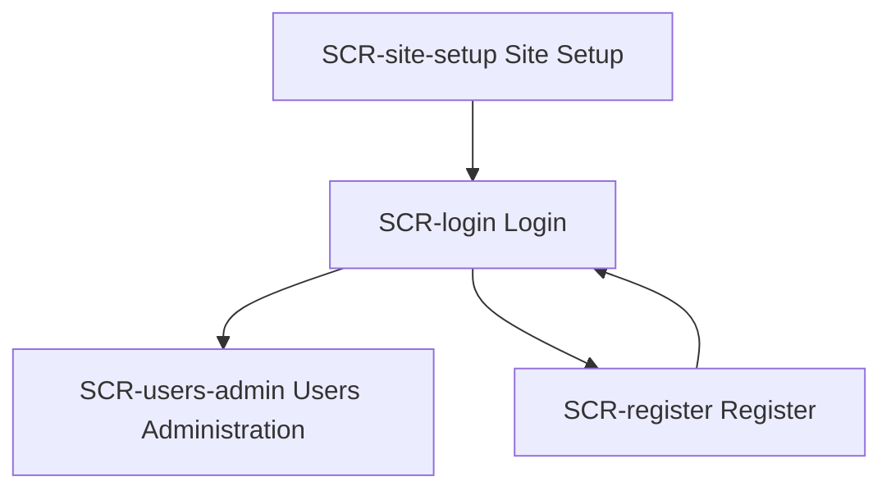
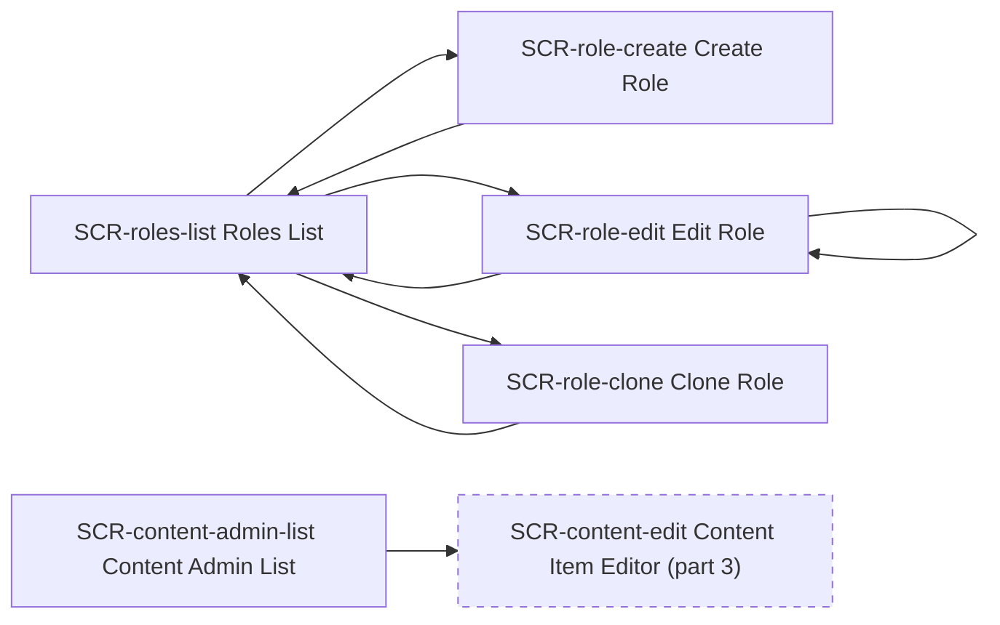
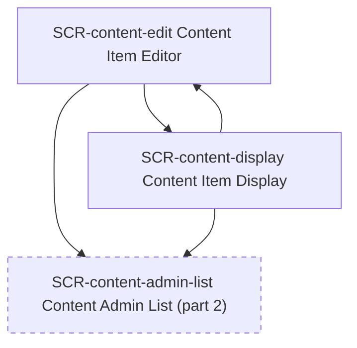
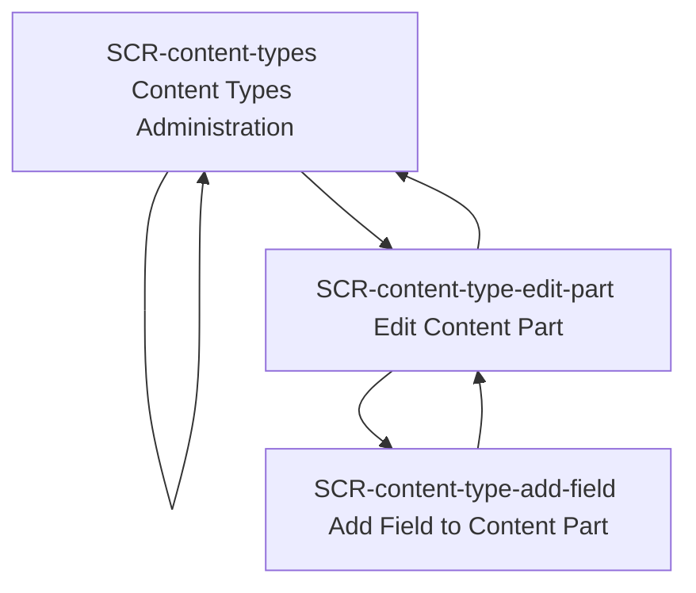
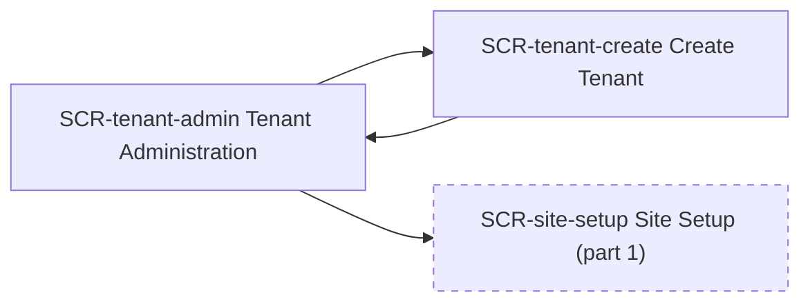

# Screens

The navigation map, in parts: an arrow points from a screen to one it opens; a dashed box is a screen drawn in another part.

### Navigation, part 1 of 5

### Navigation, part 2 of 5

### Navigation, part 3 of 5

### Navigation, part 4 of 5

### Navigation, part 5 of 5

No screen opens these, and they open none: SCR-features Features Administration, SCR-user-profile User Profile, SCR-deployment-plans Deployment Plans, SCR-queries-admin Queries Administration, SCR-security-settings Security Settings, SCR-content-version-pruning Content Version Pruning Settings, SCR-workflow-task-edit Workflow Task Design Views, SCR-media-s3-options Amazon S3 Media Options, SCR-sms-settings Settings — SMS.

## SCR-site-setup Site Setup

| name | control | required | validation | example | options |
|---|---|---|---|---|---|
| Site name | text | yes | None | TestSite |  |
| Recipe | dropdown | no | None | None | Blog, Headless, Agency, Blank |
| Database provider | dropdown | no | None | None | Sqlite, SqlConnection, Postgres, MySql |
| Admin user name | text | yes | None | admin |  |
| Admin email | email | yes | None | admin@test.com |  |
| Admin password | password | yes | None | None |  |
| Password confirmation | password | yes | None | None |  |
| Site time zone | dropdown | no | None | None | UTC, America/New_York, America/Chicago, America/Denver, America/Los_Angeles, Europe/London, Europe/Paris, Asia/Tokyo, Asia/Shanghai, Australia/Sydney |

| label | result | navigates_to |
|---|---|---|
| Set up | submit form; navigates to login on success | SCR-login |
| Show validation error | reveals site-setup--validation-error state | None |
| Show auto-setup success | reveals site-setup--autosetup-success state | None |

States: site-setup--autosetup-success: confirmation message with next-steps button, site-setup--validation-error: validation error panel

Stories: US-01a-01

## SCR-login Login

| name | control | required | validation | example | options |
|---|---|---|---|---|---|
| Username or email | text | yes | None | None |  |
| Password | password | yes | None | None |  |
| Remember me | checkbox | no | None | None |  |

| label | result | navigates_to |
|---|---|---|
| Sign in | authenticates user | SCR-users-admin |
| Create one | navigate to register | SCR-register |
| Google | redirect to Google OAuth consent screen | None |
| Microsoft | redirect to Microsoft Azure AD / Entra ID consent screen | None |

States: login--error-local-login-disabled: "Local login is disabled.", login--error-missing-username: "A user name is required.", login--error-missing-password: "A password is required.", login--error-invalid-credentials: "The specified username/password couple is invalid.", login--error-user-locked-out: "The user is locked out.", login--error-user-not-allowed: "The specified user is not allowed to sign in.", login--error-2fa-required: "The specified user is not allowed to sign in using password authentication."

Stories: US-02a-01

## SCR-register Register

| name | control | required | validation | example | options |
|---|---|---|---|---|---|
| Username | text | no | duplicate username, invalid username produce field-level error | johndoe |  |
| Email address | email | no | duplicate email, invalid email produce field-level error | john@example.com |  |
| Password | password | no | must meet password requirements | None |  |
| Password confirmation | password | no | must match password | None |  |
| Accept terms | checkbox | yes | must be checked to submit | None |  |

| label | result | navigates_to |
|---|---|---|
| Register | submit registration form | SCR-login |
| Login | navigate to login | SCR-login |

States: register--validation-error: "Please check your input • Username is already taken or invalid • Email address is already registered or invalid • Password does not meet requirements", register--email-verification-pending: "Please verify your email address before logging in. Check your inbox for a verification link."

Stories: US-02b-01, US-02b-02, US-02b-03

## SCR-users-admin Users Administration

| name | control | required | validation | example | options |
|---|---|---|---|---|---|
| Username | text | no | must be unique; must not contain invalid characters | None |  |
| Email | email | no | must be unique; must be valid format | None |  |
| Phone number | text | no | None | None |  |
| Password | password | no | None | None |  |
| Password confirmation | password | no | None | None |  |
| Status | dropdown | no | None | None | Enabled, Disabled |
| Roles: Administrator | checkbox | no | None | None |  |
| Roles: Editor | checkbox | no | None | None |  |
| Roles: Moderator | checkbox | no | None | None |  |
| Roles: Author | checkbox | no | None | None |  |

| label | result | navigates_to |
|---|---|---|
| Create user | opens create-user slide-in form; gated by authorization | None |
| Save (create/edit user) | saves user record | None |
| Cancel / close form | hides create-user form | None |
| ✎ Edit | opens edit-user slide-in form; requires authorization (AdminController.Edit) | None |
| 🔑 Password reset | sends password reset email to user | None |
| ✕ Disable | disables user; blocked if last enabled admin | None |
| ↻ Re-enable | changes user status from Disabled to Enabled | None |
| 🗑 Delete | permanently removes user account from system | None |

States: users-admin--create-form: slide-in form with all user fields plus validation errors panel, users-admin--form-validation-error: "Validation errors • Username is already taken • Username contains invalid characters • Email address is already registered • Email address is invalid", users-admin--last-admin-guard: "Cannot disable this user This is the last remaining enabled administrator account. At least one enabled administrator is required."

Stories: US-02c-01, US-02c-02

## SCR-roles-list Roles List

| label | result | navigates_to |
|---|---|---|
| Create role | navigate to create role | SCR-role-create |
| ✎ Edit | navigate to edit role | SCR-role-edit |
| ⎘ Clone | navigate to clone role (non-system roles) | SCR-role-clone |
| ✕ Delete | deletes role; blocked for system/admin roles | None |

States: roles-list--delete-blocked-state: "System roles cannot be deleted. ✕"

Stories: US-03a-01

## SCR-role-create Create Role

| name | control | required | validation | example | options |
|---|---|---|---|---|---|
| Role name | text | yes | must not contain /; must not duplicate existing role name | ContentReviewer |  |
| Description | text | no | None | Reviews content before publish |  |

| label | result | navigates_to |
|---|---|---|
| Save | creates role; navigates to roles list | SCR-roles-list |
| Cancel | navigate to roles list without saving | SCR-roles-list |

States: role-create--validation-error: "Validation error Role name must not contain / or duplicate an existing role."

Stories: US-03b-01

## SCR-role-edit Edit Role

| name | control | required | validation | example | options |
|---|---|---|---|---|---|
| Role name | hidden | no | None | Editor |  |
| Description | text | no | None | Can edit any content |  |
| View Content | checkbox | no | None | None |  |
| Edit Content | checkbox | no | None | None |  |
| Delete Content | checkbox | no | None | None |  |
| Publish Content | checkbox | no | None | None |  |
| Edit Content Types | checkbox | no | None | None |  |
| Manage Roles | checkbox | no | None | None |  |
| Manage Users | checkbox | no | None | None |  |
| Edit Users | checkbox | no | None | None |  |
| Delete Users | checkbox | no | None | None |  |
| Assign Role to Users | checkbox | no | None | None |  |
| Edit Users in Role | checkbox | no | None | None |  |
| Manage Users in Role | checkbox | no | None | None |  |
| Disable Two-Factor Authentication | checkbox | no | None | None |  |
| Import | checkbox | no | None | None |  |
| Execute Workflows | checkbox | no | None | None |  |
| Manage Workflows | checkbox | no | None | None |  |
| Manage Templates | checkbox | no | None | None |  |
| Manage Admin Templates | checkbox | no | None | None |  |
| Manage Shortcode Templates | checkbox | no | None | None |  |
| Manage Recipes | checkbox | no | None | None |  |

| label | result | navigates_to |
|---|---|---|
| Save permissions | persists permission selections to role (full replace); blocked for admin role | SCR-role-edit |
| Back to roles | navigate to roles list | SCR-roles-list |

States: role-edit--admin-role-state: "Admin role permissions are managed by the system Permission assignments for the admin role cannot be modified here.", role-edit--validation-error: "Validation error Unable to save role changes.", role-edit--duplicate-permission-alert: "Duplicate permissions detected Some permissions with the same name are defined by multiple features. These are flagged below."

Stories: US-03c-01

## SCR-role-clone Clone Role

| name | control | required | validation | example | options |
|---|---|---|---|---|---|
| New role name | text | yes | must not contain /; must not duplicate existing role name | EditorCopy |  |

| label | result | navigates_to |
|---|---|---|
| Save | clones role with its permissions under new name; navigates to roles list | SCR-roles-list |
| Cancel | navigate to roles list without saving | SCR-roles-list |

States: role-clone--validation-error: "Validation error Role name must not contain / or duplicate an existing role."

Stories: US-03b-02

## SCR-content-admin-list Content Admin List

| name | control | required | validation | example | options |
|---|---|---|---|---|---|
| Search | text | no | None | None |  |
| Content type | dropdown | no | None | None | (all), BlogPost, Page, Article, Video |
| Status | dropdown | no | None | None | (all), Published, Draft |
| Author | text | no | None | None |  |
| Select all items | checkbox | no | None | None |  |
| Select this item | checkbox | no | None | None |  |

| label | result | navigates_to |
|---|---|---|
| Create new | navigate to content item editor (new) | SCR-content-edit |
| Add to plan | bulk: adds selected content items to deployment plan; gated by authorization | None |
| Import | imports content items (ImportAsync) | None |
| ✎ Edit | navigate to content item editor | SCR-content-edit |
| Publish | PublishAsync — publishes selected/row content item | None |
| Unpublish | UnpublishAsync — unpublishes selected/row content item | None |
| Clone | CloneAsync — clones content item | None |
| Remove | RemoveAsync — clears Latest/Published flags without deleting | None |
| Restore | RestoreAsync — restores removed content item | None |

States: empty: "No items match your filter criteria Try adjusting your search or filter parameters"

Stories: US-04a-01, US-04a-02, US-04a-03, US-04a-04, US-04a-05, US-04a-06, US-04a-07, US-04a-08

## SCR-content-edit Content Item Editor

| name | control | required | validation | example | options |
|---|---|---|---|---|---|
| Title | text | yes | required; "A value is required for Title." | My First Blog Post |  |
| Body Text | textarea | no | None | None |  |
| Priority Level | number | no | min=1; max=10 | 5 |  |
| Featured | checkbox | no | None | None |  |
| Publication Date | date | no | None | 2025-08-15 |  |
| Related Link | url | no | None | None |  |
| Custom HTML | textarea | no | None | 
Formatted content
 |  |
| Tags / Categories | chip input | no | leaf terms only; multiple selections allowed | Technology, Web Development, Best Practices |  |
| Notes (Markdown) | textarea | no | None | ## Editorial Notes - Added by Sarah Chen - Last updated: Aug 15, 2025 |  |
| Featured Image | media picker | no | None | article-cover.jpg 1200×630 |  |
| Related Content | content picker | no | None | Getting Started with Web APIs, Advanced CSS Techniques |  |

| label | result | navigates_to |
|---|---|---|
| Cancel | navigate to content admin list without saving | SCR-content-admin-list |
| Preview | navigate to content display | SCR-content-display |
| Change image | opens media picker | None |
| ✕ Remove image/item | removes media picker item or related content item | None |
| Browse content | opens modal to search and select related content items | None |
| Save draft | saves draft version | None |
| Publish | publishes content item | None |
| Unpublish | unpublishes content item (sets to draft) | None |
| Discard draft | discards draft; navigate to content admin list | SCR-content-admin-list |

States: content-edit--validation-error: "Validation errors A value is required for Title.", content-edit--not-found: "Content not found The requested content item does not exist.", content-edit--unauthorized: "Access denied You do not have permission to edit this content item.", content-edit--draft-state: "Draft Not yet published", content-edit--published-state: "Published Live", taxonomy-field-edit: taxonomy terms multi-select with Required/Unique/LeavesOnly/Hint/Tag-mode states

Stories: US-04b-01, US-04b-02, US-04b-03

## SCR-content-display Content Item Display

| label | result | navigates_to |
|---|---|---|
| Edit | navigate to content item editor | SCR-content-edit |
| Back to list | navigate to content admin list | SCR-content-admin-list |

Stories: US-04d-01

## SCR-content-types Content Types Administration

| name | control | required | validation | example | options |
|---|---|---|---|---|---|
| Display Name | text | no | max 1024 characters; not null/empty | Blog Post |  |
| Technical Name | text | no | must start with ASCII letter; normalized via ToSafeName(); must be unique | BlogPost |  |
| Creatable | checkbox | no | None | None |  |
| Listable | checkbox | no | None | None |  |
| Draftable | checkbox | no | None | None |  |
| Versionable | checkbox | no | None | None |  |
| Securable | checkbox | no | None | None |  |

| label | result | navigates_to |
|---|---|---|
| Create content type | shows inline create form | None |
| Save (create) | creates content type | SCR-content-types |
| Cancel (create) | hides create form | None |
| Edit (per row) | shows inline edit form for that type | None |
| Save (edit) | saves content type changes | SCR-content-types |
| Edit parts (per row) | navigate to edit content part | SCR-content-type-edit-part |

States: content-types--create-form: "Create New Content Type ✕ Display Name Technical Name Creatable Listable Draftable Versionable Securable Cancel Create content type", content-types--edit-form-blog: inline edit form for Blog Post, content-types--edit-form-page: inline edit form for Page, content-types--edit-form-article: inline edit form for Article, content-types--edit-form-video: inline edit form for Video, content-types--edit-form-testimonial: inline edit form for Testimonial, content-types--edit-form-event: inline edit form for Event

Stories: US-05a-01, US-05a-02

## SCR-content-type-edit-part Edit Content Part

| name | control | required | validation | example | options |
|---|---|---|---|---|---|
| OrderedFieldNames | hidden | no | None | None |  |
| Position | hidden | no | 0-based integer per field; drag-sortable | Title=0, Description=1, Tags=2, Author=3, PublishDate=4, Featured=5, RelatedContent=6, Summary=7 |  |

| label | result | navigates_to |
|---|---|---|
| Add field | navigate to add field screen | SCR-content-type-add-field |
| Edit (per field row) | opens field configuration editor; available only when field type is in registered ContentFieldOptions; not available for CustomBooleanField (Featured) | None |
| Remove (per field row) | deletes field from content part definition; disabled with tooltip for system-defined fields | None |
| Save | saves field order and changes; navigate to content types | SCR-content-types |
| Cancel | navigate to content types without saving | SCR-content-types |
| Delete part | shows confirmation modal | None |
| Confirm delete | deletes content part; navigate to content types | SCR-content-types |
| Cancel (modal) | hides confirmation modal | None |

States: content-type-edit-part--confirm-delete-part: "Delete Part Are you sure you want to delete this content part? This action cannot be undone. Confirm delete Cancel"

Stories: US-05b-01, US-05b-02, US-05b-05, US-05b-06

## SCR-content-type-add-field Add Field to Content Part

| name | control | required | validation | example | options |
|---|---|---|---|---|---|
| Field type | dropdown | yes | None | None | Text, Numeric, Boolean, Date, Link, Html, Markdown, Content Picker, Media |
| Field name (display name) | text | yes | None | Author Name |  |

| label | result | navigates_to |
|---|---|---|
| Add field | creates field on content part; navigate to edit content part | SCR-content-type-edit-part |
| Cancel | navigate to edit content part without saving | SCR-content-type-edit-part |

Stories: US-05b-04

## SCR-tenant-admin Tenant Administration

| label | result | navigates_to |
|---|---|---|
| Create tenant | navigate to create tenant | SCR-tenant-create |
| Edit (Running tenant) | opens tenant edit form with fields: Name, Description, RequestUrlPrefix, RecipeName, DatabaseProvider, TablePrefix | None |
| Setup (Uninitialized tenant) | navigate to site setup for that tenant | SCR-site-setup |

Stories: US-01b-01

## SCR-tenant-create Create Tenant

| name | control | required | validation | example | options |
|---|---|---|---|---|---|
| Tenant name | text | yes | letters only, no spaces; must be unique; root tenant must be Default | MyTenant |  |
| Description | text | no | None | Secondary site |  |
| Request URL prefix | text | no | None | mytenant |  |
| Recipe | dropdown | yes | None | None | Blog, Headless, Agency, Blank |
| Database provider | dropdown | no | None | None | Sqlite, SqlConnection, Postgres, MySql |
| Table prefix | text | no | None | None |  |

| label | result | navigates_to |
|---|---|---|
| Create | creates tenant; navigate to tenant admin | SCR-tenant-admin |
| Cancel | navigate to tenant admin without saving | SCR-tenant-admin |

States: tenant-create--validation-error: "Validation error The single 'Default' tenant should be provided."

Stories: US-01b-02

## SCR-features Features Administration

| name | control | required | validation | example | options |
|---|---|---|---|---|---|
| Search / filter | text | no | None | None |  |
| Category filter | dropdown | no | None | None | All, Infrastructure, Content Management |

| label | result | navigates_to |
|---|---|---|
| Enable | enables feature; enables dependencies when force=true | None |
| Enable+ | enables feature and all its dependencies | None |
| Disable | disables feature; blocks if dependent features are enabled and force=false | None |
| Disable+ | disables feature and all dependent features | None |

States: features--success-enable: "Features enabled successfully: Features, OrchardCore.Resources", features--success-disable: "Features disabled successfully: OrchardCore.Dependencies, OrchardCore.Contents"

Stories: US-07a-01, US-07a-02, US-07a-03

## SCR-user-profile User Profile

| name | control | required | validation | example | options |
|---|---|---|---|---|---|
| Username | text | no | valid username format | johndoe |  |
| Email | email | no | valid email format | john@example.com |  |
| Time zone | dropdown | no | None | None | UTC, UTC-5 (EST), UTC-6 (CST), UTC-7 (MST), UTC-8 (PST), UTC+1 (CET), UTC+8 (CST), UTC+9 (JST) |
| Profile fields | text | no | None | None |  |

| label | result | navigates_to |
|---|---|---|
| Save | saves profile changes | None |

States: user-profile--validation-error: "Invalid username or email format. Please check your entries."

Stories: US-02e-01, US-02e-02

## SCR-deployment-plans Deployment Plans

| name | control | required | validation | example | options |
|---|---|---|---|---|---|
| Plan Name | text | no | None | None |  |
| Description | text | no | None | None |  |
| Package file (import) | file | no | None | None |  |
| Plan Name (import, optional) | text | no | None | None |  |
| Step Type | dropdown | no | None | None | ContentDefinitionDeploymentStep, DeleteContentDefinitionDeploymentStep, ContentItemDeploymentStep, AllContentDeploymentStep, QueryBasedContentDeploymentStep, AllQueriesDeploymentStep, ExportContentToDeploymentTargetDeploymentStep, AllRolesDeploymentStep |
| Configuration (JSON) | textarea | no | None | None |  |

| label | result | navigates_to |
|---|---|---|
| Create plan | saves new deployment plan; hides create form | None |
| Import | imports deployment package; gated by Import permission | None |
| Add step | adds step to deployment plan | None |
| Export | downloads plan as JSON/ZIP package; gated by Export permission | None |
| Remove | deletes deployment plan from system | None |

States: deployment-plans--create-plan-form: Create deployment plan form, deployment-plans--import-form: Import deployment package form, deployment-plans--add-step-form-N: Add deployment step form for plan N (1–7), content-definition-deployment-step-editor: Content type selector + Content parts multi-select; validates part belongs to selected type

Stories: US-08a-01, US-08a-02, US-08a-03, US-08a-04, US-08a-05, US-08a-06

## SCR-queries-admin Queries Administration

| name | control | required | validation | example | options |
|---|---|---|---|---|---|
| Query name | dropdown | no | None | None | RecentBlogPosts, ActiveUsers, ArchiveContent, ContentByStatus, PublishedArticles, WidgetInventory |
| Parameters | textarea | no | None | { "limit": 10 } |  |

| label | result | navigates_to |
|---|---|---|
| Create query | opens form to name and configure a new query | None |
| Execute query | resolves named query via IQueryManager → executes → shows results below table | None |
| Edit (per row) | opens query configuration editor | None |
| Run (per row) | executes query and shows results | None |
| Delete (per row) | removes query from system | None |

Stories: US-09a-01

## SCR-security-settings Security Settings

| name | control | required | validation | example | options |
|---|---|---|---|---|---|
| Admin role name | text | no | None | Administrator |  |
| Enable self-service registration | checkbox | no | None | None |  |
| Require email verification | checkbox | no | None | None |  |
| Require administrator approval | checkbox | no | None | None |  |
| Render registration with site theme | checkbox | no | None | None |  |
| Disable new external registrations | checkbox | no | None | None |  |
| Disable local login | checkbox | no | None | None |  |
| Require two-factor authentication | checkbox | no | None | None |  |
| Microsoft / Azure AD | checkbox | no | None | None |  |
| Facebook | checkbox | no | None | None |  |
| Twitter / X | checkbox | no | None | None |  |
| GitHub | checkbox | no | None | None |  |
| Google | checkbox | no | None | None |  |
| OpenID Connect | checkbox | no | None | None |  |
| Content-Security-Policy header | textarea | no | None | None |  |
| Referrer-Policy header | dropdown | no | None | None | no-referrer, no-referrer-when-downgrade, same-origin, origin, strict-origin, origin-when-cross-origin, strict-origin-when-cross-origin, unsafe-url |
| Permissions-Policy header | textarea | no | None | None |  |
| Background service PollingTime | text | no | None | 00:01:00 |  |
| Background service MinimumIdleTime | text | no | None | 00:00:10 |  |

| label | result | navigates_to |
|---|---|---|
| Save | persists security settings; initiates configuration reload | None |

States: security-settings--settings-saved: "Security settings saved successfully. Configuration reload initiated."

Stories: US-03c-03

## SCR-content-version-pruning Content Version Pruning Settings

| name | control | required | validation | example | options |
|---|---|---|---|---|---|
| RetentionDays | number | no | minimum 0 | None |  |
| VersionsToKeep | number | no | minimum 0 | None |  |

| label | result | navigates_to |
|---|---|---|
| Save | persists version pruning settings | None |

States: no-content-type-selected: "when no content type is selected, nothing is pruned"

Stories: US-05c-01

## SCR-workflow-task-edit Workflow Task Design Views

| name | control | required | validation | example | options |
|---|---|---|---|---|---|
| Content expression | text | no | None | None |  |
| Publish on create | checkbox | no | None | None |  |

| label | result | navigates_to |
|---|---|---|
| Save task configuration | persists workflow task settings | None |

States: publish-on-create-checked: publishes item immediately on task execution, content-expression-empty: uses default content, content-expression-set: evaluates expression

Stories: US-11a-01

## SCR-media-s3-options Amazon S3 Media Options

| name | control | required | validation | example | options |
|---|---|---|---|---|---|
| Amazon S3 configuration options | text | no | None | None |  |

| label | result | navigates_to |
|---|---|---|
| Save | persists Amazon S3 media storage options | None |

Stories: US-06a-01, US-06a-02

## SCR-sms-settings Settings — SMS

| name | control | required | validation | example | options |
|---|---|---|---|---|---|
| Azure Communication Services SMS configuration | text | no | None | None |  |

| label | result | navigates_to |
|---|---|---|
| Save | persists SMS settings; gated by ManageSmsSettings permission | None |

Stories: US-39a-02

