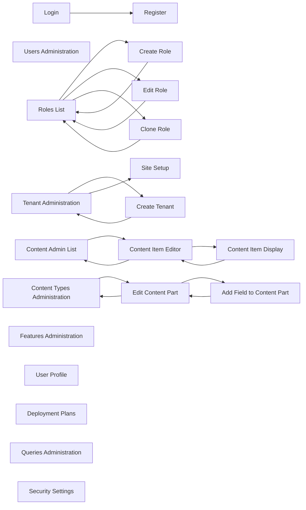

# UX

The prototype has 21 screens and 23 navigation edges. The entry screen is **Site Setup** (`site-setup`), which is the first page of the prototype; once setup is complete the user proceeds to **Login** (`login`). Screens that have no incoming edges from within the navigation graph — `features`, `user-profile`, `deployment-plans`, `queries-admin`, and `security-settings` — are reached via the shell navigation sidebar.

## Navigation map

## Journeys

### Administrator

The Administrator has full access to all screens. Starting from the entry screen after login:

1. **Site Setup** — fill in site name, recipe, database, admin credentials, timezone → click **Set up** → proceeds to Login
2. **Login** — enter username/password → click **Sign in** → arrives at Users Administration
3. **Users Administration** — click **Create user** (slide-in form) → fill fields → **Save** (stays on screen)
4. **Users Administration** → navigate via sidebar to **Roles List**
5. **Roles List** — click **Create role** → **Create Role**
6. **Create Role** — fill role name, description → **Save** → back to **Roles List**; or click **Cancel** → **Roles List**
7. **Roles List** — click ✎ → **Edit Role** — assign permissions → **Save permissions** → stays on **Edit Role**; click **Back to roles** → **Roles List**
8. **Roles List** — click ⎘ → **Clone Role** — enter new role name → **Save** → **Roles List**; or **Cancel** → **Roles List**
9. Navigate via sidebar to **Content Admin List** — click **Create new** or ✎ → **Content Item Editor**
10. **Content Item Editor** — fill fields → **Preview** → **Content Item Display** → click **Edit** → back to **Content Item Editor**
11. **Content Item Editor** → **Discard draft** or **Cancel** → **Content Admin List**
12. Navigate via sidebar to **Content Types Administration** — click **Save** → stays on **Content Types Administration**; click **Edit parts** → **Edit Content Part**
13. **Edit Content Part** — click **Add field** → **Add Field to Content Part** → **Cancel** → **Edit Content Part**
14. **Edit Content Part** → **Save** or **Cancel** or **Confirm delete** → **Content Types Administration**
15. Navigate via sidebar to **Tenant Administration** — click **Create tenant** → **Create Tenant** → **Cancel** → **Tenant Administration**
16. **Tenant Administration** — click **Setup** (uninitialized tenant) → **Site Setup**
17. Navigate via sidebar to **Features Administration** (no outgoing edges)
18. Navigate via sidebar to **User Profile** (no outgoing edges)
19. Navigate via sidebar to **Deployment Plans** (no outgoing edges)
20. Navigate via sidebar to **Queries Administration** (no outgoing edges)
21. Navigate via sidebar to **Security Settings** (no outgoing edges)

### Editor

1. **Login** → **Sign in** → **Users Administration** (landing after auth)
2. Navigate via sidebar to **Content Admin List** — click ✎ → **Content Item Editor**
3. **Content Item Editor** — edit and publish → **Preview** → **Content Item Display** → **Edit** → **Content Item Editor**
4. **Content Item Editor** → **Cancel** → **Content Admin List**

### Moderator

1. **Login** → **Sign in** → landing screen
2. Navigate via sidebar to **Content Admin List** — click ✎ → **Content Item Editor**
3. **Content Item Editor** — view/edit → **Preview** → **Content Item Display** → **Edit** → **Content Item Editor**
4. **Content Item Editor** → **Cancel** → **Content Admin List**

### Author

1. **Login** → **Sign in** → landing screen
2. Navigate via sidebar to **Content Admin List** — click **Create new** → **Content Item Editor**
3. **Content Item Editor** — create/edit → **Preview** → **Content Item Display** → **Edit** → **Content Item Editor**
4. **Content Item Editor** → **Cancel** → **Content Admin List**

### Contributor

1. **Login** → **Sign in** → landing screen
2. Navigate via sidebar to **Content Admin List** — click **Create new** → **Content Item Editor**
3. **Content Item Editor** — create draft → **Save draft** (stays on screen)
4. **Content Item Editor** → **Cancel** → **Content Admin List**

### Anonymous

1. **Site Setup** (first-time install) — fill setup form → **Set up**
2. **Login** — click **Create one** → **Register**
3. **Register** — fill registration form → **Register** → **Login**

### Authenticated

1. **Login** → **Sign in** → landing screen
2. Navigate to **User Profile** → **Save** (stays on screen)

## Interaction patterns

### Forms

- **Required marking**: fields marked required use `--color-required` (`#fff3b0`) highlight; seen on Role name (SCR-role-create), New role name (SCR-role-clone), Title (SCR-content-edit), Tenant name and Recipe (SCR-tenant-create), Field type and Field name (SCR-content-type-add-field).
- **Validation timing**: validation errors are revealed on submit; displayed as an error panel above or below the form.
- **Slide-in forms**: SCR-users-admin opens a slide-in panel for create/edit user; closed with Cancel/close.
- **Inline forms**: SCR-content-types shows inline create and edit rows on the same page.
- **Confirmation modals**: SCR-content-type-edit-part shows a modal dialog to confirm part deletion before executing the destructive action.

### Confirmation dialogs

- **General rule**: every delete confirmation dialog shall name the specific item being deleted (e.g. its title or identifier) so the user can verify the correct item before confirming.
- **Delete Content Part** (SCR-content-type-edit-part): modal with "Delete Part — Are you sure you want to delete this content part? This action cannot be undone." with **Confirm delete** and **Cancel** buttons.

### Navigation controls

- **Top header navigation**: links for Security, Content, Tenants, Configuration, Account — present on all authenticated screens.
- **Tab links**: active tab styled with `#0F62FE` colour and `font-weight: 500` (e.g., Users / Roles tabs within Security section).
- **Back links**: "Back to roles" on SCR-role-edit; "Back to list" on SCR-content-display.
- **Cancel buttons**: present on SCR-role-create, SCR-role-clone, SCR-content-edit, SCR-content-type-edit-part, SCR-content-type-add-field, SCR-tenant-create.
- **Breadcrumb trail**: every administration page shall display a breadcrumb trail showing the user's current location within the admin hierarchy, enabling one-click navigation to any ancestor level.

## States

| Screen | State | What changes |
|--------|-------|--------------|
| SCR-site-setup | site-setup--autosetup-success | Confirmation message with next-steps button shown |
| SCR-site-setup | site-setup--validation-error | Validation error panel revealed |
| SCR-login | login--error-local-login-disabled | Error message: "Local login is disabled." |
| SCR-login | login--error-missing-username | Error message: "A user name is required." |
| SCR-login | login--error-missing-password | Error message: "A password is required." |
| SCR-login | login--error-invalid-credentials | Error message: "The specified username/password couple is invalid." |
| SCR-login | login--error-user-locked-out | Error message: "The user is locked out." |
| SCR-login | login--error-user-not-allowed | Error message: "The specified user is not allowed to sign in." |
| SCR-login | login--error-2fa-required | Error message: "The specified user is not allowed to sign in using password authentication." |
| SCR-register | register--validation-error | Error panel shown with field-level messages |
| SCR-register | register--email-verification-pending | Notice: "Please verify your email address before logging in." |
| SCR-users-admin | users-admin--create-form | Slide-in form with all user fields and validation errors panel shown |
| SCR-users-admin | users-admin--form-validation-error | Validation errors panel in slide-in form shown |
| SCR-users-admin | users-admin--last-admin-guard | Block message: cannot disable last enabled admin |
| SCR-roles-list | roles-list--delete-blocked-state | Block message: "System roles cannot be deleted." |
| SCR-role-create | role-create--validation-error | Error panel: "Validation error Role name must not contain / or duplicate an existing role." |
| SCR-role-edit | role-edit--admin-role-state | Notice: admin role permissions managed by system; inputs locked |
| SCR-role-edit | role-edit--validation-error | Error panel: "Validation error Unable to save role changes." |
| SCR-role-edit | role-edit--duplicate-permission-alert | Alert: "Duplicate permissions detected" with flagged items |
| SCR-role-clone | role-clone--validation-error | Error panel: "Validation error Role name must not contain / or duplicate an existing role." |
| SCR-content-admin-list | empty | Empty state: "No items match your filter criteria" |
| SCR-content-edit | content-edit--validation-error | Error panel: "Validation errors A value is required for Title." |
| SCR-content-edit | content-edit--not-found | Error: "Content not found The requested content item does not exist." |
| SCR-content-edit | content-edit--unauthorized | Error: "Access denied You do not have permission to edit this content item." |
| SCR-content-edit | content-edit--draft-state | Status badge: "Draft Not yet published" |
| SCR-content-edit | content-edit--published-state | Status badge: "Published Live" |
| SCR-content-edit | taxonomy-field-edit | Taxonomy terms multi-select with Required/Unique/LeavesOnly/Hint/Tag-mode states |
| SCR-content-types | content-types--create-form | Inline create form shown with Display Name, Technical Name and option checkboxes |
| SCR-content-types | content-types--edit-form-blog | Inline edit form for Blog Post shown |
| SCR-content-types | content-types--edit-form-page | Inline edit form for Page shown |
| SCR-content-types | content-types--edit-form-article | Inline edit form for Article shown |
| SCR-content-types | content-types--edit-form-video | Inline edit form for Video shown |
| SCR-content-types | content-types--edit-form-testimonial | Inline edit form for Testimonial shown |
| SCR-content-types | content-types--edit-form-event | Inline edit form for Event shown |
| SCR-content-type-edit-part | content-type-edit-part--confirm-delete-part | Confirmation modal shown: "Delete Part — Are you sure?" |
| SCR-tenant-create | tenant-create--validation-error | Error panel: "Validation error The single 'Default' tenant should be provided." |
| SCR-features | features--success-enable | Success banner: "Features enabled successfully: Features, OrchardCore.Resources" |
| SCR-features | features--success-disable | Success banner: "Features disabled successfully: OrchardCore.Dependencies, OrchardCore.Contents" |
| SCR-user-profile | user-profile--validation-error | Error: "Invalid username or email format. Please check your entries." |
| SCR-deployment-plans | deployment-plans--create-plan-form | Create deployment plan form shown |
| SCR-deployment-plans | deployment-plans--import-form | Import deployment package form shown |
| SCR-deployment-plans | deployment-plans--add-step-form-N | Add deployment step form for plan N shown |
| SCR-deployment-plans | content-definition-deployment-step-editor | Content type selector and Content parts multi-select shown |
| SCR-security-settings | security-settings--settings-saved | Success message: "Security settings saved successfully. Configuration reload initiated." |

## Messages

| Screen | Field | Message |
|--------|-------|---------|
| SCR-site-setup | form | Validation error panel |
| SCR-login | form | "Local login is disabled." |
| SCR-login | form | "A user name is required." |
| SCR-login | form | "A password is required." |
| SCR-login | form | "The specified username/password couple is invalid." |
| SCR-login | form | "The user is locked out." |
| SCR-login | form | "The specified user is not allowed to sign in." |
| SCR-login | form | "The specified user is not allowed to sign in using password authentication." |
| SCR-register | Username | "Username is already taken or invalid" |
| SCR-register | Email address | "Email address is already registered or invalid" |
| SCR-register | Password | "Password does not meet requirements" |
| SCR-register | form | "Please check your input" (summary header) |
| SCR-register | form | "Please verify your email address before logging in. Check your inbox for a verification link." |
| SCR-users-admin | Username | "Username is already taken" |
| SCR-users-admin | Username | "Username contains invalid characters" |
| SCR-users-admin | Email | "Email address is already registered" |
| SCR-users-admin | Email | "Email address is invalid" |
| SCR-users-admin | form | "Cannot disable this user This is the last remaining enabled administrator account. At least one enabled administrator is required." |
| SCR-roles-list | row action | "System roles cannot be deleted." |
| SCR-role-create | Role name | "Validation error Role name must not contain / or duplicate an existing role." |
| SCR-role-edit | form | "Admin role permissions are managed by the system Permission assignments for the admin role cannot be modified here." |
| SCR-role-edit | form | "Validation error Unable to save role changes." |
| SCR-role-edit | permissions | "Duplicate permissions detected Some permissions with the same name are defined by multiple features. These are flagged below." |
| SCR-role-clone | New role name | "Validation error Role name must not contain / or duplicate an existing role." |
| SCR-content-edit | Title | "A value is required for Title." |
| SCR-content-edit | form | "Content not found The requested content item does not exist." |
| SCR-content-edit | form | "Access denied You do not have permission to edit this content item." |
| SCR-content-types | Technical Name | "must start with ASCII letter; must be unique" |
| SCR-content-types | Display Name | "max 1024 characters; not null/empty" |
| SCR-tenant-create | Tenant name | "Validation error The single 'Default' tenant should be provided." |
| SCR-features | system | "Features enabled successfully: Features, OrchardCore.Resources" |
| SCR-features | system | "Features disabled successfully: OrchardCore.Dependencies, OrchardCore.Contents" |
| SCR-user-profile | form | "Invalid username or email format. Please check your entries." |
| SCR-security-settings | system | "Security settings saved successfully. Configuration reload initiated." |
