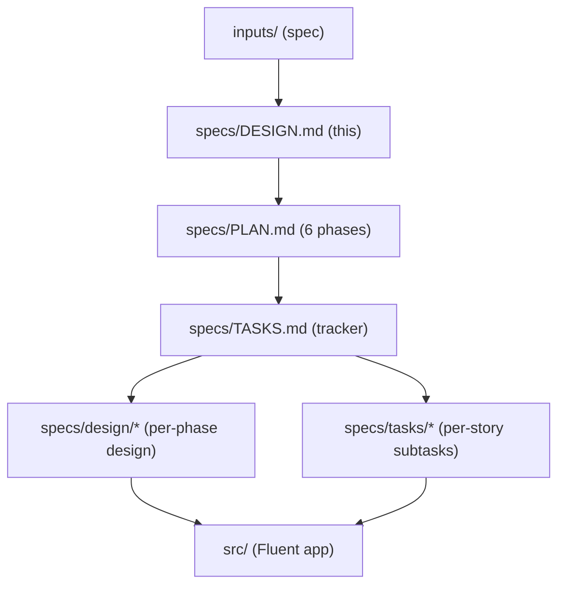

# DESIGN — Orchard Core CMS on ServiceNow

Top-level solution design. **Read this first**, then `specs/PLAN.md` (phased how/when), then `specs/TASKS.md` (granular execution). Detailed design lives in `specs/design/`.

Inputs (the original spec package) live in `inputs/`. This folder (`specs/`) is everything generated for the ServiceNow build.

---

## 1. What we are building

A ServiceNow Fluent (Now SDK) application that realizes the product described in `inputs/` — **Orchard Core CMS — CodeForensics v1.1.4**: a modular, multi-tenant content management system (users, roles, content items, content types, publishing lifecycle, tenants, features, queries, APIs, search, media, notifications).

The `inputs/` specs describe the original system as **ASP.NET Core / C# / YesSql**. We do **not** build .NET. The inputs are the source of truth for *requirements, data shapes, behavior, and acceptance criteria*, translated onto ServiceNow primitives.

## 2. Design philosophy — configure OOTB, build only the content domain

Most of what the spec calls "the platform" is **ServiceNow's platform**. We reuse it instead of rebuilding it, and spend custom effort only on the differentiated content domain.

| Concern | Approach |
|---|---|
| Users, auth, SSO/OIDC, MFA, lockout, password reset | **OOTB** (`sys_user`, Multi-Provider SSO, MFA) |
| Roles & permissions | **OOTB** roles + **ACLs** |
| Migrations, deployment | **Now SDK** + Update Sets / App Repo |
| Search, media, email/SMS, audit, background | **AI Search**, **Attachments**, **Notifications**, OOTB audit, **Scheduled Jobs** |
| **Content items, content types/fields, publish lifecycle, pruning** | **Custom build** (the product) |
| Content REST API + authoring UI | **Custom** (Scripted REST + UI Builder) |

## 3. Target ServiceNow architecture (summary)

- **Roles** (`cms_admin` … `cms_reader`) with `cms_admin` containing the rest — maps spec personas/built-in roles.
- **Tables** (scope `x_1863391_now_app`): `content_type`, `content_field`, `content_item`, `content_item_version`, `content_version_pruning`, `tenant`, `feature`, `query`.
- **Logic**: a shared `ContentLifecycle` Script Include + Flows + Business Rules/Data Policies for the Draft→Published→Removed lifecycle and validation.
- **APIs**: scoped Scripted REST exposing the `inputs/api.md` `/v1/*` contracts (GraphQL/XML-RPC deferred).
- **UI**: OOTB list/form views + a UI Builder content editor; Horizon design tokens, WCAG 2.1 AA.
- **Quality**: ATF suites where each story's Gherkin = its acceptance.

## 4. Ratified decisions (D1–D5)

See `specs/design/phase-0-decisions.md`. Summary: logical `tenant` table (not Domain Separation); dedicated `content_item_version` table; content types modeled as **data** (never generated tables); GraphQL/XML-RPC deferred; thin custom `query` table.

## 5. Detailed design index (`specs/design/`)

| Doc | Scope |
|---|---|
| `phase-0-decisions.md` | Ratified decisions D1–D5 |
| `phase-1-identity-access.md` | Roles, ACL matrix, security-settings properties, guards |
| `phase-2-content-data-model.md` | Content-domain tables, choices, ACLs, audit |
| `phase-3-content-lifecycle.md` | State machine, transitions, validation, pruning |
| `phase-4-apis-integrations.md` | Scripted REST, AI Search, Attachments, Notifications |
| `phase-5-admin-ui.md` | OOTB views + custom content editor, theming, a11y |
| `phase-6-quality-nfrs.md` | ATF, security, performance, observability, backup |
| `coverage-matrix.md` | All 281 stories → disposition → owning task → dependencies |

## 6. Companion documents

- `specs/PLAN.md` — phased strategy and build-order alignment.
- `specs/TASKS.md` — ordered execution tracker (phase-level).
- `specs/tasks/phase-N.md` — per-story ServiceNow subtasks for each phase.
- `CLAUDE.md` — global working rules and repository layout.
